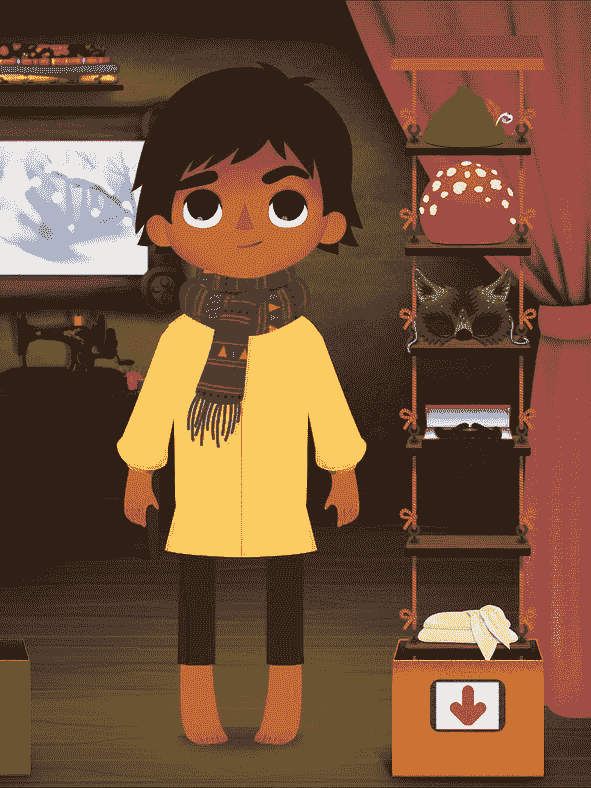

# 2. 开始之前，先了解行业

了解市场上的情况及其运作方式。

在本章中，我们将审视儿童应用的格局。我们将尝试保持一个广阔的视角，以掌握你在开始构思产品之前应该具备的基本常识。

为什么这很重要？嗯，了解我们要开发产品的市场总是至关重要的，但在这里我认为它尤其重要，因为虽然作为成年人，我们经常使用各种产品——用于生产力、娱乐、通讯、健康等等——但我们并不习惯在日常工作中使用儿童产品。因此，尽管我们因为从用户角度了解音乐流媒体应用的工作原理，而对它有所认识，但我们对儿童视频流媒体应用却知之甚少，因为我们不是这类应用的目标用户。显然，对于任何类型的数字产品，除了用户体验之外，还有很多需要了解的东西，但没有亲身实践又增加了另一层复杂性。父母在这方面可能有优势，但要对这类数字产品培养出更批判性的眼光，需要付出一些努力和分析技巧，因为，再说一次，它们不是为成年人设计的。

我们还会看看教育和娱乐之间的区别，并考察各种类型的儿童产品及其特性。最后，我会与你分享一些关于在哪里为你的产品寻找创意和灵感的技巧。

## 娱乐、教育、寓教于乐

> *大家都喜欢《天龙特攻队》，因为它就是纯粹的娱乐。*
> 
> ——演员 Mr. T

应用可以归入许多类别。只需快速浏览一下 App Store 或 Google Play Store，就能找到用于生产力、社交网络、流媒体音乐和视频、即时通讯、健身、游戏、新闻、旅行、烹饪等等的应用。这些应用是为成年人设计的，对它们进行分类是理解市面上海量产品的一种有效方式。儿童应用是这些类别之一，但它们经常融合在游戏和教育之间。

许多游戏，当它们遵循一系列规则和限制（我们将在后面的章节中了解是哪些）时，即使最初是为成年人设计的，也可以被归类为儿童产品。

我们今天在 App Store 或 Google Play Store 中仍然面临的最大问题之一是，儿童应用都被归在同一把大伞下。有时会有一些合集，比如“学龄前儿童理想选择”或“3 到 5 岁儿童应用”等等，但点进去一看，你会发现情况绝对混乱。教拼写的应用与视频应用、游戏以及其他各种应用混杂在一起。当然，这些都是儿童产品，但它们的目的各不相同！

你能想象找一个天气应用，然后在你选择的 App Store 上只能看到一个巨大的“成人应用”类别，所有东西——Spotify、Airbnb、Netflix、Microsoft Excel、Google Maps——都塞在里面吗？那该有多疯狂？是的，儿童应用的数量远少于成人应用，但这仍然是一个相当大的数字。

尽管儿童应用本身就是一个类别（有时更像一个标签），但我们仍可以识别出商店似乎忽视的子类别。存在与年龄段相关的细分，然后我们还可以根据应用的目的定义另一种细分。我们稍后会讨论年龄段，而本节我们将关注儿童应用可能具备的目的。

你的应用可能属于两大主要类别——娱乐和教育——以及第三类，即两者的结合，称为寓教于乐（英文是 educational 和 entertainment 的组合词）。

游戏、音乐、视频、舞蹈、卡拉 OK 以及所有此类事物，其主要目的是娱乐用户。而计数、拼写、阅读、编程（是的，编程）等等则是教育性的。

教育应用的质量问题（我们在第 1 章中简要提到过）非常重要，因为虚假声明和缺乏监管会带来后果——主要有两个：

1. 无法提供良好的体验，甚至在最坏的情况下可能对儿童造成伤害。

2. 这会损害家长购买这些产品的信心。如果他们没有办法判断哪个应用是真正具有教育意义的，哪个应用是真正旨在帮助孩子发展的，他们最终下载到的可能就是名不副实的东西；这可能会给整个儿童应用市场蒙上阴影，家长会完全失去对它的信任。

第三类，寓教于乐，是儿童产品最受追捧的解决方案。在保持高度兴趣而不陷入无聊的状态下向儿童传授知识，这可能是每位教育工作者（和父母）的梦想。尝试加入游戏和趣味元素并非新策略，这种做法已经持续多年，在数字时代之前，学校和各种儿童产品（例如棋盘游戏）中就已存在。即使不是父母或看护人，你也能明白，如果不加入一些趣味性，学龄前儿童可能不会觉得数数很有趣。

# 事实上，以学习为目的的游戏化设计在面向成年人的应用中也十分常见。

以 *Duolingo* 为例，其中诸如徽章和成就等功能，旨在为完成系列活动时增添挑战感和奖励机制。实际上，我们也在与教育无关的应用中运用了这一技巧，例如 `Apple Watch` 上的健康应用。每天你需要闭合三个圆环，而仅凭圆环逐渐闭合的进度本身就能产生强大的激励效果；当你连续多日完成时，还会获得一枚特殊徽章作为奖励。我们将在第 5 章进一步探讨游戏化设计。

即便是偏向娱乐性的应用，例如 `YouTube Kids`，也将教育内容推向前沿。为什么呢？因为正如我在第 1 章中提到的，教育不仅能带来收益，还有助于解决屏幕使用时间方面的担忧。

`Edutainment`（教育娱乐）并非一定是教育价值与娱乐各占 50% 的完美公式。不同产品中两者的比例可以各不相同（见图 2-1）。

**图 2-1** 教育成分可以有所不同。产品可以更偏向趣味性，反之亦然

这需要达到一种微妙的平衡。学习与乐趣（对大多数孩子而言）往往处于两个对立面，你既不想过度强调学习而使产品变得枯燥，因为枯燥的产品无法吸引孩子；如果孩子不愿使用，就会浪费父母的钱，而愤怒的父母会留下差评——请相信我。但同时，你也不想仅仅创造一种有趣、傻乐的体验，而对孩子的发展毫无价值，也无法向父母推销。影响一个产品被视为具有教育性的因素有很多：你如何营销它，它是否得到专家和/或研究的认可，是否在学校中被使用，是否隶属于在教育产品和内容方面具有可信度的品牌或知识产权，例如 *Sesame Street*（芝麻街）。

无论你心中有何种概念，最理想的做法是以恰当的比例混合这两种强大的成分。

## 应用体验的类型

鉴于前文所述，成功应用的最佳配方是教育与乐趣的结合，那么让我们来看看目前市面上为儿童提供了哪些类型的体验。这并不是一个详尽的清单，我们鼓励你自由创造不属于以下任何类别的新产品。但如果我们必须在平板电脑上为当前市场上的应用创建文件夹，我想我们可以分成四大类，并且很可能将其中很大一部分归入其中某一类。

那么，让我们逐一审视它们，并为每个类别确定关键特征。

### 教育类

纯教育类应用（即使包含游戏化层）是最受家长和教育工作者欢迎的类型之一，因此也成为最盈利的类型之一。

我不会在此重复质量对这些应用的重要性（尽管质量显然对任何应用都很重要）；我假设前文已经成功地让你相信，真正的教育价值至关重要，并且应成为我们在设计中所追求的目标之一。正因如此，教育类应用可能充满挑战。设计师很少同时是教育工作者，因此聘请一位主题专家（如持证教师）来协助设计教育类应用会很有帮助；这些专业人士能够帮助我们根据目标年龄段以及我们希望遵循的标准，来塑造体验、活动及其难度级别，它们必须具有可信度和权威性。为此，他们通常需要投入资金来获得信誉。像“教师选择奖”这样的认证或奖项可以做到这一点（这也能在营销产品时带来优势——稍后会详细讨论）。

我曾参与的一个项目名为 *StoryBots Classroom*。`StoryBots` 是由 *JibJab* 兄弟 `Gregg` 和 `Evan Spiridellis` 创造的知识产权（IP）（现已被 `Netflix` 收购），故事中一群有趣的小生物生活在电子设备里，它们的人生目标就是回答孩子们的问题。围绕这一 IP，我们创建了一系列产品，包括一部电视剧、多本数字和实体书籍、一款 `iPad` 应用、一个网站以及一个面向学校的电子学习平台，而我参与了后三个项目。

虽然应用和网站更侧重于 IP 的娱乐性，但面向幼儿园的平台 *StoryBots Classroom* 则重度聚焦于教育。当我开始在那里工作时，我已经拥有为儿童设计产品的经验（有些是专门为低龄儿童设计的，有些则是也适合儿童使用的手机游戏，但同样面向成年人），但从未参与过如此重度聚焦教育方面的学校产品。此外，整套活动课程必须符合美国政府针对学前教育的指导方针，即 `Common Core Standards`（共同核心标准），而对于既非教育工作者也非美国人的我来说，这起初完全是个谜。我当然开始自学这方面的知识，但真正的帮助来自我们的教育顾问 `Nina Neulight`。我与她密切合作，以理解 `Common Core Standards` 的要求，特别是关于数学的部分，并了解哪些类型的活动适合学龄前儿童。他们如何学习数数？能进行简单加法吗？范围到多少数字？我们如何教他们用硬币计数？以及其他许许多多问题。当我遇到问题并需要立即对想法获得反馈时，`Nina` 是我的求助对象，但我们还通过封闭的 beta 测试项目，让成千上万的真实教师参与练习测试；通过他们，我们得以进行定期的问卷调查并收集他们的直接反馈，从而开展定量研究。

因此，真正的教育类应用——那些以教授知识为目的，而不仅仅是安抚家长不安全感的应用——需要拥有教育经验的人士参与，特别是针对我们产品目标年龄段的特定教育经验。

### 模拟游戏

“过家家”游戏是典型的儿童活动；模仿成人是儿童发展过程中的一种天然学习技巧。模仿是一种玩耍方式，而玩耍是我们与所有哺乳动物共有的活动——根据研究，甚至不止哺乳动物如此^(¹⁰)、^(¹¹)，所以寻欢作乐并非人类独有。

一些应用从中汲取灵感，制作了模拟游戏，让孩子们可以体验诸如兽医、理发师、音乐家、医生、消防员，甚至机场安检员等角色。

这类产品的两大巨头是 `Toca Boca`（`https://tocaboca.com/`）和 `Dr. Panda`（`https://drpanda.com/`）。这些应用通常被构建为“世界”或“环境”，孩子们可以在此体验各种活动，每项活动都由简单的任务组成。其中一些可能只是无休止的重复性任务（重复是儿童学习的关键，他们不像成年人那样容易因反复做同一件事而感到厌倦），而另一些则可能包含有明确目标的迷你游戏。

这些游戏也带有一定的教育色彩，但其游戏性通常高于那些主打学习的产品。

我喜欢 `Toca Boca` 产品的一点是，在大部分产品中，孩子们能直接体验活动，无需通过角色代为执行动作。因此，例如在《*Toca Hair Salon*》中，孩子们可以用手指直接触摸来给角色剪头发，而无需借助一个 `avatar` 来代劳。这就像《使命召唤》系列等 FPS（第一人称射击）游戏与《古墓丽影》或《超级马里奥兄弟》等第三人称动作视频游戏之间的区别一样。

创造力也是这些游戏的另一大特色。在《*Toca Tailor*》中，孩子们可以使用一系列工具和图案库为角色设计服装，甚至可以通过拍照来创建自己的图案。

其他一些游戏可能纯粹是探索体验，比如《*Sago Mini*》系列，孩子们可以探索一个简单且插图精美的世界，寻找有趣的动画和互动。

`Dr. Panda` 系列也很有趣。其应用库非常丰富，活动范围从消防员到冰淇淋车、餐厅、农场、糖果工厂、列车长等等——每个应用都包含一系列与职业相关的迷你活动。这些活动需要简单的重复互动，但能让孩子们对职业内容、涉及的任务有个大致了解，并基本上理解世界的运作方式。

模拟类应用比其他类型更接近我们通常理解的电子游戏。但有一些重要区别需要注意，这些区别决定了电子游戏与数字玩具的不同。这类模拟游戏更像是数字玩具（见下一节），而非电子游戏。

### 沙盒游戏

“沙盒”指的是所有那些提供一个环境，让用户能利用工具自由表达创造力的产品。现实世界中的版本，当然就是沙箱本身，也包括乐高、所有积木、培乐多橡皮泥以及各种粘土等等。这些游戏对儿童和成年人都很有吸引力，无论是现实中的还是虚拟的。

这些游戏的伟大之处在于它们给予玩家的自由；有些游戏可能包含解锁成就和新工具的迷你游戏，但主要的游戏玩法都涉及大量的自由和探索。

资深儿童治疗心理学家兰迪·库尔曼博士指出^(¹²)：“儿童心理学家和游戏治疗师多年来一直在工作中使用这些技巧。游戏治疗师办公室里一个常见的工具叫做沙盘。沙盘是一种小型沙箱，配有各种角色和物件，让儿童能够描述生活中主要的关系和事件。沙盘通常配有玩具建筑和结构，以促进表达对家庭和学校的想法和担忧，这被认为是帮助儿童探索和表达对困难问题感受的有力方式。”

自由和创造力是这些游戏在儿童（以及成年人）中获得成功的主要驱动力；这可以表现为探索、搭建和破坏事物。研究强调了自由玩耍的益处^(¹³)，这是一种不由成人设定的游戏形式，孩子们可以自己制定规则，建立与他人的关系，从而提高协作能力和解决问题的能力。被允许犯错并重新尝试是蒙特梭利教学法的基础^(¹⁴)；“蒙特梭利教育实践有助于儿童发展创造力、解决问题的能力、批判性思维、时间管理能力、关爱环境和他人的意识。这可以帮助他们为未来贡献社会、成为有成就感的人做好准备。”

在数字产品中，《我的世界》或许是儿童中最流行的例子。甚至有专门教孩子们如何在《*我的世界*》里搭建东西的书籍和手册（更不用说 `YouTube` 和 `Twitch` 上的主播了）。与《*我的世界*》不同，《*Toca Blocks*》是一款专门面向儿童的沙盒游戏，尽管对于学龄前儿童来说可能稍显复杂，但其沙盒性质使其能够吸引各个年龄段的玩家。

### 内容库应用

我们目前分析的都是主动式娱乐形式，但也存在一些非常成功的被动体验应用。这意味着孩子不会主动参与到体验的推进过程中。

`YouTube`、`Netflix`、`迪士尼`、`卡通频道`、`尼克儿童频道`和`PBS`都是视频内容领域的主要参与者，它们都提供某种针对儿童的应用（或专属板块）。教育价值因知识产权（IP）和剧本质量而异。电视剧及角色的受欢迎程度以及内容供应是这类应用成功的主要驱动力。

在这种情况下，“内容为王”的说法是 100%正确的。体验必须简单且令人愉悦；内容必须易于获取、组织良好、分类清晰，但这里起主要作用的是内容本身。然而，作为设计师，我们必须创建合适的容器来让这些内容大放异彩。即使我们在围绕内容库进行构建时，也有很多因素需要考虑。例如，媒体播放器是这类应用的关键组成部分。当我在 iOS 平台开发`StoryBots`应用时，我们最先设计、可能也是最重要的部分就是媒体播放器和内容库。媒体播放器的功能是让观众能够获取内容；人们期望播放器具备一组基本功能，例如：

*   播放和停止内容

*   在播放列表中跳转至上一个或下一个内容

*   在时间线上进行拖拽

*   将内容全屏或最小化

尤其值得注意的是，我们的播放器增加了额外复杂性，因为它需要同时适用于视频内容和动画书籍。对于这两种内容，内容库的一部分还涉及名为`“starring you”`的特殊功能，孩子们可以用自己的脸成为故事的主角。所以，并非所有播放器都一样；有时它们需要针对将要显示的内容进行定制。

内容库通常是这类产品的另一个关键组成部分。内容库的主要任务是：

*   以有序的方式呈现内容

*   通过搜索和分类使内容易于访问

*   突出显示最新内容

*   根据用户偏好和历史记录推荐内容

*   提供创建收藏列表和/或自定义播放列表的可能性

不需要用户交互的产品可能会导致我们所说的“binge-watching”（沉迷式观看）。沉迷式观看意味着，如果提供连续不断的内容流，用户可能会忘记时间，连续观看数小时。这对健康有害（我们尤其希望为我们的小观众避免这种情况）。

我们可以在`Netflix`应用中找到这样的例子：当我们连续观看剧集而没有进行交互时，屏幕上会出现一个对话框，询问我们是否仍在观看。任天堂的游戏机，如 Wii 和 Switch，则更进一步，在长时间游戏后会建议休息一下。

因此，为家长提供工具，比如设置定时器在指定时间后锁定应用，是一个很好的做法。一些新的电视和移动设备在其操作系统中原生提供了此功能，但在我们的产品中提供一种快速便捷的方式来实现此功能绝对是个好主意。开发投入非常低，而且能向家长表明，我们这些设计师、开发者和品牌关心他们的孩子。

### 实用工具、健康应用及其他

其他应用属于较小的类别，如健康、通讯和实用工具，由于它们几乎可以是任何东西，很难定义需求和特性。这些应用在 App Store 和 Google Play 商店的儿童应用目录中占比很小（至少目前如此）。因此，我在这里仅简要提及一些有趣的例子。

通讯应用通常由孩子和成人共同使用，例如家庭通讯应用`Kinzoo`，与 Facebook 的`Messenger Kids`不同，它是从头开始为儿童设计的，而不是成人应用的“移植”，这意味着它并非最初为成人制作后改造为适合儿童使用的副产品。`Kinzoo`在儿童隐私和安全方面投入了大量精力，仅收集最低限度的个人数据。又如`ClassDojo`，这是一个供教师与孩子及其家长沟通的交流平台。

最近，针对儿童的正念应用越来越受欢迎。`Mindful Powers`是一款专为儿童创作的获奖应用，类似于`Stop, Breathe & Think Kids`或`Positive Penguins`。关注心理健康（终于）成为我们许多人的首要任务，而儿童的心理健康同样重要（甚至更重要）。健康也意味着保持身体活跃，这对孩子和成人都极其重要。像`GoNoodle`这样的产品旨在通过融入乐趣来帮助孩子远离久坐的生活方式。`Walkr`是游戏化与健身的完美结合；它是一款计步器应用，测量的步数可为太空旅行中的火箭提供燃料。

### 儿童电子游戏

在引言中，我解释了为什么我不会讨论那些适合儿童但并非专为儿童制作的电子游戏。通常被认为适合儿童的游戏实际上是为更广泛的受众制作的，包括休闲游戏玩家中的成年人。像`愤怒的小鸟`或`天天过马路`这样的手机休闲街机游戏，对很多人来说都很有趣，无论年龄大小。专为儿童制作的电子游戏确实存在，但它们往往包含某种教育目的；因此，在我的分类中，它们会归入“教育”类别，或者前面描述的沙盒或模拟类游戏中。

# 数字玩具并非电子游戏

> *我们都知道孩子们玩起玩具来有多“狠”。事实证明，成年人有过之而无不及。*
>
> ——马丁·库珀，美国科学家

正如我在本书前面提到的，儿童应用开发者 Toca Boca 似乎是第一个提出“数字玩具”这个术语的人，或者至少是最能诠释这一概念的代表。我们已经讨论过游戏是一种跨物种的活动，其范围似乎比我们原先认为的“仅为幼年个体适应生活做准备”更为广泛。诚然，例如当幼狮互相打斗时，这是主要目标之一：它们在学习如何悄悄潜近猎物、如何攻击，同时也在学习狮群的 dynamics。人类幼崽在模仿成年人时也发生着同样的事情（因此，为他们提供积极的榜样来模仿对我们来说至关重要），这也解释了为什么我们会有像小厨房、小吸尘器或小修理工工具这样的玩具，它们都是以我们成年人日常使用的物品为模型制作的。

这些玩具是帮助孩子们进行“假装”游戏的工具。在这些活动中没有赢家或输家，只有故事讲述和体验。孩子们一起玩“过家家”时，学习合作、家务和责任（整理、清洁、购买杂货等），没有任何奖品、积分、成就或任何形式的认可。这种活动有一个起点，但没有明确的终点，可以持续几个小时。

这类活动还需要大量的想象力。玩具可以辅助这种想象，但最终发挥作用的还是孩子的创造力。我快三岁的女儿经常玩“书店”游戏；她喜欢书，而且有很多，所以有时她会假装开了一家店，而我必须扮演顾客（尽管有趣的是，我几乎从来不被允许自己选择要买什么）。她会躲在一张充当柜台的扶手椅后面布置店铺；当她（我）决定好要哪本书时，她就把书凑到扶手椅上一个特定的位置，嘴里发出“哔——”的一声，仿佛用条形码扫描器扫了书，然后她会用一张旧的 Costco 卡在扶手和椅背之间刷一下，算是给我结账，最后把书和收据放进一个袋子里。

这个活动可以持续几十分钟，我们只需要：

*   一张扶手椅（也可以是任何能将她与顾客分隔开的东西）
*   一张旧塑料卡
*   一些书
*   一个袋子之类的东西
*   一张随便的收据或一小片纸
*   大量的想象力和对成年人行为的观察

我们没买任何昂贵的玩具，成本基本为零，但想象力得到了最大程度的发挥。

通过这种角色扮演游戏，她学到了：

*   购物是如何进行的
*   什么是支付卡
*   如何操作各种物品（刷卡、把书放进袋子、递收据、把书放回书架等）
*   语言技能（与顾客交谈，并假装顾客不是爸爸或妈妈）
*   同理心（帮助顾客找书，询问他们是否喜欢这本书等）
*   整理归纳

跟这些现实生活中的游戏活动很相似，数字玩具提供的是（通常基于现实场景和职业的）体验，除了体验本身之外没有其他目标。在诸如热门应用《Toca 理发沙龙》（图 2-2）或《Toca 裁缝店》（图 2-3）这类应用中，没有积分、关卡、对战、赢家和输家；创造力在这些产品中扮演着重要角色。

图 2-3：《Toca 裁缝店：童话故事》

图 2-2：《Toca 理发沙龙 4》

数字玩具不能，我重申一次：*不能*替代现实生活中的游戏时间，但可以是一种很好的变化和补充，并能以不同的方式激发创造力和想象力。

数字体验在灵活性和便利性方面有一些优势：我们可以随时随地玩（车里、飞机上、医生候诊室，任何地方），而且一个设备可以存储数十个（如果不是数百个）不同的应用。

数字玩具培养创造力和想象力。缺乏固定的目标、奖励和徽章，会激励孩子们创造属于自己的假装游戏，从创造的过程和最终成果中获得满足感，而不是从排行榜、成就或积分中寻找。

## 寻找创意从何入手

> *困难不在于产生新思想，而在于摆脱旧思想的束缚。*
>
> ——约翰·梅纳德·凯恩斯，英国经济学家，《就业、利息和货币通论》（1936 年）

你可能因为有一个想法并认为它能在市场上行得通而着手开发产品；也许你以前从未做过儿童数字产品，但因某个灵感而决定尝试一下，或者你在该行业已有经验，刚刚想出了一个令人兴奋的新概念。太棒了！但也可能进入儿童应用市场是出于商业机会、合作机会或客户的需求。然而，仅仅是需要进入这个市场，脑海中却没有清晰的概念。例如，一家已经为成年人提供语言学习应用的公司，决定将其受众扩展到儿童，就属于这种情况。在这种情况下，你拥有数字产品和语言教学的专业知识，但没有将儿童作为用户（父母作为客户）的经验。

这种情况下，你知道目标，但不知道如何达成。你需要想法和灵感作为起点。

有时，灵感会不经意地降临到你身上，往往在最意想不到的时刻，这很棒。而其他时候，则需要你去主动寻找，需要探索、搜寻、耐心和敏锐的观察。我们都能认同，创意无处不在，但让我们考虑一下，为这类产品寻找创意最可能的情景是什么。以下是我的指南针，为了不让你在林子里迷失得太久。

### 屏幕之内

首先，我想说一个我坚信的观点：一个想法是否新颖并不重要，只要你能让它变得更好。

仔细想想，这正是苹果许多产品背后的策略。严格来说，在苹果公司的历史上，它几乎称不上具有创新性。苹果所做的，是采纳一个有效但实现不佳的想法，并从用户体验、工业设计等角度将其优化。

第一台 Mac 的 GUI（图形用户界面，与`MS-DOS`这类文本界面相对）？施乐公司早已尝试过图形界面；再说近一点的 iPod？MP3 播放器已经存在相当长一段时间了。iPhone？智能手机和触摸屏也早已问世。诸如此类。所以，你并不一定要为你的产品想出前所未见的颠覆性创意。但你也绝不能抄袭，这一点显而易见。

那么，假设你想出了一个点子，却发现在市场上已经有类似的产品了。

你首先应该想到的是，找到与你想法相似的其他产品，这其实是一种极好的验证和灵感来源。没错！如果有人不辞辛劳地打造那款产品，投入了时间、金钱和资源，很可能是因为你的概念瞄准的是某个真实存在的需求。这很说明问题。这甚至不仅仅是“说明问题”，而是你需要了解的东西，从而真正开始投资于你自己的产品。

其次，这还能节省时间。别人已经研究并提出了概念，然后开发了产品来解决你试图应对的同一个问题/需求。这并不意味着你可以跳过调研阶段，但查看现有的产品绝对是一个绝佳的起点。

关键在于，你不一定要成为市场上第一个涉及特定概念的产品。关键在于，你要成为那个以最佳方式将概念变为现实的产品。

那么，你的想法已经存在了。你能做些什么？

- 审视所有可能成为你竞争对手的产品。不一定要局限于同一个细分市场，要跳出固有思维模式（虽然听起来有点老套！）。如果你打算打造新的`Spotify Kids`，不要只盯着`Spotify`和`Apple Music`。看看视频流媒体、`YouTube`播放列表、儿童舞蹈应用等等。
- 列出你在这些产品中发现的所有优点，以及用户和商业层面的痛点。

从哪里找到用户的痛点？从产品的用户评价开始！这些是宝贵的信息来源。接下来的问题就变成了：你的产品能为用户带来什么附加值？你如何与其它产品形成差异化？也许你可以：

- 添加许多人要求、但其他产品仍未提供的功能。
- 瞄准不同的用户群体（按年龄、语言等划分）。
- 采用不同的用户体验（更/更少趣味性、更/更少极简风格……）。
- 采用不同的商业模式（一次性付费 vs. 订阅制 vs. 带广告的免费版 vs. 免费增值版 vs. ……）。
- 等等。

我曾与 Colto 合作过，这是一家专注于儿童教育应用开发的开发商。他们最初的重点是制作语言教学应用，我与他们合作开发了几个产品；其中一个叫做“Eli Explorer”。Eli 是一只小兔子，它能像直升机一样旋转耳朵来飞行，凭借这项惊人的能力，它可以探索一个循环往复、看似无尽的世界，在那里发现新事物、做着有趣事情的可爱的角色以及大量的彩蛋。主要的灵感来自一些面向学龄前儿童的“开放世界”探索游戏，但我们在此基础上反复迭代，加入了角色配音，以教导孩子们超过 100 个单词，包括食物、动物、车辆、颜色、数数到 10 等等，涵盖 10 种不同的语言。我们还添加了大量随机化的情景，让每次冒险都感觉不同。这款游戏在 2014 年欧洲基于游戏的学习会议上获得了`最佳应用`一等奖，同时还获得了`教师选择奖`和`家长选择奖`。但最重要的是，我的女儿非常喜欢它！看到一款我在她出生前就设计好的产品，能让她如此喜爱，并且她正在成为三语儿童（意大利语、日语和英语），真正能从 Eli 的教育价值中获益，这真是太棒了。

除了儿童产品，市面上还有成千上万的其他应用。有时候，一个好主意可能来自于看看成人的产品，然后为儿童制作一个友好的版本。`YouTube` 推出了其儿童版本 `YouTube Kids`，`Spotify` 也做了同样的事情，就连 `Facebook` 也为其流行的即时通讯应用发布了儿童版。不用说，并非所有产品都适合转变为儿童友好型，但探索儿童领域之外的应用绝对值得一试。

市场上永远有*优秀*产品的空间，因为没有完美的设计，总有改进的余地。要记住的是：不要复制，不要抄袭，而是要改进，让它变得更好，更简单，更有趣。

### 现实生活

在人类历史的大部分时间里，我们都在屏幕之外生活（希望未来我们也会继续如此）；因此，有很多活动可以探索，并转化为数字版本。我不怕啰嗦，再次提醒，这并不意味着数字产品应该取代这些活动的现实对应物。

棋盘游戏、纸牌游戏、艺术和手工艺都是你可以寻找灵感来源的地方。例如，纸质娃娃的数字版本，孩子们可以用手指剪裁和装饰衣服，在无法使用剪刀和颜料的情况下（比如在飞行途中），可以成为真实活动的有效替代。此外，数字版本可以给孩子的创作带来生命，角色之间可以互动，与孩子互动，并对触摸、语音或陀螺仪传感器做出反应，或者借助 AR（增强现实）技术，将创作带入我们的现实世界。

这只是一个灵感源于现实生活经典游戏的雏形；外界还有近乎无限的可能性，等待着我们用技术重新构想和增强。

书籍和电视节目也是创意的有效来源。它们可以仅仅作为灵感，或者，如果可能的话，与它们的创作者建立真正的合作关系，为他们的知识产权提供额外的接触点。截至 2020 年中，我在上一节提到的应用开发商 Colto 正在追求这一商业机会，为 `Highlights` 等出版商和 `Nickelodeon` 等电视网络创建基于书籍和电视剧的游戏。

例如，如果你看一部像 `Peppa Pig` 这样受欢迎的儿童节目，并观看几集，你会发现许多创造互动体验的机会。

最后，不要低估简单观察孩子们玩耍的价值。理解他们的思维方式、他们彼此之间的关系、群体动态、他们与物体互动的方式，你可以了解到很多关于他们的需求以及如何最好地服务他们的信息。

## 观察

我们继续之前的话题，谈论观察儿童玩耍和互动。如果你有孩子，或许已经略知一二，但让我们看看如何设置一个更具控制性的环境。当你在测试环境中观察成年人使用产品时，通常需要为测试环节制定详细方案，可以在自由探索与执行特定功能测试任务之间交替进行，并常借助高科技设备，如眼动追踪生成热力图、脑电图和心电图传感器监测脑部与心脏活动，以及屏幕录制和摄像。

设计师黛布拉·莱文·格尔曼^(¹⁵)在其著作《为儿童设计》中建议，面对小用户时应采用更简单的设置。一间放有适龄玩具的房间就足够了，若能观察他们在感到舒适安全的环境（如家中或教室）中活动，效果更佳。

如果你已明确应用的主题（例如音乐、艺术、交通工具或拼图），另一个好建议是仅将空间布置成与产品主题相关的玩具和游戏，这样孩子们会专注于与你研究相关的活动。

这也适用于产品目标年龄段的界定（提前做出此类决策以划定探索边界是个好主意）。我建议观察儿童在小组（两到三人）和独处时与玩具及其他工具的互动方式。这两种情境都能为发现产品新用例提供价值。你可能会发现从未想过的集体活动，或未曾想到的独自玩耍方式。共同玩耍是儿童发展的重要部分，而父母必然欣赏能让孩子们聚在一起（不发生争执）的玩具和游戏。

## 行业洞见：专访格雷格·斯皮里德利斯

格雷格·斯皮里德利斯与兄弟埃文共同创立了 StoryBots（`www.storybots.com`），这是一个儿童教育媒体品牌，涵盖动画短片、数字及纸质书籍、数字产品，以及 Netflix 上的一档热门电视节目。StoryBots 斩获多项大奖，包括三项艾美奖、两项安妮奖，并获得英国电影和电视艺术学院奖及威比奖提名等。格雷格早在 StoryBots 成立之前就已涉足数字产品领域，1999 年他与兄弟共同创立了 JibJab Bros. Studios。

**鲁本斯：是什么激发了你为孩子打造知识产权的兴趣？**

格雷格：我和兄弟埃文于 1999 年创办了 JibJab 公司，专门开发互联网内容。到 2011 年时，我们各自都有了年幼的孩子，却遗憾地发现电视上没有让我们愿意像父辈陪我们看《芝麻街》那样，与孩子共同观看的节目。于是我们决定自己创造些好东西！

**鲁：从一开始你就清楚其中的商机吗？如果是的话，发展是否符合预期，或者中途是否不得不调整方向？**

格：有几件事是明确的。首先，我们有超过十年制作短内容的经验，相信这些技能可以迁移到儿童领域。其次，iPad 刚刚问世，它显然将成为改变儿童内容消费方式的游戏规则改变者。第三，YouTube 已被证明是一个巨大的分发平台，我们有信心能利用它为新的儿童品牌建立庞大的全球受众群。

**鲁：制作数字产品（如 iOS 应用和 StoryBots Classroom）的想法是何时产生的？你从一开始就看到了该品牌的教育价值，还是后来才意识到的？**

格：我们最初在 YouTube 上发布短视频，特别是 26 集的字母系列视频。这些视频发布后不久，就有老师反馈它们在课堂上非常有用。我们意识到，一位老师每个学年能接触到 20 到 40 个孩子，而孩子老师是向家长推广品牌的最佳代言人。在开发 StoryBots 几年后，我们决定为教室专门打造一款适配智能白板的产品。

**鲁：StoryBots 采用订阅制。这种商业模式近年来广受欢迎，许多软件公司正从一次性付费转向月度或年度订阅。但查看评论时，用户常抱怨这些产品的实际价值。对于让用户感知订阅服务的物有所值，你有什么建议？频繁更新？新鲜内容？客户关怀？**

格：以上所有！当我们每月推出新内容且用户知晓时，订阅模式最成功。特别是当我们提供数字版“每月一书”俱乐部服务时。不过，我必须说，在儿童领域建立大企业非常困难。有大量免费产品争夺孩子的注意力（YouTube、我的世界、罗布乐思等），而且在该领域获取新客户的成本极高。

**鲁：StoryBots（包括电视节目和相关数字产品）是屡获殊荣的品牌，获得多项艾美奖、安妮奖、威比奖及英国电影和电视艺术学院奖提名……这些奖项有助于向家长营销产品吗？在儿童产品中，奖项是有效的营销工具吗？**

格：我认为从获取客户和转化率角度看，普通奖项价值有限。它们有助于提升品牌光环，但我认为家长不会仅因某项娱乐类大奖（如艾美奖）就更愿意付费。不过，有些奖项如“教师选择奖”，我认为有助于验证我们产品的教育价值，这总能帮助将免费用户转化为付费客户。

**鲁：我很喜欢《Ask the StoryBots》这档节目的一点是，它既能取悦孩子又能吸引家长——多数幼儿节目都做不到这一点（我深有体会）。数字儿童产品中常缺失的正是这种共享欢乐时刻。让如此多元的用户同时产生兴趣，有什么秘诀吗？**

格：创造共享体验至关重要！作为家长，没有什么比与孩子共度欢乐时光更珍贵的了。这是我们制作《Ask the StoryBots》时设定的首要目标，也是我们最成功应用的关键驱动力。

**鲁：最后一个问题。我们谈了孩子和家长，但另一个关键群体是教育工作者。在为儿童开发数字产品时，如何获得教育工作者的支持？他们期望这类产品具备什么？**

格：在开发新产品时让教育工作者加入开发过程，是赢得他们支持的最佳方式。虽然规模化很难，但与教育工作者交流时，你会获得如何让产品减轻他们负担的建议。如果你能让教师工作更轻松，为他们的课堂学习体验增添乐趣与激情，你就掌握了成功产品的要素！

## 章节回顾

- 面向儿童的数码产品范围广泛，从娱乐到教育应有尽有。你的产品不必非得具有教育意义，单纯有趣也很好。

- 我们可以将儿童数码产品划分为几个主要类别：**教育类**、**模拟类**、**沙盒类**和**内容库类**。目前应用商店中大多数儿童产品都属于这些类别之一。

- 数码玩具是一种互动式体验，在某种程度上类似于电子游戏，但最大的区别在于，它们不提供特定的挑战，没有排行榜或积分。它们是玩具，其故事情节和目标由自由玩耍的孩子自己决定。

- 你可以通过不同方式获取新灵感：观察市场。市面上有什么？我如何能做得更好？你可以从现实世界、儿童书籍或电视节目中寻找灵感；如何让这个故事变得可互动？最后，观察儿童玩耍是发现新设计机会的绝佳途径。

