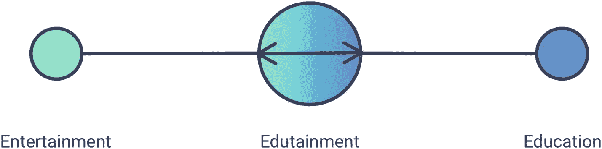

# 事实上，以学习为目的的游戏化设计在面向成年人的应用中也十分常见。以 *Duolingo* 为例，其中诸如徽章和成就等功能，旨在为完成系列活动时增添挑战感和奖励机制。实际上，我们也在与教育无关的应用中运用了这一技巧，例如 Apple Watch 上的健康应用。每天你需要闭合三个圆环，而仅凭圆环逐渐闭合的进度本身就能产生强大的激励效果；当你连续多日完成时，还会获得一枚特殊徽章作为奖励。我们将在第 5 章进一步探讨游戏化设计。

即便是偏向娱乐性的应用，例如 YouTube Kids，也将教育内容推向前沿。为什么呢？因为正如我在第 1 章中提到的，教育不仅能带来收益，还有助于解决屏幕使用时间方面的担忧。

`Edutainment`（教育娱乐）并非一定是教育价值与娱乐各占 50%的完美公式。不同产品中两者的比例可以各不相同（见图 2-1）。

**图 2-1** 教育成分可以有所不同。产品可以更偏向趣味性，反之亦然

这需要达到一种微妙的平衡。学习与乐趣（对大多数孩子而言）往往处于两个对立面，你既不想过度强调学习而使产品变得枯燥，因为枯燥的产品无法吸引孩子；如果孩子不愿使用，就会浪费父母的钱，而愤怒的父母会留下差评——请相信我。但同时，你也不想仅仅创造一种有趣、傻乐的体验，而对孩子的发展毫无价值，也无法向父母推销。影响一个产品被视为具有教育性的因素有很多：你如何营销它，它是否得到专家和/或研究的认可，是否在学校中被使用，是否隶属于在教育产品和内容方面具有可信度的品牌或知识产权，例如 *Sesame Street*（芝麻街）。

无论你心中有何种概念，最理想的做法是以恰当的比例混合这两种强大的成分。

## 应用体验的类型

鉴于前文所述，成功应用的最佳配方是教育与乐趣的结合，那么让我们来看看目前市面上为儿童提供了哪些类型的体验。这并不是一个详尽的清单，我们鼓励你自由创造不属于以下任何类别的新产品。但如果我们必须在平板电脑上为当前市场上的应用创建文件夹，我想我们可以分成四大类，并且很可能将其中很大一部分归入其中某一类。

那么，让我们逐一审视它们，并为每个类别确定关键特征。

### 教育类

纯教育类应用（即使包含游戏化层）是最受家长和教育工作者欢迎的类型之一，因此也成为最盈利的类型之一。

我不会在此重复质量对这些应用的重要性（尽管质量显然对任何应用都很重要）；我假设前文已经成功地让你相信，真正的教育价值至关重要，并且应成为我们在设计中所追求的目标之一。正因如此，教育类应用可能充满挑战。设计师很少同时是教育工作者，因此聘请一位主题专家（如持证教师）来协助设计教育类应用会很有帮助；这些专业人士能够帮助我们根据目标年龄段以及我们希望遵循的标准，来塑造体验、活动及其难度级别，它们必须具有可信度和权威性。为此，他们通常需要投入资金来获得信誉。像“教师选择奖”这样的认证或奖项可以做到这一点（这也能在营销产品时带来优势——稍后会详细讨论）。

我曾参与的一个项目名为 *StoryBots Classroom*。`StoryBots` 是由 *JibJab* 兄弟 Gregg 和 Evan Spiridellis 创造的知识产权（IP）（现已被 Netflix 收购），故事中一群有趣的小生物生活在电子设备里，它们的人生目标就是回答孩子们的问题。围绕这一 IP，我们创建了一系列产品，包括一部电视剧、多本数字和实体书籍、一款 iPad 应用、一个网站以及一个面向学校的电子学习平台，而我参与了后三个项目。

虽然应用和网站更侧重于 IP 的娱乐性，但面向幼儿园的平台 *StoryBots Classroom* 则重度聚焦于教育。当我开始在那里工作时，我已经拥有为儿童设计产品的经验（有些是专门为低龄儿童设计的，有些则是也适合儿童使用的手机游戏，但同样面向成年人），但从未参与过如此重度聚焦教育方面的学校产品。此外，整套活动课程必须符合美国政府针对学前教育的指导方针，即 `Common Core Standards`（共同核心标准），而对于既非教育工作者也非美国人的我来说，这起初完全是个谜。我当然开始自学这方面的知识，但真正的帮助来自我们的教育顾问 `Nina Neulight`。我与她密切合作，以理解 `Common Core Standards` 的要求，特别是关于数学的部分，并了解哪些类型的活动适合学龄前儿童。他们如何学习数数？能进行简单加法吗？范围到多少数字？我们如何教他们用硬币计数？以及其他许许多多问题。当我遇到问题并需要立即对想法获得反馈时，`Nina` 是我的求助对象，但我们还通过封闭的 beta 测试项目，让成千上万的真实教师参与练习测试；通过他们，我们得以进行定期的问卷调查并收集他们的直接反馈，从而开展定量研究。

因此，真正的教育类应用——那些以教授知识为目的，而不仅仅是安抚家长不安全感的应用——需要拥有教育经验的人士参与，特别是针对我们产品目标年龄段的特定教育经验。

### 模拟游戏

“过家家”游戏是典型的儿童活动；模仿成人是儿童发展过程中的一种天然学习技巧。模仿是一种玩耍方式，而玩耍是我们与所有哺乳动物共有的活动——根据研究，甚至不止哺乳动物如此^(¹⁰)、^(¹¹)，所以寻欢作乐并非人类独有。

一些应用从中汲取灵感，制作了模拟游戏，让孩子们可以体验诸如兽医、理发师、音乐家、医生、消防员，甚至机场安检员等角色。

这类产品的两大巨头是 Toca Boca（`https://tocaboca.com/`）和 Dr. Panda（`https://drpanda.com/`）。这些应用通常被构建为“世界”或“环境”，孩子们可以在此体验各种活动，每项活动都由简单的任务组成。其中一些可能只是无休止的重复性任务（重复是儿童学习的关键，他们不像成年人那样容易因反复做同一件事而感到厌倦），而另一些则可能包含有明确目标的迷你游戏。

这些游戏也带有一定的教育色彩，但其游戏性通常高于那些主打学习的产品。

我喜欢 Toca Boca 产品的一点是，在大部分产品中，孩子们能直接体验活动，无需通过角色代为执行动作。因此，例如在《*Toca Hair Salon*》中，孩子们可以用手指直接触摸来给角色剪头发，而无需借助一个 `avatar` 来代劳。这就像《使命召唤》系列等 FPS（第一人称射击）游戏与《古墓丽影》或《超级马里奥兄弟》等第三人称动作视频游戏之间的区别一样。

创造力也是这些游戏的另一大特色。在《*Toca Tailor*》中，孩子们可以使用一系列工具和图案库为角色设计服装，甚至可以通过拍照来创建自己的图案。

其他一些游戏可能纯粹是探索体验，比如《*Sago Mini*》系列，孩子们可以探索一个简单且插图精美的世界，寻找有趣的动画和互动。

Dr. Panda 系列也很有趣。其应用库非常丰富，活动范围从消防员到冰淇淋车、餐厅、农场、糖果工厂、列车长等等——每个应用都包含一系列与职业相关的迷你活动。这些活动需要简单的重复互动，但能让孩子们对职业内容、涉及的任务有个大致了解，并基本上理解世界的运作方式。

模拟类应用比其他类型更接近我们通常理解的电子游戏。但有一些重要区别需要注意，这些区别决定了电子游戏与数字玩具的不同。这类模拟游戏更像是数字玩具（见下一节），而非电子游戏。

### 沙盒游戏

“沙盒”指的是所有那些提供一个环境，让用户能利用工具自由表达创造力的产品。现实世界中的版本，当然就是沙箱本身，也包括乐高、所有积木、培乐多橡皮泥以及各种粘土等等。这些游戏对儿童和成年人都很有吸引力，无论是现实中的还是虚拟的。

这些游戏的伟大之处在于它们给予玩家的自由；有些游戏可能包含解锁成就和新工具的迷你游戏，但主要的游戏玩法都涉及大量的自由和探索。

资深儿童治疗心理学家兰迪·库尔曼博士指出^(¹²)：“儿童心理学家和游戏治疗师多年来一直在工作中使用这些技巧。游戏治疗师办公室里一个常见的工具叫做沙盘。沙盘是一种小型沙箱，配有各种角色和物件，让儿童能够描述生活中主要的关系和事件。沙盘通常配有玩具建筑和结构，以促进表达对家庭和学校的想法和担忧，这被认为是帮助儿童探索和表达对困难问题感受的有力方式。”

自由和创造力是这些游戏在儿童（以及成年人）中获得成功的主要驱动力；这可以表现为探索、搭建和破坏事物。研究强调了自由玩耍的益处^(¹³)，这是一种不由成人设定的游戏形式，孩子们可以自己制定规则，建立与他人的关系，从而提高协作能力和解决问题的能力。被允许犯错并重新尝试是蒙特梭利教学法的基础^(¹⁴)；“蒙特梭利教育实践有助于儿童发展创造力、解决问题的能力、批判性思维、时间管理能力、关爱环境和他人的意识。这可以帮助他们为未来贡献社会、成为有成就感的人做好准备。”

在数字产品中，《我的世界》或许是儿童中最流行的例子。甚至有专门教孩子们如何在《*我的世界*》里搭建东西的书籍和手册（更不用说 YouTube 和 Twitch 上的主播了）。与《*我的世界*》不同，《*Toca Blocks*》是一款专门面向儿童的沙盒游戏，尽管对于学龄前儿童来说可能稍显复杂，但其沙盒性质使其能够吸引各个年龄段的玩家。

### 内容库应用

我们目前分析的都是主动式娱乐形式，但也存在一些非常成功的被动体验应用。这意味着孩子不会主动参与到体验的推进过程中。

`YouTube`、`Netflix`、`迪士尼`、`卡通频道`、`尼克儿童频道`和`PBS`都是视频内容领域的主要参与者，它们都提供某种针对儿童的应用（或专属板块）。教育价值因知识产权（IP）和剧本质量而异。电视剧及角色的受欢迎程度以及内容供应是这类应用成功的主要驱动力。

在这种情况下，“内容为王”的说法是 100%正确的。体验必须简单且令人愉悦；内容必须易于获取、组织良好、分类清晰，但这里起主要作用的是内容本身。然而，作为设计师，我们必须创建合适的容器来让这些内容大放异彩。即使我们在围绕内容库进行构建时，也有很多因素需要考虑。例如，媒体播放器是这类应用的关键组成部分。当我在 iOS 平台开发`StoryBots`应用时，我们最先设计、可能也是最重要的部分就是媒体播放器和内容库。媒体播放器的功能是让观众能够获取内容；人们期望播放器具备一组基本功能，例如：

*   播放和停止内容
*   在播放列表中跳转至上一个或下一个内容
*   在时间线上进行拖拽
*   将内容全屏或最小化

尤其值得注意的是，我们的播放器增加了额外复杂性，因为它需要同时适用于视频内容和动画书籍。对于这两种内容，内容库的一部分还涉及名为“ starring you”的特殊功能，孩子们可以用自己的脸成为故事的主角。所以，并非所有播放器都一样；有时它们需要针对将要显示的内容进行定制。

内容库通常是这类产品的另一个关键组成部分。内容库的主要任务是：

*   以有序的方式呈现内容
*   通过搜索和分类使内容易于访问
*   突出显示最新内容
*   根据用户偏好和历史记录推荐内容
*   提供创建收藏列表和/或自定义播放列表的可能性

不需要用户交互的产品可能会导致我们所说的“ binge-watching”（沉迷式观看）。沉迷式观看意味着，如果提供连续不断的内容流，用户可能会忘记时间，连续观看数小时。这对健康有害（我们尤其希望为我们的小观众避免这种情况）。

我们可以在`Netflix`应用中找到这样的例子：当我们连续观看剧集而没有进行交互时，屏幕上会出现一个对话框，询问我们是否仍在观看。任天堂的游戏机，如 Wii 和 Switch，则更进一步，在长时间游戏后会建议休息一下。

因此，为家长提供工具，比如设置定时器在指定时间后锁定应用，是一个很好的做法。一些新的电视和移动设备在其操作系统中原生提供了此功能，但在我们的产品中提供一种快速便捷的方式来实现此功能绝对是个好主意。开发投入非常低，而且能向家长表明，我们这些设计师、开发者和品牌关心他们的孩子。

### 实用工具、健康应用及其他

其他应用属于较小的类别，如健康、通讯和实用工具，由于它们几乎可以是任何东西，很难定义需求和特性。这些应用在 App Store 和 Google Play 商店的儿童应用目录中占比很小（至少目前如此）。因此，我在这里仅简要提及一些有趣的例子。

通讯应用通常由孩子和成人共同使用，例如家庭通讯应用`Kinzoo`，与 Facebook 的`Messenger Kids`不同，它是从头开始为儿童设计的，而不是成人应用的“移植”，这意味着它并非最初为成人制作后改造为适合儿童使用的副产品。`Kinzoo`在儿童隐私和安全方面投入了大量精力，仅收集最低限度的个人数据。又如`ClassDojo`，这是一个供教师与孩子及其家长沟通的交流平台。

最近，针对儿童的正念应用越来越受欢迎。`Mindful Powers`是一款专为儿童创作的获奖应用，类似于`Stop, Breathe & Think Kids`或`Positive Penguins`。关注心理健康（终于）成为我们许多人的首要任务，而儿童的心理健康同样重要（甚至更重要）。健康也意味着保持身体活跃，这对孩子和成人都极其重要。像`GoNoodle`这样的产品旨在通过融入乐趣来帮助孩子远离久坐的生活方式。`Walkr`是游戏化与健身的完美结合；它是一款计步器应用，测量的步数可为太空旅行中的火箭提供燃料。

### 儿童电子游戏

在引言中，我解释了为什么我不会讨论那些适合儿童但并非专为儿童制作的电子游戏。通常被认为适合儿童的游戏实际上是为更广泛的受众制作的，包括休闲游戏玩家中的成年人。像`愤怒的小鸟`或`天天过马路`这样的手机休闲街机游戏，对很多人来说都很有趣，无论年龄大小。专为儿童制作的电子游戏确实存在，但它们往往包含某种教育目的；因此，在我的分类中，它们会归入“教育”类别，或者前面描述的沙盒或模拟类游戏中。

