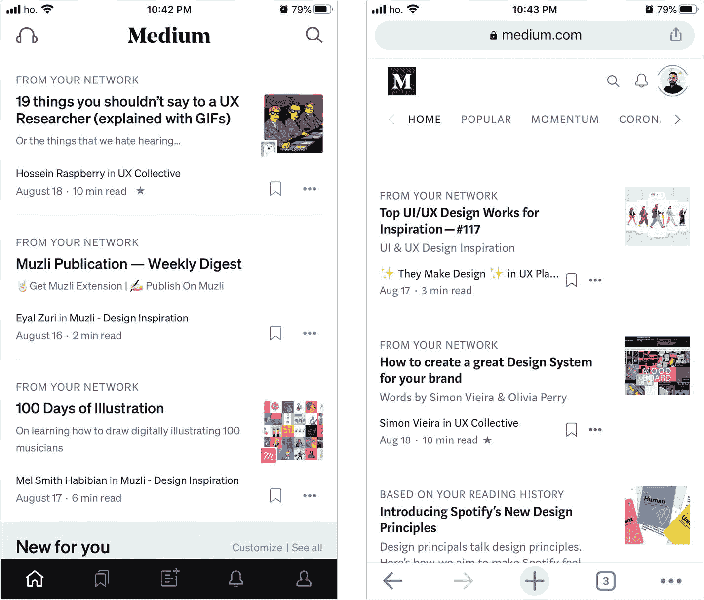
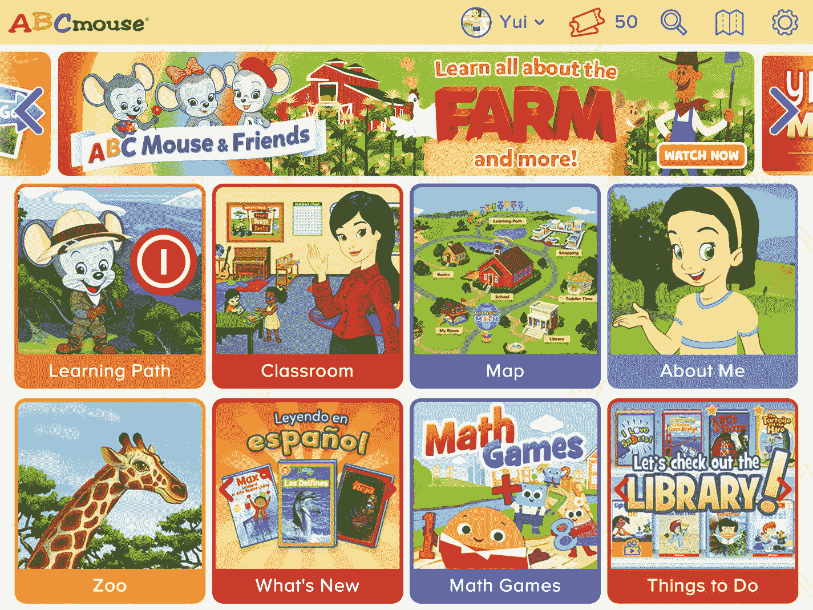
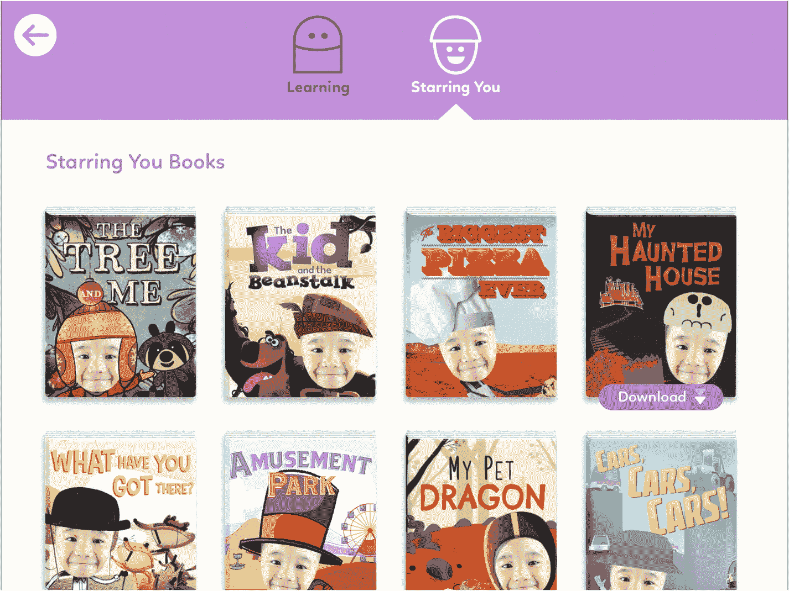
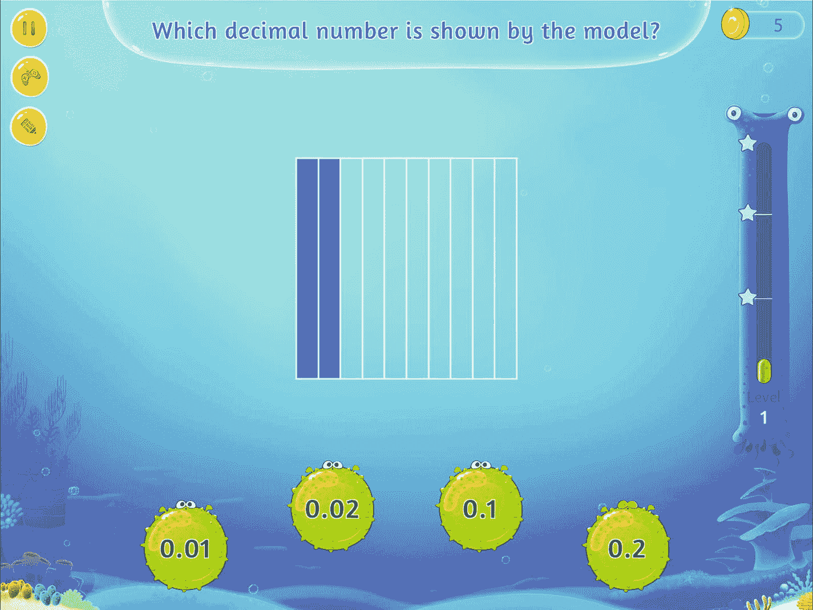
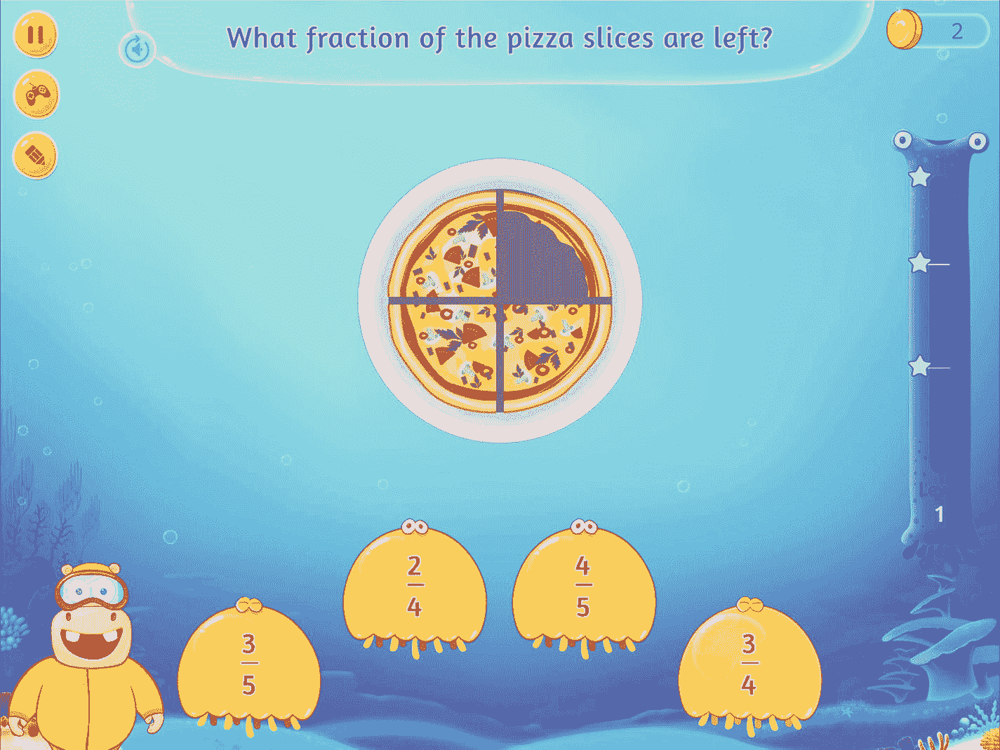
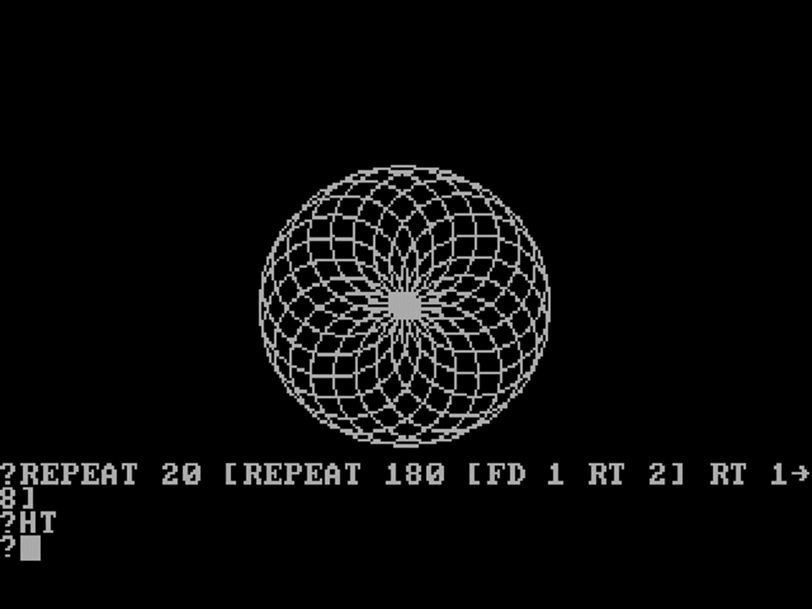
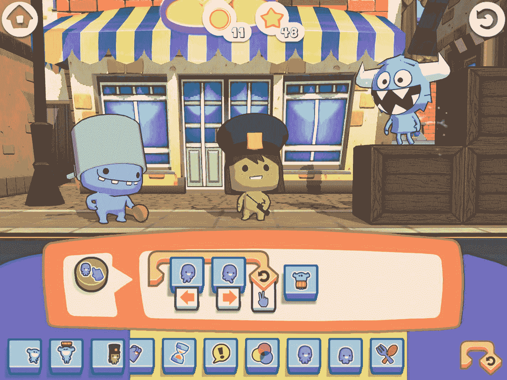
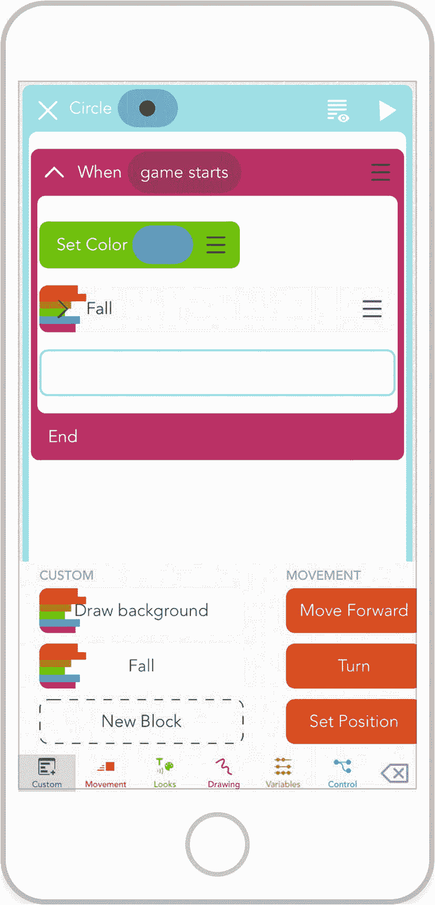
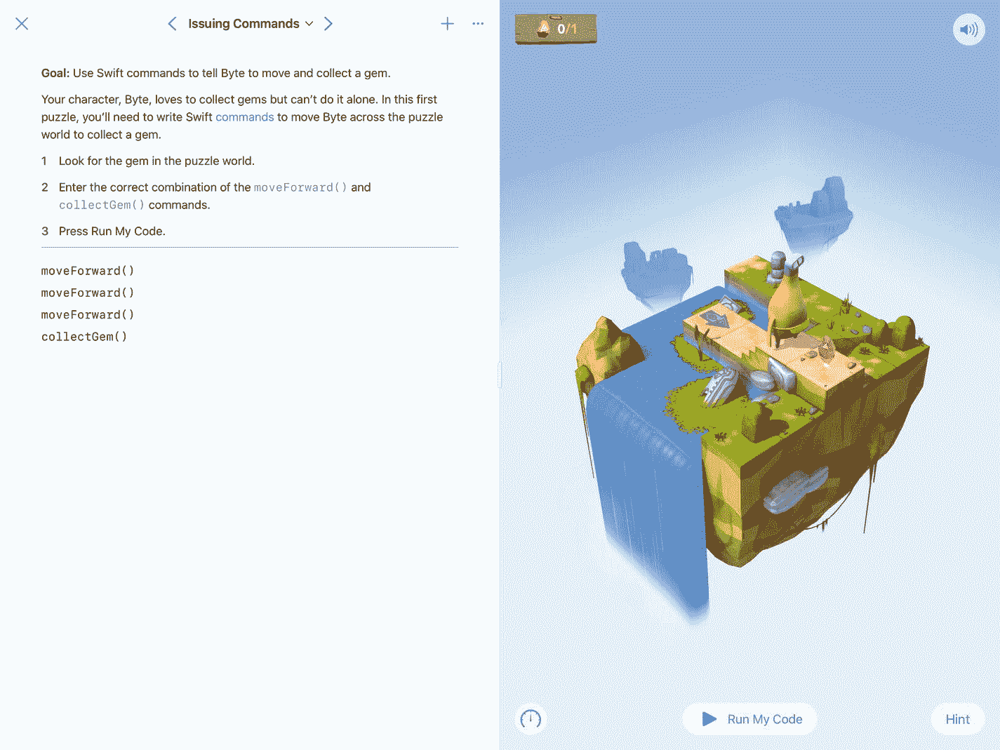
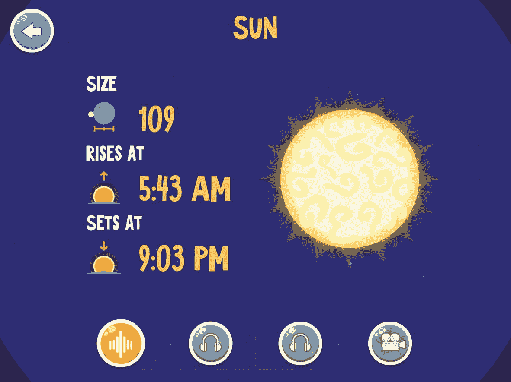

# 4. 概念

为你的产品打好基础。

本章致力于理解我们在真正开始构思想法之前应该做出的决策。在某些情况下，有些人可能会选择在过程中做出这些决策，但在我看来，最好至少设定一些固定的点来界定范围。这能加快进程。

诸如：哪些设备最适合我的目标受众？这个产品应该是原生应用还是网页应用？这将是哪种类型的体验？至少回答其中一些问题，能为我们构建概念基础提供一些基石。这并不意味着你应该固步自封，绝不改变任何想法。你可以改变，并且在大多数情况下你也会改变，但至少你不会被“白纸焦虑”所困扰，并且能以更精简的流程开始。

我们如何能事先做出这些决策？通过研究和策略。在前面的章节中，我们考察了行业（竞争对手、商业机会等）和受众。由此，我们应该定义我们的机会是什么，以及如何最好地利用它们。假设我们从与小学教师的交谈中得到提示，了解到他们在一年级和二年级学生中遇到的一个痛点。那么，5-7 岁的孩子应该在哪些设备上使用我们的产品呢？这是哪种类型的问题？是关于特定学科吗？是关于让整个课堂参与进来吗？是关于阅读吗？还是关于数学？如果我们确定了一个待解决的问题，一个未被满足或未被其他产品妥善满足的需求，我们就可以回答许多前述问题，并拥有构思想法的坚实基础。

## 我们应该使用哪些技术？

那么，我们终于到了这里！我们研究了市场；我们了解了我们的受众；我们对竞争对手进行了研究；现在团队已经准备好探索可能性并提出想法了。

不过，在开始构思产品想法之前，我们需要做一个重要的决策，考虑到这个决策将如何影响我们将要定义的概念的成果，最好提前明确这一点。问题是：我们想制作什么样的产品？适用于哪些设备？响应式网站、原生应用，甚至是附带配套应用的实体产品，这些选择都会影响其局限性和可能性，无论是从技术层面，还是从营销和盈利层面。

有哪些选择呢？嗯，常言道：天空才是极限。最常见和明显的选择是移动应用和响应式网站/网页应用。让我们来看看两者之间的主要区别。

### 移动应用

原生应用可以是安卓版或 iOS 版（在我写这本书的时候，这是大众市场上仅有的两个选择）。当然，你可以为每个操作系统开发和发布一个版本；只需记住，尽管目前安卓设备占多数，但统计数据显示，iOS 在每用户收入方面表现更好。^(¹⁶)

除非你的团队足够大，否则你很可能需要先开发其中一种，那么从哪里开始呢？哪个更好？^(¹⁷)

需要考虑几个因素；让我们看看一些数据，以便更清晰地了解情况。

- 安卓在市场份额方面遥遥领先，约占 75%。
- 然而，iOS 的收入几乎是安卓的两倍（140 亿美元对 70 亿美元）。

表 4-1 比较了 iOS 和安卓应用在收入和下载量方面的情况。

**表 4-1** 2019 年 iOS vs. 安卓收入与下载量对比^(¹⁸)

| | iOS | 安卓 |
| --- | --- | --- |
| 收入 | 142 亿美元 | 77 亿美元 |
| 下载量 | 80 亿 | 216 亿 |

正如你从表 4-1 中所见，iOS 的下载量约为安卓的三分之一，但收入却几乎是其两倍！这相当引人注目。很明显，iOS 用户比安卓用户更愿意为应用和订阅付费。这也得益于安卓的开源特性，使得替代商店和盗版版本成为可能。苹果封闭且受控的生态系统使得 iOS 的数字产品更不容易（尽管并非完全不受）受到盗版和非法利用的影响。

现在，让我们考虑为某个平台开发的技术方面。

- **开发复杂度**：安卓的生态系统比 iOS 碎片化得多。尽管近年来增加了更多屏幕尺寸，但为安卓开发时需要处理的屏幕比例和分辨率数量远高于 iOS。众多品牌提供了海量的型号目录，而苹果的设备种类则相对较少（在我写这本书时，有五种不同的 iPad 和五种不同的 iPhone 型号）。
- **开发时间**：统计数据显示^(¹⁹)，为安卓开发应用的速度比为 iOS 开发慢 30%到 40%。
- **开发成本**：这里的估算很复杂，因为虽然更长的开发时间可能意味着更高的成本，但实际情况是，用于制作 iOS 应用的开发工具`Xcode`只能在苹果设备上运行；因此，你需要一台昂贵的 MacBook 来制作 iOS 应用，而制作安卓应用则可以使用便宜得多的 Windows PC（请注意，这并非双向适用：你绝对可以在 Mac 上制作安卓应用）。
- **编程语言**：构建安卓应用的官方语言是`Java`；2017 年，`Kotlin`被添加为第二官方语言。`C++`、`C#`可以通过安卓原生开发工具包（`NDK`）使用，并且通过使用工具转换成安卓安装包，甚至`Python`也是一个选项。此外，还可以使用基于`Apache Cordova`的`Adobe PhoneGap`框架，通过`HTML`、`CSS`和`JavaScript`创建安卓应用，但这些应用本质上是通过`WebView`展示并打包成原生应用形式的网页应用。iOS 的官方语言是`Objective-C`和`Swift`。所有这些都意味着，你需要为每个平台配备至少熟悉一种语言的开发者，或者需要不同的开发者来为这两个系统制作应用。

# 发布流程

苹果在上架应用商店前有一个相当冗长且严格的提审与批准流程，而安卓的流程则更快、更简单。iOS 上的审核时间通常也更长，这同样会影响到更新：在安卓上，更新几乎是即时的，而在 iOS 上则需再次经历审核流程。在成本方面，成为 Google Play 商店开发者的费用是一次性支付 25 美元，而苹果则要求每年支付 99 美元才能获得进入 App Store 的资格。

综合考虑这些因素，最终决定取决于你的优先级。如果你的优先目标是产品的盈利能力，那么你可能想先开发 iOS 版本，这样开发更容易，利润最大化。如果你更关心触达尽可能广泛的用户群体（例如，这是一个非营利项目），那么安卓是更好的选择。

在设计方面，一般来说（对此不必全信），iOS 上的产品在用户体验和视觉设计上更胜一筹。我认为我们无法将其归因于单一原因，但我的猜测是，这是多种因素共同作用的结果。作为一个封闭的生态系统，App Store 的上线规则比 Google Play Store 严格得多，这造就了一个更加精挑细选、质量更高的应用目录；因此，竞争设定了更高的标准，你希望与它们看齐，甚至超越它们。

安卓不受限制的方式为大量独立开发者和爱好者创造了完美的试验场，他们为我们带来了许多优秀的、在 iOS 设备上无法实现的产品，但也让生态系统中充斥着大量低质量、可能（或故意）有害、且标准远低于 iOS 的平庸产品。

最终，用户要么愿意为品质付费，要么根本不付费；当你的产品做得很好且外观漂亮时，更容易向用户收费。

`审美-可用性效应`^（[20]）^是指“倾向于认为有吸引力的产品更易用”。人们倾向于相信看起来更好的产品会工作得更好——即使它们实际上并没有更有效或更高效。

将这一点与安卓应用易于非法下载结合起来，你就能理解为什么为 iOS 开发产品利润要高得多。

## Web 应用

Web 应用在浏览器中显示，并且需要活跃的网络连接才能工作。现代 Web 应用是*响应式*的，这意味着它们会根据展示它们的容器来调整布局。通常存在一些*断点*，这些断点根据特定的尺寸区间决定应用组件的表现行为，从而定义了当你在智能手机、平板电脑或更大的电脑屏幕上显示 Web 应用时，布局会有何不同。这与原生移动应用有很大不同，在原生应用中，你通常仍然需要一定程度的响应式设计，以使应用能够适配例如从 iPhone 8 到 iPhone 12 的不同屏幕，但你需要为平板电脑构建专门的版本。

一个更大的区别在于，Web 应用是*平台无关*的。这很重要，因为平台无关意味着你不需要为 iOS 和安卓甚至电脑开发不同的应用！只要浏览器支持，你的应用就能显示（是的，可能会存在一些限制，例如在电脑和智能手机之间，但你不需要在每个平台上用不同的技术构建一个完全不同的应用）。

在图 4-1 中，你可以看到 Medium 在其安卓原生应用（左侧）和 Web 版本（右侧）中的不同，而 iOS 应用又不同于安卓版本。

图 4-1 Medium 在其原生应用（左侧）和移动网站（右侧）版本中的对比

原生应用通常速度更快，在用户体验上给人更*灵敏*的感觉，动画运行更流畅，整体体验更具沉浸感。但让我们列出两者的优缺点（表 4-2）。

表 4-2 移动应用 vs. Web 应用

|       | 优点 | 缺点 |
| :--- | :--- | :--- |
| 移动应用 | 速度更快 可离线工作 功能更多（更好访问设备硬件） 更安全（需批准才能上架商店） 更易发现（得益于应用商店） 不在浏览器中运行（对孩子更安全） 可以发送推送通知 | 比 Web 应用构建成本更高 通常需要为每个平台构建专门版本 维护和更新成本高 更新需要安装在设备上 应用商店审核流程有时困难且不一致 |
| Web 应用 | 在浏览器中运行，无需安装 平台无关，无需为每个设备构建专门版本 自动更新，无需用户本地安装或干预 比移动应用构建更快、更容易 无需批准（没有官方商店，它们存在于 Web 上） | 不能离线工作 比原生应用慢，且通常缺少某些功能 可发现性较差（没有商店） 用户体验通常不如原生应用 |

## 渐进式 Web 应用

渐进式 Web 应用（PWA）这个术语由设计师 Frances Berriman 和谷歌 Chrome 工程师 Alex Russell 于 2015 年引入。他们定义了一个应用被视为 PWA（*渐进式 Web 应用*）所需满足的一系列要求。关于 PWA 究竟是什么，目前仍存在一些争议，它似乎处于一个灰色地带，以至于真正宣布一个 Web 应用何时成为 PWA 的边界仍然模糊不清。但无论如何，其核心理念是 PWA 应该融合原生应用和 Web 应用的最佳优势。

让我们看看根据 Google Web.dev^（[21]）^和其他来源提出的要求：

-   **渐进式**：无论用户选择何种浏览器，都能为每位用户工作。
-   **响应式**：适应任何形态因子——桌面、移动设备、平板电脑或未来出现的形态。
-   **初始加载后更快**：初始加载完成后，相同的内容和页面元素无需每次重新下载。
-   **不依赖网络**：允许离线使用或在低质量网络下使用。
-   **类似应用**：通过类似应用的交互和导航给用户以应用的感觉。
-   **持续更新**：由于 Service Worker 更新机制，始终处于最新状态。
-   **安全**：通过 `HTTPS` 提供服务，防止窃听并确保内容未被篡改。
-   **可发现**：通过`manifest.json`和 Service Worker 注册被识别为“应用”，并可被搜索引擎发现。
-   **可再互动**：能够使用推送通知来维持与用户的互动。
-   **可安装**：无需应用商店即可提供主屏幕图标。
-   **可链接**：可以通过 URL 轻松分享，无需复杂安装。

这样看来，PWA 似乎是显而易见的选择，这就是为什么几年前许多人预测 PWA 会扼杀原生应用明星。但这并没有发生，至少现在和可预见的未来不会。

那么与原生应用的区别何在？有几件事需要考虑，因为虽然 PWA 确实结合了原生应用和 Web 应用的许多优点，但它也存在一些缺点。例如，缺少审核流程带来的安全性，任何人都可以创建 PWA 并在网上发布，因为另一个缺点是，没有商店。

由于本书不深入探讨技术细节，目前看来，PWA 在纸面上比在实际中表现更好。

### 那么，我该如何选择？

归根结底，原生应用能提供更高的安全性（这对儿童产品至关重要）、更好的用户体验（更流畅的过渡、更快的响应……），以及在品牌和可信度方面更高的投资回报率——这一点在与家长打交道时不容低估。

根据之前呈现的数据，在原生应用中，简单来说，`iOS` 是能让你获得更高利润的平台，而 `Android` 则能带来更多下载量，如果你更看重这一点的话。

### 根据儿童年龄选择合适的设备

我们讨论了原生应用、网页应用和 `PWA`，但更关键的问题是：我们应该在哪种设备上运行这些应用？在概念开发的早期阶段，我们需要决定：我们的应用应该运行在哪些设备上？智能手机？平板电脑？电脑？还是所有设备？这也会极大地影响用户与应用互动的方式。

每种设备都有其特点，从屏幕尺寸到用户与它的交互方式都不尽相同。智能手机或平板电脑主要是基于触摸的设备，而电脑的主要交互方式是通过键盘和鼠标（或触控板）的组合。但是，智能手机和平板电脑也提供了更多的传感器，例如陀螺仪和加速度计，我们可以利用这些传感器来开发与设备交互的替代方式。

人机交互（`HCI`）受到用户能力水平的极大影响。例如，对于患有帕金森病的人来说，用鼠标点击微小的目标可能会是一种非常令人沮丧的体验。我们的身体在成长过程中会逐步提高处理物体时的灵活性和精细度；新生儿由于肌肉和神经系统仍在“建设中”，因此动作不受控制。随着婴儿长大，她会越来越适应自己的身体，并对其拥有更高的控制力，但这个过程会持续数年。幼儿的手仍然很笨拙，更不用说那些胖乎乎的小手有多小了。因此，一个 3 岁孩子与设备交互的方式，与一个 6 岁孩子能做到的截然不同。

让我们来看看身体发育的阶段。从运动技能开始，我们可以定义三个层次^(²²)：

- **粗大运动技能**：涉及大肌肉群的运动，比如手臂或腿部的肌肉，例如跳跃、蹦跳等动作。
- **精细运动技能**：涉及手腕和手指小肌肉的精确运动。例如用笔写字和画画，用拇指和食指捏起小物体等等。
- **运动协调能力**：将前两者结合，协调身体不同部位以完成特定任务的整体能力。

这三个层次在不同年龄段之间存在很大差异；因此，偏好的手势和设备也随之改变，如表 4-3 所示，该表基于尼尔森诺曼集团（`NNG`）的一篇文章。

**表 4-3** 基于年龄的儿童身体发育情况及建议设备（数据来源：`NNG`）

|               |                     | 3–5 岁              | 6–8 岁              | 9–12 岁             |

|---------------|---------------------|---------------------|---------------------|---------------------|
| **身体能力**   | 粗大运动技能         | 有限                | 部分发展            | 发展良好            |
|               | 精细运动技能         | 非常有限            | 有限                | 发展良好            |
|               | 运动协调能力         | 非常有限            | 有限                | 部分发展            |
| **设备偏好**   | 触摸屏              | 触摸屏和 `PC`       | 触摸屏和 `PC`       | 触摸屏和 `PC`       |

从表中可以看出，即使是年龄较小的儿童也能轻松完成诸如点击、滑动和拖拽等简单手势。这些手势对大多数用户来说是自然而然的，无论年龄大小，因为它们主要涉及粗大运动技能，而大多数儿童的粗大运动技能发展得比精细运动技能更早。当然，由于前面解释的原因，对于年龄较小的儿童，点击交互需要更大的目标。

使用鼠标交互操作起来更复杂，触控板似乎对某些孩子有帮助，但总的来说，我们应该考虑在为 9 岁及以上的儿童设计产品时，才引入鼠标的使用。

不过值得注意的是，在 `NGG` 进行的测试中，即使是能够使用鼠标的年龄较大的孩子，如果给他们提供了触摸屏选项，他们也会放弃鼠标转而使用触摸屏。

显然，和我们所有人一样，每个孩子的灵活程度都是个体化的，所以可能会有 7 岁就能完美操作键盘和鼠标组合的孩子，但我们可以得出结论：虽然触摸屏是所有年龄段的有效选择，但对于 9 岁及以上的儿童，应考虑使用涉及键盘和鼠标的更传统的电脑交互方式。

不过，触摸屏的尺寸多种多样。我们仍然可以找到屏幕尺寸为 4.7 英寸的智能手机（尽管现在很少了），也有屏幕尺寸高达 12.9 英寸的 iPad Pro。考虑到表 4-3 中关于粗大和精细运动技能的信息，我们可以理解为什么更大的目标更好；我们甚至可以简化地说：孩子越小，需要的目标就越大。

不难看出，在触摸屏设备中，平板电脑应优先于智能手机。

现在，如果必须从本节讨论的所有内容中得出一个结论，综合考虑商业机会、平台安全性和儿童身体发育情况，我会说，为 `iPad` 开发原生应用可能是首选方案。但你的想法或业务可能还有其他特殊情况，导致这并非最佳选择。希望在此，我已经提供了足够的数据和信息，供你做出明智的决策。

# 谈谈 SMART Board

教室与我们记忆中的样子（至少是我这一代和之前几代人的记忆）相比已经发生了翻天覆地的变化。如今，教育工作者们的工具箱里增添了不少新设备，比如我们在上一节中讨论过的那些。但还有一种教室里特有、而我们家里没有的设备：SMART Board。它是什么？如何工作？我们的产品又能如何从中获益？

SMART Board（实际上是 SMART Tech 公司产品的专有名称），或者说一般的交互式白板，是一种外形与经典白板相似的大型交互式显示屏。它可以是巨大的触摸屏，也可以是连接了电脑和投影仪的白板组合。用户可以进行点击、拖放、滑动等常见手势操作，并像在普通白板上一样用（特制的）记号笔书写，而且他们绘制的内容还可以进行交互。

与我们的许多技术一样，交互式白板最初于 20 世纪 90 年代初在`PARC`（曾名为施乐 PARC，第一个图形用户界面和鼠标的发明地）开发，但直到近几年才作为课堂辅助工具流行起来。

如今，从幼儿园及以上年级的许多教室都配备了 SMART Board。自 2007/2008 年以来，该设备在学校中的普及率急剧上升。

它们之所以受欢迎，是因为这些交互式白板集白板、触摸屏设备、投影仪和电视屏幕的功能于一身。教师可以将其用于多种活动，与为每个学生或小组提供触摸设备不同，在白板上进行的活动可以吸引全班同学参与。一些制造商还提供遥控器，学生可以通过它集体参与白板上显示的投票和测验。

交互式白板最直接、最明显的好处是它的使用能让课堂更具吸引力。将动画视觉效果与声音和交互性相结合，是让用户（尤其是年轻用户）保持专注和兴趣的巨大助力。教师还可以尝试不同的教学风格，以满足学生的不同需求。事实上，我们并非都以相同的方式学习，有些人偏爱视觉材料，另一些人则从触摸和互动中获益更多，等等。SMART Board 的多功能性为教师提供了众多选择。

SMART Board 本质上就是电脑。因此，它可以访问无限丰富的学习资料（因为，你知道的，互联网相当庞大）。教师可以启动一项活动，然后即时搜索与该主题相关的补充材料。

不仅如此，就像电脑一样，它们可以连接各种外部外设，比如显微镜，可以用来增强学习体验。

研究^(²³)表明，在课堂上使用 SMART Board 取得了令人鼓舞的成果，基本上对所有 K-12 阶段的孩子都有效，能让他们在从语言学习到科学等广泛的学科领域里更投入、更有动力、理解更深刻。这种积极性的提升不仅限于学生，也影响了教师，从而形成一个良性循环：积极的教师能吸引学生，而投入的学生又能增强教师的积极性。

## 为交互式白板而设计

大多数交互式白板的宽高比与普通台式电脑（16:10）相似，与横向握持的平板电脑相当，但尺寸当然要大得多。因此，你必须仔细考虑屏幕上元素的放置位置。

虽然一个（没有残疾的）成年人通常可以相对轻松地触碰到白板的顶部，但一个孩子可能做不到。有些交互式白板可以根据需要上下移动，但有时是固定安装的，那么考虑我们交互组件的可达性就很重要。这取决于你设计所针对的年龄组，但同样重要的是也要考虑到有残疾的儿童，他们可能无法像其同学一样触碰那么高的位置。

在交互式白板上，你可以运行任何能在电脑上运行的软件，因为它们本质上就是（带有触摸功能的）另一个外接屏幕。桌面应用（指电脑应用，包括笔记本电脑）和网络应用都能运行。

`StoryBots Classroom`（本书前面提到过）是一个旨在电脑、平板电脑以及幼儿园交互式白板上运行的网络应用。我们必须安排按钮和其他交互组件，使其能在这所有尺寸差异巨大的平台上正常工作。

如果你决定开发网络应用（或桌面应用），也请考虑到它可能被用于交互式白板，而不仅仅是电脑和平板电脑。这是一个将用例扩展到教室并吸引教育工作者参与的好机会。尤其是幼儿园，通常不会为每个孩子配备 iPad 或电脑，但他们很可能有一块 SMART Board。因此，请仔细考虑（并测试！）你用户界面中每个元素的放置位置。一个用鼠标点击或手指轻触很容易够到的按钮，如果放得太高，对使用交互式白板的孩子来说就可能遥不可及。

作为替代方案，你可以考虑让教师能够进入一个“SMART Board”模式，用户界面会相应改变。但是，正如杰夫·拉斯金曾说过的那样，我本人并非“模式”的粉丝。

## 像孩子一样思考

> *每个孩子都是艺术家。问题在于如何在长大后仍然保持艺术家的本色。*
> 
> ——巴勃罗·毕加索，西班牙画家

用户体验中最重要的技能之一是共情。共情的定义是“理解并分享他人感受的能力”。^(²⁴) 这一点为何在用户体验设计中至关重要显而易见。理解我们试图帮助的人群，是找到解决问题（我们旨在解决的问题）的（其中一个）正确方案的第一步。

当我们为之设计的人群在性别、年龄、种族、文化、语言等方面与我们相似时，共情可能很容易。当我们为与自身不同的用户进行设计时，就变得更困难了。这也是团队多元化非常重要的原因。对问题和解决方案持有不同观点总是有益的，同样因为你如果从未在生活中经历过某个问题，可能甚至都不会意识到它的存在。如果你从未坐过轮椅，你很可能认为将自动取款机安装在离地面四英尺高的地方是个好主意，或者至少不是什么大问题。

现在，假设你是共情领域的金牌得主，你的团队也是有史以来最多元化的，但我敢肯定团队中不会有 12 岁或更小的成员（如果有，那么执法部门随时都可能来敲你的门）。当我们试图为儿童构思概念时，将自己置于用户的位置上确实很难。但心理学家就如何尝试回归我们童年的心智模式给出了一些建议^(²⁵)。

### 摆脱束缚

等等，别脱衣服！这里更多是指放松你的心理限制。作家威廉·W·珀基曾说：“你得跳舞，仿佛无人观看。”这正是孩子们所做的。他们不害怕被评判（至少在他们很小的时候是这样）；他们跳舞、唱歌、玩耍，毫不顾忌别人如何看待他们或作何感想。研究表明，当爵士乐手即兴演奏时，他们会关闭大脑中引发抑制和自我审查的区域。显然，当人们在生活中找到一些可以真正释放自我的领域时，他们就能茁壮成长。

### 拥抱糟糕的点子

这一点与上一点紧密相关。当你放下束缚时，你也要接纳那些平时因害怕被评判而藏在心里的想法。

我强烈建议你在任何头脑风暴中牢记这一点，无论是关于儿童产品还是其他领域。摆脱自我审查和对说错话、表达疯狂或看似错误想法的恐惧，能够激发其他想法和讨论，真正推动事情发展。

孩子们没有这种恐惧，他们自由地表达自己的想法，即使是最荒谬、最古怪的点子也毫不犹豫。他们释放想象力，你也应该这样做。

### 慢下来，体验无聊

在日常生活中，我们失去了感到无聊、忍受无聊、仅仅与自己相处而无所事事的能力。即使当我们认为自己或说自己在“什么都没做”时，我们其实也在看电视，或者漫无目的地刷着最爱的社交网络无止境的信息流（注意：这是暗黑模式！），甚至做那些被认为对自己更有益的事情，比如读一本书（就像这本！）。从严格意义上说，我们可能并不算高效，但大脑确实在运作。当我们允许自己漫无目的地徜徉，沉浸在无聊中时，想象力便会被激活。这并不意味着你需要一动不动地坐在沙发上盯着白墙。你可以随意散散步，不戴耳机与世隔绝，看看周围，听听声音和身边的人。让你的思绪在没有外界刺激（如电视节目、书籍、音乐等）强迫你思考的情况下自由流淌。这正是孩子们所做的，也是我们限制儿童屏幕使用时间的原因（见第 7 章）。

### 摒弃既有知识

对孩子们来说，很多事情都是新奇的，年龄越小越是如此。1897 年，意大利诗人乔瓦尼·帕斯科利发表了一首名为《小童》的诗。诗中表达了一个观点：在我们每个人的内心深处，都住着一个小孩子，能够以一种崭新且不带偏见的角度看世界，能通过非理性和直觉的思考而非理性反思来发现真相。帕斯科利用这个比喻来解释他写诗的方式，但这其中蕴含着一个重要启示：试着以一切都是新鲜的方式去看待世界。作为一名设计师，我无法不想起这与用户体验——尤其是儿童体验——的关联。例如，在评估一个界面时，假设你对界面毫无先验知识，这种想法对于与用户建立共情连接极有帮助。

## 教什么

在第 2 章中，我们讨论了面向儿童的数字产品是否可能具有教育意义。再次强调，制作一款纯粹以娱乐为目的的应用程序本身并无不妥，只要这种娱乐在任何方面都不损害儿童的身心健康和情感发展。

但我们也谈到了教育价值的重要性，因为这是家长和教育工作者最关心的（还记得“无愧疚感屏幕时间”这个概念吗）。此时，当你处于产品的概念阶段，你可能会开始思考应该关注哪个学科，是否有些学科比其他学科更合适？当然，你不想给幼儿园的孩子教流体物理学，所以首要要求是与目标受众所在年级教授的内容保持一致。

一些产品提供了从学前班到小学的相当长的课程体系，这不仅意味着他们的目标受众更广，也意味着他们能够长期留住用户。

### 完整课程

一个最著名的例子就是 Age of Learning 公司旗下的`ABCmouse`（[ABCmouse.com](http://abcmouse.com)）。`ABCmouse`（图 4-2）的课程针对 2 至 8 岁的儿童，即从学前班到小学二年级。该课程在学科和难度上与孩子们在学校学习的内容保持一致，因此它就像他们正在进行的教育的纲要。学科包括阅读与语言艺术、数学、科学，以及艺术与色彩。

**图 4-2** ABCmouse 欢迎界面

# 儿童教育应用中的学科学习

ABCmouse 提供了完整的学习路径，涵盖了上述所有学科。该路径在视觉上呈现为一条道路，上面有多个代表课程和奖励的站点。

## 阅读

阅读当然是儿童应用程序中最常教授的技能之一。这类应用可以提供不同的方法和材料；最常见的是插图故事书。与纸质书最大的区别在于，数字形式的书籍可以具有交互性和动画效果，还能提供跟读功能。借助语音识别技术，它们甚至可以听孩子朗读并监控进度。

数字图书凭借其互动特性，能够提供更高的参与度，并且可以轻松地为每个孩子进行个性化定制。我曾参与开发的 StoryBots 应用也提供了一个书籍板块（图 4-3）。这些插图和动画精美的电子书提供了一些特别之处：孩子是故事的主角。通过一项名为“你就是主角”的功能，家长可以上传孩子的照片来创建以其姓名命名的个人化身；这个化身会在书中作为主角出现，每次都会根据故事和图书的视觉风格改变造型。此外，当故事中提到主角时，图书会使用孩子的真实姓名，所有代词也会根据孩子的性别进行相应更改。所有这些，再加上文笔优美的故事、令人惊叹的循环动画以及出色的音效设计，使得这些书对孩子们极具吸引力。如今，利用像面部 3D 映射这样更现代的技术，我们可以想象出更加精彩的产品。

**图 4-3** iPad 上 StoryBots iOS 应用的书籍板块

## 语言艺术

这个科目可以轻松地与阅读相结合。语言艺术类应用能帮助孩子学习拼写（例如，完成句子或单词，或者重新排列单词中的字母或句子中的单词、填字游戏等）以及新词汇。此外，用手指描摹字母和数字是另一项简单又有趣的活动。

一个有趣的案例研究是名为“ABC Gurus”（图 4-4 和 4-5）的应用，由 Colto 开发，这是一家专注于儿童产品的应用开发机构，我有幸曾与他们合作过几个项目。

图 4-5

完成个性化定制后，他们可以欣赏一段动画，这段动画能巩固对该字母的运用。

图 4-4

在“ABC Gurus”中，孩子可以用各种道具和绘画工具来个性化定制字母。

在这款应用中，孩子可以从字母表中任选一个字母，使用颜色和动画道具进行装饰，然后触发一段动画，学习一个以此字母开头的单词。

孩子们还可以截取自己的作品并保存在设备上。这款应用取得了巨大的成功，这得益于其简洁的概念、精美的插图风格，以及它将语言艺术与绘画和创造力相结合的特点。事实上，即使你的重点不是完整的课程体系，而是一个特定科目，只要跳出学科的界限，融入其他元素（尤其是创意元素），也能带来引人入胜的新概念。

## 数学

数学是儿童教育应用中最常教授的科目之一。鉴于其涉及的主题多样、创建练习相对简单，以及该科目本身的重要性，数学在我们创建 StoryBots Classroom 平台时成为了首选。

计数、基本运算、基础几何图形提供了丰富的练习可供选择。语言艺术需要单独创建每个练习（你无法真正随机化句子），而数学练习则提供了更高的自动化和随机化程度。针对我们的平台，我们能够创建一系列基础练习，然后定义多种算法，以便持续自动生成随机组合，每次都生成不同的练习。

SplashLearn 为从幼儿园到五年级的儿童提供了一套数学活动课程。他们的应用在全球有 3000 万儿童使用，并获得了众多在课堂上经常使用这些产品的教师的高度赞扬。我喜欢他们管理活动进阶的方式，从更具视觉化和说明性的方法，逐步过渡到更具图表性的方法，最终达到数字化的方法，这种方式非常直观，能温和地引导孩子理解那些常常令人头疼的数学概念，例如分数和小数（图 4-6 和 4-7）。

图 4-7

一个学习小数的游戏。

图 4-6

一个学习分数的游戏。

## 编程

1993 年，我 11 岁时，就读于一所开设实验课程的公立学校，课程包括双倍于常规时长的英语（对于我来说是第二语言）和编程。对于 20 世纪 90 年代初的意大利公立学校来说，教孩子编程是非常不寻常的，而刚收到我的第一台个人电脑（一台配备 2MB 内存、运行 MS-DOS 6 的 386 电脑）的我对此非常感兴趣。

我们使用的编程语言叫做 `Logo`^(²⁶)（图 4-8），它于 1967 年作为教授编程的教育工具而创建。

图 4-8

用 `Logo`^(²⁷) 制作的几何设计。

尽管年代久远，`Logo` 背后的方法论至今仍然适用；事实上，这类应用中的大多数都采用了相同的方法，但运用了现代且非常吸引人的图形风格。例如，`CodeSpark Academy`（图 4-9）使用了这种赛璐珞风格的 3D 有趣可爱角色，但指导它们的逻辑与我们当年在 `Logo` 中使用的完全相同。

图 4-9

`CodeSpark Academy`。

软件开发是儿童教育应用中最热门的主题之一。教授代码工作的基本原理不仅对未来从事开发者的职业有帮助，而且有助于学习逻辑思维和解决问题的能力——这些技能无论我们学习或从事何种职业，在我们生活的任何时刻都可能派上用场。

`Hopscotch`（图 4-10）是一个面向 8-14 岁儿童的开发平台。它的有趣之处在于，孩子们不仅可以用它创建自己的游戏，还可以与年轻开发者社区分享他们的作品。

图 4-10

`Hopscotch`。

市面上有许多产品可以教孩子编程的基础知识，显然这个话题如此有趣，以至于连苹果公司也决定加入进来。2016 年，苹果为 iPad 推出了 `Swift Playgrounds`（图 4-11），这款应用不仅旨在教授其新的编程语言 `Swift`，还教授编程的基本原理。该应用迅速成为 100 个国家/地区 App Store 下载量最高的应用之一，平均评分为 4/5。在 `Swift Playgrounds` 的旅程开始时，用户的任务是让一个外形奇特的外星人通过一个迷宫般的浮动立方体岛屿，到达一些红色宝石。让它前进、左转、右转等指令的逻辑，与我们当年在 `Logo` 中移动屏幕上的“海龟”（光标当时的称呼）的逻辑完全相同。

图 4-11

`Swift Playground`。

这个科目真的很有趣，因为尽管其他所有科目都可以使用传统工具学习，但软件开发的数字特性使其无法与设备的使用分离开来（尽管在高中编程课上，我们曾经先在纸上写代码，但那说的是史前时代了）。

乐高是另一个抓住这一趋势的巨头品牌。乐高儿童机器人编程，顾名思义，是一系列帮助孩子迈出编程和机器人学第一步的产品。产品线共分三种：

*   乐高 Boost，面向 7 至 12 岁的儿童

*   乐高 Mindstorms，面向 10 岁及以上儿童

*   乐高教育 WeDo 2.0，专门作为学校教学工具创建，旨在为教师提供开展引人入胜的课堂项目的工具

这些产品的美妙之处在于，它将动手创造（即经典的乐高方式）与用于编程的数字积木相结合，从而让你的作品活起来。

*Sphero* 是另一款出色的智能设备，它将一个球形机器人形式的实体“玩具”与一个开发平台相结合，用于编程完成障碍赛等任务。开发过程使用逻辑积木（像大多数面向儿童的编程工具一样）进行。开发者可以利用传感器数据，并通过 LED 灯矩阵编程来实现视觉输出。

该公司此前曾提供大量智能玩具，其中一些拥有广受欢迎的知识产权授权，例如现已停产的星球大战主题机器人编程套件。

另一个很棒的概念是`Ozobot`。这是另一个小机器人，其工作原理与竞争对手不同；除了经典的逻辑积木方法外，它还可以使用颜色积木进行编程。该机器人有一个读取颜色的传感器，开发者可以使用不同的颜色模式组合来向其发出指令。这意味着机器人可以在数字表面（例如 iPad）上工作，通过读取数字路径，或者无需使用设备进行编程，只需在纸上使用标记即可。该公司将这种“无设备开发”作为一项差异化功能进行推广，抛开所有关于屏幕时间的考虑，这种可能性在学校环境中代表着巨大的机遇——为所有学生配备足够的平板电脑可能是一项高昂的成本（尤其是对公立学校而言）；这样一来，孩子们只需使用标记笔、纸张和一个 99 美元的机器人就能接触编程。事实上，该公司正在通过面向学校的专用套装来利用这一商机。

但是，孩子们为什么要学习编程呢？尽管软件工程师是收入最高、最受欢迎的职业之一，但在 2019 年的美国，STEM（科学、技术、工程和数学）毕业生中只有大约 10%是软件工程师。无论好坏，软件产品是近年来对我们生活影响最大的产品。像 Uber、Airbnb、Facebook 或 Tinder 这样的服务改变了我们社会的形态。越早开始学习这门将塑造未来的语言越好，还因为这些产品涉及许多伦理问题。解释“能力越大，责任越大”（谢谢，本叔叔）将有助于培养更优秀的新一代创业者/开发者/设计师。但更重要的是，未来的一代将对他们每天使用的屏幕背后的东西有更清醒的认识，他们将更清楚地理解他们用这些屏幕所做的一切的后果和影响，同时也能更好地理解他们的在线隐私，以及屏幕之下潜藏的危险与机遇。

编程是一项创造性的活动。这似乎有点反直觉，因为代码依赖于逻辑和数学、布尔变量、函数和许多其他看似不具创造性的东西。但这些只是实现创造性表达的极好工具。还有什么比仅仅通过书写一串字母（或者对儿童而言，像逻辑积木这样更直观的东西）就能从无到有创造出东西更具创造性呢？这不仅仅是创造性的问题，看到你的代码成功运行（尤其是在搞定一个恼人的 bug 之后）所带来的成就感是无价的，它真的可以增强你的信心和自尊。借助前面提到的`Hopscotch`等平台，你可以分享你的作品，并从下载量或游戏次数中获得那种自我提升。

编程还能培养的其他软技能包括毅力、沟通和协作能力。完成一个项目通常涉及向同伴寻求帮助，学习他们以往的经验，并与社区分享我们自己的经验，在竞争与合作之间建立一种非常健康的平衡。

## 你可以教授任何东西

我在前几节中描述的主题是一些最常见的选择，但实际上你几乎可以教授任何东西，从历史、地理到语言等等。一项关于教育类应用使用情况的研究^(²⁸)得出的有趣发现是，绘画应用可以在儿童发展中发挥积极作用，因为绘画是一项允许儿童思考并创造他们对事物看法的活动。因此，在传统绘画工具可能难以使用或不切实际的场景下（例如旅行中），绘画应用可以成为传统绘画工具的补充（但绝不能替代）。

将创造性活动与更具结构性的学习相结合的方法，例如前面提到的`ABC Gurus`示例，可以增强体验并使其更愉快。创造性活动甚至可能成为一种激励措施；想象一种游戏化的机制：当孩子解决数学运算或其他不那么有趣的任务时，他们可以解锁新的绘画工具、颜色、贴纸和动画。

几个不常见学科的例子：`Star Walk Kids`（图 4-12）是一款面向小学生的天文学应用。`Toca Lab: Elements`（图 4-13）教授孩子们化学和物理的基础知识，例如元素如何随温度变化而反应，以及它们如何改变状态等。

**Figure 4-13**

`Toca Lab: Elements` 让孩子们用有趣的小生物进行实验，模拟元素的反应，学习化学和物理的基础知识。

**Figure 4-12**

`Star Walk Kids` 向小学年级的儿童教授天文学。

## 被动学习与主动学习

教学和学习可以通过多种不同的方式进行。目前有很多教学方法，随着新技术和新方法的应用与测试，它们也在不断演进。

定义传授知识和教育学生的方法论并非新鲜事，这可以追溯到古罗马和古希腊时期，不同的风格历经几个世纪和不同文化的发展演变，并受到科学和社会进步的影响。

本书并非旨在进行此类分析，我也并非有资格进行此类分析的人；在本章中，我们将讨论被动学习和主动学习之间的主要区别。事实上，我们可以将活动分为这两大类，无论你选择哪种教学方法。

为什么理解这种差异很重要？我们广泛讨论了娱乐与趣味之间的平衡，而理解被动学习和主动学习的利弊，可以成为帮助我们实现这种平衡的工具之一。我们还必须考虑到，每个人有不同的学习过程。有些人更擅长自学阅读，另一些人可能发现实践活动更有效，还有一些人则从视听材料中受益，等等。因此，理解主动学习和被动学习之间的区别，可以帮助我们设计出满足这些不同学习风格需求的产品。

### 被动学习

学生坐在教室里听老师讲课，接收概念和事实，这就是被动学习。你去参加设计大会，听台上演讲者发言，同样是被动学习；看纪录片或读书也是如此。

被动学习是一种“经典”方法，即由掌握知识的人以自上而下的方式传递给他人。由于理解材料的责任落在学习者身上，被动学习可以教会孩子集中注意力并自我管理学习过程。

被动学习有助于提升的一些关键技能包括：

*   写作能力

*   倾听能力

*   组织能力

在第 2 章中，我们讨论了娱乐与教育之间的平衡。一款专注于娱乐的产品本身并无不妥，例如一个包含视频和歌曲的应用；但如果这些内容能融入教育素材，那么这将是实现被动学习体验的完美方式。像经典的《ABC 字母歌》就是绝佳范例，但如今也有更现代的儿童歌曲创作方式，例如 StoryBots 资料库中非常有趣的恐龙说唱系列。

被动学习并不意味着枯燥；有了优秀的编剧、音乐人和艺术家，被动学习也可以引人入胜且充满乐趣（参见第 3 章末尾对编剧斯科特·埃蒙斯的采访）。

### 主动学习

主动学习通过讨论与合作、批判性思维、解决问题，以更“动手实践”的方式进行。实验室实验是主动学习的好例子，教师仅作为引导者的同伴讨论也是如此。主动学习更具参与感和赋能性，通常也比被动学习更有趣，因为它带来直接的体验，并有可能通过自己的探索获得发现的满足感。

虽然被动学习倾向于指向一个正确答案或解决方案，但主动学习则促进发散性思维（如果你熟悉`设计思维`方法论，应该明白我在说什么），即学生探索多种可能性，更多地从宏观角度思考问题，而不是聚焦于细小的个别问题。这种思维方式有助于学生建立问题范围内甚至范围之外所有相关元素之间的联系，也就是经典的“跳出固有思维模式”。

主动学习的经典例子包括：

*   动手实验

*   小组问题

*   同伴教学

*   游戏与挑战

### 哪种方式更好？

正如你可能预料的，这个问题没有标准答案。最终完全取决于学习者和学习材料。一个不好玩的游戏，可能比一个教授同一主题的有趣音乐视频更枯燥，参与度也更低。

根据产品类型和可用资源，你通常需要将两者结合起来。`ABCmouse` 在将其学习路径中融入所有可能体验方面做得相当出色；在这个过程中，孩子们解谜、回答测验、观看视频、阅读故事等。混合主动与被动学习是增加多样性、并尽力涵盖所有学习风格和需求的最佳方式。^(²⁹)

## 行业见解：专访尼娜·纽莱特博士

尼娜·纽莱特是一位经验丰富的教育工作者，拥有斯坦福大学学习、设计与技术硕士学位和加州大学洛杉矶分校教育心理学博士学位，并且拥有从幼儿园到十二年级的课堂教学经验。她曾为面向小学生的教育产品的成功与开发做出贡献，这些产品包括书籍、歌曲、视频、电视节目，以及一个包含家庭辅助组件的计算机化课堂教学数学项目。

**鲁本斯：我在本书中多次提到，在设计面向儿童的互动体验时，团队中有一位教育顾问非常重要。如果我们希望自己的应用被认为是“教育类”的，这甚至是必须的。您如何看待当今教育类应用的格局？**

尼娜：很高兴听到你认为团队中配备一位教育顾问至关重要。许多从事数字教育产品开发的设计团队都忽略了吸纳具备教学/学习专业知识的人员，结果往往在后续遇到问题。没有这类输入而设计的产品，可能会缺乏有效的教育背景，并且难以真正做到对儿童友好。我们看到，对于在学校和家庭中使用的高质量、真正具有教育意义的数字产品，存在着巨大的需求。学校的网络化程度比以往任何时候都高，学生可以利用的设备也更多。家长们也希望孩子能精通科技。

**鲁：家长和老师在决定下载哪款儿童产品时，应该留意什么？**

尼：任何儿童产品都必须是安全的，这意味着它不应包含广告、暴力或霸凌内容。总的来说，使用该产品值得孩子花费时间。使用应用来娱乐是可以的，但如果家长寻找的是具有教育意义的内容，那么它就应该是真正的——教育产品。阅读产品描述，或者让孩子向你介绍它。我建议家长自己先试用一下产品，并观察孩子使用它的情况。即使只用几分钟，这也能让家长获得对产品的真实体验。如果你不喜欢它，就不要让孩子使用。当你认为某款应用不适合孩子时，完全可以直接对孩子说“不”。

# 章节回顾

鲁：一款面向儿童的数字化产品，需要具备哪些特征才能被认为是具有教育意义的？在设计时，有什么重要的方面需要牢记？又有哪些错误是绝对需要避免的？

尼：任何教育产品都需要有学习目标。数字产品的设计者应该清晰地陈述这些目标。你的孩子应该能够用一两句话告诉你，他们使用该产品后会学到什么。很多所谓的教育游戏，即使完全回避学习内容也能玩下去。当孩子使用产品时，家长可以问自己：他们是在练习已经学过的东西，还是在学习新东西？孩子们两者都需要——既要练习技能，也要学习新的技能和概念。

教育科技设计师犯的最大错误，是制造出那些因嘈杂刺耳的噪音和图形而令家长、老师和其他学生感到恼火的产品。不要想当然地以为孩子会使用耳机，或者会待在单独的房间里。

鲁：作为一位曾经担任过教师的教育顾问，您在选择用于课堂的互动体验时，会看重哪些方面？

尼：它应该对学生和老师都易于使用，能够为所有学习者（无论其能力水平如何）提供有效的学习体验，并且要有吸引力。产品最好还内置了灵活性，使其可以以不同的方式使用——适用于一个学生、两个学生、由老师带领的小组，或者整个班级。

鲁：您对与儿童一起测试数字产品有何建议？最佳环境是什么样的？与他们互动的最佳方式是什么？

N：进行一些可用性测试非常重要。测试应该在设计过程的早期进行。你测试得越早，就越有可能打造出优秀且有效的产品。你能尽早发现问题，并知道自己是否走在正确的道路上。我喜欢让一些目标年龄段的孩子，以及一些稍小和稍大的孩子参与测试。测试应包括与试用产品的孩子交流，了解他们学到了什么以及最喜欢什么。我发现与孩子互动的最佳方式是进行对话，让测试时间尽可能短，并让他们感到尽可能舒适。对于 7 岁及以下的孩子，将测试间隔控制在 15 分钟或更短是有效的，因为他们往往非常好动。

R：作为教育顾问和母亲，你对屏幕时间有什么看法？你是如何管理的？

N：我认为，关注孩子使用设备的时间以及他们如何使用设备都很重要。现在有很多很棒的程序，能给孩子提供没有屏幕就无法获得的体验，我希望孩子们能沉浸其中，而不会因为屏幕时间有限而感到压力。作为家长，我从未觉得有必要给孩子设定具体的屏幕使用分钟数，但有些家长可能需要设定限制。我会尽可能以身作则，展示良好的科技使用行为，适时休息，并且在与人交谈时，我不会看着屏幕。平衡是关键！

-   决定为产品考虑哪种设备，取决于几个因素：目标用户（年龄和技能）、商业机会（投资回报率）、技术及其优缺点。
-   除了移动设备和电脑，还要考虑其他设备，例如交互式白板。
-   像孩子一样思考很复杂。试着卸下拘束，接受糟糕的点子，放慢节奏，摒弃先入为主的观念。
-   在教育应用中，有些学科比其他学科更受欢迎。当然，最受欢迎的学科竞争者也最多。尝试探索小众领域。
-   通过游戏化方法可以有效地向儿童教授编程基础知识。
-   被动学习和主动学习各有利弊。哪种最好，很大程度上取决于每个个体用户。尽可能将两种方法结合起来。

