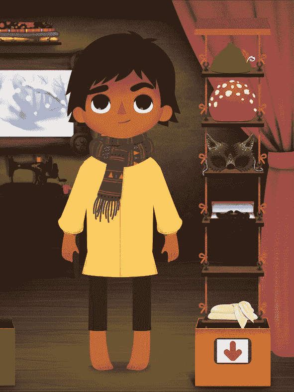

# 数字玩具并非电子游戏

> *我们都知道孩子们玩起玩具来有多“狠”。事实证明，成年人有过之而无不及。*
>
> ——马丁·库珀，美国科学家

正如我在本书前面提到的，儿童应用开发者 Toca Boca 似乎是第一个提出“数字玩具”这个术语的人，或者至少是最能诠释这一概念的代表。我们已经讨论过游戏是一种跨物种的活动，其范围似乎比我们原先认为的“仅为幼年个体适应生活做准备”更为广泛。诚然，例如当幼狮互相打斗时，这是主要目标之一：它们在学习如何悄悄潜近猎物、如何攻击，同时也在学习狮群的 dynamics。人类幼崽在模仿成年人时也发生着同样的事情（因此，为他们提供积极的榜样来模仿对我们来说至关重要），这也解释了为什么我们会有像小厨房、小吸尘器或小修理工工具这样的玩具，它们都是以我们成年人日常使用的物品为模型制作的。

这些玩具是帮助孩子们进行“假装”游戏的工具。在这些活动中没有赢家或输家，只有故事讲述和体验。孩子们一起玩“过家家”时，学习合作、家务和责任（整理、清洁、购买杂货等），没有任何奖品、积分、成就或任何形式的认可。这种活动有一个起点，但没有明确的终点，可以持续几个小时。

这类活动还需要大量的想象力。玩具可以辅助这种想象，但最终发挥作用的还是孩子的创造力。我快三岁的女儿经常玩“书店”游戏；她喜欢书，而且有很多，所以有时她会假装开了一家店，而我必须扮演顾客（尽管有趣的是，我几乎从来不被允许自己选择要买什么）。她会躲在一张充当柜台的扶手椅后面布置店铺；当她（我）决定好要哪本书时，她就把书凑到扶手椅上一个特定的位置，嘴里发出“哔——”的一声，仿佛用条形码扫描器扫了书，然后她会用一张旧的 Costco 卡在扶手和椅背之间刷一下，算是给我结账，最后把书和收据放进一个袋子里。

这个活动可以持续几十分钟，我们只需要：

*   一张扶手椅（也可以是任何能将她与顾客分隔开的东西）
*   一张旧塑料卡
*   一些书
*   一个袋子之类的东西
*   一张随便的收据或一小片纸
*   大量的想象力和对成年人行为的观察

我们没买任何昂贵的玩具，成本基本为零，但想象力得到了最大程度的发挥。

通过这种角色扮演游戏，她学到了：

*   购物是如何进行的
*   什么是支付卡
*   如何操作各种物品（刷卡、把书放进袋子、递收据、把书放回书架等）
*   语言技能（与顾客交谈，并假装顾客不是爸爸或妈妈）
*   同理心（帮助顾客找书，询问他们是否喜欢这本书等）
*   整理归纳

跟这些现实生活中的游戏活动很相似，数字玩具提供的是（通常基于现实场景和职业的）体验，除了体验本身之外没有其他目标。在诸如热门应用《Toca 理发沙龙》（图 2-2）或《Toca 裁缝店》（图 2-3）这类应用中，没有积分、关卡、对战、赢家和输家；创造力在这些产品中扮演着重要角色。

图 2-3：《Toca 裁缝店：童话故事》

图 2-2：《Toca 理发沙龙 4》

数字玩具不能，我重申一次：*不能*替代现实生活中的游戏时间，但可以是一种很好的变化和补充，并能以不同的方式激发创造力和想象力。

数字体验在灵活性和便利性方面有一些优势：我们可以随时随地玩（车里、飞机上、医生候诊室，任何地方），而且一个设备可以存储数十个（如果不是数百个）不同的应用。

数字玩具培养创造力和想象力。缺乏固定的目标、奖励和徽章，会激励孩子们创造属于自己的假装游戏，从创造的过程和最终成果中获得满足感，而不是从排行榜、成就或积分中寻找。

## 寻找创意从何入手

> *困难不在于产生新思想，而在于摆脱旧思想的束缚。*
>
> ——约翰·梅纳德·凯恩斯，英国经济学家，《就业、利息和货币通论》（1936 年）

你可能因为有一个想法并认为它能在市场上行得通而着手开发产品；也许你以前从未做过儿童数字产品，但因某个灵感而决定尝试一下，或者你在该行业已有经验，刚刚想出了一个令人兴奋的新概念。太棒了！但也可能进入儿童应用市场是出于商业机会、合作机会或客户的需求。然而，仅仅是需要进入这个市场，脑海中却没有清晰的概念。例如，一家已经为成年人提供语言学习应用的公司，决定将其受众扩展到儿童，就属于这种情况。在这种情况下，你拥有数字产品和语言教学的专业知识，但没有将儿童作为用户（父母作为客户）的经验。

这种情况下，你知道目标，但不知道如何达成。你需要想法和灵感作为起点。

有时，灵感会不经意地降临到你身上，往往在最意想不到的时刻，这很棒。而其他时候，则需要你去主动寻找，需要探索、搜寻、耐心和敏锐的观察。我们都能认同，创意无处不在，但让我们考虑一下，为这类产品寻找创意最可能的情景是什么。以下是我的指南针，为了不让你在林子里迷失得太久。

### 屏幕之内

首先，我想说一个我坚信的观点：一个想法是否新颖并不重要，只要你能让它变得更好。

仔细想想，这正是苹果许多产品背后的策略。严格来说，在苹果公司的历史上，它几乎称不上具有创新性。苹果所做的，是采纳一个有效但实现不佳的想法，并从用户体验、工业设计等角度将其优化。

第一台 Mac 的 GUI（图形用户界面，与`MS-DOS`这类文本界面相对）？施乐公司早已尝试过图形界面；再说近一点的 iPod？MP3 播放器已经存在相当长一段时间了。iPhone？智能手机和触摸屏也早已问世。诸如此类。所以，你并不一定要为你的产品想出前所未见的颠覆性创意。但你也绝不能抄袭，这一点显而易见。

那么，假设你想出了一个点子，却发现在市场上已经有类似的产品了。

你首先应该想到的是，找到与你想法相似的其他产品，这其实是一种极好的验证和灵感来源。没错！如果有人不辞辛劳地打造那款产品，投入了时间、金钱和资源，很可能是因为你的概念瞄准的是某个真实存在的需求。这很说明问题。这甚至不仅仅是“说明问题”，而是你需要了解的东西，从而真正开始投资于你自己的产品。

其次，这还能节省时间。别人已经研究并提出了概念，然后开发了产品来解决你试图应对的同一个问题/需求。这并不意味着你可以跳过调研阶段，但查看现有的产品绝对是一个绝佳的起点。

关键在于，你不一定要成为市场上第一个涉及特定概念的产品。关键在于，你要成为那个以最佳方式将概念变为现实的产品。

那么，你的想法已经存在了。你能做些什么？

- 审视所有可能成为你竞争对手的产品。不一定要局限于同一个细分市场，要跳出固有思维模式（虽然听起来有点老套！）。如果你打算打造新的`Spotify Kids`，不要只盯着`Spotify`和`Apple Music`。看看视频流媒体、`YouTube`播放列表、儿童舞蹈应用等等。
- 列出你在这些产品中发现的所有优点，以及用户和商业层面的痛点。

从哪里找到用户的痛点？从产品的用户评价开始！这些是宝贵的信息来源。接下来的问题就变成了：你的产品能为用户带来什么附加值？你如何与其它产品形成差异化？也许你可以：

- 添加许多人要求、但其他产品仍未提供的功能。
- 瞄准不同的用户群体（按年龄、语言等划分）。
- 采用不同的用户体验（更/更少趣味性、更/更少极简风格……）。
- 采用不同的商业模式（一次性付费 vs. 订阅制 vs. 带广告的免费版 vs. 免费增值版 vs. ……）。
- 等等。

我曾与 Colto 合作过，这是一家专注于儿童教育应用开发的开发商。他们最初的重点是制作语言教学应用，我与他们合作开发了几个产品；其中一个叫做“Eli Explorer”。Eli 是一只小兔子，它能像直升机一样旋转耳朵来飞行，凭借这项惊人的能力，它可以探索一个循环往复、看似无尽的世界，在那里发现新事物、做着有趣事情的可爱的角色以及大量的彩蛋。主要的灵感来自一些面向学龄前儿童的“开放世界”探索游戏，但我们在此基础上反复迭代，加入了角色配音，以教导孩子们超过 100 个单词，包括食物、动物、车辆、颜色、数数到 10 等等，涵盖 10 种不同的语言。我们还添加了大量随机化的情景，让每次冒险都感觉不同。这款游戏在 2014 年欧洲基于游戏的学习会议上获得了`最佳应用`一等奖，同时还获得了`教师选择奖`和`家长选择奖`。但最重要的是，我的女儿非常喜欢它！看到一款我在她出生前就设计好的产品，能让她如此喜爱，并且她正在成为三语儿童（意大利语、日语和英语），真正能从 Eli 的教育价值中获益，这真是太棒了。

除了儿童产品，市面上还有成千上万的其他应用。有时候，一个好主意可能来自于看看成人的产品，然后为儿童制作一个友好的版本。`YouTube` 推出了其儿童版本 `YouTube Kids`，`Spotify` 也做了同样的事情，就连 `Facebook` 也为其流行的即时通讯应用发布了儿童版。不用说，并非所有产品都适合转变为儿童友好型，但探索儿童领域之外的应用绝对值得一试。

市场上永远有*优秀*产品的空间，因为没有完美的设计，总有改进的余地。要记住的是：不要复制，不要抄袭，而是要改进，让它变得更好，更简单，更有趣。

### 现实生活

在人类历史的大部分时间里，我们都在屏幕之外生活（希望未来我们也会继续如此）；因此，有很多活动可以探索，并转化为数字版本。我不怕啰嗦，再次提醒，这并不意味着数字产品应该取代这些活动的现实对应物。

棋盘游戏、纸牌游戏、艺术和手工艺都是你可以寻找灵感来源的地方。例如，纸质娃娃的数字版本，孩子们可以用手指剪裁和装饰衣服，在无法使用剪刀和颜料的情况下（比如在飞行途中），可以成为真实活动的有效替代。此外，数字版本可以给孩子的创作带来生命，角色之间可以互动，与孩子互动，并对触摸、语音或陀螺仪传感器做出反应，或者借助 AR（增强现实）技术，将创作带入我们的现实世界。

这只是一个灵感源于现实生活经典游戏的雏形；外界还有近乎无限的可能性，等待着我们用技术重新构想和增强。

书籍和电视节目也是创意的有效来源。它们可以仅仅作为灵感，或者，如果可能的话，与它们的创作者建立真正的合作关系，为他们的知识产权提供额外的接触点。截至 2020 年中，我在上一节提到的应用开发商 Colto 正在追求这一商业机会，为 `Highlights` 等出版商和 `Nickelodeon` 等电视网络创建基于书籍和电视剧的游戏。

例如，如果你看一部像 `Peppa Pig` 这样受欢迎的儿童节目，并观看几集，你会发现许多创造互动体验的机会。

最后，不要低估简单观察孩子们玩耍的价值。理解他们的思维方式、他们彼此之间的关系、群体动态、他们与物体互动的方式，你可以了解到很多关于他们的需求以及如何最好地服务他们的信息。

## 观察

我们继续之前的话题，谈论观察儿童玩耍和互动。如果你有孩子，或许已经略知一二，但让我们看看如何设置一个更具控制性的环境。当你在测试环境中观察成年人使用产品时，通常需要为测试环节制定详细方案，可以在自由探索与执行特定功能测试任务之间交替进行，并常借助高科技设备，如眼动追踪生成热力图、脑电图和心电图传感器监测脑部与心脏活动，以及屏幕录制和摄像。

设计师黛布拉·莱文·格尔曼^(¹⁵)在其著作《为儿童设计》中建议，面对小用户时应采用更简单的设置。一间放有适龄玩具的房间就足够了，若能观察他们在感到舒适安全的环境（如家中或教室）中活动，效果更佳。

如果你已明确应用的主题（例如音乐、艺术、交通工具或拼图），另一个好建议是仅将空间布置成与产品主题相关的玩具和游戏，这样孩子们会专注于与你研究相关的活动。

这也适用于产品目标年龄段的界定（提前做出此类决策以划定探索边界是个好主意）。我建议观察儿童在小组（两到三人）和独处时与玩具及其他工具的互动方式。这两种情境都能为发现产品新用例提供价值。你可能会发现从未想过的集体活动，或未曾想到的独自玩耍方式。共同玩耍是儿童发展的重要部分，而父母必然欣赏能让孩子们聚在一起（不发生争执）的玩具和游戏。

## 行业洞见：专访格雷格·斯皮里德利斯

格雷格·斯皮里德利斯与兄弟埃文共同创立了 StoryBots（`www.storybots.com`），这是一个儿童教育媒体品牌，涵盖动画短片、数字及纸质书籍、数字产品，以及 Netflix 上的一档热门电视节目。StoryBots 斩获多项大奖，包括三项艾美奖、两项安妮奖，并获得英国电影和电视艺术学院奖及威比奖提名等。格雷格早在 StoryBots 成立之前就已涉足数字产品领域，1999 年他与兄弟共同创立了 JibJab Bros. Studios。

**鲁本斯：是什么激发了你为孩子打造知识产权的兴趣？**

格雷格：我和兄弟埃文于 1999 年创办了 JibJab 公司，专门开发互联网内容。到 2011 年时，我们各自都有了年幼的孩子，却遗憾地发现电视上没有让我们愿意像父辈陪我们看《芝麻街》那样，与孩子共同观看的节目。于是我们决定自己创造些好东西！

**鲁：从一开始你就清楚其中的商机吗？如果是的话，发展是否符合预期，或者中途是否不得不调整方向？**

格：有几件事是明确的。首先，我们有超过十年制作短内容的经验，相信这些技能可以迁移到儿童领域。其次，iPad 刚刚问世，它显然将成为改变儿童内容消费方式的游戏规则改变者。第三，YouTube 已被证明是一个巨大的分发平台，我们有信心能利用它为新的儿童品牌建立庞大的全球受众群。

**鲁：制作数字产品（如 iOS 应用和 StoryBots Classroom）的想法是何时产生的？你从一开始就看到了该品牌的教育价值，还是后来才意识到的？**

格：我们最初在 YouTube 上发布短视频，特别是 26 集的字母系列视频。这些视频发布后不久，就有老师反馈它们在课堂上非常有用。我们意识到，一位老师每个学年能接触到 20 到 40 个孩子，而孩子老师是向家长推广品牌的最佳代言人。在开发 StoryBots 几年后，我们决定为教室专门打造一款适配智能白板的产品。

**鲁：StoryBots 采用订阅制。这种商业模式近年来广受欢迎，许多软件公司正从一次性付费转向月度或年度订阅。但查看评论时，用户常抱怨这些产品的实际价值。对于让用户感知订阅服务的物有所值，你有什么建议？频繁更新？新鲜内容？客户关怀？**

格：以上所有！当我们每月推出新内容且用户知晓时，订阅模式最成功。特别是当我们提供数字版“每月一书”俱乐部服务时。不过，我必须说，在儿童领域建立大企业非常困难。有大量免费产品争夺孩子的注意力（YouTube、我的世界、罗布乐思等），而且在该领域获取新客户的成本极高。

**鲁：StoryBots（包括电视节目和相关数字产品）是屡获殊荣的品牌，获得多项艾美奖、安妮奖、威比奖及英国电影和电视艺术学院奖提名……这些奖项有助于向家长营销产品吗？在儿童产品中，奖项是有效的营销工具吗？**

格：我认为从获取客户和转化率角度看，普通奖项价值有限。它们有助于提升品牌光环，但我认为家长不会仅因某项娱乐类大奖（如艾美奖）就更愿意付费。不过，有些奖项如“教师选择奖”，我认为有助于验证我们产品的教育价值，这总能帮助将免费用户转化为付费客户。

**鲁：我很喜欢《Ask the StoryBots》这档节目的一点是，它既能取悦孩子又能吸引家长——多数幼儿节目都做不到这一点（我深有体会）。数字儿童产品中常缺失的正是这种共享欢乐时刻。让如此多元的用户同时产生兴趣，有什么秘诀吗？**

格：创造共享体验至关重要！作为家长，没有什么比与孩子共度欢乐时光更珍贵的了。这是我们制作《Ask the StoryBots》时设定的首要目标，也是我们最成功应用的关键驱动力。

**鲁：最后一个问题。我们谈了孩子和家长，但另一个关键群体是教育工作者。在为儿童开发数字产品时，如何获得教育工作者的支持？他们期望这类产品具备什么？**

格：在开发新产品时让教育工作者加入开发过程，是赢得他们支持的最佳方式。虽然规模化很难，但与教育工作者交流时，你会获得如何让产品减轻他们负担的建议。如果你能让教师工作更轻松，为他们的课堂学习体验增添乐趣与激情，你就掌握了成功产品的要素！

## 章节回顾

- 面向儿童的数码产品范围广泛，从娱乐到教育应有尽有。你的产品不必非得具有教育意义，单纯有趣也很好。

- 我们可以将儿童数码产品划分为几个主要类别：**教育类**、**模拟类**、**沙盒类**和**内容库类**。目前应用商店中大多数儿童产品都属于这些类别之一。

- 数码玩具是一种互动式体验，在某种程度上类似于电子游戏，但最大的区别在于，它们不提供特定的挑战，没有排行榜或积分。它们是玩具，其故事情节和目标由自由玩耍的孩子自己决定。

- 你可以通过不同方式获取新灵感：观察市场。市面上有什么？我如何能做得更好？你可以从现实世界、儿童书籍或电视节目中寻找灵感；如何让这个故事变得可互动？最后，观察儿童玩耍是发现新设计机会的绝佳途径。