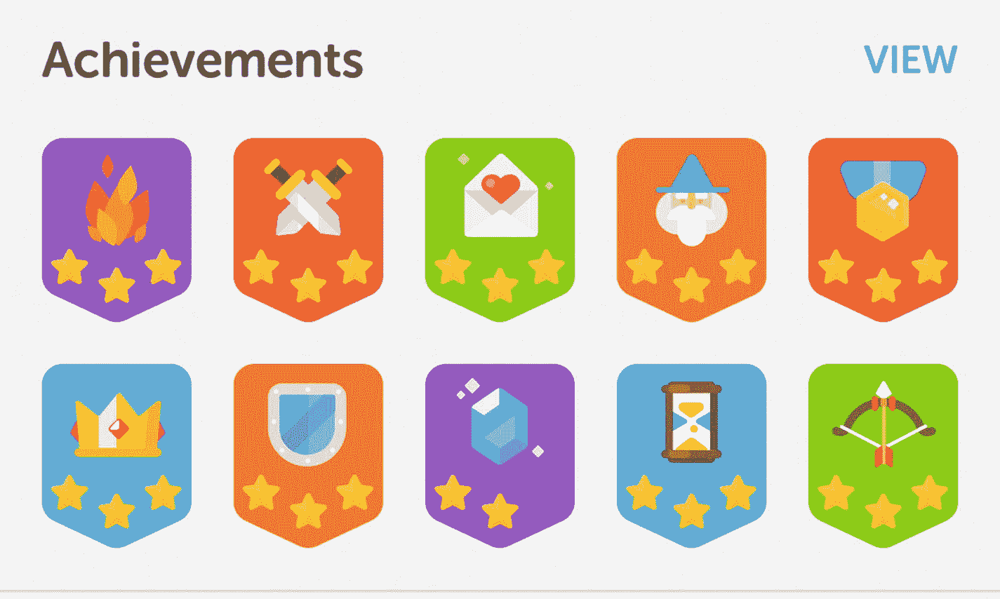
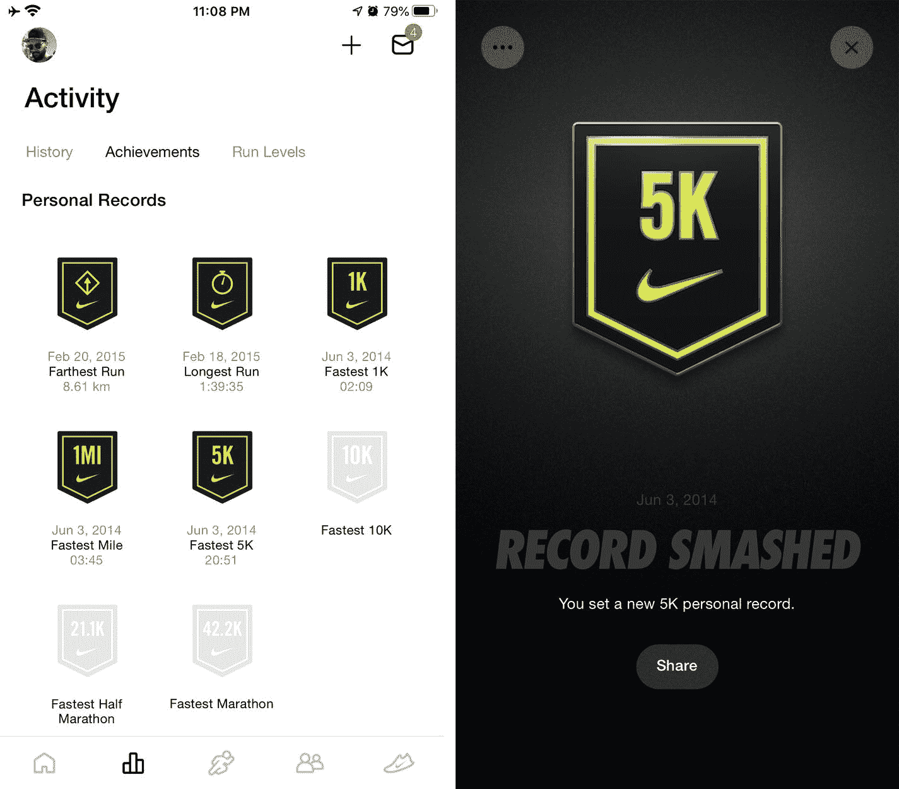
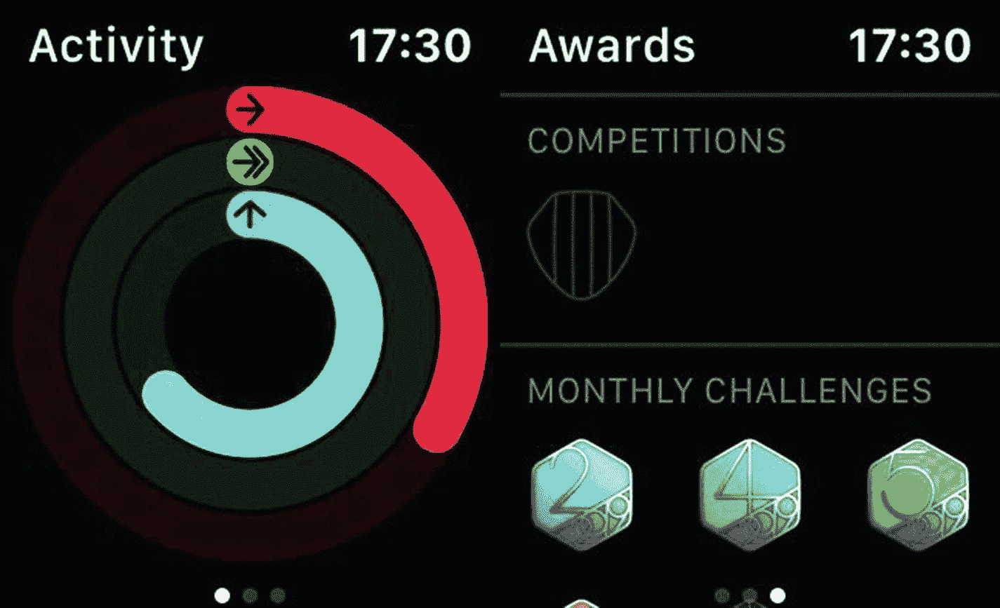
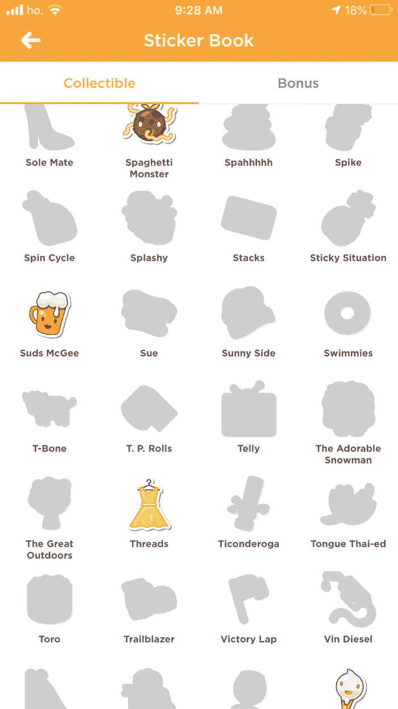
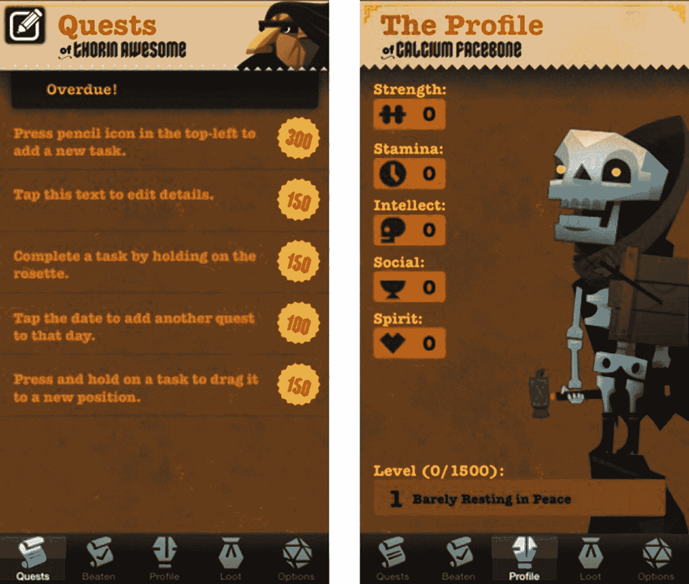
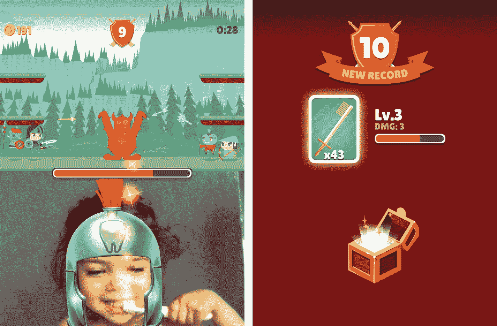
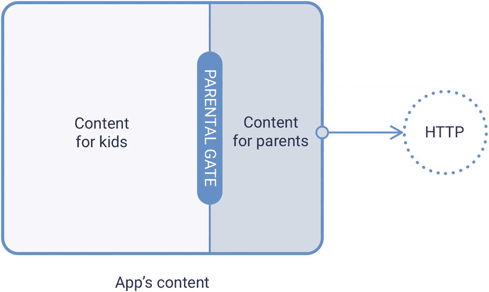
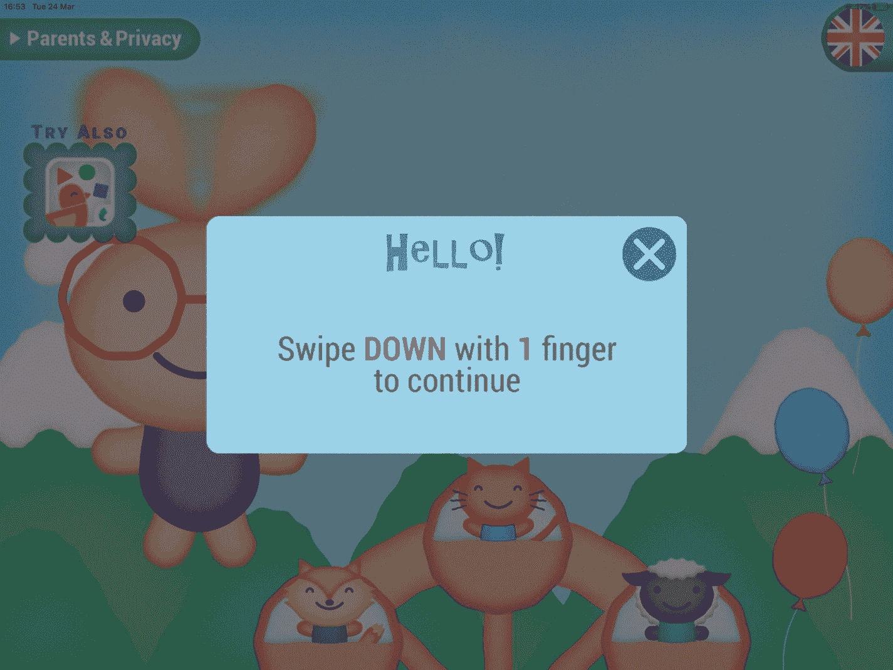
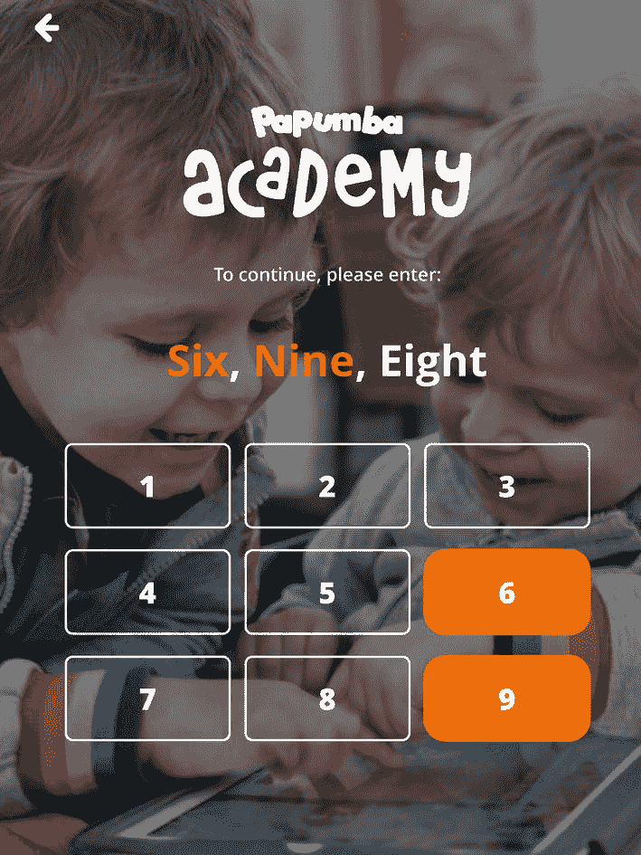

# 5. 游戏化

游戏化是几年前开始越来越流行的热门词汇之一。许多公司试图在其产品中实施某种游戏化机制，但很少有公司做对了。

为什么理解什么是游戏化以及它如何运作对我们来说很重要？为体验增加游戏元素可能是一个非常强大的工具，因为“玩”的概念植根于我们的 DNA 中。人类自古以来就玩游戏，就像所有哺乳动物（以及不只是它们）一样。即使我们长大后，可悲地停止了玩耍或大幅减少了玩耍的时间，“游戏”的概念对我们来说仍然非常熟悉，并且可以触发强烈的情感和记忆。

可以想象，游戏化涉及很多心理学知识，但为了简化问题，让我们将讨论保持在实际操作的层面，分析哪些产品有效地使用了这种策略，我们可以应用哪些技术以及如何应用，以及通常该做什么和不该做什么。

如果你正在为儿童设计学习体验，参与度和动机是你绝对想要实现的两件事。当你设计纯游戏体验时，让孩子有动力很容易；实际上，难的是反其道而行之，避免他们上瘾。但是，当你的产品目标是教育时，保持年轻用户的兴趣和参与度就更难了。游戏化可以提供帮助。

但是“游戏化”是什么意思呢？我认为 `交互设计基金会` 提出的定义非常到位：

> “游戏化是一种技术，设计师将游戏元素嵌入到非游戏环境中，以增强用户对产品或服务的参与度。通过将诸如排行榜和徽章等合适的趣味功能编织到现有系统中，设计师挖掘用户的内在动机，让他们乐于使用它。”

首先要注意的是，你不能在游戏中使用游戏化，这很明显。游戏化是将游戏机制引入非游戏产品，例如教育产品、社交媒体平台、评级和评论平台、健身追踪应用等等。然而，很多时候，游戏化被当作一种能提升参与度和内容病毒式传播的神奇药水来实施。不要指望一个徽章系统或数字贴纸册能让一个无聊的产品变得有吸引力和有趣。游戏化可以帮助用户更有动力地使用产品，但它不可能是你唯一依赖的东西。一个常见的错误是把这种技术看作是让产品成功的途径，但事情没那么简单：如果产品本身很糟糕，仅仅靠游戏化是救不了它的。

尽管如此，如果做得好，它可以是让你的产品更令人愉快的非常成功的方式。

## 动机

动机是在产品中实施游戏化的主要原因之一。动机有两种类型：内在动机和外在动机。

内在动机是指做某事的愿望来自于你自身；没有外部因素影响你完成这件事的渴望。例如，你想学弹吉他，是因为你想学习一项新技能并演奏一些音乐。

相反，受外在动机驱动意味着做某事的需要受到外部因素的影响，比如获得奖励或避免惩罚，例如，开车时减速以避免收到罚单。

尽管内在动机看起来是最理想的情况，但实际上这两者并没有更好之分——它们都有效。一项研究发现，如果正面反馈是真诚的、能促进自主性，并传达了现实且可实现的标准，那么表扬可以帮助增强儿童（和成人）的内在动机。但同一项研究也指出，表扬对动机的影响是一个复杂的问题，还受到接受者的年龄、性别和文化的影响，在某些情况下甚至可能是有害的。

当我们谈论外在动机时，游戏化就登场了（双关语，意为“发挥作用”）。它是一种提供奖励感的工具，无论是排行榜上的榜首、解锁新内容，还是我们稍后将讨论的任何其他机制。

在某种程度上，这是一种转移内在动机的技巧。一个孩子可能对学习数学没有太强的内在动机，但他们可能非常有动力在一个数学游戏的班级排行榜上获得第一名。因此，游戏化作为一种外在激励因素，调节了这种内在动机，将其从数学本身转移到游戏上，而归根结底，这个游戏正是在教孩子数学。

# 一些著名的案例

让我们来看看数字产品中优秀游戏化设计的几个例子。尽管这些产品大多面向成年人，但它们运用游戏元素激励用户的方式非常巧妙且实现得十分出色。我之所以选用这些例子，是因为你很可能亲自体验过其中一些，通过亲身感受，能更清晰地理解我们所说的游戏化。同时也能更清楚地看到，这些技术不受年龄限制，可以用于任何年龄用户群体的数字产品中。

## Duolingo
`Duolingo`（图 5-1）是一款语言学习应用，它高度依赖游戏化设计来激励用户进步并持续学习。

图 5-1
`Duolingo` 成就界面

该应用提供了一系列成就和相应的徽章，用户通过完成活动并每天使用应用来解锁“连续”徽章。

游戏化已深深嵌入 `Duolingo` 的用户体验之中，以至于他们甚至与超级流行的街机手机游戏 `Angry Birds`（由 `Rovio` 开发）进行了联合品牌活动，这还得益于它们都以鸟类作为吉祥物（我们将在后面章节专门讨论数字产品中角色的开发和使用）。

## Nike Run Club
在健身领域，许多产品都采用了游戏化技术，因为挑战、奖励和目标的概念与体育活动完美契合。最早这样做的品牌之一是 `Nike`，它推出了 `Nike+` 平台（现称为 `Nike Run Club`；图 5-2）。用户可以查看自己的成绩、解锁成就、与朋友比较和挑战等。这是一个极好的工具，可以提升动力，保持用户参与度，并帮助他们养成日常习惯。

图 5-2
`Nike Run Club` 中的徽章

## Apple Watch 的健康圆环
同样在健康领域，`Apple Watch` 的健康圆环是一个例子。`Apple Watch` 向大众普及了追踪每日身体活动以保持健康的理念。该应用有三个圆环（图 5-3），用于衡量你一天中的活动量、锻炼时间和站立时间。通过合上这些圆环，用户会收到通知和徽章来保持动力，连续合上所有圆环的天数越多，解锁的徽章就越有分量。这种机制如此强大，以至于有些人将其视为一种生活方式，实现了连续多年合上所有圆环的成就。

图 5-3
`Apple Watch` 健康圆环和徽章

## Swarm
`Swarm` 是 `Foursquare`（图 5-4）的继承者，后者或许是第一个基于位置的社交媒体。它引入了“签到”的概念，让用户可以实时告知联系人自己正在访问的餐厅、商店或其他商业场所或地点。用户访问的地点越多，解锁的徽章就越多；通过定期访问同一个地点，用户可以成为该地点的“市长”。尽管 `Foursquare` 不如刚推出时那么流行，但它仍然是游戏化应用于现实生活场景的一个好例子。

图 5-4
访问地点即可解锁 `Swarm` 中的徽章

## Epic Win
虽然不像前面的例子那么流行，但 `Epic Win`（图 5-5）仍然是一个非常引人注目的游戏化案例。这可能是将游戏机制应用到实用工具类应用中最极端的尝试之一。`Epic Win` 是一个 `RPG`（角色扮演游戏）风格的待办事项清单应用。完成任务和家务可以让你获得经验值、解锁战利品、升级角色等等。

图 5-5
通过完成任务，用户可以提升角色等级

儿童产品中也有很多例子；这里我挑选了两个有趣的案例，因为它们并非在通常的教育场景中使用游戏化。

一个是 `Brushing Hero`（图 5-6），一款激励孩子刷够时间牙的应用。通过使用 `AR`（增强现实）和面部识别技术，孩子们会看到自己化身为与怪物战斗的骑士。他们刷牙越久，击中的敌人就越多，累积的点数也越多，从而提升角色等级。

图 5-6
在 `Brushing Hero` 中，孩子们在刷牙时收集点数并提升角色等级

第二个例子是正念应用 `Stop, Breathe & Think Kids`（图 5-7）。通过完成冥想和正念练习，孩子们可以解锁数字商品。这是一种非常简单的机制，但看到它被应用于这类体验中，还是很有趣的。

图 5-7
通过完成任务，孩子们可以解锁收藏品

## 组件
在了解了一些游戏化应用的著名案例后，我们可以明确识别出究竟哪些组件和工具可供我们使用，以便将其有效地应用到我们的产品中。

这些组件正是大多数电子游戏的共通之处。正如本章前面所述，你不能将游戏化应用于一款电子游戏，因为游戏化意味着将非游戏产品向游戏靠拢，而电子游戏本身当然已经是游戏了。你可以做的是向电子游戏学习。分析是什么让这类产品有趣且引人入胜，并尝试提炼出这些组件，然后试验如何将它们应用到非游戏产品上。

以下是一些可以单独或组合使用的游戏化组件示例：
- `积分（Points）`：用户可通过产品内的各种活动获得的信用值。积分可能是最经典的游戏化组件之一。它可以决定用户在 `排行榜` 上的位置。
- `排行榜（Leaderboard）`：按累计积分排序的用户列表。这从街机游戏早期起就是另一个典型元素。渴望爬上排行榜顶端、占据榜首位置，正是激励用户参与产品并赢取积分的动力。
- `应用内货币（In-app currency）`：类似于积分，但用于在平台内交易商品。应用内货币可通过不同方式累积，具体取决于产品及其机制。它们通常与积分是分开的，因为可以像虚拟货币一样被消费。
- `经验值（Experience）`：经验值源于 `RPG`（角色扮演游戏）。在这些游戏中，我们采取的每一个行动和决定，与其他角色或游戏对象的每一次互动，都会给予我们经验值。经验值基本上记录了我们参与游戏的程度。
- `等级（Level）`：这个组件是经验值的指标。它也源于 `RPG`，在 `RPG` 中，玩家的主要目标之一就是提升角色等级以变得更强、获得新能力等。等级可以解锁特殊功能，以此作为激励用户的方式。
- `进度（Progression）`：传达我们在某个过程中已进展到何处的想法，可以帮助用户保持参与感并坚持到底（这就是为什么让用户了解下载或安装过程完成了多少、还有多少剩余总是一个好主意）。进度通常与等级相关联，因为它表明在升级到更高等级之前，我们还需要获得多少经验值。
- `任务/使命/成就（Quests/missions/achievements）`：玩家为了获得积分或经验值以及/或者解锁成就而必须完成的目标。
- `徽章（Badge）`：当达成特定目标时，会解锁一个徽章作为奖励。通常有大量徽章可供解锁；它们被收集在特定的“奖杯”界面中，玩家可以在那里看到已获得的徽章，并且通常还能看到尚未获得的徽章，以保持他们的参与度和积极性。
- `升级（Upgrades）`：升级可以通过提升等级或使用应用内货币购买来解锁。它们在游戏中代表某种优势，使完成任务和解锁徽章变得更容易。
- `虚拟形象（Avatar）`：在大多数（但并非所有）游戏中，我们通过某种角色来行动。在游戏化中，这可以简单地采用用户选择的头像形式，用于在与其他玩家互动时标识自己。

通过阅读这些描述，您可以看到，许多这些组件都是相互关联的。经验值可以决定你的等级，等级可以解锁升级以获取成就和解锁徽章，而这些又可以奖励你额外的经验值，如此循环往复。理解这些机制对于设计合适的游戏化至关重要。将这些要素随意地散落在数字产品上，只会形成一种非常糟糕（即几乎不存在）的游戏化策略。因此，充分理解如何将这些碎片拼凑起来，并创建一种循环机制（就像我之前描述的简单机制那样，让链条的最后一环与第一环相连，形成无限循环），这一点非常重要。

当然，并非所有产品及其目标用户都是相同的。因此，为了开发有效的游戏化方案，了解你的用户、他们的驱动力、他们的动机以及他们的技能是至关重要的。你想要达到的复杂程度取决于此；例如，你不会为目标用户是幼儿的应用设计一套包含经验值、等级、能量提升和应用内货币的复杂 RPG 机制。在这种情况下，一系列可供解锁的数字收藏品可能就足够了。但对于 10 岁或 12 岁的大一点的孩子来说，这也许意义不大，数码贴纸对他们来说可能不够吸引人。他们或许更会被一项更复杂的挑战所激励和娱乐，例如拥有一个可以和朋友比较成绩的排行榜，以及可以自定义的虚拟形象。

另一个需要理解的重要点是，你不能拿一个成品，在设计过程结束时再给它加上一层游戏化。从最开始，定义和实施游戏化策略就是用户体验设计理念中不可或缺的一部分。它不是可以即插即用的模块，而是深深嵌套在体验的核心之中。当它只是事后添加时，你一眼就能看出来，而且这通常是一种非常糟糕的游戏化。

## 最佳实践

以下是设计游戏化时值得牢记的一些良好原则。

### 平衡

游戏化并非易事。首先，它关乎有趣的游戏元素与产品实际目的之间的平衡。它不应过于强势，以至于将产品的性质从其原本的范畴转变为彻头彻尾的电子游戏。因此，在设计游戏化策略时，平衡至关重要。如果你的应用主要目标是教育，请务必确保教育是体验的核心，而游戏化组件只是让“良药”更容易入口的“糖衣”。

### 超越“BPL”

徽章（Badges）、积分（Points）和排行榜（Leaderboard），即 BPL。这是最基本（也最被滥用）的游戏化机制。诚然，它足够灵活，能够适应多种产品，但你肯定不希望自己的产品只是某个旧概念的又一个翻版，对吧？尝试超越已知的模式和已经见过的体验。

### 为用户量身定制

游戏化策略并非“混合搭配”之物。每个产品及其受众都需要定制的游戏化方案，不能直接复制粘贴到另一个产品上。尤其对于面向儿童的数字产品而言，正如我们在前几章中看到的，仅仅 2 岁的年龄差距就非常显著。你必须清楚你的用户是谁，他们的兴趣点在哪里，什么能吸引他们，并据此进行规划。在为学龄前儿童和五年级学生设计时，所用的“食材”可能相同或非常相似，但“烹饪”的方式却可能大相径庭。

# 警惕成瘾性

没错，我们使用游戏化机制来吸引和激励用户，但绝不想让他们对我们的产品上瘾。考虑到我们的小用户们的年龄，动机与沉迷之间的界限有时可能非常模糊，我们必须注意他们花在设备上的时间（是的，又说到屏幕时间了）。如果我们只看原始数据，成瘾似乎是完美游戏化的标志——我们将用户参与度最大化到了用户几乎无法停止使用产品的程度。听起来很棒，对吧？不，并非如此。促进用户有意识地、健康地使用我们的数字产品，本身就是用户体验的一部分。

阿扎·拉斯金（苹果公司 Macintosh 项目发起人杰夫·拉斯金之子）被普遍认为是“无限滚动”模式的发明者，我们在 Facebook、Twitter、Instagram 和其他产品中早已习惯这种体验。几年后，当这种模式变得无处不在时，他对自己创造了这种无法预见到后果的成瘾性交互表达了歉意^(³³)。

作为设计师，我们不能将用户参与本身视为成功；我们需要将其置于一个更广阔的背景中考虑，在这个背景下，用户的福祉才是我们的首要关注点。

## 章节回顾

* 游戏化可用于吸引儿童并激励他们。

* 游戏化的经典元素包括：积分、排行榜、应用内货币、经验值、等级、进度、任务、徽章、升级、头像。

脚注 1 2 3 4

# 安全措施

在为儿童设计数字产品时，安全必须是重中之重，这应该毫无争议。儿童产品的安全功能不仅是设计师（以及开发者等所有相关人员）显而易见的道德选择，也是应用商店（无论是苹果还是谷歌）和法律（各国规定不同）的要求。

安全意味着许多方面：从通过帮助用户控制屏幕使用时间来促进设备健康使用，到避免在线不良遭遇，再到过滤不适合用户年龄的内容。儿童产品安全性的一个主要薄弱环节是连接性。

连接性意味着我们的设备可以访问互联网，因此儿童可能接触到无穷无尽的有害体验。

尽管我们可以采取措施防止儿童访问我们产品之外的内容或与陌生人联系，但我们必须记住，他们只需在设备上轻轻滑动或点击`home 按钮`，就能绕过我们能想到的任何家长控制关卡。

现在，一些安卓设备提供了“儿童模式”，基本上将设备置于锁定模式，功能仅限于让选定的应用运行，别无他用。在我撰写本文时，iPadOS 和 iOS 尚未提供此功能。它们提供了一系列家长控制^(³⁴)功能，用于限制音乐和视频中的露骨内容、访问某些网页等，但这并不是你可以在将设备交给孩子时像按飞行模式按钮那样快速开启或关闭的功能。

## 商店要求

当我们谈论的是移动应用（而非基于浏览器的产品）时，`App Store`^(³⁵)和`Google Play Store`对于应用能否进入其儿童类别都有一系列要求。

这两个平台都有面向开发者的指南，列出了他们的产品要进入儿童类别必须满足的所有要求。总的来说，必须避免的是：
* 指向外部网站或社交媒体平台的链接
* 任何形式的购买机会，无论是虚拟商品还是实物商品
* 以任何方式与陌生人发消息或交流

所有可能符合此列表的功能都必须隐藏在`家长控制门`之后（稍后会详细说明）。

另一个重要要求是隐私。如今，我们都知道在线隐私的重要性及其应受保护。这一点在涉及儿童时更为重要，因此，所有希望在儿童类别中占据一席之地的数字产品都必须符合美国的`COPPA`^(³⁶)（儿童在线隐私保护法）和欧盟的`GDPR`^(³⁷)（通用数据保护条例）。合规性不仅在发布时需要确保，在未来的所有更新中也必须如此；不仅如此，一旦产品进入儿童类别，即使后来被移除并移至其他类别，它仍然必须保持合规，以保护所有当初在其被认定为儿童安全产品时购买的用户。

### 广告

在儿童数字产品中投放广告是一个非常棘手的话题。这是一个灰色地带，只要广告不违反前面描述的准则，允许什么、禁止什么，很大程度上取决于开发者的道德水准。当然，内容必须适合儿童，例如，你不能在一个面向幼儿的产品上投放赌博网站的广告（即使纯粹从商业角度看，这也毫无意义）。

直到不久前，问题还在于广告网络并未提供经过精心挑选、100%对儿童安全的广告，因此依赖这些为成年人设计的服务可能会很复杂。为了解决这个问题，现在有了专门为儿童产品设计的广告网络，例如`superawesome.com`或`kidoz.net`。这些平台提供符合法律要求的内容，开发者可以安全地通过展示广告来创收，或者在一系列应用网络中推广自己的产品，同时知道他们正在精准触达目标受众。

广告和儿童之间的结合常常招致非议，也是因为儿童没有足够的经验来辨别哪些是广告，哪些是你产品中合法的内容。作为成年人，我们多年沉浸在数字世界（无论是应用还是网站）中，已经培养出了在 UX 设计中所谓的`横幅盲视`现象。当网站访客有意识或无意识地忽略以横幅等形式出现的广告时，就会发生这种现象。这也是为什么如今网站上的广告变得如此具有侵略性的原因——新闻媒体将其整个背景出售给广告商，以及其他诸如此类的可怕事情。

儿童是网络新手；他们还需要积累那些由错误点击、弹窗开启后几乎无法关闭以及其他所有让我们（几乎）免疫的烦扰所构成的体验。因此，作为一个家长和努力做出合乎道德决策的设计师，我的观点是：应始终避免在儿童产品中投放广告。

# 家长锁

*家长锁*是最常见的防止儿童访问产品中面向成人区域的方式，例如家长设置订阅付款方式的设置页面，或包含外部网页链接的页面。

家长锁（图 6-1）是一个屏幕，以全屏页面或弹窗形式出现，放置在儿童可访问区域与其不可访问区域之间，例如从应用主页到其设置页面之间。

图 6-1

家长锁锁住了对成人内容的访问。所有通往开放互联网的访问都位于此锁之后

这个页面（或弹窗）会提出一个问题，用户必须正确回答才能进入成人专属区域。这个问题可以有不同形式，从简单的数学运算，到执行一段文字描述的手势，或在数字键盘上输入一段文字描述的数字序列。

在 `Colto` 出品的 `Eli Explorer`（图 6-2）中，用户被要求在屏幕上执行一个手势。

图 6-2

`Eli Explorer` 通过手势进入家长区域

`Bimi Boo` 出品的 `Drawing for Kids`（图 6-3）要求成人在数字键盘上输入其出生年份。

图 6-3

`Drawing for Kids` 要求成人输入其出生年份

`Papumba Academy` 以及许多其他应用，要求用户输入一串数字（图 6-4）。

图 6-4

要求从书面文字到数字键盘输入数字序列

如你所见，家长锁可以有多种形式，但需要牢记的重点是，它们必须足够简单，让家长能快速通过而不头疼（你不想让他们解复杂的谜题），但同时，对儿童来说又要足够困难，成为一道保护他们不进入不应访问区域的屏障。另一个需要牢记的重点是，这些问题或任务应该是随机化的。不要总是要求执行相同的手势或输入相同的序列：孩子们很聪明。

当然，当孩子能够阅读时，这种认证技术会更难实现；在这种情况下，`PIN` 码或密码可能是更好的选择。现代设备还提供基于指纹或面部识别的生物认证（`biometric authentication`），这也是一个非常有效的选项。

## 社交与通讯应用

所有面向儿童的在线社交活动，无论是通讯内容还是社交媒体类型，都需要非常谨慎的设计。有几个需要考虑的方面和需要注意的危险因素。其中包括：

*   与陌生人接触

*   分享个人信息

*   收集个人数据

*   `likes`、`followers` 等虚荣指标及其对心理健康的影响

其中一些方面由应用商店政策和政府法规（如我们将在第 10 章中看到的 `COPPA` 和 `GDPR`）处理。但其他方面则没有，例如虚荣指标的使用，这取决于开发应用的公司及其设计师的伦理道德来解决这些问题。

当我们为儿童设计一个通讯平台，或任何形式的开放式交流（例如，包括对内容的评论）时，我们绝对需要确保家长和监护人有责任控制孩子可以和谁联系，以及可以被谁联系。这就是为什么我们需要在产品的屏幕上设置家长锁，防止儿童通过这些屏幕访问网络（如同前一节讨论的那样）。

这类应用需要为儿童和家长设计不同的体验，后者应拥有管理员权限，以便接受或拒绝向孩子账户添加联系人的请求。这几乎是所有此类应用的承诺。

当涉及虚荣指标^(³⁸)及其对用户心理健康的影响时，情况就不同了。关于社交网络是否让我们抑郁，对此主题的研究尚未得出最终结论。但不可否认的是，在线社交互动对我们的情绪有影响。^(³⁹)

`LEGO Life` 考虑到了本节开头提到的许多问题。其内容由人工审核，儿童不能上传照片作为头像，只能从一套乐高模型中选择，评论仅限于表情符号和预设回复。

在我看来，它的不足之处在于提供了诸如*点赞*之类的虚荣指标。在儿童中推广这种机制是一个不确定的领域，作为家长（和设计师），我会很乐意避免它。

同样的情况也发生在 `PopJam` 上，一个如其常见问题解答中所描述的“面向 7-12 岁儿童的创意社区平台”。这里的内容当然也是经过审核的，通常不允许自拍和人物照片，除非通过应用提供的贴纸进行遮挡。其准则还明确禁止用户发布个人信息，如真实姓名、地址、学校名称等。`PopJam` 也具有虚荣指标，如 `likes` 数、`followers` 数量，甚至有一个经典游戏化方法（参见“游戏化”一章）中的 `levels`，在这种情况下，并非用于教育等更有益的目的，而是仅仅为了在平台上的参与度。

`Kinzoo` 的创始人兼首席执行官 `Sean Herman` 就这一主题写了一本非常有趣的书，名为 *Screen Captured: Helping Families Explore the Digital World in the Age of Manipulation*。^(⁴⁰) 你可以在第 7 章结尾的“行业洞察”中找到我与他就此主题的交流。

## 章节回顾

*   儿童产品的安全是重中之重。所有对外部链接的访问和涉及真实货币的购买都必须设有家长锁。必须始终避免与陌生人进行开放式交流。

*   美国的 `COPPA` 和欧洲的 `GDPR` 等法规确保开发者正确使用儿童数据并保护其身份。

*   家长锁可以采用不同的技术，从简单的数学问题到手势。你也可以利用生物识别数据，如指纹或面部识别。

*   通讯应用应在封闭网络中运行，只有家长或监护人才能为孩子添加联系人。

*   警惕儿童产品中的虚荣指标，例如 `likes` 和 `followers`。

脚注 1   2   3   4   5   6   7

