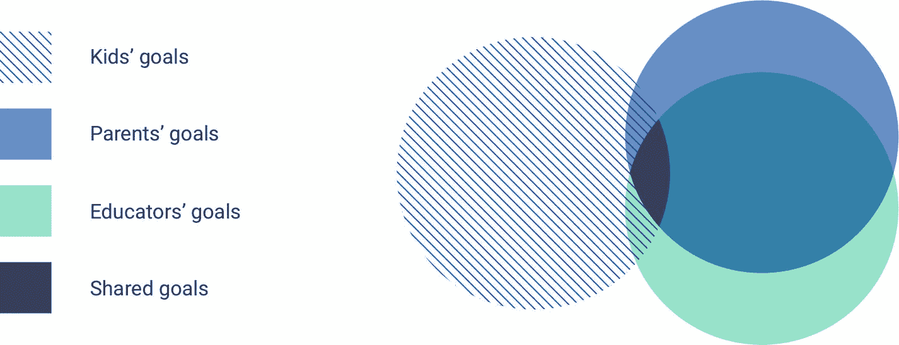

# 3. 了解你的目标受众

了解你的用户、他们的需求与期望。理解挑战。发现机遇。

> *我爱孩子，但他们可不好糊弄。*
> 
> ——罗宾·威廉姆斯，喜剧演员

在本书开篇，我们简要介绍了将要设计的产品需要应对三类不同受众：儿童、家长和教育者。在本章中，我希望深入分析这一点，并强调为何在项目开发的概念阶段就必须认识到这三类受众的差异及其重要性。

## 三重受众

通常，任何产品（无论是否为数码产品）都会涉及一个参考目标。这个目标回答的问题是：这款产品为谁而设计？它可以是一个由年龄、性别、语言、地域、习惯、品味以及更多细分维度定义的群体，这些维度也可以相互组合。例如，我们针对居住在大型城市、热爱运动和听音乐的 25 至 34 岁人群设计产品。这是一个宽泛的目标。通过增加更多筛选条件，我们可以根据商业策略将其进一步缩小。

通常，产品拥有或宽或窄的目标受众，但很少会超过一个（除非是高度注重内容的产品/服务，其类型的多样性能满足多种用户需求，例如流媒体服务）。儿童产品，尤其是数码产品（特别是需要订阅的），需要取悦不同类型的用户，而这些用户通常怀有截然不同的目标。正如你所了解的，我们谈论的是儿童和家长，而在这两类用户之外，我还想加入教育者，稍后我会解释原因。

在这个韦恩图（图 3-1）中，一个圆圈代表儿童的兴趣和目标，另一个代表家长的；我们可以看到这两者的交集非常小，而家长与教育者的目标重叠则大得多（但并非完全一致；例如，教师可能更关心协作功能，而家长则更关注屏幕时间监控）。

图 3-1

儿童、家长与教育者需求的重叠情况

这是面向成人的产品与面向儿童的产品之间的关键区别，后者使得市场推广更具挑战性。通常，儿童对产品的趣味性更感兴趣，而家长最关心教育价值。因此，在第二章中，我强调了在两者之间找到良好平衡至关重要。但你不需要严格从学术意义上去理解教育价值。像《愤怒的小鸟》这样的游戏可以展示物理、重力等概念；它是一款成人和儿童都觉得好玩的娱乐游戏，但成年人可能已经对这些概念了然于心，而对于儿童来说，这不仅可以带来纯粹的娱乐，也能起到教育作用。

### 儿童

这是我们关注的焦点，因为作为设计师，我们与家长和教育工作者一样，都怀有为孩子创造有价值之物的志向。

我所说的“有价值”是指：

-   **无害（生理和心理上）**  
    产品必须符合儿童安全法律法规，并遵循儿科医生及其他专家建议的最佳实践。

-   **促进其发展**  
    产品应对儿童的认知和身体发展产生积极影响。无论应用的主要目的是否是教育，它都应始终提供一种以年轻用户福祉为中心的体验。

-   **趣味十足**  
    没人喜欢枯燥乏味的东西，对孩子来说更是如此。尤其当你的产品旨在教育时，你希望孩子们在使用时能感到快乐，从而保持他们的兴趣和好奇心。这就像给良药裹上糖衣，好让他们愿意服用。没有孩子愿意咽下的苦糖浆是毫无意义的。

-   **易于使用**  
    这一点与上一点紧密相关。如果一个应用或网站使用起来很麻烦，即使是最有趣的想法也会变得乏味。你不想让用户感到沮丧，因为失去他们的注意力极其容易。成年人或许能忍受糟糕的用户体验，因为他们可能别无选择（例如，与工作相关的软件），但孩子们使用这些应用是为了娱乐和教育。别让糟糕的用户体验破坏了乐趣。

-   **无障碍且包容**  
    多样性终于进入了设计讨论。随着我们的社区日益多元化，即使你只为特定地区开发产品，也应将包容性视为一项附加值。除了种族、宗教或原籍国，多样性也可能意味着存在身体和/或认知障碍；包容性意味着要考虑到这一点，并致力于开发无障碍的产品。

在本书的引言中，我简要指出了与成年用户相比，儿童用户群会根据年龄进行细分。这可能是个问题，因为，即使你不是家长也能想象到，一个 3 岁孩子的认知能力和运动技能与一个 10 岁孩子截然不同。前者很可能还不识字，对世界的认知非常有限，抽象思维能力有限，逻辑和数学能力也不同，而且在进行手势操作时的灵巧度也不同，对年龄较大的孩子来说非常容易的`拖放`操作，对年龄较小的孩子来说可能很棘手，等等。

本书无法详尽阐述儿童身心发展的所有细节；那是医学手册和儿科医生的任务。我唯一能做的，是提供一些思路和更实用的技巧，我们将在后续深入探讨用户体验和用户界面问题时具体分析。

根据孩子的年龄，家长在做决策时的影响力也不同。对于年龄较小的孩子，决定花钱下载哪个应用是家长的选择，而年龄较大的孩子在这些决策上可能有更大的影响力。因此，在设计时始终兼顾孩子和家长的需求仍然是正确的，但随着孩子长大，这个平衡点会有所偏移。

所以，正如你所见，我们的第一类受众已经在多个层面上支离破碎。理解并决定我们的产品为哪个年龄段设计至关重要。我特意用了单数的“年龄段”而非“多个年龄段”；考虑到仅仅一年内发生的巨大发展差异，要让产品适用于超过 2-3 年的年龄跨度是一项艰巨的任务。常见的年龄段分组是 3-5 岁、6-8 岁、9-11 岁，有时是 2-4 岁、5-7 岁等等；在 Google Play 商店和苹果 App Store 上，他们将最年轻的群体称为“5 岁及以下”。

### 家长

正如我们之前所说，在购买数字产品时，家长作为决策者的角色通常会随着孩子长大而减弱。但没有哪个孩子能在经济上自给自足；因此，你仍然需要高度重视家长的需求（和意见）。

家长的需求与孩子不同。他们更关心应用可能具有的教育价值、安全性以及成瘾性。这是一个他们可以让孩子独自使用几分钟的产品，还是需要持续监督的东西（提示：如果需要持续监督，那感觉就不太对劲）？

此外，还有财务方面的考量，例如产品的价格，或者取决于商业模式，订阅费用，以及由此产生的性价比关系。

一个产品是否适合儿童，部分程度上可能非常主观。法律划定了界限，但对于像便便或放屁笑话这样的小事，由于文化差异或仅仅是个人品味和信仰的不同，解读方式大相径庭。

家长掌握着两种强大的议价武器，它们可以成就或毁掉我们的产品：钱包和（应用商店或任何其他有用户评论功能的平台上的）评论。

要让家长花钱购买一个产品，他们需要被说服，相信其质量、价值和安全性。在本书中，我们将从设计和营销的角度探讨如何实现所有这些目标。

评论对于任何产品来说都可能是诅咒或祝福，但家长由于天生（且合理）地保护自己的孩子，当产品低于他们的期望时，他们毫不留情，所以请务必关注评论。

家长通常信任教育工作者，因此让他们参与进来很重要。

### 教育工作者

教师是我们最好的盟友。他们与家长有两个共同点：他们关心孩子，并且是成年人。但教师的需求与家长不同，购买力也不同。尤其是在公立学校，教师可能没有足够的资金批量购买你的产品，所以考虑为他们提供免费访问权限。为什么？因为教师可以成为你的代言人，在家长（以及其他教师，这些教师会再向更多家长推广，形成潜在的病毒式传播机制）中推广产品。

教师需要有足够的理由来推荐你的产品，因此他们更看重质量。虽然家长可能没有合适的工具来评估一款儿童应用的质量，但教师知道一个产品是否值得在课堂上使用并推广到家庭。一些教师还有自己的博客和社交媒体渠道，向同行提供数字产品建议。因此，从一开始就让教师参与到开发过程中至关重要，团队中拥有一位教育专家顾问至关重要，同时建立一个由参与 Beta 测试的教师组成的反馈小组也同样重要。

当你为儿童设计教育产品，并期望教师在课堂上使用时，要知道教师会需要一个后台管理面板，他们可以在此分析产品使用情况、结果、跟踪活动，甚至自定义活动等等。这部分工作将与面向儿童的界面不同，因为它将是你的儿童产品中，为满足成人专业工作需求而设计的一部分。这仅仅是“儿童”产品可以多么复杂的又一个例证。

