# 7. 交互设计

设计适龄体验。

在前几章中，我们介绍了一些为儿童进行用户体验设计所涉及的挑战。我们讨论了运动技能发展的不同阶段，因为这些阶段会严重影响与设备交互的能力，并限制或拓宽我们的交互机会。

在本章中，我们将更深入地探讨在为儿童设计数字产品时会遇到的交互挑战（和机遇）。

## 儿童与成人用户：关键差异

有一点很明确：儿童的思维方式与成人不同。我们将在下一节更深入地探讨这个话题，但目前，先让我们识别出影响交互和整体用户体验的儿童与成人之间的一些宏观差异。

### 儿童发育非常迅速

无论在生理还是认知层面，儿童都发育迅速。因此，为 4 岁儿童设计的产品可能不适合 6 岁儿童；因此，在`App Store`和`Google Play Store`上，我们会对儿童应用按 2 年的间隔进行分类：“5 岁及以下”、“6–8 岁”和“9–11 岁”。

而普通成年人，只要没有认知或生理障碍，无论年龄大小，其能力基本上都相差无几。当然，60 多岁的人的视力可能不如 20 岁的年轻人，但一个通用的银行、音乐流媒体或即时通讯应用，对于相差几十岁的用户来说，都能完美运行。

### 儿童享受过程

作为成年人，除非是在玩游戏，否则我们希望使用数字产品的体验尽可能简单。想象一下使用酒店预订网站或在线购买机票的场景。你期望事情简单直观，希望能尽快找到所需内容，从而高效地完成任务，避免不必要的麻烦。

但儿童在使用数字产品时，他们享受的是过程，而非结果。他们不打算尽快完成某个特定任务；他们想要享受体验，并在过程中发现有趣的事物。

从起点到终点之间，儿童享受我们所称的“微冲突”(micro-conflicts)。

正如我们在第 5 章中讨论过的，这种理念是游戏化的核心。

### 儿童经验较少

我们将在下一节更详细地看到，处于这些发展阶段（从幼儿园到六年级或七年级；见本章后文皮亚杰的认知发展四个阶段）的儿童，实际上无法提前预测自己行为的后果。他们生活经验匮乏，因此往往比成年人更容易轻信他人。作为设计师，我们的职责是确保我们的年轻用户身处一个受保护且安全的环境中。这是我们产品必须提供的最重要特性之一，我们将在专门的章节中探讨其意义。在与数字产品交互方面，儿童的经验显然少于普通成年人。这意味着许多我们在为成年人设计交互和界面时视为理所当然的模式，对儿童来说仍然很陌生。对他们而言，构建复杂信息架构的心理地图可能极具挑战性，甚至是不可能的。执行某些手势操作可能构成双重挑战：首先是理解这些手势，其次是正确地执行它们。生活经验的缺乏，尤其是与数字产品交互经验的缺乏，使得儿童在隐私和安全方面特别脆弱，并且在操作界面时更容易感到沮丧。

儿童并非缩小版的成人，他们与众不同，需要不同的可用性指南。不过，重要的是要认识到，许多适用于成人并能创造轻松愉快体验的用户体验（UX）原则，对儿童同样有效。一致性就是其中之一。你不想在交互过程中改变交互方式或用户界面（UI）组件来迷惑儿童，就像你不想在面向成人的产品中这样做一样。简化设计、避免认知过载，同样适用于儿童和成人。

表 7-1 总结了基本的异同点。

**表 7-1** 儿童与成人用户体验的差异与相似之处（数据来源：尼尔森诺曼集团）

| | | 儿童 | 成人 |
|---|---|---|---|
| **相同点** | **遵循 UI 惯例** | 偏好 | 偏好 |
| | **用户控制** | 偏好 | 偏好 |
| | **第一反应** | 快速判断应用/网站（如果不满意就离开） | 快速判断应用/网站（如果不满意就离开） |
| **小差异** | **等待意愿** | 渴望即时满足 | 耐心有限 |
| | **多重/冗余导航** | 非常令人困惑 | 略微令人困惑 |
| | **返回按钮** | 在应用和网站中如果按钮显眼则使用，但浏览器`返回`按钮不使用（年幼儿童） 依赖该按钮（年龄较大的儿童） | 依赖该按钮 |
| | **阅读** | 完全不读（最年幼儿童） 尝试阅读（年幼儿童） 浏览扫描（年龄较大儿童） | 浏览扫描 |
| | **可读性水平** | 对应各自年级水平 | 面向普通大众消费者的文本为 8 到 10 年级水平 |
| | **滚动** | 避免（年幼儿童） 有部分（年龄较大儿童） | 有部分 |
| | **触屏标准手势（点击、滑动、拖拽）** | 大而简单的动作（年幼儿童） 简单且受欢迎（年龄较大儿童） | 简单且受欢迎 |
| **大差异** | **访问网站的目的** | 娱乐 | 完成任务 沟通/社交 |
| | **探索行为** | 喜欢尝试多种选项 扫荡屏幕 | 坚持主要路径 |
| | **现实生活隐喻，例如空间导航** | 对阅读前儿童非常有帮助 | 对于在线 UI 通常显得分散注意力或过于笨拙 |
| | **生理限制** | 打字速度慢 鼠标控制能力差 | 无（除非有残疾） |
| | **动画和声音** | 喜欢 | 通常不喜欢 |
| | **广告和促销** | 无法与真实内容区分 | 广告被忽略（横幅盲区）； 促销信息被怀疑看待 |
| | **泄露私人信息** | 通常意识到问题：犹豫是否输入信息 | 经常轻率地愿意提供个人信息 |
| | **针对年龄的设计** | 至关重要，年龄组之间需要非常细致的区分 | 对大多数网站不重要（除非要适应老年人） |

# 认知发展

我们介绍了身体发展的各个阶段及其相应的技能，但还有一个重要的变量需要考虑：认知发展。

就像我们的肌肉一样，我们的大脑也会随着成长不断演变和发展。12 岁孩子能处理的认知负荷与 3 岁孩子能应付的认知负荷截然不同。这对我们产品的设计影响巨大，例如会影响交互方式和用户界面组件——不仅体现在样式上，还体现在我们能够使用的组件类型上。

让·皮亚杰（1896-1980）是瑞士心理学家，他首次记录了婴儿、儿童和青少年的智力发展与能力，并提出了儿童认知发展的四个阶段理论。

皮亚杰对儿童认知发展的兴趣源于对他自己的侄子和女儿的观察。这些观察强化了他日益成熟的假设：儿童的大脑并非成年人头脑的缩小版。

在当时的历史背景下，儿童在很大程度上被视为成年人的缩小版。皮亚杰是首批指出青少年思维方式与成年人不同的学者之一。基于这些观察，皮亚杰得出结论：儿童并非不如成年人聪明，而是思维方式不同。阿尔伯特·爱因斯坦曾这样评价皮亚杰的发现：“如此简单，只有天才才能想到。”

这个主题非常庞大，需要比我所能提供的更多篇幅和专业知识，但让我们尝试提炼出设计工作所需的信息，并定义一些基本原则和最佳实践。

皮亚杰的四个认知发展阶段^(⁴¹)是：

*   **感知运动阶段**（出生至 18-24 个月）
*   **前运算阶段**（学步期（18-24 个月）至幼儿期（7 岁））
*   **具体运算阶段**（7 岁至 12 岁）
*   **形式运算阶段**（青春期至成年）

本书感兴趣的是前运算阶段和具体运算阶段。皮亚杰认识到，一些儿童经历这些阶段的年龄可能不同于前述的平均年龄，并且一些儿童在特定时期可能表现出多个阶段的特征。然而，他确信认知发展始终遵循这一顺序，阶段不可跳过，且每个阶段都以新的智力技能和对世界日益加深的理解为特征。

## 前运算阶段

在前运算阶段（18 个月至 7 岁），儿童能够运用符号思维，这有助于我们为他们设计图标。他们的语言变得更加成熟和复杂，同时也发展了记忆力和想象力。这使他们能够理解过去与未来的区别，并进行假装游戏。

然而，他们的思维在很大程度上仍基于直觉，并非完全符合逻辑。他们还不能完全掌握更复杂的概念，如因果关系、时间和比较。

此阶段的主要特征和发展变化如下：

*   儿童开始进行符号思考，并理解如何使用词语和图片来代表物体。
*   此阶段的儿童往往以自我为中心；因此，他们可能难以从他人的视角看问题。
*   尽管他们的语言和思维技能在提升，但他们仍倾向于以非常具体和实际的方式进行思考，抽象思维的空间很小。

## 具体运算阶段

小学年龄及青春期前的儿童（7 至 11 岁）表现出逻辑性、连贯性和具体性的思维。

这个年龄段儿童的推理变得不那么以自我为中心，他们逐渐更关注外部事件。他们开始意识到自己的思想和感受是独特的，可能不被他人分享，甚至可能不是现实的一部分。

然而，在此阶段，大多数儿童仍然无法进行抽象或假设性思考。随着儿童开始更好地理解他人的观点和感受，前一个阶段的以自我为中心的观点开始消退。

此阶段的主要特征和发展变化如下：

*   在此阶段，儿童开始对真实事件进行逻辑思考。
*   他们开始理解守恒概念，例如，将一定量的液体从细高容器倒入矮胖容器，液体量保持不变。
*   他们的思维尽管仍然非常具体，但变得更有条理和逻辑性。
*   他们开始运用归纳逻辑，即从特定信息推理出更普遍的原则。

然而在这两个阶段中，一些关键的认知技能仍不成熟：心理理论（即理解他人意图和情绪的能力）——共情能力仍在构建中；认知灵活性，即处理冲突信息和转换视角的能力；以及执行功能，即计划并监控自身行为的能力。

## 一些设计建议

以下是为儿童设计任何类型数字产品时需要牢记的一些用户体验建议。

### 为活动设定明确的目标

活动的目标应清晰明确，并且如何达成目标也应一目了然。为此，你可以使用不同的技巧。例如，你可以使用动画来演示如何玩游戏或执行活动，或者使用包含分步说明的简单教程。

在这种情况下，别忘了在每次尝试每个步骤后提供反馈。

反馈在任何数字产品中都很重要，对成年人也是如此，但对儿童而言则是必须的。然而，仅提供反馈还不够，反馈还必须适合用户的认知水平。之前我们讨论过认知发展，了解到年幼的孩子无法完全理解他人的观点和感受。因此，如果你的反馈仅仅基于一个角色根据孩子的行为做出不同表情（开心、难过……），那么对于一个 3-4 岁的孩子来说，这可能不足以让他们理解自己做得是否正确。基于角色面部表情和手势的反馈可能还需要考虑文化因素；有时在不同文化中它们意味着不同的事情。考虑加入带有明确信息的语音，比如“对了！”，“为什么不试试呢？”等等。

### 说明应根据儿童的理解水平进行设计

第二条建议与第一条密切相关。在解释活动时，要注意你使用的语言；它必须根据用户的年龄能力（本质上就是我们之前讨论的认知发展在此处的应用）被轻松理解。

# 利用现有心智模型与世界观，帮助孩子完成任务

如前所述，儿童无法立即进行符号化思考，即便年龄稍大的孩子，我们也应意识到他们仍在发展这一能力。因此，关键在于利用他们已有的心智模型来解释事物并引导他们完成活动。

面向成人的数字艺术应用可能使用彩色圆形或方形来表示调色板中的色样（图 7-1）。而对于孩子来说，使用类似蜡笔的图标可能更合适（图 7-2）。不过说实话，根据我与我两岁女儿的直接经验，她在看到我在 `Procreate` 中选择颜色后，立刻就能自己切换颜色：调用调色板并点击她想要的颜色。但她先看到我操作了，这是最大的区别——观察学习与探索发现是两回事。

图 7-2 – 应用 `Archaeologist` 涂色书中的调色板

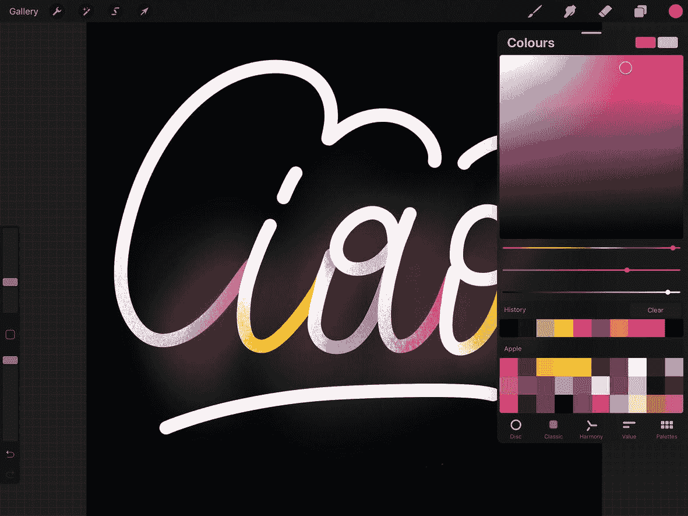

图 7-1 – `Procreate` 调色板面板

通常，运用孩子熟悉的现实情境中的心智模型，有助于引导他们完成任务。这可以让您考虑拟物化设计（skeuomorphic design）的理念，我们将在第八章讨论用户界面时进一步探讨这个话题。

# 设计自解释界面，减轻认知负荷，预防错误

在用户体验领域，“认知负荷”指的是执行任务所需消耗的心智资源总量。

尽管我们的记忆容量近乎无限，与设备不同，但我们的*大脑算力*并非如此。当我们需要处理的信息量超出生物 CPU 的承载能力时，表现就会下降：理解信息耗时更长、遗漏细节、忘记事项，最终可能因不堪重负而完全放弃任务。作为设计师，这显然是我们想要避免的情况。

我们设计的界面应帮助用户减轻*工作记忆*的负担。每当我们投入一项任务时，都会不断向记忆加载信息；如果界面设计不当，我们在步骤间切换时就可能遗忘内容。这并非因为我们分心或健忘，而是工作记忆被过多信息挤占了。设计良好的用户信息应引导我们完成任务，并辅助记忆，使我们无需存储所有信息。

一个常见的 UX 迷思是著名的“7±2 法则”，也称为米勒定律。乔治·米勒是美国心理学家，认知心理学奠基人之一。1956 年，他发现普通人短期记忆能存储 5 到 9 个项目。在 UX 设计中，这一观察常被过于字面地理解，导致设计师避免设计超过九个选项的菜单。这里的误解在于：米勒谈论的是需要记忆的信息，但菜单在使用界面时应始终可见，你无需凭记忆记住所有选项。你能想象记住 Adobe Photoshop 的所有菜单和子菜单吗？或者将其所有菜单缩减至不超过九项？这两件事都不可能实现。

因此，减轻工作记忆的负担意味着设计能够支持用户执行任务、达成目标的体验，同时不超出其认知能力，避免他们放弃任务乃至整个产品。

设计自解释且直观的界面，对面向成人的产品而言是最佳实践，但对儿童产品尤为重要——因为他们普遍对用户界面和数字产品了解较少。普通成年人经过多年在不同设备上使用数字产品的练习，某些交互模式已成为常识。例如，文档或网页的滚动条对任何人而言都不言自明，但幼儿可能不理解使用类似组件进行滚动交互。事实上，我们常用的许多界面组件与现实情境毫无共同之处，也并非基于儿童熟悉的心智模型。因此，被我们成年人视为简单直观的设计，若要同样适用于儿童，则需经过仔细测试。

## 交互：考虑年龄与设备特性

在第四章中，我们讨论了儿童的身体发育情况及其对执行特定交互或使用特定设备能力的影响。

当我们为儿童设计数字产品时，应清晰了解哪种设备更合适——这不仅取决于产品类型，更取决于我们所面向的年龄段。

### 为低龄儿童使用触屏

触摸界面是与设备交互最自然的方式。当我们使用键盘、鼠标、触控板、游戏手柄或任何与输出显示分离的输入外设时，便需要一种中介交互：我们在一个设备上操作，却在另一个设备上看到结果。而使用触屏时，输入和输出位于同一空间。我点按一个按钮，就能看到它在手指下做出反应（记住：*反馈*！）；我不需要依赖桌面上某个东西移动的光标，去点击离我手指活动范围几英寸远的屏幕上的按钮。

不难理解触控交互为何对儿童更友好，以及为何需要更少的认知负荷。模拟现实世界物理规律的界面使交互简单易懂。它们不仅易于执行，而且便于直觉发现和记忆。

在为儿童设计的产品中，我们应将触控交互限制在最自然和简单的几种：轻点、滑动、拖拽。

根据我的经验，对于非常年幼的孩子来说，拖拽已经有点过于复杂了。在我设计的一款教育游戏的第一个版本中，孩子们通过拖拽角色在屏幕上移动。在测试中，我们注意到这种拖拽动作对低龄儿童的手臂精细度要求过高，因此我们让角色自动移动到孩子轻点的地方。年龄大一些的孩子仍然可以拖拽它，以获得更流畅的体验和更好的角色控制感，但低龄用户也能轻松移动角色并享受产品。如果可能，提供不止一种方式来执行动作是个好主意。每个孩子都会决定如何以他们觉得更舒适的方式与产品互动。

在面向成年人的产品设计中，过去几年我们目睹了大量新奇触控交互的诞生。从多点触控手势开始，发展到用户需要掌握五指捏合、四指滑动，甚至疯狂的挤压手机、用指关节敲击或在屏幕上画圆圈（这些都是真实的例子）。

这些更新的手势不能被视为“自然”，因为它们并非现实世界动作的数字翻译；它们被创造出来的原因，仅仅是我们用尽了自然手势，需要创造新的手势来增加更多功能和快捷方式，同时避免冲突（一个手势对应多个结果）。但这些*人为的*（与*自然的*相对）手势更难记忆和掌握。缺乏现实世界的对应物，使它们更难被发现，也更不令人难忘；用户需要记住它们，并记住我们将每个手势与什么功能关联。三指上滑调出多任务屏幕，我们在现实生活中没有任何动作类似这个手势及其结果；因此，这是我们需要学习并在需要时记住如何使用的东西。

这些额外功能的代价，是更复杂的用户体验和用户更高的认知负荷。

我们不能要求低龄儿童学习并执行那些我们归类为自然手势之外的手势。即使在这些自然手势中，我们也必须根据低龄用户的身体发育情况仔细评估他们是否能做到（记住精细运动与大运动技能的区别；更多信息请参见第 4 章）。

### 意外触碰

低龄儿童能以非常自然的方式点击触屏，但他们并不清楚这项技术的一个简单局限：如果你触摸了多个区域，设备不知道哪次触摸是有意的，哪次是无意的。我观察到这种情况在我两岁的女儿身上经常发生。当拿着屏幕时，他们常常会碰到边缘，因此设备会将其记录为一次点击，结果，有意的点击反而没有响应，导致沮丧和困惑。

我们可以用不同的方法解决这个问题，每种方法都有优点和缺点：

- 通过实现手掌误触算法。类似于许多数字绘画应用的功能，允许用户在画画时将手掌侧面搁在屏幕上。这假设意外触碰不是由一根手指造成的。
- 通过在屏幕边缘定义一个安全区域，应用在该区域不检测任何触碰。当然，这仅在这种意外触碰发生在安全区域内时才有效。
- 通过使用某种计时触控检测。当触碰时间过长时，应用予以忽略。这个解决方案同样只对因孩子握持设备方式导致的意外触碰有效，而不是针对意外的点按。

我并不认为这是一个大问题，但在为非常年幼的孩子设计基于触屏的界面时，这是我需要考虑并最终进行测试的事情。

### 基于桌面端的设计

正如我们在上一节和第 4 章中看到的，触屏是低龄儿童的最佳选择。但从 6 岁起，我们就可以开始考虑涉及鼠标和键盘的计算机产品了。不过在这种情况下，我们能使用的交互方式仅限于简单的按键和对大目标的点击。目标尺寸非常重要，无论是对于触屏界面还是基于鼠标的界面，但关于这一点，我们将在专门讨论用户界面设计最佳实践的第 8 章中进一步阐述。

使用鼠标或触控板进行拖拽和滚动，往往需要超出该年龄段儿童通常具备的运动技能水平。最佳实践是仅依赖简单的键盘交互（一次按一个键，无组合键）或简单的点击。正如上一节所述，我们仍然可以提供拖拽交互，但前提是我们必须提供一种基于点击的替代模式：先点击选中要移动的元素，再点击其目标位置。另一种技术是*点击携带*：用户点击要拖拽的对象，该对象会自动附着在光标上，无需一直按住鼠标按钮，然后用户可以在目标位置再次点击以释放对象。即点击附着、移动、点击释放，而非点击并按住、移动、释放。

然而，大约到了 9 岁，孩子们已经发展出足够精细的运动技能来执行各种交互。这个年龄段的孩子很多已经会使用游戏主机，并且能够与各种常见设备进行交互。

表 7-2 展示了不同年龄段与相应的推荐交互方式及设备的对比。

**表 7-2** 基于年龄段的推荐交互方式及设备

| 年龄 | 交互方式 | 设备 |
| :--- | :--- | :--- |
| 2 岁 | 单点触控 | 平板电脑 |
| 3 至 5 岁 | 点击、滑动、拖拽 | 平板电脑（5 岁儿童也可用智能手机） |
| 6 至 8 岁 | 所有基于触控的手势。使用触控板点击，简单的键盘操作 | 触屏设备以及配备鼠标或触控板的电脑 |
| 9 至 12 岁 | 所有基于触控的手势。使用鼠标和触控板进行拖拽和滚动，键盘与鼠标的复杂协调操作 | 触屏设备以及配备鼠标或触控板的电脑 |

使用触屏对于任何年龄段都是不错的选择，但选择触屏设备作为平台还不够；我们还必须考虑哪些手势适合我们的目标年龄段。

简单的自然交互是任何年龄段的最佳选择；这些交互包括点击、滑动，以及在一定程度上包括拖拽，但最后一种应谨慎使用，并且应始终提供一种替代交互模式。

对于 6 岁及以上的儿童产品，我们可以考虑使用涉及键盘和鼠标或触控板的电脑应用。但直到 8 岁，我们应该考虑的交互方式仍然只是按键和简单点击。拖拽，尤其是在长距离（例如从屏幕一端到另一端）的操作，可能难以执行并容易引发挫败感。NNG（尼尔森诺曼集团）进行的测试强调，大多数儿童更偏好使用鼠标，而在触控板上执行同样的交互操作对他们来说往往更加困难。

## 幼儿还不识字，如何解决？

理想情况下，低龄儿童不应独自使用设备；父母、老师或看护人应始终在场（请参见本章后面关于屏幕时间的部分）。这似乎解决了学龄前儿童不识字的问题，但事实并非如此。当然，在需要阅读文本时，看护的成人肯定可以介入，但你希望孩子能掌控自己的体验，而出现一些需要他人解读的神秘符号，并不能让孩子感到有自主权。

让我们看看一些我们可以依靠的技巧，来尝试解决，或至少缓解这个问题。

### 使用语音

让尚未识字的幼儿能够操作界面的方法之一，是使用语音用户界面来代替文本。语音用户界面（VUI）既可用于向孩子发出指令，也可作为孩子控制产品的输入方式，例如像 YouTube Kids 那样进行搜索。

在 YouTube Kids 中（图 7-3），搜索可以通过打字或语音完成（先点击麦克风图标，然后说话）。

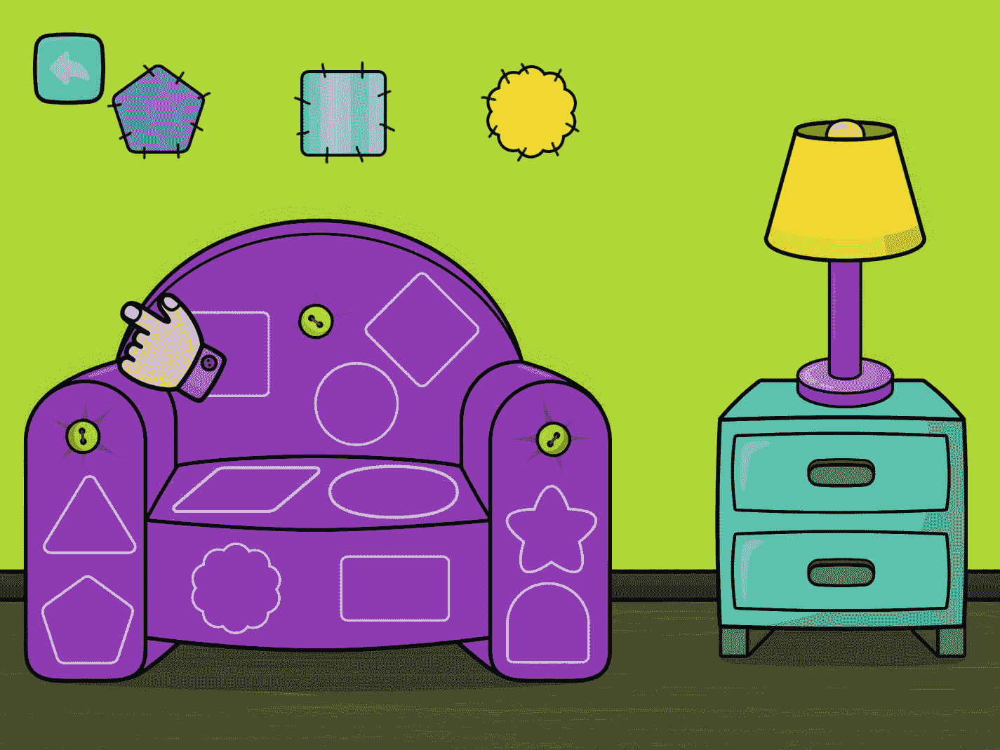

图 7-4

在 Bimi Boo 开发的幼儿游戏应用中，一个手形光标演示了拖拽交互

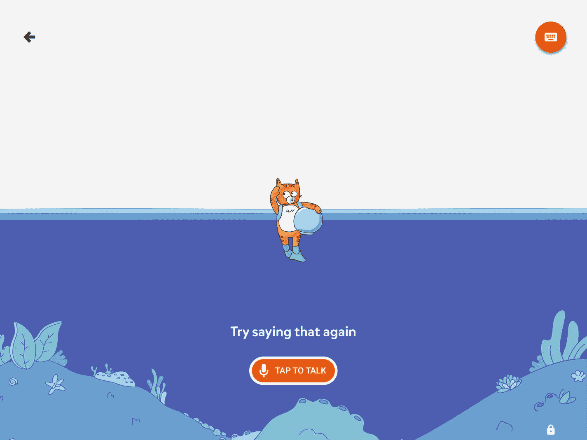

图 7-3

YouTube Kids 语音搜索

一旦输入查询，结果将以大缩略图的形式在水平滚动条中显示。标题很小且次要；视频的视觉预览是主要的行动号召。

如今，语音识别软件已非常出色，并且得益于机器学习，它正日益精进。不过，当我们面对 2-3 岁的幼儿时，他们常常说话不清、发音不准，或者有时像尤达大师一样语序奇特，有的孩子甚至完全不会说话或只会咿呀乱语。2019 年，在一年一度的 I/O 开发者大会上，谷歌展示了一项旨在帮助语言障碍人士使用`语音用户界面`（VUI）的语音识别技术。他们展示了一种能够理解非标准语音的技术，这非常令人鼓舞，坦白说近乎神奇，但这样的技术只有像谷歌这样的大型科技公司才能实现，因为它们能获取源源不断的数据来喂养机器学习算法，并不断完善语音识别软件的能力。如果他们将这项技术开放给第三方，那么较小的公司和初创企业将能够在产品中引入更先进的 VUI，儿童产品也将从中受益。这确实是一个例子，说明为儿童设计体验与为残障人士设计无障碍产品有很多共同点。因此，学习为非常年轻的用户设计，不仅能让你在从事成人产品设计时成为更好、更具包容性和更有意识的设计师。

在利用语音引导体验方面，主要有两种方法可以在产品中实现：使用配音演员或使用文本转语音软件。

第一种选择显然需要更大的投入，而且并非灵活的解决方案，因为如果需要更改文案，很可能需要重新录制语音（除非你足够幸运，能在后期制作中通过剪切和粘贴的魔法进行编辑）。

另一方面，配音演员能确保体验更具人性化感受，他们能够传达情感，这是文本转语音软件（至少在目前）无法提供的，尽管这种软件与语音识别软件一样，正变得越来越好。

决策取决于多种因素；这不仅仅是预算的问题。在我参与的一个教育产品项目中，我们通过算法生成活动，从而能够获得几乎无穷无尽的变化；使用的素材每次也是从我们设计师创作的大型插图库中随机选取。鉴于这些练习生成的随机性，我们无法依赖配音演员为数十万种（甚至更多）可能性配音；我们不得不使用软件生成的语音。

决策还取决于我们正在处理的内容类型。对于指导性文本，软件选项已经足够，但对于讲故事，比如绘本之类的内容，配音演员当然是最佳选择。

### 使用有隐喻意义的图标

在本章前面部分，我们了解到儿童的认知发展是一个渐进的过程，而抽象和具象思维能力是在儿童发育的后期（大约 12 岁及以上）才出现的。

图标应诉诸儿童熟悉的思维模式。在我们每天工作中使用的软件里，保存文件的经典图标通常是 3.5 英寸软盘（幸运的是，我们开始逐渐摒弃它），而在 2007 年，只有 2%的电脑还在支持它。但这是大多数成年人都能理解的隐喻。另一个例子是电话听筒的经典形状，尽管电话设计早已脱离那种造型很久了。

对于儿童，我们必须仔细思考一个图标是否使用了他们无法理解的隐喻。例如，我们不能用黑胶唱片来代表音乐，因为他们不会知道那个黑色圆盘是什么，也不知道它有什么用途。

### 使用动画引导体验

动态能吸引我们的注意力，并且比静态元素更有效地引导我们完成体验。用箭头指向某物可能会有所帮助，但看到以“演示”模式播放的互动则更为清晰。

在 Bimi Boo 开发的`幼儿游戏`中（图 7-4），一种拖拽交互（我不建议对这个年龄段的孩子使用）会在活动开始时通过一只手来演示其工作原理。

在这个具体案例中，我认为如果我们能看到形状随着手一起移动并被放置到相应位置，会显得更清晰。

动画可以用来展示交互如何运作，或者如何执行任务、玩游戏，但它也可以简单地用于一次只吸引用户对某个元素的注意力，并逐步引导他们。关键在于，使用动画可以帮助我们吸引用户的注意力，并将教学组件与其他内容区分开来。如果我使用同一个元素，例如图 7-4 中的手，来指向屏幕上的各个位置，并让它流畅地从一个移到另一个，我就能自然而然地引导用户的视线到我需要他们关注的地方。

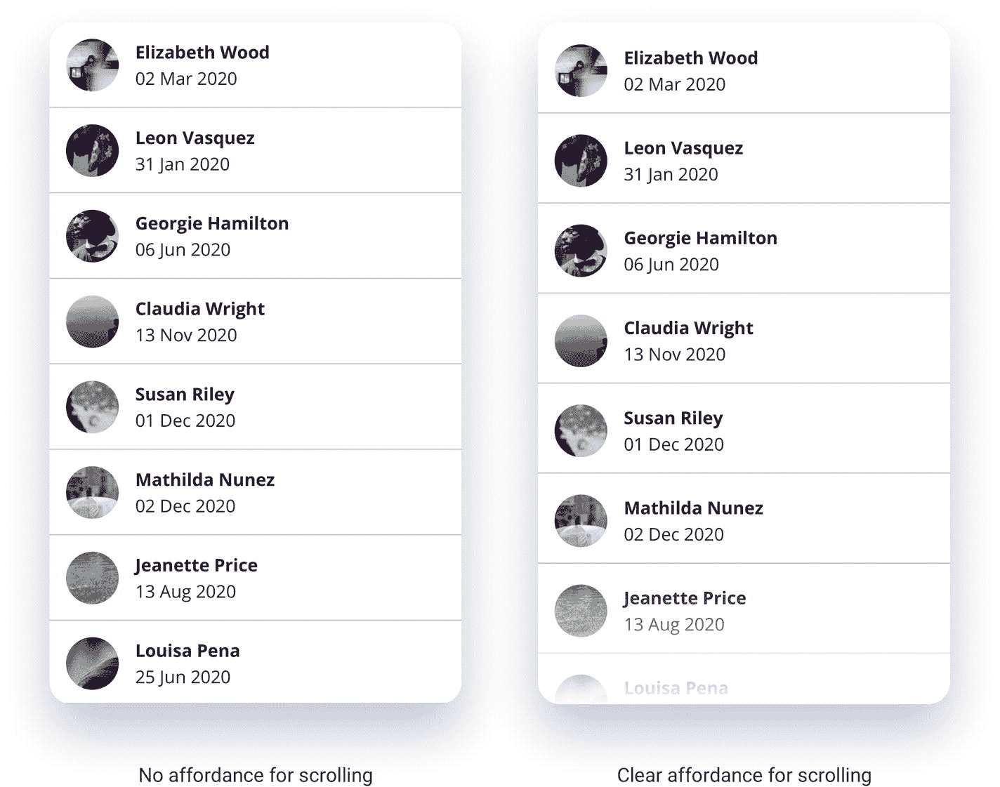

图 7-5

在右侧，底部元素的淡出效果表明还有更多内容可以通过向上滚动来发现

### 渐进式呈现

在用户体验设计中，当我们创造一种体验时，会谈到*渐进式呈现*，这种体验不会一次性用所有信息轰炸用户，而是从一个简单的设置开始，随着用户对产品越来越熟悉，逐步增加更多信息、选项或任务。

例如，在我们之前看到的*幼儿游戏*示例中，孩子立刻被提示有 3 个形状可拖拽和 11 个空位。为了让体验在学习时无需任何文字说明也能更轻松，他们本可以从一个形状和一个空位开始，然后是一个形状加两三个空位，接着是两个形状，以此类推。

一开始只有非常有限的选项，这样就限制了出错（并因此感到沮丧）的可能性。由于只有一种操作方式，理解逻辑以及如何推进就变得容易得多。

这种技巧（以及前面描述的其他技巧）经常用于解谜类游戏，比如*《糖果粉碎传奇》*和类似的游戏，这些游戏的进程非常平缓，学习曲线非常温和，用户会感到一切尽在掌控，通过完成关卡获得成就感，并被鼓励继续前进。

这些游戏非常擅长不让用户感到沮丧，它们之所以能做到这一点，是因为它们是通过让人们上瘾来实现盈利的。我们当然不希望用户对我们的产品上瘾，但我们与这些游戏确实有着共同的兴趣，那就是让体验尽可能愉快，并让用户感到一切尽在掌控。

## 适合儿童导航

作为成年人，我们如今对科技的普遍掌握程度已经相当高。大多数使用遵循常见 UX 模式和最佳实践的数字产品的人，无需任何指导就能理解如何在各板块间导航、进行搜索、登录和注销等操作。我们已经接受了数十年的训练；我们亲历了数字产品的演变，也见证了用户体验设计作为一门学科的发展。我们中几乎每个人，第一次面对一款普通产品时，都能很快理解它的运作方式以及如何完成最常见的任务。

儿童仍然缺乏这方面的知识，因为他们对数字产品还很陌生，或者说相当陌生。当面对一个功能暗示（affordance）不明确的界面时，他们会很难理解哪些是可交互的，哪些不是。

当然，所有这些关注点和最佳实践对于年龄越小的孩子来说就越真实、越有效，而用户年龄越大，他们的能力就越接近成年人。一个 12 岁的孩子能理解下拉菜单是如何工作的，而一个 3 岁的孩子则不能。

### 功能暗示（Affordances）

首先，我们来定义一下*功能暗示*的含义。这个术语是由唐·诺曼引入用户体验设计的，他是一位认知科学和可用性工程领域的研究员、教授和作家，被广泛认为是用户体验设计学科的创始人。

在唐·诺曼 1988 年出版的著作《设计心理学》中，功能暗示被定义为可感知的行动可能性。一个组件的功能暗示取决于用户的身体能力和过往经验。

一个无法传达其如何操作的对象（或 UI 组件）就是缺乏功能暗示。

看看这个例子（图 7-5）；左边的列表没有提供任何功能暗示来表明它是一个可滚动的列表，并且还有更多项目。视口正好包含八个项目，每个项目的高度是视口总高度的八分之一；没有任何提示让用户明白他们可以通过向上或向下滚动来找到更多内容。

在右图中，项目的间距不同，用户仍然可以看到有八个项目，但底部的最后一个项目被截断了。此外，列表最后部分项目顶部的浅色渐变是一种视觉辅助，旨在“欺骗”用户的大脑，让他们认为列表还在继续，超出了他们当前能看到的部分。最后，底部项目被截断以及渐变出现在屏幕底部，这些事实提示用户可以从底部向上滚动；而如果这些功能暗示位于列表顶部，则它们会提示相反的操作。

对于儿童来说，鉴于他们与数字产品交互的经验相对不足，功能暗示甚至更为重要，并且需要更加清晰。

有几种不同的方式可以让功能暗示对儿童来说更清晰：

*   **颜色的运用**：考虑在交互元素上使用明亮的颜色，而在背景和一般的非交互元素上使用更柔和的颜色（见第 8 章）。

*   **动画的运用**：当孩子们看到一个动画元素时，他们会期望它是可交互的。他们自然而然地会尝试点击它，看看会发生什么。静态元素则不那么有吸引力，但要注意，让所有东西都动起来很容易带来过多的视觉噪音和混乱。请谨慎使用。

为按钮添加阴影是 UI 中暗示功能暗示的典型方式。但对于年龄较小的孩子来说，屏幕上的所有东西都是平面的，无论它投射了什么阴影。这个隐喻可能无法为他们提供良好的功能暗示。

此外，对于儿童产品的功能暗示，尺寸很重要。我们之前已经讨论过运动技能和执行交互；我们将在第 8 章关于用户界面设计的内容中进一步讨论尺寸和其他视觉设计主题。

### 信息架构

在为儿童产品组织信息时，简洁是关键。成年人的应用和网站，根据其复杂程度，可以有高度分支的信息架构，而在儿童产品中，你需要尽可能保持其扁平。

如果你有大量信息和板块需要安排，拥有扁平的信息架构意味着菜单中同时有太多的项目。这是一个权衡，一般来说，菜单中项目越少意味着信息架构分支越多，而信息架构分支越少则意味着菜单中项目越多。

# 信息架构与反馈

高度分支的架构甚至可能让成年人感到困惑；这就是为什么大型网站，例如公共管理门户网站，信息量巨大，导航起来可能非常棘手，需要借助 `面包屑导航` 等工具，这样用户才不会迷路。儿童产品的理想信息架构由 2 层，最多 3 层组成（图 7-6）。

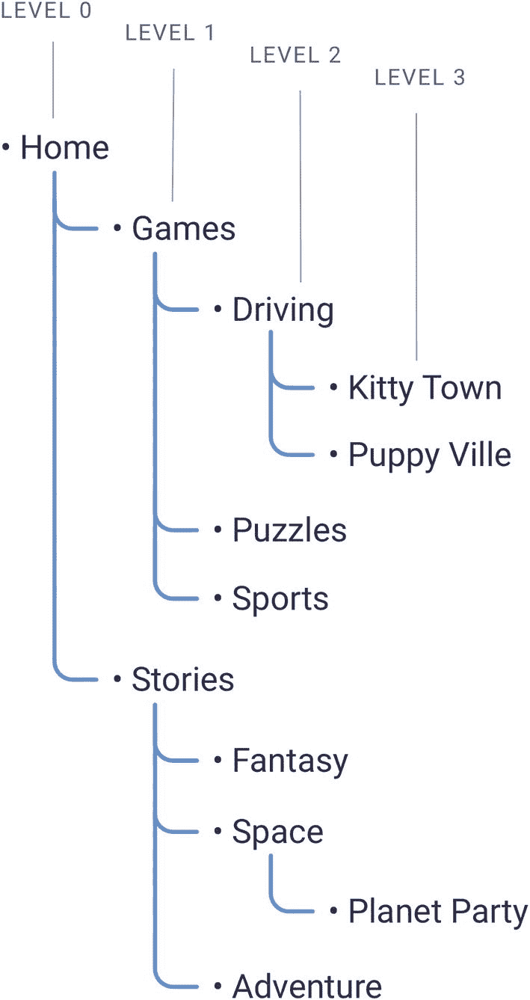

图 7-6

简单信息架构

在图 7-6 所示的信息架构中，我们可以看到第一级菜单有“游戏”和“故事”；每个菜单项都有第二级，例如，“游戏”类别包括“驾驶”、“拼图”和“运动”，而“故事”类别包括“奇幻”、“太空”和“冒险”作为第二级。第三级是开始游戏或故事之前的最后一级。你不希望层级比这更深，对于 2 到 5 岁的儿童，最好保持 2 层或更少的深度。

对于不熟悉数字环境的儿童来说，他们更难在脑海中绘制产品的认知地图，如果他们迷失方向，找不到想找的东西，就会感到沮丧。保持事物简单，在单个屏幕中提供过多选择和信息嵌套过深之间找到恰当的平衡。

## 菜单

菜单的形式多种多样，但并非所有都适合儿童。例如，下拉菜单所需的运动技能和认知技能都超出了幼儿的能力范围。正如我在上一节关于信息架构的内容中提到的，最好尽量精简菜单，提供尽可能少的选项，并且这些选项需要具备清晰的预设用途 (`affordances`)，并且要与背景明显区分开来。

顶部导航和底部导航适用于年龄较大的儿童，但对于更小的用户来说，菜单应该放在主屏幕的核心位置。这些选项不能只有文字；正如我们在本章中所讨论的，年幼的孩子还不会阅读，而年龄稍大的孩子对文字可能也不够自信，更何况图片对所有孩子都更具吸引力。因此，菜单选项最好使用能清晰说明其含义的图标或小插画。在讨论认知发展时，我们提到儿童很难进行抽象和隐喻性思考，所以对事物进行具象化的呈现是最佳方式。

在我担任产品设计师的艾美奖获奖应用 `StoryBots`（图 7-7）的 iPad 版本中，我们经历了多次主屏幕的迭代，最终版本中菜单角色非常突出，选项数量有限，信息架构扁平化，图标也富有表现力和动效。

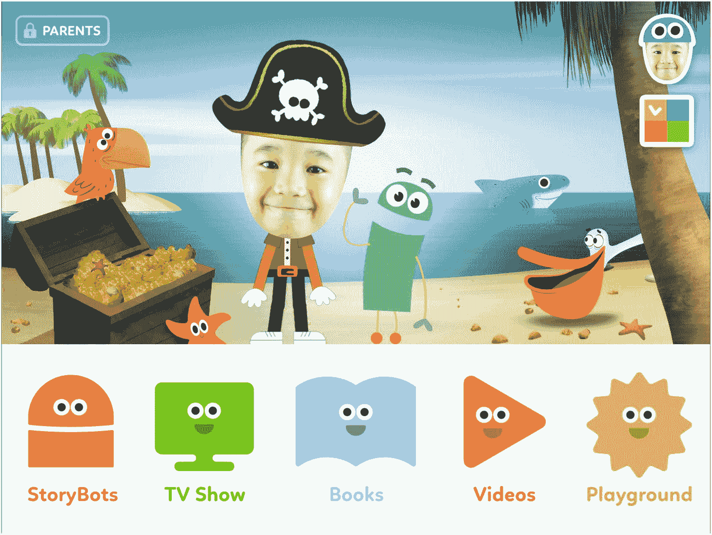

图 7-7

iPad 版 `StoryBots` 应用的主屏幕

不过，根据我的观察，我可以告诉你，儿童的视觉记忆力非常好。因此，即使他们不理解某个选项的含义，只要父母、老师或看护人向他们演示了其功能，他们就能记住，甚至包括一些更抽象的表示方式。当然，这并不理想；你希望你的产品对儿童来说是直观清晰的，让他们可以自己使用（不是独自一人，而是在成人监护下自己使用，这始终是最佳情况）。

## 反馈

儿童需要反馈；他们需要产品对他们的交互做出响应。首先，给予反馈总是一个好主意，无论对儿童还是成人都一样。但儿童在操作设备和数字界面方面的经验较少，因此，让他们知道自己所做的每一个操作都在产生某种效果，这一点对他们来说更为重要。

这种反馈可以是从一个组件外观的简单变化到更复杂的动画，也包括声音效果。

### 微交互

我们开始本节讨论时谈到了反馈，但反馈只是一个更宏大过程的一个步骤，这个过程称为 `微交互`。什么是微交互？它为何在此语境中如此重要？

如果你在网上搜索，会发现关于微交互的定义有好几种。下面是我的定义：

*   `微交互` 是用户与系统之间进行交互的最小表现形式。

交互的一个单一瞬间可以被识别为一个 `微交互`。一个 `微交互` 永远不会由一系列多个手势组成，如图 7-8 所示。

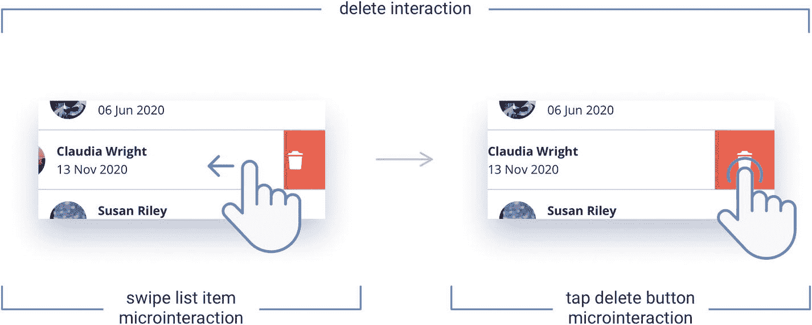

图 7-8

`微交互` 示例

`微交互` 可以由用户触发（例如，点击按钮），也可以由系统触发（例如，推送通知）；这个触发器会根据系统中定义的规则进行解读，并产生一个反馈作为响应；这种反馈可以循环，也可以不循环，具体取决于 `微交互`、上下文等因素。见图 7-9。

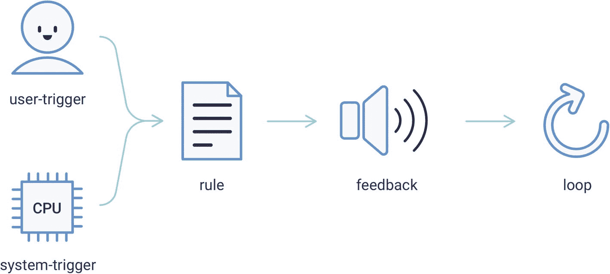

图 7-9

`微交互` 的组成部分

`微交互` 这个话题非常大，在这里我只想聚焦于它在儿童产品中为何重要。`微交互` 可以在以下方面提供帮助：

*   通过将现实世界的隐喻带入数字空间，为界面提供物理感，例如，按钮被按下时的反应（见下一节）。这有助于从现实到数字的过渡。

*   向用户保证，她/他所做的一切正在对产品产生影响。

*   为体验增添一些乐趣。请记住，儿童享受的是过程，而非结果。在使用数字产品时，他们是体验驱动型的，而不像我们成年人那样是任务驱动型的。

### 视觉反馈

让我们来看一个通过视觉设计方法提供反馈的经典例子：按下的按钮。

按钮是我们在儿童界面中最常用的组件。因此，确保这些按钮能提供正确的体验至关重要。一个按钮应该始终具有一个 `按下状态`（图 7-10），以表明它正在对儿童的操作做出反应。传达这种反应的方式可以根据你用户界面的风格而有所不同：你可以让按钮稍微变小，仿佛它正在被推回去，远离用户；或者你可以调低亮度，或让它的阴影（如果有的话）消失，等等。重要的是在其外观上提供一个显著的变化，以清楚地表明：是的，应用正在对我的操作做出反应。

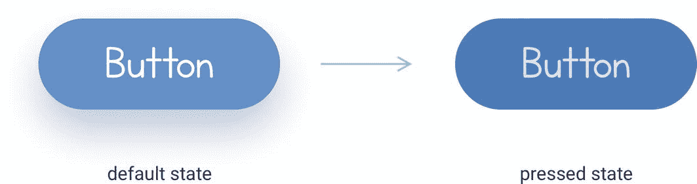

图 7-10

按钮按下时外观发生变化以传达状态变化

与这个事件关联的视觉反馈可以是任何形式，但模仿现实反应总是一个好主意，这样组件的行为才会显得自然。一个按钮在被按下时膨胀或旋转会显得很奇怪，因为这不符合物理按钮的行为。

### 动画反馈

动画在现代界面中变得越来越重要。我们在上一节中看到，组件的不同状态如何通过视觉来反馈某事正在发生。在两个状态之间过渡时，我们可以使用动画。动画增强了反馈效果，平滑了状态之间的跳跃，并引发用户更强烈的情感反应。

动画反馈可以传达信息，并使体验更加有趣。在为儿童设计时，你甚至可以在某些方面比设计成人产品时走得更远。虽然我们所有人都欣赏应用中流畅悦目的动画，但儿童可能会觉得它们足够有趣，以至于把它们当成一种把玩工具，例如，按钮有弹性的反应，或者抽屉进入屏幕时过冲的效果（图 7-11）。这类卡通效果在儿童界面中效果非常好。

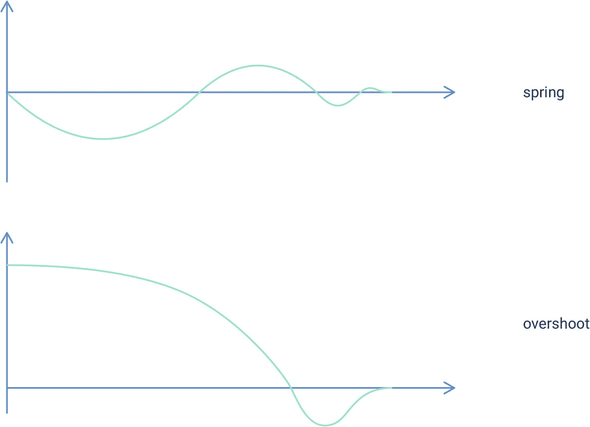

图 7-11

弹性和过冲动画曲线图

动画确实能与用户对话。你使用的动作应该模仿你想传达的信息。一个经典的例子是，一个组件左右晃动，以表示出现了问题（例如，你按错了按钮）。这个动作让人联想到摇头说“不”（这可能并非适用于所有文化，因此取决于产品发布的地点和目标受众）。

动画反馈甚至还可以更进一步。在某些情况下，你确实想要传达某种成就，而不仅仅是一个组件对交互的反应。一个正确的答案或解锁某项成就（参见关于游戏化的第 5 章）或许值得来点烟花效果——这里是比喻义，或者也可以是字面意义上的。

### 听觉反馈

另一种非常重要的反馈方式是利用声音。在本章前面部分，我们分析了帮助不识字的儿童的各种解决方案，其中之一就是使用 `画外音`。这是当孩子需要更明确的反馈时，我们可以使用的一个完美声音示例。但声音也应与更小的事件（即 `微交互`）相关联，例如按下按钮、滑动，或拖放交互中的抓取和释放。

对于这类事件，使用有趣古怪的声音，配合前面描述的动画效果，效果会非常好。保持趣味性，从动画片中汲取灵感。

声音的选择对于补充动画至关重要：它必须与动作相匹配，否则会显得很别扭。一个弹出的按钮配上“嗖”的一声可能会显得奇怪，但同样的声音用在滑动操作上就会很合适。声音应充当动画的旁白。

声音可以是音效或音乐。无论哪种情况，让它们变得有趣和欢快都很重要。因此，对于音效，不要过于写实；对于音乐，要保持节奏轻快。当你想要为错误答案或错误操作提供负面反馈时，可以使用“更悲伤”的音调。

### 触觉反馈

这项技术在一段时间前变得流行起来，如今，在现代设备上，触觉反馈的真实感已达到令人难以置信的水平。最近，我和一位朋友谈论此事，他不知道也不相信我的 `MacBook Pro` 上的触控板实际上并没有物理移动，其反馈仅仅是触觉效果。为了说服他，我不得不关掉电脑，让他亲自感受触控板根本没有任何点击感。

我们在 `iPhone` 的某个应用上使用 `Force Touch` 时感觉到的“弹出感”也是同理。在这种情况下，出现的上下文菜单上的动画有助于营造出某种东西在我们指尖下真实弹出的错觉。这个例子完美地说明了动画和触觉反馈的结合如何欺骗我们的大脑，让我们以为发生了物理变化，而实际上，它只是数字对象的响应。如果在此基础上，再加入恰当的音效，那你就找到了反馈的“终极秘诀”。

孩子需要反馈，这不仅是为了娱乐，也是为了让他们理解产品对他们的交互动作是有响应的。

# 儿童产品设计：注意力与体验

视觉、动态、声音和触觉响应的结合，可以成为一种非常强大的“鸡尾酒”，让你的产品在不实际使用语音的情况下与用户“对话”。它们能极大地提升用户体验，不仅使其更直观，也让其使用起来更愉悦、更有趣。话虽如此，你并不需要每次都把它们全部结合起来。有时你只需要视觉和动画反馈，有时可以加入声音，等等。为一个事件设计恰当的反馈是一项不容忽视的任务，因为它确实能让一款产品与众不同。

## 帮助孩子集中注意力

吸引孩子的注意力并不是希望他们沉迷于我们的产品；这永远不是我们的目的。我们希望吸引他们的注意力，是为了教他们如何专注，如何避免分心，并学习如何集中精力完成一项任务。我们应用的用户体验设计在这方面起着重要作用。

在我们的日常生活中，我们越来越多地被周围的众多设备分散注意力，它们通过无休止的通知和刺激来争夺我们的全部注意力。以至于像`Apple`和`Google`这样的大型科技公司，以及所有主要的智能手机制造商，都开始采取措施迈向所谓的“数字健康”。`Android`和`iOS`现在都提供了工具来监控我们的应用使用情况、每小时拿起手机的次数、在社交平台上花费的时间等等。

在我们的工作中，也经常从一个应用跳到另一个应用，从一台设备切换到另一台设备。我们在`Slack`上回复一条消息，然后跳过去读一封邮件，又回到刚下载的`PDF`文件，再看一眼关于即将召开的会议的通知，如此循环往复。我们已经丧失了专注的能力。

区别在于，我们小时候没有这样的干扰，但现在的孩子却可能有，而这真的会损害他们专注的能力。这就是为什么屏幕时间是一个非常重要的话题，也是为什么我们需要在他们使用我们的产品时帮助他们集中注意力。

但是，孩子为什么会分心呢？正如我多次说过的，他们只是和成人不同，他们的思维方式也不同。作为成年人，我们学会了处理枯燥的任务，我们知道如果事情必须完成，无论多么不愉快，我们都得去处理。孩子们还在学习这一点，或者正处在学习的过程中。如果他们遇到一项无聊的活动，他们会很容易转向其他更能吸引他们天生好奇心的事物。这种好奇心是他们分心的主要原因之一，但这绝对是一件好事。保持好奇心是获取知识的主要驱动力；我们当然不想阻碍这一点，但我们想帮助他们学会如何专注，如何在必要时应对枯燥，以及总的来说，如何变得可靠和值得信赖。

### 避免通知和弹窗

在儿童产品中，应避免应用内通知，以及那些凭空跳出、用于推广更多游戏或其他让人分心内容的弹窗。

我们必须精心设计用户体验，让用户能顺畅地导航到他们想去的地方，而不被不想要的消息打断。我们为他们铺好通往目的地的道路，并且不想在路上设置任何“广告牌”。通知和弹窗大多数时候对成年人来说都很烦人；对孩子来说，它们不仅烦人，还会引起困惑和分心。

不过，有一件事我需要澄清一下。*应用内通知*和*推送通知*有什么区别？

推送通知是指那些在应用外部出现的通知。它们会出现在系统层面，即使屏幕锁定也会显示。它们就是你收到消息或类似情况时获得的经典通知。开发者可以决定将推送通知作为一种营销工具，通知用户特别促销或新产品发布，我们稍后在讨论营销和其他与金钱相关的内容时会谈到这一点。

应用内通知是指出现在应用内部的通知，通常在你一启动应用时就出现。它可以用于不同目的，例如，传达更新信息，或者再次推广同一开发者的相关产品。

为什么这个区别对我们很重要？推送通知会出现在设备上，无论你正在使用哪个应用，甚至无论你是否在使用设备；因此，它更可能是成年人会阅读的内容。它更多地属于设备或操作系统体验的一部分，而非应用体验本身。

应用内通知是应用用户体验的一个组成部分。它是发生在应用内部并存在于其中的事物，因此是孩子使用你的产品时体验的一部分。在大多数情况下，它也是使用应用的设计语言而非操作系统的设计系统进行定制的。

所以，虽然推送通知是通过家长的设备与他们沟通，但应用内通知则更直接地与孩子对话。

### 善用动画与彩蛋

我们讨论过动画如何引导用户并提升体验的趣味性。但动画不应造成干扰——过度使用、在过多场景下无目的地运用动画（尤其是在完成任务时，这里的“任务”也包括游戏，不一定是严格意义上的教育内容），会分散用户本该专注于完成目标的注意力。彩蛋也是如此。我们都喜欢数字产品体验中的小惊喜。比如在聊天应用里给别人写“生日快乐”时突然飘出五彩纸屑，这种有趣又惊喜的瞬间能让体验变得愉悦，并与产品建立更富共情的纽带。但它们应是例外而非常态：适度使用能带来惊喜和乐趣，但滥用就会变得烦人，最重要的是会分散注意力。而且孩子们一旦发现这些彩蛋，往往会反复尝试，使其成为体验的焦点——这可不是我们想要的。

所以，请务必为产品添加一些魔法时刻，但不要过度。

### 一次只做一件事

多任务处理不适合孩子。我们对自己能同时处理多件事的自豪感，不应误导我们试图将这项技能教给孩子（说实话，这对成年人也没什么好处）。培养孩子专注力的最佳方式，是每次只引导他们完成一项任务。你可以预告接下来要做什么，但绝不能让用户手忙脚乱地从一个活动跳到另一个活动。

### 将大任务拆解为小任务

将大任务分解成小活动，是帮助儿童（以及成年人）集中精力并完成任务的有效方法。`ABCmouse`的学习路径就采用了这一原则——路径虽然很长，但以课程为单位组织，每节课又包含一系列小活动。孩子们能看到总体目标和达成路径，但每次只专注于完成一个小任务。

另一个好例子是*Papumba*中的购物与烹饪活动。

首先，爷爷请孩子购买食材来做菜（图 7-12）。

图 7-12

第一步，爷爷给孩子一份食谱

接着，在杂货店里，任务是一次只放一种食材到秤上（注意那只手正在指示任务焦点；除数字外没有任何文字）（图 7-13）。

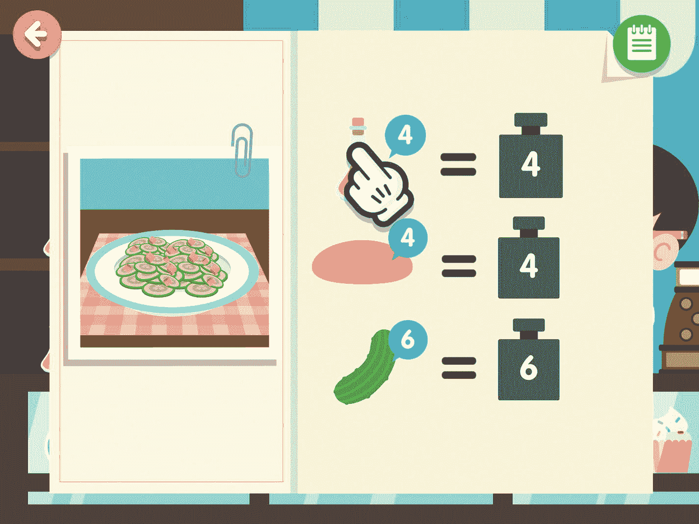

图 7-13

第二步，孩子去杂货店挑选食材

把食材放到秤上时，孩子会从旁白、视觉效果以及店员角色的反应中获得即时反馈（图 7-14）。

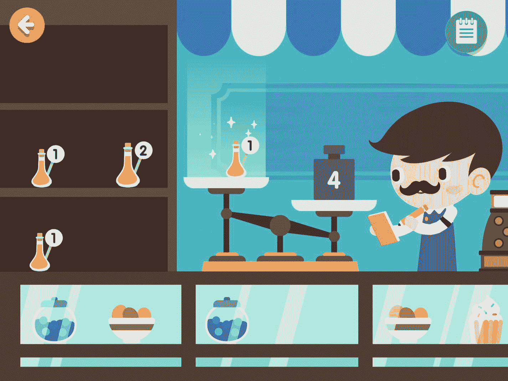

图 7-14

第三步，孩子将食材放到秤上称量重量

任务完成后，他们会看到已完成标记（图 7-15）。

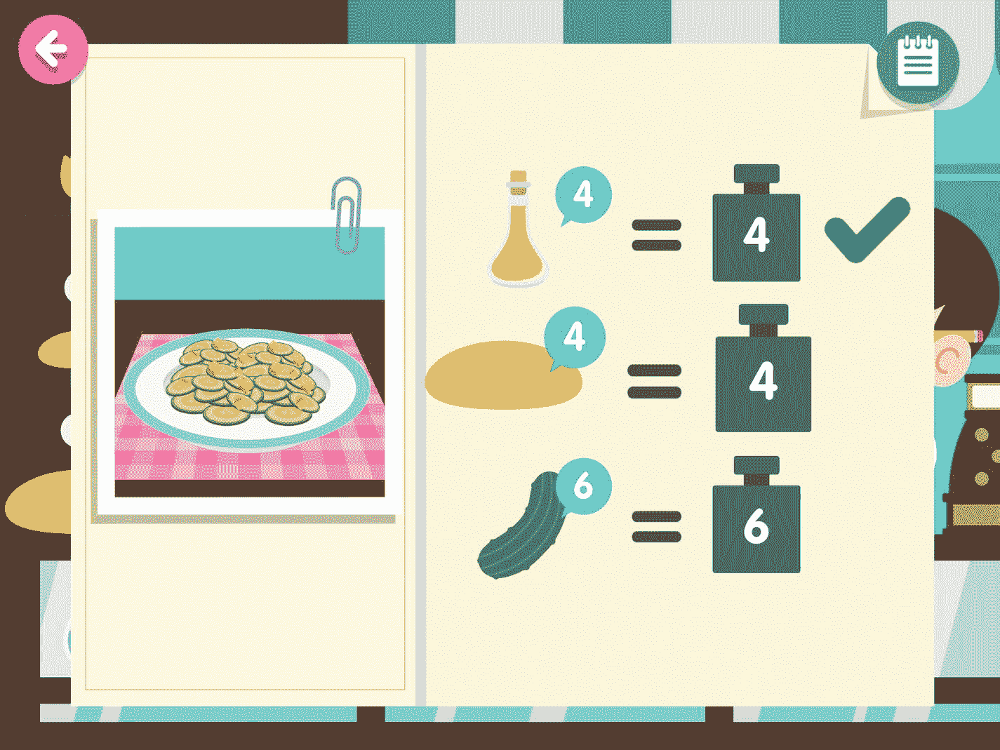

图 7-15

第四步，当重量正确时，物品旁会出现一个对勾标记

买完食材后，他们可以享受用自己协助做好的菜来喂爷爷的乐趣（图 7-16）。

图 7-16

第五步，爷爷、孩子和猫咪（是的，猫咪也加入）一起享用美食

此外，像按照食谱烹饪这类活动可以定义为*序列化*。序列化意味着按特定顺序执行一系列指令，这是一种有助于提升专注力的练习形式。

### 奖励

另一种提升专注力的方法是提供奖励。正如我们在第 5 章所讨论的，奖励是游戏化策略中使用的主要技巧之一。

任务完成后的成就感非常强大，尤其以*盲盒礼物*和收藏品的形式效果显著。这种策略常见于休闲街机游戏——玩家玩得越多，可解锁的角色就越多。一个非常著名的例子是热门手机街机游戏*Crossy Road*，截至 2020 年中，它已包含 272 个不同的角色。

收藏品的概念通常以贴纸集的形式呈现。孩子可以通过完成活动获得更多贴纸；学英语的应用*Lingokids*（图 7-17 和 7-18）就采用了这个理念。

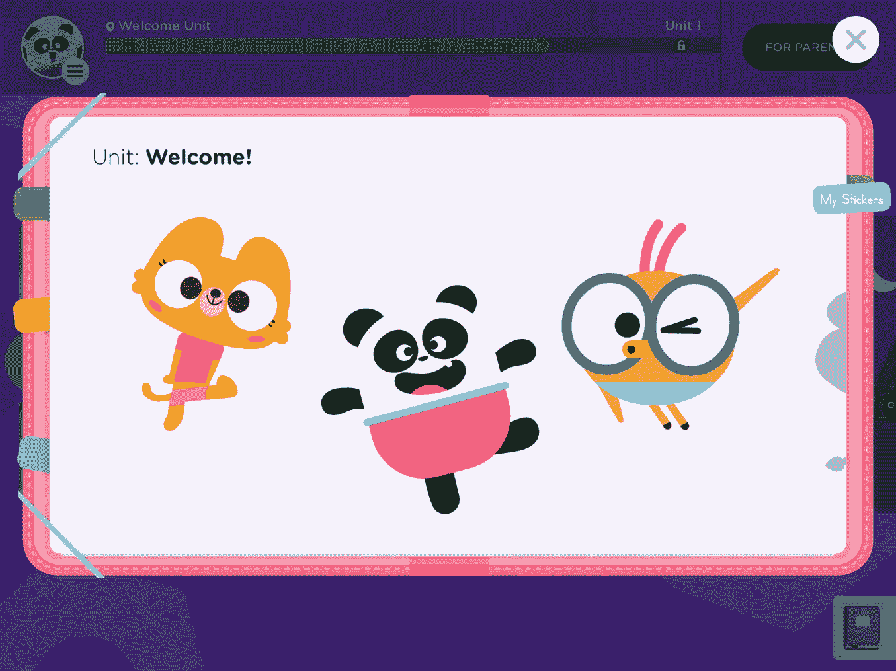

图 7-18

`Lingokids`中的贴纸集

图 7-17

`Lingokids`中解锁的贴纸

### 设置休息时间

在纯粹娱乐时刻与学习时刻之间交替，有助于孩子在后半段更专注。如果你的产品提供了包含多个连续课程的学习路径，不妨考虑在每个学习活动之间穿插一些有趣的内容。它可能是一段好玩的音乐视频或小游戏，纯粹为了放松和开怀一笑。知道前方有这样的内容，也能很好地激励孩子在课程中继续前进。

此外，建议安排一些不依赖屏幕的活动，或者将两者巧妙结合，也是个好主意。例如，你可以邀请孩子先在纸上画些东西，然后拍下画作并进行数字着色、添加贴纸等操作；或者利用更先进的技术，如*增强现实*（详见第 11 章）。

总结帮助孩子集中注意力的方法：

- 避免通知和弹窗等干扰事件。

- 善用动画和彩蛋，不要过度。

- 要求孩子一次只做一件事，不要让他们感到不堪重负。

- 将大任务分解成小活动。

- 提供奖励。

- 设置分散注意力和休息的间隔时间。

## 屏幕时间，以伦理为导向的设计方法

> *下一步进化将走向屏幕。*
>
> —马克·马龙，喜剧演员

在讨论儿童福祉时，很少有比屏幕时间更具争议的话题。这是一个每隔一天就会有一项新研究出来否定前一项研究的话题；这是一个“咖啡对身体好，等等，咖啡对身体不好…我是说好，还是不好，这得看情况。但总的来说好。不，不好”的话题。

当然，你不会找到任何研究表明屏幕时间越长越好，但有一点是明确的：屏幕时间需要受到监控，并且尽可能由父母或看护人陪同。关键问题是：多长时间是合理的？

**作为父母**，我们关心孩子的福祉，希望在他们拿着小平板或在电脑前度过的时光中做出明智的选择。但我们也知道屏幕的安抚力量有多么诱人，能安抚一个在拥挤的公交车或儿科候诊室里闹脾气的幼儿。这是一种强大的工具，不能滥用。

**作为设计师**，我们希望促成这些明智的选择。如今，许多（面向成人的）数字产品在设计上都有一个特定目的：尽可能长时间地吸引我们的注意力。社交网络是这种做法的典型例子。最臭名昭著的例子也许是“无限滚动”，如今它在许多数字产品中无处不在，而不仅仅是在社交网络上。你滚动内容，却看不到尽头，滚动、滚动、滚动、滚动，新鲜内容不断弹出，丝毫不顾及你疲惫的大拇指。传统的好翻页功能去哪了？

数字福祉现已成为设计领域的热门话题，`iOS` 和 `Android` 都提供了追踪应用使用情况、我们每小时收到多少通知、我们拿起手机的频率等功能的工具。所有这些指标都有助于我们保持健康的生活方式。

对于孩子来说，这一点更为重要。

儿童成长过程中的一个基本步骤是模仿成年人，而如今成年人最常做的事情之一就是使用移动设备。孩子们很早就认识了这些物品；根据 2015 年美国儿科学会年会上一项研究的数据，^(⁴⁷)大多数孩子在两岁时就已经使用过智能手机和平板电脑。这项关于儿童接触媒体和电子产品的研究涉及了 370 名有 6 个月至 4 岁孩子的家长。

调查显示，97%的家庭拥有电视，83%的家庭拥有平板电脑，77%的家庭拥有智能手机，59%的家庭能够上网。家长们透露，52%的一岁以下儿童看过电视，36%触摸过或滑动过屏幕，24%用设备打过电话，15%使用过应用程序，12%玩过电子游戏。孩子们在屏幕前花费的时间随着年龄增长而成比例增加，26%的两岁儿童和 38%的四岁儿童每天使用设备至少一小时。要锻炼他们的思维和解决问题的能力，幼儿需要亲身体验真实的材料和工具。这与其说是“时间”长短的问题，不如说是他们在这些时间里做什么的问题。屏幕时间应该被监控，以了解他们在使用设备期间在做什么、使用哪些产品以及如何使用，而不仅仅是定义一个固定的分钟数。观看 YouTuber 搞怪整蛊视频的 15 分钟，并不比用一个应用程序学习阅读和写作的一小时好。

然而，对于孩子来说，正确对待技术的方式不仅仅是屏幕时间的问题。另一个重要方面是他们与谁一起度过这些设备使用时间；没有发现任何东西可以替代与父母或看护人的直接互动。但同时也有证据表明，如果条件合适，3 岁以下的儿童可以通过屏幕上呈现的材料学习词汇，但这样的条件要求父母/看护人/教育者在观看视频活动期间增加额外的语言和非语言沟通形式。在这种情境下，眼神交流尤为重要。设备可以强化孩子们在学校学习的内容，但不幸的是，市场上大多数产品并不是为了孩子+成人双人使用而设计的，因此，满足这一需求既是挑战也是机遇。

### 挑战/机遇

我们如何能创造一种既能吸引孩子又能吸引成人，同时强化他们语言和非语言沟通的教育体验？

`Toca Boca` 的联合创始人比约恩·杰弗里在他的网站上一篇文章中，^(⁴⁹) 强调了在使用设备进行活动时这种关系的重要性。他还补充说，帮助孩子为自己选择合适的（以及为更小的孩子做出选择的）产品，并观察这些产品的使用方式也很重要。它们是否为孩子与朋友和兄弟姐妹在现实生活中建立联系提供了机会？它们是否创造了分享和学习的时刻？最后，杰弗里呼吁父母要提倡多样性。并非所有儿童应用程序都必须具有教育意义，有些可以是纯粹为了娱乐和消遣，重要的是要多样化，并与屏幕之外的其他活动保持平衡。

屏幕时间更多是质量问题而非数量问题。

我完全同意他在这方面的观点。我正是以同样的论点开启了我关于设计儿童应用的文章系列（本书的创意来源）：就像生活中几乎所有其他事物一样，关键在于平衡。

### 专家有何建议？

美国儿科学会（`AAP`）建议父母避免让 18 个月以下的儿童接触屏幕时间，唯一例外是视频通话。事实上，这种活动允许儿童与远方的亲人（例如，与居住很远的祖父母）进行双向沟通，这与被动地观看视频内容或类似活动完全不同。

从 2015 年到 2018 年，我住在洛杉矶期间，我的父母在意大利，我的岳父母在日本。我和妻子在 2017 年迎来了美丽的 Yui 的诞生，当时我们远离双方家人。在那段时间里，我们大量使用 `FaceTime` 让女儿与在世界两端的祖父母建立联系。当她后来在现实生活中见到他们时，看到他们之间的关系如此自然，真是令人惊叹，尽管在那之前他们大部分相处时间都是通过屏幕进行的。因此，并非所有屏幕时间都一概有害；重要的是评估屏幕上有什么，它的质量，并与屏幕之外发生的所有其他体验保持平衡。

美国儿科学会还提出了哪些建议？如前所述，18 个月以上的儿童不应独自使用设备，而应始终由父母或看护人陪同，每天不超过一小时。年龄较大的儿童可以使用更长时间，但一切都需要与足够的其他活动和睡眠（根据年龄不同，8-12 小时）相平衡；因此，他们还建议将移动设备、电视和电脑放在卧室之外。不过值得注意的是，这个话题仍在不断研究中，考虑到数字产品在儿童教育和发展中仍然相当新颖，随着我们在未来几年对儿童与技术关系有更多了解，我们很可能会看到新的结果和指导方针。

### 挑战/机遇

我们能否在我们的产品中纳入正确的信息，以教育父母如何以正确的方式让孩子接触技术？

## 行业洞察：肖恩·赫尔曼专访

肖恩·赫尔曼是专为儿童与家庭设计的通讯平台 `Kinzoo` 的创始人兼首席执行官。他还是《屏幕俘获：帮助家庭在操控时代探索数字世界》一书的作者，书中阐释了优质屏幕时间与被俘获在无尽信息流中接受操控的区别——在当今时代，就连儿童也在寻求各种形式的社会认同。

**鲁本斯：** `Kinzoo` 立刻引起了我的好奇，因为专门为儿童及其家庭设计的通讯应用并不常见。后来我发现了你的著作《屏幕俘获》，书中探讨了社交媒体的危害（不仅限于儿童）、当今儿童与科技的关系、屏幕时间等话题。这立刻引起了我的共鸣，因为我的书也涉及许多相同主题——尽管更多是从设计角度。你关于为儿童进行伦理设计必要性的论述尤其吸引了我。你认为，在当今针对儿童的数字产品中，我们最迫切需要解决的问题是什么？

**肖恩：** 在我看来，开发儿童数字产品最紧迫的问题是，它们必须从根本上围绕儿童的隐私和安全进行设计。儿童不是一个应该被扩张的市场。他们有着独特的需求，而且我始终认为，在年龄较小时，隐私与安全的关联程度远高于我们成年之后。当儿童的隐私受到侵害时，其负面后果的范围远比成年人广泛。

我非常担心现有产品只是简单地向儿童领域扩张。原因是成人平台（尤其是社交平台）的构建旨在优化两件事：增长和参与度。在为儿童和家庭设计产品时，你必须在安全方面牺牲一些增长杠杆，并且不应使用说服性设计来驱动参与度。点赞、粉丝数和连续互动记录是被用来保持我们参与度的例子，但我相信，随着年轻人越来越依赖通过这些方式获得社会认同，这会带来意想不到的后果。

在我看来，将那些为大规模增长而设计的平台进行改造，使其适应儿童市场，确实极具挑战性。我认为这就是为什么我们看到 `Facebook Messenger Kids` 存在漏洞，允许儿童在群组中与陌生人联系。我绝不认为这是故意的，但这恰恰体现了挑战所在。

更糟糕的是，有几个平台完全无视儿童在使用它们这一事实。`YouTube` 是最明显的例子，但我们知道北美有数百万儿童在使用 `Instagram`、`Snapchat` 和 `TikTok` 等平台。在我看来，对这些平台而言，无视这一事实，援引其使用条款（规定 13 岁以上用户使用），然后简单地说儿童不应该在上面，比遵守 `COPPA`（《儿童在线隐私保护法》）或 `GDPR-K`（《通用数据保护条例-儿童》）更容易。但这些平台的价值也来源于用户数量。传统上，像 `FTC`（美国联邦贸易委员会）这样的监管机构并没有足够的威慑力来强制它们采取行动，因此平台可以享受额外用户带来的好处，而无需改变其注册流程或关键工作流来保护年轻用户的隐私。值得肯定的是，`FTC` 已与 `YouTube` 合作，开始做出一些改变，首先是承认我们作为家长已经知道的事实——儿童正在大量使用这些平台。

**鲁本斯：** `Kinzoo` 获得了家长们非常积极的评价。我相信他们中的大多数人与你、与我一样，对涉及通讯和社交活动的儿童数字产品抱有同样的担忧。你是如何解决这个问题的？你采取了哪些措施来赢得家长的信任？

**肖恩：** 最重要的是，我是一名家长。`Kinzoo` 的存在是因为我意识到，在让我当时 7 岁的女儿与朋友和家人安全、私密地联系方面存在空白。我当时在寻找解决方案，却只找到了 Facebook 的产品，这对我来说是绝对的禁区。我不希望我的女儿接触那个平台及其商业模式。我们创建 `Kinzoo` 是因为我认为家长需要选择，而那些更注重隐私的家长可以有一个 Facebook 之外的替代品。我们有两个真正的与众不同之处。首先，如前所述，我们是围绕儿童的隐私和安全从头构建的。我们首先是作为家长做决策，其次才是作为企业。其次，我们有一个不同的商业模式。`Kinzoo` 只收集最少量必要的数据，并且永远不会将其出售给第三方。我们维护了一份在 `Kinzoo` 上从成人和儿童处收集的所有数据点清单。这份清单非常简短，并且我们强制要求证明每个数据点是如何惠及用户，而非 `Kinzoo` 的，之后才会继续收集它。性别就是一个例子。我们很想知道 `Kinzoo` 上男女用户的比例，但我们找不到对用户有益的方式，因此我们决定不为儿童收集这项信息。

只有成功赢得家长的信任，我们才能成功。我们首先并且始终以家长、叔叔阿姨的身份来做所有决定。我们将对我们所做的一切保持透明，并始终与那些希望成为社区一员的人保持公开对话。这让我感到最兴奋。

**鲁本斯：** `Kinzoo` 已获得 `kidSAFE` 认证。根据你的经验，这类认证对家长有效吗？他们知道这些认证的含义吗？这是他们在决定为孩子下载哪个应用或订阅哪项服务时会考虑的因素吗？

**肖恩：** 在我们为当前版本的 `Kinzoo` 编写一行代码之前，我们就已经遵守了《儿童在线隐私保护法》（`COPPA`），该法案保护我们最年轻的在线用户。在世界其他地区，尤其是欧洲，`GDPR` 和 `GDPR-K` 提供了类似的保护。我认为如果所有家长都能了解这些法规会很好，但我敢打赌，了解这些的家长比例不到 5%，在为孩子考虑下载新应用时，将其纳入考量的家长甚至更少。

这很不幸，因为它们实际上是很好的法规。`COPPA` 在 2000 年左右提出时得到了两党支持，因为监管机构意识到当时几乎没有保护最年轻互联网用户利益的措施。这些法规非常强大且实用，它们只是要求公司在儿童能够在线分享个人信息之前获得家长同意，并保护用户控制自己数字足迹的能力。对我们来说，遵守这些法规相对简单，因为它们正是我希望自己的孩子在网络上享有的那种保障。结果，这无疑为我们的注册流程和一些关键工作流（例如用户之间如何连接）增加了更多障碍。但对我而言，在消除这些障碍方面所面临的挑战绝对值得，因为它意味着为儿童创造一个更安全的网络世界。

我希望有一天家长能更多地了解现有的法规，并据此做出决定，但我不认为这在短期内会大规模发生。我们将继续努力就这一主题教育家长，并成为该领域的真正领导者。在商业模式方面，我们也知道，从广义上讲，隐私几乎是所有人都声称重视的东西，但尚无证据表明我们愿意为此付费。因此，我们知道我们必须提供更多价值才能实现产品的盈利。

**R:** 在我于 2019 年 2 月撰写的一篇文章1中，我提议移除社交网络上的“点赞”功能，以此改善用户的心理健康。同年年底，`Instagram` 决定从其内容中移除点赞计数（并非我的功劳）。你在 `Kinzoo` 中有意避免了任何类似机制。你是否收到过用户对此类功能的请求？他们是否注意到并欣赏这种功能的缺失？

**S:** 点赞功能从未被纳入 `Kinzoo` 的考虑范围，我们也几乎没有收到过用户对此的需求。作为一款通讯软件，“点赞”本来就不太常见，但我深入自学了利用多巴胺循环来提升用户参与度的机制。我学到了很多关于说服性设计的知识，以至于真正理解了点赞、分享和关注对平台更广泛的作用。它们会产生用户对平台的粘性，但后果是，这些机制很容易变成人们衡量自身、验证其社交地位的记分牌。

近年来，美国青少年的焦虑和抑郁情绪急剧上升。我完全不同意一些人的观点，他们急于将青少年智能手机使用率的上升归咎为此类问题的根本原因。如此一概而论是极其愚蠢和不负责任的。我认为有许多社会经济、政治、金融和社会趋势正在导致这些问题的加剧。不过，就技术而言，根据我的研究，我最为自己孩子担心的一件事是，他们可能会用这些虚荣指标来衡量自我价值。我认为，倾听青少年心声时，有足够的轶事证据表明，部分（并非所有）青少年确实非常重视自己的帖子获得了多少个“赞”，而不是关注真实的联结。

实际上，我在自己的书中提出，`Instagram` 移除点赞功能并非为了促进更好的心理健康，而是为了应对一个日益增长的趋势：越来越多的青少年因为“赞”不够而删除了自己的大量帖子。有许多来自青少年的引言可以证明这一点。此外，如果你回顾一下与移除该功能相关的 `Instagram` 人员的声明，他们提到，用户生成内容因这种压力而减少是做出改变的一个原因。作为一个平台，`Instagram` 的价值完全取决于其内容，而青少年删除大量用户生成内容对他们来说绝对是一个问题。也许我有点愤世嫉俗，但我不认为 Facebook 旗下的公司会仅仅为了“更伟大的利益”而做出这样的改变。背后总会有商业理由，这通常可以追溯到他们如何增长和吸引受众。

我在书的开头讲述了一个故事：一个包含点赞和关注功能，甚至更糟的是将奖励与它们挂钩（例如，达到一定粉丝数量才能解锁新功能）的儿童平台，成为了我写这本书以及我们在 `Kinzoo` 中做出许多设计决策的主要催化剂。任何预期会有 13 岁以下用户使用的平台都不应该包含点赞和关注的概念。没有例外。

**R:** 在本书中，我多次指出，为儿童设计意味着要为多个不同的目标群体设计：首先，我们有不同年龄段的孩子，然后还有父母（以及一般意义上的家庭），通常还有教育工作者。你在交互和视觉设计方面是如何进行设计的？

**S:** 我们试图迎合从 5 岁到 95 岁的用户群体，这极具挑战性。我们与一家世界级的设计公司合作，花了将近一年的时间来设计当前版本的 `Kinzoo`。这个过程涉及许多许多轮的研究、原型设计和可用性测试，以使其恰到好处，或者说是我们认为尽可能合适的程度。我们对每个用户群体——孩子、父母、祖父母——都投入了大量时间和心思，以便更好地理解我们需要考虑什么。

从设计的角度来看，我们面对的是低龄用户，他们对应用程序还没有太多习得模式，但他们绝对不想被当作“小宝宝”对待。我的意思是，他们想要探索的空间，想要感受到一定程度的自主权和掌控感，但绝对不想要一个感觉像是“幼儿园级别”的用户界面和用户体验。我认为 `YouTube Kids` 就是一个典型的例子，许多孩子（当他们长到 5、6 岁时）会因为上述原因而拒绝使用这个产品。

父母们有很多习得模式，并且习惯了相当开放的平台，这些平台让与他人联系变得异常简单。我们必须继续与父母合作，为他们提供既熟悉又能让他们了解为何要以特定方式设计某些功能以保护家庭利益的用户体验。我们确实需要做好一件事，那就是找到减少使用障碍的方法，以便我们能够成长，同时教育父母为什么我们要设置额外的功能来保护他们的隐私。

另一个极具挑战性的方面是构建一个足够灵活的产品，以适应对“家庭”的多种定义。为核心家庭设计相对容易，但一旦我们考虑到离婚、继父母、继兄弟姐妹以及无数其他家庭组合形式，挑战性就会成倍增加。我们在这方面投入了巨大精力，并且这将继续成为我们未来需要重点改进的方向。我们希望 `Kinzoo` 能够适用于所有家庭，无论他们如何定义家庭。

`Kinzoo` 的另一个独特之处在于，它是一个成人和儿童共享的平台，而不是像 `Facebook Messenger` 和 `Messenger Kids` 那样是两个独立的平台。因此，我们还有许多其他事项需要考虑，但我们乐于迎接这一挑战。

**R:** COVID-19 疫情迫使许多家庭长时间分离，社交距离尤其影响了祖父母。在这段时间里，你看到 `Kinzoo` 的使用量激增了吗？你认为这一事件是否改变了人们对儿童数字产品的看法，让我们意识到需要为他们提供更具体的工具？

**S:** `Kinzoo` 当时已经在 `App Store` 上架，但说实话，在 COVID-19 开始对我们的产生巨大影响时，我们仍处于内测阶段。在 3 月初到 3 月中旬，我们确实看到了从漏斗顶部（网站流量）到底部（下载和互动）的激增。

我认为疫情让许多人重新思考我们与技术的关系。我认为许多父母开始将屏幕时间视为敌人，而是一种在极具挑战性的环境中，让孩子与朋友、家人（否则可能会非常孤立）以及课堂保持联系的方式。此外，我觉得父母们也亲眼目睹了这样一个事实：我们的孩子通常仍然更喜欢真实的社交联系，而不是通过设备。许多孩子彻底拒绝了像 `Zoom` 这样的东西，并且很乐意回到教室。因此，对我们孩子只能通过屏幕才能拥有友谊的担忧应该会减少一些。

我认为在此期间，`Kinzoo` 的价值主张从未像现在这样清晰，并且我认为，更多的父母将会思考如何更好地将技术融入孩子的生活中。我极为乐观地认为，技术可以为我们的孩子带来积极的净效益，但我们必须专注于为他们提供技术最好的一面，同时避免他们接触到最坏的一面。对我们来说，我们专注于“联结、创造、培养”这三个产品支柱，我们认为这是一个很好的开端。我希望看到更多新兴公司出现，将用户及其隐私的利益置于广告商的利益之上。我认为，只有这样，我们才能真正开始为我们的孩子释放技术的巨大潜力。

## 章节回顾

- 儿童与成人在数字产品中寻求不同的体验。

- 心智模型和认知负荷必须符合年龄特点。
- 儿童的认知发展分为四个阶段：感知运动阶段、前运算阶段、具体运算阶段和形式运算阶段。每个阶段对应着不同的认知和运动技能水平。
- 交互设计应考虑到目标受众所处的发展阶段。
- 设备的选择也取决于目标的年龄和发展水平。对于年龄较小的孩子，触摸设备是最佳选择。年龄较大的孩子（8 岁及以上）也可以使用鼠标和键盘进行交互。
- 学龄前儿童不识字。你可以通过多种技巧来帮助他们：使用画外音、动画、提示性图标和渐进式展示。这些方法可以组合使用。
- 导航和信息架构必须简单。不要让信息架构变得过于复杂。
- 避免通知、弹窗、过度使用彩蛋和动画等干扰。设置休息间隔。一次只做一件事，不要要求多任务处理。
- 脚注 1   2   3   4   5   6   7   8   9   10

