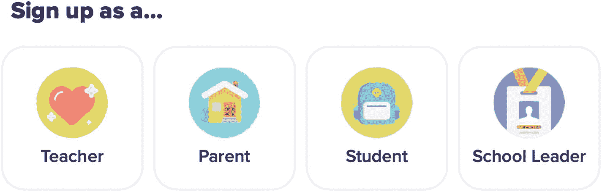
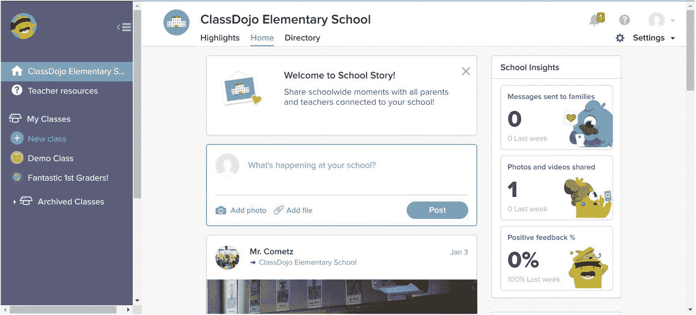
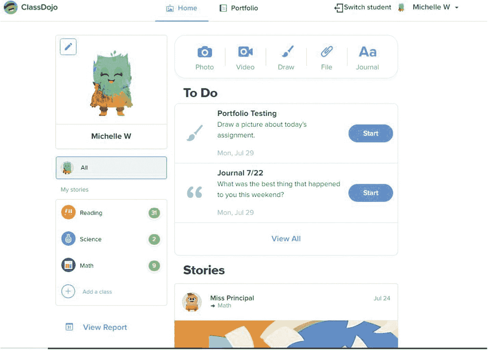

# 跨平台示例：ClassDojo

`ClassDojo` 是一款面向儿童、家长和教师的跨平台产品的优秀示例（图 3-2）。其目的是作为一个课堂沟通平台，连接教师、学生和家庭。举例来说，教师可以与家长分享课堂生活的瞬间，孩子可以查看作业并获取教师的评分和评语，家长则可以提问、与教师联系，并监控孩子的学习进展。

`图 3-2` `ClassDojo` 中不同用户的新手引导

每种用户都会获得不同的体验。例如，以下是学生和教师的不同仪表盘（图 3-3 和 3-4）。

`图 3-4` 教师端网页仪表盘

`图 3-3` 学生端网页仪表盘

在这个案例中，该产品可能更侧重于帮助教师组织活动并吸引儿童和家长参与。因此，你的儿童产品可能并不以儿童为首要目标用户。

当我在 `StoryBots` 工作时，我们有两个主要产品。一个是主要面向儿童的 `iOS` 应用，为学龄前儿童提供视频、书籍和活动的集成平台。第二个是 `StoryBots Classroom`，这是一款适用于平板电脑、`PC` 和 `SMART` 白板的数字平台，可在学校和家庭中使用，以寓教于乐的方式教授数学。因此，虽然 `iOS` 应用主要关注儿童，但在 `StoryBots Classroom` 上，我们更多地转向了教育工作者的需求（教学、参与、组织等）。

探索优先满足家长和教育工作者需求的可能性，儿童需求将随之得到满足。有时，这种视角的转换有助于激发新的想法和机遇。

## 行业洞察：Scott Emmons 访谈

Scott Emmons 是一位作家和词曲作者。他为儿童创作了多部作品，包括为 `Netflix` 电视节目 `Ask the StoryBots` 创作的歌曲和片段、早期读者书籍，以及为动画短片创作的教育类歌曲。

**Rubens：我有幸目睹你在 `StoryBots` 的电视节目、书籍和歌曲上的工作，你的创造力以及融入作品中的趣味性令我惊叹。第一个问题可能有些老套，但我很想知道你的灵感从何而来。**

Scott：谢谢你的美言！我想我最大的灵感来自于阅读、观看或聆听那些我喜欢并欣赏的创意作品。我为孩子们写了很多押韵诗，所以像苏斯博士、谢尔·希尔弗斯坦、杰克·普雷卢茨基等真正的语言大师给了我很多启发。灵感也可能仅仅来自于留意身边发生的事情，然后看看能否从中创作出有趣的东西。当我坐下来写作时，我通常会先进行头脑风暴，自由联想，直到找到一个我感兴趣的点子。我也深信通过散步或做其他活动来挖掘潜意识，让想法自然涌现。

**R：你也为成年人写作。你认为我们对儿童和成人说话的方式主要区别在哪里？**

S：对我来说，区别可能没你想象的那么大。为儿童写作时，我的一个主要原则是不要居高临下地对他们说话。即使孩子们不一定理解每一个词，有吸引力的内容仍然能抓住他们的兴趣。这正是为 `StoryBots` 工作的一大收获。他们以有趣的方式呈现一些颇具挑战性的概念，让孩子们乐在其中。同时，我觉得我为孩子们写的东西往往更天马行空一些。孩子们更愿意接受无厘头的想法，所以如果我想写一只长着兔子耳朵的恐龙，我可以直接去写。

**R：所有`StoryBots`的内容都既超级有趣又具有教育意义。将这两方面结合起来有什么秘诀？它们通常不太容易融合。秘诀是什么？**

S：再次强调，我认为秘诀是加入一丝奇思妙想。我没有创作外太空系列歌曲，但那是一个绝佳的例子。还有什么比用说唱形式的太阳、月亮和行星来教孩子们认识天体更好的方法呢？我确实创作了一系列关于数字 1 到 10 的蓝草风格歌曲。为此，我常常只是即兴发挥，选取孩子们熟悉的有趣事物。比如数字 3，我可以引入三只小猪、三只小猫咪、老国王科尔的三位小提琴手等等。为孩子们将教育和娱乐结合起来很有趣，因为几乎任何东西都可以变成一个角色。

**R：`StoryBots`成功地让大人也喜欢上为孩子们制作的内容。你认为你为成人写作的经验是否帮助你在为儿童写作时，也能向成年人传递会心一笑的趣味？**

S：这又回到了不要对孩子居高临下这点上。`Ask the StoryBots` 里充满了孩子们理解不了的小笑话和旁白，但这种态度对孩子们来说仍然很有趣，而成年人则可以享受其中额外的幽默。有时，你可以创作出在多个层面上都有效的作品。我为“动物”那一集写了关于两栖动物的歌曲。唱这首歌的角色很明显是在向查克·琼斯老动画片中的密歇根蛙 J. 致敬。大多数孩子可能不明白这个梗，但他们仍然可以把它当作一首有趣的歌来欣赏。

**R：你为早期读者写了一系列书籍。在创作这类作品时，需要牢记哪些要点？比如使用较短的句子，或避免被动语态？我在这儿只是猜测。你才是专家！**

S：那些“Step into Reading”书籍看起来非常简单，但它们是我为 `StoryBots` 创作的最具挑战性的作品之一。是的，对于单词和句子长度都有严格的规定。当我写押韵诗时，我对格律——节奏、重音、音节数等——非常讲究。更让我抓狂的是，我还不被允许使用缩略形式（例如 don't 代替 do not）。这又增加了一整层难度！但这些书确实很成功，所以我没什么可抱怨的。

**R：`StoryBots` 在节目中、书籍里和短视频中呈现的许多主题，都是看似很难向幼儿解释的科学事实。但他们却做得非常成功。这里有什么秘诀吗？**

S：我必须归功于 Spiridellis 兄弟（`StoryBots` 的创始人），他们没有回避这些复杂的主题。他们没有把内容变得幼稚化！这往往是将基本概念分解成孩子们能够消化的、可理解的信息碎片的问题。我创作了很多歌曲，我认为歌曲还有一个额外的好处，就是孩子们会反复听，所以信息得到了强化。我接到的最具挑战性的任务是用一首一分钟的歌曲来解释万有引力。孩子们第一次听到时，大部分信息可能都一闪而过，但通过重复，这些信息就会留下印象。至少我希望如此。

**R：你过去曾是一名希腊语和拉丁语教师。即使你不是教孩子，你认为这段经历对你创作教育内容有帮助吗？**

S：说实话，我从未真正考虑过这个问题。也许它以一种无形的方式有所帮助。我之前谈到过将信息分解成易于消化的小块，这是教学的一个重要部分。我认为我的学术背景在某些方面有帮助，因为它让我对词汇和语言有了深刻的理解。另一方面，我有时又必须把自己从学术思维中拉出来，才能触及到真正有趣的东西。

## 章节回顾

- 为儿童设计也意味着为家长和教师设计。
- 孩子们将乐趣置于其他需求之上。
- 儿童受众按年龄段划分。每个年龄段都有不同的需求，并带来不同的机遇与挑战。
- 家长可能是一群要求非常高的受众。他们希望孩子得到最好的，同时也期望物有所值。
- 教育工作者如果信任我们的产品并发现其真正价值，就可以成为我们的盟友。他们可以成为我们产品的大使，向家长和其他教育工作者推广其使用。
- 一款受教育工作者信赖的产品，在家长眼中也更可靠。