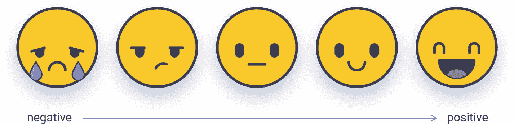

# 9. 儿童用户测试

向用户学习，完善你的产品。

> *测试导致失败，而失败带来理解。*
>
> ——伯特·鲁坦，美国航空航天工程师

用户测试并非一定要在开发过程的最后阶段进行。你可以在项目一开始就用`低保真原型`（甚至`纸面原型`）来测试某个想法。并且在开发过程中，任何时候你认为有益，都应进行测试，例如在推进某个特定功能或交互之前先对其进行测试。不过可以肯定的是，这是你在产品上市之前必须做的一件事。

同样，儿童与成人不同，要有效地对他们进行测试，需要根据他们的需求来开展工作，以便从测试环节中获得最大收益并得到有用的见解。很容易理解，对 26 岁和 36 岁的人进行用户研究，在测试方式上是完全相同的。从市场营销角度看，他们可能属于不同的年龄段，但从可用性角度看，他们是两个认知和运动技能水平相似的成年人。而两个年龄差相同的儿童情况则完全不同。对 3 岁儿童进行研究与对 13 岁儿童进行研究是两码事。你可能已经听腻了这一点，但请允许我再重申一次：在儿童发育过程中，即使是 2 岁的差异也意味着天壤之别。

在对儿童进行用户研究时，有几个方面需要考虑，本章我们将介绍对他们进行用户测试的最佳实践。

## 招募参与者

参与者的年龄是一个相当明显的变量，需要与你的产品目标年龄相匹配。而且，除非你的产品专门针对某一性别，否则你也应该让男女参与者比例均衡。

在招募儿童进行用户测试时，最好比测试成人时多招募一些参与者。原因有几点：

*   在对儿童进行测试时，每个参与者需要应对两个人：儿童和一位家长/看护人。这使得有人可能遇到问题而无法到场的几率翻倍。

*   有时儿童，尤其是年龄较小的孩子，在与陌生人交谈、被提问等情况下可能会害羞。你可以尝试书中所有的技巧（我们稍后会介绍其中一些），但有时什么方法都不管用，你只能让他们离开。

除了参与者数量，性格的多样性也至关重要。当然，你无法亲自了解他们，但可以向家长询问他们的孩子是偏内向型，还是更外向、话少或话多，或者是否在和朋友在一起时更健谈等等。这些信息有助于了解如何与孩子接触，也能获得对产品更广泛反应和反馈的样本。

别忘了获取家长的同意。由于涉及未成年人，准备好所有必要的文件非常重要。根据你进行测试的国家（以及公司）的不同，具体要求可能会有所不同，因此请务必遵守当地的法律法规。

## 测试环境

一个友好的环境是让参与者放松的第一步。根据你的需求和可能性，你可以：

*   在公司或测试机构中，专门设立一个用于儿童用户测试的房间。

*   找一个公共空间，比如学校或图书馆，作为测试实验室。

两者的主要区别在于，专门的测试场所可以提供更好的基础设施，例如多角度摄像头、单向镜等。公共空间的优势通常是成本较低，而且如果你的参与者经常去那个地方（也许是他们的学校或当地公共图书馆），它还具有一个巨大优势——一个熟悉的环境，让他们更容易感到舒适。

无论如何，这个场所的设计必须以儿童为中心。因此，装饰必须对儿童友好，使用彩色海报和其他装饰物。重要的是要保持良好平衡：对孩子们来说既温馨友好，但又不能过于分散注意力。尽量避免玩具或其他潜在干扰源，当然，除非测试的目的就是玩玩具。窗户是好的，但如果窗外景色刺激过多，最好不要让参与者面对窗户。

家具也必须以儿童为中心，因此桌椅的尺寸应适合你所测试的年龄段。总体而言，营造出一点像教室的感觉是个好主意，这能向他们灌输适当行为的概念。

别忘了，你自己也是环境的一部分！因此，你的外表对于让参与者感到舒适也至关重要。不要穿着过于讲究，避免正装（我想甚至不需要提白大褂。请千万不要穿！），休闲但专业的服装是最佳选择。另一个好办法是穿着印有参与者年龄段儿童喜爱的流行角色的 T 恤、徽章或贴纸；这可是个打破僵局的好方法。

总而言之，就是要避免让孩子们感觉自己在被测试，或者像是去看医生。从一开始就明确告诉他们，孩子们是来教*你*一些东西的，而不是反过来。

## 家长的在场

赢得家长的信任很重要，因为如果孩子明白他们的家长或监护人是信任你的，他们就更有可能参与并感到舒适。有时，尤其是对年龄较小的孩子（2 到 4 岁），让家长在房间里有助于他们感到安全，但对于其他孩子，测试时有家长在场可能是有害的，因为他们担心答错被评判（当然没有所谓的错误答案，但孩子可能会认为存在这种可能性——务必不惜一切代价避免）。在真正尝试之前，不可能知道哪种方式更好，而且每个孩子都不同，所以如果孩子允许，可以尝试先让家长离开房间，看看情况如何。观察肢体语言；一个孩子不断地看向家长离开的门，这明显表明让家长在房间里可能是个好选择。

如果家长或监护人在房间里，让孩子看到他们将要坐的位置，但随后让孩子的脸朝向另一个方向，以避免孩子不断寻求家长的认可，并避免成年人的点头或其他有意或无意的信号影响孩子。

必须指导成年人只做安静的观察者。如果孩子向家长求助，你和家长应向孩子解释，孩子才是专家，是来教你们的，而你们只是想学习，以此鼓励孩子自己尝试。

家长也可以协助解释任务或解读孩子的回答。这不仅是宝贵的资源，也是让他们感到被参与并赢得他们信任的一种方式。但同样重要的是，他们绝不能以任何方式影响孩子的回答。

# 友谊配对

我注意到一个效果不错的方法，尤其是对 6 到 8 岁的孩子而言，就是让朋友（或年龄相仿的兄弟姐妹）参与进来。与朋友结对能帮助害羞的孩子敞开心扉，说出自己的想法。这有助于减轻他们独自面对陌生成年人时的压力，而且这种小型头脑风暴也是一个交流观点、一次听到多个孩子想法的机会。他们与产品互动的方式也很有趣，因为这可能为团队合作和小组游戏的新功能激发灵感。在这种情况下，重要的是避免因“谁该使用设备”而产生冲突。设定轮流顺序，并让两个孩子都参与进来，这样就不会有人因为看着另一个孩子玩而感到无聊。

# 原型

儿童天生比成年人更具探索精神，因此他们更可能点击任何东西，只是为了看看会发生什么。虽然纸面原型在概念的最初阶段可能适合探索特定的游戏场景，但我坚信，当真正要检验你的想法时，高保真原型至关重要。

原型的保真度应尽可能接近真实情况，尤其是在视觉设计方面。如果测试视觉设计并非我们的主要目标，成年人可以接受线框原型。对于一个成年人来说，如果我们要测试的是注册流程，一个灰色的、带尖角的写着“注册”的按钮，与一个更精致、更美观的相同组件相比，差别并不大。但对孩子来说，这可能天差地别。因此，结合视觉设计来制作交互原型，是真正从儿童用户测试中获得正确洞察的唯一途径。

原型中包含的流程、交互和屏幕越多越好。这可以避免因遇到“死路”而导致测试卡壳的风险。

然而，即使是一个高保真原型，通常也远未达到成品状态，可能并非所有流程和功能都被设计和原型化。而且，成年人往往更能专注于任务，而孩子们则更可能随意点击那些可能“破坏”原型的东西。因此，最好在某处隐藏一个重置功能（可以是一个特定手势，孩子很难无意中做到），以便快速回到初始状态。

# 提问

首先要明确（也要对父母或监护人讲清楚）的是：接受测试的并不是孩子，而是产品。让孩子知道，他们是来帮助你、教你如何运作的。通过让他们感觉自己才是专家，而你只是来学习的，来赋予他们力量。

在开始测试前，最好有一些破冰环节。在本章前面部分，我建议穿上带有流行角色的衣服，以引发关于他们喜欢（或不喜欢）的事物的对话。这是一点；你也可以问一些一般性的问题，比如他们最喜欢的游戏或应用是什么，喜欢它们的什么，是独自使用还是和朋友或兄弟姐妹一起使用，等等。这些开放式问题对他们来说很容易回答，同时也能提供一些有价值的见解。

你需要坚持非常具体和务实的问题。不要过于抽象，正如我们在第 7 章中讨论的那样；对于 11 岁以下的孩子（当然，每个孩子略有不同），他们仍然很难进行抽象思考。

在开始任务之前，还有几件事需要澄清：

- 如果他们不知道如何做某事或如何回答一个问题，这完全没问题。他们随时可以向你寻求帮助。

- 他们可以自由表达自己，不用担心伤害任何人的感情。如果某件事他们不喜欢，说出来也没问题。

任务的难度应该循序渐进——从简单的任务开始，帮助孩子建立自信，然后在测试结束时转向更复杂的任务。最初的一两个任务即使非常基础，甚至可能不是你本次测试的重点，也没关系。重要的是让参与者先放松下来。所有任务的复杂度都应该是现实的，但这应该是概念本身决定的。如果你觉得某个功能太复杂而无法测试，那么它一开始就不应该成为你产品的一部分。

你使用的语言应当与你所测试的儿童的年龄相适应。我所说的“适应”不是说不能有脏话——这应该是默认的。我指的是语言要足够简单，让你的测试对象能理解，同时又不能有居高临下的感觉。无论是给年龄稍大的孩子提供书面指示，还是给不识字的儿童口头说明时，都应如此。

孩子们很容易分心，偏离你为测试规划的路径。虽然与成年人测试相比，这可能会耗费更多时间，但让他们（在原型的允许范围内）探索也同样重要。你可能会发现一些意想不到的东西。

# 时长

与成年人测试相比，与儿童进行测试时，明智的做法是始终预留更多时间。如前所述，孩子更容易分心，并在执行任务时走自己的路。这未必是坏事，但一定要分配更长的测试时间。

每次测试的时长不应超过一小时，以免孩子失去兴趣。同时考虑在测试过程中安排一两次休息，我建议在实际开始测试前（经过一些破冰交谈后）提议去一次厕所；这可以防止日后因生理需求而分心或计划外中断。

向孩子解释测试将如何进行总是一个好主意——分解说明你们将要一起进行的活动、会使用什么设备、他们会遇到什么样的问题和任务等等。让他们对即将发生的事情有所了解，是另一种让参与者放松、避免他们感到焦虑的方法。

## 反馈

这是儿童用户研究和成人用户研究的另一个关键区别。在与成人合作时，你希望自己的反馈和反应尽可能中立。答案没有对错之分；参与者是在测试产品，而不是被测试，所以他们才是告诉你产品有哪些对与错的人。没有“大棒”，也没有“胡萝卜”。

虽然这最后一点对于儿童用户测试仍然成立，但你的参与者可能需要闻到“胡萝卜”的味道才能获得动力和信心。积极的反馈至关重要，但必须谨慎给予。你不想将参与者引向任何特定方向，所以试着找到在不影响他/她决定的情况下给予积极回应的方式。可以试试诸如“谢谢你教我这些！”、“这真的很有趣！”或“你真的帮了大忙了！”这样的说法。奖励的是参与者的行为，而不是他们的决定。像这样积极的反馈是让孩子更自信、更愿意表达的一种方式。

# 获取答案

有时，理解孩子们的意思可能很困难。年幼的孩子词汇量有限，表达想法的能力也有所欠缺。有几种策略可以尝试采用，以缓解这一问题。首先，对会话过程进行录像会很有帮助，之后可以反复回看（必要时可多次），同时也能注意到参与者肢体语言中更细微的反应。如果进行录像，请记得在家长需要签署的同意书中明确声明，并附上所有必要的隐私政策参考。

如果在你专注于孩子时，能有另外一个人在场做笔记，也会有所帮助。将全部注意力放在孩子身上，无需中断记录来注释答案，这既有利于你与参与者建立的关系，也有利于笔记质量——因为有专人负责记录。

促进年幼孩子回答问题的好策略之一是使用视觉辅助工具来表达感受。这非常类似于我们在医生办公室常见的那种海报，上面用不同的面部表情对应不同的疼痛等级（希望你的产品不会引起同样痛苦的反应）。可以是一张纸，让孩子在上面指出最能代表他们感受的表情（图 9-1）；也可以是一些贴纸，让孩子将其贴在某个地方，以增加趣味性（如果你已经为产品或品牌设计了一个角色，可以将其用于此目的；参见第 8 章）。

图 9-1 你可以使用类似表情符号的贴纸来帮助孩子表达情绪

最后，如果有一位家长在场（见本章前面的“家长在场”部分），你可以请其帮忙促进回答，但要注意家长不应提示任何内容，只在必要时鼓励和解读孩子的回答。

## 行业洞察：采访玛蒂娜·德尔阿夸

玛蒂娜·德尔阿夸是一名专注于儿童产品的游戏设计师。她是 Colto 公司的产品主管，该公司专门为儿童开发教育游戏，并与尼克国际儿童频道和高光公司等大型媒体公司合作。

**鲁本斯：你们如何处理招募工作？除了年龄之外，在招募参与者测试产品时，你们还会关注其他因素吗？**

玛蒂娜：年龄对我们来说是一个关键要求，但不是唯一要求。我记得五年前我们刚开始的时候，当时了解测试的孩子是否使用移动设备极其重要。有很多孩子不习惯使用这些设备，而对我们来说，测试这两类孩子非常关键。如今，几乎找不到从未使用过设备的孩子了。不过，我们仍然认为，与那些没有丰富数字体验的孩子一起测试我们的应用很重要，以便了解我们的产品是否足够直观。

**鲁本斯：你认为，当孩子们来参加用户测试时，与他们接触的最佳方式是什么？你让他们放松、感到舒适和安全的秘诀是什么？你能分享一些技巧和窍门吗？**

玛蒂娜：一上来就把应用直接交给孩子，得到的结果毫无用处。他们会睁大眼睛，呆滞地看着你。“我该做什么？”他们似乎在问。我的建议是尝试“打破”你作为“成年人”的形象，成为“朋友”。我通常的做法是拿出自己的设备，开始玩不同的游戏来激发他们的兴趣。然后，我开始和他们谈论喜欢的应用和电视节目，让他们放松下来。过了一会儿，我就请他们试试这款新的“应用”，也就是我一开始就想让他们试用的那个！

**鲁本斯：测试环境有多重要？你认为最佳设置是什么？**

玛蒂娜：环境可能是儿童测试中最重要的因素。这里的环境不仅仅指“建筑物”本身，而是你进行测试时整个体验所营造的氛围。重现孩子们将要使用你应用的那种舒适氛围非常重要。根据我的经验，我们既在学校测试过，也在办公室的玩耍约会中进行过测试。显然，后者是更轻松的测试方式，孩子们在玩耍约会中更放松、更有自信，感觉更像在家里。为了达到这种氛围，除了数字产品，我们还喜欢准备一些孩子们熟悉的实体游戏产品，这样他们可以一起使用和玩耍，以建立自信并改善整体体验。

**鲁本斯：那家长呢？你如何让他们对自己孩子参与用户测试感到安心？**

玛蒂娜：我过去不太与家长互动。然而最近，我们开始让他们更多地参与到用户测试本身中来。我们需要了解他们在孩子玩耍中的参与程度以及参与方式。当然，孩子是主要用户，但家长也是重要的参与者。他们是购买游戏的人，但更重要的是，他们常常是与孩子一起互动和玩耍的人。让他们成为测试的一部分，会让他们看到孩子使用应用时感到自在得多。

**鲁本斯：有时孩子，尤其是年幼的孩子，可能难以表达他们对产品的想法或感受。对此，你有什么建议来帮助他们？**

玛蒂娜：理解孩子的喜好和需求非常复杂。我们通常更依赖非语言交流。直接提问很少奏效，因为孩子往往倾向于给出“正确答案”。作为变通方法，多年来我们想出了各种更容易让孩子理解、并能给出更真实答案的问题。例如，“你喜欢这个游戏吗？”变成了“你想让我打开另一个应用吗？”；“描述一下这个游戏”变成了“你会怎么跟你的朋友介绍这个游戏？”。

**R:** 在成年人测试中，我们通常避免给出任何形式的反馈，无论是正面的还是负面的。诚然，测试中不存在绝对的对错，但我认为，在与儿童合作时，给予参与者一些正面反馈也同样重要。我们怎样才能在不影响测试结果的前提下，给予正面反馈并建立他们的自信呢？

**M:** 正如你所说，测试中没有对错之分，因此研究者的目标应该是“打破对犯错的恐惧”。这一点对成年人适用，对儿童尤其如此。在这种情况下，我们喜欢做的，就是无论他们做什么，都持续给予鼓励性的反馈，以提升他们的自信心，让他们“表现出”真实的自己。并且，根据具体情况，尝试分析孩子的行为，同时避免一直盯着他们看，以免让他们感到压力。

**R:** 我知道你最近（由于新冠疫情保持社交距离的要求）和孩子们进行了一些远程用户测试，这相当不寻常。与面对面测试相比，最大的区别是什么？孩子们对这种测试环境反应如何？有什么技巧可以分享吗？

**M:** 远程测试是我原本认为行不通的方式。我很高兴地说我大错特错了。它效果非常好，甚至开启了一种新的测试视角。孩子们总是和父母一起待在家里，感到非常自信和放松。我们不必费心去营造“宾至如归”的感觉，就能看到他们在自己平常玩耍的环境中进行游戏！在某些情况下，父母会过度参与孩子的测试，但在几次“虚拟游戏约会”之后，我们成了管理父母和孩子的专家！

效果如此之好，以至于我们决定未来继续采用远程测试。然而，需要强调的是，这并不能替代面对面测试，而是一种有效的补充。

## 章节回顾

- 儿童和成年人的用户测试是不同的。
- 在针对儿童进行用户研究时，即使是微小的年龄差距也很重要。
- 招募的参与者要比你认为需要的数量多。
- 尝试招募性格多样的参与者，包括内向和外向的。
- 必须获得家长的同意。
- 建立一个欢迎儿童、以儿童为中心的环境，无论是在学校、公共图书馆还是测试机构。
- 让环境友好，但不要过于分散注意力。
- 着装要专业，但着装随意。穿着过于正式可能会令人畏惧。
- 尝试在着装中加入一些流行角色元素。这可以充当破冰的话题。
- 赢得家长的信任。向他们解释测试的内容（与他们的孩子无关）以及如何进行。
- 对于年龄较小的孩子（2 至 4 岁），如果有助于孩子放松，父母或监护人可以在房间里。
- 房间里的父母应作为安静的观察者，远离参与者的视线。
- 在需要支持和鼓励时，请求父母介入，但要注意他们不要影响孩子的选择。
- 有些孩子适合与亲密的朋友一起结对测试。
- 结对测试时，要规定好轮流顺序，以免因使用设备而产生争执。
- 高保真原型是面向儿童的最佳选择。
- 儿童倾向于探索并点击所有内容。包含一种快速重置原型的方法。
- 让参与者知道，被测试的不是他们，而是产品。他们是老师。
- 从简单的问题和任务开始，以建立测试者的信心。
- 提问要具体，并使用适合其年龄的语言。不要使用专业或艰深的词汇。
- 让他们知道，不知道答案或不知道如何完成任务是没关系的。
- 没有人会因为负面评论而受到伤害。
- 允许在任务范围之外进行一点探索（如果原型允许的话）。
- 每场测试最长持续时间为一小时。
- 与成年人测试相比，为用户研究留出更长的时间。
- 计划好一开始就安排上厕所的时间，并在测试期间安排一到两次休息。
- 说明测试将如何进行。
- 给予笼统但正面的反馈。不要像对待成年人测试那样“面无表情”。
- 如果孩子很难表达自己的感受，尝试使用带有表情符号或插图的视觉量表。
- 如果可能，仅专注于参与者本人，由其他人负责记录。
- 录像有助于回顾回答和肢体语言。

