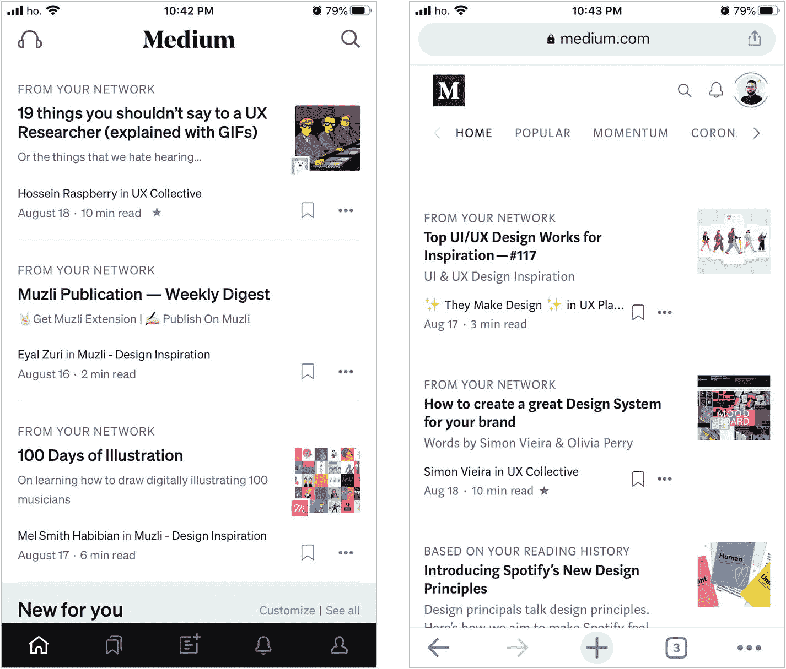

# 发布流程

苹果在上架应用商店前有一个相当冗长且严格的提审与批准流程，而安卓的流程则更快、更简单。iOS 上的审核时间通常也更长，这同样会影响到更新：在安卓上，更新几乎是即时的，而在 iOS 上则需再次经历审核流程。在成本方面，成为 Google Play 商店开发者的费用是一次性支付 25 美元，而苹果则要求每年支付 99 美元才能获得进入 App Store 的资格。

综合考虑这些因素，最终决定取决于你的优先级。如果你的优先目标是产品的盈利能力，那么你可能想先开发 iOS 版本，这样开发更容易，利润最大化。如果你更关心触达尽可能广泛的用户群体（例如，这是一个非营利项目），那么安卓是更好的选择。

在设计方面，一般来说（对此不必全信），iOS 上的产品在用户体验和视觉设计上更胜一筹。我认为我们无法将其归因于单一原因，但我的猜测是，这是多种因素共同作用的结果。作为一个封闭的生态系统，App Store 的上线规则比 Google Play Store 严格得多，这造就了一个更加精挑细选、质量更高的应用目录；因此，竞争设定了更高的标准，你希望与它们看齐，甚至超越它们。

安卓不受限制的方式为大量独立开发者和爱好者创造了完美的试验场，他们为我们带来了许多优秀的、在 iOS 设备上无法实现的产品，但也让生态系统中充斥着大量低质量、可能（或故意）有害、且标准远低于 iOS 的平庸产品。

最终，用户要么愿意为品质付费，要么根本不付费；当你的产品做得很好且外观漂亮时，更容易向用户收费。

`审美-可用性效应`^（[20]）^是指“倾向于认为有吸引力的产品更易用”。人们倾向于相信看起来更好的产品会工作得更好——即使它们实际上并没有更有效或更高效。

将这一点与安卓应用易于非法下载结合起来，你就能理解为什么为 iOS 开发产品利润要高得多。

## Web 应用

Web 应用在浏览器中显示，并且需要活跃的网络连接才能工作。现代 Web 应用是*响应式*的，这意味着它们会根据展示它们的容器来调整布局。通常存在一些*断点*，这些断点根据特定的尺寸区间决定应用组件的表现行为，从而定义了当你在智能手机、平板电脑或更大的电脑屏幕上显示 Web 应用时，布局会有何不同。这与原生移动应用有很大不同，在原生应用中，你通常仍然需要一定程度的响应式设计，以使应用能够适配例如从 iPhone 8 到 iPhone 12 的不同屏幕，但你需要为平板电脑构建专门的版本。

一个更大的区别在于，Web 应用是*平台无关*的。这很重要，因为平台无关意味着你不需要为 iOS 和安卓甚至电脑开发不同的应用！只要浏览器支持，你的应用就能显示（是的，可能会存在一些限制，例如在电脑和智能手机之间，但你不需要在每个平台上用不同的技术构建一个完全不同的应用）。

在图 4-1 中，你可以看到 Medium 在其安卓原生应用（左侧）和 Web 版本（右侧）中的不同，而 iOS 应用又不同于安卓版本。

图 4-1 Medium 在其原生应用（左侧）和移动网站（右侧）版本中的对比

原生应用通常速度更快，在用户体验上给人更*灵敏*的感觉，动画运行更流畅，整体体验更具沉浸感。但让我们列出两者的优缺点（表 4-2）。

表 4-2 移动应用 vs. Web 应用

|       | 优点 | 缺点 |
| :--- | :--- | :--- |
| 移动应用 | 速度更快 可离线工作 功能更多（更好访问设备硬件） 更安全（需批准才能上架商店） 更易发现（得益于应用商店） 不在浏览器中运行（对孩子更安全） 可以发送推送通知 | 比 Web 应用构建成本更高 通常需要为每个平台构建专门版本 维护和更新成本高 更新需要安装在设备上 应用商店审核流程有时困难且不一致 |
| Web 应用 | 在浏览器中运行，无需安装 平台无关，无需为每个设备构建专门版本 自动更新，无需用户本地安装或干预 比移动应用构建更快、更容易 无需批准（没有官方商店，它们存在于 Web 上） | 不能离线工作 比原生应用慢，且通常缺少某些功能 可发现性较差（没有商店） 用户体验通常不如原生应用 |

## 渐进式 Web 应用

渐进式 Web 应用（PWA）这个术语由设计师 Frances Berriman 和谷歌 Chrome 工程师 Alex Russell 于 2015 年引入。他们定义了一个应用被视为 PWA（*渐进式 Web 应用*）所需满足的一系列要求。关于 PWA 究竟是什么，目前仍存在一些争议，它似乎处于一个灰色地带，以至于真正宣布一个 Web 应用何时成为 PWA 的边界仍然模糊不清。但无论如何，其核心理念是 PWA 应该融合原生应用和 Web 应用的最佳优势。

让我们看看根据 Google Web.dev^（[21]）^和其他来源提出的要求：

-   **渐进式**：无论用户选择何种浏览器，都能为每位用户工作。
-   **响应式**：适应任何形态因子——桌面、移动设备、平板电脑或未来出现的形态。
-   **初始加载后更快**：初始加载完成后，相同的内容和页面元素无需每次重新下载。
-   **不依赖网络**：允许离线使用或在低质量网络下使用。
-   **类似应用**：通过类似应用的交互和导航给用户以应用的感觉。
-   **持续更新**：由于 Service Worker 更新机制，始终处于最新状态。
-   **安全**：通过 `HTTPS` 提供服务，防止窃听并确保内容未被篡改。
-   **可发现**：通过`manifest.json`和 Service Worker 注册被识别为“应用”，并可被搜索引擎发现。
-   **可再互动**：能够使用推送通知来维持与用户的互动。
-   **可安装**：无需应用商店即可提供主屏幕图标。
-   **可链接**：可以通过 URL 轻松分享，无需复杂安装。

这样看来，PWA 似乎是显而易见的选择，这就是为什么几年前许多人预测 PWA 会扼杀原生应用明星。但这并没有发生，至少现在和可预见的未来不会。

那么与原生应用的区别何在？有几件事需要考虑，因为虽然 PWA 确实结合了原生应用和 Web 应用的许多优点，但它也存在一些缺点。例如，缺少审核流程带来的安全性，任何人都可以创建 PWA 并在网上发布，因为另一个缺点是，没有商店。

由于本书不深入探讨技术细节，目前看来，PWA 在纸面上比在实际中表现更好。

### 那么，我该如何选择？

归根结底，原生应用能提供更高的安全性（这对儿童产品至关重要）、更好的用户体验（更流畅的过渡、更快的响应……），以及在品牌和可信度方面更高的投资回报率——这一点在与家长打交道时不容低估。

根据之前呈现的数据，在原生应用中，简单来说，`iOS` 是能让你获得更高利润的平台，而 `Android` 则能带来更多下载量，如果你更看重这一点的话。

### 根据儿童年龄选择合适的设备

我们讨论了原生应用、网页应用和 `PWA`，但更关键的问题是：我们应该在哪种设备上运行这些应用？在概念开发的早期阶段，我们需要决定：我们的应用应该运行在哪些设备上？智能手机？平板电脑？电脑？还是所有设备？这也会极大地影响用户与应用互动的方式。

每种设备都有其特点，从屏幕尺寸到用户与它的交互方式都不尽相同。智能手机或平板电脑主要是基于触摸的设备，而电脑的主要交互方式是通过键盘和鼠标（或触控板）的组合。但是，智能手机和平板电脑也提供了更多的传感器，例如陀螺仪和加速度计，我们可以利用这些传感器来开发与设备交互的替代方式。

人机交互（`HCI`）受到用户能力水平的极大影响。例如，对于患有帕金森病的人来说，用鼠标点击微小的目标可能会是一种非常令人沮丧的体验。我们的身体在成长过程中会逐步提高处理物体时的灵活性和精细度；新生儿由于肌肉和神经系统仍在“建设中”，因此动作不受控制。随着婴儿长大，她会越来越适应自己的身体，并对其拥有更高的控制力，但这个过程会持续数年。幼儿的手仍然很笨拙，更不用说那些胖乎乎的小手有多小了。因此，一个 3 岁孩子与设备交互的方式，与一个 6 岁孩子能做到的截然不同。

让我们来看看身体发育的阶段。从运动技能开始，我们可以定义三个层次^(²²)：

- **粗大运动技能**：涉及大肌肉群的运动，比如手臂或腿部的肌肉，例如跳跃、蹦跳等动作。
- **精细运动技能**：涉及手腕和手指小肌肉的精确运动。例如用笔写字和画画，用拇指和食指捏起小物体等等。
- **运动协调能力**：将前两者结合，协调身体不同部位以完成特定任务的整体能力。

这三个层次在不同年龄段之间存在很大差异；因此，偏好的手势和设备也随之改变，如表 4-3 所示，该表基于尼尔森诺曼集团（`NNG`）的一篇文章。

**表 4-3** 基于年龄的儿童身体发育情况及建议设备（数据来源：`NNG`）

|               |                     | 3–5 岁              | 6–8 岁              | 9–12 岁             |

|---------------|---------------------|---------------------|---------------------|---------------------|
| **身体能力**   | 粗大运动技能         | 有限                | 部分发展            | 发展良好            |
|               | 精细运动技能         | 非常有限            | 有限                | 发展良好            |
|               | 运动协调能力         | 非常有限            | 有限                | 部分发展            |
| **设备偏好**   | 触摸屏              | 触摸屏和 `PC`       | 触摸屏和 `PC`       | 触摸屏和 `PC`       |

从表中可以看出，即使是年龄较小的儿童也能轻松完成诸如点击、滑动和拖拽等简单手势。这些手势对大多数用户来说是自然而然的，无论年龄大小，因为它们主要涉及粗大运动技能，而大多数儿童的粗大运动技能发展得比精细运动技能更早。当然，由于前面解释的原因，对于年龄较小的儿童，点击交互需要更大的目标。

使用鼠标交互操作起来更复杂，触控板似乎对某些孩子有帮助，但总的来说，我们应该考虑在为 9 岁及以上的儿童设计产品时，才引入鼠标的使用。

不过值得注意的是，在 `NGG` 进行的测试中，即使是能够使用鼠标的年龄较大的孩子，如果给他们提供了触摸屏选项，他们也会放弃鼠标转而使用触摸屏。

显然，和我们所有人一样，每个孩子的灵活程度都是个体化的，所以可能会有 7 岁就能完美操作键盘和鼠标组合的孩子，但我们可以得出结论：虽然触摸屏是所有年龄段的有效选择，但对于 9 岁及以上的儿童，应考虑使用涉及键盘和鼠标的更传统的电脑交互方式。

不过，触摸屏的尺寸多种多样。我们仍然可以找到屏幕尺寸为 4.7 英寸的智能手机（尽管现在很少了），也有屏幕尺寸高达 12.9 英寸的 iPad Pro。考虑到表 4-3 中关于粗大和精细运动技能的信息，我们可以理解为什么更大的目标更好；我们甚至可以简化地说：孩子越小，需要的目标就越大。

不难看出，在触摸屏设备中，平板电脑应优先于智能手机。

现在，如果必须从本节讨论的所有内容中得出一个结论，综合考虑商业机会、平台安全性和儿童身体发育情况，我会说，为 `iPad` 开发原生应用可能是首选方案。但你的想法或业务可能还有其他特殊情况，导致这并非最佳选择。希望在此，我已经提供了足够的数据和信息，供你做出明智的决策。