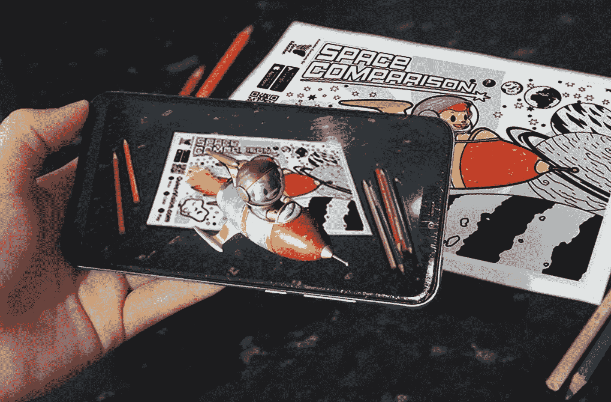
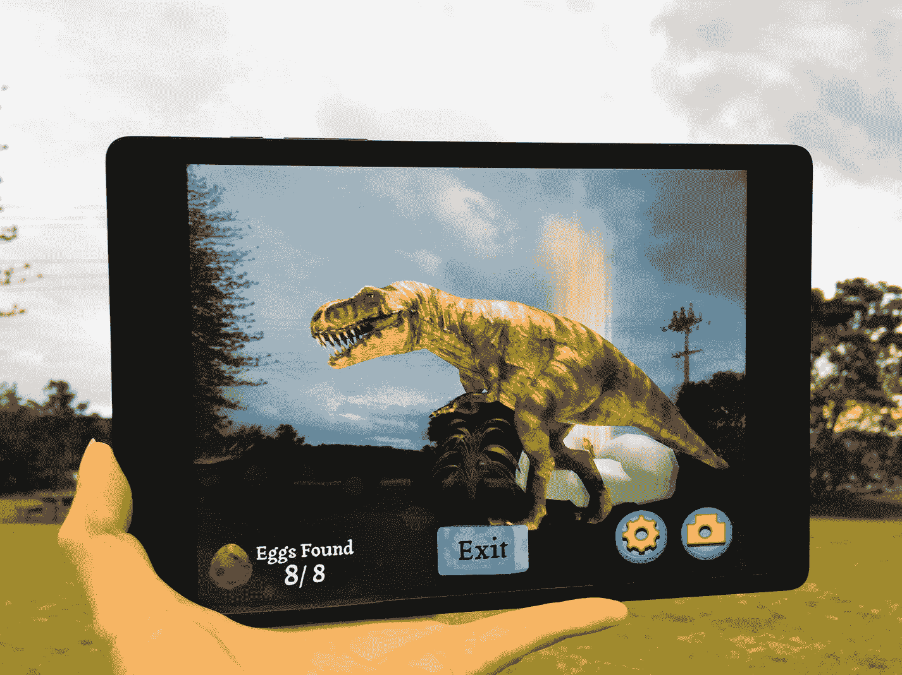
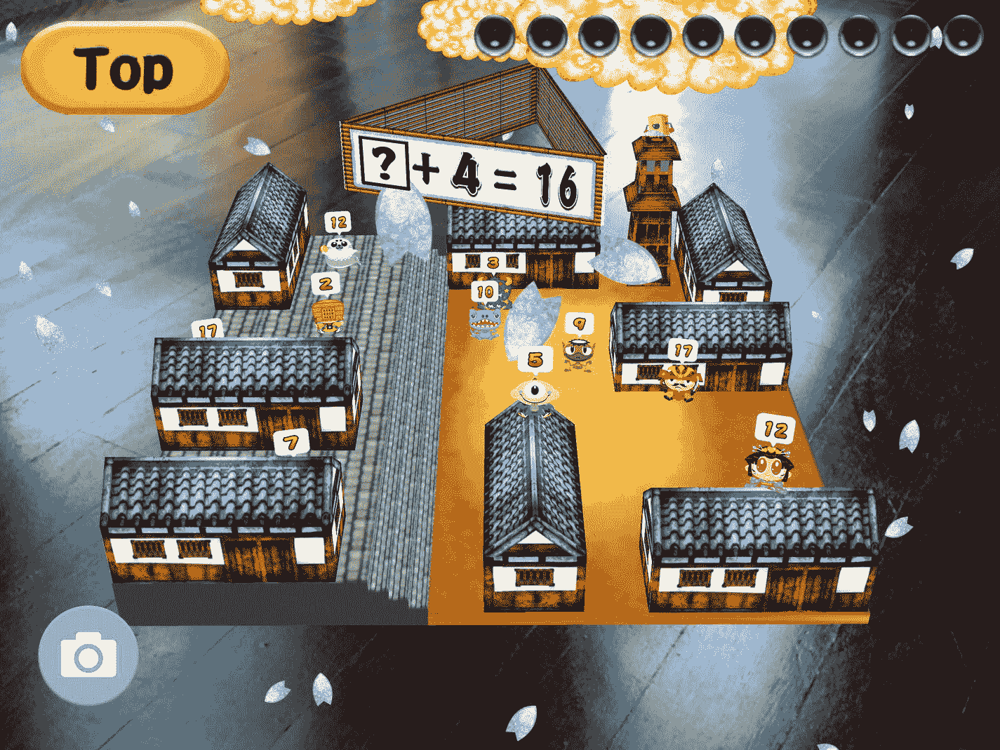
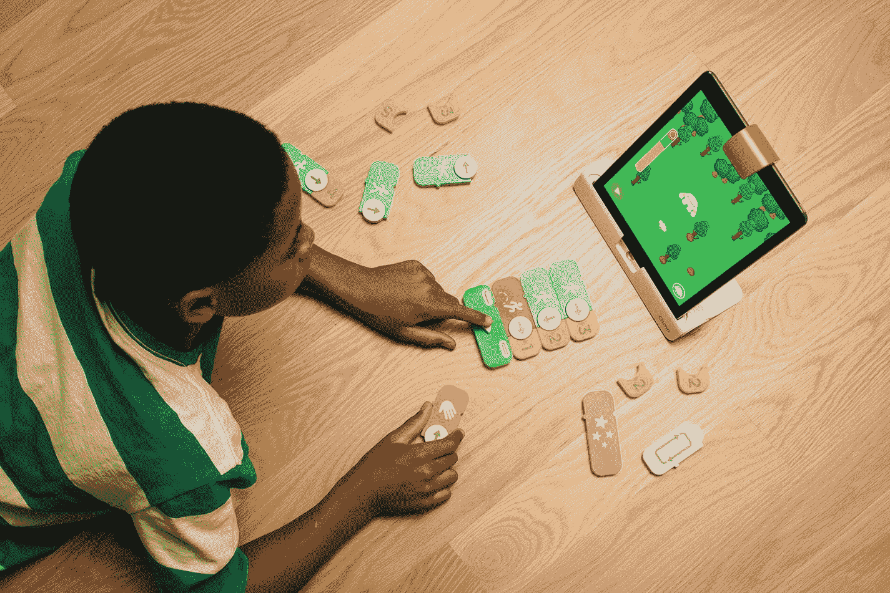
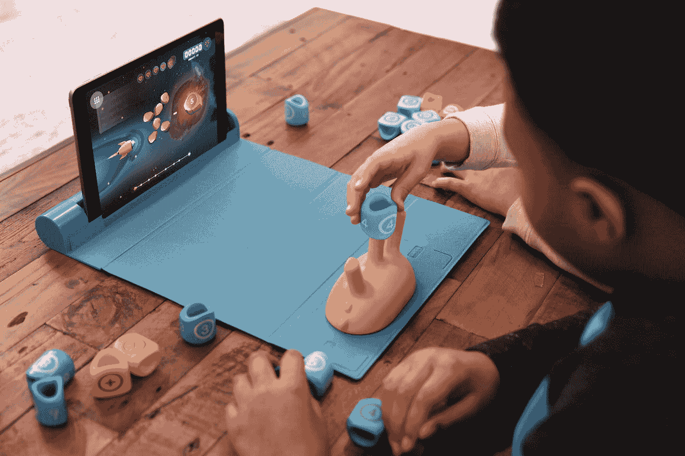
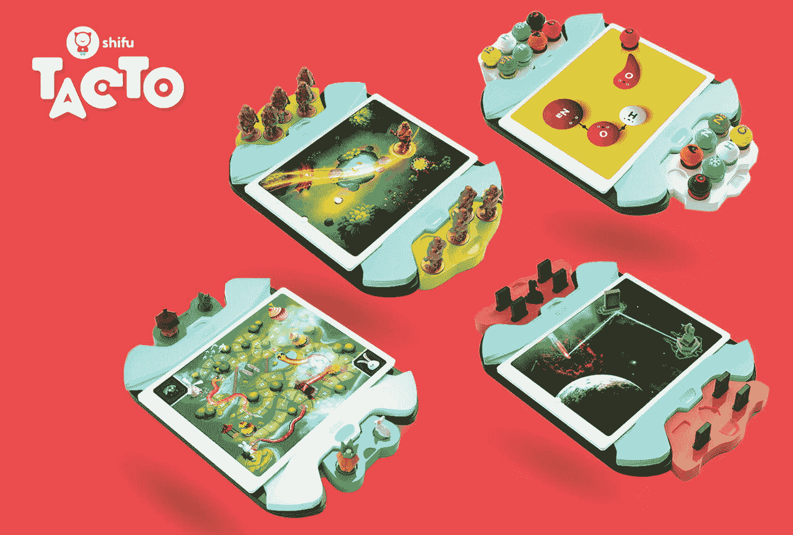
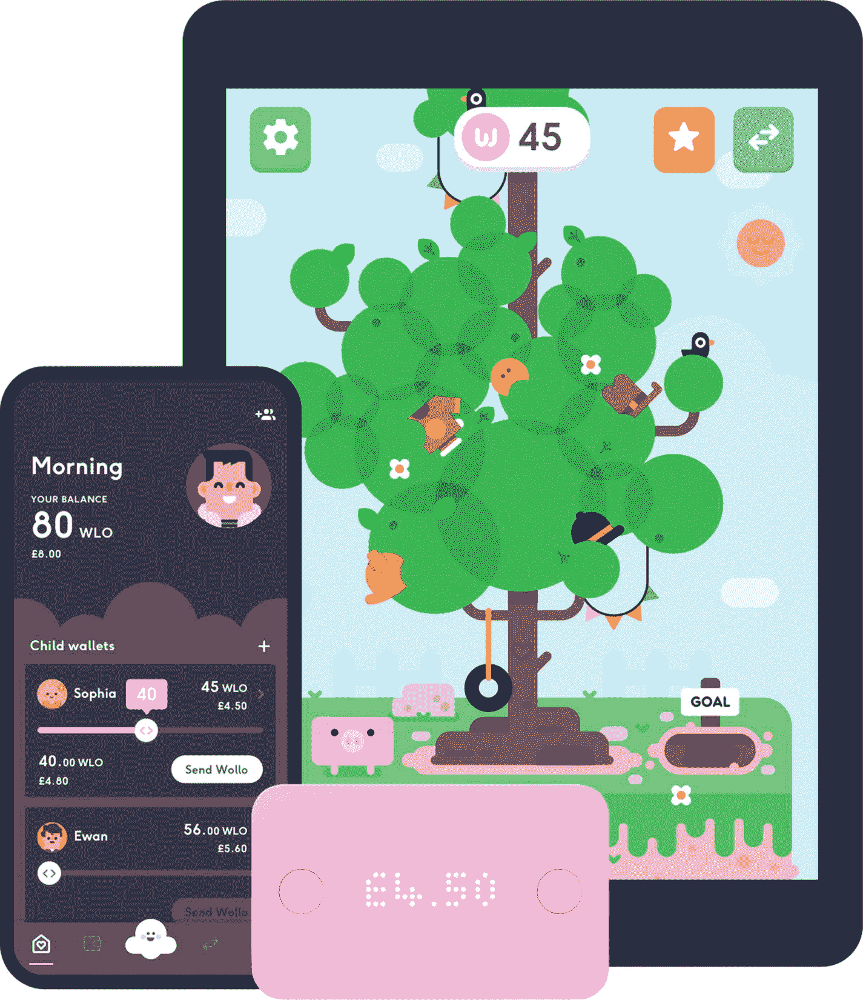

# 11. 超越屏幕

探索打破现实世界界限的体验。

本书的大部分内容讨论的是将在很长一段时间内仍然有效的原则（影响触控交互的人为因素、色彩理论、排版、视觉感知等，短期内不会改变），但新技术不可避免地会为设计新交互带来新机遇，因此，我们将看到新的需求和最佳实践的出现。想象接下来会发生什么，这既令人兴奋，又很困难，因为正如英国科幻作家亚瑟·C·克拉克在他著名的三句箴言（又称克拉克三大定律）的最后一条中所说：“任何足够先进的技术，都与魔法无异。”

我们生活在一个了不起的时代，新技术日新月异。技术的发展完全不像查尔斯·达尔文所描述的自然界中那种极其缓慢的过程。它是以类似摩尔定律所阐述的对数方式实现巨大飞跃的^(⁷⁵)。

在长达近两百五十页的篇幅里，我主要讨论了屏幕内发生的事情，因为现今绝大多数面向儿童的数字化产品都存在于其中。但在我们告别之前，我想邀请您看看一些超越屏幕限制的产品创意。这些技术和产品如今已经存在，但它们正在突破常规的边界。

# 增强现实

截至 2020 年年中，`增强现实（AR）`尚未真正融入我们的日常生活。这项技术已经存在相当长一段时间，但我们似乎仍在努力寻找其在大众消费市场的真正应用。该技术最成功的应用案例是手游 *《精灵宝可梦 Go》*，它于 2016 年风靡全球，迅速成为一种流行文化现象。

在我看来，`AR` 面临的挑战之一是缺乏合适的设备来实现其功能。将虚拟对象叠加到现实世界，需要用户透过举在眼前的屏幕来观察和移动。这实际上并不舒适，尤其是考虑到智能手机比平板电脑轻，但它提供的“窥视孔”非常小，我们只能通过它看到 `AR` 世界；而平板电脑的屏幕更大，提供了更舒适的视野，代价是需要手持更重的设备。

有一些设备能完美支持这项技术，例如，想象一下在驾驶时使用它，信息会出现在汽车的挡风玻璃上。这正是所有主要汽车原始设备制造商（在此处指汽车制造商）目前正在研究的方向。但或许享受 `AR` 的最佳设备将是智能眼镜，这也是已经研发了一段时间的另一款设备。

除非这些设备成为大众市场产品，否则 `AR` 将始终难以蓬勃发展。然而，增强现实蕴含着一种“惊叹”因素，体现了克拉克定律中提到的“魔力”，这使得它成为儿童数字产品的有效组成部分。孩子们喜欢看到和体验魔法，他们喜欢被震撼（其实我也是），而且，正如我多次提到的，孩子们享受的是过程。因此，虽然在面向成年人（任务驱动型）的产品中使用 `AR` 常显得花哨，但在面向儿童（体验驱动型）的产品中使用 `AR`，却能让我们的产品脱颖而出。

在儿童产品中使用 `AR` 的缺点仍然是其人体工程学问题，尤其是对于年龄较小的儿童。要正确定位目标、手持设备的同时可能还需要与屏幕上的元素互动（尤其是在使用平板电脑时），这可能会带来一些挑战，是需要我们牢记的。

尽管如此，让我们来看看一些在儿童产品中 `AR` 的有趣应用案例。

## QuiverVision

`QuiverVision` 很有趣，因为它很好地将新技术与“传统”活动（如涂色书）融合在一起。成年人可以从一个庞大的插图库中下载并打印 `PDF` 文档，孩子们则可以用普通的马克笔或蜡笔给它们涂色（图 11-1）。通过 `QuiverVision` 应用程序，用设备摄像头对准这些插图，它们就会以 `3D` 模型的形式在 `AR` 中“活过来”。它有一系列应用程序，例如经典的 `QuiverVision`、教育版、时装设计师版以及一款用于面部贴纸的版本。

图 11-1

`QuiverVision` 应用将角色带入现实

其中一些插图在进入 `AR` 后，甚至包含互动和小游戏，孩子可以与角色互动并一起玩耍。

数字与非数字的混合是创造我之前提到的魔法效果的完美方式。孩子们在增强现实中看到的 `3D` 模型，是用他们亲手在纸上平面插图上涂绘的颜色和装饰定制的，并且还能与模型互动。这是一个非常有趣的效果。

## Geo AR Games

`Geo AR Games` 是新西兰的一家开发商，致力于研究涉及 `AR` 和地理定位的有趣概念。他们的应用 *《魔法公园》* 邀请孩子们通过探索一个由 `AR` 增强并游戏化的现实环境来发现外面的世界（图 11-2）。增强现实与地理定位的结合类似于 *《精灵宝可梦 Go》*，但 *《魔法公园》* 的活动范围仅限于指定的公共公园，因此对儿童来说更安全。就像 `QuiverVision` 一样，有趣的是 `AR` 如何实现数字游戏与传统游戏的结合，在这里尤其还能促进体育活动。

图 11-2

`Geo AR Games` 开发的恐龙主题体验

## Math Ninja AR

日本开发商 `Fantamstick` 在一款名为 *《数学忍者 AR》* 的教育游戏中利用 `AR` 来教授数学（图 11-3）。虽然与前几个例子相比，这款应用中对增强现实的使用更为传统，但值得注意，这项技术的运用使得用户体验更具吸引力和趣味性。游戏中的所有活动本可以在没有 `AR` 的情况下，完全在屏幕内的数字环境中完成，但他们决定利用增强现实来为孩子们创造一些与众不同且更神奇的东西，从而让他们以更愉快、更吸引人的方式学习数学。

图 11-3

`Fantamstick` 的 `Math Ninja AR`

# 真实玩具 + 数字玩具

数字玩具和应用程序不一定与传统玩具竞争。事实上，如今的玩具正变得越来越智能，市场上已经有一些出色的产品完美地结合了两个世界的精华。

与 AR 在物理世界和虚拟元素之间创造虚构交互不同，这些产品涉及使用一个真实的、可触摸的玩具，可以通过应用程序进行控制、定制或编程。这个概念通常用于向儿童教授编程基础知识（我们在第 4 章中看到了一些例子），但在娱乐和教育方面还有许多其他应用。

## Osmo

`Osmo` 是一个智能玩具品牌，它将平板电脑的使用与一系列实物拼块结合起来。孩子们可以使用这些拼块与屏幕上发生的事情进行交互。`Osmo` 套装包括一个专用的平板电脑支架和一个特殊的摄像头盖子，使摄像头能够对准平板电脑所在的桌面（图 11-4）。

图 11-4

用于教授编程的 `Osmo` 套装

该应用程序利用摄像头读取桌面上发生的事情，并识别孩子们正在使用的拼块。它涵盖了编程、数学、形状、拼写、科学、地理等多个方面的套装。

### PlayShifu

`PlayShifu` 产品是实体与数字玩具概念的另一种诠释。与 `Osmo` 类似，它包含多种套件，涵盖从棋盘游戏到数学、化学、音乐等多个领域。有趣的是，它提供了三种完全不同的产品，可与平板电脑配合使用。

`Shifu Plugo` 是一个带有磁性游戏垫的支架，孩子们可以在上面放置不同的套件，与屏幕上的游戏进行互动（图 11-5）。他们可以放置零件、将它们连接在一起、移动它们，设备的摄像头会读取游戏垫上发生的一切，并将动作转化为视频游戏中的操作。

图 11-5

使用 `Plugo Count` 套件进行的一款数字太空游戏

`Shifu Tacto` 则是一款完全不同的产品（图 11-6）。平板电脑被放置在一个特殊支架上，两名玩家可以面对面进行对战。这是对棋盘游戏的全新演绎，将经典机制和道具（例如小雕像及其他组件）与视频游戏相结合。这些游戏寓教于乐，教授 STEM（科学、技术、工程、数学）科目，例如涉及反射和折射的物理知识、涉及分子和化合物的化学知识，以及更具经典性和策略性的内容。

图 11-6

`Shifu Tacto` 套件

`Shifu Orboot` 是一款非常有趣的产品，它将地球仪这类传统教具、平板电脑和增强现实（AR）技术结合在一起（图 11-7）。孩子们可以通过平板电脑在增强现实中与地球仪互动，获取有关世界各地动物、文化、美食、发明、古迹和地图的信息。未来还会推出关于恐龙和火星的地球仪。

图 11-7

使用 `Shifu Orboot` 探索世界各地的古迹

### Pigzbe

`Pigzbe` 是一款专为儿童设计的数字存钱罐（图 11-8）。针对儿童的金融产品目前尚不普遍，但正变得越来越流行。`Pigzbe` 旨在教导 6 岁及以上的儿童认识金钱的价值并学会储蓄。家长或看护人可以通过手机上的应用程序分配任务，并设定相应的金钱奖励。当任务完成时，孩子们会看到奖励以一棵树的形式呈现，这棵树代表着他们的储蓄，正在被浇灌并茁壮成长。该产品还包含一个实体设备：一个设计非常精美的现代版存钱罐，每当有新任务分配时，它会发出通知，并显示储蓄金额。这样一来，孩子们无需频繁查看平板电脑屏幕，就能随时了解任务进度和他们的存款。

图 11-8

`Pigzbe` 的家长端应用、儿童端应用以及数字存钱罐设备

## 章节总结

- 随着新技术的出现，我们将看到更多开发新型数字产品和新体验的机遇。
- 数字产品可以超越屏幕的限制，实现数字与现实的融合。
- 增强现实（AR）能帮助我们为产品注入令人惊叹的“哇”元素。
- 增强现实（AR）可用于将现实生活中的活动与触摸屏上的交互结合起来。
- 数字玩具并非要与实体玩具竞争，它们可以相互促进，相得益彰。
- 通过使用摄像头和其他传感器，设备可以理解孩子在做什么并做出相应反应。
- 平板电脑可被用来创造新一代更先进的棋盘游戏。
- 产品的实体部分可以是一个辅助设备，不一定是严格意义上的“玩具”。

脚注 1

