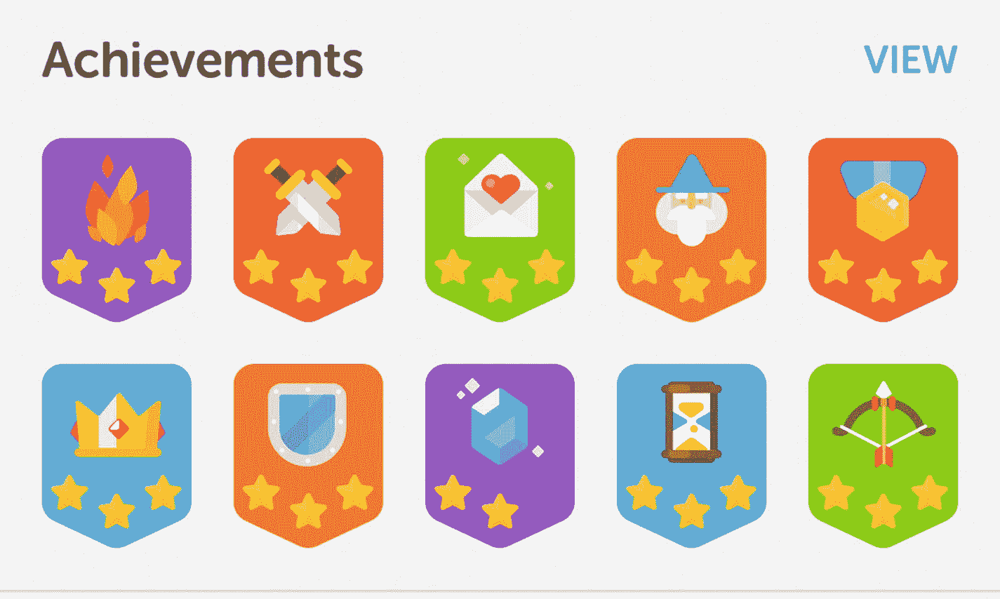
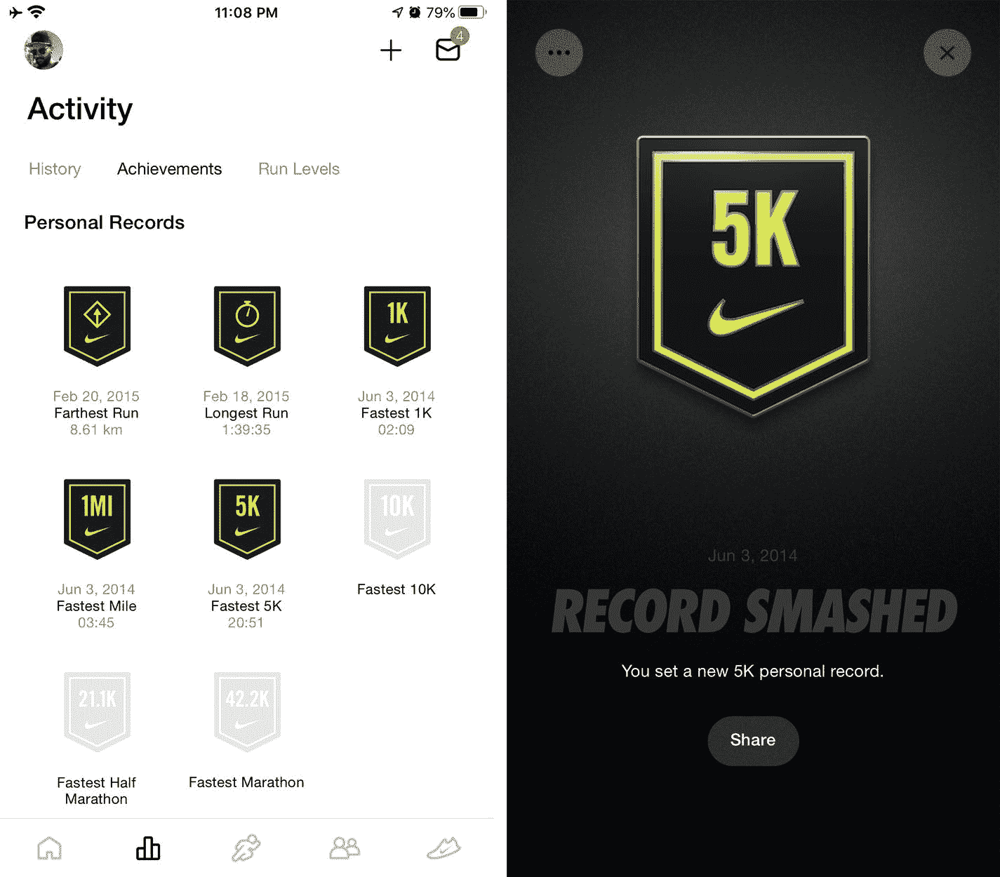
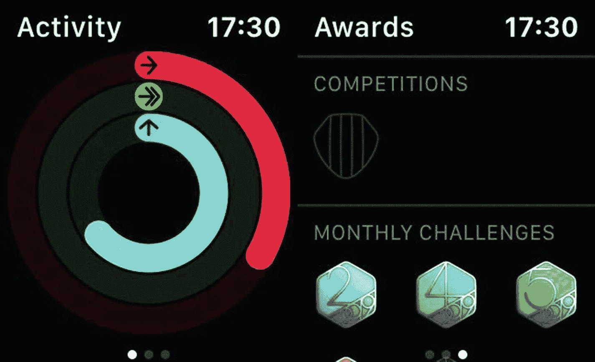
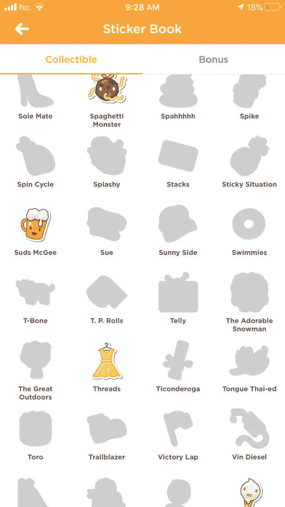
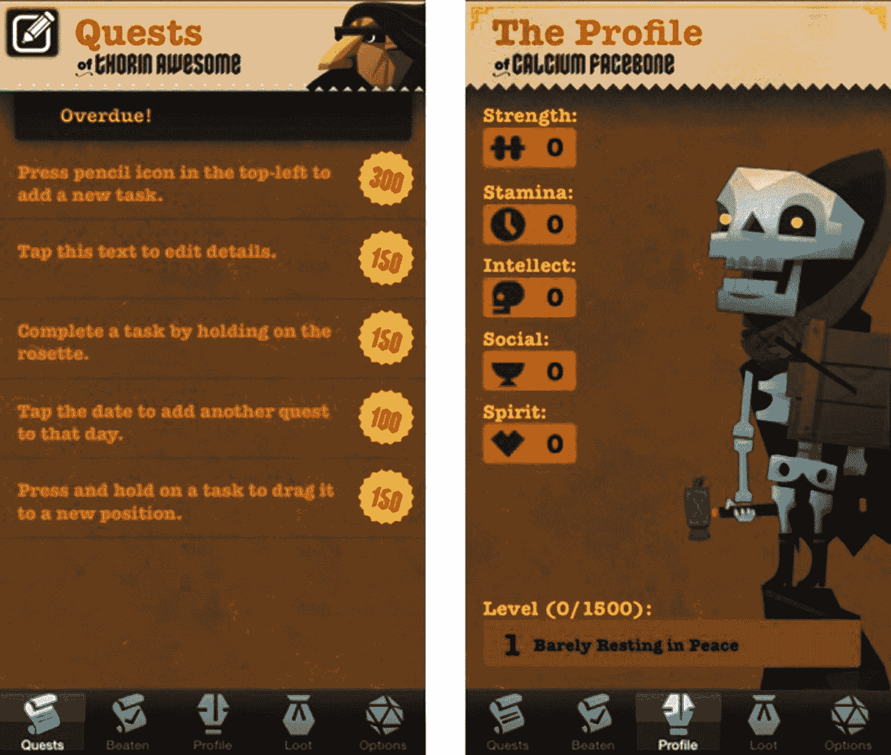
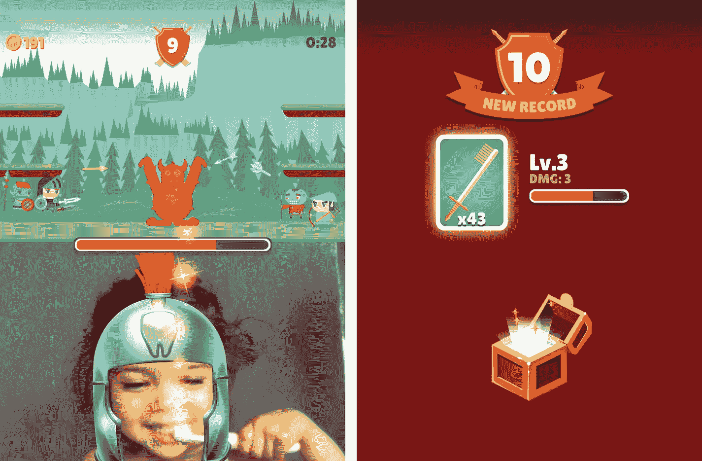
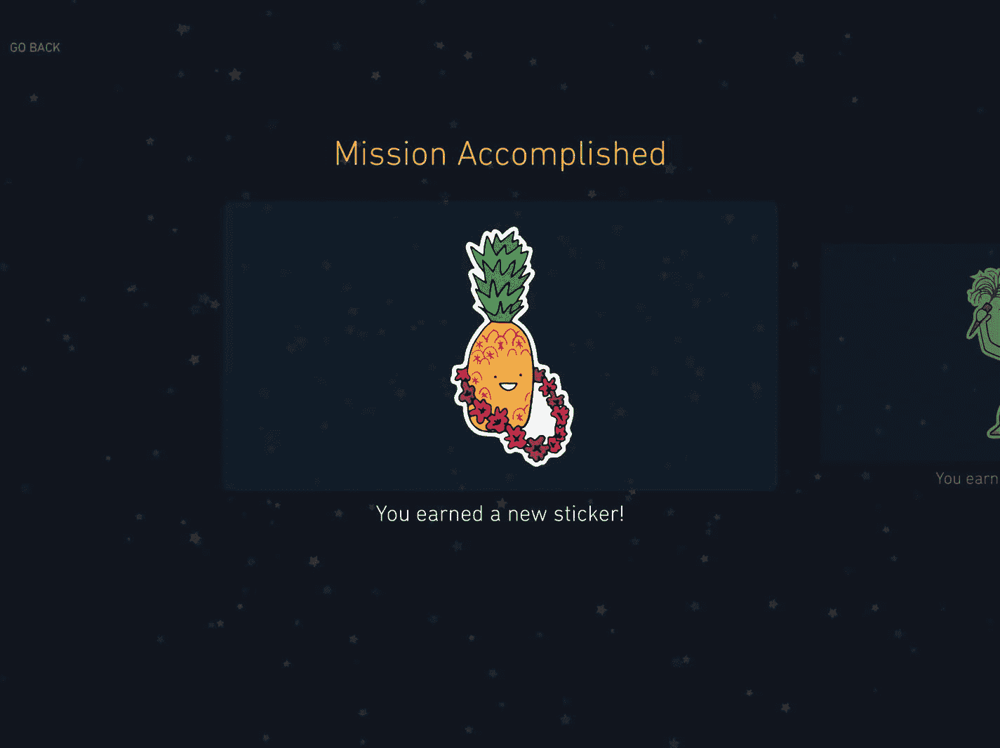

# 一些著名的案例

让我们来看看数字产品中优秀游戏化设计的几个例子。尽管这些产品大多面向成年人，但它们运用游戏元素激励用户的方式非常巧妙且实现得十分出色。我之所以选用这些例子，是因为你很可能亲自体验过其中一些，通过亲身感受，能更清晰地理解我们所说的游戏化。同时也能更清楚地看到，这些技术不受年龄限制，可以用于任何年龄用户群体的数字产品中。

## Duolingo
`Duolingo`（图 5-1）是一款语言学习应用，它高度依赖游戏化设计来激励用户进步并持续学习。

图 5-1
`Duolingo` 成就界面

该应用提供了一系列成就和相应的徽章，用户通过完成活动并每天使用应用来解锁“连续”徽章。

游戏化已深深嵌入 `Duolingo` 的用户体验之中，以至于他们甚至与超级流行的街机手机游戏 `Angry Birds`（由 `Rovio` 开发）进行了联合品牌活动，这还得益于它们都以鸟类作为吉祥物（我们将在后面章节专门讨论数字产品中角色的开发和使用）。

## Nike Run Club
在健身领域，许多产品都采用了游戏化技术，因为挑战、奖励和目标的概念与体育活动完美契合。最早这样做的品牌之一是 `Nike`，它推出了 `Nike+` 平台（现称为 `Nike Run Club`；图 5-2）。用户可以查看自己的成绩、解锁成就、与朋友比较和挑战等。这是一个极好的工具，可以提升动力，保持用户参与度，并帮助他们养成日常习惯。

图 5-2
`Nike Run Club` 中的徽章

## Apple Watch 的健康圆环
同样在健康领域，`Apple Watch` 的健康圆环是一个例子。`Apple Watch` 向大众普及了追踪每日身体活动以保持健康的理念。该应用有三个圆环（图 5-3），用于衡量你一天中的活动量、锻炼时间和站立时间。通过合上这些圆环，用户会收到通知和徽章来保持动力，连续合上所有圆环的天数越多，解锁的徽章就越有分量。这种机制如此强大，以至于有些人将其视为一种生活方式，实现了连续多年合上所有圆环的成就。

图 5-3
`Apple Watch` 健康圆环和徽章

## Swarm
`Swarm` 是 `Foursquare`（图 5-4）的继承者，后者或许是第一个基于位置的社交媒体。它引入了“签到”的概念，让用户可以实时告知联系人自己正在访问的餐厅、商店或其他商业场所或地点。用户访问的地点越多，解锁的徽章就越多；通过定期访问同一个地点，用户可以成为该地点的“市长”。尽管 `Foursquare` 不如刚推出时那么流行，但它仍然是游戏化应用于现实生活场景的一个好例子。

图 5-4
访问地点即可解锁 `Swarm` 中的徽章

## Epic Win
虽然不像前面的例子那么流行，但 `Epic Win`（图 5-5）仍然是一个非常引人注目的游戏化案例。这可能是将游戏机制应用到实用工具类应用中最极端的尝试之一。`Epic Win` 是一个 `RPG`（角色扮演游戏）风格的待办事项清单应用。完成任务和家务可以让你获得经验值、解锁战利品、升级角色等等。

图 5-5
通过完成任务，用户可以提升角色等级

儿童产品中也有很多例子；这里我挑选了两个有趣的案例，因为它们并非在通常的教育场景中使用游戏化。

一个是 `Brushing Hero`（图 5-6），一款激励孩子刷够时间牙的应用。通过使用 `AR`（增强现实）和面部识别技术，孩子们会看到自己化身为与怪物战斗的骑士。他们刷牙越久，击中的敌人就越多，累积的点数也越多，从而提升角色等级。

图 5-6
在 `Brushing Hero` 中，孩子们在刷牙时收集点数并提升角色等级

第二个例子是正念应用 `Stop, Breathe & Think Kids`（图 5-7）。通过完成冥想和正念练习，孩子们可以解锁数字商品。这是一种非常简单的机制，但看到它被应用于这类体验中，还是很有趣的。

图 5-7
通过完成任务，孩子们可以解锁收藏品

## 组件
在了解了一些游戏化应用的著名案例后，我们可以明确识别出究竟哪些组件和工具可供我们使用，以便将其有效地应用到我们的产品中。

这些组件正是大多数电子游戏的共通之处。正如本章前面所述，你不能将游戏化应用于一款电子游戏，因为游戏化意味着将非游戏产品向游戏靠拢，而电子游戏本身当然已经是游戏了。你可以做的是向电子游戏学习。分析是什么让这类产品有趣且引人入胜，并尝试提炼出这些组件，然后试验如何将它们应用到非游戏产品上。

以下是一些可以单独或组合使用的游戏化组件示例：
- `积分（Points）`：用户可通过产品内的各种活动获得的信用值。积分可能是最经典的游戏化组件之一。它可以决定用户在 `排行榜` 上的位置。
- `排行榜（Leaderboard）`：按累计积分排序的用户列表。这从街机游戏早期起就是另一个典型元素。渴望爬上排行榜顶端、占据榜首位置，正是激励用户参与产品并赢取积分的动力。
- `应用内货币（In-app currency）`：类似于积分，但用于在平台内交易商品。应用内货币可通过不同方式累积，具体取决于产品及其机制。它们通常与积分是分开的，因为可以像虚拟货币一样被消费。
- `经验值（Experience）`：经验值源于 `RPG`（角色扮演游戏）。在这些游戏中，我们采取的每一个行动和决定，与其他角色或游戏对象的每一次互动，都会给予我们经验值。经验值基本上记录了我们参与游戏的程度。
- `等级（Level）`：这个组件是经验值的指标。它也源于 `RPG`，在 `RPG` 中，玩家的主要目标之一就是提升角色等级以变得更强、获得新能力等。等级可以解锁特殊功能，以此作为激励用户的方式。
- `进度（Progression）`：传达我们在某个过程中已进展到何处的想法，可以帮助用户保持参与感并坚持到底（这就是为什么让用户了解下载或安装过程完成了多少、还有多少剩余总是一个好主意）。进度通常与等级相关联，因为它表明在升级到更高等级之前，我们还需要获得多少经验值。
- `任务/使命/成就（Quests/missions/achievements）`：玩家为了获得积分或经验值以及/或者解锁成就而必须完成的目标。
- `徽章（Badge）`：当达成特定目标时，会解锁一个徽章作为奖励。通常有大量徽章可供解锁；它们被收集在特定的“奖杯”界面中，玩家可以在那里看到已获得的徽章，并且通常还能看到尚未获得的徽章，以保持他们的参与度和积极性。
- `升级（Upgrades）`：升级可以通过提升等级或使用应用内货币购买来解锁。它们在游戏中代表某种优势，使完成任务和解锁徽章变得更容易。
- `虚拟形象（Avatar）`：在大多数（但并非所有）游戏中，我们通过某种角色来行动。在游戏化中，这可以简单地采用用户选择的头像形式，用于在与其他玩家互动时标识自己。

通过阅读这些描述，您可以看到，许多这些组件都是相互关联的。经验值可以决定你的等级，等级可以解锁升级以获取成就和解锁徽章，而这些又可以奖励你额外的经验值，如此循环往复。理解这些机制对于设计合适的游戏化至关重要。将这些要素随意地散落在数字产品上，只会形成一种非常糟糕（即几乎不存在）的游戏化策略。因此，充分理解如何将这些碎片拼凑起来，并创建一种循环机制（就像我之前描述的简单机制那样，让链条的最后一环与第一环相连，形成无限循环），这一点非常重要。

当然，并非所有产品及其目标用户都是相同的。因此，为了开发有效的游戏化方案，了解你的用户、他们的驱动力、他们的动机以及他们的技能是至关重要的。你想要达到的复杂程度取决于此；例如，你不会为目标用户是幼儿的应用设计一套包含经验值、等级、能量提升和应用内货币的复杂 RPG 机制。在这种情况下，一系列可供解锁的数字收藏品可能就足够了。但对于 10 岁或 12 岁的大一点的孩子来说，这也许意义不大，数码贴纸对他们来说可能不够吸引人。他们或许更会被一项更复杂的挑战所激励和娱乐，例如拥有一个可以和朋友比较成绩的排行榜，以及可以自定义的虚拟形象。

另一个需要理解的重要点是，你不能拿一个成品，在设计过程结束时再给它加上一层游戏化。从最开始，定义和实施游戏化策略就是用户体验设计理念中不可或缺的一部分。它不是可以即插即用的模块，而是深深嵌套在体验的核心之中。当它只是事后添加时，你一眼就能看出来，而且这通常是一种非常糟糕的游戏化。

## 最佳实践

以下是设计游戏化时值得牢记的一些良好原则。

### 平衡

游戏化并非易事。首先，它关乎有趣的游戏元素与产品实际目的之间的平衡。它不应过于强势，以至于将产品的性质从其原本的范畴转变为彻头彻尾的电子游戏。因此，在设计游戏化策略时，平衡至关重要。如果你的应用主要目标是教育，请务必确保教育是体验的核心，而游戏化组件只是让“良药”更容易入口的“糖衣”。

### 超越“BPL”

徽章（Badges）、积分（Points）和排行榜（Leaderboard），即 BPL。这是最基本（也最被滥用）的游戏化机制。诚然，它足够灵活，能够适应多种产品，但你肯定不希望自己的产品只是某个旧概念的又一个翻版，对吧？尝试超越已知的模式和已经见过的体验。

### 为用户量身定制

游戏化策略并非“混合搭配”之物。每个产品及其受众都需要定制的游戏化方案，不能直接复制粘贴到另一个产品上。尤其对于面向儿童的数字产品而言，正如我们在前几章中看到的，仅仅 2 岁的年龄差距就非常显著。你必须清楚你的用户是谁，他们的兴趣点在哪里，什么能吸引他们，并据此进行规划。在为学龄前儿童和五年级学生设计时，所用的“食材”可能相同或非常相似，但“烹饪”的方式却可能大相径庭。