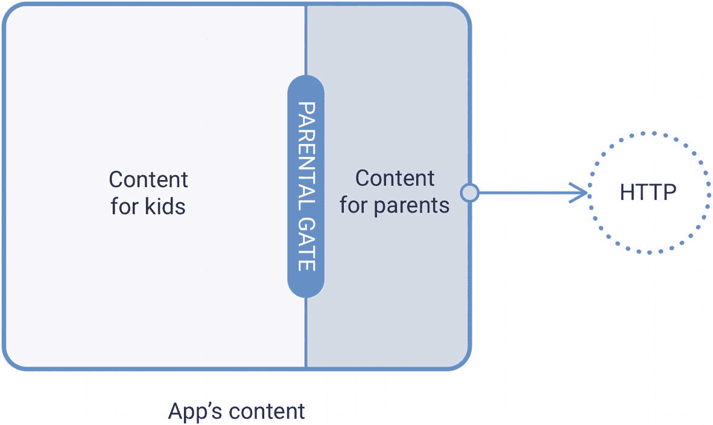
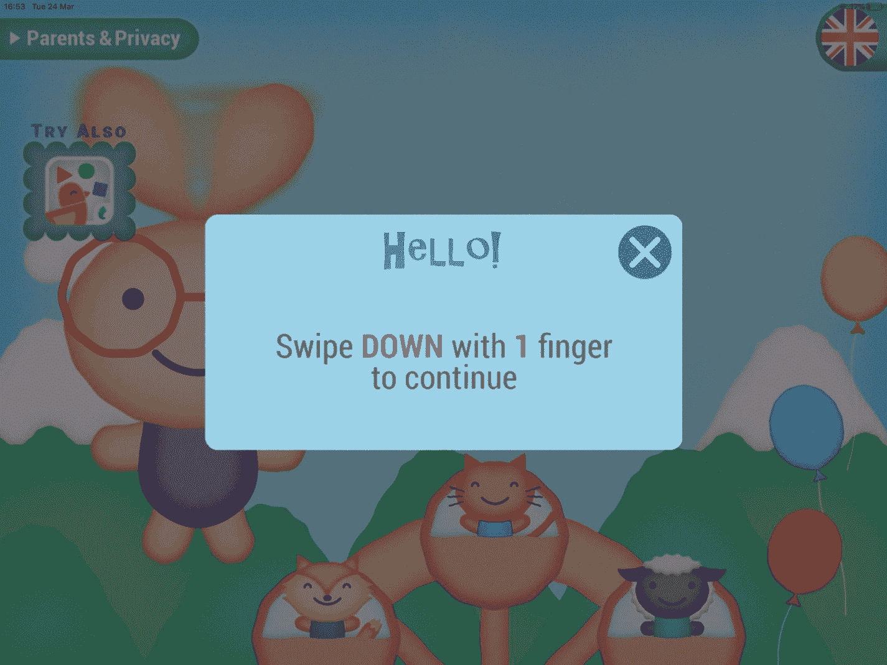
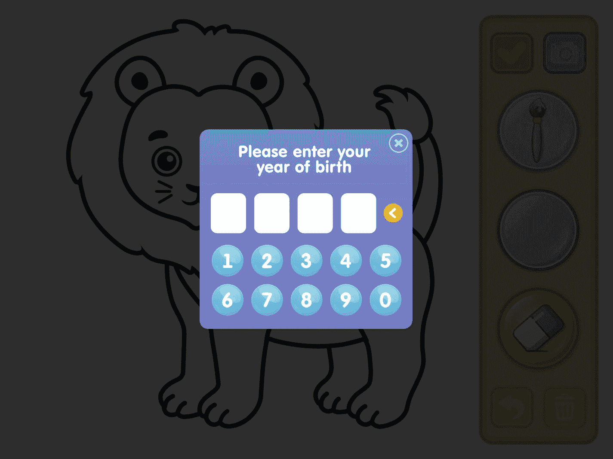
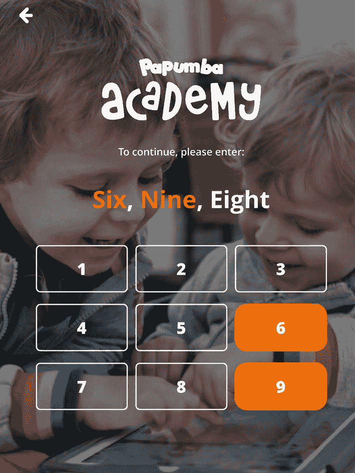

# 家长锁

*家长锁*是最常见的防止儿童访问产品中面向成人区域的方式，例如家长设置订阅付款方式的设置页面，或包含外部网页链接的页面。

家长锁（图 6-1）是一个屏幕，以全屏页面或弹窗形式出现，放置在儿童可访问区域与其不可访问区域之间，例如从应用主页到其设置页面之间。

图 6-1

家长锁锁住了对成人内容的访问。所有通往开放互联网的访问都位于此锁之后

这个页面（或弹窗）会提出一个问题，用户必须正确回答才能进入成人专属区域。这个问题可以有不同形式，从简单的数学运算，到执行一段文字描述的手势，或在数字键盘上输入一段文字描述的数字序列。

在 `Colto` 出品的 `Eli Explorer`（图 6-2）中，用户被要求在屏幕上执行一个手势。

图 6-2

`Eli Explorer` 通过手势进入家长区域

`Bimi Boo` 出品的 `Drawing for Kids`（图 6-3）要求成人在数字键盘上输入其出生年份。

图 6-3

`Drawing for Kids` 要求成人输入其出生年份

`Papumba Academy` 以及许多其他应用，要求用户输入一串数字（图 6-4）。

图 6-4

要求从书面文字到数字键盘输入数字序列

如你所见，家长锁可以有多种形式，但需要牢记的重点是，它们必须足够简单，让家长能快速通过而不头疼（你不想让他们解复杂的谜题），但同时，对儿童来说又要足够困难，成为一道保护他们不进入不应访问区域的屏障。另一个需要牢记的重点是，这些问题或任务应该是随机化的。不要总是要求执行相同的手势或输入相同的序列：孩子们很聪明。

当然，当孩子能够阅读时，这种认证技术会更难实现；在这种情况下，`PIN` 码或密码可能是更好的选择。现代设备还提供基于指纹或面部识别的生物认证（`biometric authentication`），这也是一个非常有效的选项。

## 社交与通讯应用

所有面向儿童的在线社交活动，无论是通讯内容还是社交媒体类型，都需要非常谨慎的设计。有几个需要考虑的方面和需要注意的危险因素。其中包括：

*   与陌生人接触

*   分享个人信息

*   收集个人数据

*   `likes`、`followers` 等虚荣指标及其对心理健康的影响

其中一些方面由应用商店政策和政府法规（如我们将在第 10 章中看到的 `COPPA` 和 `GDPR`）处理。但其他方面则没有，例如虚荣指标的使用，这取决于开发应用的公司及其设计师的伦理道德来解决这些问题。

当我们为儿童设计一个通讯平台，或任何形式的开放式交流（例如，包括对内容的评论）时，我们绝对需要确保家长和监护人有责任控制孩子可以和谁联系，以及可以被谁联系。这就是为什么我们需要在产品的屏幕上设置家长锁，防止儿童通过这些屏幕访问网络（如同前一节讨论的那样）。

这类应用需要为儿童和家长设计不同的体验，后者应拥有管理员权限，以便接受或拒绝向孩子账户添加联系人的请求。这几乎是所有此类应用的承诺。

当涉及虚荣指标^(³⁸)及其对用户心理健康的影响时，情况就不同了。关于社交网络是否让我们抑郁，对此主题的研究尚未得出最终结论。但不可否认的是，在线社交互动对我们的情绪有影响。^(³⁹)

`LEGO Life` 考虑到了本节开头提到的许多问题。其内容由人工审核，儿童不能上传照片作为头像，只能从一套乐高模型中选择，评论仅限于表情符号和预设回复。

在我看来，它的不足之处在于提供了诸如*点赞*之类的虚荣指标。在儿童中推广这种机制是一个不确定的领域，作为家长（和设计师），我会很乐意避免它。

同样的情况也发生在 `PopJam` 上，一个如其常见问题解答中所描述的“面向 7-12 岁儿童的创意社区平台”。这里的内容当然也是经过审核的，通常不允许自拍和人物照片，除非通过应用提供的贴纸进行遮挡。其准则还明确禁止用户发布个人信息，如真实姓名、地址、学校名称等。`PopJam` 也具有虚荣指标，如 `likes` 数、`followers` 数量，甚至有一个经典游戏化方法（参见“游戏化”一章）中的 `levels`，在这种情况下，并非用于教育等更有益的目的，而是仅仅为了在平台上的参与度。

`Kinzoo` 的创始人兼首席执行官 `Sean Herman` 就这一主题写了一本非常有趣的书，名为 *Screen Captured: Helping Families Explore the Digital World in the Age of Manipulation*。^(⁴⁰) 你可以在第 7 章结尾的“行业洞察”中找到我与他就此主题的交流。

## 章节回顾

*   儿童产品的安全是重中之重。所有对外部链接的访问和涉及真实货币的购买都必须设有家长锁。必须始终避免与陌生人进行开放式交流。

*   美国的 `COPPA` 和欧洲的 `GDPR` 等法规确保开发者正确使用儿童数据并保护其身份。

*   家长锁可以采用不同的技术，从简单的数学问题到手势。你也可以利用生物识别数据，如指纹或面部识别。

*   通讯应用应在封闭网络中运行，只有家长或监护人才能为孩子添加联系人。

*   警惕儿童产品中的虚荣指标，例如 `likes` 和 `followers`。

脚注 1   2   3   4   5   6   7