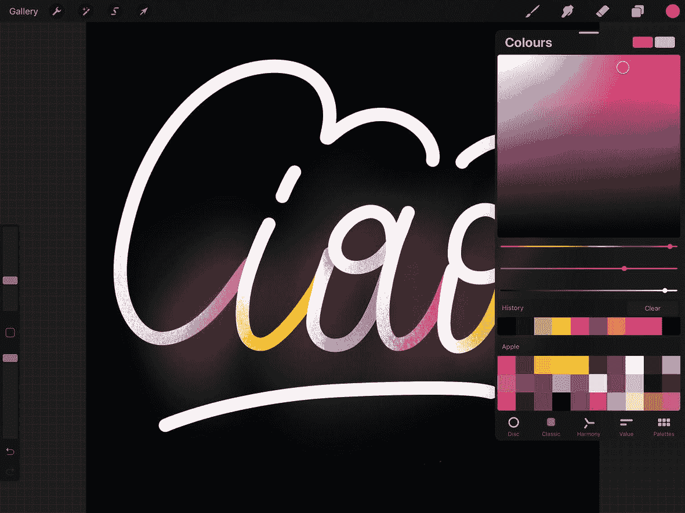

# 利用现有心智模型与世界观，帮助孩子完成任务

如前所述，儿童无法立即进行符号化思考，即便年龄稍大的孩子，我们也应意识到他们仍在发展这一能力。因此，关键在于利用他们已有的心智模型来解释事物并引导他们完成活动。

面向成人的数字艺术应用可能使用彩色圆形或方形来表示调色板中的色样（图 7-1）。而对于孩子来说，使用类似蜡笔的图标可能更合适（图 7-2）。不过说实话，根据我与我两岁女儿的直接经验，她在看到我在 `Procreate` 中选择颜色后，立刻就能自己切换颜色：调用调色板并点击她想要的颜色。但她先看到我操作了，这是最大的区别——观察学习与探索发现是两回事。

图 7-2 – 应用 `Archaeologist` 涂色书中的调色板

图 7-1 – `Procreate` 调色板面板

通常，运用孩子熟悉的现实情境中的心智模型，有助于引导他们完成任务。这可以让您考虑拟物化设计（skeuomorphic design）的理念，我们将在第八章讨论用户界面时进一步探讨这个话题。