# 扁平化还是拟物化

如果你是一位经验丰富的设计师，我相信无需我解释“拟物化”的含义，但对于阅读本文的其他读者以及需要复习的朋友，请允许我花几行篇幅聊聊这个话题。

拟物化这个术语用来描述那些界面组件模仿真实世界对应物的设计。最早的例子之一，就是伴随首批`GUI`出现的桌面（指家具中的桌子）隐喻。这个古老的隐喻至今仍在沿用：我们使用图标（大多看起来有点像纸张），将它们放入文件夹（字面意义上用纸文件夹表示），还有一个垃圾桶，等等。诚然，在首次实现这一设计时，计算机的图形能力有限，所以所有这些 UI 组件都是简化且不逼真的。当苹果发布第一代 `iPhone` 时，他们感到有必要帮助用户过渡到这种新设备和新的输入方式（触摸界面当时在消费电子产品中并不流行）。按钮是立体的，备忘录应用看起来像一个真正的记事本，带有纸张和皮革纹理，甚至连应用图标也模仿真实物体，与如今极其简约的版本大相径庭（图 8-1）。

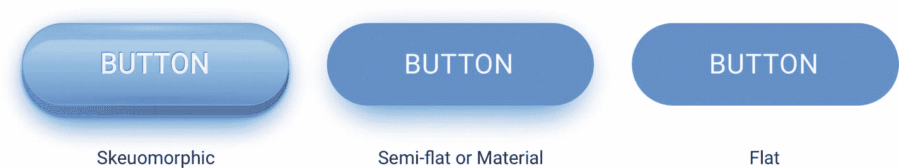

图 8-1

不同风格和复杂度级别的按钮

过了一段时间，当移动设备上的交互模式已经成熟稳定时，扁平化和极简设计开始流行起来，这也要归功于安卓和谷歌 `Material Design` 的普及。^(⁵²) 人们不再需要 3D 效果来理解按钮就是按钮，UI 变得更轻量，更容易编码和渲染，也无需为纹理使用 `PNG` 图片。自 2013 年发布的 `iOS 7` 起，苹果也放弃了拟物化和高光效果（真是“Web 2.0”风格！），加入了扁平化的潮流。在桌面端，`Mac` 和 `Windows` 现在大多采用扁平设计，绝大多数现代网站也是如此。

现在再看拟物化界面，就像看 80 年代的服装，你会感到一种怀旧感，混杂着“我们当时怎么会喜欢这种东西？！”的感觉。

正如我所说，拟物化背后是有原因的，那就是利用既有的心智模型使界面更直观。但如今这已不再必要，因为我们的心智模型直接在数字设备中形成，我们不再需要拟物化这双“训练轮”了。但孩子们呢？他们初次接触数字产品，迄今为止他们学习理解的世界是由真实物体构成的——由有形的材料组成，是三维的。

不过在我看来，我认为有必要进行区分。我相信我们可以识别出两个层次的拟物化：`概念拟物化`和`真实拟物化`。

所谓`概念拟物化`，我指的是像之前提到的桌面隐喻这样的模式，我们利用既有的心智模型，设计出这些物体及其相关行为的数字版本。它们的视觉设计可以相当抽象：一个文件可以是一个矩形，一角有个三角形模拟纸张的折角。这并不在于东西看起来有多逼真，而在于它们如何运作。

`真实拟物化`则是指，我刚才描述的同一交互技术，同时以逼真的外观呈现，包含纹理、细节、高光、阴影等等，以模仿物理界面。

这第二种拟物化与视觉趋势的联系更紧密。一些研究^(⁵³)表明，UI 组件的逼真度并不会对自闭症谱系儿童使用界面的可用性产生积极影响。另一项研究^(⁵⁴)（针对成年人）甚至测量发现，在许多情况下，视觉上更繁杂的设计甚至会对产品的易用性产生负面影响，尤其会影响经验丰富的用户，他们会被界面组件的复杂性和丰富细节拖慢速度。

如果符合我们决定追求的视觉风格（在我撰写本文时，`Dribbble` 和其他设计灵感网站上正兴起一种所谓的`新拟物`风格，但迄今为止还没有真正的产品采用它，因为这种风格会带来可访问性问题——显然对孩子们也不好），可以应用一定程度的真实拟物化，但不要抱着让界面更不言自明的目的去使用它，并且要意识到过度使用可能会适得其反。

关于让按钮（或任何其他组件）显得可点击的担忧，可以通过其他类型的可供性来解决，例如颜色、对比度和动画。你不需要为了吸引孩子去按，而把按钮做得像塑料做的；在扁平设计上使用定时弹跳动画可能更有效。经验法则：越简单越好。

## 调色板

当我们购买新车、装饰房屋或决定早上穿什么时，颜色在我们的决策中扮演着重要角色。当面对两个或更多选择时，几乎不可能在某种程度上不受颜色的影响。这也是设计师通常用灰度制作线框图的原因之一——为了避免利益相关者（以及他们自己）因颜色而对某个决定产生偏见。颜色可以极大地促进产品的成功（或失败），每种色调在设计和营销中都被用来传递特定的信息并激发特定的感受（蓝色代表信任，橙色代表趣味，红色代表激情，等等）。

关于颜色和色彩理论，已有卷帙浩繁的著作。颜色比其他任何视觉元素都更能设定你产品的基调；因此，调色板的选择是 UI 设计过程中最重要的步骤之一。

一个常见的误解是，儿童界面应该非常色彩斑斓。诚然，孩子们（尤其是低龄儿童）喜欢鲜艳明亮的颜色，但我们必须注意，不要用过于丰富的色调来淹没他们。

颜色可以成为我们在用户界面中建立层次结构的工具之一，例如，我们可以用颜色来区分哪些是背景元素，哪些是交互元素。

对于 2–4 岁的儿童来说，颜色是他们对物体进行分类时使用的主要变量。这意味着，对于这个年龄段的孩子来说，一个红色的大立方体、一个中等大小的蓝色球体和一个绿色的小棱锥，首先被认知为红色、蓝色和绿色的物品，然后才是立方体、球体和棱锥，或者是小、中、大的物体。对成年人来说，这一点也部分成立——颜色是物品的一个非常显著的特征——但在使用其他分类方式方面，我们比幼童要强得多。

### 明亮与大胆

1994 年一项发表于《遗传心理学杂志》、题为`儿童对颜色的情绪联想`的研究（见注 55）中，克里斯·J·博雅齐斯和雷努·瓦盖塞测试了 5-6 岁儿童对一系列颜色的情绪反应。他们发现，儿童倾向于对明亮色（如粉色、蓝色和红色）表达更多积极情绪，而将消极感受与较暗、饱和度较低的颜色（如灰色、黑色和棕色）联系在一起。这并不令人意外；我们大多数人可能会认同这些孩子的感受。但对成年人而言，深色（如黑色或深蓝）也能激发优雅、奢华和高档感，而孩子们似乎无法从中获得太多积极感受——不过有趣的是，根据这项研究，同龄男孩比女孩更频繁地将深色与积极情绪联系在一起。

在 1972 年发表于《实验儿童心理学杂志》的一项更早研究（见注 56）《幼儿颜色感知中的变量》中，罗斯林·盖恩斯教授测试了六种不同色调（绿色、红色、紫色、蓝色、橙色和黄色）的明度和饱和度如何影响儿童的颜色辨别能力。换言之，当颜色更暗或饱和度更低时，孩子们区分颜色的难度是否更大（图 8-2）？根据这项研究，答案是肯定的。虽然儿童在颜色明亮且饱和时能很好地辨别，但随着颜色变暗或变柔和，错误率会上升。1975 年，这项研究被扩展到其他年龄段（见注 57），测试对象包括幼儿园儿童、五年级学生、高中二年级学生、非艺术家成年人和专业艺术家。所有群体的错误率都遵循相似模式，但错误频率与年龄呈线性关系：年龄越小，错误率越高。

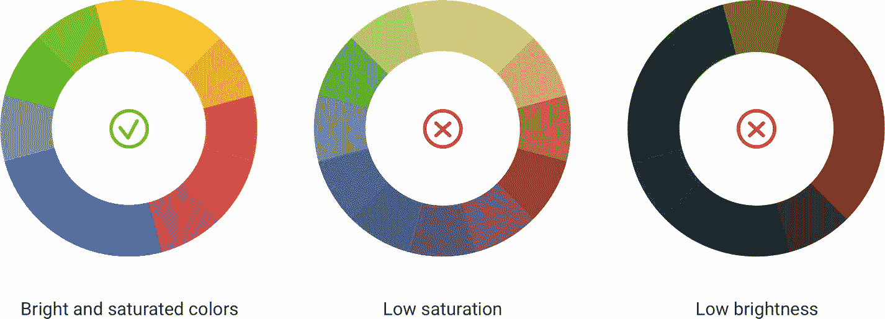

**图 8-2** 明度与饱和度对比

> **注**  
> 可通过访问 [www.apress.com/9781484262894](http://www.apress.com/9781484262894) 并点击“下载补充材料”按钮，查看本章中所有图片的数字版本。

当颜色变暗且更中性时，辨别难度增加是人类生理机制的一部分，但在儿童中这一特征更为显著。因此，让颜色保持合理的饱和度和明度是个好主意，尤其对于交互组件。对于非交互的背景和元素，我们可以选择更柔和的色调（图 8-3），以清晰区分层级并引导交互。

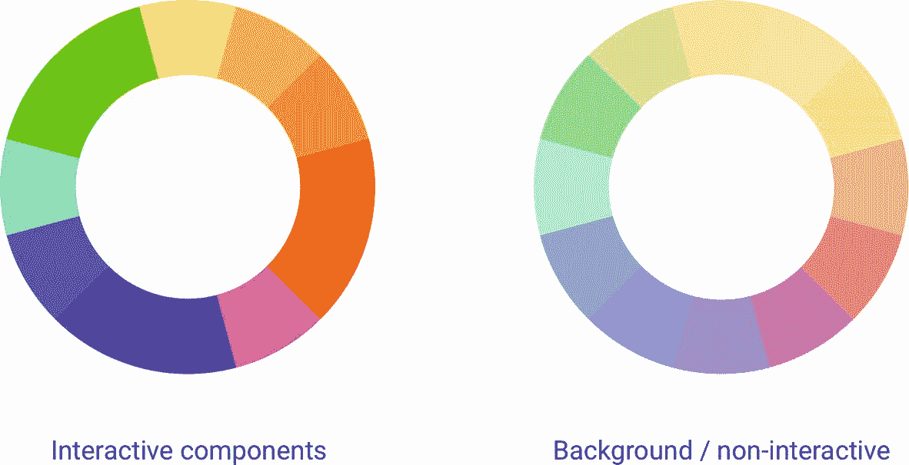

**图 8-3** 交互元素采用饱和色调，背景采用柔和色调

### 色彩和谐

饱和色调并不意味着在所有屏幕上都要呈现完整的彩虹色。正如我在本书中多次提到的，优秀设计的一般规则同样适用于儿童数字产品。

色彩理论指导我们根据色轮上色调的位置，通过一系列可能的组合找到正确的和谐关系。我们也可以将这些技巧应用于儿童产品，但需牢记上一节提到的颜色辨别能力的局限性。

要找到色彩和谐，我们可以借助几个策略，这些策略源于数百年来色彩理论的研究，且从未改变——原因很简单：人类的眼睛和大脑在过去 30 万年（甚至有人说 50 万年）里，物理结构从未改变。

#### 互补

互补色是色轮上相对两侧的色调（图 8-4）。一种原色与由另外两种原色衍生出的间色互为补色，例如蓝色（原色）与橙色（黄色和红色混合而成的间色）、黄色（原色）与紫色（红色+蓝色）、或红色（原色）与绿色（蓝色+黄色）。

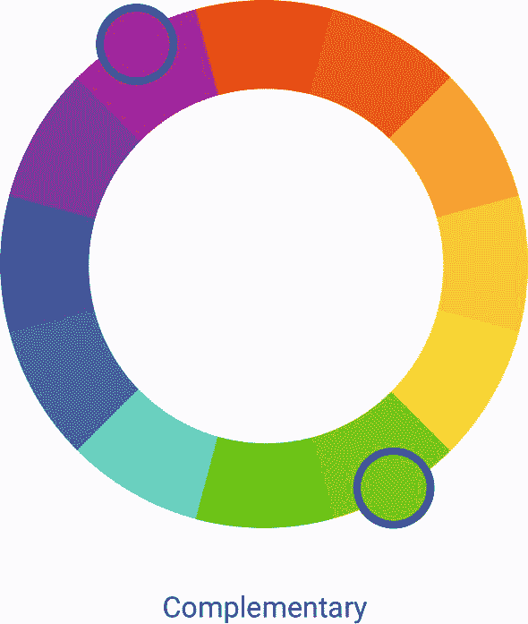

**图 8-4** 互补色

互补色能实现非常高的对比度，甚至常常会显得过度。在叠加互补色时务必谨慎，因为它们可能形成不太悦目的组合，尤其是红色+绿色（这对绿色盲人群来说也是一个非常棘手的组合）（图 8-5）。

## 三等分

三等分调色板基于色轮上彼此间隔相等的三种色调；它们位于等边三角形的顶点上（图 8-6）。三等分和谐仍能提供大量对比，但色调间的冲突感略低于互补组合。

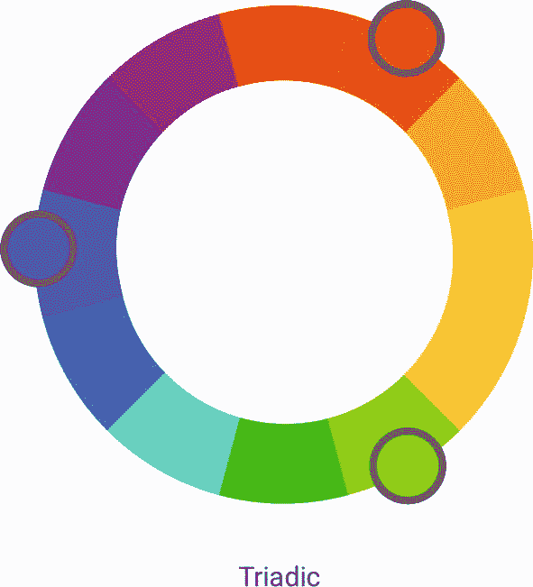

**图 8-6** 三等分色

原色是三等分色，间色也是另一种三等分和谐。要在保持三等分方案的同时为调色板增加更多选项，可以调整其中一个（或多个）三等分色的明度，使其变暗或变亮（图 8-7）。

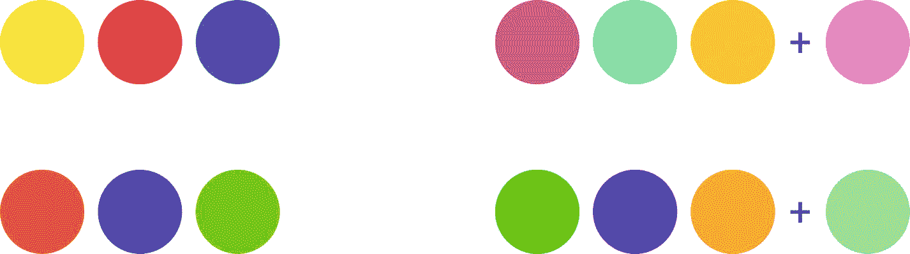

**图 8-7** 三等分色调色板示例

## 分裂互补

分裂互补色和谐是前两种方式的结合。先选一种颜色，找到其互补色，然后在色轮上分别向该互补色的左右两侧稍作偏移，形成一个窄三角形（图 8-8）。由此得到的两种颜色不再是初始颜色的精确补色，对比度将不那么刺眼，更为柔和（图 8-9）。

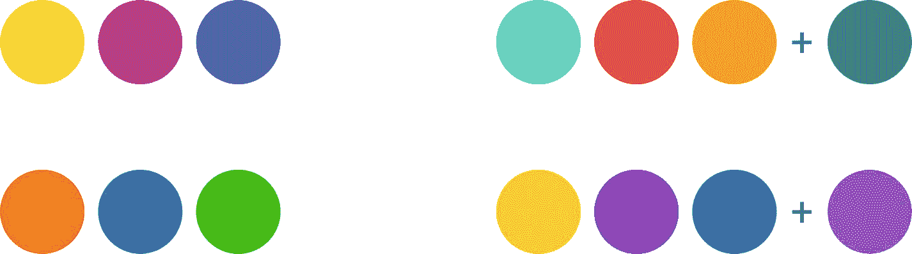

**图 8-9** 分裂互补色调色板示例

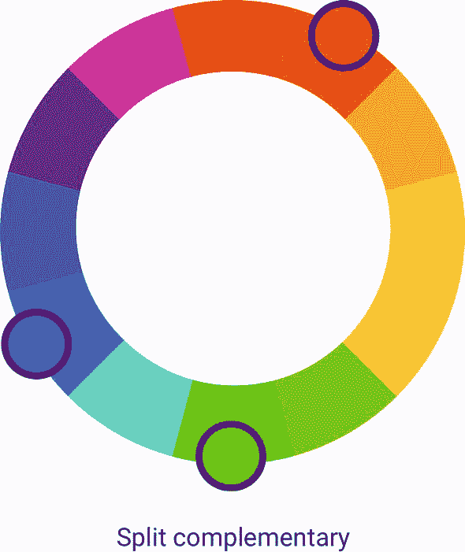

**图 8-8** 分裂互补

## 方形与矩形

方形与矩形和谐由两对互补色构成。在方形和谐中，顾名思义，四种色调在色轮上彼此等距；而在矩形和谐中……它们则形成一个矩形（图 8-10）。

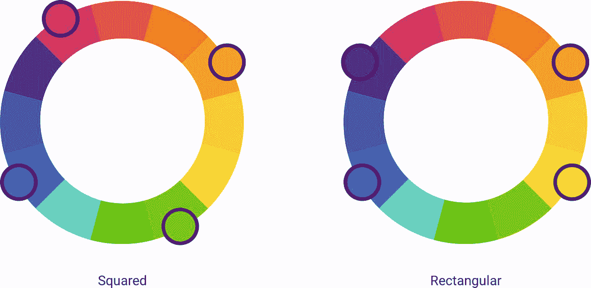

**图 8-10** 方形与矩形

方形与矩形和谐都能在冷暖色调间取得良好平衡（图 8-11）。

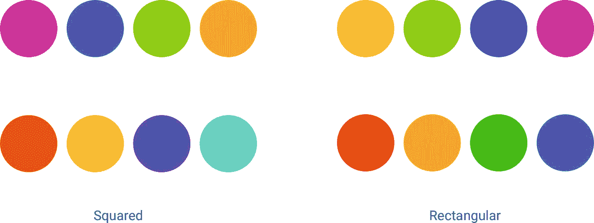

**图 8-11** 方形与矩形色调色板示例

## 相似色

相似色调色板由色轮上彼此相邻的一组色相构成（图 8-12）。其结果是一组更趋同的色彩，从而降低了对比度（图 8-13）。

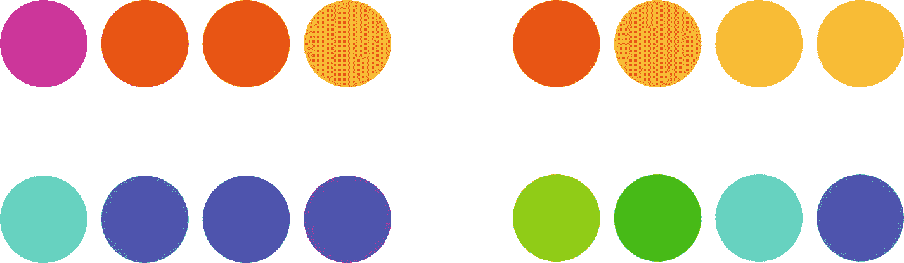

**图 8-13** 相似色调色板示例

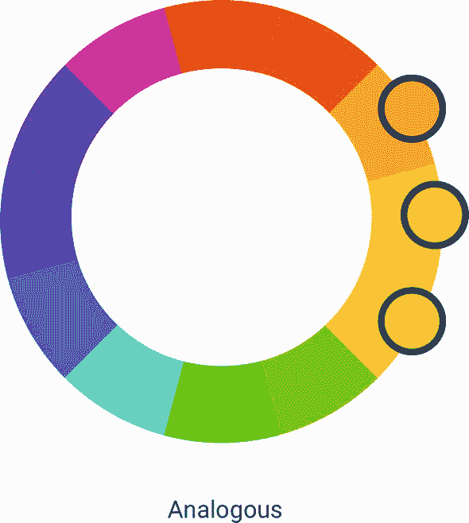

**图 8-12** 相似色

## 单色

单色调色板仅由单一颜色的不同明度构成（图 8-14）。想象一张黑白照片，那就是一个单色调色板。除了对比度较低之外，与其他配色方案相比，单色调色板可能略显单调，尤其对于儿童而言（图 8-15）。

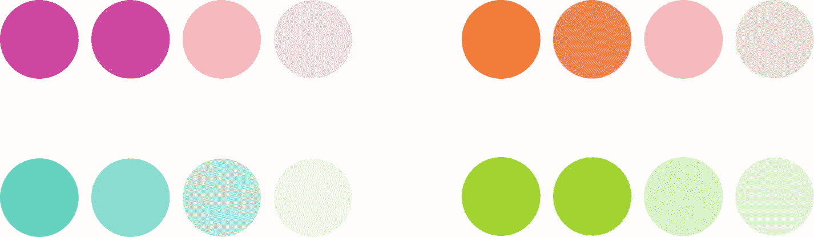

**图 8-15** 单色调色板示例

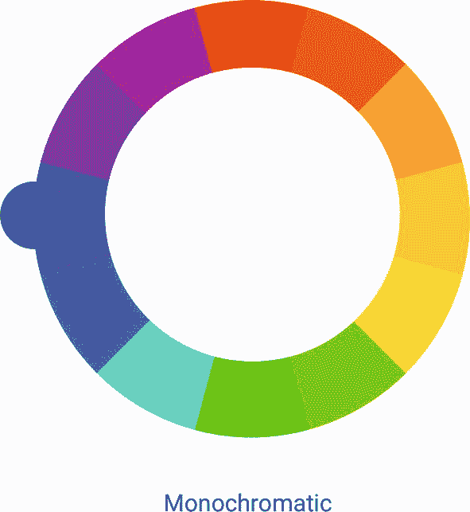

**图 8-14** 单色

## 推荐配色方案

我们探讨了定义色彩搭配的常见技巧，并结合本节开头讨论的儿童色彩感知信息，我不建议采用单色和相似色调色板。

色相有限带来的单调感以及对比度的缺乏，使得这类配色方案对儿童产品而言不太理想。不能说这些方法中的任何一种绝对正确或错误，这完全取决于你选择的色相、调色板的使用方式、色相之间的比例等诸多因素。不过，我们可以根据经验和针对儿童的研究，指出哪些方法（而非调色板本身！）更有可能成功（图 8-16）。

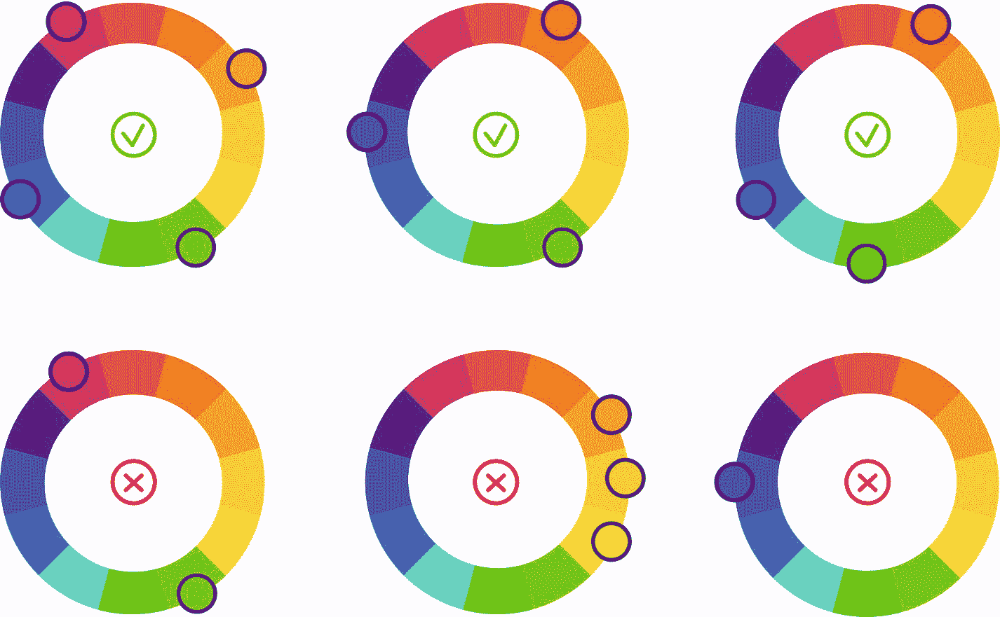

**图 8-16** 推荐配色方案

## 实用工具

为了帮助你利用我们刚刚讨论过的各种比例找到色彩组合，网上有多种在线工具——例如[`coolors.co`](http://coolors.co)，你可以在此决定使用哪种方法生成调色板（相似色、三色、互补色等），并调整亮度、饱和度和色温等。然后，你可以将调色板保存或导出为不同格式，如`PNG`或`SVG`（图 8-17）。

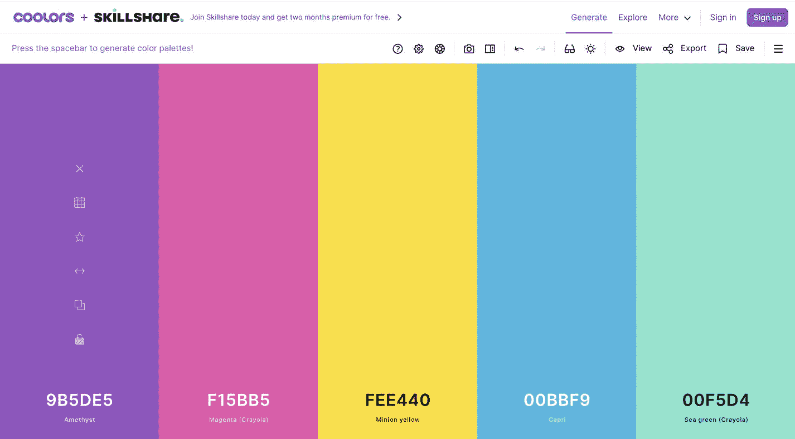

**图 8-17** Coolors.co

另一个是[colorhunt.co](http://colorhunt.co)，这是一个设计师和艺术家可以创建并分享调色板的社交平台。你可以过滤出最受欢迎或最时尚、最新的调色板，或者根据你想包含在调色板中的单一颜色进行搜索等（图 8-18）。

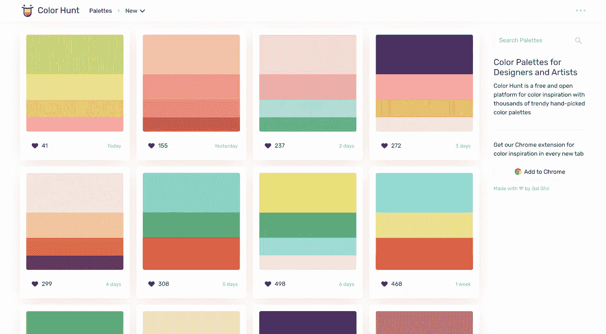

**图 8-18** Colorhunt.co

## 为儿童与为成人设计用色的区别

在为成人设计时，通常的做法是为产品中调色板颜色的分布设定特定比例。我们通常以一个主色、一个（或两个）辅助色和一个强调色作为主调色板；此外，还有一系列使用频率较低的颜色（可能用于图标、插图、警告消息等）。

这些颜色之间的比例会因产品和品牌而异。一个常见的分布是`6:3:1`（主色占 60%，辅助色占 30%，强调色占 10%），即黄金比例（设计师的最爱）。占比较大的部分（主色和辅助色）通常用于背景，颜色也偏中性（黑色、白色、灰色或其他冷色调或暖色调的柔和色），而强调色则用于需要吸引注意力的地方（交互组件，如按钮、开关、复选框等），通常是更明亮、饱和度更高的颜色（蓝色、紫色、黄色等）。

在图 8-19 的示例中，我们可以看到底部导航栏如何使用蓝色强调色来指示当前显示的是应用的哪个部分，以及如何用于*行为召唤*（每块内容下方的按钮）。通常，我们只使用一种强调色，并且在应用的每个屏幕上都保持一致。这有助于用户一眼就理解屏幕上哪些内容重要。设计师利用强调色来引导体验，帮助用户在各种流程中找到方向，有时还会用它来暗示用户选择某个操作而非另一个（例如“订阅”而非“取消”）。

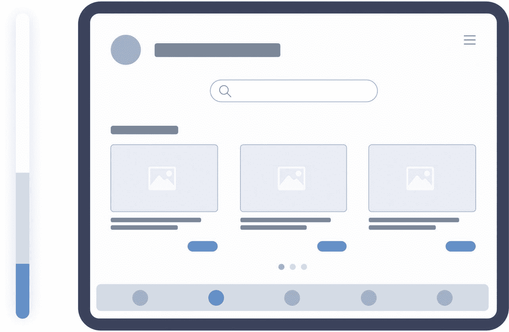

**图 8-19** 成人应用中的用色示例

强调色也是产品或公司品牌的一部分，因此它不仅服务于交互目的，也服务于沟通目的。

在儿童产品中，我们可以使用多种强调色，并利用这种多样性来发挥优势。如前所述，儿童，尤其是年龄较小的孩子，将颜色作为区分不同物体的首要变量。因此，我们可以，例如，使用不同的颜色来标识应用或网站的每个部分。紫色代表视频，蓝色代表游戏，黄色代表故事书，等等（图 8-20）。每个部分都会有不同的图标，但他们首先注意到的将是颜色，并且他们会很快学会，要看视频就需要点击屏幕上的紫色项目。

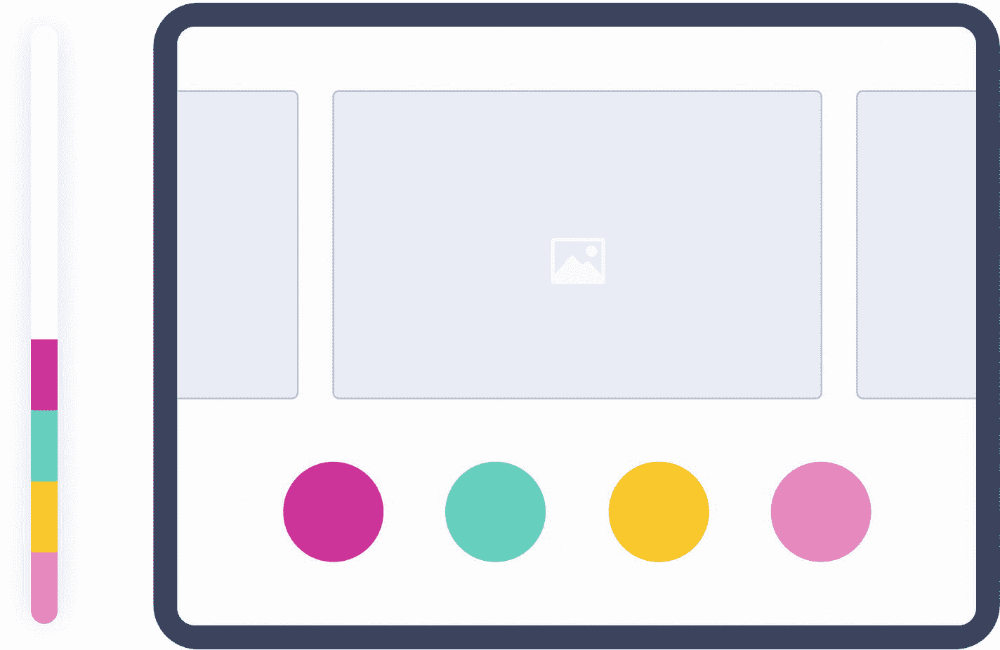

**图 8-20** 儿童应用中的用色示例

颜色不仅能让我们的应用或网站更加多彩和有趣，还能服务于特定的用户体验目标，使导航更易于记忆。

不过，有一点需要注意。虽然使用不同颜色来标识不同部分可以帮助儿童在数字产品中找到方向，但同一组件的不同实例使用多种颜色可能会造成混淆。例如：用于返回上一屏幕的箭头应始终保持相同的颜色（以及设计和反馈效果）。

当颜色有助于用户理解他们身在何处或想去哪里时，颜色的多样性是有益的。或者用于区分一种操作和另一种操作；例如，“蓝色代表创建”，“红色代表删除”，那么任何创建按钮都必须为蓝色，任何删除按钮都必须为红色。一致性至关重要。

总而言之，颜色可以作为一种额外的辅助手段，增强儿童的用户体验，帮助导航和流程。你可以为不同的部分和操作分配不同的颜色，但随后必须在整个产品中保持一致。

## 儿童色彩中的性别偏见

我们从小就被灌输粉色代表女性、蓝色代表男性的观念（图 8-21）。在意大利，人们会在新生儿家门口挂上丝带：如果宝宝是女孩，丝带是粉色的；如果是男孩，则是浅蓝色的。这种规范究竟起源于何时何地，至今仍存在争议。^(58)

马里兰大学历史学家`Jo B. Paoletti`就此主题撰写了一本书^(59)，书名为*《粉与蓝：美国男孩女孩的区分之道》*。在书中，她梳理了几十年来的婴儿用品和时尚潮流，试图找出这种基于性别的流行色彩关系是何时形成的。

她认为，直到第二次世界大战之前，颜色与性别的对应关系都尚无定论。1918 年 6 月号的《恩肖婴儿用品部》（一本面向婴儿服装制造商的行业杂志）甚至写道：“关于这个问题，一直众说纷纭，但普遍接受的规则是粉色给男孩，蓝色给女孩。原因是粉色作为一种更明确、更强烈的颜色，更适合男孩；而蓝色更为柔和雅致，更适合女孩。”这完全颠覆了当今的观念。不过，这段引文也催生了一个都市传说，认为当时的规定确实是粉色给男孩、蓝色给女孩。而实际上，这很可能只是众多建议或尝试之一，旨在为市场营销找到一个共同基础，远非当时的普遍规范。

多项研究试图探究女性偏爱粉色是否源于人类基因的先天设定，但并未找到任何证据，这种偏好似乎纯粹源于文化根源。这种偏好之所以在全球范围内如此普遍，并跨越了许多不同现代文化的边界，仅仅是因为西方/美国流行文化的广泛传播——2018 年一项针对香港儿童的研究^(60)证明了这一点。

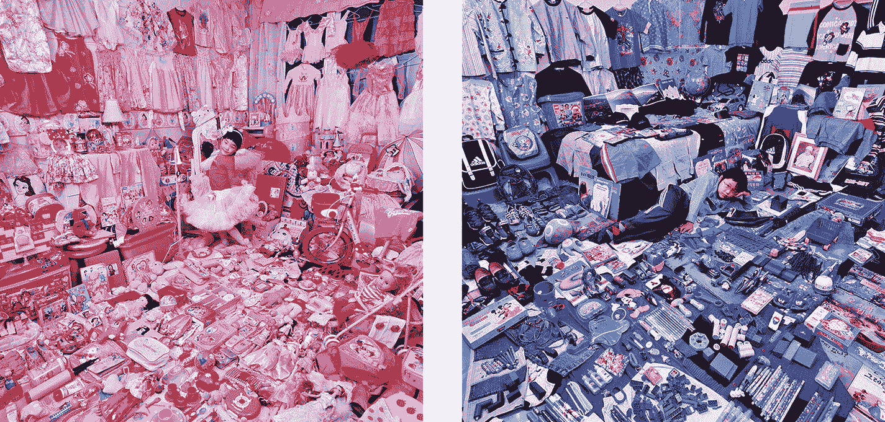

**图 8-21**

左图：《粉色计划——Jeeyoo 和她的粉色物品》，韩国首尔，Light jet 冲印，2007 年，©JeongMee Yoon。右图：《蓝色计划——Seunghyuk 和他的蓝色物品》，韩国京畿道，Light jet 冲印，2007 年，©JeongMee Yoon。

唯一确定的是，我们今天所知的这种性别关联始于 20 世纪 50 年代的美国，并在 80 年代真正流行起来，当时儿童产品（及整个市场）的广告、营销和消费主义达到了空前的高度。像美泰芭比娃娃这样的玩具，更是将粉色推向了我们今天所质疑的那种女性气质的典范。事实上，美泰公司也在反思这一点。近年来，芭比娃娃被重新定位为性别差异的反对者，推出了“你可以成为任何你想成为的人”宣传活动。

对于我们的女儿，我和妻子会尽量避免给她购买粉色的衣物和玩具，因为我们不希望她受到社会对女孩“应该”喜欢什么的刻板印象影响。我们不刻意推荐任何特定性别的玩具或活动，而是努力培养她对各种事物的好奇心，让她自己决定是对动物、车辆、音乐、烹饪还是其他事物更感兴趣——完全基于她真实的兴趣和品味（对于幼儿来说，这变化非常频繁，这很正常）。出于同样的原因，我们对她看的电影和电视节目也非常谨慎。尽管如此，在大约两岁时，她开始莫名其妙地被粉色吸引。如果在几种颜色中让她选择，其中包含粉色，她大多数时候都会选择粉色。这可能只是她个人的品味，一种随机的偏好——她也可能喜欢绿色，但偏偏是粉色——或者也可能是我们无法控制的外部因素（很可能是其他小女孩）的影响。

那么数字产品呢？它们是否也应遵循同样的性别定义模式？我不这么认为，原因有二。

首先，我们应该开始摆脱这种老派的营销传统。在一个渴望包容和平等的世界里，继续延续“女性=娇柔=粉色，男性=阳刚=蓝色”的观念，显得非常落伍。

另一个原因是，如果你的产品并非与某个高度性别化的品牌（如芭比）紧密绑定，那么保持尽可能中性的设计是个好主意，无论产品涉及什么活动。`Toca Boca`的数字玩具同样深受男孩喜爱，即使游戏主题是传统上与女性相关的活动，比如美发或给玩偶和角色换装。这自然能让你的产品吸引更广泛的用户群体。

### 图标

图标可能是我们在用户界面设计中最常见的视觉辅助元素。它们能帮助用户无需阅读文字即可识别功能，或作为文字标签的补充来阐明概念。我们可以在工具栏、按钮（单独或与文字一起）、各类菜单、导航组件（例如移动应用中的底部导航栏）等地方找到图标。

1973 年，施乐帕克研究中心的研发人员开发了`Alto`，这是第一台配备图形用户界面的个人电脑（GUI；我们今天常用的术语 UI，在技术上也可以指由物理按钮和旋钮构成的界面，但为了符合当前行业内的通用说法，我将 GUI 称为 UI）。这项革命性的实验首次提出了*桌面隐喻*^(61)的概念，我们今天仍在电脑上使用这一概念，而这种表现形式也引入了*图标*的理念——即描绘概念的小型图画。

图标的使用在移动设备上变得更为重要。在移动设备上，每个应用都通过一个图标启动，图标是快速区分不同应用的主要方式。此外，与电脑相比，移动应用的用户界面可用空间更小，而图标有助于最有效地利用这些空间。

### 图标的抽象性

图标的设计可以或多或少地具象化，这取决于它需要表达的概念，但即使是最抽象的图标，一旦成为标准，通常也易于识别。请参见图 8-22 中的示例。

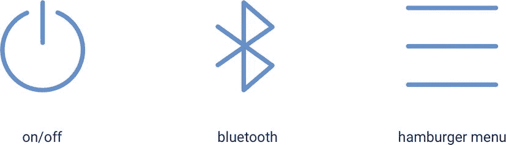

**图 8-22** 常见的抽象图标。如今大多数用户都能理解它们的含义。

近年来，UI 专业人士讨论最多的图标之一就是所谓的“汉堡菜单”。它被许多设计师痛恨，但又以略有不同的形状和形式极其流行。严格来说，不能说汉堡图标是抽象的；它的设计代表了菜单中列出的项目。然而，这种设计所采用的高度概括性使其很难被称为具象图标。尽管如此，由于它在应用和网站中的普及，如今大多数用户都知道它的含义，并知道点击或触碰它时会有什么预期。

即使是起初非常具象的图标，也可能随着时间的推移成为某个概念的抽象化代表。我们在成人产品中使用的一些图标，指向的是如今已无太大意义的古老技术，但它们的视觉呈现已成为其代表动作的同义词。

几个经典的例子：“保存”和“通话”（图 8-23）。

**图 8-23** “保存”图标和“通话”图标。

用软盘图标来表示“保存”操作，在几十年前我们曾用这种物理存储设备保存数据时，是非常具象的。电话图标的道理也是如此。如今想要在手机上找到那种听筒，只能去古董店了。我敢肯定，绝大多数 Z 世代的人从未在现实生活中见过这两样东西，更别提使用过了。然而，在`iPadOS`（2019 年 9 月发布）中，用来拨打 FaceTime 通话的图标正是那种电话听筒，并且同样的设计在当今市场上的绝大多数智能手机中无处不在。

最近，“保存”图标正在被另一种图标所取代：一个指向开口矩形或某种“托盘”的向下箭头（图 8-24）。但同样的视觉元素也常被用来表示“下载”。这两种操作有时会重叠，但它们并不完全相同。软盘图标仍然非常流行。

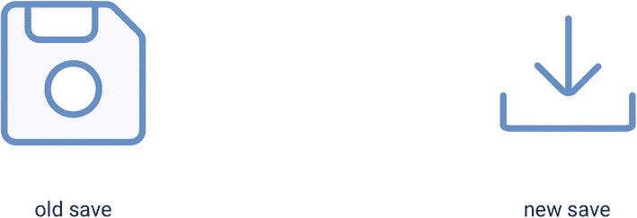

**图 8-24** 旧版“保存”图标和新版“保存”图标。

我们在第 7 章中看到，儿童的思维在认知发展的具体运算阶段（大约 12 岁及以上）之前是非常具体的。他们很难解读抽象的表征，因此，为他们设计的图标应当比为成人设计的图标更具象。在 Bimi Boo 的《幼儿游戏》中，每个活动都由该活动主视觉的一个更小、略微简化的版本来表示，这是在清晰度和保持设计简洁之间一个很好的折中方案。

### 为儿童设计图标

为儿童设计图标首先要注意到的一点是，正如第 3 章以及随后在第 7 章中提到的，他们成长得很快。为 20 岁用户设计的图标可以完美适用于 60 岁用户。但对儿童来说并非如此。你为 12 岁儿童设计的东西可能不适用于 5 岁儿童。反之亦然，因为虽然大孩子肯定能理解为低龄儿童设计的图标，但我们需要考虑到符合年龄特点的风格设计也很重要（我们将在本章末尾对此进行更多探讨）。

在本书开头，我们提到设计一款能够吸引所有年龄段儿童的应用几乎是不可能的。面向广泛受众的应用，如 YouTube Kids，应该根据用户的年龄提供不同的体验。YouTube Kids 部分做到了这一点，但其图标却是相同的，从学龄前儿童到 12 岁的孩子都在使用。

在图 8-25 中，我们可以看到图标设计中年龄与抽象程度之间关系的图示。当然，这不能被视为数学上的精确关系；它仅仅用作理解这一概念的视觉辅助。

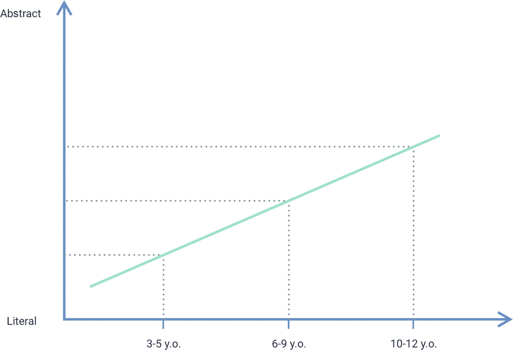

**图 8-25** 年龄与允许的抽象程度之间的关系。

用于 6 岁及以上儿童产品的图标也可以简化，这得益于我们可以开始使用文字标签与图标搭配。我们不应完全依赖文字，或过度依赖文字，但我们可以开始在设计中降低具象程度和细节。

# 为儿童设计图标

为儿童设计图标时，非常重要的一点是使用他们理解的心智模型。在本节前面，我举了软盘图标的例子，以及年轻人可能不明白它的由来的情况。这一点（甚至更）适用于相比成人对世界认知有限的儿童。

在接下来的练习（图 8-26）中，我设想了一个代表相同功能的图标将如何随着用户年龄的增长而演变。

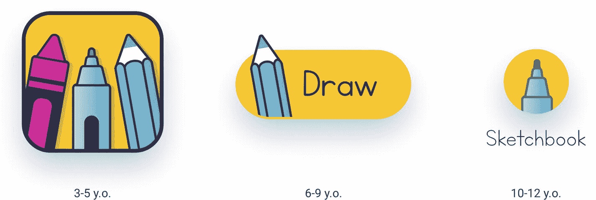

让我们逐一分析这些图标，并在下表中查看每一步的差异。

| 在面向 3-5 岁儿童的图标中： | 在面向 6-9 岁儿童的图标中： | 在面向 10-12 岁儿童的图标中： |
| --- | --- | --- |
| • 色彩大胆，高对比度 | • 元素更少 | • 设计更简洁 |
| • 所有元素均有深色轮廓以增加对比度 | • 底座没有明显的轮廓 | • 无深色轮廓，但图案仍带有“童趣”风格 |
| • 绘图工具后方有阴影，使其与背景分离 | • 铅笔后方无阴影 | • 药丸形状的容器，更类似于成人应用 |
| • 更圆润、“可爱”的比例 | • 更纤细，不那么“可爱”的比例 | • 马克笔是直的，看起来更“严肃” |
| • 无文字 | • 大号文字；使用简短单词的标签 | • 文字尺寸更小；标签文字更长，用词更成熟；标签位于下方，更类似于成人应用 |
| • 大而方形的触摸目标 | • 小的触摸目标 | • 更小的触摸目标 |

尽管面向低龄儿童的图标（图 8-26 左侧）包含更多元素，但值得注意的是，它仍然使用了有限的调色板，没有过度堆砌细节，并且远未达到逼真（拟物化，还记得吗？）的程度。

图标中的每个元素都应当易于辨认和清晰明了，这一点至关重要。过度使用过多的颜色层次、过多的细节，试图达到逼真效果，不仅毫无用处，甚至可能有害。

## 有时你必须遵循标准

在某些情况下，按字面意思呈现会变得非常复杂，甚至不可能，甚至适得其反。一个典型的例子是“播放”图标，它既用于媒体播放器开始播放内容，也用于游戏中开始游戏。在我看来，试图为这两种行为都设计出字面化的呈现，不仅复杂，而且有害。原因是这种视觉代码是标准，不仅适用于儿童的数字界面，也普遍适用于任何界面。因此，让孩子们了解这个符号的作用更好，即使他们第一次看到时会觉得含义模糊。“暂停”图标和其他类似的标准设计（图 8-27）也是如此。

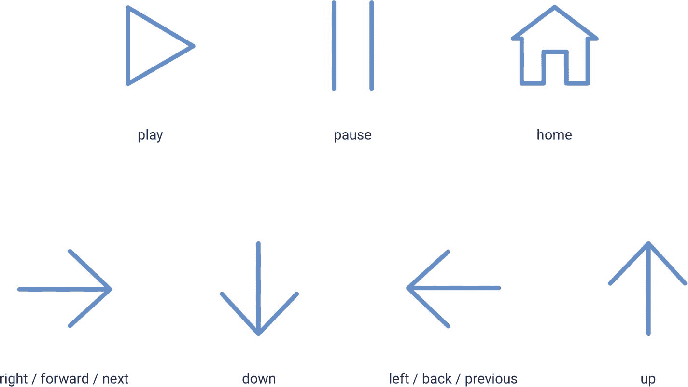

“主页”图标是一个特例，因为它用一个真实的事物来描述一个非物理的空间。即使是很小的孩子也能理解这个图形是“房子”，但将其与“主屏幕”的概念联系起来，是一种可能难以理解的抽象概念（年龄大一些的孩子，随着他们对网页导航和数字产品越来越熟悉，就会理解这个想法）。目前，许多儿童产品仍在使用它。我的建议是，对于 3-5 岁年龄段的儿童产品，信息架构应足够扁平，只需点击 1 到 2 次返回按钮即可回到主屏幕（参见第 7 章），无需使用房子图标作为快捷方式。年龄稍大的孩子可以应对稍微复杂的产品和架构，并且很快就能理解这个图标的含义。

归根结底，你必须考虑到儿童不会只使用你的产品。他们会同时使用许多其他产品，而重新发明一套不同的视觉代码只会让你的产品显得奇怪，使用起来令人沮丧。不要低估孩子学习和记忆新形状及其含义的能力。即使他们不能一眼理解某个图标的含义，他们也会学得很快。

在为儿童设计图标时，我们应该牢记以下几点：

-   依赖与年龄相符的心智模型。
-   使用醒目但不过多的颜色。
-   对比度非常重要。
-   孩子年龄越小，图标应该越字面化。
-   字面化并不意味着逼真。过多的细节可能会令人困惑。
-   考虑图标的使用尺寸。对于年龄较大的孩子，较小的触控目标意味着图标设计需要更简约。
-   不要重新发明标准图标。儿童不会只使用你的产品。

# 字体排印

一个非常常见的误解是，儿童产品上的字体排印必须使用古怪、滑稽、几乎无法辨认的字体。出于几个原因，这是错误的。首先，难看的字体在儿童产品上仍然难看，这可能只是个人品味和对字体排印敏感度的问题。但也有其他原因，而且品味与它们关系不大。

如果我们正在为学龄前和小学儿童设计产品，我们必须小心，因为这是他们第一次接触阅读和写作。虽然成年人很容易（嗯，取决于字体）识别不同风格的字母 `a`（图 8-28），比如草书和印刷体、衬线体和无衬线体、非常简单的或装饰性很强的，但看到这些不同风格可能会让孩子感到困惑。

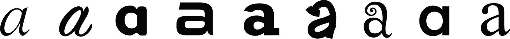

一种难以阅读或与他们在学校学到的字体差异太大的字体可能会让人困惑和沮丧。最终甚至可能打击孩子的阅读积极性。这不是我们想要的。

即使是在为非阅读者设计的产品中，也必须考虑到这一点。你的应用程序可能面向还不会阅读的非常小的孩子（我们在本书前面讨论过这方面的解决方案），但即使是你可能拥有的少量文字，也最好使用一种能够训练他们大脑识别字母、无需费力且不产生视觉噪音的字体进行书写。

关于什么字体对儿童来说是好的字体，存在不同的观点。^(⁶²,⁶³) 我们许多最常见的假设是基于直觉、实际使用和教育者的传统，但没有科学的方法来真正验证它们。因此，许多选择依赖于假设，很难真正提供一套有数据支持的规则。

为儿童选择字体风格，通常基于这样一种想法：它应该与学校教授的书法图形方法保持一致。但一些教育者质疑这种方法，认为字体应该帮助儿童熟悉常规书籍和杂志中使用的字体排印。这两种理由似乎都合理。

许多字体设计师和字体公司推出了专为初学读者设计的字体。他们大多以传统规则作为设计的起点，例如，普遍认为*无衬线*字体更容易被儿童识别。无衬线字体被设计成“骨架”形式，字母的外形仅由其骨架构成，这是我们通常用*印刷体*书写时的写法，我们不会给字母添加衬线。儿童友好型字体的设计随着所谓的“幼儿字符”的引入而更进一步。这些字符在 1920 年代被引入，并在 1930 年代变得更加流行。幼儿字符是什么意思？这些字符是对特定字母进行的变体设计，旨在让儿童更容易阅读。这些字母最常见的例子是单层结构的 `a` 和 `g`（图 8-29）。区别如下。

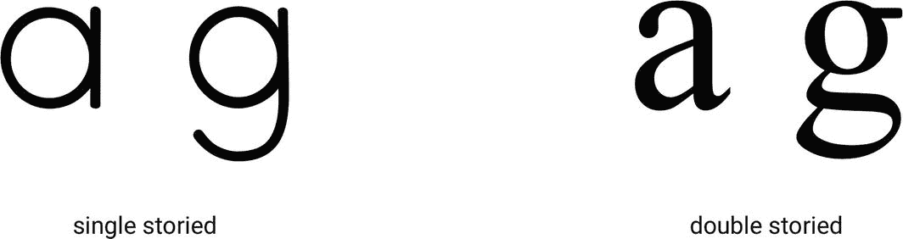

幼儿字符的其他常见例子是大写 `I` 和小写 `l`（图 8-30），在许多无衬线字体中它们看起来几乎相同。在其幼儿版本中，`I` 带有衬线，而 `l` 带有弯曲的终端。

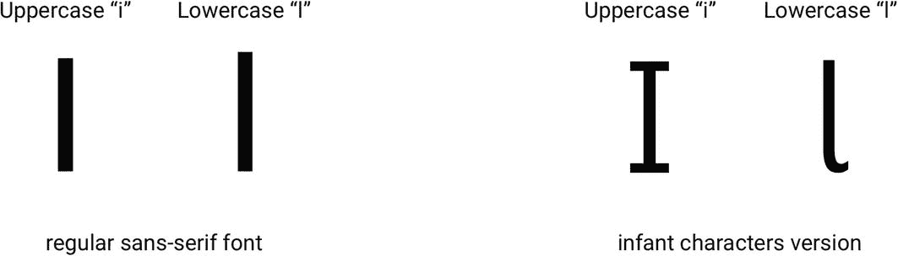

字体公司在诸如 `Gill Sans` 和 `Bembo` 等流行字体中引入了这些变体。像 Rosemary Sassoon 和 Adrian Williams 这样的字体设计师专门为儿童书籍设计了字体。他们的字体 `Sassoon Primary` 包含了所有幼儿字符变体，包括 `l` 和 `t` 的弯曲终端以及大写 `I` 上的衬线。这是一款非常出色的字体，我个人非常喜欢。

## 衬线字体 vs. 无衬线字体

选择*衬线字体*还是*无衬线字体*也是一个关乎媒介的问题。Berrin Dogusoy、Filiz Cicek 和 Kursat Cagiltay 在 2016 年进行的研究^(⁶⁵)《衬线字体与无衬线字体如何影响屏幕阅读：一项眼动追踪研究》只是诸多研究中的一例，这些研究通过眼动追踪技术测试，强调了无衬线字体在屏幕上的可读性优于衬线字体。

Sheree Josephson 在 2008 年进行的研究《让读者的视线停留在屏幕上：一项比较无衬线字体与衬线字体的眼动追踪研究》，发表于《视觉传播季刊》，也得出了相同的结论。这项研究尤其有趣，因为作者不仅比较了衬线字体与无衬线字体，还比较了专为印刷设计的字体和专为屏幕设计的字体。总体而言，使用专门为屏幕设计的无衬线字体（此处为 `Verdana`，由 Matthew Carter 于 1996 年为微软设计）取得了最佳效果。

在 2012 年发表于 NNG 的一篇文章^(⁶⁶)中，Jakob Nielsen 对“在线阅读应首选无衬线字体”这一准则提出了质疑。他（站得住脚的）论点是：这个“规则”是在屏幕分辨率较低的年代制定的，当时衬线字体的渲染远非理想，导致文本可读性差且模糊不清。在相对近代的时期，屏幕质量已大幅提升。Verdana 和 72 dpi 分辨率显示器的时代早已一去不复返。因此，如果衬线字体在印刷品上被认为更具可读性，那么在与印刷页面分辨率相当的屏幕上，它们难道不应同样如此吗？前文提到的 Dogusoy、Cicek 和 Cagiltay 在 2016 年的研究似乎持不同意见，但这可能还不足以定论。关于在线阅读应选择衬线字体还是无衬线字体的争论至今仍在继续，但将讨论拉回本书的主题，有一点值得注意：面向儿童的数字产品通常不需要长段落。事实上恰恰相反。

然而，不可否认的是，衬线字体通常看起来更严肃，而在数字界面上，无衬线字体看起来更现代、更具“科技感”（目前没有任何操作系统——无论是桌面端、移动端还是其他——将衬线字体作为默认字体）。数字产品在很大程度上仍然遵循着使用无衬线字体系列的“老规则”。

最终，对于面向儿童的网站或移动应用等数字产品来说，无衬线字体似乎是最佳选择。

### 一个好的儿童字体系列应具备哪些特征？

#### 圆形字怀

形状简单、友好，字怀（*图* *8-31**）* 宽阔且采用圆角设计。避免使用矩形或过于狭窄的字怀。较宽的字体可提供更好的可读性，也更接近儿童在学校学习的书写风格。

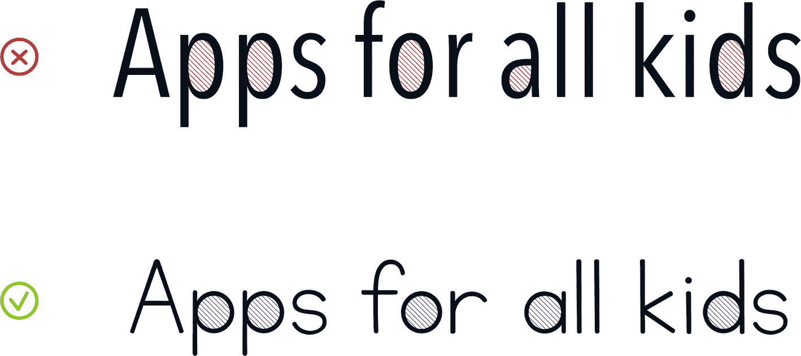

图 8-31

字怀圆润度对比

#### 更高的 X 高度

字体的 x 高度是指其小写字母 “x” 的高度，该高度应指导所有不含上下伸部分的小写字母的设计（图 8-32）。^(⁶⁷) x 高度较高的字体看起来更具可读性。

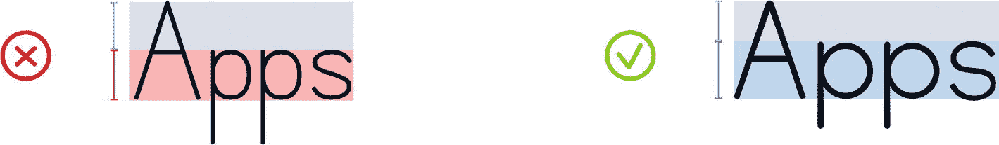

图 8-32

X 高度对比

#### 避免使用装饰性字体

在任何数字产品中，无论用户年龄大小，都应始终避免使用装饰性字体。但人们普遍认为，过于花哨的字体显得幼稚，因此适合儿童书籍、网站和应用。基于前述所有理由，这种想法是完全错误的。此类字体读（或看）起来并不有趣，只会让人感到困惑和视觉疲劳（图 8-33）。

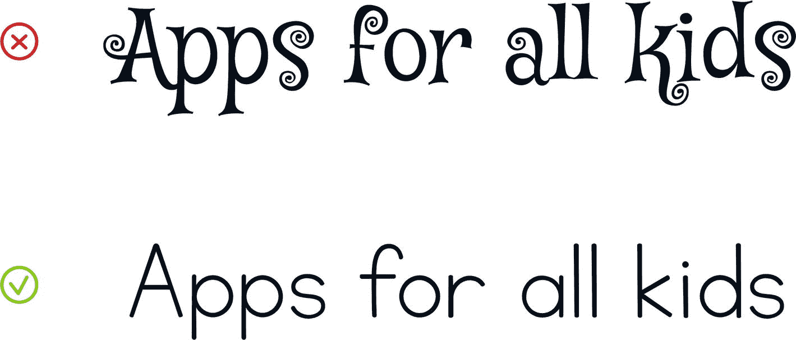

图 8-33

装饰性字体与简洁无衬线字体的对比

#### 注意字体的粗细与平衡

字体的粗细和宽度直接影响其可读性。与平衡性良好的字体相比，过粗或过细、过窄或过宽的字体往往可读性较差（图 8-34）。

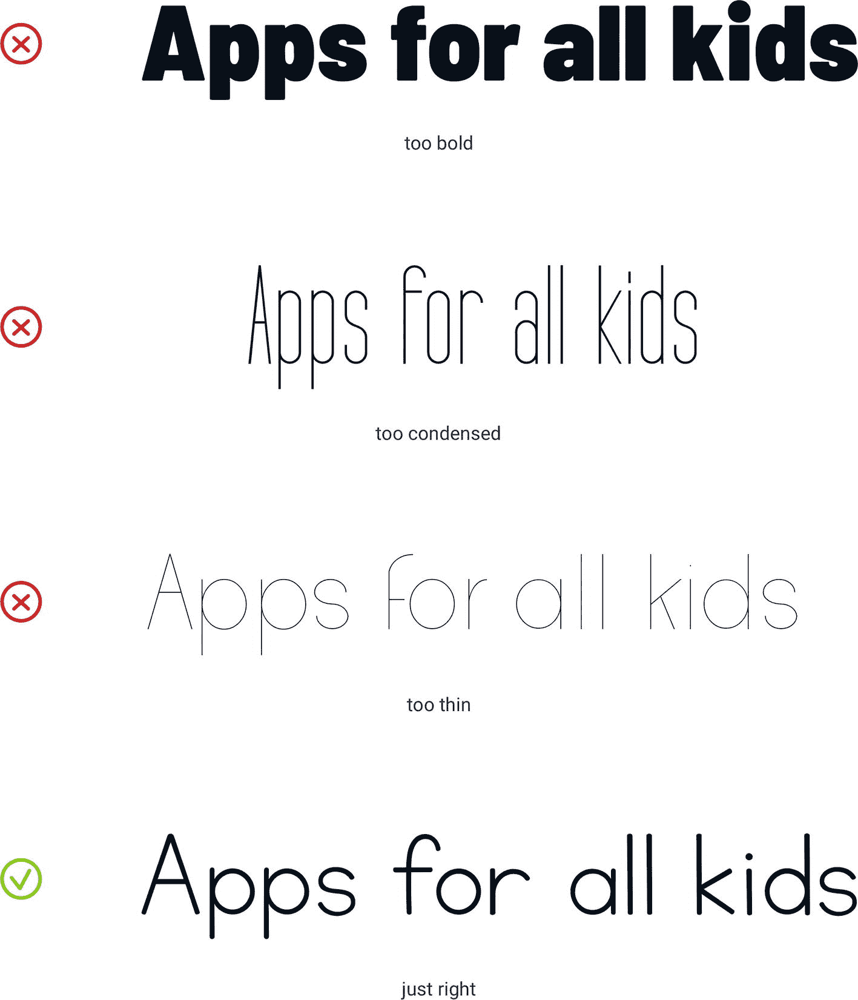

图 8-34

不同字体粗细对比

### 那么有哪些好的字体可供选择？

选择合适的字体可能非常耗时。市面上有数不清的选项，而且每天都有新字体出现。如果你没有太多时间进行研究，我可以列举几个满足前述所有条件的选项，但选择也应反映你的品牌以及你希望产品呈现的观感和风格。

*Gill Sans Infant* 是一款经典设计，历史悠久的字体，也是最早引入并推广儿童（infant）字符风格的字体之一。本节前面提到的 *Sassoon Primary* 则是一款更现代的字体，专为儿童设计。不过，需要注意的是，这两种字体都并非为屏幕使用而设计，而是用于印刷材料。

Kimberly Geswein 是一位字体设计师，她设计了好几款儿童字体系列。她的 *KG Neatly Printed* 就是我用于本章各要点图示中正确版本的字体。我喜欢它，是因为正如其名，它非常工整，同时又很友好，不过于严肃。

### 字号

字号无疑是影响字体易读性的主要因素之一。初级阅读者的读物通常使用大号字体，以便儿童更容易区分字母。

当我们处理针对“初级阅读者”（通常从 5 岁左右开始，直到 11 岁）的儿童数字产品时，文字大小最为重要。而对于还不能阅读的幼儿产品（如果有文字的话——应该尽量减少），文字主要是为陪伴的成年人准备的。

在初级阅读者的读物中，字体的 x 高度通常从大约 4 毫米/0.16 英寸逐渐减小到大约 2 毫米/0.08 英寸，即成人字体的大小。请注意，我说的是“x 高度”，而不是字号。x 高度与字号之间的比例因字体而异；请看下面的示例以更好地理解（图 8-35）。

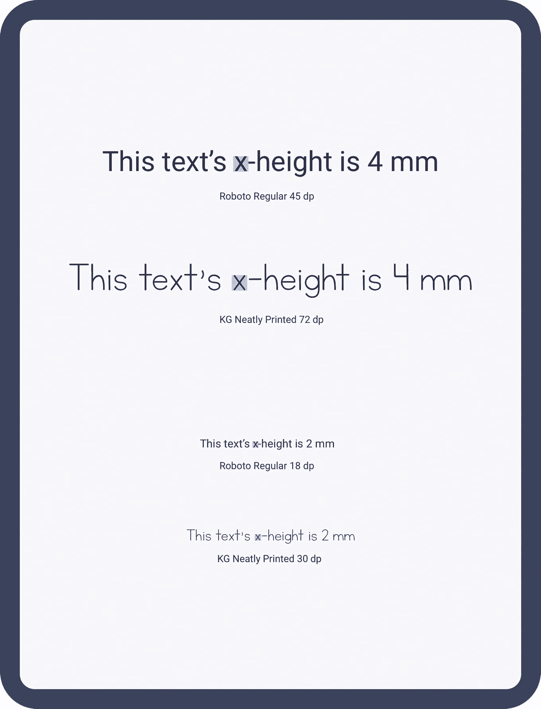

图 8-35

在 10.2 英寸 iPad 上的字号对比（仅示意比例，非实际尺寸）

如你所见，根据我们使用的字体不同，要达到 4 毫米的 x 高度所需的字号差异巨大，这取决于字体的设计方式。现在，4 毫米的 x 高度是非常大的文字，但这里我们讨论的是，例如在插图书中，正文段落的合适字号。如果我们只需要为某些图标添加标签，或为按钮添加单个词语，那么可以使用更小的字号。

### 行距

行距（在排版术语或 CSS 中称为行高）是指文本行之间的距离。可以想象，这是我们可以用来提升可读性的另一个变量。通常情况下，大多数字体族设置的默认行距已足够使用，但对于初学阅读者，我们可以略微增加行距，让段落显得更通透。

虽然没有精确的计算公式（这也取决于字体的上升部、下降部高度以及 x 高度等因素），但我多次尝试过一条经验法则：用字体的 x 高度乘以 1.618（黄金比例；取 1.5 也可以，毕竟黄金比例更多是一种执念），并将此作为上一行基线与下一行 x 高度之间的距离。这通常会（但并非总是）比字体的默认行距稍大（图 8-36）。

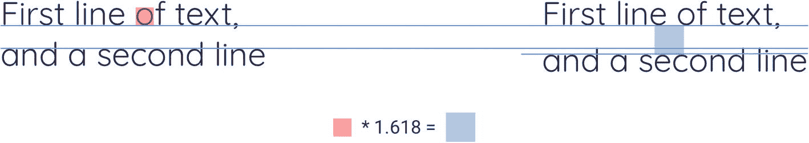

图 8-36

稍大的行距能提升初学阅读者的可读性

### 字母大小写

全大写文本的可读性低于首字母大写后接小写字母的句子式大小写（就像你正在读的这句话）（图 8-37）。

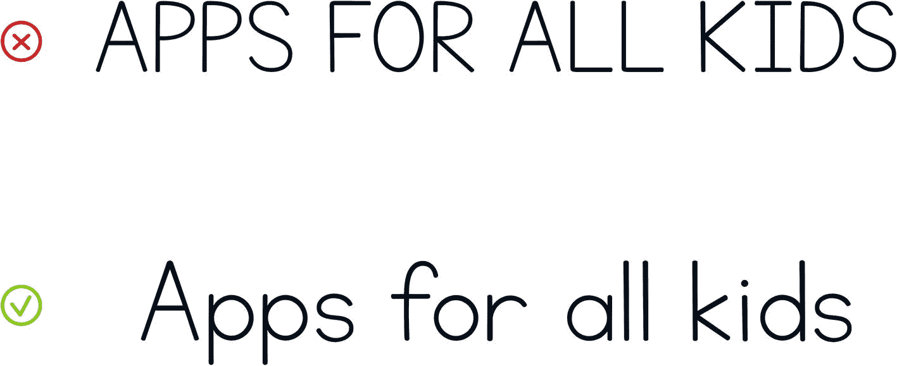

图 8-37

全大写句子的可读性低于句子式大小写

这是排版的普遍规则，并非专为儿童设计，但考虑到我们面对的是初学阅读者（如果他们正在阅读的话），这更是应用这一最佳实践的理由。

总而言之，我建议保持简洁，采用无衬线、非装饰性的字体，并确保设计均衡（字宽适中、x 高度不过高过矮、字重恰当等）。具体选择哪种字体族，应取决于你希望产品呈现的外观感受和品牌调性。然后只需遵循常规的优秀排版规则，处理字距、间距、行高等问题。为儿童设计时有一些最佳实践，但这些并不会与优秀设计的一般规则相冲突，这一原则适用于所有方面，排版亦然。

## 按钮

我们所能想到的最基础的 UI 组件大概就是按钮了。按钮可以有多种形式和样式，是数字产品设计中功能最丰富的工具之一。

按钮可以链接到另一个屏幕或模态框，也可以关闭它；可以添加或移除项目，开始或停止视频或音乐；它基本上可以触发产品中的任何操作。

按钮还有一个巨大的优势：它们只需要最基础的交互——点击或轻触。你不需要双击按钮，不需要拖拽按钮，不需要滑动或捏合。只需一次点击或轻触即可，非常简单实用。

这使得按钮成为一个非常重要的组件，因为你产品中的许多交互都将依赖于它们。那么首要问题是：什么能让按钮易于使用？

有几个因素，比如可见性、位置、可感知性，但最重要的可能还是尺寸。按钮的尺寸决定了触屏设备上的触摸目标区域，或光标操作设备上的可点击区域。这些尺寸应考虑儿童在每个身体发育阶段的运动技能。我们在第 7 章中看到，不同年龄段的儿童对应着不同的精细与粗大运动技能水平。年龄较小的孩子由于协调能力尚未充分发展，需要更大的目标区域。随着年龄增长，他们完善和发展了控制四肢和手指的能力，我们的界面便可以依赖较小的目标区域了。

### 菲茨定律

在 UX 设计中，我们有一个原则叫**菲茨定律**。美国心理学家保罗·菲茨于 1954 年观察到，移动物体的速度与物体本身的大小，与执行该动作时的错误率之间存在关系。换句话说，移动速度越快、物体越小，出错的可能性就越高。多年后，当界面变得图形化并引入鼠标等指点设备时，这一原则被应用于交互设计。

菲茨定律

获取目标所需的时间是目标距离和大小的函数。

## 儿童触控目标

杰夫·拉斯金在其 2000 年出版的著作《人性化界面》^(⁶⁸)中详细阐述了菲茨定律，以及它如何应用于苹果 `Macintosh` 的设计。一个具体的应用实例是：传统上，在 `Mac` 电脑中，应用程序的主菜单位于屏幕边缘的顶部栏。这使得用户可以非常快速地将光标上移，直接定位到菜单上，且无需担心越界（因为屏幕到此为止）。而在 `Windows` 系统中，应用程序的主菜单包含在窗口内部。这一微妙的差异导致在 `Windows` 上定位并点击菜单比在 `Mac` 上更困难（或更慢），因为用户需要精确地将光标停在正确的高度。

这个例子并非无的放矢。在涉及使用鼠标或触控板的儿童产品中，请考虑同样的思路：尝试将菜单放置在屏幕上易于通过简单动作（无需过高精度）定位的位置，例如屏幕边缘。

当我们讨论按钮时，无论在触屏还是光标操作设备上，菲茨定律都绝对相关。考虑到我在本节开头提到的关于儿童发育的考量，按钮尺寸与点击/轻触便捷性之间的关系，在面向儿童的设计中甚至更为重要。

我们来谈谈具体数值。好了，我们已经讨论了理论，但在实际应用中，儿童产品中最适合的按钮尺寸是多少呢？

`iOS` 的人机界面指南指出，触控区域的最小尺寸为`44 × 44 pt`^(⁶⁹)，而 `Android` 则为`48 × 48 dp`。这些是针对成年人的最低尺寸标准，但即便对我们成年人来说，舒适的尺寸也要大得多。2006 年的一项研究^(⁷⁰)表明，舒适且能快速操作的理想区域尺寸略小于 1 厘米（0.4 英寸）。不过我们需要指出几点：该研究针对的是单手持握设备并使用拇指操作的情况（即智能手机场景，而非平板电脑），并且这是在实验环境中的理想尺寸；在现实中，没有哪个应用能为每个可点击区域提供这么大的空间。

如果你想快速了解这个尺寸，可以参照 `iPhone` 主屏幕上一个应用图标的尺寸。它正好是 1 厘米（0.4 英寸）。在 `iPad` 上，它们稍大一些，大约为 1.2 厘米（0.5 英寸）。

为什么在数字产品中要讨论厘米（或英寸）？按钮（或其他任何交互组件）的触控区域，都不可避免地与它在现实世界中的尺寸相关联，而不仅仅是数字空间中的尺寸。我们的手指是真实存在的，其大小无法用像素来衡量；同样，设备也是我们握在手中的物理实体。使用厘米、毫米或英寸，可以更快速、更清晰地理解我们所说的尺寸。一旦确定了它们在现实世界中的外观，我们就可以将其转换为`dp`，然后根据所需的像素密度进行导出。

`NNG` 进行的可用性测试确定，对于幼儿来说，最小的可触控区域是成年人认为舒适尺寸（1 厘米）的四倍，即`2 × 2 厘米`（0.8 英寸 × 0.8 英寸）的区域。

换算成`dp`，这些尺寸大约相当于`64 dp`（实际上是`63 dp`，但最好四舍五入为偶数）和`126 dp`，因为`1 毫米` = `6.299 dp`（图 8-38）。

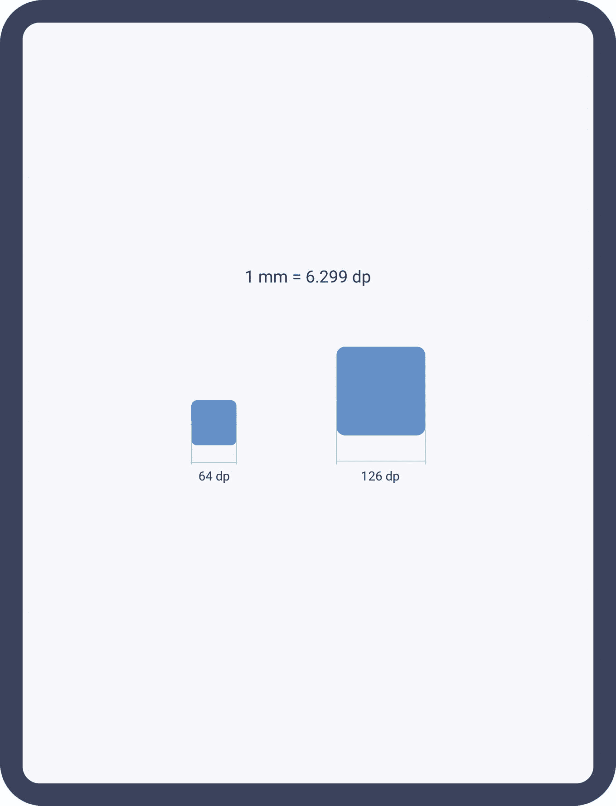
**图 8-38** – 成人与儿童理想触控区域对比

这个较大的区域是为学龄前儿童（3 至 5 岁）设计产品时，触控区域所需的理想空间。这个尺寸与儿童的年龄成反比，孩子年龄越大，这个区域就可以越小，直到大约 12 岁，这时我们终于可以开始考虑成人的尺寸了（图 8-39）。

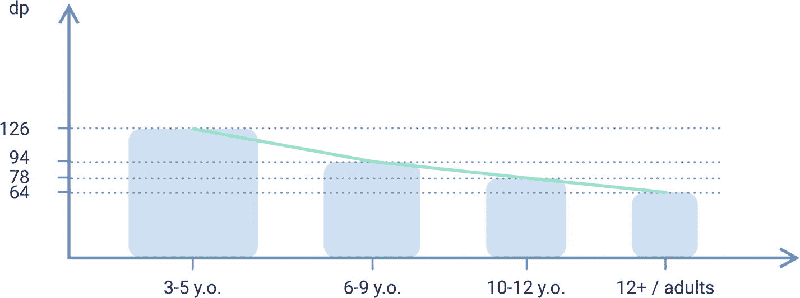
**图 8-39** – 与年龄相关的理想触控目标尺寸

这种关联关系以及图 8-39 中给出的尺寸，是通过将儿童的理想尺寸作为起始值、成人的尺寸作为最终值，并找出中间年龄段的中点来计算的。但人类不是机器人，所以运动技能的发展并非线性的，我们不会像下载云端更新一样发展（现在还不能）。因此，这些应该被视为经验法则，而非精确的数学计算。

## 安全空间

在讨论触控目标时，我们还应该考虑它们之间的间距。两个尺寸足够大但彼此靠得太近的触控目标，可能会导致误触。根据经验法则，我通常会考虑将触控目标周围相当于其大小 50%的区域作为安全空间（图 8-40）。

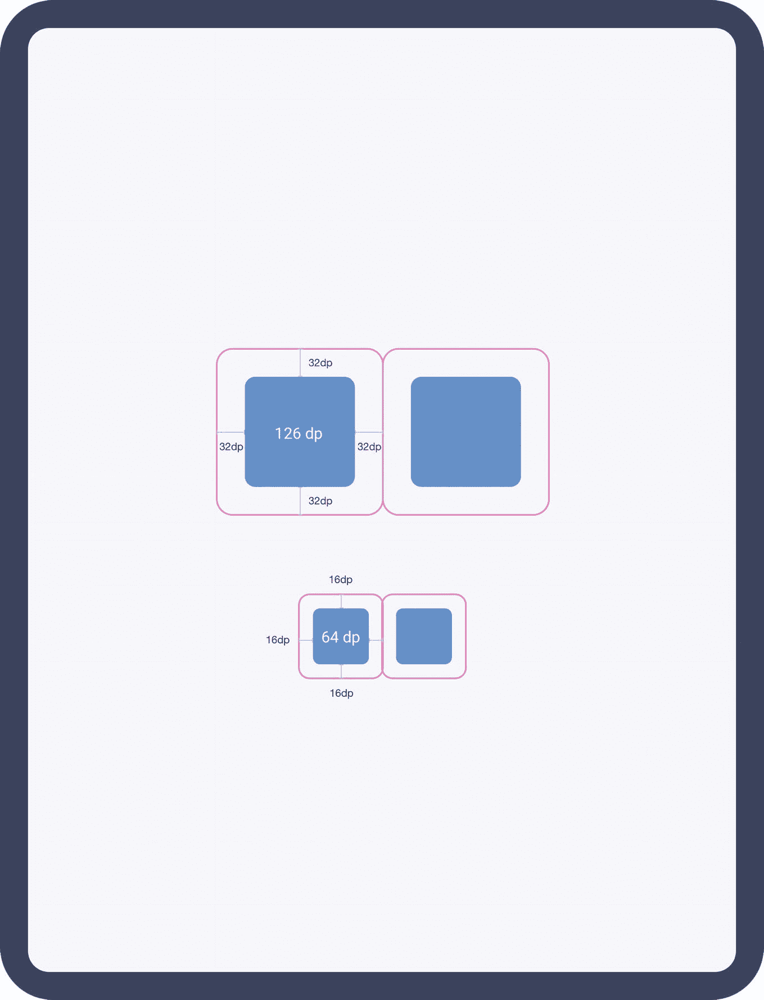
**图 8-40** – 触控目标周围的安全空间

## 按钮样式

我们在本章前面已经讨论过拟物化设计，我们了解到，采用拟物化不仅不必要且已过时，在某些情况下，甚至还会妨碍易用性。

样式与品牌、产品个性以及你想要产品呈现的外观和感觉密切相关。正因如此，我无法在这里给出任何具体的指导。尽管如此，我们还是来看一些思考点。由你来决定它们是否适用于你的产品。

#### 圆角

在儿童实体产品中，没有尖锐的边角。原因显而易见，是为了避免对玩耍这些物体的儿童造成身体伤害。当然，在数字产品中，我们不必担心这一点，但圆角仍然是个好主意（圆润程度可以有所不同，从几个`dp`到药丸形按钮那样完全圆润都可以；见图 8-41），因为它们看起来比尖角友好得多（对比见图 8-41）。目前（2020 年），这在成人产品中也是一个趋势，但对于儿童产品来说，这是一个无需多想的选择，而且我非常怀疑我们是否会看到尖锐边角在儿童产品中变得流行。

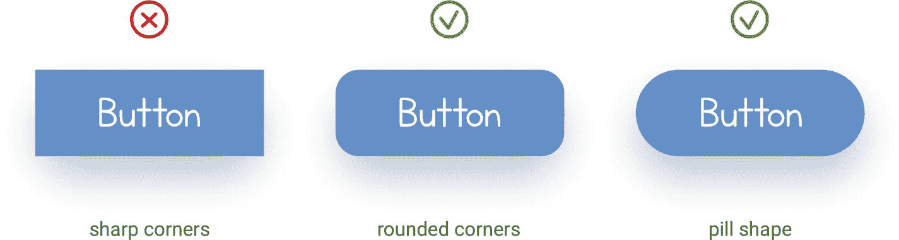
**图 8-41** – 不同程度的圆角

#### 阴影与否？

介于扁平与拟物化之间的折中风格是 `Google Material Design` 所使用的样式。在这种设计语言中，组件是扁平的，但它们的工作方式类似于放置在不同高度上的纸张，并在下方的元素上投下阴影（图 8-42）。这种由伪 3D 空间创造的错觉有助于用户理解层级关系，并区分哪些是可触摸或点击的。

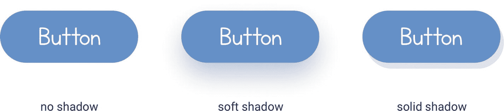
**图 8-42** – 不同类型的阴影。对于儿童来说，几乎没有区别

然而，这对于幼儿来说并不奏效。他们无法感知屏幕上的事物是 3D 空间，所以无论有没有阴影，对他们来说都是扁平的。这并不意味着你不能使用阴影，但归根结底，这更多是一种风格选择，而非用户体验选择。

## 避免“虚假按钮”

按钮看起来应该像按钮，这是一条简单的规则。但另一条规则是，非按钮元素不应该看起来像按钮。注意用户界面中那些可能像按钮、但并非交互元素的组件；例如，计分器的容器应该明显不同于你想点击进入某个地方或执行某种操作的元素（除非它本身就能操作）（图 8-43）。

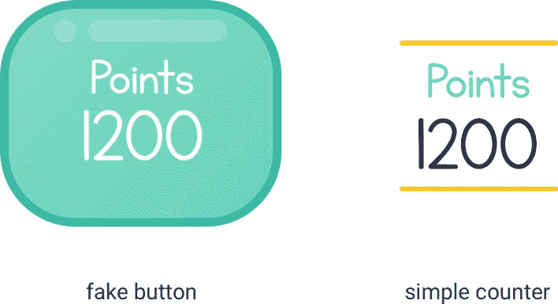
**图 8-43** – 左侧：具有按钮外观的计分器，暗示了可操作性。右侧：不鼓励用户点击的简化版本

## 其他组件

通常，在儿童产品中，我们没有像成人产品中那样丰富的组件库。诸如单选按钮、复选框、滚动条、下拉菜单等组件，通常不会用于儿童产品，尤其是学龄前儿童产品。大多数交互都基于对按钮的点击，偶尔也会用到拖放和滑动操作。

牢记我们本节刚刚讨论的关于触控/点击目标的最佳实践以及所有其他准则，再结合第 7 章的信息，理解我们可以使用哪些组件以及如何设计它们，应该是相当直接明了的。