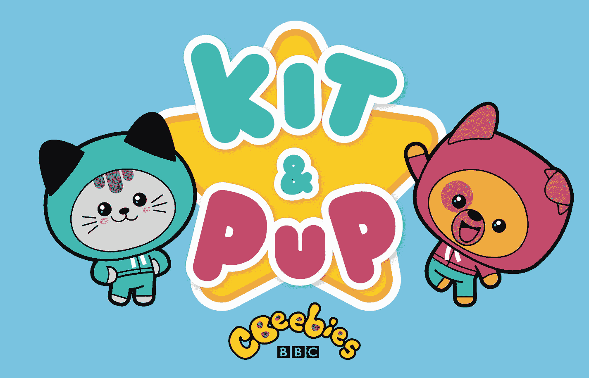
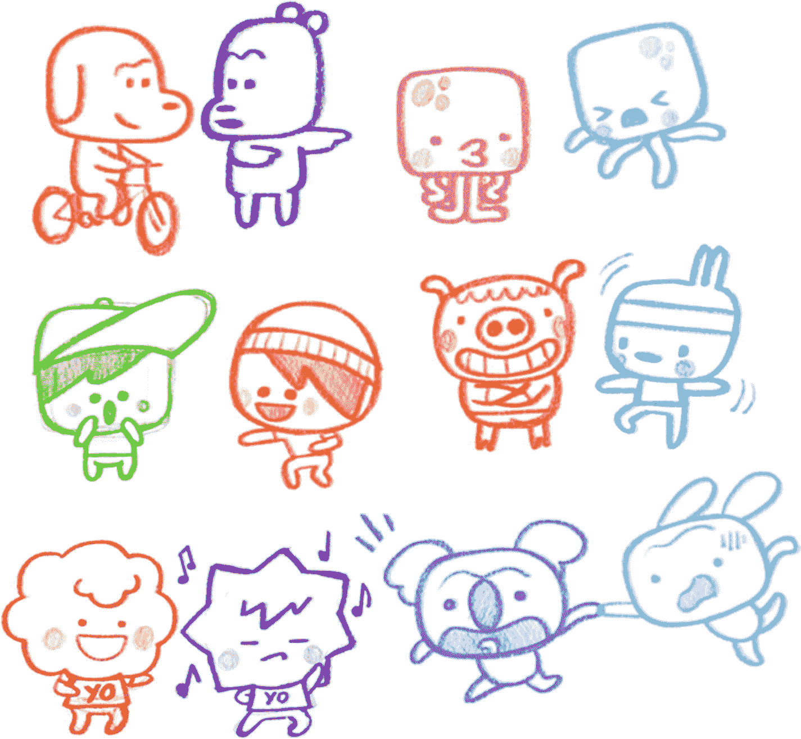
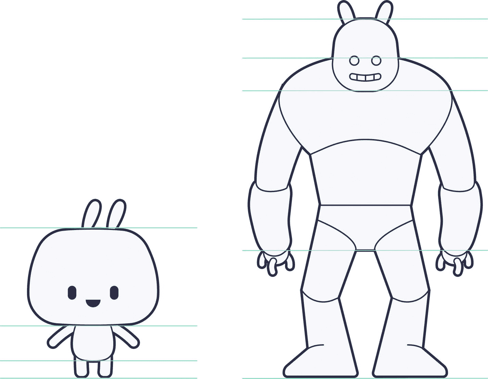
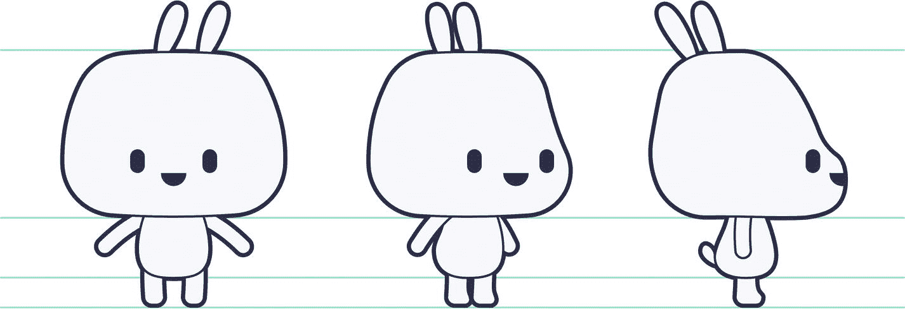
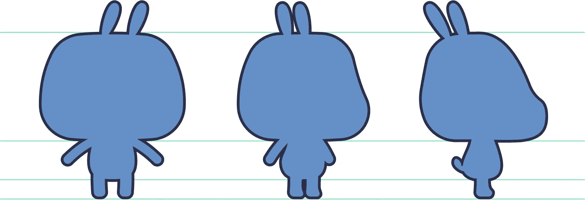
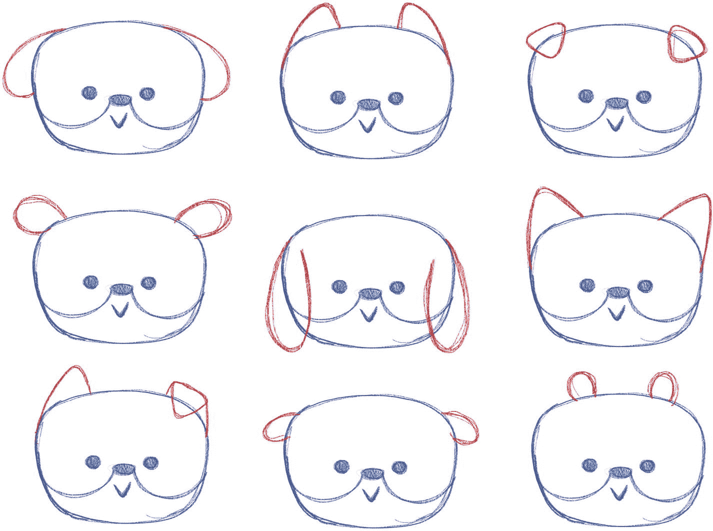
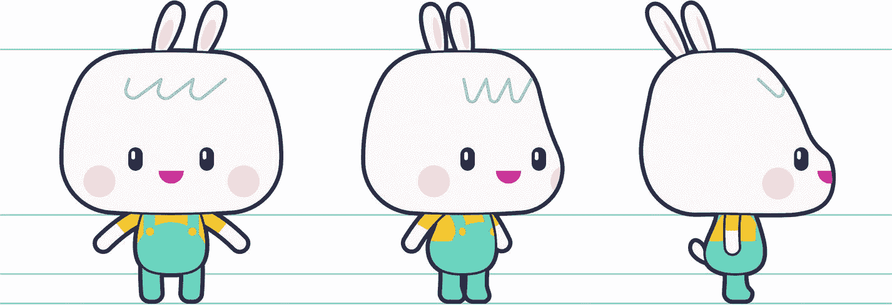
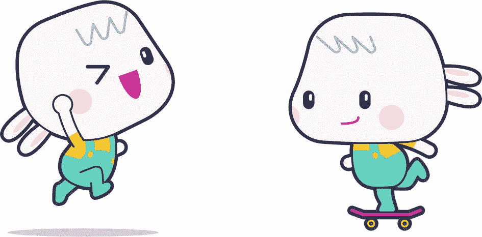
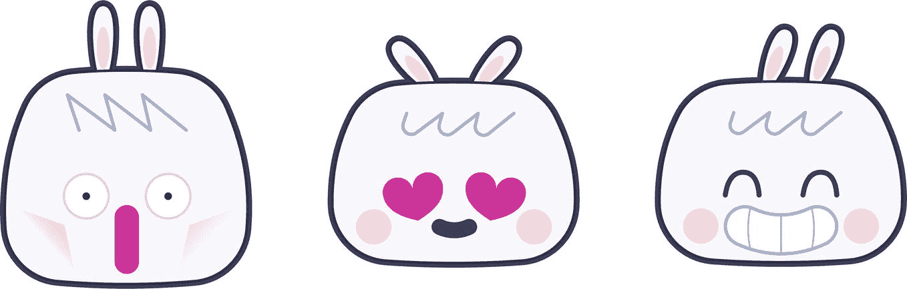

# 角色设计基础

对于一本数字产品设计书籍而言，这或许看起来是个不同寻常的主题，但在此特定语境下并非如此。角色在儿童应用中都扮演着重要角色，我敢说，几乎找不到一款完全不包含任何角色的儿童应用。虽然角色在不同应用中的作用各异，但它们普遍存在于从教育类到娱乐类等各类产品中。

有些面向成人的应用也会在体验中使用角色，但大多数（电子游戏除外）并不使用。角色是儿童数字产品的一大特色，它们服务于实际目的，绝非毫无意义的审美点缀。

## 为什么要在产品中加入角色？

- 在用户与产品之间建立更强的情感联系。
- 提供反馈，引导儿童完成体验。
- 以更清晰、更高效的方式进行沟通。
- 让体验变得更有趣。
- 打造更强大的品牌，并为其拓展至数字世界（或应用系列）之外的可能性。

以上都是为数字产品添加一个或多个角色的绝佳理由。它们既满足了用户体验的需求，也满足了品牌/商业的需求。在儿童数字产品中，角色是用户界面不可或缺的组成部分。

从市场营销的角度来看，角色确实有助于巩固品牌和推动产品成功。在我看来，`Angry Birds` 的成功很大程度上归功于出色的角色设计。诚然，它是一款有趣的游戏，但其概念远非独创。角色（以及故事叙述）使其成为一款热门大作，并发展成为一个价值数百万美元的品牌，衍生出故事片、主题公园以及数不胜数的周边产品。如果同样的创意没有角色，或角色设计糟糕，就绝不可能取得如此成功。

数字产品中角色成功的另一个绝佳案例，特别是针对儿童的产品，是 Toca Boca 的 `Toca Life` 系列。这些应用系列（每个应用专注一个主题，如 `Toca Life: Vacation`、`Toca Life: Farm`、`Toca Life: Hospital` 等）中的角色被用于 H&M 的儿童服装系列。

现在你可能会问：你对此有何了解？嗯，碰巧的是，除了担任（面向儿童和成人的）数字产品设计师之外，我还长期兼职从事插画师和角色设计师的工作。我曾为全球众多客户绘制角色插画，例如耐克、Foot Locker、孩之宝等。在教育领域，我曾为牛津大学出版社等机构出版的 ESL 教材绘制插画，但或许最有意思的项目是 2017 年为 BBC 儿童电视网 CBeebies 所做的那一个。该项目是为 BBC 内部制作团队创作的教育系列节目 `Kit & Pup`（图 \8-44）。这最后一项工作尤其值得一提，因为它始于一个电视节目（共 52 集，每集 5 分钟的短剧），但后来扩展成了一款名为 `Kit & Pup` 的教育游戏的数字产品。

图 8-44

我为 Kit & Pup 电视节目设计的角色

在本节中，我想介绍为产品创建优秀角色的主要步骤。

## 定义角色的个性、姓名和故事

即使你实际上不会在应用内展示角色的故事，它更多是作为一个吉祥物，那么定义角色的个性、一些背景故事并给它起个名字也非常重要。个性会影响角色的外貌、动作方式、表情、说话方式、与用户的沟通方式等等。围绕你的品牌和应用概念来塑造角色。你想传达什么？你计划如何使用这个角色？它是用户的导师吗？还是伙伴？它更像一个哥哥/姐姐的角色吗？它是一个英雄，还是用户应该帮助的对象？

角色建立在原型和刻板印象之上。现代心理学中常用、且频繁用于创意写作的原型，源于瑞士精神科医生卡尔·荣格的思想，而荣格的理论又基于柏拉图的作品。这里无需深入细节，请允许我将其极度简化为：

- 原型回答的问题是：“这个角色做什么？”
- 刻板印象回答的问题是：“她/他怎么做？”

## 决定角色的物种

角色可以是人类、各种动物、神话生物、外星人、人造生命……任何东西都可以成为角色，甚至植物或物体也行！

一旦决定了角色的个性和故事，我建议尝试几种不同的方案，以快速缩略图草图的形式呈现。我在为 BBC 项目工作时接到的第一个任务就是探索一对角色组合，当时我只知道这个节目将围绕“对立”的世界（冷/热、湿/干等）展开。我画了许多草图，从动物到人类，到几何形状，再到幻想生物，总共 64 个不同的角色（图 \8-45 展示了其中一部分）。在这个阶段，我没有绘制静止不动的角色，而是想象了他们之间的小对话，以及他们跳舞、打斗、奔跑、尖叫、歌唱等情景。这帮助我强化了对他们个性的构想。

图 8-45

这只是我为 Kit & Pup 绘制的众多缩略草图中的一小部分

## 确定角色比例

比例取决于你希望角色引发的感受，并能很大程度上传达角色的个性。头部与身体的比例是定义角色可爱程度的重要变量。大头小身的角色看起来更可爱，因为它们模仿了我们看到的婴儿的比例；例如，我为 `Kit & Pup` 设计的角色就是如此。

而如果我们想创造一种超级英雄类型的角色，就需要更写实的比例（图 \8-46）。

图 8-46

不同的比例传达不同的个性

比例需要保持一致，除非为了表达特别强烈的情感，偶尔在夸张的姿势中进行挤压和拉伸。

然后是角色的 `turnaround`，这是角色开发的另一个基本步骤。`turnaround` 是一张展示角色至少三个不同角度（例如，正面、半侧面和侧面）的图纸。这能体现角色的体积感，并作为所有姿势的参考（图 \8-47）。

图 8-47

从三个角度展示的角色图样

你需要确保角色是“可读的”，这意味着其形状和体积易于观众理解。一种检验方法是观察其剪影。你应该仅凭剪影就能大致了解角色是什么（图 \8-48）。

图 8-48

角色的剪影

### 颜色、细节与配饰

颜色和细节的多寡取决于你选择的风格，但总体而言，尤其是为学龄前儿童设计角色时，我建议保持简洁。在配色方案的选择上，我们可以参考本章“配色方案”部分讨论的内容。**明亮**的颜色、**高对比度**以及**有限的调色板**在大多数情况下是安全的选择。

细节和配饰是凸显角色个性、使其令人难忘且易于区分的所在（图 8-49 和图 8-50）。同样在这种情况下，最好要牢记用户年龄，使用他们认识并能识别的配饰。

图 8-50：为《Kit & Pup》中角色耳朵所做的不同测试

图 8-49：完成色彩和细节后的最终角色

刻板印象可以有所帮助。尽管将刻板印象应用于真人是不好的，但在角色身上，它们有助于传达信息并展现角色的个性。当我在为 Colto 公司的《Eli Explorer》构思角色 Eli 时，我决定给他戴上眼镜，原因有二：首先，为了展示戴眼镜是正常、体面甚至是酷的（就像哈利·波特为无数孩子所做的那样）；其次，为了赋予 Eli 一个充满好奇心、乐于探索新事物的形象。这是刻板印象吗？嗯，是的。在考虑刻板印象时，我们必须谨慎，避免延续有害和错误的刻板印象。一个无害的刻板印象是“书呆子戴眼镜”（注意，这与“戴眼镜的人是书呆子”不同）；一个错误的刻板印象是“跳舞是女孩的事”。其他无害的刻板印象还有：伐木工穿格子衬衫、留胡子，巫师戴尖顶帽，猫头鹰是智慧的象征，等等。

无论如何，始终要避免性别和种族刻板印象！如果非要说有什么，角色应该教导的是包容性。

### 动态姿势

要真正了解一个角色是否成功，动态姿势至关重要。观察角色在动作中的表现，对于定义其个性如何体现在运动方式中，以及检查其比例都很重要。动态姿势还应包括使用物品，例如，了解角色如何抓取物体或乘坐交通工具（图 8-51）。

图 8-51：动态姿势测试

### 夸张的表情

在你的儿童数字产品中设计角色的主要原因，是为了建立情感纽带，并与用户进行更清晰的沟通。为此，需要牢记的一点是：你的角色必须富有表现力。它们的感受和反应必须清晰地呈现在面部和整个身体上。夸大面部特征的大小和变形是达成这一目的的一种方法。让各种表情之间产生显著差异也很重要；细微的差别可能会被忽略。大笑需要大的张开的嘴巴，惊讶需要大的圆睁的眼睛，等等；同时也要考虑使用经典道具，比如心形眼睛等（图 8-52）。如果角色是动画的，动作也应强调表情的变化。

图 8-52：角色的不同表情。面部特征被夸大以强调情绪

### 简洁性

界面中使用的角色应足够简洁，以免分散用户对要完成（或你希望他们完成）任务的注意力。其作用是引导孩子完成体验、提供反馈、建立联系并引发情感反应。这是一个辅助角色，而非主要角色。孩子应该是体验中的主角，角色只是在那里提供帮助和娱乐。

特别是在为学龄前儿童设计时，保持角色简洁的另一个重要原因是让孩子易于理解并能够描绘。以《小猪佩奇》为例。佩奇和节目中的所有其他角色都由简单的形状和纯色构成。四肢像棍子，身体是简单的几何形状：女性角色是半椭圆，男性角色是圆形。孩子们可以相当容易地画出佩奇以及她的家人和朋友。我认为这对于低龄儿童的角色来说是一个非常聪明的特点。

### 包容性

角色可以在促进包容性方面发挥重要作用。因此，正如我之前提到的，避免性别和种族刻板印象非常重要。这并不意味着所有角色都应该是性别中立的，但角色不应落入早已过时的刻板印象窠臼。多样性应当被赞美和拥抱。

Toca Boca 对此非常重视，他们产品中的角色非常多元化，且从未以不良方式被刻板化。Toca Boca 应用的整体风格是性别中立的；他们的任何产品都没有明确针对男性或女性。

但是，谈论包容性不能止步于性别和种族。包容性还必须考虑到残障人士。一个很好的例子是一款名为《Cardpocalypse》的游戏，它在包括 Apple Arcade、Steam、PlayStation、Xbox 和 Nintendo Switch 在内的多个平台上发布。故事的主角是一个坐在轮椅上的女孩，遗憾的是，这在角色设计中仍然非常罕见。

