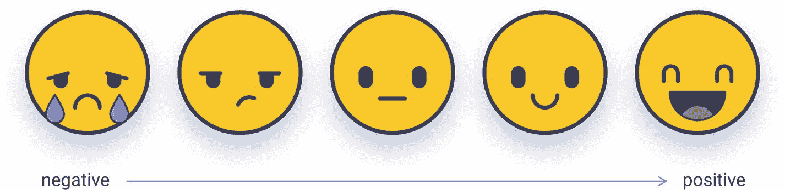

# 获取答案

有时，理解孩子们的意思可能很困难。年幼的孩子词汇量有限，表达想法的能力也有所欠缺。有几种策略可以尝试采用，以缓解这一问题。首先，对会话过程进行**录像**会很有帮助，之后可以反复回看（必要时可多次），同时也能注意到参与者肢体语言中更细微的反应。如果进行录像，请记得在家长需要签署的同意书中明确声明，并附上所有必要的隐私政策参考。

如果在你专注于孩子时，能有另外一个人在场做笔记，也会有所帮助。将全部注意力放在孩子身上，无需中断记录来注释答案，这既有利于你与参与者建立的关系，也有利于笔记质量——因为有专人负责记录。

促进年幼孩子回答问题的好策略之一是使用视觉辅助工具来表达感受。这非常类似于我们在医生办公室常见的那种海报，上面用不同的面部表情对应不同的疼痛等级（希望你的产品不会引起同样痛苦的反应）。可以是一张纸，让孩子在上面指出最能代表他们感受的表情（图 9-1）；也可以是一些贴纸，让孩子将其贴在某个地方，以增加趣味性（如果你已经为产品或品牌设计了一个角色，可以将其用于此目的；参见第 8 章）。

**图 9-1** 你可以使用类似表情符号的贴纸来帮助孩子表达情绪

最后，如果有一位家长在场（见本章前面的“家长在场”部分），你可以请其帮忙促进回答，但要注意家长不应提示任何内容，只在必要时鼓励和解读孩子的回答。

## 行业洞察：采访玛蒂娜·德尔阿夸

玛蒂娜·德尔阿夸是一名专注于儿童产品的游戏设计师。她是 Colto 公司的产品主管，该公司专门为儿童开发教育游戏，并与尼克国际儿童频道和高光公司等大型媒体公司合作。

**鲁本斯：你们如何处理招募工作？除了年龄之外，在招募参与者测试产品时，你们还会关注其他因素吗？**

玛蒂娜：年龄对我们来说是一个关键要求，但不是唯一要求。我记得五年前我们刚开始的时候，当时了解测试的孩子是否使用移动设备极其重要。有很多孩子不习惯使用这些设备，而对我们来说，测试这两类孩子非常关键。如今，几乎找不到从未使用过设备的孩子了。不过，我们仍然认为，与那些没有丰富数字体验的孩子一起测试我们的应用很重要，以便了解我们的产品是否足够直观。

**鲁本斯：你认为，当孩子们来参加用户测试时，与他们接触的最佳方式是什么？你让他们放松、感到舒适和安全的秘诀是什么？你能分享一些技巧和窍门吗？**

玛蒂娜：一上来就把应用直接交给孩子，得到的结果毫无用处。他们会睁大眼睛，呆滞地看着你。“我该做什么？”他们似乎在问。我的建议是尝试“打破”你作为“成年人”的形象，成为“朋友”。我通常的做法是拿出自己的设备，开始玩不同的游戏来激发他们的兴趣。然后，我开始和他们谈论喜欢的应用和电视节目，让他们放松下来。过了一会儿，我就请他们试试这款新的“应用”，也就是我一开始就想让他们试用的那个！

**鲁本斯：测试环境有多重要？你认为最佳设置是什么？**

玛蒂娜：环境可能是儿童测试中最重要的因素。这里的环境不仅仅指“建筑物”本身，而是你进行测试时整个体验所营造的氛围。重现孩子们将要使用你应用的那种舒适氛围非常重要。根据我的经验，我们既在学校测试过，也在办公室的玩耍约会中进行过测试。显然，后者是更轻松的测试方式，孩子们在玩耍约会中更放松、更有自信，感觉更像在家里。为了达到这种氛围，除了数字产品，我们还喜欢准备一些孩子们熟悉的实体游戏产品，这样他们可以一起使用和玩耍，以建立自信并改善整体体验。

**鲁本斯：那家长呢？你如何让他们对自己孩子参与用户测试感到安心？**

玛蒂娜：我过去不太与家长互动。然而最近，我们开始让他们更多地参与到用户测试本身中来。我们需要了解他们在孩子玩耍中的参与程度以及参与方式。当然，孩子是主要用户，但家长也是重要的参与者。他们是购买游戏的人，但更重要的是，他们常常是与孩子一起互动和玩耍的人。让他们成为测试的一部分，会让他们看到孩子使用应用时感到自在得多。

**鲁本斯：有时孩子，尤其是年幼的孩子，可能难以表达他们对产品的想法或感受。对此，你有什么建议来帮助他们？**

玛蒂娜：理解孩子的喜好和需求非常复杂。我们通常更依赖非语言交流。直接提问很少奏效，因为孩子往往倾向于给出“正确答案”。作为变通方法，多年来我们想出了各种更容易让孩子理解、并能给出更真实答案的问题。例如，“你喜欢这个游戏吗？”变成了“你想让我打开另一个应用吗？”；“描述一下这个游戏”变成了“你会怎么跟你的朋友介绍这个游戏？”。

**R:** 在成年人测试中，我们通常避免给出任何形式的反馈，无论是正面的还是负面的。诚然，测试中不存在绝对的对错，但我认为，在与儿童合作时，给予参与者一些正面反馈也同样重要。我们怎样才能在不影响测试结果的前提下，给予正面反馈并建立他们的自信呢？

**M:** 正如你所说，测试中没有对错之分，因此研究者的目标应该是“打破对犯错的恐惧”。这一点对成年人适用，对儿童尤其如此。在这种情况下，我们喜欢做的，就是无论他们做什么，都持续给予鼓励性的反馈，以提升他们的自信心，让他们“表现出”真实的自己。并且，根据具体情况，尝试分析孩子的行为，同时避免一直盯着他们看，以免让他们感到压力。

**R:** 我知道你最近（由于新冠疫情保持社交距离的要求）和孩子们进行了一些远程用户测试，这相当不寻常。与面对面测试相比，最大的区别是什么？孩子们对这种测试环境反应如何？有什么技巧可以分享吗？

**M:** 远程测试是我原本认为行不通的方式。我很高兴地说我大错特错了。它效果非常好，甚至开启了一种新的测试视角。孩子们总是和父母一起待在家里，感到非常自信和放松。我们不必费心去营造“宾至如归”的感觉，就能看到他们在自己平常玩耍的环境中进行游戏！在某些情况下，父母会过度参与孩子的测试，但在几次“虚拟游戏约会”之后，我们成了管理父母和孩子的专家！

效果如此之好，以至于我们决定未来继续采用远程测试。然而，需要强调的是，这并不能替代面对面测试，而是一种有效的补充。

## 章节回顾

- 儿童和成年人的用户测试是不同的。
- 在针对儿童进行用户研究时，即使是微小的年龄差距也很重要。
- 招募的参与者要比你认为需要的数量多。
- 尝试招募性格多样的参与者，包括内向和外向的。
- 必须获得家长的同意。
- 建立一个欢迎儿童、以儿童为中心的环境，无论是在学校、公共图书馆还是测试机构。
- 让环境友好，但不要过于分散注意力。
- 着装要专业，但着装随意。穿着过于正式可能会令人畏惧。
- 尝试在着装中加入一些流行角色元素。这可以充当破冰的话题。
- 赢得家长的信任。向他们解释测试的内容（与他们的孩子无关）以及如何进行。
- 对于年龄较小的孩子（2 至 4 岁），如果有助于孩子放松，父母或监护人可以在房间里。
- 房间里的父母应作为安静的观察者，远离参与者的视线。
- 在需要支持和鼓励时，请求父母介入，但要注意他们不要影响孩子的选择。
- 有些孩子适合与亲密的朋友一起结对测试。
- 结对测试时，要规定好轮流顺序，以免因使用设备而产生争执。
- 高保真原型是面向儿童的最佳选择。
- 儿童倾向于探索并点击所有内容。包含一种快速重置原型的方法。
- 让参与者知道，被测试的不是他们，而是产品。他们是老师。
- 从简单的问题和任务开始，以建立测试者的信心。
- 提问要具体，并使用适合其年龄的语言。不要使用专业或艰深的词汇。
- 让他们知道，不知道答案或不知道如何完成任务是没关系的。
- 没有人会因为负面评论而受到伤害。
- 允许在任务范围之外进行一点探索（如果原型允许的话）。
- 每场测试最长持续时间为一小时。
- 与成年人测试相比，为用户研究留出更长的时间。
- 计划好一开始就安排上厕所的时间，并在测试期间安排一到两次休息。
- 说明测试将如何进行。
- 给予笼统但正面的反馈。不要像对待成年人测试那样“面无表情”。
- 如果孩子很难表达自己的感受，尝试使用带有表情符号或插图的视觉量表。
- 如果可能，仅专注于参与者本人，由其他人负责记录。
- 录像有助于回顾回答和肢体语言。

