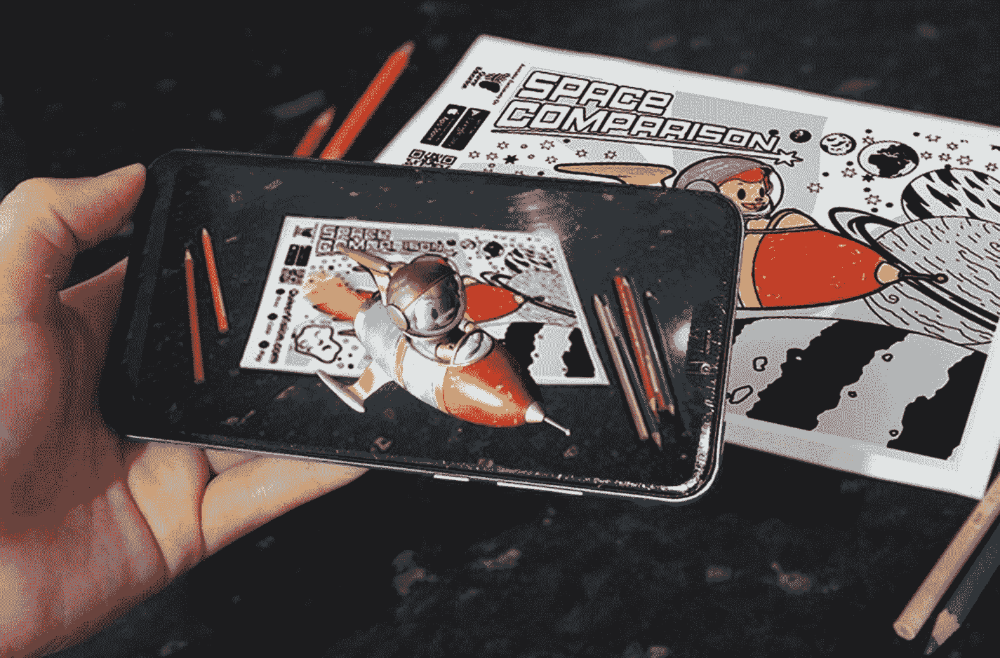
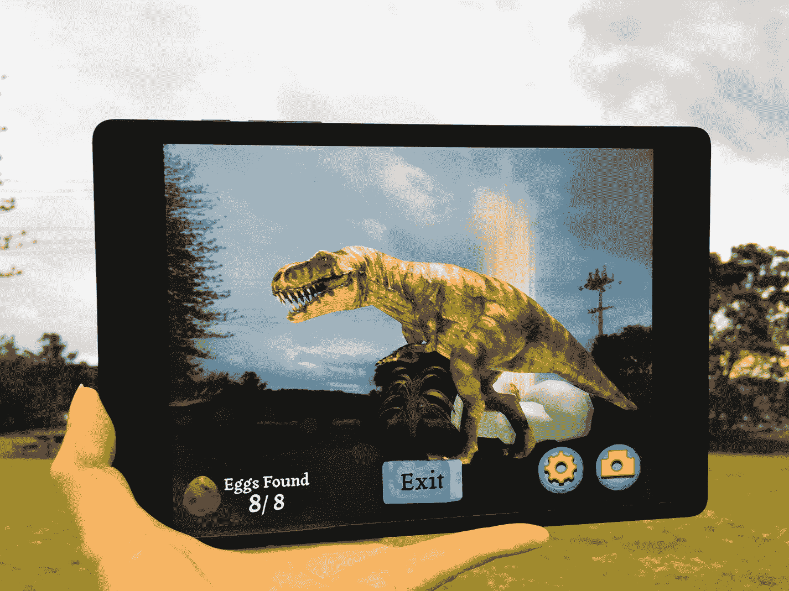
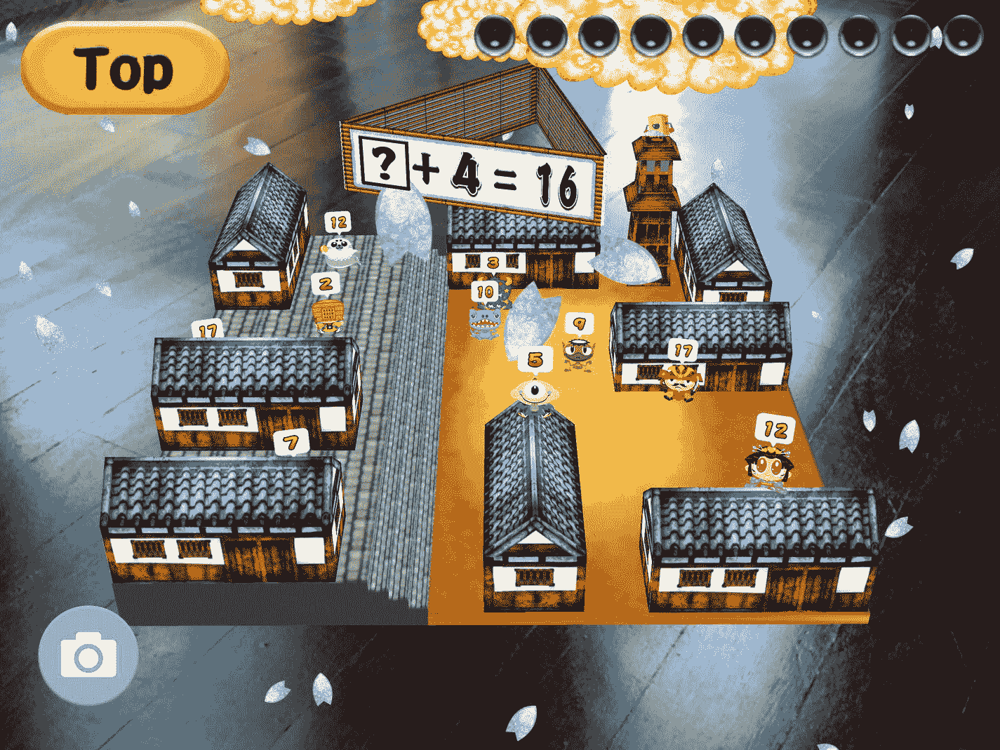

# 增强现实

截至 2020 年年中，`增强现实（AR）`尚未真正融入我们的日常生活。这项技术已经存在相当长一段时间，但我们似乎仍在努力寻找其在大众消费市场的真正应用。该技术最成功的应用案例是手游 *《精灵宝可梦 Go》*，它于 2016 年风靡全球，迅速成为一种流行文化现象。

在我看来，`AR` 面临的挑战之一是缺乏合适的设备来实现其功能。将虚拟对象叠加到现实世界，需要用户透过举在眼前的屏幕来观察和移动。这实际上并不舒适，尤其是考虑到智能手机比平板电脑轻，但它提供的“窥视孔”非常小，我们只能通过它看到 `AR` 世界；而平板电脑的屏幕更大，提供了更舒适的视野，代价是需要手持更重的设备。

有一些设备能完美支持这项技术，例如，想象一下在驾驶时使用它，信息会出现在汽车的挡风玻璃上。这正是所有主要汽车原始设备制造商（在此处指汽车制造商）目前正在研究的方向。但或许享受 `AR` 的最佳设备将是智能眼镜，这也是已经研发了一段时间的另一款设备。

除非这些设备成为大众市场产品，否则 `AR` 将始终难以蓬勃发展。然而，增强现实蕴含着一种“惊叹”因素，体现了克拉克定律中提到的“魔力”，这使得它成为儿童数字产品的有效组成部分。孩子们喜欢看到和体验魔法，他们喜欢被震撼（其实我也是），而且，正如我多次提到的，孩子们享受的是过程。因此，虽然在面向成年人（任务驱动型）的产品中使用 `AR` 常显得花哨，但在面向儿童（体验驱动型）的产品中使用 `AR`，却能让我们的产品脱颖而出。

在儿童产品中使用 `AR` 的缺点仍然是其人体工程学问题，尤其是对于年龄较小的儿童。要正确定位目标、手持设备的同时可能还需要与屏幕上的元素互动（尤其是在使用平板电脑时），这可能会带来一些挑战，是需要我们牢记的。

尽管如此，让我们来看看一些在儿童产品中 `AR` 的有趣应用案例。

## QuiverVision

`QuiverVision` 很有趣，因为它很好地将新技术与“传统”活动（如涂色书）融合在一起。成年人可以从一个庞大的插图库中下载并打印 `PDF` 文档，孩子们则可以用普通的马克笔或蜡笔给它们涂色（图 11-1）。通过 `QuiverVision` 应用程序，用设备摄像头对准这些插图，它们就会以 `3D` 模型的形式在 `AR` 中“活过来”。它有一系列应用程序，例如经典的 `QuiverVision`、教育版、时装设计师版以及一款用于面部贴纸的版本。

图 11-1

`QuiverVision` 应用将角色带入现实

其中一些插图在进入 `AR` 后，甚至包含互动和小游戏，孩子可以与角色互动并一起玩耍。

数字与非数字的混合是创造我之前提到的魔法效果的完美方式。孩子们在增强现实中看到的 `3D` 模型，是用他们亲手在纸上平面插图上涂绘的颜色和装饰定制的，并且还能与模型互动。这是一个非常有趣的效果。

## Geo AR Games

`Geo AR Games` 是新西兰的一家开发商，致力于研究涉及 `AR` 和地理定位的有趣概念。他们的应用 *《魔法公园》* 邀请孩子们通过探索一个由 `AR` 增强并游戏化的现实环境来发现外面的世界（图 11-2）。增强现实与地理定位的结合类似于 *《精灵宝可梦 Go》*，但 *《魔法公园》* 的活动范围仅限于指定的公共公园，因此对儿童来说更安全。就像 `QuiverVision` 一样，有趣的是 `AR` 如何实现数字游戏与传统游戏的结合，在这里尤其还能促进体育活动。

图 11-2

`Geo AR Games` 开发的恐龙主题体验

## Math Ninja AR

日本开发商 `Fantamstick` 在一款名为 *《数学忍者 AR》* 的教育游戏中利用 `AR` 来教授数学（图 11-3）。虽然与前几个例子相比，这款应用中对增强现实的使用更为传统，但值得注意，这项技术的运用使得用户体验更具吸引力和趣味性。游戏中的所有活动本可以在没有 `AR` 的情况下，完全在屏幕内的数字环境中完成，但他们决定利用增强现实来为孩子们创造一些与众不同且更神奇的东西，从而让他们以更愉快、更吸引人的方式学习数学。

图 11-3

`Fantamstick` 的 `Math Ninja AR`