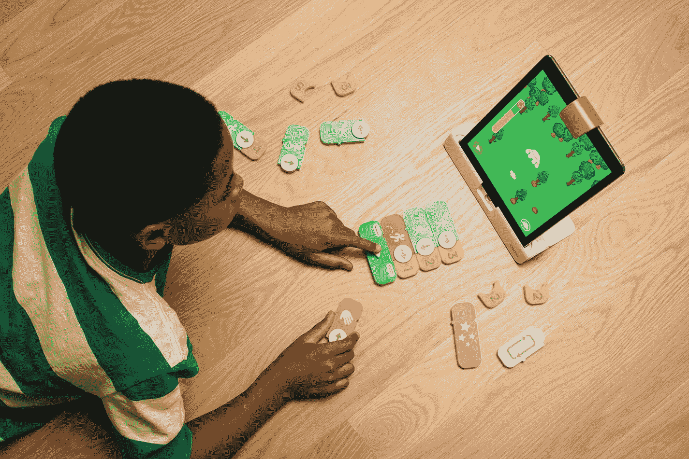
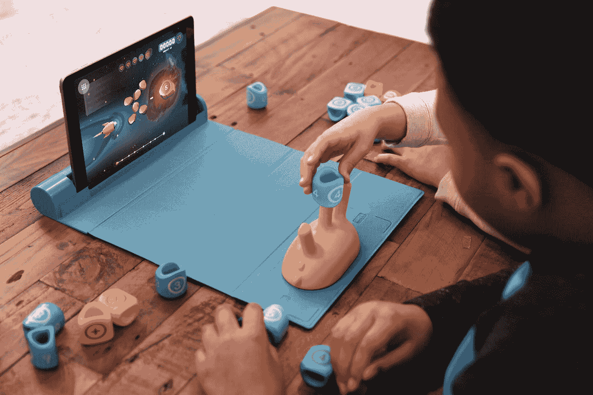
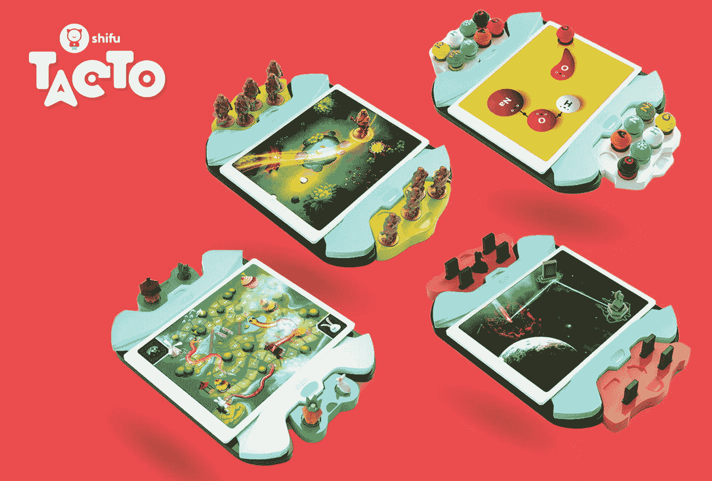
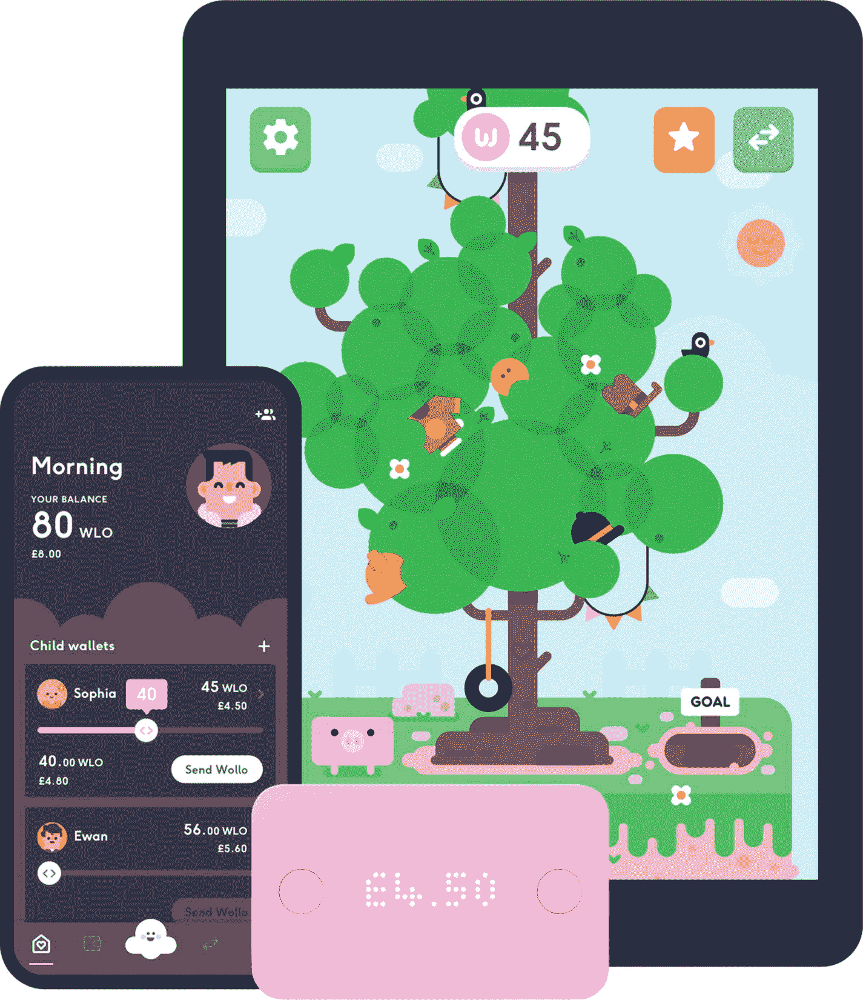

# 真实玩具 + 数字玩具

数字玩具和应用程序不一定与传统玩具竞争。事实上，如今的玩具正变得越来越智能，市场上已经有一些出色的产品完美地结合了两个世界的精华。

与 AR 在物理世界和虚拟元素之间创造虚构交互不同，这些产品涉及使用一个真实的、可触摸的玩具，可以通过应用程序进行控制、定制或编程。这个概念通常用于向儿童教授编程基础知识（我们在第 4 章中看到了一些例子），但在娱乐和教育方面还有许多其他应用。

## Osmo

`Osmo` 是一个智能玩具品牌，它将平板电脑的使用与一系列实物拼块结合起来。孩子们可以使用这些拼块与屏幕上发生的事情进行交互。`Osmo` 套装包括一个专用的平板电脑支架和一个特殊的摄像头盖子，使摄像头能够对准平板电脑所在的桌面（图 11-4）。

图 11-4

用于教授编程的 `Osmo` 套装

该应用程序利用摄像头读取桌面上发生的事情，并识别孩子们正在使用的拼块。它涵盖了编程、数学、形状、拼写、科学、地理等多个方面的套装。

### PlayShifu

`PlayShifu` 产品是实体与数字玩具概念的另一种诠释。与 `Osmo` 类似，它包含多种套件，涵盖从棋盘游戏到数学、化学、音乐等多个领域。有趣的是，它提供了三种完全不同的产品，可与平板电脑配合使用。

`Shifu Plugo` 是一个带有磁性游戏垫的支架，孩子们可以在上面放置不同的套件，与屏幕上的游戏进行互动（图 11-5）。他们可以放置零件、将它们连接在一起、移动它们，设备的摄像头会读取游戏垫上发生的一切，并将动作转化为视频游戏中的操作。

图 11-5

使用 `Plugo Count` 套件进行的一款数字太空游戏

`Shifu Tacto` 则是一款完全不同的产品（图 11-6）。平板电脑被放置在一个特殊支架上，两名玩家可以面对面进行对战。这是对棋盘游戏的全新演绎，将经典机制和道具（例如小雕像及其他组件）与视频游戏相结合。这些游戏寓教于乐，教授 STEM（科学、技术、工程、数学）科目，例如涉及反射和折射的物理知识、涉及分子和化合物的化学知识，以及更具经典性和策略性的内容。

图 11-6

`Shifu Tacto` 套件

`Shifu Orboot` 是一款非常有趣的产品，它将地球仪这类传统教具、平板电脑和增强现实（AR）技术结合在一起（图 11-7）。孩子们可以通过平板电脑在增强现实中与地球仪互动，获取有关世界各地动物、文化、美食、发明、古迹和地图的信息。未来还会推出关于恐龙和火星的地球仪。

图 11-7

使用 `Shifu Orboot` 探索世界各地的古迹

### Pigzbe

`Pigzbe` 是一款专为儿童设计的数字存钱罐（图 11-8）。针对儿童的金融产品目前尚不普遍，但正变得越来越流行。`Pigzbe` 旨在教导 6 岁及以上的儿童认识金钱的价值并学会储蓄。家长或看护人可以通过手机上的应用程序分配任务，并设定相应的金钱奖励。当任务完成时，孩子们会看到奖励以一棵树的形式呈现，这棵树代表着他们的储蓄，正在被浇灌并茁壮成长。该产品还包含一个实体设备：一个设计非常精美的现代版存钱罐，每当有新任务分配时，它会发出通知，并显示储蓄金额。这样一来，孩子们无需频繁查看平板电脑屏幕，就能随时了解任务进度和他们的存款。

图 11-8

`Pigzbe` 的家长端应用、儿童端应用以及数字存钱罐设备

## 章节总结

- 随着新技术的出现，我们将看到更多开发新型数字产品和新体验的机遇。
- 数字产品可以超越屏幕的限制，实现数字与现实的融合。
- 增强现实（AR）能帮助我们为产品注入令人惊叹的“哇”元素。
- 增强现实（AR）可用于将现实生活中的活动与触摸屏上的交互结合起来。
- 数字玩具并非要与实体玩具竞争，它们可以相互促进，相得益彰。
- 通过使用摄像头和其他传感器，设备可以理解孩子在做什么并做出相应反应。
- 平板电脑可被用来创造新一代更先进的棋盘游戏。
- 产品的实体部分可以是一个辅助设备，不一定是严格意义上的“玩具”。

脚注 1