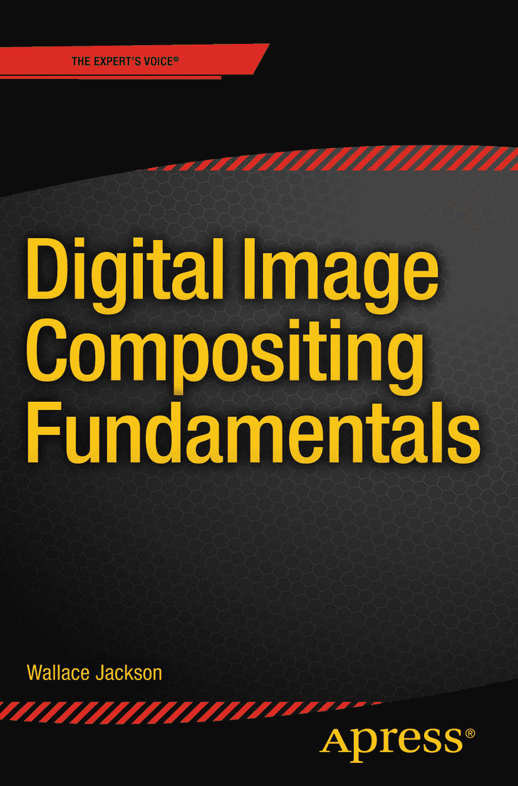

# 华莱士·杰克逊 数字图像合成基础

本书作者提到的任何源代码或其他补充材料，读者均可从[`www.apress.com`](http://www.apress.com/)获取。如需详细了解如何查找本书的源代码，请访问[`www.apress.com/source-code/`](http://www.apress.com/source-code/)。读者还可以在 SpringerLink 上各章节的“补充材料”部分访问源代码。

ISBN 978-1-4842-1639-2，电子书 ISBN 978-1-4842-4060-1，DOI 10.1007/978-1-4842-4060-1

© 华莱士·杰克逊，Apress 出版社，2015 年

## 数字图像合成基础

总经理：韦尔莫德·斯帕尔，首席编辑：史蒂夫·安格林，技术审稿人：查德·达比，编辑委员会：史蒂夫·安格林、路易丝·科里根、乔纳森·詹尼克、罗伯特·哈钦森、米歇尔·洛曼、詹姆斯·马卡姆、苏珊·麦克德莫特、马修·穆迪、杰弗里·佩珀、道格拉斯·庞迪克、本·雷诺-克拉克、格温南·斯皮林、史蒂夫·韦斯，协调编辑：马克·鲍尔斯，文字编辑：贾娜·温斯坦，排版：SPi Global，索引编制：SPi Global，插图制作：SPi Global

如需了解翻译相关事宜，请发送电子邮件至`rights@apress.com`，或访问[`www.apress.com`](http://www.apress.com)。Apress 出版社及 friends of ED 品牌的图书可批量购买，用于学术、企业或促销用途。大多数图书也提供电子书版本和许可。如需更多信息，请参考我们的特殊批量销售–电子书许可网页：[`www.apress.com/bulk-sales`](http://www.apress.com/bulk-sales)。

本作品受版权保护。出版商保留所有权利，涉及材料的全部或部分内容，特别是翻译、重印、重用插图、朗诵、广播、以微缩胶片或任何其他物理方式复制，以及信息存储与检索、电子改编、计算机软件，或采用目前已知或未来开发的类似或不同方法进行传输。与评论、学术分析相关的简短摘录，或专门为在计算机系统上输入和执行而提供的材料（仅供购买者独家使用），不受此法律限制。本出版物或其部分的复制仅允许在出版商所在地现行版权法的规定下进行，且使用许可必须始终从 Springer 获取。使用权可通过版权清算中心的 RightsLink 获得。违反行为将根据相关版权法被起诉。

本书中可能出现商标名称、标识和图像。我们不会在每次出现商标名称、标识或图像时都使用商标符号，而是以编辑方式使用这些名称、标识和图像，以利于商标所有者，且无意侵犯商标权。本出版物中对商品名称、商标、服务标志及类似术语的使用（即使未明确标识）不应被视为对其是否受所有权保护的意见表达。

尽管本书中的建议和信息在出版时被认为是真实准确的，但作者、编辑和出版商均不对可能出现的任何错误或疏漏承担法律责任。出版商对本书所含内容不作任何明示或暗示的保证。

本书通过 Springer Science+Business Media New York 在全球图书贸易中发行，地址：233 Spring Street, 6th Floor, New York, NY 10013。电话：1-800-SPRINGER，传真：(201) 348-4505，电子邮件：`orders-ny@springer-sbm.com`，或访问`www.springeronline.com`。Apress Media, LLC 是加州有限责任公司，其唯一成员（所有者）是 Springer Science + Business Media Finance Inc (SSBM Finance Inc)。SSBM Finance Inc 是一家特拉华州公司。

《数字图像合成基础》献给开源社区中的每一个人，他们如此勤奋地工作，使专业的新媒体应用开发软件和内容开发工具能够免费提供给富应用开发者，从而使他们能够利用这些工具实现我们的创意梦想和财务目标。最后但同样重要的是，我将本书献给我的父亲帕克·杰克逊、我的家人、我终生的朋友以及我牧场生产的邻居们，感谢他们持续的帮助、支持以及那些放松的深夜烧烤聚会！