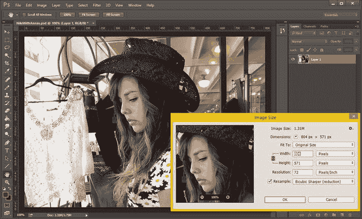
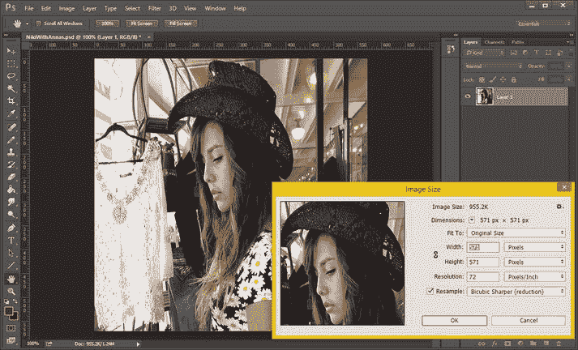
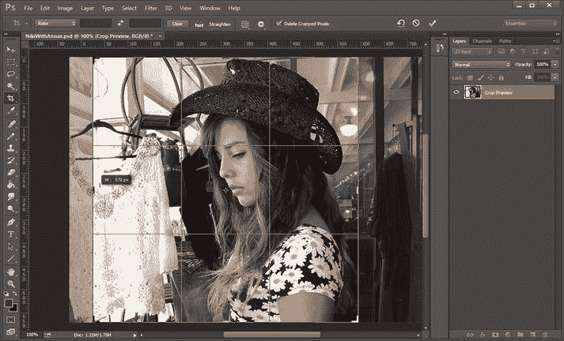
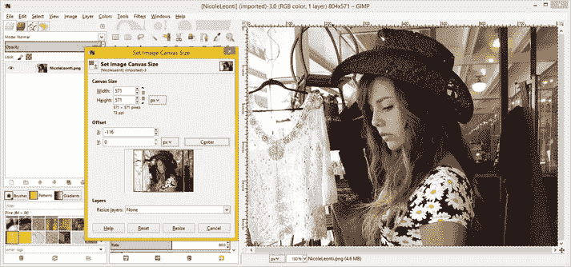
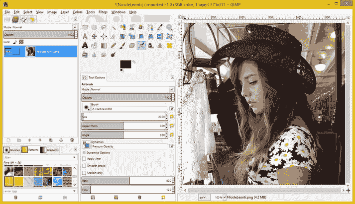
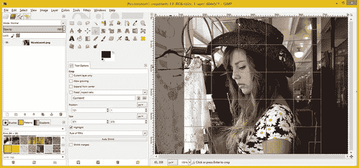

# 3. 图像宽高比：从原理到实践

为了防止图像失真，不应以任何方式操纵或改变宽高比。充分了解宽高比将确保你不会扭曲数码图像，这就是为什么本章对于你的数码图像合成知识体系极其重要。

在探讨计算宽高比所涉及的数学原理之后，我们将研究如何“锁定”该比例。锁定宽高比可以消除图像缩放过程中的失真，无论是向上采样（放大图像分辨率）还是向下采样（缩小图像分辨率）。你也可以通过裁剪来避免失真，即从数码图像的顶部、底部和两侧移除像素。

## 宽高比：2D 中的像素比例

数码图像中包含的像素数量称为分辨率，而数码图像中 x 与 y 的比例则称为宽高比。宽高比是图像分辨率中一个更复杂的方面（无意双关），因为它是宽度与高度的比值，即 `w:h`，体现在图像分辨率规格中，或者在谈论图像的 x 轴和 y 轴时表示为 `x:y`。

宽高比定义了数码图像的形状，也适用于设备显示屏的形状。例如，智能手表拥有方形屏幕，而宽屏 iTV 电视则拥有矩形屏幕。在本章中，我们将探讨如何根据这些不同的屏幕形状来更改宽高比。

`1:1` 宽高比的数码图像（或显示屏）可以说是完美的正方形。根据定义，`1:1` 宽高比等同于 `2:2` 或 `3:3` 宽高比。需要注意的是，正是这两个数字之间的比例（而非数字本身）定义了图像或屏幕的形状，这就是它被称为宽高比的原因，尽管通常简称为宽高。

`2:1` 的宽高比属于宽屏宽高比，而 `3:1` 的宽高比则可称为全景宽高比。

## 屏幕形状：常见的显示宽高比

第 2 章中讨论的许多高清电视分辨率显示屏，都采用了 `16:9` 的高清电视宽屏宽高比。然而，有些显示器则使用了不那么宽、或者说更高的 `16:10`（或者按最小公分母来说是 `8:5`）宽高比。更宽的屏幕无疑很快也会出现在市场上，因此请关注 `16:8`（也就是 `2:1`）的超宽屏幕，其屏幕分辨率将为 `2160 x 1080`。

最初的电视屏幕几乎是方形的，采用了 `3:2` 的宽高比。计算机屏幕则采用了 `4:3` 的宽高比，例如 Macintosh 的 `512 x 384` 屏幕分辨率，或 PC 的 `640 x 480`。一旦你在本章下一节学会了如何计算宽高比，你就可以验证我的计算了！

随着时间的推移，PC 显示器变得越来越宽，直到 2013 年出现了 `2:1` 宽屏的 `2160 x 1080` 显示器。不久之后，采用 `2:1` 显示比例（`4096 x 2048` 像素）的超高清（UHD）4K iTV 电视也将出现在市场上。

最新的宽高比变化是由智能手表行业带来的，2015 年出现了方形的 `1:1` 宽高比显示屏。定制的屏幕宽高比可能会变得相当极端；我们都见过体育场馆中环绕在馆墙顶部和两端的 `9:1` 宽高比屏幕。

## 计算：如何得出宽高比

图像的宽高比通常表示为宽高比冒号两侧都能得到的最小整数对。如果你在高中学习最小公分母时认真听讲了，那么这种宽高比的计算应该相当容易。

我通常采用不断将两边同时除以 2 的方法来进行这种数学演算（快速念五遍，这会让接下来的操作看起来更简单）。我们以一个比较特殊的 `1280 x 1024`（称为 SXGA）分辨率为例。`1280:1024` 的一半是 `640:512`，再一半是 `320:256`。再一半是 `160:128`，再一半是 `80:64`。再一半是 `40:32`，再一半是 `20:16`。从 `10:8` 开始，最后一半得到 `5:4`。因此，SXGA 分辨率采用了 `5:4` 的宽高比。

有趣的是，上述所有比例都是相同的宽高比，并且都是有效的。因此，如果你想走最简单的捷径，只需将图像分辨率中的 `x` 替换为冒号，你就得到了该图像的宽高比。行业标准要求将宽高比简化为其最简形式，正如我们在此所做的那样，因为这是一个更有用的比例。

## 使用图像软件：保持宽高比

要在 Photoshop 中更改数字图像的分辨率，你需要使用 `图像 ➤ 图像大小` 菜单序列，如上一章的图 2-1 所示。请注意图 3-1 中 `图像大小` 对话框里的链条图标，以及当它被启用时如何连接宽度和高度数据字段。这会“锁定”宽高比，因此当你更改一个值时，另一个值将根据当前图像宽高比自动更改，从而保持缩放沿 `x` 轴和 `y` 轴均匀一致。

图 3-1. 在 Photoshop 中使用 `图像 ➤ 图像大小` 菜单序列

如果你提前看一下本章中的图 3-2，你也可以看到未锁定的宽高比图标，以及当链条图标被点击解锁后，这两条线（连接到宽度和高度字段的线）是如何消失的。

图 3-2. `图像大小` 对话框显示 `宽:高` 宽高比已解锁

这个 `图像大小`（`图像缩放`）对话框的用户界面设计表明，锁定宽高比以防止图像失真这一概念，对于你的数字图像编辑和合成工作流程至关重要。

让我们解锁此对话框中的宽高比，并将图像大小调整为方形 `571 x 571` 像素的图像，这样你就可以亲眼看到因更改宽高比而引起的失真。

图 3-2 显示了这个图像，以及另一个宽度沿 `x` 轴失真的预览图像。在某些时候，你会在互联网上的图片中看到这种错误。这很常见，如果你看到一张脸异常瘦长，或者异常臃肿，你很可能看到的是图像在 `x` 轴和 `y` 轴上的宽高比失真。

你改变宽高比的程度越剧烈，失真就越明显。并且，对于人物和动物来说，这种失真比对于风景或纹理（例如石头或树叶的照片）要明显得多。

要在不发生失真的情况下实现宽高比的改变，方法是使用图像裁剪而非图像缩放。图像裁剪通过从顶部、底部或两侧切掉部分像素来改变像素数量，而不是通过缩放或对相同像素进行重采样以达到不同的分辨率规格。

图 3-3 展示了 Photoshop 的裁剪工具，它在屏幕左侧的魔棒工具下方被选中。

图 3-3. 使用 Photoshop 的裁剪工具创建一张 `1:1` 宽高比的图像

如你所见，Photoshop 工具提供了裁剪网格引导线以及当前图像宽度（以像素为单位）的指示器，两者都叠加在图像上方。

这些功能使你能够实时准确地了解你对图像所做的操作，以及当你完成工具操作后会得到什么结果。要完成裁剪工具操作，你需要双击裁剪区域内部。

GIMP 提供了一个 `设置图像画布大小` 对话框，它提供了图像裁剪功能，如图 3-4 所示。设置新的画布大小允许你将数字图像裁剪为所需的宽高比，而不会引入任何失真。重要的是要注意，Photoshop 也有一个 `画布大小` 对话框，可以用来代替裁剪工具以达到相同的结果。你还可以点击 `居中` 按钮进行裁剪操作。

图 3-4. GIMP 的 `设置图像画布大小` 对话框允许你裁剪图像

裁剪对话框的结果如图 3-5 所示。

图 3-5.

`图像 ➤ 画布大小` 操作的结果

就像 Photoshop CS 同时具备 `图像 ➤ 画布大小` 功能和裁剪工具一样，GIMP 也拥有裁剪工具。请在工具面板中寻找刀形图标，如图 3-6 中以蓝色高亮选中的部分所示。该工具具有大量选项，可在工具面板下方查看。

图 3-6.

如图中以蓝色高亮显示的部分，GIMP 具备一个裁剪工具（刀形图标），并带有许多选项

Photoshop 的选项沿屏幕顶部显示，如图 3-3 所示。在 GIMP 中，我选择了 `五等分规则` 选项来使用精细裁剪网格。我将左边缘定位在 x 轴上的 121 位置（在 Photoshop 中我使用了 116）。

GIMP 还会向我显示这个 571 像素图像的大小，以便我获得想要实现的精确结果。如你所见，这两个图像工具对裁剪操作提供了不同的方法，但两者都能达到同样专业水平的最终结果。

如你所见，只要你善加利用，GIMP 和 Photoshop 都提供了强大的图像裁剪和图像缩放工具。

## 总结

在第三章中，我们探讨了宽高比的概念，它用于定义图像的矩形形状。你了解了一些当今消费电子硬件设备最常用的宽高比，以及计算宽高比背后的数学原理。最后，我们学习了如何通过在缩放时锁定宽高比，或使用裁剪工具或 `画布大小` 对话框，来避免在更改图像分辨率或宽高比时产生变形。我们详细介绍了在 Photoshop CS6 和 GIMP 2.8.14 中如何访问和使用裁剪工具及 `画布大小` 对话框。

在下一章中，我们将深入研究数字图像色彩理论，并探讨颜色在数字图像合成流程和数字图像中是如何表示的。

