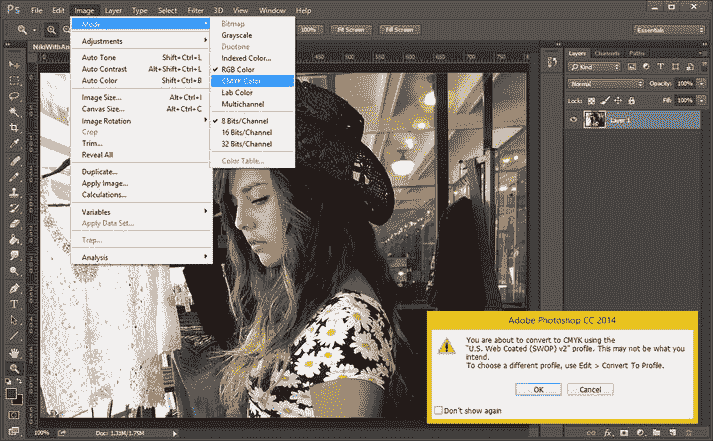
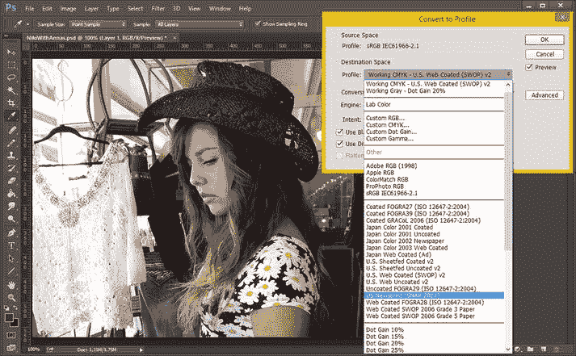
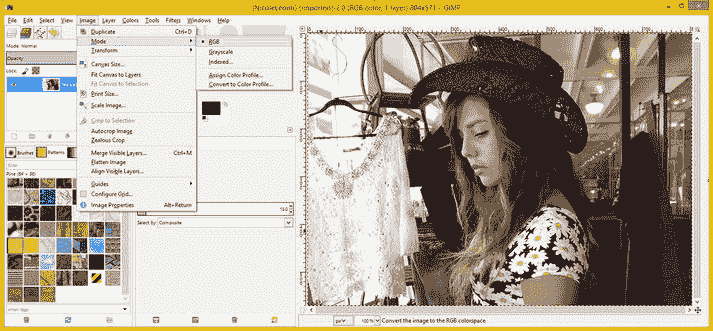
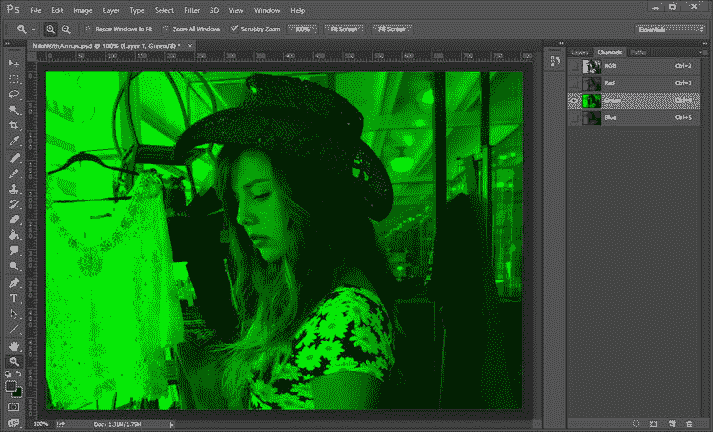
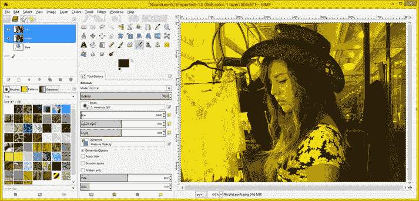

# 4. 数字成像的色彩：色彩理论

既然你已经了解了如何使用定义图像分辨率和图像宽高比的 `x,y` 网格来定位像素，那么现在是时候深入每个像素内部，看看它是如何定义其色彩空间的。虽然数字图像在数据层面上保存了其分辨率和宽高比，但每个像素都包含其自身的特性，例如 `x,y` 网格（阵列）位置、颜色构成、透明度或不透明度、混合模式等等。我们将在本书的各个章节中逐一探讨所有这些领域。

构成数字图像的像素颜色最终决定了图像的外观，因此色彩理论在此是一个重要主题。`Photoshop` CS6 和 `GIMP` 2.8.14 都拥有大量的工具，使我们能够调整颜色，以及根据颜色值来选择像素。

如果你正在使用现代的消费电子设备，那么你就在使用 `RGB`（红、绿、蓝）像素颜色模型。如果你在处理现代打印机，那么你就在使用 `CMYK`（青、品红、黄、黑）颜色模型。

如果你想知道为什么缩写不是 `CMYB`，那是因为它的黑色版被称为“关键”版，其他颜色版都与其对齐。

在本章中，我们将研究这两种颜色模型，以及最适合用于数字图像合成流程的颜色模型或“模式”。现在，让我们开始吧！

### 色彩理论：使用像素颜色通道

无论你是在合成用于显示屏的数字图像，还是使用油墨在打印机上进行打印，你的像素都会包含使用一个或多个“通道”的颜色值。在印刷行业中，这些通道有时被称为“印版”，延续了老式印刷机使用金属印版的传统（其中一些至今仍在使用）。在 `Photoshop` 和 `GIMP` 中，颜色通道拥有自己的浮动面板，允许你只处理单个颜色通道（或印版），这对于特殊效果或其他高级图像操作来说非常有用。

### 减色模型：使用 CMYK 印版进行打印

现代彩色打印机至少使用 `CMYK` 中的四种墨水颜色，从而能够生成多种多样的颜色。高端喷墨打印机正推出配备六色或八色墨盒的型号，能够产生更丰富的色彩变化。

打印机墨水采用减色模型，该模型的工作原理是墨水相互去除颜色——也就是说，两种颜色混合时会相互加深（通过去除浅色墨水），这就是为什么它被称为“减色”色彩过程。

例如，青色和品红色墨水混合会产生紫色，这比单独使用任何一种墨水时产生的颜色都要深。

减色模型产生的颜色比加色模型少，这一点我将在接下来讨论。仔细想想，这相当合乎逻辑，因为减法是在减少，而加法是在增加。在 `Photoshop` 以及 `GIMP` 中，你可以通过 `图像 ➤ 模式` 菜单序列及其包含所有支持颜色模式的子菜单来访问颜色模式。该路径如图 4-1 所示，同时还有一个 `CMYK` 警告对话框。右下角的警告对话框提示你，即将从 `RGB` 转换到 `CMYK` 色彩配置文件，并建议使用 `编辑 ➤ 转换为配置文件` 菜单序列来对转换过程进行更精细的控制。



图 4-1.

你可以使用 `图像 ➤ 模式` 菜单序列设置颜色模式

通常你更愿意在 `RGB` 色彩配置文件下工作，因为 `RGB` 拥有 16,777,216 种颜色可供使用，而 `CMYK` 的颜色数量要少得多，而且智能手机、`iTV` 电视机、平板电脑、电子书阅读器、笔记本电脑、上网本或超级本都不支持 `CMYK` 颜色模型。

就像你希望像素对像素地匹配分辨率和宽高比一样，在每个像素内，你也希望匹配你创建数字图像所针对的设备（打印机或显示器）所支持的那些颜色通道。

如图 4-2 所示，通过此菜单序列访问的对话框允许你选择预定义的色彩配置文件，这些配置文件是行业中用于创建不同应用的标准，例如报纸印刷（如所选）或单页印刷。



图 4-2.

`转换为配置文件` 对话框提供了一个配置文件选择器

重要的是要注意，数码相机使用 `RGB` 颜色模式，通过一种称为电荷耦合器件（简称 `CCD`）的设备来捕获数字图像数据。这意味着输入到你的数字图像编辑和合成软件包中的数据是 `RGB` 颜色模式，因此在这种颜色模式下进行编辑也是合乎逻辑的，因为转换为 `CMYK` 会导致图像丢失一些颜色。

基于这些原因，大多数数字图像合成师使用 `RGB` 颜色模型进行图像合成工作，然后在打印前转换为 `CMYK`。这样，你可以为当前数字图像合成项目生成 `CMYK` 和 `RGB` 两种表示形式。这是一个优势，因为你的图像合成作品既可以在显示器上使用，也可以进行打印。

这种为打印而进行的转换过程被图像合成师用得越来越少，这或许可以解释为什么 `GIMP` 没有在其软件包中添加完整的 `CMYK` 颜色模型。尤其是随着数码相机和显示设备时代的到来，公众对模拟和印刷媒体形式的依赖大大减少。这种趋势每天都在持续，因为更多的智能手机、智能手表、平板电脑、电子阅读器和 `iTV` 电视机正大量涌入当前的市场。

如图 4-3 所示，`GIMP` 的 `图像 ➤ 模式` 子菜单不支持减色颜色模式。不过，如果你确实希望使用 `GIMP` 进行 `CMYK` 颜色模型和打印工作，有一种变通方法。有一个名为 `Separate` 的插件可用于 `GIMP`，它能添加 `CMYK` 颜色模式支持，而 `AUR` 为 Linux 用户提供了一个名为 `Separate+`（增强版）的高级版本。你可以在以下网址找到它：[`https://aur4.archlinux.org/`](https://aur4.archlinux.org/)。



图 4-3.

`GIMP` 的 `图像 ➤ 模式` 菜单仅支持加色模型

这些插件可以将 `RGB` 图像分离为 `CMYK`，通过 `ICC` 配置文件和 `LCMS` 提供色彩管理，允许颜色的软打样，并允许你将 `ICC CMYK` 配置文件附加到已分色的数字图像文件上。

`Separate+` 插件具有与 `Separate` 相同的功能，但它还能够将 `RGB` 配置文件转换为其他 `RGB` 配置文件，并提供双色调支持。

### 加色模型：使用 RGB 颜色通道进行显示

另一方面，`LED`、`LCD` 和 `OLED` 显示器使用 `RGB` 加色模型，因为它们使用的是光而不是墨水。使用光（即加色模型）的一个优点是能产生更多的颜色。如果你曾见过棱镜或彩虹中呈现的颜色，你就会意识到用光产生的颜色极其绚丽多彩，这是墨水根本无法复制的。这就是本书主要关注 `RGB` 颜色的原因。

加色模型与减色模型相反，因此，虽然混合红色和绿色墨水会得到深紫色，但混合红色和绿色光却会得到黄色！

像素颜色由三种颜色的光定义：红色、绿色和蓝色；因此称为“`RGB`”。这些颜色在每个像素中以不同的量存在。显示屏幕通过将每个 `RGB` 颜色平面（或通道）的光波长相加来利用加色模型。这种颜色模式用于平板电脑、电子阅读器、智能手表、智能手机、`iTV` 电视机、上网本、个人电脑和笔记本电脑中流行的 `LED`、`LCD` 和 `OLED` 显示器。

在图 4-4 中，我已在 `Photoshop` 首选项对话框中开启了“使用通道颜色显示”模式。现在，通过选择颜色通道左侧的眼睛图标，你可以使用绿色通道的颜色查看绿色强度数据值。



图 4-4.

在 `Photoshop` CS6 中选中的绿色通道

`GIMP` 使用相同的颜色通道面板，其图标模仿了彩色描图纸堆叠的效果。如图 4-5 所示，我已通过使用相同的眼睛图标打开了绿色和红色通道，以产生绿色 + 红色 = 黄色的加色模型叠加效果。你可以有选择地对所需的颜色通道应用效果和规格。



图 4-5.

在 `GIMP` 中选中的红色和绿色通道

这种将颜色通道分离到各自独立面板的做法，通过允许用户按单个通道隔离颜色，使图像编辑软件变得更加强大。

能够对单个颜色通道进行处理并应用效果，是数字图像编辑软件的一个重要且强大的功能。

加色模型可用于创建数千万种不同的颜色值。我们将在下一节探讨这背后所涉及的数学原理。

### RGB 色彩的数学原理：强度相乘

你所能混合使用的红、绿、蓝光色调数量（即强度等级）决定了你能复现的色彩总量。在当今的数字设备中，每个像素针对红、绿、蓝（`RGB`）三色都能产生 256 级光强度。

每个图像像素都会生成对应颜色，因此图像中的每个像素针对其 `RGB` 色彩数据值，每种颜色都拥有 256 级色彩强度。

这些 `RGB` 通道（或称色板、平面）各自占用一个字节（即 8 位）。8 位数据最多可容纳 256 个不同数值，因此红、绿、蓝三色各自拥有 256 级亮度。

数字图像中每个像素内部的色彩强度（亮度）数据，以每种颜色的亮度等级表示。该等级范围介于 0（关闭亮度）到 256（完全开启亮度）之间。

# 表示 RGB 色彩值与计算总颜色数量

计算总可用颜色数量很简单：同样是简单乘法。将 256 乘以 256 再乘以 256，得到 16,777,216 种颜色——这代表在三个不同颜色通道中，每种颜色具备 256 个等级时，所能获得的全部独特色彩组合。你常会看到这个 16,777,216 色值在营销宣传中被近似表示为 16.8M 色。

### 表示 RGB 色彩值：使用十六进制数据值

每个像素中红、绿、蓝各色值所对应的 256 级亮度，允许你设定 8 位数值来控制各色值的色彩亮度变化。色彩亮度可从最小值 0 变化到最大值 255（若从 1 开始计数，则为 256 个不同的色彩强度数据值）。

用于表示数字图像像素颜色的位数，可以通过 Base16（即十六进制）记法进行编码。Base16 从 0 计数到 F，因此拥有 16 个数值（位）来表示颜色。使用两个这样的十六进制值，便可得到 16 x 16 = 256 个值，这正是每个 RGB 颜色通道所需的颜色数量。嘿！这一切都说得通了！

在 Android、HTML5、JavaScript 和 CSS3 中，这通过井号（`#`）实现；而在 Java 中，则使用 `0x` 前缀。例如，表示颜色 BLACK（黑色，所有值均为关闭或零值）的代码如下：

```
colorValue = #000000    // Android, HTML5, JS, CSS3 颜色值十六进制
colorValue = 0x000000   // Java 和 JavaFX 颜色值十六进制
```

而颜色 WHITE（白色，所有像素完全开启）则用以下代码表示：

```
colorValue = #FFFFFF    // Android, HTML5, JS, CSS3 颜色值十六进制
colorValue = 0xFFFFFF   // Java 和 JavaFX 颜色值十六进制
```

对于颜色 RED（红色），只需开启红色通道像素，因此十六进制代码如下：

```
colorValue = #FF0000    // Android, HTML5, JS, CSS3 颜色值十六进制
colorValue = 0xFF0000   // Java 和 JavaFX 颜色值十六进制
```

对于颜色 GREEN（绿色），需开启绿色通道像素，因此十六进制记法如下：

```
colorValue = #00FF00    // Android, HTML5, JS, CSS3 颜色值十六进制
colorValue = 0x00FF00   // Java 和 JavaFX 颜色值十六进制
```

类似地，颜色 BLUE（蓝色）开启蓝色通道像素，因此十六进制记法如下：

```
colorValue = #0000FF    // Android, HTML5, JS, CSS3 颜色值十六进制
colorValue = 0x0000FF   // Java 和 JavaFX 颜色值十六进制
```

在下一章中，我们将探讨这些位深度如何应用于不同的数字图像文件格式，例如 8 位 GIF、16 位 TIFF、24 位 JPEG、32 位 PNG，甚至 48 位或 64 位的 RAW 图像文件格式。还有很多知识要学，但我保证，这会很有趣！

### 本章小结

在第四章中，我们探讨了色彩理论的概念，该理论定义了色彩如何在数字图像的每个像素中呈现。你学习了加法（RGB）和减法（CMYK）色彩模式之间的区别，以及计算标准 24 位 RGB 数字图像总可用颜色数量背后的数学原理。我们还介绍了如何在 Photoshop 和 GIMP 中设置色彩模式，如何在 Photoshop CS6 中将 RGB 色彩模式转换为行业标准的 CMYK 色彩表示，如何通过 Separate+插件为 GIMP 添加 CMYK 支持，色彩通道如何表示，以及如何在 Photoshop CS6 和 GIMP 2.8.14 中选择使用它们。

在下一章中，你将学习数字图像色彩深度，以及不同图像格式如何支持不同的色彩深度。

