# 7. 数字图像的隔离：蒙版工具

既然你已经了解了 Alpha 通道数据及其在数字图像合成管线中的使用方法，以及如何利用它来“存储”数字图像对象，那么下一步自然就是学习如何使用蒙版工具从数字图像中提取主体。这在数字图像合成行业被称为“提取蒙版”。

Photoshop 和 GIMP 提供了多种蒙版工具，可用于实现这种像素提取的最终效果。我们将在本章中探讨其中一些工具，以及可用于从 24 位数字图像素材中提取蒙版并将其转换为 32 位图像素材的方法和工作流程。由此产生的素材将包含 Alpha 通道。该 Alpha 通道用于隔离图像中你想要在图层堆栈中进行合成的任何主体素材。

## 蒙版：隔离与提取像素

蒙版是从图像中提取不规则形状像素区域的过程，通常用于数字图像合成。通常，期望的结果是将这些像素与另一张图像组合，以实现某种艺术效果或特殊特效。这通过图层来实现，我们将在第 8 章中详细介绍图层，以及更高级的功能，例如 Porter-Duff 混合和传输模式。所有这些功能都利用了这些复杂的、多模态操作的数字图像合成软件包，例如我们本书所使用的这些。我建议你获取并掌握它们。

我不打算深入探讨关于蒙版的大量术语、理论等等，因为它更多地关乎工作流程以及这些软件包提供的各种以多种不同方式选择像素的工具。

如果你不想学习手动创建图像蒙版，可以购买一块绿幕或蓝幕，在幕前拍摄你的主体（对象），然后使用流行的插件之一来自动生成蒙版。

### Photoshop 魔术棒：容差与取样

接下来，让我们通过从一张 PNG24 图像中提取鸟形图案，来仔细探究 Photoshop 中魔术棒遮罩工具的工作原理。在图 7-1 中，我将 `容差` 设置为 16，并点击图像中的木质区域，以此展示这张特定图片的容差阈值。`容差` 决定了点击取样点（像素）时，其周围多少种相似颜色会被纳入像素选区（集合）。现在，我们增加一下 `容差`。

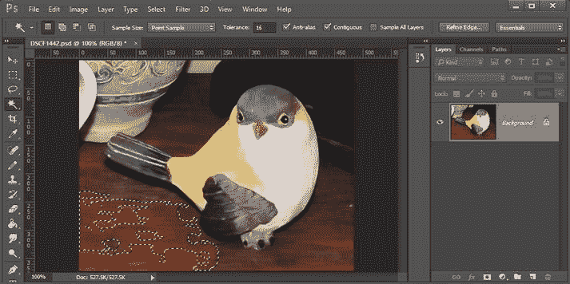

图 7-1. 将 `容差` 设置为 16 后点击木质桌面的结果

图 7-2 显示了使用三倍于前的 `容差`（设置为 48）后的视觉效果。如你所见，你将频繁使用这个 `容差` 设置，以便让工具给出你期望的选区结果。

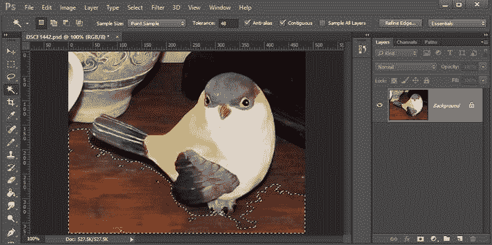

图 7-2. 将 `容差` 设置为 48 后点击木质桌面的结果

我通常的工作流程是：先设置好 `容差` 和点取样大小，点击想要消除的颜色，如果选区结果不理想，就通过 `选择` ➤ `取消选择`（在 GIMP 中是 `选择` ➤ `无`）菜单操作来取消选区，然后设置不同的 `容差`，并在必要时调整取样大小。接着，再选取一个相似颜色的像素点，重复以上步骤，直到获得接近我需要的选区结果。

现在你已经了解不同 `容差` 设置带来的效果。你可以在遮罩工作流程中的任何时刻更改此值（在两次点击选取像素区域之间进行更改）。接下来，我们看看 `取样大小`，我们将把它从单一点取样（基于像素）更改为 `3 by 3 平均` 的平均像素块，如图 7-3 所示。

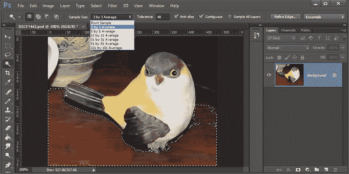

图 7-3. 选择 `3 by 3 平均` 取样大小后点击屏幕木质桌面的结果

现在，当我点击木质桌面左下角时，选区集合中包含了更多像素，效果就像我把 `容差` 调高了一样。`容差` 控制选区与所选颜色的差异范围，而 `取样大小` 则允许你为算法提供一个从相邻像素（矩阵）中提取颜色的平均值。结合使用这两个设置，你可以精细调整任何选区，所以一定要多尝试，感受它们如何影响最终获得的选区集合。

其他选项（复选框）允许你柔化选区边缘（我始终使用此功能），并实现连续选区。反锯齿功能会对选区边缘的像素颜色进行平均处理，从而产生更平滑的边缘效果。你也可以根据需要从其他图层取样颜色，但通常情况下，你一次只处理一个图像图层。

我选择 `连续` 的原因，在你阅读完本章下一节后会更加明了。简而言之，这个选项的作用是，只将你点击的选区扩展到颜色连续的像素区域。

如果你取消勾选 `连续`（`消除锯齿` 和 `连续` 默认是勾选的），那么图像中凡是出现该取样颜色及其容差范围内的像素区域，都会形成选区“孤岛”。`连续` 之所以能给你更多控制权，是因为它允许你扩展当前的选区。我将在下一节讨论如何使用（按住）`Shift` 键修饰符来增加选区时，告诉你如何执行这种扩展操作。这是最常用的魔术棒工作流程。

### 增加选区：使用 Shift 修饰符

如果你要遮罩的主体周围有颜色均匀的区域（或均匀的颜色渐变区域），理论上你可以调整取样大小和容差，直到输入数值生成的选区集合能够完美提取出主体。然而，大多数图像，比如我们这里使用的这张，都“繁忙”得多，需要多次颜色取样（点击）。

一个解决方案是：在选取第一个像素之后的所有像素时，按住键盘上的 `Shift` 修饰键，对不同颜色进行取样并添加到选区中。

就这张特定图像而言，小鸟旁边有棕褐色、棕色、奶油色、粉色和黑色区域，因此我们需要使用这个技巧。我使用了较低的 `容差`——这里是 12——如图 7-4 所示。

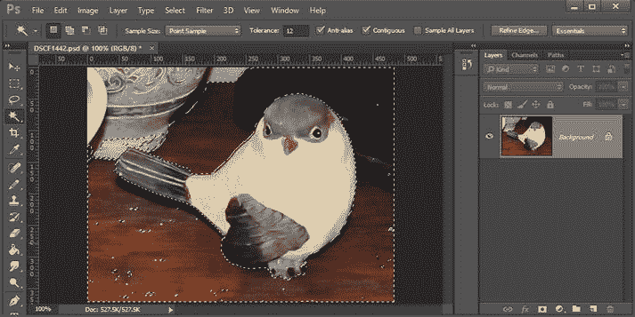

图 7-4. `RingElement.png` 图层显示了尺寸和 Alpha 通道

要获得这个（像素）选区集，请从木质桌面左下角开始点击序列，第一次点击后，按住键盘上的 `Shift` 键，再点击小鸟周围其他未被选中的区域。这会不断扩大选区集合，你的选区范围会逐渐扩大并精细化，直到最终得到图 7-4 所示的结果。

一旦你选中了小鸟周围的大部分区域，如图 7-4 所示，你就可以学习如何使用 Alpha 通道来精炼你的选区，这将是本章下一节要介绍的内容。有趣的是，许多数字艺术家从未想过用选区工具快速提取主遮罩，将结果保存为 Alpha 通道，然后用画笔简单地完成任务，之后再通过这个 Alpha 通道将结果重新加载为选区集合！

### 选区编辑：利用 Alpha 通道编辑选区

正如你在第 6 章（图 6-2）中所见，Alpha 通道可用于存储已蒙版的对象，以便日后需要时轻松将其选中。有趣的是，你还可以利用数字图像编辑软件提供的所有图像编辑和合成工具，来编辑这些黑白 Alpha 通道像素。

让我们在蒙版工作流程中充分利用这一点，使用如图 7-5 所示的 `保存选区` 对话框，将目前使用 `魔术棒` 工具所做的操作转换为 Alpha 通道数据。相比在逐渐缩小的像素选区内尝试 `Shift` 单击，使用图像编辑工具可能能让你更快速地优化此蒙版！

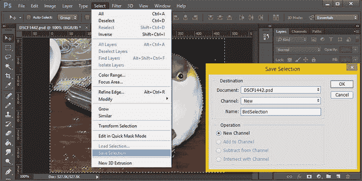

图 7-5. 你可以在 `保存选区` 对话框中将 Alpha 通道保存为类似 `BirdSelection` 的名称

如图所示，Photoshop 中此操作的菜单路径为 `选择 ➤ 保存选区`。你可以将 Alpha 通道命名为类似 `BirdSelection` 的名称，然后点击 `确定` 按钮创建新的 Alpha 通道，该通道将包含 `魔术棒` 工具在蒙版工作过程中迄今为止为你创建的选区数据（灰度）。

要查看此 Alpha 通道，请选择你的 `通道` 面板选项卡，如图 7-6 右侧所示，点击 `BirdSelection` Alpha 通道的可见性图标（一个眼睛图标），并利用位于 `通道` 面板顶部的 `RGB` 主通道，关闭颜色通道的可见性图标。

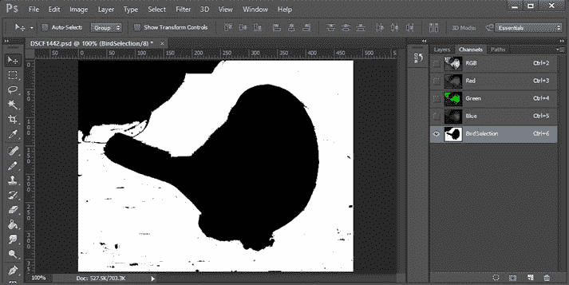

图 7-6. 你可以在 `通道` 面板中选择 `BirdSelection` 进行编辑

`通道` 面板顶部的这个 `RGB` 通道是一个便捷（汇总）通道，当选中它时，将同时作用于红色、绿色和蓝色通道。我将其称之为汇总操作，因为它以完全相同的方式将任何工具或算法应用于这三个颜色通道。在此案例中，对当前选中的图像合成图层来说，这恰好是对其像素颜色数据进行可见性选择，或者更精确地说，是取消可见性选择。

你可以使用任何编辑工具来清理黑色鸟形轮廓外部的黑色区域，包括橡皮擦或画笔工具（设置为使用白色）。清除大面积黑色区域最快的方法是，在你想要移除的区域上画一个矩形，从而选中该区域，如图 7-7 所示。然后，在将 `填充` 内容设置为 `白色` 颜色值后，使用 `编辑 ➤ 填充` 菜单序列。

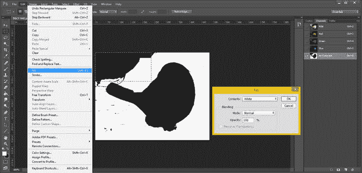

图 7-7. 要移除大面积黑色区域，请选中内容并前往 `编辑 ➤ 填充 ➤ 白色`

你可以使用 `填充`、`橡皮擦` 或 `画笔` 工具，清除黑色鸟形轮廓外部的所有黑色像素，从而在黑色和白色像素之间创建清晰的界限，如图 7-8 所示。

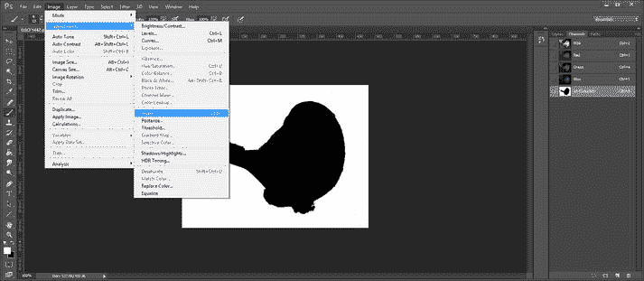

**图 7-8.** 蒙版外部清理干净后，使用 `图像 ➤ 反相`

一旦通用蒙版区域清理完毕，你需要对选区进行反相。这样就会选中鸟——目前，除了鸟本身之外的所有内容都被选中了，因为这是进行蒙版的简便方法：反向操作。在数字图像处理中，处理工作流程的最佳方式有时可能恰好与你原本认为的最佳方法相反！蒙版就是一个完美的例子：你先选中不想要的部分，然后翻转（反相）选区，从而抓取你想要的部分！

`反相` 功能可以通过 `图像 ➤ 调整 ➤ 反相` 菜单序列找到，如图 7-8 左上角蓝色高亮显示。

反相选区后，就进入了蒙版编辑的微调阶段。在此阶段，你将开始处理蒙版的边缘。蒙版的边缘是其最重要的区域，因为边缘质量将影响你蒙版的感知质量。当你将蒙版对象用于某个数字图像合成图层，以将此蒙版的像素与合成图像中其他图层的像素合并时，这一点至关重要。

## 遮罩微调：Alpha 边缘精修技术

创建蒙版工作流程的下一步，是完善蒙版白色（不透明）与黑色（透明）区域之间的边缘。这是蒙版的反走样处理。如果你在`魔术棒`工具中选择了`反走样`选项，那么算法生成的蒙版中可能已经存在一些这样的处理。如果你没有选择此选项，蒙版边缘将只存在黑色和白色像素。让我们使用缩放（放大镜）工具，看看是否有灰色像素。这些灰色像素将提供一种具有“实时”色彩混合的蒙版（利用反走样技术），处理对象（鸟）与任何你之后可能希望将对象合成到其上的背景图像之间的过渡，因为它们定义了透明度。

如图 7-9 所示，蒙版已被反转，并且边缘确实存在灰色像素，提供了这种反走样功能。为了创建这张图像，我将鸟尾底部一条“干净”边缘上略微弯曲的区域放大了。正如标签所示，我放大了 700%，这样你就能看到边缘像素和反走样效果。

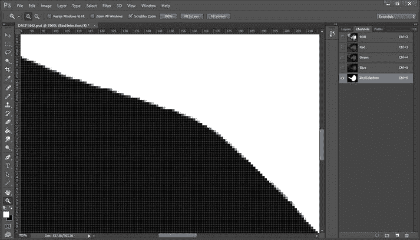

**图 7-9.** 你可以放大蒙版边缘来查看反走样效果。

现在，让我们通过使用 `查看 ➤ 100%` 菜单序列缩小视图，然后在 Photoshop CS 中启用 `蒙版叠加` 功能。这通过点击 `RGB` 通道旁边的 `眼睛` 图标来完成。

这将在蒙版的透明区域上叠加一层红色色调，如图 7-10 所示。这层色调允许你在编辑蒙版的同时，也能看到你正在抠图的图像，这样你正在处理的图像就可以用作参考指南。

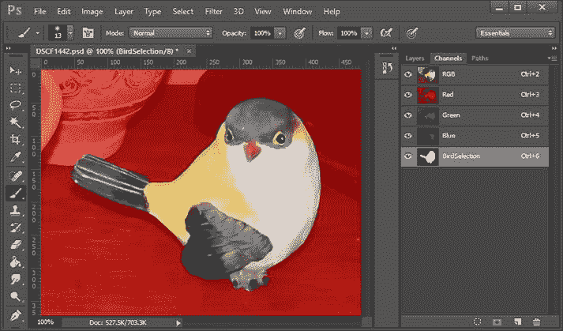

**图 7-10.** 选择 `RGB` 通道的 `眼睛` 图标来启用蒙版叠加。

如图 7-11 所示，我使用了一个 13 像素的柔和边缘 `笔刷` 工具，并将视图放大 400% 来修复鸟尾的顶部边缘和背部。正如你所见，这些区域在微调该蒙版与鸟形对象的边缘贴合度方面，确实需要一些工作。

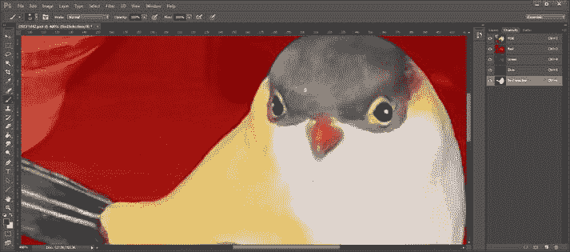

**图 7-11.** 要编辑鸟尾边缘，请使用 13 像素的柔和笔刷并放大视图。

你可以使用 `RGB` 通道的 `眼睛` 图标来开启和关闭这种红色蒙版辅助显示。你需要在工作中反复使用此功能，以便看到实际的蒙版本身。

你也可以在没有此蒙版叠加的黑白模式下工作，确保蒙版完全是黑色和白色，并在两种颜色之间的边缘处保留了灰色的反走样像素。

这通常是遮罩艺术家的操作方式：他们使用红色蒙版叠加指南来查看蒙版处理的进展，然后关闭它以处理高对比度的黑白表示，因为在边缘之外的蒙版区域，这样做更容易看清你的操作。

你应该花足够的时间来完善蒙版，以确保获得你想要的结果。请记住，和其他一切技能一样，成为一名专业的合成师需要大量的练习！需要重点注意的是，虽然我们使用了一个 484×372 分辨率的示例图像来观察这个蒙版处理过程，但使用更高分辨率的图像来进行蒙版处理，几乎总能得到更高质量的图像合成结果。单个像素相对于整个图像的尺寸比例（百分比）更小，因此边缘和反走样效果也更加精细。

在 GIMP 中与 `魔术棒` 工具等效的是 `模糊选择` 工具。由于它在两个软件中的工作方式极其相似，我决定改为向你展示如何在 GIMP 中通过使用另一种创新的、采用了不同方法的算法来提取蒙版。这个算法可以通过使用 `剪刀选择` 工具来实现。

## GIMP 剪刀工具：智能抠图算法

要访问 `剪刀选择` 工具，请使用 `文件 ➤ 打开` 菜单序列在 GIMP 中打开 `MaskExercise.png` PNG24 数字图像文件。然后，选择屏幕右上角显示的 `剪刀` 工具图标（如图 7-12 所示），点击你想提取的对象边缘，开始勾勒你要放置的轮廓线。当你点击对象上的第二个点时，`剪刀选择` 工具将应用其边缘检测算法。这在图 7-12 中鸟的头部顶端可以看到。

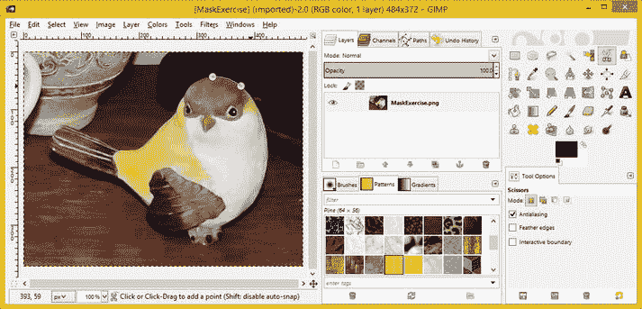

**图 7-12.** 要从图像中提取对象，请打开图像，选择 `剪刀` 工具，然后点击其边缘。第二次点击将启用边缘检测。

如果你选中了`交互式边界`选项（如图 7-13 屏幕左下角勾选所示），当你调整选区轮廓上的点以细化蒙版节点时，边缘检测算法将实时重新计算。


**图 7-13.** 沿着对象边缘点击以创建轮廓线。

`剪刀` 工具就像一个智能样条线，在点与点之间（我称之为该工具的节点）移动时会自动向后查看并调整其曲率，同时设置张力手柄（每个节点的进出曲率）。你甚至可以细化节点的位置来调整曲线！

### 调整剪刀工具：智能样条节点

我发现，将节点置于对象颜色变化处时，边缘检测算法的结果更好，如图 7-14 所示，位于鸟的灰色和黄色区域。在绘制曲线的整个过程中（包括闭合曲线后），你都可以随时通过拖拽来移动节点位置。曲线通过点击你放置的第一个节点来闭合，在本例中，该节点位于鸟的头顶。如图所示，当你拖拽节点重新定位时，节点之间的线条会变直，当你将节点放到新位置时，会重新计算新的曲线拟合算法。

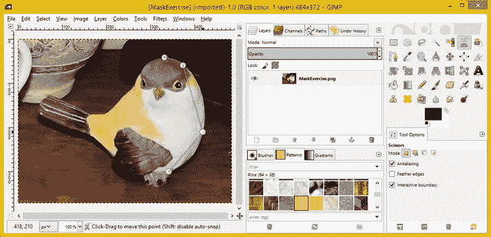

图 7-14. 你可以随时移动节点以获得更好的结果

如果你将图右侧的节点重新定位到鸟的胸部中央，智能曲线放置算法将获得比任何其他边缘放置算法都高出100% 的结果（你可以使用本书附带的`MaskExercise.png`文件亲自尝试）。结果如图 7-15 所示，边缘检测效果完美。

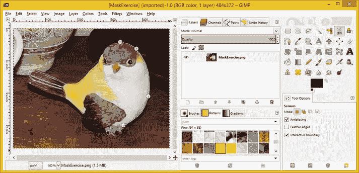

图 7-15. 这种节点放置方式获得了更好的边缘匹配结果

在图 7-16 中，我将图像放大到 200%，以便能更清楚地看到鸟图像底部的利爪，从而进行节点放置。如图所示，有几个节点我不得不稍微重新定位，以便从剪刀工具算法中获得更好的边缘拟合效果，特别是翅膀尖端的那个节点（将图 7-16 与图 7-17 进行比较）。

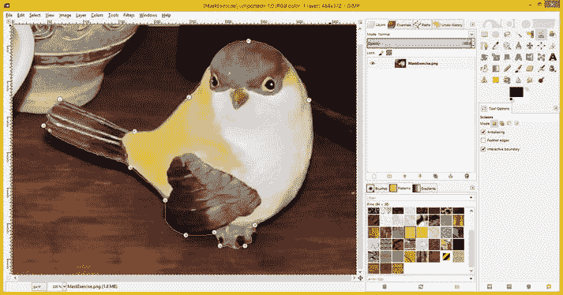

图 7-17. 要闭合样条曲线，请点击你放置的第一个节点

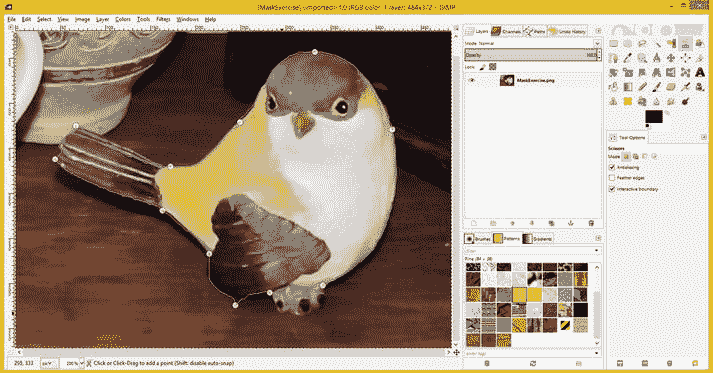

图 7-16. 先放置简单节点，细节留到最后处理

另外，请注意在图 7-14 到图 7-16 中，我将轮廓的起点设在了鸟爪旁边，因为这是你蒙版的细节区域，所以我打算最后处理这部分。因此，我的第一个点在鸟爪的右侧，我按逆时针方向放置节点，结束于鸟爪的左侧，这样我最后放置的节点就是鸟爪的细节部分。

这样做的原因是，我可以最后再放大到鸟爪区域，此时已经使用剪刀选择工具勾勒出了大部分蒙版区域。

需要注意的是，如果你点击其他 GIMP 工具，当前正在使用的工具将中止运行。因此，如果你想缩放，必须使用`视图` ➤ `缩放` ➤ `放大`的菜单序列（或`视图` ➤ `缩放` ➤ `缩小`），以保持此剪刀工具处于激活状态。出于这个原因，了解 Photoshop 和 GIMP 的菜单序列以及工具图标都很有用。

如图 7-17 所示，剪刀算法在鸟爪区域的表现相当不错，除了爪子部分，我需要将其转换为选区并保存为 Alpha 通道（以便编辑）后手动处理。

要完全闭合选择曲线，请将指针悬停在你放置的第一个节点上，当指针变为闭合曲线指针时，点击鼠标，曲线便会闭合。需要注意的是，选择曲线闭合后，你仍然可以调整（移动）节点。要将选择曲线转换为选区区域，请点击曲线内部。

如图 7-18 所示，我已经将曲线转换为选区，现在就可以使用与 Photoshop 中相同的工作流程来保存选区集并在通道中编辑。在 GIMP 中执行此操作的菜单序列是`选择` ➤ `保存到通道`。然后，你可以使用`选择` ➤ `切换快速蒙版`来切换快速蒙版（红色颜色指示）模式。

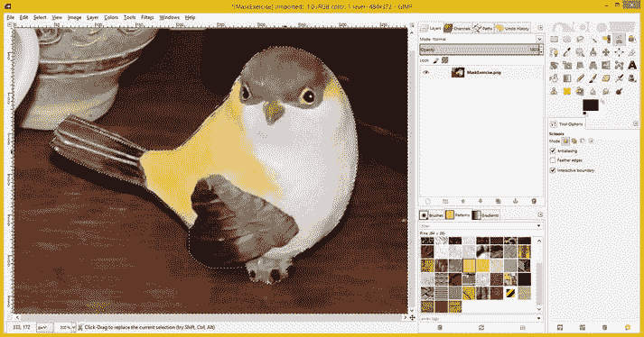

图 7-18. 点击闭合样条曲线内部以创建最终选区

如图 7-19 所示，保存到通道后，你可以重新打开该通道，并使用画笔工具（已选择）配合黑色和白色进行进一步编辑。颜色可以通过工具图标下方的颜色样本之间的弧形箭头进行切换。

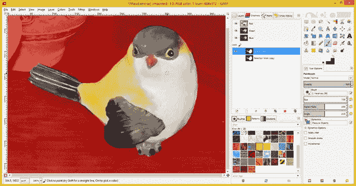

图 7-19. 在 GIMP 中使用快速蒙版模式来优化蒙版

如图 7-19 所示，我使用画笔工具确保右脚趾包含在蒙版区域内，并稍微清理了其他区域。

这个剪刀选择工具确实可以让你达到 99%的蒙版工作都由你放置的节点和工具算法完成的程度。想想看，这相当令人惊叹，尤其是 GIMP 可以免费用于商业用途。当然，由于你现在已经拥有了`XCF`文件，你可以在边缘清理和蒙版完善上花费任意多的时间。熟能生巧。

在下一章中，我们将研究如何使用图层面板。

### 总结

在本章中，我们回顾了使用 Photoshop（魔棒工具）和 GIMP（剪刀选择工具）创建蒙版的最常用方法。你学习了如何使用 Photoshop 魔棒及其采样大小和容差设置，以及如何将选区保存到 Alpha 通道并进一步编辑以完善最终结果。在 GIMP 中，你学习了剪刀选择工具，它采用了一种不同的方法，利用强大的算法创建一条样条曲线，使其贴合对象的任何边缘，你通过沿对象周边放置节点来引导它。我们还介绍了将此结果保存到 Alpha 通道并进一步编辑蒙版的方法，操作方式与在 Photoshop CS6 中相同。

在第 8 章中，你将学习更多关于数字图像合成图层的内容，以及如何使用它们的功能，这些功能可以通过 Photoshop CS6 和 GIMP 2.8.14 中的图层面板来访问。

```
if (condVar > someVal) {console.log("xxx")}
```

