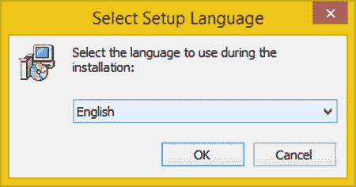
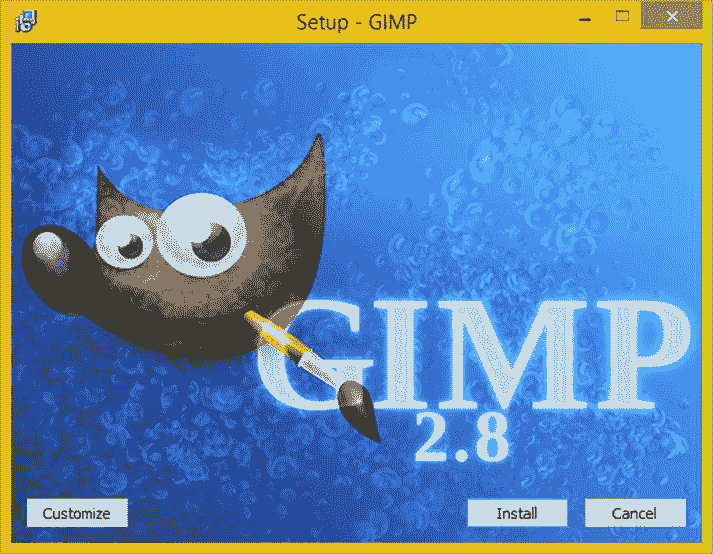
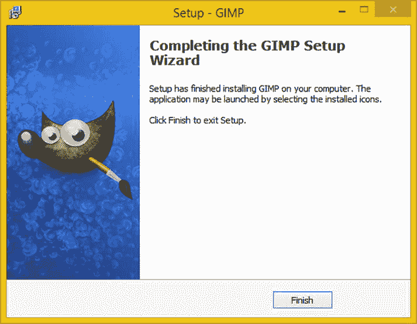

# 数字影像的基础：像素

欢迎阅读《数字图像合成基础》。本书将带你了解数字影像的基础知识以及多层图像合成。它从最底层的概念开始——在本章中就是像素——并在后续章节中逐步构建这些概念，直到我们全面理解图像合成的概念、管线、工作流程和术语。

在阅读本书的过程中，我将通过复现这些概念、技巧和术语来向你展示它们的具体面貌，所使用的工具是目前最广泛使用的两款数字图像合成软件：`Adobe Photoshop CS6` 和开源软件 `GIMP`；后者可免费用于商业用途。

考虑到你可能不愿为知名品牌的数字影像软件付费，本章第一部分将介绍如何下载并安装属于你自己的开源 `GIMP` 软件包。如果你想使用付费软件，我建议使用 `Photoshop`，每月费用为 10 美元。本章其余部分将讨论数字图像合成的基本元素：像素。

像素是如何合成的正是本书的核心内容。每一章都将建立在前几章知识的基础上，直到你清晰（这里没有双关之意）地了解数字图像合成管线究竟如何运作。

## 下载并安装 GIMP

为了跟随本书的进度，所有读者都需要拥有某种数字影像软件包，无论是 `Adobe Photoshop`、`Corel Painter` 还是 `PaintShop Pro`。如果你没有这些软件，可以使用 `GIMP 2.8`，它可免费用于商业用途。

要下载当前稳定版 `GIMP 2.8.14`（下一个版本 `GIMP 2.9` 是备受期待的 `GIMP 3.0` 的前身，预计在 2016 年某个时候发布），请访问 [`www.gimp.org`](http://www.gimp.org/) 并点击橙色的“Download”按钮，见图 1-1，或者点击屏幕右侧的“Downloads”链接。

图 1-1. 访问 gimp.org 网站；点击“Download”按钮

然后，下载适用于你操作系统的 `GIMP-2.8.14.exe` 安装程序以开始安装。安装程序会自动判断你需要 32 位还是 64 位版本，因此你只需选择安装软件时想要使用的语言，并点击“OK”按钮，如图 1-2 所示。

图 1-2. 选择安装时想要使用的语言

点击“OK”按钮后，你将看到 `GIMP` 安装对话框，如图 1-3 所示。在这里，你可以点击“Install”按钮开始安装过程。

图 1-3. 点击“Install”按钮开始安装

如果你想自定义安装，可以点击“Customize”按钮，然后精确选择你想要安装到系统上的组件。

我建议你使用（完整）的“Install”按钮，这将为你提供默认的 `GIMP` 软件安装，包括当前稳定版 `GIMP` 所包含的插件、滤镜和文件支持，这是一个完全完成（成品）的包架构。`GIMP` 是一款可与付费图像编辑软件相媲美的数字影像软件包。

如图 1-4 所示，`GIMP` 将自行安装。

图 1-4. `GIMP` 告诉你它正在安装哪个文件

安装过程完成后，点击“Finish”按钮，如图 1-5 所示，然后在你的操作系统任务栏上创建一个快捷图标，以便只需单击鼠标即可启动 `GIMP`。

图 1-5. 点击“Finish”按钮完成安装

现在你已经安装了数字影像软件包，我们可以来看看所有数字图像处理工作流程的基本元素：像素。

## 数字图像的基础：像素

数字图像由二维（`2D`）数组（或称网格）构成，其中包含一种称为像素的东西。像素（`Pixel`）是一个行业术语，由两个词组合而成：图片（通常被称为“pix”）和元素（简写为“els”）。因此，你所处理的任何数字图像的基础就是它的图像元素。

这些元素决定了数字图像的一切，包括其文件大小、尺寸、颜色、半透明度、形状、格式以及许多其他特性。在本书的后续章节中，我将逐一讲解每个特性，在逻辑概念之上层层构建。此外，还有数字插图，它们不是由像素构成的。

### 光栅 vs. 矢量：影像 vs. 插图

除了像素这个术语，我们再来了解一些与像素相关的其他术语，以确保在本章中全面覆盖所有内容。基于像素的数字影像也称为“光栅影像”。这是因为像素阵列可以被显示这些像素的设备“光栅化”。这些设备包括从 `iTV` 到平板电脑、智能手机再到智能手表的一切设备。

还有另一种类型的数字图像，称为“矢量”图像，它是用数学而非像素来定义的。矢量图像使用称为“顶点”的点以及线条或曲线来绘制你的“数字插图”，这是当今多媒体行业中通常对矢量图像的称呼。

矢量图像拥有自己的二维软件类型，称为数字插图软件。你可能熟悉 `Inkscape`（一款开源数字插图软件包）、`Adobe Illustrator`、`Macromedia Freehand` 或 `Corel Draw`。

### 渲染：将矢量艺术转换为光栅图像

矢量图像可以通过一个称为“渲染”的过程转换为光栅图像。渲染后的图像本质上是一幅光栅图像。无论是二维矢量作品还是三维矢量作品，都可以渲染成光栅图像，而你现在已经知道，光栅图像就是基于像素的图像。

至此，本书中概述的所有概念都可以应用于（或者说本质上会被应用于）这种像素格式的光栅图像。请记住备份你的矢量作品，以便随时改进并重新渲染它，因为一旦被光栅化或渲染，它就不再是矢量作品了，所以请保留矢量格式。

矢量插图相比光栅图像的主要优势在于，由于它使用数学定义，因此可以放大或缩小到任意尺寸。缩放光栅图像会导致所谓的“像素化”。

## 总结

在第一章中，我们确保你已经安装并准备好了数字图像合成软件包以供探索，同时还了解了数字图像的基本元素：像素。我们还介绍了光栅（基于像素）图像与矢量（基于数学）图像之间的区别。

接着，我们探讨了渲染的概念，即将基于数学矢量的数字插图转换为基于光栅像素的数字图像表现形式。

在下一章中，我们将探讨像素如何存储在 `X`、`Y` 数组中，以及图像分辨率的概念。