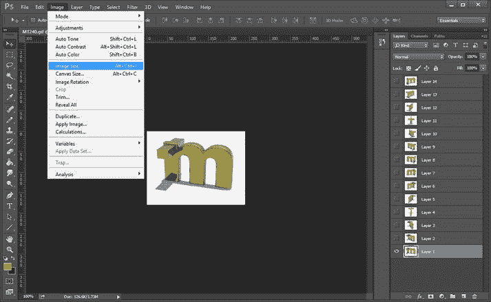
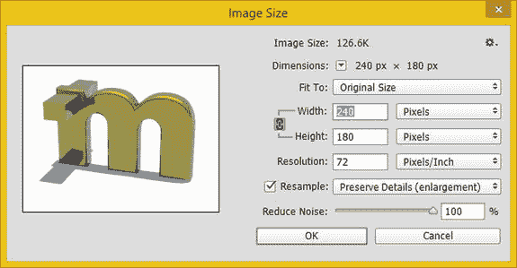
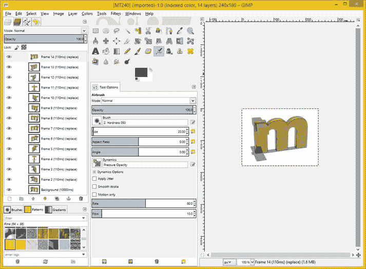
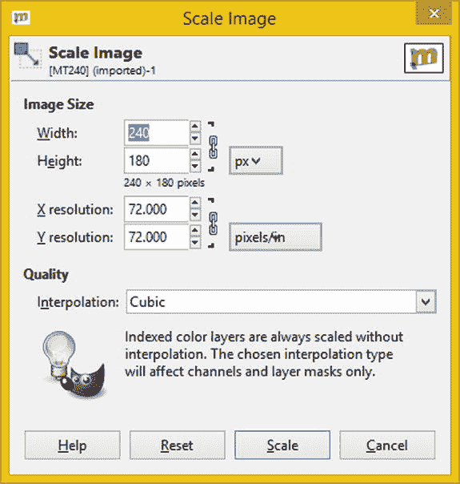
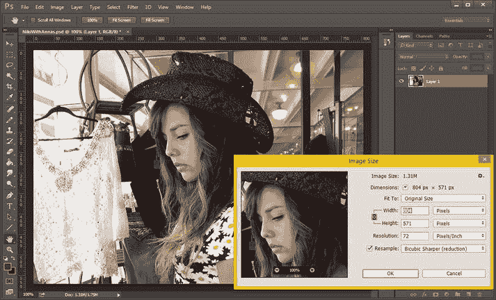
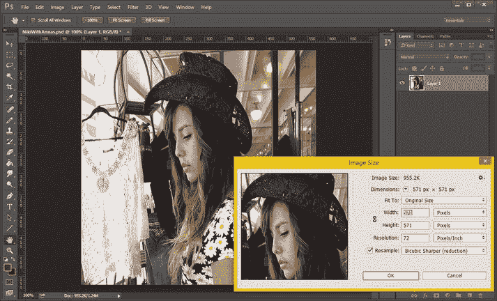
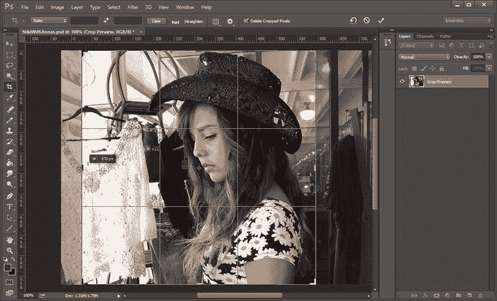
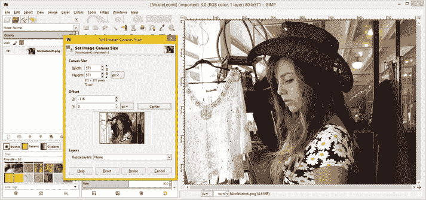
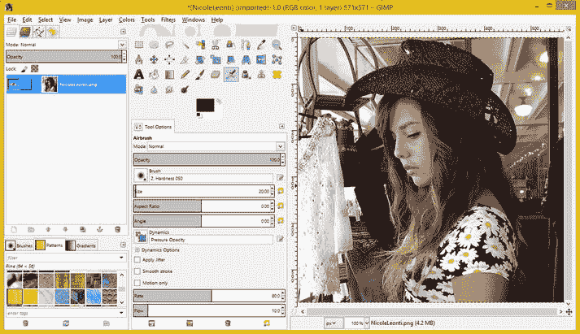
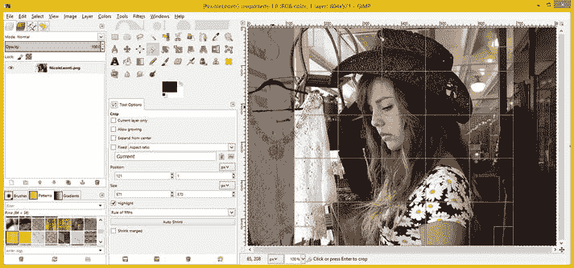

# 2. 数字图像的大小：分辨率

现在你已经了解了构成光栅图像的像素基础模块，以及基于像素的二维光栅图像与基于顶点和线（或曲线）的二维（或三维）矢量图像之间的区别。在本章中，我们将通过考察数字图像合成的 x 与 y 维度来深化这些概念。既然你已经在电脑上安装了 GIMP，我将在书中同时使用 Photoshop 和 GIMP 来阐述概念，因为它们是最广泛使用的数字图像处理软件包。

单个像素只是空间中的一个点，被称为一维（请不要这样称呼你的配偶），而图像则是一个使用 x 和 y 两个维度的二维像素阵列或网格。这其中的含义非常丰富，因此我将用整整一章来探讨这个二维像素阵列及其影响。

一个二维阵列涉及图像尺寸（也称为数据足迹）和分辨率。分辨率定义了构成数字图像所需的像素数量，并决定了数字图像所能包含的细节量。

在接下来的小节中，你将学习用于计算图像分辨率的数学方法，以及当前行业中各种标准消费电子设备显示分辨率的详细信息。从第 6 章到第 13 章，你将需要为这些设备设计图像。

### 分辨率：二维空间中的像素数量

数字图像资产中包含的像素数量用一个称为分辨率的术语来表示。该术语指的是图像中包含的像素数量，同时考虑宽度（通常用 `w` 表示，或者用 `x` 表示 x 轴）和高度（通常用 `h` 表示，或者用 `y` 表示 y 轴）。分辨率赋予了数字图像其二维尺寸。

图像资产的分辨率用两个数字（宽度，即 `x`，和高度，即 `y`）表示，中间用 `x` 连接。例如，常见的 VGA 分辨率表示为 `640 x 480`。另一种表述方式是使用“by”这个词，例如 `640 by 480` 像素。现在让我们学习一些基础数学，以便了解如何计算图像中包含的像素总数。

#### 计算数学：计算图像总像素数

要计算任何二维图像中包含的总像素数，你需要将像素宽度乘以像素高度。希望你还能记得在学校学过的矩形面积公式；现在，我们将以专业成像的示例再次应用它。由于我当年没意识到学校所教的内容还会有专业用途，所以没认真听，后来不得不重新学习数学和物理。

举个例子，将真正的 HD 分辨率图像 `1920 x 1080` 的宽度和高度相乘，你会得到 `2,073,600` 像素。如果你是一位数码摄影师，你会熟悉“两百万像素”这个说法，它指的是 200 万像素，而这正是真正高清晰度（HD）分辨率所能提供的像素数量。

数字图像中使用的像素越多，其分辨率就越高。更高的分辨率为观看者提供更多细节或更清晰的图像主体定义，这也是为什么高清电视（HDTV）被称为高清晰度电视，而新兴的 4K 分辨率 UHDTV 被称为超高清电视的原因。

接下来，让我们看看几种最流行的消费电子设备分辨率，这样你就会知道在数字图像合成流程中应该使用哪些像素分辨率，以便你的图像能够全屏显示。

#### 匹配目标分辨率：设备分辨率

数字图像合成的目标之一，是使数字图像中的像素数量与将要显示它的硬件设备相匹配。过去市场上曾有数十种不同分辨率的设备，但近年来设备已趋向于符合 HDTV 分辨率标准，因为随着 OLED（有机发光二极管）等新显示技术的出现，像素间距（点距）越来越小，使得显示屏幕可以达到类似打印机的分辨率。

第一批 HDTV 屏幕的分辨率我称之为“准高清”，即 `1280 by 720`；`1280 x 720 = 921,600` 像素。这种 `1280` 分辨率至今仍很常见，我在许多入门级智能手机、入门级平板电脑、上网本和笔记本电脑上都能看到它的身影。原因在于，许多电影、视频和电视内容仍然采用蓝光 `1280 x 720` 格式制作，将内容分辨率与设备分辨率匹配可以获得最佳的视觉效果，因为无需任何像素缩放。我们将在第 3 章中讨论像素缩放。

当今市场上另一种常见的 HDTV 显示屏分辨率是业内所谓的“全高清”；它具有 `1920 by 1080` 的分辨率。如你所知，这提供了 200 万像素，而 `1280` 高清分辨率只提供 100 万像素。你可以在入门级 iTV 电视、主流智能手机、中型平板电脑、电子书阅读器和高端笔记本电脑（也称为笔记本计算机）上看到全高清分辨率。

近年来市场出现了一种新型 HDTV 显示屏分辨率，业内称为“超高清”（UHD），它由 `4096 x 2160` 分辨率组成。计算一下，这种显示屏的分辨率包含 `8,847,360` 像素，即接近 900 万像素，而 `1920` 高清分辨率只提供 200 万像素。你可以在高端 iTV 电视、前沿智能手机、高端平板电脑、电子书阅读器以及最新的 UHD 笔记本电脑（也称为 UHD 笔记本计算机）上看到超高清分辨率。

还有另一类消费电子设备，其分辨率较低。智能手表的分辨率为 `320 by 320`，而华为的智能手表为 `400 by 400`。预计到 2016 年，智能手表领域将出现更高的像素密度（像素间距），带来 `480-by-480` 像素的屏幕，并有望在 2016 年底或 2017 年初出现 `560-by-560` 或 `640-by-640` 像素的屏幕。

#### 使用成像软件：确定分辨率

要在 Photoshop 中查看数码图像的分辨率，需使用 `图像 ➤ 图像大小` 菜单序列，如图 2-1 所示。

图 2-1. 在 Photoshop 中使用 `图像 ➤ 图像大小` 菜单序列

GIMP 拥有不同的图像大小对话框，如图 2-2 所示。该对话框会显示图像大小（数据体积）、尺寸、宽度、高度、DPI（每英寸像素数），并提供重采样（缩放）选项，我们将在第 3 章中介绍。

图 2-2. GIMP `图像大小` 对话框显示图像大小和尺寸

对话框中还有一个“减少杂色”选项，缩放操作总会引入杂色，这支持了我在本章前面提出的观点：应使内容分辨率与设备的屏幕尺寸或物理硬件屏幕像素分辨率相匹配。

这样做将确保你的数码图像合成项目和数码图像获得最高质量的视觉效果。

现在，让我们看看开源软件包 GIMP `2.8.14` 中的图像分辨率功能，如图 2-3 所示。如你所见，图像的统计信息直接显示在 GIMP 数码图像合成软件包顶部的标题栏中，无需打开任何对话框。

图 2-3. GIMP 在其标题栏中显示图像的统计信息

这些统计信息包括颜色深度（我们将在第 5 章中介绍）、该合成图中的图层数量（我们将在第 8 章中介绍）以及图像的分辨率，采用 `WxH` 格式，本例中为 `240x180` 像素。

如果你想知道这些截图为何包含 14 个图层，那是因为我打开的文件是 GIF 动画（或 aGIF）格式，因此每个动画单元都位于不同的图层上。本例中，该数码图像（或 3D 动画）文件数据格式包含我的 3D 动画 `Mind Taffy Design` 徽标。

GIMP 确实有一个可用于查看图像分辨率并将其缩放至新分辨率的对话框，名为 `缩放图像` 对话框。

该对话框可在屏幕左上角的 `图像` 菜单下找到，如图 2-3 所示。如果你想查看它，请执行 `图像 ➤ 缩放图像` 菜单序列。

GIMP 也将其 `图像大小` 对话框称为 `缩放图像` 对话框，如图 2-4 所示。它允许你通过几种不同的插值（缩放）算法来选择质量。

图 2-4. GIMP 的 `缩放图像` 对话框

我们将在第 3 章中介绍缩放时讨论宽高比。缩放是一个非常重要的考量因素，这就是为什么我们要将图像的像素分辨率与目标设备的屏幕分辨率相匹配，以便设备或平台不会替我们进行缩放，因为这样做会降低质量。

你应始终掌握数码图像资产的缩放（也称为重采样）控制权，这样才能向观众保证最高的质量水平。

你可能想到，图像的分辨率与其存储大小（数据体积）之间存在关系。由于图像的像素需要被存储，像素越多，系统内存中保存它们所需的数据量就越大。这似乎显而易见，但我想还是说明一下。

### 总结

在本第二章中，我们了解了容纳图像像素的 x,y 像素阵列显示结构，并学习了数码图像分辨率的概念。我们探讨了计算数码图像中包含像素数量的数学原理，并考察了如何在两个最广泛使用的数码图像合成软件包——Photoshop CS6 和 GIMP 2.8.14 中确定图像分辨率。我们了解到，这两个软件包都允许你通过一个称为重采样或缩放的过程来更改图像分辨率，该过程使用插值算法。我们将在下一章中更详细地研究这个过程。

我们还将探讨由 x,y 像素阵列的分辨率参数定义的图像形状，即图像宽高比的概念。最后，我们还将介绍如何正确地进行图像缩放而不失真，以及如何通过裁剪图像（而非缩放）来控制宽高比。

### 数码成像的形状：宽高比

现在你已经了解了图像分辨率以及如何计算构成光栅图像的像素数量，是时候考虑数码图像的形状（矩形或正方形）了。数码图像的形状，行业术语称为“宽高比”，其重要性可能超乎你的想象，尤其是在你通过图像缩放（称为重采样）或图像裁剪来改变它的时候。

# 图像宽高比：从原理到实践

为了防止图像失真，不应以任何方式操纵或改变宽高比。充分了解宽高比将确保你不会扭曲数码图像，这就是为什么本章对于你的数码图像合成知识体系极其重要。

在探讨计算宽高比所涉及的数学原理之后，我们将研究如何“锁定”该比例。锁定宽高比可以消除图像缩放过程中的失真，无论是向上采样（放大图像分辨率）还是向下采样（缩小图像分辨率）。你也可以通过裁剪来避免失真，即从数码图像的顶部、底部和两侧移除像素。

## 宽高比：2D 中的像素比例

数码图像中包含的像素数量称为分辨率，而数码图像中 x 与 y 的比例则称为宽高比。宽高比是图像分辨率中一个更复杂的方面（无意双关），因为它是宽度与高度的比值，即 `w:h`，体现在图像分辨率规格中，或者在谈论图像的 x 轴和 y 轴时表示为 `x:y`。

宽高比定义了数码图像的形状，也适用于设备显示屏的形状。例如，智能手表拥有方形屏幕，而宽屏 iTV 电视则拥有矩形屏幕。在本章中，我们将探讨如何根据这些不同的屏幕形状来更改宽高比。

`1:1` 宽高比的数码图像（或显示屏）可以说是完美的正方形。根据定义，`1:1` 宽高比等同于 `2:2` 或 `3:3` 宽高比。需要注意的是，正是这两个数字之间的比例（而非数字本身）定义了图像或屏幕的形状，这就是它被称为宽高比的原因，尽管通常简称为宽高。

`2:1` 的宽高比属于宽屏宽高比，而 `3:1` 的宽高比则可称为全景宽高比。

## 屏幕形状：常见的显示宽高比

第 2 章中讨论的许多高清电视分辨率显示屏，都采用了 `16:9` 的高清电视宽屏宽高比。然而，有些显示器则使用了不那么宽、或者说更高的 `16:10`（或者按最小公分母来说是 `8:5`）宽高比。更宽的屏幕无疑很快也会出现在市场上，因此请关注 `16:8`（也就是 `2:1`）的超宽屏幕，其屏幕分辨率将为 `2160 x 1080`。

最初的电视屏幕几乎是方形的，采用了 `3:2` 的宽高比。计算机屏幕则采用了 `4:3` 的宽高比，例如 Macintosh 的 `512 x 384` 屏幕分辨率，或 PC 的 `640 x 480`。一旦你在本章下一节学会了如何计算宽高比，你就可以验证我的计算了！

随着时间的推移，PC 显示器变得越来越宽，直到 2013 年出现了 `2:1` 宽屏的 `2160 x 1080` 显示器。不久之后，采用 `2:1` 显示比例（`4096 x 2048` 像素）的超高清（UHD）4K iTV 电视也将出现在市场上。

最新的宽高比变化是由智能手表行业带来的，2015 年出现了方形的 `1:1` 宽高比显示屏。定制的屏幕宽高比可能会变得相当极端；我们都见过体育场馆中环绕在馆墙顶部和两端的 `9:1` 宽高比屏幕。

## 计算：如何得出宽高比

图像的宽高比通常表示为宽高比冒号两侧都能得到的最小整数对。如果你在高中学习最小公分母时认真听讲了，那么这种宽高比的计算应该相当容易。

我通常采用不断将两边同时除以 2 的方法来进行这种数学演算（快速念五遍，这会让接下来的操作看起来更简单）。我们以一个比较特殊的 `1280 x 1024`（称为 SXGA）分辨率为例。`1280:1024` 的一半是 `640:512`，再一半是 `320:256`。再一半是 `160:128`，再一半是 `80:64`。再一半是 `40:32`，再一半是 `20:16`。从 `10:8` 开始，最后一半得到 `5:4`。因此，SXGA 分辨率采用了 `5:4` 的宽高比。

有趣的是，上述所有比例都是相同的宽高比，并且都是有效的。因此，如果你想走最简单的捷径，只需将图像分辨率中的 `x` 替换为冒号，你就得到了该图像的宽高比。行业标准要求将宽高比简化为其最简形式，正如我们在此所做的那样，因为这是一个更有用的比例。

## 使用图像软件：保持宽高比

要在 Photoshop 中更改数字图像的分辨率，你需要使用 `图像 ➤ 图像大小` 菜单序列，如上一章的图 2-1 所示。请注意图 3-1 中 `图像大小` 对话框里的链条图标，以及当它被启用时如何连接宽度和高度数据字段。这会“锁定”宽高比，因此当你更改一个值时，另一个值将根据当前图像宽高比自动更改，从而保持缩放沿 `x` 轴和 `y` 轴均匀一致。

图 3-1. 在 Photoshop 中使用 `图像 ➤ 图像大小` 菜单序列

如果你提前看一下本章中的图 3-2，你也可以看到未锁定的宽高比图标，以及当链条图标被点击解锁后，这两条线（连接到宽度和高度字段的线）是如何消失的。

图 3-2. `图像大小` 对话框显示 `宽:高` 宽高比已解锁

这个 `图像大小`（`图像缩放`）对话框的用户界面设计表明，锁定宽高比以防止图像失真这一概念，对于你的数字图像编辑和合成工作流程至关重要。

让我们解锁此对话框中的宽高比，并将图像大小调整为方形 `571 x 571` 像素的图像，这样你就可以亲眼看到因更改宽高比而引起的失真。

图 3-2 显示了这个图像，以及另一个宽度沿 `x` 轴失真的预览图像。在某些时候，你会在互联网上的图片中看到这种错误。这很常见，如果你看到一张脸异常瘦长，或者异常臃肿，你很可能看到的是图像在 `x` 轴和 `y` 轴上的宽高比失真。

你改变宽高比的程度越剧烈，失真就越明显。并且，对于人物和动物来说，这种失真比对于风景或纹理（例如石头或树叶的照片）要明显得多。

要在不发生失真的情况下实现宽高比的改变，方法是使用图像裁剪而非图像缩放。图像裁剪通过从顶部、底部或两侧切掉部分像素来改变像素数量，而不是通过缩放或对相同像素进行重采样以达到不同的分辨率规格。

图 3-3 展示了 Photoshop 的裁剪工具，它在屏幕左侧的魔棒工具下方被选中。

图 3-3. 使用 Photoshop 的裁剪工具创建一张 `1:1` 宽高比的图像

如你所见，Photoshop 工具提供了裁剪网格引导线以及当前图像宽度（以像素为单位）的指示器，两者都叠加在图像上方。

这些功能使你能够实时准确地了解你对图像所做的操作，以及当你完成工具操作后会得到什么结果。要完成裁剪工具操作，你需要双击裁剪区域内部。

GIMP 提供了一个 `设置图像画布大小` 对话框，它提供了图像裁剪功能，如图 3-4 所示。设置新的画布大小允许你将数字图像裁剪为所需的宽高比，而不会引入任何失真。重要的是要注意，Photoshop 也有一个 `画布大小` 对话框，可以用来代替裁剪工具以达到相同的结果。你还可以点击 `居中` 按钮进行裁剪操作。

图 3-4. GIMP 的 `设置图像画布大小` 对话框允许你裁剪图像

裁剪对话框的结果如图 3-5 所示。

图 3-5.

`图像 ➤ 画布大小` 操作的结果

就像 Photoshop CS 同时具备 `图像 ➤ 画布大小` 功能和裁剪工具一样，GIMP 也拥有裁剪工具。请在工具面板中寻找刀形图标，如图 3-6 中以蓝色高亮选中的部分所示。该工具具有大量选项，可在工具面板下方查看。

图 3-6.

如图中以蓝色高亮显示的部分，GIMP 具备一个裁剪工具（刀形图标），并带有许多选项

Photoshop 的选项沿屏幕顶部显示，如图 3-3 所示。在 GIMP 中，我选择了 `五等分规则` 选项来使用精细裁剪网格。我将左边缘定位在 x 轴上的 121 位置（在 Photoshop 中我使用了 116）。

GIMP 还会向我显示这个 571 像素图像的大小，以便我获得想要实现的精确结果。如你所见，这两个图像工具对裁剪操作提供了不同的方法，但两者都能达到同样专业水平的最终结果。

如你所见，只要你善加利用，GIMP 和 Photoshop 都提供了强大的图像裁剪和图像缩放工具。

## 总结

在第三章中，我们探讨了宽高比的概念，它用于定义图像的矩形形状。你了解了一些当今消费电子硬件设备最常用的宽高比，以及计算宽高比背后的数学原理。最后，我们学习了如何通过在缩放时锁定宽高比，或使用裁剪工具或 `画布大小` 对话框，来避免在更改图像分辨率或宽高比时产生变形。我们详细介绍了在 Photoshop CS6 和 GIMP 2.8.14 中如何访问和使用裁剪工具及 `画布大小` 对话框。

在下一章中，我们将深入研究数字图像色彩理论，并探讨颜色在数字图像合成流程和数字图像中是如何表示的。