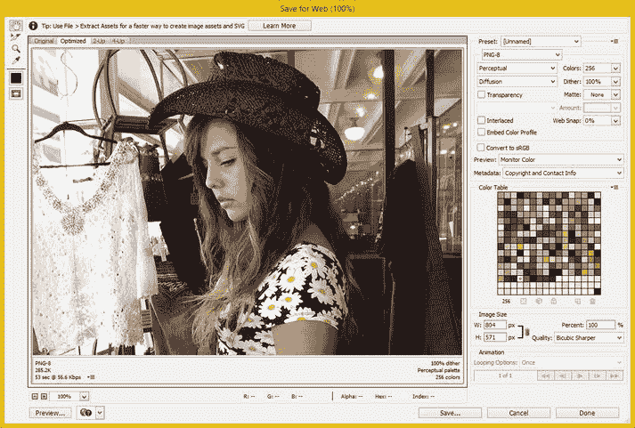
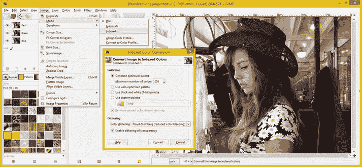

## 5. 数字成像的数字化：色彩深度

既然你已经了解了数字图像编辑与合成中使用的两种主要色彩理论模型，以及我们此后将聚焦于`RGB`模式的原因，现在是时候更深入地探讨色彩如何在每个像素上以数字方式表示了。在数字图像及其文件格式中，用于定义颜色的位数传统上被称为数字图像色彩深度。最常用的色彩深度（也用于最常用的图像格式`JPEG`）是真彩色，即 24 位色。还存在其他使用不同位级色彩深度的图像格式，例如 `GIF` 格式使用 8 位色（或称索引色）；`Targa` 格式使用 16 位色（或称高彩色）；以及 `RAW` 格式和 `HDRI` 格式，它们最高可使用 48 位色，甚至 64 位色。

我们将以上一章的知识为基础，学习 32 位`RGBA`模式（如果你愿意，也可称为`ARGB`色彩模式，即 32 位色彩深度）。这种模式对于合成至关重要，因为它增加了一个`Alpha`（`A`）通道，我将在第六章中详细讲解，因为该通道对数字图像合成工作流程及管线（我称之为数据处理路径）非常重要。

我们将探讨当今数字成像中使用的四种主要色彩深度。8 位“索引色”色彩深度用于优化数据体积，16 位“高彩色”色彩深度很少使用，流行的 24 位“真彩色”用于`JPEG`，而用于合成的 32 位`PNG`格式则包含`Alpha`通道——我们将在下一章中详细介绍，因为它使我们能够实现图像的混合或淡出效果。

在本章中，我们将研究这四种色彩深度，以及最适合你的数字图像合成管线使用的色彩深度（或称“位深度”）。理解色彩值如何为像素数字化是关键所在。

### 色深：定义颜色的位深

除了用于定义数字图像内颜色以及文件格式的位数之外，色深还利用这些数据位来定义数字图像中每个像素可用颜色的数量。数字图像行业中常用的色深包括 8 位、16 位、24 位和 32 位。我将在本章中概述每种位深（色深）的常见文件格式，并在此提及能够存储 48 位或 64 位彩色图像数据的新型高动态范围图像（`HRDI`）和`RAW`格式。此外，考虑到您可能是多媒体制作人或计算机程序员，我也会指出 `Android`、`HTML5`、`Java` 和 `JavaFX` 所支持的广泛使用的数字图像格式。

中等色深图像采用 16 位色深，因此包含 65,536 种颜色（计算方式为 256 乘以 256）。`Targa`（`TGA`）和标签图像文件格式（`TIFF`）这两种数字图像格式支持该色深。如果您想在 `Java` 编程中使用除标准 `GIF`、`JPEG` 和 `PNG` 之外的其他数字图像格式，则需要导入 `Java` 图像库。

真彩色图像采用 24 位色深，因此包含超过 1600 万种颜色。计算方式为 256 乘以 256 再乘以 256，结果等于 16,777,216 种颜色。支持 24 位色深的文件格式包括：`JPEG`（或 `JPG`）、`PNG`、`BMP`、`XCF`、`PSD`、`TGA`、`TIFF` 和 `RAW`。`Java` 支持其中三种：`JPEG`、`PNG24`（24 位）和 `PNG32`（32 位）。使用 24 位色深将为您提供最高级别的图像质量。这就是我建议在基于 `Java`、`HTML5` 和 `Android` 的应用程序和游戏中使用 `PNG24` 或 `PNG32` 的原因。

### 索引颜色：使用调色板容纳 256 种颜色

最低的色深存在于 8 位索引颜色图像中。这些图像最多包含 256 种颜色值，这就是它们被认为是 8 位图像的原因，并且它们使用一种索引“调色板”来管理颜色，因此被称为“索引颜色图像”。索引颜色的流行图像文件格式包括 `GIF`、`PNG8`、`TIFF`、`BMP` 和 `TGA`。

使用 `Photoshop` 将您的 24 位真彩色图像数据转换为索引颜色图像格式（`GIF` 或 `PNG8`）的方法是使用 `文件 ➤ 存储为 Web 所用格式` 菜单序列。这将打开如图 5-1 所示的“存储为 Web 所用格式”对话框，该对话框允许您设置文件格式（`GIF` 或 `PNG8`）、颜色数量、颜色转换算法（感知、选择性、自适应或受限）、抖动算法（扩散、图案或噪声）以及许多其他高级选项。



**图 5-1.** 您可以在 `Photoshop` 中使用“存储为 Web 所用格式”来创建索引颜色图像

我为此图像选择的颜色数量是 8 位（256 色），以便向您展示索引颜色算法的出色表现。请注意，图像预览看起来就像一张真彩色图像。您可以选择介于 2 到 256 种之间的任意颜色数量。

作为色深的一个示例，如果您选择 2 种颜色，那将是一个 1 位（`PNG1`）图像；4 种颜色将是 `PNG2`（2 位色深）图像；16 种颜色将是 4 位的 `PNG4` 色深图像；64 种颜色将是 6 位的 `PNG6` 图像；128 种颜色将是 7 位的 `PNG7` 图像。

位于颜色数量下拉选择器左侧的颜色选择算法下拉菜单，提供了几种用于为您的索引颜色调色板选择颜色的不同算法。我偏好“感知”算法，但也有“选择性”、“自适应”和“受限”算法。使用这些算法的最佳方法是直观地选择一种，然后查看预览结果。您可以观察屏幕左下角的文件大小，如图 5-1 所示。

您可以在颜色选择算法菜单下方看到抖动选择算法下拉菜单。我偏好“扩散”抖动，但也有“图案”设置和“噪声”（随机）设置。抖动是一种在渐变的两种不同颜色之间放置点阵图案的过程，用以减少索引颜色图像中常见的一种称为“条带”的效果。还有一个下拉菜单用于设置算法将应用的抖动程度；我通常将其设置为 100%，让算法自行处理。

“交错”选项通常会增大数据占用空间（文件大小），并允许渐进式渲染，适用于您的网页。“杂边”选项允许针对您提供的颜色值进行边缘平滑处理，前提是您在索引颜色图像中使用`Alpha`通道。我们将在第 6 章中讨论这一点。

您还可以选择使用以下功能：嵌入颜色配置文件（针对此图像，位于文件内部）和转换为 `sRGB`（针对图像颜色配置文件），但通常情况下，您会希望保持这些选项不被选中，除非您有充分的理由使用它们。

接下来，让我们看看如何使用 `GIMP` 2.8.14 将真彩色图像数据转换为索引颜色图像数据。正如您将在图 5-2 中看到的，在 `GIMP` 中调出此对话框的方法是使用 `图像 ➤ 模式 ➤ 索引` 菜单序列。这将弹出一个“索引颜色转换”对话框。它比 `Photoshop` 的“存储为 Web 所用格式”对话框选项少，但重要的选项都在，以便您可以指定色深（位深）和抖动。



**图 5-2.** `GIMP` 的 `图像 ➤ 模式 ➤ 索引` 创建索引颜色

在 `GIMP` 中，我通常使用 `Floyd-Steinberg` 扩散抖动算法之一；在这种情况下，使用的是能减少颜色渗色的那种，它可以保持颜色边缘干净而紧凑。我还选择了完整的 256 种颜色，除非您需要节省几 KB 的数据占用空间，否则通常您都会想这么做，但牺牲图像质量来节省这点空间并不值得。

### 高彩色：使用 15 位和 16 位色深

中等色深存在于较少见的 15 位或 16 位高彩色图像中。我说“较少见”是因为 15 位和 16 位文件格式在所有人都用于其各种酷炫消费电子设备的开源平台（`Android`、`Java`、`JavaFX`、`HTML5`、`CSS3`、`JavaScript`）上并未得到广泛支持。

15 位高彩色格式支持 32,768 种颜色值，通常配置为 `555 RGB` 格式，这意味着您的 15 位颜色 `RGB` 颜色通道各使用 5 位数据。

16 位高彩色格式支持 65,536 种颜色值，通常配置为 `565 RGB` 格式，这意味着红色和蓝色通道各使用 5 位数据，而绿色通道则使用 6 位数据。

您可能会好奇，为什么这额外的分辨率位（代表了额外的 32,768 级颜色强度）被分配给了绿色通道。原因在于，图像中的绿色通道承载了您图像的大部分对比度数据！这是使本书如此有价值的关键知识点之一，因为将这些知识应用到您在 `GIMP` 或 `Photoshop` 中的操作方式上，将对最终图像的质量产生重大影响。

因此，为高彩色图像使用 `565 RGB` 配置总能产生更清晰、更鲜明的图像效果。支持高彩色的数字图像格式包括：`TIFF`、`TGA`、`BMP` 和（`Photoshop`）`PSD`。不幸的是，在 `Android` 或 `HTML5` 中，甚至在 `Java`、`JavaFX` 或 `JavaScript` 中，这些格式均不受支持，至少在不使用第三方图像文件格式导入库的情况下是不支持的。

接下来，让我们看看真彩色（24 位）图像格式，我们在第 4 章中曾用它学习色彩理论。

### 真彩色：使用 24 位彩色图像背景板

正如我之前指出的，数字图像中最广泛使用的文件格式之一是 `JPEG` 格式，它只有一种类型：24 位。其他支持 24 位颜色数据的文件格式包括`BMP`、`TIFF`、`TGA`、`PSD`和`PNG24`。由于`PNG`也支持 8 位（`PNG8`）或 32 位（`PNG32`）颜色，为了精确起见，我将 24 位的 `PNG` 格式称为`PNG24`。

正如你在第 4 章中学到的，真彩色图像使用`RGB 888`颜色配置。这些真彩色文件格式之间的主要区别在于一个关键因素：有损压缩。

### 真彩色加 Alpha：使用 32 位数字图像

有损压缩意味着算法（也称为“编解码器”）会丢弃部分数据以获得更小的数据体积。与之相反的是无损压缩。在应用任何有损压缩（主要是 `JPEG` 算法）之前，最好将原始文件保存为无损数据格式。

`PSD`、`BMP`、`TGA` 和 `TIFF` 格式使用的无损压缩不会丢弃任何原始图像数据；它会应用一种算法来查找模式，从而使用更少的数据。这保证了最终的高图像质量。

传递数字图像的“数字载体”主要使用真彩色、24 位图像。这些载体包括网站、电子书、移动应用程序、iTV 节目、智能手表、数字标牌以及类似的数字图像显示设备和数字图像社交分享论坛。

然而，在图像合成中，流程中只有一个图层（或板块）使用 24 位数据，我们将在第 8 章中详细介绍。我喜欢称其为背景板或背景图层，因为它位于图层堆栈的底部（背面），因此不需要（或使用）透明度。

合成堆栈中背景板上方的所有其他图层都需要支持透明度，因此需要 32 位数据，这通常被称为 `ARGB` 或 `RGBA`。

这种透明度由第四个通道提供，称为 Alpha 通道。在下一节中，我将向你介绍这第四个通道，我们还会在第 6 章及之后的每一章中更详细地介绍 Alpha 通道，因为透明度是数字图像合成中的一个重要概念。

除了 8 位、16 位和 24 位数字图像，还有 32 位数字图像。支持 32 位颜色数据的格式包括 `PNG`、`TIFF`、`TGA`、`BMP` 和 `PSD`。我喜欢使用 `PNG32`，因为它受到 `HTML5`、`Java`、`JavaFX`、`CSS3`、`JavaScript` 和 `Android` 的支持，而其他文件格式不像 `PNG` 格式那样与开源操作系统和浏览器深度集成。这 32 位图像数据包括 24 位的 `RGB` 颜色数据，加上 8 位的“Alpha”或透明度值数据，这些数据保存在通常被称为 Alpha 通道的通道中。

既然你现在知道 8 位可以保存 256 个值，那么你应该能理解 Alpha 通道可以为数字图像中的每个像素保存 256 个不同级别的透明度数据值。

这对你的数字图像合成来说是一个重要概念，因为它意味着包含这 32 位图像数据的图层允许像素颜色的部分（从 0 到 256，或全部）渗透到（或与）其下方的图层混合，从而可以创建合成（混合）图像。

最后，让我们看看这四个数据通道如何转换为 `Java`、`JavaFX` 和 `JavaScript` 代码、`HTML5` 和 `CSS3` 标记以及 `Android Studio`。没错，我们要讨论的是十六进制表示法，适用于所有恰好正在阅读这些基础材料的程序员和多媒体制作人员。

在 `Android`、`HTML5`、`JavaScript` 和 `CSS3` 中，颜色加 Alpha 的十六进制采用 `ARGB` 格式，因此两个 Alpha 值位置放在前面。例如，表示 `TRANSPARENT`（透明），在代码中所有值都是关闭的或为零，则如下所示：

```
colorValue = #00000000   // Android, HTML5, JS, CSS3 Alpha+Color (ARGB)
colorValue = 0x00000000  // Java and JavaFX Alpha+Color Value Hexadecimal
```

而对于颜色 `WHITE`（白色），具有 50%的半透明度，则将所有 `RGB` 像素设置为全亮以显示 `WHITE`，并在 Alpha 通道数据值槽中每个使用 8（如果从零开始计数则为 7）：

```
colorValue = #77FFFFFF   // Android, HTML5, JS, CSS3 Alpha+Color Value
colorValue = 0x77FFFFFF  // Java and JavaFX Alpha+Color Value Hexadecimal
```

对于颜色 `RED`（红色），具有 25%的半透明度，应在每个 Alpha 通道槽中使用值 3，并使用 `FF` 仅开启红色通道像素，即完全开启红色，完全关闭绿色和蓝色，如下所示：

```
colorValue = #33FF0000   // Android, HTML5, JS, CSS3 Alpha+Color (ARGB)
colorValue = 0x33FF0000  // Java and JavaFX Alpha+Color Value Hexadecimal
```

对于颜色 `GREEN`（绿色），具有 37.5%的半透明度，应在每个 Alpha 通道中使用值 5，并使用 `FF` 仅开启绿色通道像素，即完全开启绿色，完全关闭红色和蓝色：

```
colorValue = #5500FF00   // Android, HTML5, JS, CSS3 Alpha+Color (ARGB)
colorValue = 0x5500FF00  // Java and JavaFX Alpha+Color Value Hexadecimal
```

对于颜色 `BLUE`（蓝色），具有 75%的半透明度，应在每个 Alpha 通道槽中使用值 `B`，并使用 `FF` 仅开启蓝色通道像素，即完全开启蓝色，完全关闭绿色和红色：

```
colorValue = #BB0000FF   // Android, HTML5, JS, CSS3 Alpha+Color (ARGB)
colorValue = 0xBB0000FF  // Java and JavaFX Alpha+Color Value Hexadecimal
```

在下一章中，我们将深入探讨如何在 Photoshop 和 GIMP 中使用 Alpha 通道数据——接下来会更加精彩！

### 本章小结

在第五章中，我们探讨了颜色深度的概念，它定义了用于表示数字图像中每个像素颜色的位数。你了解了支持不同位深度的各种数字图像文件格式，例如 8 位的 `GIF`、16 位的 `TGA`、24 位的 `JPEG` 和 32 位的 `PNG`。我们研究了如何在 Photoshop 和 GIMP 中将真彩色模式转换为索引调色板，并回顾了诸如颜色选择算法、抖动算法和渐进式交错等概念。你学习了高彩色 15 位和 16 位图像，重新审视了真彩色 24 位图像，并添加了 8 位 Alpha 通道以创建 32 位数字图像格式，这种格式非常适合图像合成，特别是当你将 `HTML5` 与 `CSS3`、`Android Studio` 或 `Java` 与 `JavaFX` 结合使用时。这是因为 `PNG32` 允许你将合成图层从 Photoshop 或 GIMP 导出到 `NetBeans 8.1`（Java 和 `HTML5` IDE）或 `IntelliJ 14`（Android `IDEA`）。

在下一章中，你将了解更多关于数字图像 Alpha 通道的信息，以及如何利用它通过允许多个图层共存来促进图像合成流程。