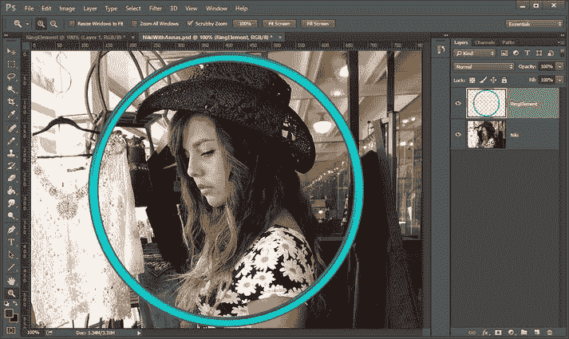
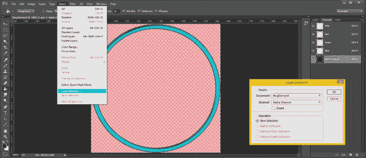
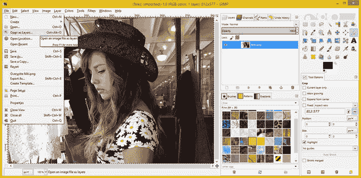
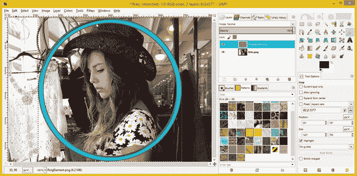
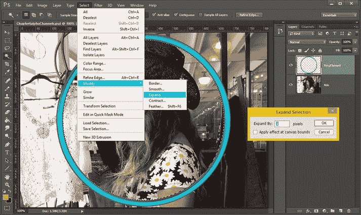
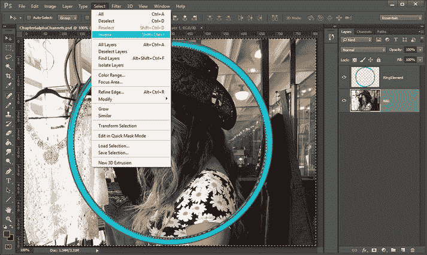
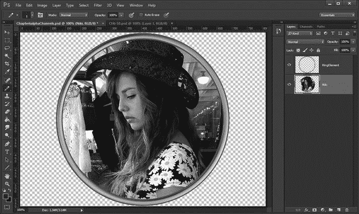
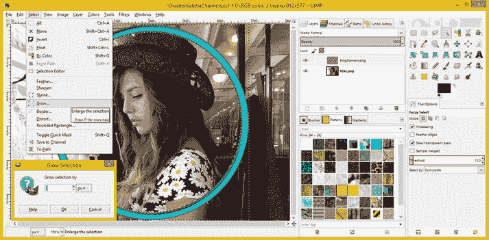
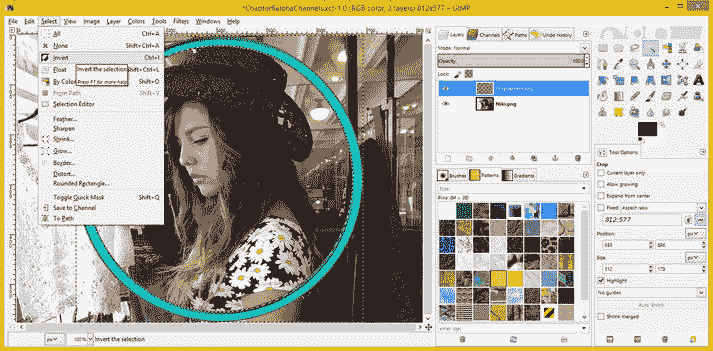
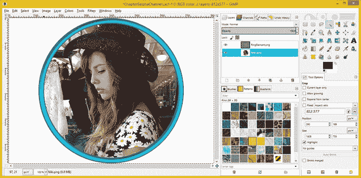

# 6. 数字成像的透明度：Alpha 通道

现在你已经了解了大多数数字图像编辑和合成流程中使用的基本色彩深度，接下来我们将重点关注 32 位 `RGBA` 模式。`RGBA` 模式几乎等同于图像合成中除 24 位彩色背景板之外的所有合成图层。我们也不会重点讨论高动态范围图像（`HDRI`），因为其数据量过大，且对本书大多数读者所针对的使用场景（包括互联网、电子书、智能电视、智能手机、智能手表、平板电脑、上网本、笔记本电脑等）并不实用。

本章我们将重点讨论 `ARGB`（我会交替使用这些缩写）图像数据模式中的 alpha 分量。请注意，我在此处严格区分，并未将其称为“色彩模式”，因为只有 `RGB` 分量是颜色。而额外的 `A` 分量代表透明度，它根本不是一种颜色，而是在数字图像合成“流程”中跨图层、平面或背景板合并颜色的方式。

我们还将探讨如何在 Photoshop 和 GIMP 中访问 alpha 通道，以及这两个程序中的一些实用工具。这些工具将使你能够更轻松地处理 alpha 通道中保存的透明度数据。

### Alpha 通道：定义透明度

让我们来看看 alpha 通道如何定义数字图像像素的透明度值，以及这些通道如何用于数字图像合成。Alpha 通道可以在数字图像合成软件中提供透明度（我称之为“静态”用途），也可以通过 `PNG32` 图像资源，使用 Java、JavaFX、JavaScript、HTML5、CSS3 和 Android 等平台实时合成数字图像（我称之为“动态”用途）。在动态用途中，代码允许你以毫秒级精度访问像素透明度值，并按任意方式对这些数据进行动画处理。

数字图像合成涉及无缝融合多个数字图像图层。可想而知，控制像素透明度是一个极其重要的概念。数字图像合成广泛应用于平面设计、故事片制作、游戏设计，以及近年来的应用程序开发等领域。

当你希望在显示器上创建一幅看似单一图像（甚至动画），但实际上是由多个合成图像图层无缝集合而成的画面时，就会用到数字图像合成。

设置图像或动画合成的主要原因之一，是让你能够通过将不同组件置于不同图层来对图像合成中的各个元素施加更精细的控制。我们将在第 8 章中更详细地介绍图层。

要实现多层合成，始终需要 alpha 通道透明度值。你可以利用它精确控制像素颜色与其下方合成流程（图层堆栈）中其他图层同一 `x,y` 图像位置像素颜色的混合程度。

与 `RGB` 色彩通道类似，alpha 通道具有 `256` 级透明度，范围从 100% 透明（`0`）到 100% 不透明（`255`）。每个像素都有不同的 alpha 透明度数据，就像每个像素都有不同的 `RGB` 颜色数据一样。因此，alpha 通道与其伴随的色彩通道非常相似，区别在于它定义的是混合程度，而其他三个通道定义的是红、绿、蓝颜色的值或强度级别。

让我们通过一个简单示例来看看这在 Photoshop CS6 中的效果：将一个环形元素叠加到我迄今为止在本书中一直使用的模特图像上。如图 6-1 所示，我将 `RingElement.png`（`PNG32` 数字图像）添加到 Photoshop CS 图层堆栈的顶层，展示了装饰性环形元素的 alpha 通道数据（透明区域与不透明区域），以及这种 alpha 通道功能使你能够在数字图像合成流程中实现的效果。

图 6-1.

在 Photoshop 中，一个 PNG32 格式的 RingElement 被添加到 Nikki 上方的图层中

你可以看到，每个像素的 alpha 通道透明度值通过棋盘格图案显示，如屏幕右侧“图层”面板中的图层预览图标所示。

棋盘格图案会显示在图层中任何具有透明度值的区域。因此，如果一个像素（或像素值区域）是部分不透明的（例如 50% 半透明），它就会显示 50% 的棋盘格图案。这是一个简单的数字图像合成示例，如图所示，视觉效果是无缝的。

你可以在图 6-2 中看到棋盘格透明度表示，以及屏幕右侧选中的“通道”面板。

图 6-2.

alpha 通道及“载入选区”对话框

我还选择了 `Alpha Channel`，在 `Load Selection` 对话框中，我通过 `Select ➤ Load Selection` 菜单顺序访问了该对话框。这会在图像上生成一个红色蒙版，以便更好地向你展示 Alpha 通道数据所在的位置（或者相反，不在的位置）。我们将在第 7 章中了解更多关于蒙版的知识，届时我们将真正开始在 Alpha 通道内处理像素，以实现高级数字图像合成效果。

我向你展示了我如何选择我的 `RingElement` 数据，以便我可以继续使用 `Edit ➤ Copy` 菜单顺序，将该数据复制到剪贴板，然后将其粘贴到图 6-1 中所示的 Niki 图像合成中，该图位于选定的右侧标签页中。

为了将戒指图像数据放置在 Niki 图层顶部的另一个图层中，我选择了 Niki 图层，并使用了 `Edit ➤ Paste` 菜单顺序。这会将选定的像素数据粘贴到自动创建于 Niki 图层上方的图层中，用 Alpha 透明度值填充任何未使用的像素，并自动为新图层创建一个 Alpha 通道。最后，我双击了图层标签，并为其提供了我自己的 `RingElement` 图层标签，可以在图 6-1 中看到它以灰色选中状态显示。

接下来，让我们看看如何使用 GIMP 创建相同的合成流程。GIMP 2.8.14 中有一个非常酷的功能，可以方便地将 32 位图像（例如 `RingElement.png32` 文件）导入 GIMP。此功能会在图像合成流程（图层堆栈）中自动创建一个图层，并将导入的图像放置到该图层组件中。

使用 GIMP 的 `File ➤ Open as Layer` 菜单顺序比我在 Photoshop CS 中使用的工作流程要简单得多，你可以在图 6-1 和图 6-2 中看到 Photoshop 的工作流程。要使用此命令，请选择 `Niki.png` 图层（在图 6-3 中以蓝色显示），然后使用 `File ➤ Open as Layer` 顺序，如图 6-3 左侧所示。

图 6-3.

你可以使用 `Open as Layer` 菜单选项在 GIMP 中插入戒指

如果你从 `File Open` 对话框中选择一个 `RingElement.png` 文件，GIMP 会将其作为一个合成图层添加到你的 `Niki.png` 图层之上，如图 6-4 所示。你将看到 GIMP 也使用棋盘格图案来表示透明度，如图 6-4 右侧的图层调板所示。请注意，GIMP 还会使用一个黑黄相间的虚线方块来显示 `RingElement.png` 图层的像素尺寸，该虚线框在 `RingElement` 图层上框住了 Niki 图像合成中间的区域。

图 6-4.

`RingElement.png` 图层显示尺寸和 Alpha

Alpha 通道不仅用于在合成流程（图层堆栈）中定义透明区域，还可以用于更创造性的目的，例如存储选区。

### 选区：使用 Alpha 进行选区集

正如你在图 6-2 中已经看到的，Alpha 通道也可以用来存储对象，以便在以后的数字图像合成项目中轻松选择使用。我们将在第 7 章中更详细地介绍选区集和蒙版，但我将在这里向你展示一些工具和技术，以便我们能够更无缝地过渡到本书后面相关章节的主题。

#### 在 Photoshop CS 中选择 Alpha 通道数据

让我们继续使用我们在图 6-1 中开始的 Photoshop 示例，看看这是如何工作的。我随书附带了 PSD 文件；它名为 `Chapter6alphaChannels.psd`，位于 `apress.com` 网站上本书的文件仓库中，如果你想现在打开它并跟随我一起操作。

你要做的第一件事是单击左侧工具栏顶部的魔棒工具，如图 6-5 中被选中的那样（它看起来像一个仙女棒）。

图 6-5.

使用 Photoshop 的魔棒工具选择戒指内部

然后，单击戒指中间区域，并确保你的 `RingElement` 图层是右侧面板中选中的图层。数字成像软件是“模态”的，我们将在涵盖模态操作的第 10 章中更详细地讨论这一点。

如图 6-5 所示，戒指的中心区域随即被选中，呈现出行业俗称的“行军蚁”效果。

如果你愿意，可以使用 `Select ➤ Modify ➤ Expand` 菜单顺序和 `Expand Selection` 对话框将选区向外扩展几个像素，这些也在图 6-5 中可见。我决定将我的圆形选区宽度扩展 3 个像素。

我这样做是为了确保我的选区延伸到戒指边缘下方，这样在工具放置选区边缘的地方，戒指边缘就不会有可见的边缘过渡。这是合成专业人员经常使用的一种流行的数字图像合成技巧。

然后，单击 Niki 图层，并使用 `Select ➤ Inverse`，选择戒指外部的图像像素，如图 6-6 所示。

图 6-6.

选区已反转且 Niki 图层被选中

你可以按下 `Delete` 键来删除像素，如图 6-7 所示。

图 6-7.

通过使用 `Delete` 键，你可以删除选定的像素

由于 Photoshop CS 是模态的，关键的“一步”是在选中 `RingElement` 图层时选择像素，然后在按下 `Delete` 键之前，将选中的图层切换到 Niki 图层，这样被删除的将是那些像素。这将只留下圆形的 Niki 装饰元素，可用于网站、应用程序或社交媒体。

现在，让我们看看使用 GIMP 完成相同操作的工作流程，因为归根结底，就工作流程而言，这两款数字成像软件差别很大。这个特定的流程对于这两个软件来说相当相似，但其他流程则完全不同。

#### 在 GIMP 中选择 Alpha 通道数据

在 GIMP 中，用于选择连续像素（颜色或透明度）的工具称为 `Fuzzy Select`（模糊选择）工具，而非 Photoshop 中的 `Magic Wand`（魔棒）工具。其图标非常相似，如图 6-8 右上角蓝色高亮所示。确保选中 `RingElement.png` 图层，然后在圆环内部点击以创建选区。接着，使用 `Select ➤ Grow`（选择 ➤ 扩大）菜单序列打开 `Grow Selection`（扩大选区）对话框。如果扩大 3 个像素，就能确保你的选区以及生成的图像数据完全覆盖在圆环下方。

图 6-8.

要确保图像完全位于圆环下方，首先在圆环内部点击，然后使用 `Select ➤ Grow`（选择 ➤ 扩大）并扩大 3 个像素。

本质上，我是在扩大选区以确保其边缘“隐藏”在 `RingElement`（圆环元素）之后。在图 6-8 中，你可以看到选区边缘在圆环元素内侧可见；而在图 6-9 中，它位于圆环元素下方，即使你的选区“行军蚁”看起来实际上在圆环元素上方（其实并非如此）。

图 6-9.

要反选图像中已选中的部分，请在圆环内部点击，然后使用 `Select ➤ Invert`（选择 ➤ 反选）菜单。

在本书中，我会频繁使用这一技巧，以便你熟悉如何扩大选区，使其不正好位于合成图层的边缘，从而避免图像边缘出现微小瑕疵。

接下来，使用 `Select ➤ Invert`（选择 ➤ 反选）菜单序列来反选选区。这样做会选中圆环下方和外部的图像部分，而非内部区域——从而保留圆环内部的内容。图 6-9 展示了该菜单序列，以及通过 `Grow Selection`（扩大选区）对话框向外扩大 3 个像素后的内环选区。现在，你只需选中 `Niki.png` 图层，然后点击 `Delete`（删除）键，即可移除位于圆环元素外部的背景图像像素！

图 6-10 展示了选中 `Niki.png` 图层并按下 `Delete`（删除）键后的 GIMP 界面。正如你所见，GIMP 会在图层后面使用白色背景色，这是该程序与 Photoshop CS6 的众多不同之处之一。

图 6-10.

你可以选中 `Niki.png` 图层并按 `Delete`（删除）键来移除背景图像。

如果你想去除白色背景并获得透明度，需要在激活原始 3 像素扩选区的状态下，右键点击 `Niki.png` 图层，然后选择 `Add Layer Mask`（添加图层蒙版）对话框中的 `Selection`（选区）选项。

这会将选区转换为图层蒙版，使图层本身的背景底板变为透明，而非使用白色。不过，这将是第 7 章的主题，届时我们将更深入地探讨蒙版技术。

随着本书内容的推进，我们会越来越频繁地使用图层蒙版，所以你将逐渐熟悉这个重要且强大的概念。我在此处提前引入，旨在让你尽早开始接触它。

幸运的是，下一章正是相关内容，因此这又是章节主题间一次无缝的过渡，我希望在本书中始终保持这种流畅的衔接。

### 本章小结

在本第六章中，我们深入探讨了数字图像 Alpha 通道的概念。图像 Alpha 值定义了在数字图像合成管线中，每个合成图层内的像素如何表现半透明度。你了解了 Photoshop 和 GIMP 分别如何表示 Alpha 数据，以及用于显示这些数据的 `Layers`（图层）和 `Channels`（通道）面板。你还学习了如何将一个包含 Alpha 值的 PNG32 图像对象叠加合成到一个不含任何 Alpha 值的 PNG24 图像对象（因为它只是一个底板，也称为背景图像）上。

我们还介绍了如何在 Photoshop 中使用 `Magic Wand`（魔棒）工具以及在 GIMP 中使用 `Fuzzy Select`（模糊选择）工具选择透明像素区域。此外，我们还学习了如何扩大和反选选区，以及如何删除选中的像素，从而在我们的数字图像合成管线中创造出更多像素透明度。

在下一章中，你将学习更多关于数字图像蒙版的知识，以及如何使用像素选择工具“提取”数字图像蒙版，并通过 Alpha 通道将其保存以供日后使用。正如你所见，本书的章节编排顺序是很有道理的！

