# 8. 数字成像的组织：使用图层

既然你已经学会了如何在数字图像合成流程中为对象创建蒙版，那么下一个合乎逻辑的步骤就是学习如何利用图层面板来组织你的数字图像合成项目。图层允许你将已添加蒙版的对象隔离开来，并将成像特效应用于单个图层和你的数字图像底板——即作为数字图像合成基础的底层背景图像。

最初，在早期的数字图像软件版本中，图层仅用于隔离带蒙版的对象，就像投影仪上的描图纸可以让你在演示中添加内容一样。图层最初的设计目的仅仅是容纳图像合成组件。在开发周期的某个阶段，开发者开始为图层添加其他很酷的功能，使其功能变得强大一个数量级。

我将本章内容安排为介绍图层面板，因为到目前为止，图层的作用远不止是组织你的数字图像合成！事实上，仅关于如何使用图层面板就可以写一整本书，因为它现在集成了如此多的功能，你将在本书的剩余部分中看到这一点。

`Photoshop` 和 `GIMP` 都支持一系列很酷的图层组织工具，这些工具可用于组织非常复杂的数字图像合成流程并创建特效结构，你将在接下来的五章中看到这些内容。

由于 `Photoshop` 在使用图层方面尤其擅长，能让你实现各种图像处理和特效，因此我们将花更多时间来研究这个软件的图层功能，然后看看 `GIMP 2.8.14` 支持的那些令人印象深刻的功能。

希望 `GIMP 3.0` 能增加一些 `Photoshop CS6` 当前提供的强大图层功能，特别是调整图层概念，它允许你以调整图层的形式执行数字图像像素调整，并附带非破坏性设置，随后可以通过编辑调整图层本身来更改这些设置！

在本章中，你将全面学习 `Photoshop` 的调整图层。让我们开始吧——我们有很多内容要讲！实际上，是无数层相关的成像信息，绝无双关之意！

### 图层的差异：`Photoshop` 与 `GIMP`

就功能而言，`Photoshop` 和 `GIMP` 差异最大的领域之一就是图层。如果你对数字图像编辑或合成非常认真，你很可能会每月支付 10 美元来获得 `Photoshop CS`，或者让你的客户在你的项目合同中支付每年 120 美元的订阅费。`GIMP 2.8` 拥有足够的图层功能来执行专业的数字图像合成，但 `Photoshop CS` 具有一些特效应用功能，使得调整结果或根据客户要求进行更改变得容易得多。`GIMP 3.0` 将在 2016 年（这些功能在 2.9 版中测试之后）增加更多强大的功能和特性。

#### `Photoshop` 图层：组织与特效

如果你下拉 `Photoshop` 的 `图层` 菜单（如图 8-1 所示），你会看到大量的图层组织、蒙版和数字图像算法（称为“调整”）。本章我将重点介绍 `新建` 和 `新建调整图层` 子菜单，因为没有足够的时间或篇幅来涵盖 `Photoshop` 通过其 `图层` 面板提供的所有功能。这是另一个可以自成一本专著的话题，因为它包含填充图层、视频图层、智能对象、图层样式，甚至还有一个为你进行网页切片的工具！

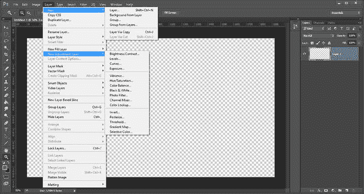

图 8-1.

`Photoshop` 的 `图层` 菜单提供了许多高级功能

在本章中，我们将重点介绍那些在数字图像合成工作流程中最常用的图层功能。这些功能包括创建新图层、复制图层、图层编组、命名图层、合并图层、调整图层以及删除图层。我会在本章以及本书后续章节中，向你展示如何在软件的多个位置访问这些命令。

为了得到图 8-1 中看到的空白 `图层 1`，我打开了 `Photoshop`，并使用 `文件 ➤ 新建` 菜单序列。这就是如何创建你的空白数字图像合成流水线的方法。

接下来我将向你展示 `GIMP` 中的 `图层` 菜单，以便在本章的每一节中都涵盖这两个软件包。

#### `GIMP` 图层：组织与蒙版

要访问 `GIMP` 中的数字图像合成图层，请打开 `GIMP` 程序，并使用 `文件 ➤ 新建` 菜单序列创建一个新的空白数字图像合成文档。要了解其图层功能与 `Photoshop` 的对比，请下拉 `GIMP` 的 `图层` 菜单及其 `蒙版` 子菜单（如图 8-2 所示）。正如你将看到的，`GIMP` 的图层功能远少于 `Photoshop CS6`，但图像合成所需的核心功能一应俱全。这些内容将是我们本章以及后续章节中，在构建你对软件的知识并学习新功能时将要涵盖的部分图层功能。

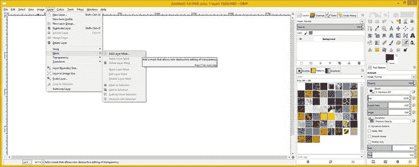

图 8-2.

`GIMP` 的 `图层` 菜单及其 `蒙版` 子菜单

和 `Photoshop` 一样，这些 `GIMP` 的图层功能可以通过 `图层` 菜单或右键单击图层本身唤出的上下文相关菜单系统访问，这是一条能让你工作流程更快的快捷方式。

如图 8-2 所示，`GIMP` 允许你创建 `新建图层` 或 `新建图层组`，以及复制图层、向下合并图层、固定图层和删除图层。在本书的其余部分，我们将研究使用这些功能的合成工作流程，因此即使本章没有专门介绍它们，你也会了解它们是如何使用的。

你还可以在 `GIMP` 中 `缩放` 图层，或更改 `图层边界大小`，使图层大于其包含的数字图像。如果图层边界大于其图像，你也可以使用 `图层适配图像大小` 选项来使图层小于图像。此外还有 `从可见区域新建图层` 选项，它将标记为可见（显示眼睛图标）的图层合并到一个位于图层合成堆栈顶部的新图层中，使其位于合成渲染预览的顶端。

如图 8-2 所示，`GIMP` 的每个图层默认都使用白色作为背景色。`GIMP` 有一个 `图层 ➤ 蒙版` 子菜单，允许你 `添加图层蒙版` 以获得 `Photoshop` 中默认的透明度。一旦 `GIMP` 的图层关联了蒙版，其他图层蒙版功能（显示为灰色）就会被启用。这些功能包括 `应用`（渲染为像素）、`显示`、`删除`、`编辑` 和 `禁用`（暂时关闭）`图层蒙版`。

如你所见，`GIMP` 包含了创建和组织复杂图像合成所需的所有基础图层支持。由于该程序的合成工作方式与 `Photoshop` 非常相似，因此我们先来看看 `Photoshop` 中的图层合成，稍后再研究 `GIMP` 的图层。

### 在 Photoshop 中使用图层：合成图像

让我们继续构建在第 6 章中开始的合成图像。首先打开 `Chapter6alphaChannels.psd` 文件，然后使用 `图层` ➤ `新建图层` 菜单序列（如图 8-1 所示）来访问“新建图层”对话框，如图 8-3 所示。将图层命名为 `TextLayer`，选择“颜色：无”（透明）和“模式：正常”，最后设置“不透明度：100%”。你将要在第 9 章中了解关于模式的知识。我想在本次练习中向你展示如何将文本对象添加到你的合成图像中，因为这具有许多实际应用。

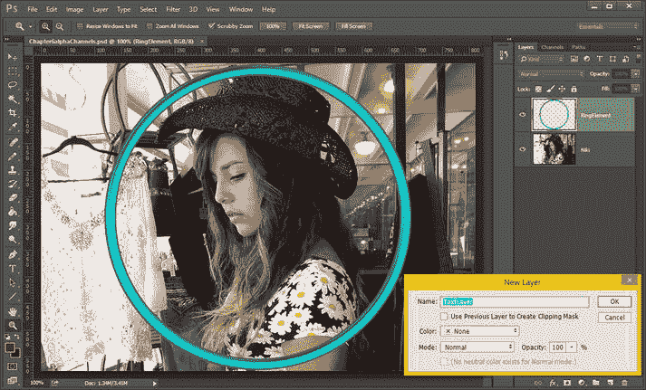

图 8-3. 使用 `图层` ➤ `新建图层` 菜单序列，然后设置“名称：TextLayer”

现在我们准备看看 Photoshop CS 的文字工具，可以通过点击屏幕左侧图标工具栏下部的大写字母 `T` 来访问。你已经使用过魔棒工具来创建蒙版；现在你将探索一些其他工具。

**提示**  
如果你点击 Photoshop 工具栏（屏幕左侧）上的任意图标并按住鼠标按钮，将出现一个弹出菜单，显示你可以选择的其他紧密相关的工具。

#### 添加文本对象：使用垂直文字工具

为了添加文本对象，点击并按住左侧工具栏中的字母 `T` 图标，然后从弹出的下拉菜单中选择“垂直文字工具”，如图 8-4 所示。确保你的 `TextLayer` 仍处于选中状态，然后在合成图像的右上角点击并输入“COMPOSITING”，使用金色和 54 号 Arial Black 字体。如图顶部所示，你可以在顶部菜单下方的文字工具选项工具栏中设置字体、样式、字号、消除锯齿、对齐方式和颜色。

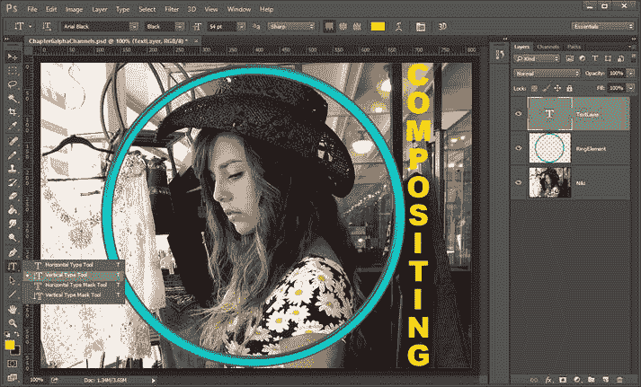

图 8-4. 要添加文本对象，请点击字母 `T` 图标并选择“垂直文字工具”，然后输入“COMPOSITING”

完成后若要微调文本对象的位置，请点击移动工具（工具栏上的顶部图标），并使用键盘上的方向键以单个像素为单位移动它，或用鼠标拖动对象。

#### 特效图层：为文本添加效果

接下来，让我们为文本对象添加一些投影效果，使其“脱颖而出”，并为你的图像合成增添一些专业感。为此，右键点击 `TextLayer`，并在屏幕右侧出现的下拉菜单中选择“混合选项”，如图 8-5 所示。

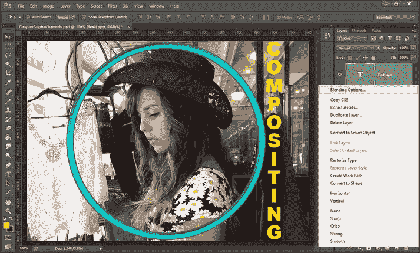

图 8-5. 要添加投影，请右键点击 `TextLayer` 并从下拉菜单中选择“混合选项”

我倾向于使用“内阴影”（如图 8-6 屏幕左侧所示）来为文字添加阴影效果，使其看起来像是嵌入到图像中。

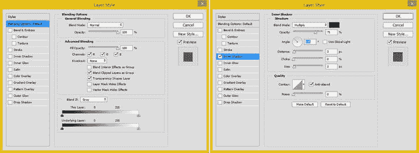

图 8-6. 要添加文字阴影，请选择“内阴影”选项并设置“角度”和“大小”

为此，我设置了 135 度的角度，“大小”和“距离”均为 3 像素，“不透明度”为 75%，“混合模式”为“正片叠底”，“收缩”为 0 像素，并选择了“消除锯齿”的“等高线”。

如果你确保选中了对话框右侧的“预览”选项，就可以随意调整这些设置，它们的效果将实时渲染在你的文本对象上，这样你就能在设置对话框中看到结果并进行调整，直到它完全符合你的要求。

点击“确定”后，你将看到最终的内阴影效果，如图 8-7 所示。请注意，Photoshop 使用了一个新的子图层来封装这些设置。这就是我先前讨论使用图层范式来包含特效设置和可见性时所提到的分层用法。正如你所见，你可以随时编辑这些设置（试试看！），或者使用图层可见性（眼睛）图标来预览效果。

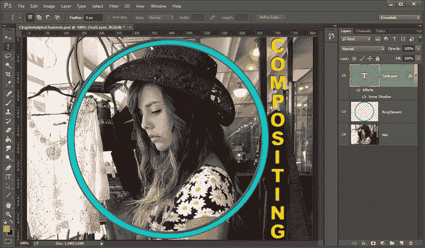

图 8-7. 要开启或关闭“内阴影”效果，请切换眼睛图标

如果你点击内阴影效果旁边的眼睛图标，就会看到你可以单独开启或关闭这个效果。这增强了数字图像合成软件的模块化特性，并允许所有内容作为独立的项目（我称之为“动作”）在图层堆栈（或“合成管线”）中进行组合。

#### 调整图层：调整图像特性

现在让我们来看一下 Photoshop 中一种独特的图层类型——调整图层。在 Photoshop 中，“调整”是指摄影师对数字图像所做的更改。这可能包括调整颜色、增加对比度，或者将彩色图像转换为黑白照片——接下来我们将使用其中一个调整图层来完成后者。从本质上讲，这些图层允许进行所谓的“无损”编辑，因为调整操作被单独保存在图层本身内部，永远不会永久性地应用到你的数字图像数据上。

要创建黑白调整图层，请选择 `Niki` 图层，然后使用 `图层` ➤ `新建调整图层` ➤ `黑白` 菜单序列来打开“新建图层”对话框，如图 8-8 所示。

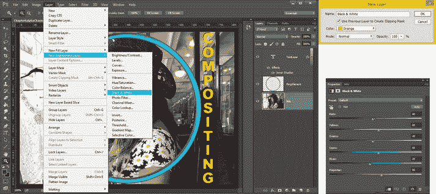

图 8-8. 你可以为 `Niki` 图层添加一个“黑白”调整图层

然后，在“新建调整图层”对话框中选择“使用前一图层创建剪贴蒙版”选项，这会将此调整图层附加到 `Niki` 图层上。

我还选择了一种橙色，向你展示如何为图层设置颜色编码，这也是组织工作的另一种方式。在本书中，我将使用橙色为调整图层着色，以便读者能一目了然。

点击“确定”并创建调整图层后，`Niki` 将变成黑白图像，如图 8-9 所示。你可以点击眼睛图标来切换此效果（图像去色调整），随意开启或关闭它。

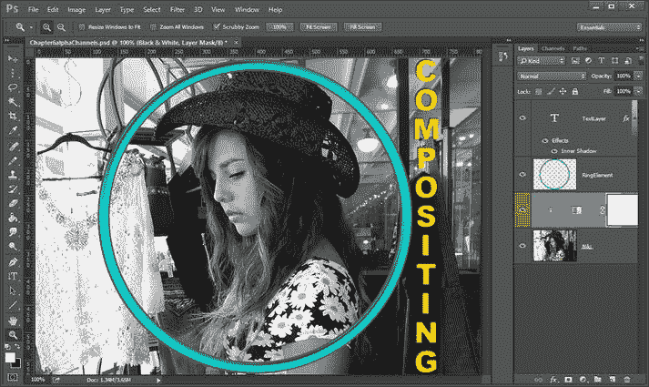

图 8-9. 调整图层显示了你输入的图像调整数据

让我们继续看看 GIMP 中一些类似的合成功能，了解该软件在创建合成图像方面的表现。与 Photoshop 图像合成类似，我们将在 GIMP 图像中包含一张图片、对象、垂直文本和一个特效。

### 在 GIMP 中使用图层：基础合成

让我们通过右键单击上下文菜单的工作流程在 GIMP 中添加新图层。右键单击浅蓝色的 `RingElement` 图层，如图 8-10 所示，然后选择 `New Layer` 以打开 `New Layer` 对话框。将图层命名为 `TextLayer`，并将 `Layer Fill Type` 设置为 `Transparency`。此对话框会将图层大小设置为与文档大小设置相等。这与您在 Photoshop 中创建新图层的第一步相同。

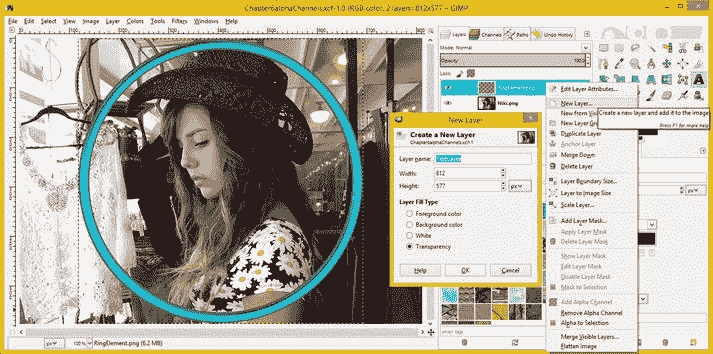

图 8-10.

要在 GIMP 中添加新图层，请右键单击 `RingElement` 图层并选择 `New Layer`

您在 Photoshop 中执行的下一步是单击 `T` 图标（GIMP 使用的是 `A`）来添加文本，选择 `Vertical Type` 工具，然后输入单词“COMPOSITING”。由于 GIMP 没有 `Vertical Text` 工具，为了获得类似的结果，您必须在输入每个字母后按下 `Enter` 键。如图 8-11 所示，您可以使用类似的拾色器对话框设置金色。您可以在屏幕右下方的 `Tool Options` 下设置字体、样式、抗锯齿和行间距。

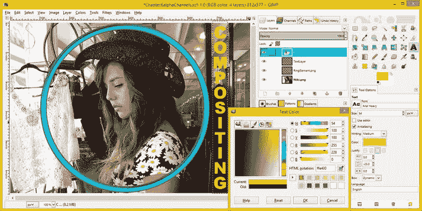

图 8-11.

要在 GIMP 中输入文本，请单击 `A` 图标，选择 `Text tool` 选项，将颜色设置为金色，然后输入文本

您在 Photoshop 中做的下一件事是添加 `Inner Shadow` 效果，使其看起来像是文本从图像中剪裁出来。GIMP 没有像 Photoshop CS6 那样的 `Layer Styles`，因此我将在第 9 章中介绍像素混合模式时向您展示如何创建阴影。

如图 8-11 所示，当您创建文本时，GIMP 会为您创建图层，因此您将不需要 `TextLayer`！我只是想向您展示如何在该程序中创建一个新图层，以便您知道如何操作。如图中所示，这样做的一个方便之处在于，GIMP 的 `Text` 工具会自动为您设置文本图层的大小（宽度和高度）。

GIMP 也没有调整图层功能，因此我将向您展示一种不同的（非破坏性）工作流程，使用可以模拟此最终结果的功能。

要在 GIMP 中删除图层，请右键单击 `TextLayer`，然后从出现的下拉菜单中选择 `Delete Layer`，如图 8-12 所示。

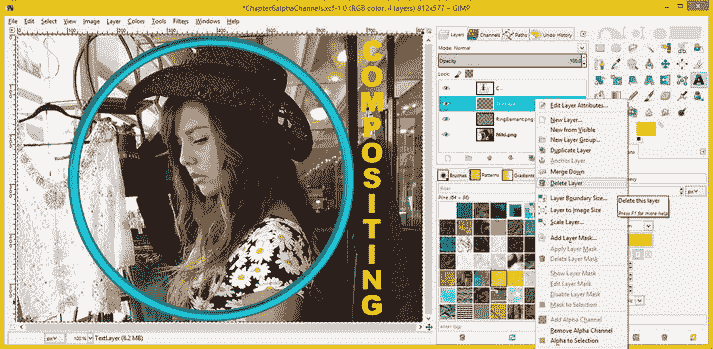

图 8-12.

右键单击 `TextLayer`，然后选择 `Delete Layer`

要对您的 `Niki` 图像实施非破坏性编辑，请右键单击 `Niki.png` 图层并选择 `Duplicate Layer` 菜单选项，如图 8-13 所示。将新图层命名为 `Niki Black & White`。此工作流程将保持 `Niki.png` 图层中的原始颜色数据完好无损，允许您将这个黑白 `Niki` 图层变成一个包含其各自独立图层中去饱和图像数据的图层。

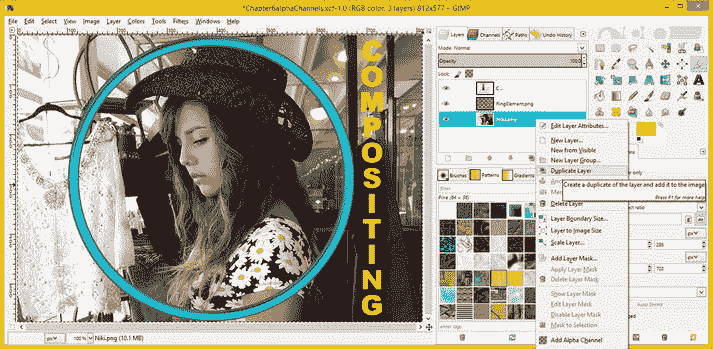

图 8-13.

右键单击 `Niki.png` 图层并选择 `Duplicate Layer`

重命名复制的图层，方法是双击新图层的名称以使其可编辑。结果如图 8-14 所示。

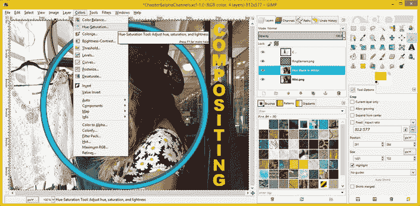

图 8-14.

使用 `Colors ➤ Hue-Saturation` 对 `Niki Black & White` 图层进行去饱和处理

然后使用 `Colors ➤ Hue-Saturation` 菜单序列，打开 `Hue-Saturation` 对话框，以便您可以移除任何颜色饱和度，如图 8-15 所示。

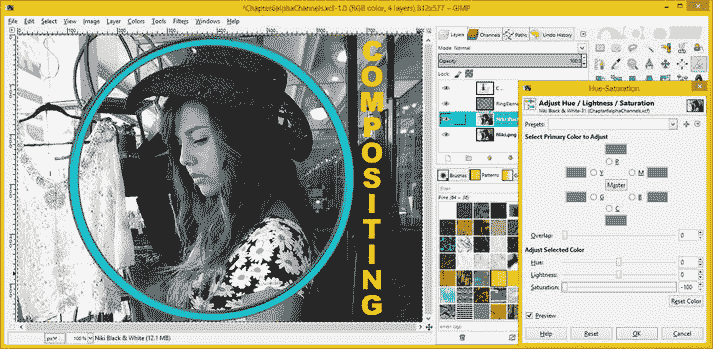

图 8-15.

将 `Saturation` 滑块设置为 `-100` 以进行去饱和处理

`Hue-Saturation` 对话框允许您调整 `Hue`（色温）、`Lightness`（图像中白色或黑色的程度）和 `Saturation`（颜色相对于黑色或白色的量），从而完全控制图像图层的颜色。

如果您确保选中对话框底部的 `Preview` 选项，则可以在移动每个滑块时实时查看所选图层中滑块设置的结果，以便您可以微调或“调整”结果，直到它完全符合您的预期为止。

如图 8-16 所示，您已经使用 GIMP 图层实现了与在 Photoshop 中基本相同的最终结果，只是文本图层内部没有投影。

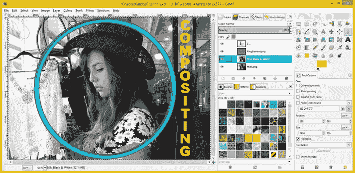

图 8-16.

现在您在 GIMP 中得到了相同的去饱和结果

在下一章介绍混合模式时，您将学习如何使用 GIMP 创建这些阴影。这些模式对于创建逼真的投影效果是必需的，因此，本书各章主题的顺序再次完美契合。

### 总结

在本章（第八章）中，我们回顾了如何使用图层来组织使用 Photoshop 和 GIMP 的数字图像合成。我们查看了 Photoshop 和 GIMP 中的基本图层菜单，以了解这些软件包支持哪些图层功能，并观察到高级图层功能是区分 Photoshop CS6 和 GIMP 2.8.14 的领域之一。

您学习了如何在 Photoshop 中创建新图层以及如何向图层添加垂直文本对象。您还学习了如何在 Photoshop 中创建和应用图层样式，以及如何使用 Photoshop 创建和应用调整图层。

然后，我们介绍了如何使用不同的工作流程在 GIMP 中创建完全相同的合成。您使用水平文本工具创建了垂直文本，并学习了如何通过使用标准图层（而不是使用调整图层）来应用非破坏性编辑，因为 GIMP 2.8 版本不支持调整图层。

在第 9 章中，您将学习更多关于混合模式如何与图层及图层功能在数字图像合成中协同工作的知识，因为这两者是相辅相成的。在 Photoshop CS6 和 GIMP 2.8 中，您也可以使用图层调板访问混合模式。

