# 数字成像算法：混合模式

既然您已经学会了如何在数字图像合成流程中使用图层，在本章中，我们将深入探讨并查看每个图层中包含的混合模式功能。这些混合模式在 GIMP 和 Photoshop 中都存在，它们提供了跨不同图层组合像素的算法功能。这些混合算法最初由 Thomas Porter 和 Tom Duff 创建，在 Android API 中，混合模式实际上是 `PorterDuff` 类的一部分，该类以这两人的名字命名。

除了这些像素混合算法现在已可用于 Android 5 API 之外，Porter-Duff 模式也可在 JavaFX API 中使用，这意味着它们现在也包含在 Java 7、Java 8 和 Java 9 中。最近，它们也被添加到 HTML5 中，使用了 CSS3 和 JavaScript，因此它们非常值得学习，特别是如果您有兴趣使用所有这些流行的开源软件开发平台来制作交互式新媒体内容。

如果您想学习如何在 Java 代码中使用混合模式，而不仅仅是在数字图像合成软件内部，我有多本涵盖此内容的书，包括《Beginning Java 8 Games Development》（2014 年）、《Pro Android Graphics》（2013 年）和《Pro Java Games Development》（2016 年），所有这些都由 Apress 出版。

### 像素混合：波特·达夫模式理论

我在此将这些像素传输和像素混合模式称为“波特·达夫”，因为我是程序员，这样你就能知道它们是什么以及从何而来。尽管在安卓（编程）中是这样称呼的，但在 Photoshop 和 GIMP 中并非如此，所以这个术语实际上只是你在行业交流中用来显得自己知识渊博的谈资。这些模式通常称为混合模式、传输模式，有时也称为图层模式或合成模式。

波特·达夫模式应用于数字成像软件中，使用设置为其中一种模式的图层——默认为“正常”。正如你所料，默认的像素组合（混合）模式根本不使用任何算法，因此保持正常设置意味着不应用任何像素混合算法。

但值得注意的是，Alpha 通道数据仍然会被应用，因为它定义了半透明度，并且始终会纳入你的合成管线，无论你的混合模式是设置为正常还是其他某种像素混合算法。

Alpha 通道定义了直线（正常）不透明度，并不是一种通过混合像素颜色来改变其实际颜色值的复杂算法方法。Alpha 允许在图像图层和其下方内容之间进行逐像素淡入淡出，因此它使用的是简单的数学方法，至少与这些混合和传输模式中使用的复杂算法相比是这样。

这意味着你可以利用 Alpha 通道在逐像素基础上控制混合模式的应用位置，并且拥有 256 个级别（8 位）的控制能力来调节这种混合的应用程度。因此，你的 Alpha 通道和不透明度滑块（同时控制所有像素的淡入淡出，位于图 9-1 屏幕右上方）可以用来微调混合模式的应用效果。

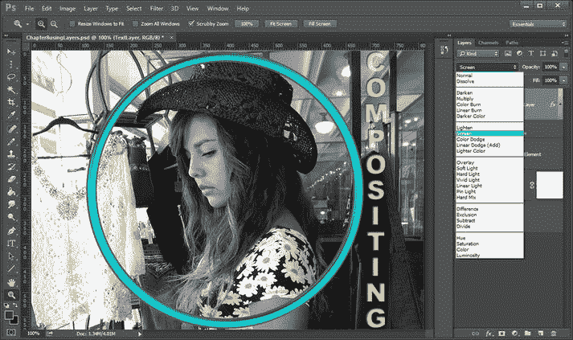

图 9-1.

如果你在 Photoshop 中选择模式下拉菜单，可以查看所有可用的模式

正如你将看到的，这些图层变得越来越复杂，因为你必须记住越来越多的东西，例如 Alpha 通道、混合模式、图层不透明度、图层蒙版、图层样式（特殊效果子图层）、图层调整以及构成像素数据的颜色通道等，仅举几例。

这就是为什么我使用“模态”一词来描述如何在数字图像合成软件和 Photoshop 工具中工作。合成预览中发生的情况直接与许多操作模式的设置相关，例如你正在使用的工具、该工具的选项、当前选中的图层、选中的混合算法等等。我们将在下一章探讨数字成像软件的模态性，因为意识到所有这些模式是你作为合成师成功的关键。

#### Photoshop 混合：支持的混合模式

让我们从第 8 章打开 Photoshop 文件，如果它尚未在你的桌面上打开的话。打开后，单击“图层”面板顶部的“混合模式”菜单（向下箭头展开菜单），如图 9-1 所示。正如你将看到的，Photoshop 有五组混合模式。最上面的是“正常”（未应用模式）和“溶解”（随机像素颜色传输）模式，因为它们不使用任何像素混合算法。下一部分描述了产生变暗效果的模式；再下一部分概述了产生变亮效果的模式；随后列出了混合像素以提供特殊效果的模式；再后面概述了提供基本数学布尔算法的模式。最后一部分描述了将通过传输像素颜色属性来创建特殊效果的模式。

如图 9-1 所示，我选择了“滤色”模式，以便你可以查看此效果，它会将彩色文本变成一种滤色层，从而使其背后图层的某些细节可以作为彩色文本对象的一部分显示出来。这些模式可以为你的图像合成管线增添一些非常微妙而专业的细节，以及一些疯狂的特殊效果，在本章中我们查看其中一些算法混合和传输模式时，你将会看到这一点。

Photoshop 有 26 种混合模式算法。接下来让我们看看 GIMP，了解该程序支持多少种混合模式用于数字图像合成。

#### GIMP 混合：支持的混合模式

首先，使用 GIMP 打开 `Chapter8usingLayers.xcf` 文件，如图 9-2 所示。你会注意到，GIMP 的混合模式功能比 Photoshop 少，但图像合成所需的核心混合和传输模式全部具备。它们以不同的方式分组，包括变亮、变暗、混合、布尔，然后是颜色类模式，可用于创建图像效果。与在 Photoshop CS 中访问它们的方式类似，这些混合模式可以在 GIMP 的“图层”菜单顶部访问。我在图 9-2 中展开了 GIMP 的“模式”菜单，以便你可以看到 GIMP 当前支持的二十种模式（比 Photoshop 少六种）。我猜测另外六种算法是受专利保护的，在那些专利过期之前不会出现在 GIMP 3.0 中。

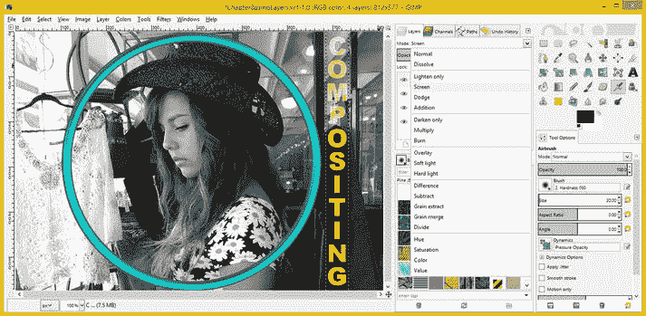

图 9-2.

如果你在 GIMP 中选择模式下拉菜单，可以查看所有可用的模式

除了“正常”（不应用混合模式算法）之外，最常用的模式包括“正片叠底”模式（我们将在下一节中使用它来应用阴影），以及“滤色”、“叠加”、“柔光”和数学布尔传输模式（“相加”、“减去”、“划分”和“差值”）。了解这些模式效果的最佳方法就是尝试使用它们！你可以使用彩色文本对象图层来尝试，也可以（或者）结合你的 `RingElement` 对象图层一起使用。

对每个图层（或两个图层）尝试不同的模式，以观察它们如何与黑白 Niki 图层以及真彩色 Niki 图层交互。要在 Photoshop 中获得真彩色图层，请关闭调整图层的可见性（眼睛图标）。对于 GIMP，两个 Niki 图层也可以使用该图层可见性（眼睛）图标进行切换开启和关闭。

正如你所见，GIMP 包含了创建数字图像合成效果所需的所有基础模式。我承诺过要向你展示如何在 GIMP 中创建投影效果，那么接下来我们就使用“正片叠底”模式来搞定它。

### 在 GIMP 中使用模式：制作阴影副本

让我们继续完善你在第 6 章中开始的合成图像，使用 GIMP 中的 `Chapter8usingLayers` 文件，如图 9-2 所示，我们刚刚打开它。首先，点击“COMPOSITING 文字”图层将其选中，然后使用 `图层 ➤ 复制图层` 菜单命令来复制它。如果你想使用更快捷的右键菜单，也可以直接右键点击文字图层，选择 `复制图层`。选中复制出的图层，将其命名为 `阴影`，点击`文字`工具，使用取色器将颜色设置为黑色。

如果你的文字取色器没有显示金色，请确保你已点击了左侧合成图像视图中的文字对象本身。在你点击了图像合成像素显示区域中的实际文字对象后，GIMP 将允许你点击色板对话框，并将取色器十字准线从金色拖到黑色。

如图 9-3 所示，我已命名了图层，将其颜色设置为黑色，最后右键点击它并选择了 `丢弃文字信息`。此菜单选项会将黑色文字栅格化，使其成为像素数据，后续你将通过工作流程将其转变为投影。

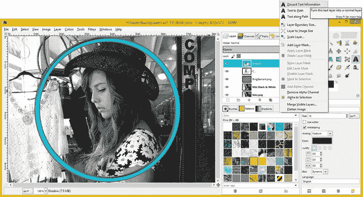

图 9-3. 要将黑色文字转换为像素数据，首先右键点击选中的 `阴影` 图层，然后点击 `丢弃文字信息`

接下来，点击`移动`工具（如图 9-4 右上角所示已被选中），然后在位于工具面板下方的“工具选项”区域中选择`移动活动图层`。

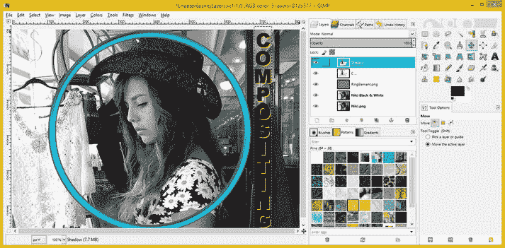

图 9-4. 你可以使用`移动`工具配合方向键将黑色文字偏移 2 个像素

点击`阴影`图层将其选中，然后在图像预览区域点击黑色文字，以此告知`移动`工具你想要移动的对象。确保只是点击，而不是点击并拖动，否则黑色文字会被移动太多。

之后，你可以使用方向键来移动文字对象（或 GIMP 中的任何选中对象），每次移动一个像素。这是一个有用的功能，请务必练习使用它。

现在，按两次左方向键和两次上方向键。这会令你的黑色文字相对于金色文字产生偏移，如图 9-4 所示。

你开始看到这个工作流程如何能产生大量投影可能性了——当然，是在你应用模糊效果使其看起来更像投影之后！不过，在应用模糊滤镜之前，我们还需要先完成一个遮罩步骤，让阴影看起来更逼真。

现在，右键点击`合成`图层将其选中（我已将该图层重命名为首字母大写，以便适应图层空间），然后选择 `Alpha 到选区` 选项，如图 9-5 所示（并务必阅读弹出信息以获取提示、技巧和快捷键）。

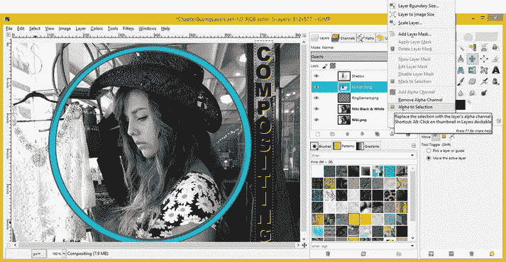

图 9-5. 选择`合成`图层并使用 `Alpha 到选区` 选项

> 提示：如果你将鼠标悬停在 GIMP 用户界面的任何组件上（例如菜单项和工具图标），你将看到关于该 GIMP 功能的黄色弹出信息，以及额外的提示、技巧和快捷键。这是学习该软件的好方法。

接下来，选中你的`阴影`图层，然后使用 `编辑 ➤ 清除` 菜单命令，利用你从`合成`文字图层中提取的选区来移除大部分像素，如图 9-6 所示。这是我所说的“模式化操作步骤”的一个例子，即你选择一个图层，而选择后执行的工具变得至关重要。

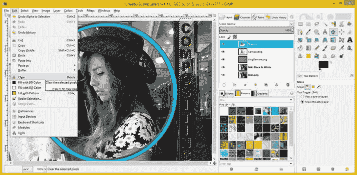

图 9-6. 要移除大部分像素，请选择`阴影`图层并使用 `编辑 ➤ 清除` 命令

然后，使用 `选择 ➤ 无` 菜单命令取消你的黑色文字选区（闪烁的虚线框），并选中你的`阴影`图层，以便应用模糊效果。

使用 `滤镜 ➤ 模糊 ➤ 高斯模糊` 菜单命令，打开高斯模糊对话框，如图 9-7 所示。在 X 和 Y 两个维度上应用 2 个像素的模糊。确保该对话框中的链条图标已锁定宽高比。

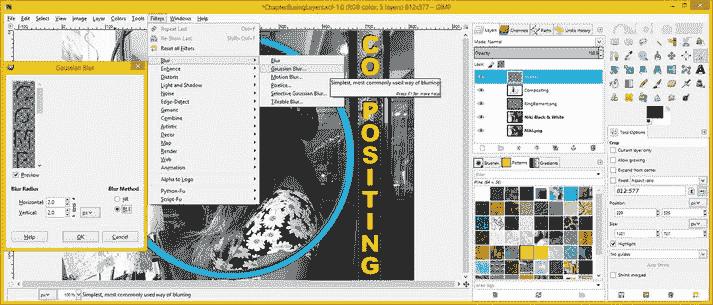

图 9-7. 要模糊阴影边缘，请使用 `滤镜 ➤ 模糊 ➤ 高斯模糊` 菜单命令

点击确定按钮，将高斯模糊设置应用到`阴影`图层，阴影会立刻看起来更真实。

然后选择`移动`工具，点击预览图像中的`阴影`部分，以告知 GIMP 这是你想要移动的对象，并使用方向键来定位阴影效果。

调整投影位置，使其达到与在 Photoshop 中使用`图层样式 内阴影`工具相同的效果。你可能需要使用方向键在 X 和 Y 维度上将阴影移动几个像素，使其看起来像是位于文字对象的内部，营造出文字被切割进图像的效果。

为了让投影颜色与金色文字颜色进行混合（正片叠底），将`模式`下拉菜单设置为`正片叠底`，如图 9-8 截图右上角红色圆圈所示。这能增加更多真实感，尤其是在已经模糊的阴影区域。

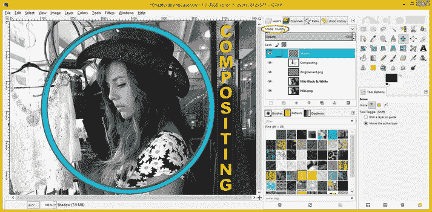

图 9-8. 你可以使用`移动`工具和`正片叠底`模式对阴影进行微调

如你所见，在 GIMP 中你也能完成在 Photoshop 中能做到的大部分工作。在 Photoshop 中创建此效果需要四个图层，在 GIMP 中则需要五个，但最终结果经过调整，在两个软件中可以做到完全相同。

我将使用 Photoshop 来查看其余最常用于合成的模式，以确保我在本书的每个章节中都能公平地介绍这两个软件。

### Photoshop 混合模式：炫酷特效

在本章的剩余部分，让我们看看 Photoshop 中的一些混合模式，它们能为你提供一些非常强大的图像合成“外观”和特殊效果。由于其中一些模式非常相似，我不打算在此处介绍全部 26 种模式，但我会讲解一些你发现自己会经常用到的模式。这些模式包括可以模拟光线照射到图像上的模式、将一个图像叠加到另一个图像之上的模式，以及创建类似的基于像素的二维特效的模式。我们已经在 GIMP 2.8.14 中介绍了`滤色`模式和`正片叠底`模式，因此我将重点介绍 Photoshop CS6 中的其他模式，因为这两种模式在 Photoshop 中的工作方式与在 GIMP 中相同。让我们开始看看，使用我们目前创建的图像合成，混合模式可以创建出哪些炫酷特效。

#### 柔光：为数字图像投下一束光

Photoshop 中的`柔光`模式非常适合模拟光线照射在图像上的效果。接下来，我们在第 8 章的合成图（见图 9-9）中创建这一效果。首先，点击屏幕右侧`图层`面板中`效果`图层旁的可见性眼睛图标，关闭`文字图层效果`。然后，选择`文字`工具，点击屏幕顶部的金色色板，使用拾色器将文字颜色更改为白色。这样做的目的是为了模拟光线照射在图像上的效果。接着，点击屏幕左侧图标工具栏顶部的`移动`图标，将垂直文字移动到合成图的右侧。最后，从`图层`面板的下拉菜单中选择`柔光`模式，你就能看到一个类似文字形状的手电筒照射在数字合成图上的效果。是不是很棒！

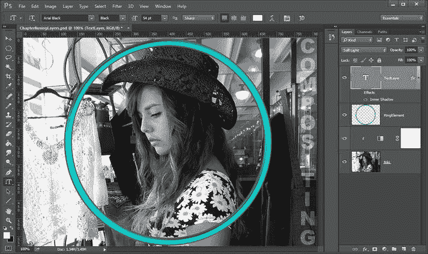

图 9-9. 选中`文字图层`，将模式更改为`柔光`

我们刚刚了解了`柔光`模式；现在来看看`强光`模式是否能带来截然不同的特殊效果。值得注意的是，`柔光`和`强光`模式在 GIMP 2.8.14 中同样可用，因此如果你喜欢，也可以使用该软件包创建这些效果，或许还能借此多练习一下数字图像合成。

#### 强光：为文字添加玻璃叠加效果

在`强光`测试中，我使用`文字`工具将文字重置为橙金色，并通过可见性眼睛图标重新开启了`内阴影图层样式`。我想向您展示如何将投影效果与混合模式相结合，以实现最大的视觉冲击力。我还将垂直文字移回了图像中木梁之间的原始位置，并从图层顶部的下拉菜单中选择了`强光`模式。最终的专业效果如图 9-10 所示。

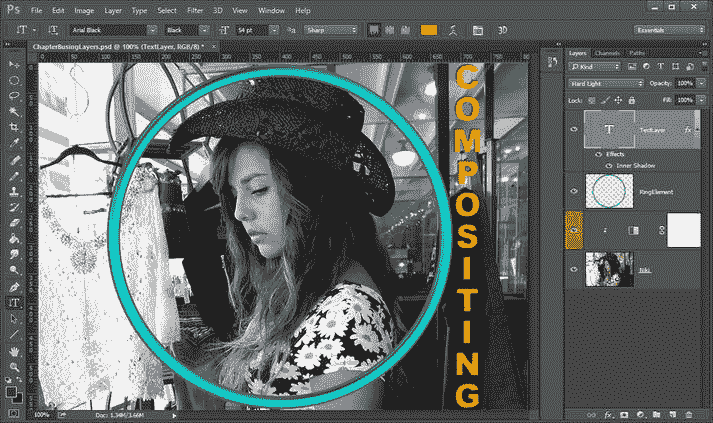

图 9-10. 左键单击`文字图层`，设置`强光`模式

#### 线性加深：将 3D 金属环变成玻璃

接下来，我们同时为文字和圆环对象图层设置模式，以增加 Photoshop 处理的像素效果数据量。我们将在两个图层上计算混合模式，在文字图层上应用`内阴影`效果，并在`Niki`图层上进行`黑白`图像调整。

首先，选择`圆环元素图层`，将`正常`混合模式替换为`线性加深`模式。这将把您的青绿色铬环变成青绿色玻璃环，如图 9-11 所示。

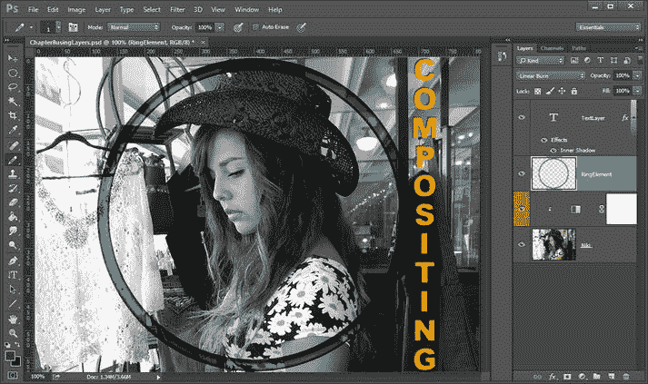

图 9-11. 要将青绿色铬环变成青绿色玻璃环，请选择`圆环元素`图层，并在下拉菜单中设置`线性加深模式`

`线性加深`混合模式与`颜色加深`混合模式类似。`颜色加深`模式增加对比度，而`线性加深`模式则降低亮度，使基色变暗并反映混合色，从而使金属看起来像玻璃。`线性加深`模式与`正片叠底`模式相似，但在这种特定的特殊效果实现（金属变玻璃）中，`线性加深`模式能产生更真实的效果。事实上，您可以尝试选择`正片叠底`模式进行对比。

需要注意的是，使用`白色`作为混合色与`线性加深`模式结合，不会对图像产生任何改变。

数字摄影师可以利用`线性加深`混合模式对其数码照片进行色调和颜色调整。该模式从 Photoshop 7 开始引入，当您希望增强数码照片中较暗区域的效果时尤为有用。在其他图像软件包中，它有时被称为`减去`。

接下来，我们使用`明度`模式，通过去除饱和度来将蓝色圆环元素变成铬环元素。正如我们在第 8 章中看到的，去除颜色饱和度只会留下`明度`（黑白或灰度）值。

`色相`影响图像的色温或颜色；`饱和度`影响图像包含多少颜色（相对于灰度）；`明度`影响图像使用的明亮程度（白色值）或黑暗程度（黑色值）。

#### 明度：将金属环变成铬面

同样，首先选择您的`圆环元素图层`，如图 9-12 所示。然后将`线性加深`混合模式替换为`明度`混合模式。这将把您的青绿色铬环元素转变为深色银铬环元素。在使用混合模式时，只需在包含 3D 圆环元素的图层上设置`明度`混合模式即可。

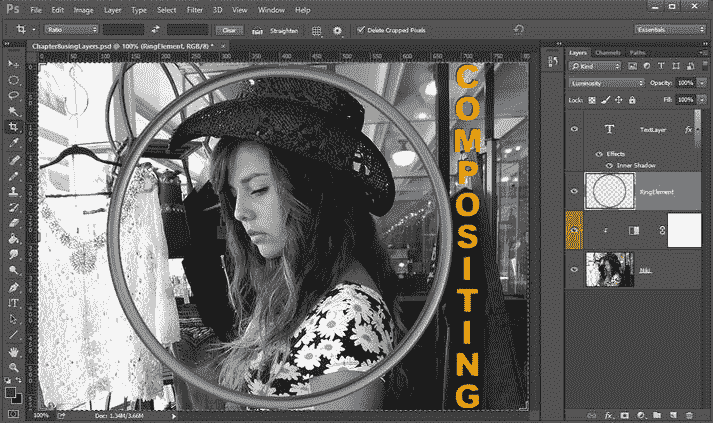

图 9-12. 选择`圆环元素`图层并设置`明度`模式

`明度`是您四种面向颜色（可称为“色调”）的混合模式之一，位于 Photoshop 混合模式下拉菜单的底部，如图 9-1 所示。这四种颜色混合模式作用于您之前见过的`色相/饱和度`对话框中的值，仅影响两个图像之间像素的`色相`、`饱和度`或`明度`分量。

简单来说，当您将一个图层与另一个设置为`明度`混合模式的图层组合时，结果像素的颜色会保留原始（下方）图层的色相和饱和度值，但明度值仅来自设置为`明度`的混合图层。接下来，让我们为`圆环元素图层`添加`投影图层样式`，并使用`差值`混合模式来创建一个酷炫的特殊效果，从而充分利用我们在 Photoshop CS6 中实现的这四个图层的所有功能。

#### 差异：使用图层反转像素颜色

现在，让我们为现有的图层增加一些复杂度，为 `RingElement` 图层添加一个图层样式，这样我们就可以在 `Niki` 图像图层上为其添加投影，使其看起来像是漂浮在图像上方。

为此，选中 `RingElement` 图层后，右键单击并选择 `混合选项` 菜单项，以打开 `图层样式` 对话框，如图 9-13 所示。

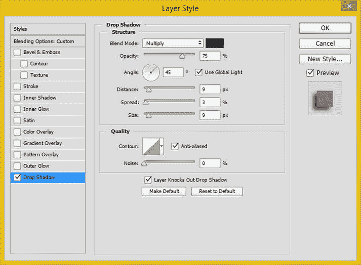

图 9-13.

设置投影图层样式

然后，选择 `正片叠底` 混合模式，将 `不透明度` 设为 75%，`角度` 设为 45 度。勾选 `使用全局光`，接着设置 `距离` 为 9 像素，`扩展` 为 3 像素，`大小` 为 9 像素。

勾选 `消除锯齿` 和 `预览` 复选框，如图所示。

点击 `确定` 按钮后，戒指元素下方就会出现一个逼真的投影，而无需手动创建。

你在 GIMP 中看到了创建这种投影效果所需的工作流程。在 Photoshop 中，`图层样式` 对话框会自动为你完成这项工作，这是 GIMP 尚不具备的高级功能之一。接下来，在 `图层` 选项卡下选择 `差值` 模式，如图 9-14 所示。

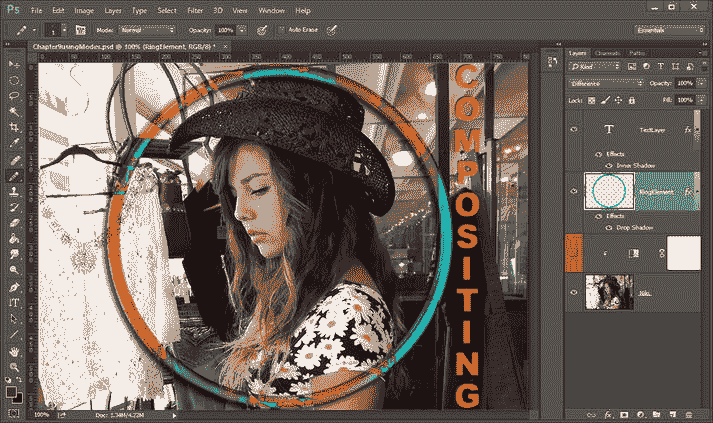

图 9-14.

选择 `RingElement` 图层并设置 `差值` 模式

现在，关闭橙色调整图层的可见性（眼睛）图标，这将恢复 `Niki` 图层的原始颜色数据，以便你更好地观察该模式的效果。根据 `RingElement` 图层下方图层的图像数据，戒指的某些区域会变为红色或蓝色。

请务必花些时间在 Photoshop 和 GIMP 中尝试所有混合模式，以便了解它们与 Alpha 通道、不透明度、图层和图层样式结合使用时，能为你的数字图像合成流程带来什么效果。在这个领域，丰富的模式使用经验能帮助你判断在特定图像上哪些模式有效、哪些无效。

### 本章小结

在第九章中，我们探讨了如何使用混合模式，通过 Photoshop 和 GIMP 将强大的基于像素的算法应用于数字图像合成。我们查看了 Photoshop 和 GIMP 中的基本 `模式` 菜单，了解这些软件包支持哪些混合模式算法，并注意到混合模式的高级功能是区分 Photoshop CS6 和 GIMP 2.8.14 的领域之一，Photoshop 提供了额外的六种混合模式算法。

你学习了如何在 GIMP 中使用正片叠底模式创建内部投影，以及涉及复制文本、选择 Alpha 数据、遮罩和应用模糊滤镜的工作流程。

我们研究了 Photoshop 中其他一些流行的混合模式（这些模式未在 GIMP 中探讨），并将它们应用于本章的 Photoshop 文件。我们还为更多图层添加了混合模式和图层样式，以进一步增加项目的复杂度，并演示混合模式如何与 Alpha 通道和图层样式协同作用。

在 第 10 章 中，你将进一步了解数字图像合成软件的模态操作，以及这些模态操作如何与数字图像合成图层和图层功能协同工作，二者相辅相成。

