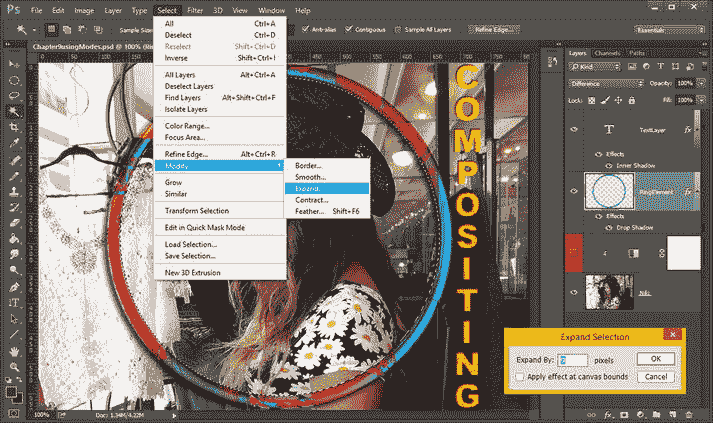
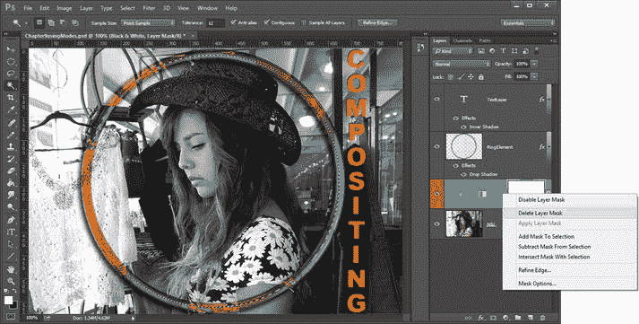
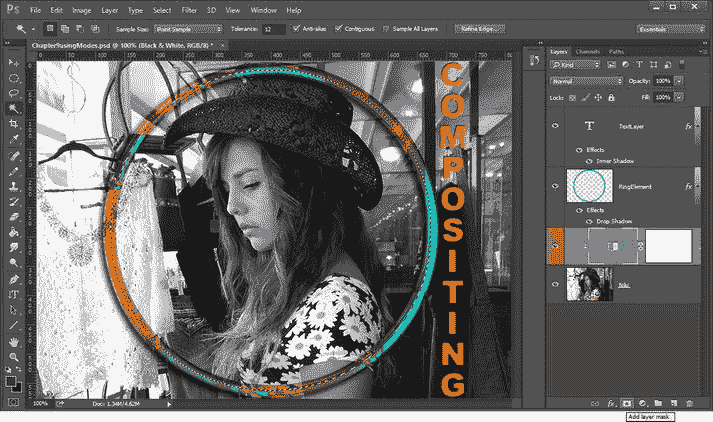
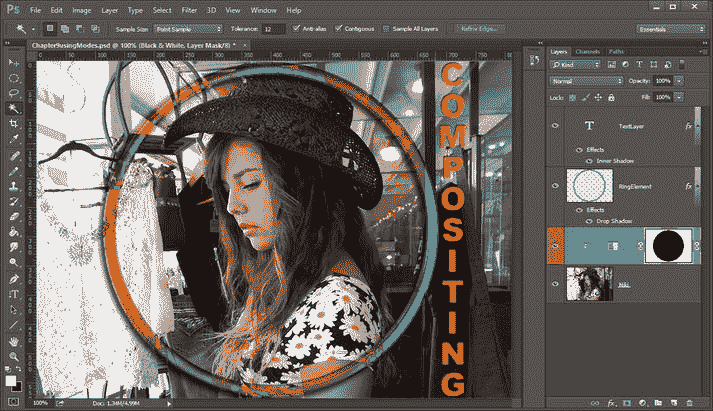

# 10. 数字成像的模态：模态操作

既然你已经学习了一些数字图像合成的基本组件，例如概念与术语、Alpha 通道、选区（遮罩）、图层、混合模式等，让我们用一章的时间来更深入地研究高级数字成像软件的模态操作本质。这种模态操作也存在于其他高端多媒体制作软件包中，例如 3D、数字视频编辑与特效以及音频软件中。这种模态功能也是编程语言的一部分，如 C、C#、C++、Python、Java、JavaFX 和 JavaScript。

由于这些高级软件包的模态性，有多个因素——在这里指操作模式——其设置需要你在操作（使用）软件时始终牢记在心。

这是因为这些模式的设置——例如，你正在使用的工具；你的工具选项设置；选择了哪个图层；按住哪个键盘修饰键（如 `Shift`、`Control`、`Alt`）；选择了哪种混合模式；哪个图标（如可见性、锁定等）处于开启或关闭状态；等等——将决定你使用软件最终获得的结果。

## 模态操作：流程的一部分

就像有一个合成流程处理你的图像图层、模式和通道设置，该流程从图层堆栈的底部向上逐层处理一样，还有一个更复杂的操作设置流程，数字图像合成软件在你使用它时会实时处理这个流程。要能够生成你要求软件创建的结果，它必须关注你选择的工具、正在处理的图层、已选择的选项，以及你使用鼠标和键盘进行的操作。

#### 处理流程：工具、选项和设置

由于这是一本关于数字图像合成基础知识的书，而非其高级功能，因此我不会深入到在软件代码库内部，工具、选项、图层、Alpha 通道、选区、混合模式、按键修饰符和像素位置（实时鼠标位置、移动、拖动等）以何种顺序处理的具体层面。从用户的角度来看，这其实并不重要，因为在使用工具（移动鼠标、点击、拖动或按下键盘按键）之前，你已经设置了所有定义将要发生什么的模式。如果你错误地设置了这些操作模式，就会得到非预期的结果。有时，这些结果甚至可能非常酷，你也许会决定保留它们！

由于这些专业软件包包含许多不同的工具和选项，其中大部分会相互影响，因此复杂新媒体软件的使用可能会很快变成一个高级项目，因为你必须在脑海中理清所有这些设置及其相互关系。这与计算机编程类似，你需要以类似的方式跟踪变量及其处理方式。你的图像合成（或软件应用）越复杂，在处理过程中，你需要实时记住的组件就越多。

#### 熟能生巧：将一切牢记于心

从别人身后观看数字图像合成软件的操作，你可能会觉得它看起来很简单，因为你无法看到他们脑海中的运作过程。然而，在你努力掌握这类软件包的过程中，你会发现，当你试图让软件完全按照你的意图运行以实现项目目标——即达到你期望的最终视觉效果时，实时地在脑海中理清所有这些操作模式是一项挑战。

这意味着，如果你想真正掌握任何数字图像合成软件包，你需要有意识地开始练习，在作为学习过程的一部分时，追踪所有这些不同的操作模式以及它们如何相互影响。

正如你在本书中已经看到的，所有这些数字图像编辑和合成软件包处理其操作模式管道的方式都不同！

正因如此，在本书中，我选择展示两种最流行的图像合成软件——开源软件 GIMP 和付费软件 Photoshop——的不同工作流程，它们最终都能达到相同的结果。通过这种方式，本书覆盖了更广泛的用户群体，并强调了模式操作重点，因为这两个软件包使用了不同的工作流程。

### 模式操作：一个 Photoshop 示例

让我们继续让你当前的合成项目更高级，这次我们具体观察模式操作方法是如何进行的。我们将学习 Photoshop 中的一些新功能和工具，以及如何将 `RingElement` 内部的像素转换为彩色，同时保持 `RingElement` 外部的像素为黑白。

继续实现更高级的功能将让你持续看到，在数字图像合成软件包中，使用模式操作对于获得期望结果的重要性；在本例中，就是 Photoshop CS6。

#### Photoshop 魔棒工具：模式选择集

如果尚未打开，请打开你的第 9 章 Photoshop 文件 `Chapter9usingModes.psd`。然后，点击 `RingElement` 图层，以设置你要操作的目标图层。接下来，点击 `魔棒` 工具，如图 10-1 左上角工具栏中选中所示。现在，在你的图像合成中点击 `RingElement` 内部，以选择该区域。使用 `选择 ➤ 修改 ➤ 扩展` 菜单序列打开 `扩展选区` 对话框，然后将选区扩展 9 个像素，使选区正好位于 `RingElement` 下方一半的位置。

图 10-1. 要开始你的模式操作，请选择圆环内部并将其扩展 9 个像素

如果你想将选区保存为 Alpha 通道，可以使用 `选择 ➤ 存储选区`，并将选区命名为 `RingSelection`。

现在，你在 `RingElement` 下方有一个选区，由于 `Niki` 图层是你的底板，并且在图层堆叠中其合成顺序低于你的 `RingElement` 图层，是时候学习如何将此选区作为 `图层蒙版` 应用到你的 `黑白调整` 图层上，或为其应用该蒙版。

#### Photoshop 图层蒙版：删除默认图层蒙版

首先选择橙色调整图层，如图 10-2 所示，然后右键点击调整图层右侧的白色 `图层蒙版` 预览图标。接着，使用 `删除图层蒙版` 菜单选项删除白色图层蒙版。此图层蒙版会选择整个图像进行黑白调整处理，因为蒙版中的每个像素都完全开启（白色或 `#FFFFFF` 值，这意味着整个图像中的每个像素都会得到完全的调整应用）。我们在这里所做的是删除 Photoshop 创建的默认图层，以便在下一节中，我们可以指示 Photoshop 使用我们在上一节中通过结合 `魔棒` 工具和 `RingElement` 图层创建的选择集来制作一个新的图层蒙版。

图 10-2. 要移除 Photoshop 设置的白色图层蒙版，请右键点击调整图层蒙版并将其删除

还有另一种工作流程可以实现我们将在下一节要做的事情——使用你在 `RingElement` 内部的自定义选择集替换默认（选择所有像素）的图层蒙版。这个工作流程涉及在应用 `图层 ➤ 新建调整图层` 工作流程之前，先选择你 `RingElement` 的内部区域，就像你在上一节中所做的那样。如果你按此顺序操作，你的选区将自动显示为调整图层中显示的图层蒙版。

#### 自定义图层蒙版：添加选区作为图层蒙版

此时橙色调整图层应该仍被选中，如图 10-3 所示，`黑白调整` 图标旁边有一个额外的方块，表明图层蒙版是空的。要将选择集作为其蒙版添加到调整图层，你需要按住键盘上的 `Alt` 键，然后点击 `图层` 面板底部的 `添加图层蒙版` 图标。这将使 `RingElement` 内部以彩色显示 `Niki`，而 `RingElement` 外部以黑白显示。如果你想获得相反的效果——即反转生成的蒙版——只需不按住 `Alt` 键，然后点击 `添加图层蒙版` 图标即可。

图 10-3. 要将选择集添加到调整图层，请按住 `Alt` 键并点击 `添加图层蒙版` 图标

图 10-3 还在屏幕右下角显示了弹出式工具提示，告诉你哪个图标是 `添加图层蒙版` 图标。其他图标可用于访问 `图层样式` (`fx`) 以及诸如新建图层、删除图层、锁定图层和其他核心图层功能。

如果你想记住哪些图标执行哪些图层功能，可以将鼠标悬停在这些图标上自行查看，如果你想成为专业的数字图像合成师，就应该这样做。

如图 10-4 所示，你的调整图层现在将你的选区显示为它的 `图层蒙版`，并且你的圆环元素内部现在使用彩色像素，而外部使用黑白（灰度或去饱和度）像素。

图 10-4. 将你的选区转换为调整图层蒙版

请注意，我们仅用四个图层就完成了所有合成工作，然而，我们应用了半打甚至更多的特效。

现在，让我们看看如何使用 GIMP 2.8.14 自带的模式操作来完成此工作流程。

