# 模态操作：以 GIMP 为例

打开`Chapter9usingModes.xcf`文件，选择`RingElement`图层和`Fuzzy Select`工具。点击圆环内部创建你在 Photoshop 中创建的选区，如图 10-5 所示。

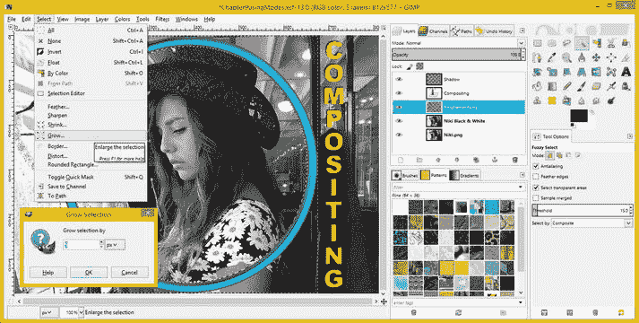

**图 10-5.** 使用`Fuzzy Select`工具选择`RingElement`图层，启动 GIMP 模态操作

然后，使用 GIMP 的 **Select ➤ Grow** 菜单序列访问 **Grow Selection** 对话框，输入 9 像素的值，就像你在 Photoshop 中所做的那样。点击 **OK** 按钮，你将获得可作为图层蒙版使用的蒙版选区。

由于此选区使圆环外部变为黑色（透明），而你希望圆环内部透明，请使用 GIMP 的 **Select ➤ Invert** 菜单序列，如图 10-6 所示。

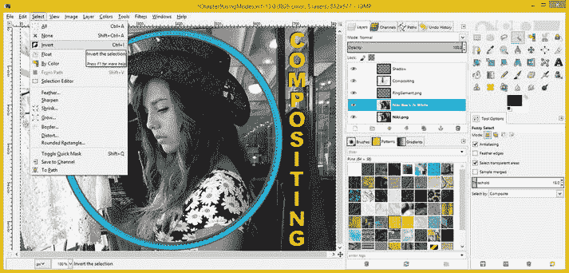

**图 10-6.** 要使圆环内部透明而非外部，选择`Niki Black & White`图层并反转选区

如果你希望圆环内部显示黑白版本的`Niki.png`而非彩色版本，则保持选区不变，因为此时无需反转。

现在，我们准备为黑白`Niki.png`图层添加图层蒙版，这将允许彩色`Niki.png`图层透显。这正是你的 Photoshop 调整图层蒙版所做的事情，但它是在系统内存中“幕后”进行的，而不是像你在 GIMP 中这样在图层调板中显式操作。不同的工作流程，相同的结果。

#### GIMP 图层蒙版：添加图层蒙版

要为`Niki Black & White`图层添加图层蒙版，以便`Niki.png`（彩色）图层透显，你需要选择`Niki Black & White`图层进行此模态操作，然后右键单击它。你还需要选择 **Add Layer Mask** 菜单选项（如图 10-7 所示），以及其弹出工具提示和 **Add Layer Mask** 对话框中的 **Selection** 选项，然后点击 **Add** 按钮。这将把当前活动选区作为图层蒙版添加到你的`Niki Black & White`图层。

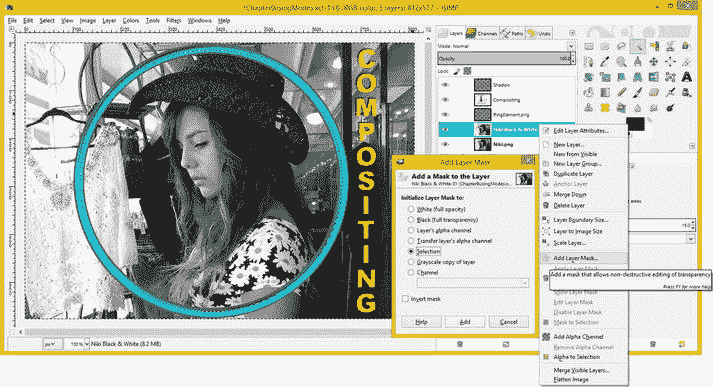

**图 10-7.** 要使`Niki.png`彩色图层透显，选择`Niki Black & White`图层，然后选择 **Add Layer Mask**

图层蒙版随后将允许部分`Niki.png`彩色像素数据从其上方的图层透显出来，如图 10-8 所示。

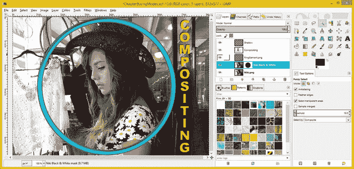

**图 10-8.** 图层蒙版揭示`Niki.png`图层的像素颜色数据

请注意，如果你选择了任何其他图层，然后执行相同的 **Add Layer Mask** 工作流程，你将无法得到期望的结果。

为了完成 GIMP 对你在 Photoshop 图像合成中所做操作的模拟，你需要为`RingElement`添加投影。这将为你提供更多体验模态操作的机会。让我们来了解一下 GIMP 的图层、工具、选项、选区、蒙版、模式和工作流程。

#### GIMP 特殊效果：创建圆环投影

我差点忘了将`RingElement`的混合模式更改为 **Difference**，所以我现在就做。混合模式不影响实际像素数据，因此无论我们将该图层设置为使用什么模式，你仍然可以创建投影效果以将其与下面的图层合成。

如图 10-9 顶部所示，我已将模式设置为 **Difference** 并选择了`RingElement`图层，以便从其透明区域获取选区集。这将通过 GIMP 中的 **Alpha to Selection** 功能完成。

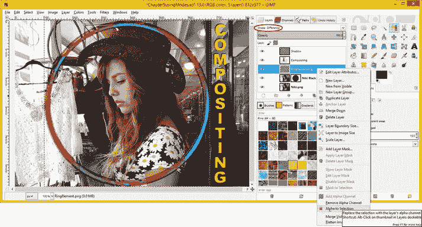

**图 10-9.** 选择`RingElement`图层和 **Alpha to Selection**

要访问此功能，请右键单击所选图层。在上下文相关菜单的底部，你应该会看到 **Alpha to Selection** 选项。如果选择此项，GIMP 将选择你的圆环元素所占用的区域。

工作流程（模态操作序列）的下一步是在`RingElement`下方创建一个新图层，我们将其命名为`RingShadow`，以容纳投影像素。

这需要添加到`RingElement`图层的下方，因为阴影逻辑上应位于圆环元素的下方。

要创建它，请选择`RingElement`下方的一个图层——对于此合成，它将是`Niki Black & White`图层——然后按照 **Layer ➤ New Layer** 菜单序列操作，如图 10-10 所示，并将其命名为`RingShadow`。

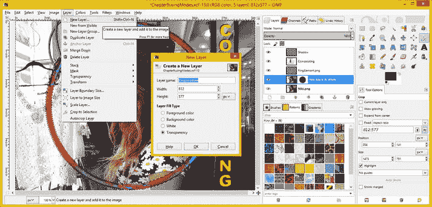

**图 10-10.** 要在`RingElement`下方创建新图层，首先选择`Niki Black & White`图层，然后使用 **Layer ➤ New Layer** 菜单序列

请注意，由于数字成像软件的模态操作，选区独立于图层存在，因此你可以从`RingElement`图层获取（或提取）此选区，然后在选择`RingShadow`图层后填充它。

这是一个展示模态操作如何强大的例子，也是一个如何创造性地利用它的例子。

现在，选择你的新`RingShadow`图层（如图 10-11 所示），并使用 **Edit ➤ Fill with FG Color** 菜单序列，用纯黑色填充与`RingElement`相同的区域（尽管在其下方）。你会注意到你的圆环将恢复为蓝色金属色，因为黑色现在会遮挡`Niki`图层的像素颜色。目前无需使用 **Difference** 模式，因此现在我打算将此模式设置改回 **Normal**，直到稍后在此模态操作密集的工作流程中解决这个问题。

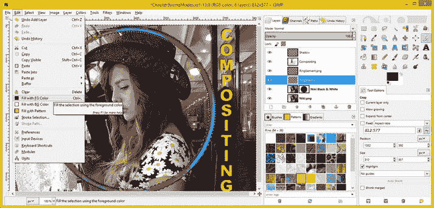

**图 10-11.** 要用黑色填充新图层上的选区，选择你的新`RingShadow`图层，并使用 **Edit ➤ Fill with FG Color** 菜单序列

现在我们可以使用 GIMP 强大的模糊功能之一，在蓝色圆环下方创建逼真的投影效果。

由于你已经使用过 **Gaussian Blur**，让我们使用另一个 GIMP 模糊算法，如图 10-12 中间的子菜单所示。

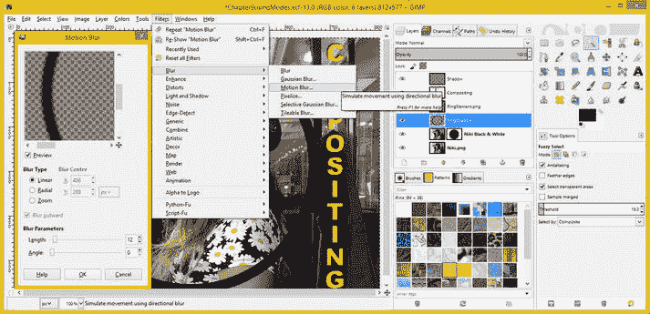

**图 10-12.** 使用 **Motion Blur** 算法时，按照 **Filter ➤ Blur ➤ Motion Blur** 顺序操作，并将 **Length** 设置为 12

我决定使用**运动模糊**算法，原因有三：首先，它面向好莱坞风格；其次，我无需使用移动工具来移动需要模糊的对象，因为该算法会自动移动像素；第三，我希望模糊效果径直向左，这通常是实现（应用）运动模糊的通用方式。此外，由于圆环元素触及了该合成图像的顶部和底部边缘，阴影必须位于你的正左方，这样才能避免它在数字图像合成的顶部或底部被裁切。

选择你的 `RingShadow` 图层，然后依次点击 `滤镜 ➤ 模糊 ➤ 运动模糊` 菜单，打开图 10-12 左侧所示的 `运动模糊` 对话框。接着，将 `角度` 设置为 0，`长度` 设置为 12 像素的运动模糊，并点击 `确定` 按钮。0–360 度的角度从 9 点钟方向开始顺时针递增，因此你需要使用值 0 来创建你的 `角度`，从而得到正左方的设置。

现在，如果你尚未操作，请选择 `RingElement` 图层，然后选择 `正常` 混合模式，如图 10-13 顶部所示。这将使你能够在蓝色金属圆环元素就位的情况下，看到运动模糊阴影的效果。你会注意到，GIMP 的这一运动模糊算法在创建定向投影特效方面表现出色！

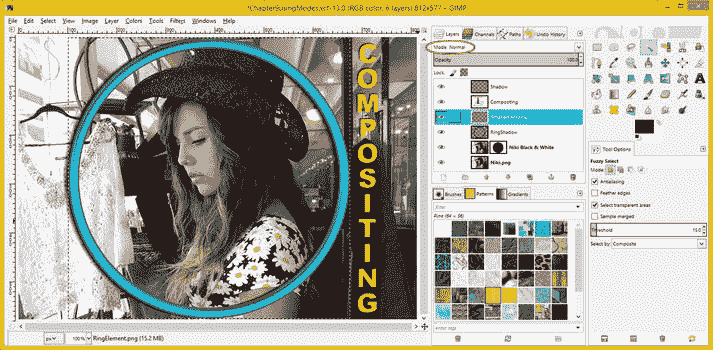
*图 10-13.*

要查看运动模糊阴影对你的蓝色金属圆环元素产生的效果，请选择 `RingElement` 图层和 `正常` 混合模式。

还需要注意的一点是，我们省略了你在内阴影效果工作流程中执行的几个步骤，因为你无需使用移动工具来定位此效果！

我刚意识到我忘记应用合成文本图层的彩色玻璃效果了，就像我们在 Photoshop 中使用强光模式所做的那样。因此，接下来，让我们选择 `Compositing` 文本图层并设置 `强光` 模式。

这将使垂直文本看起来好得多，如图 10-14 所示。

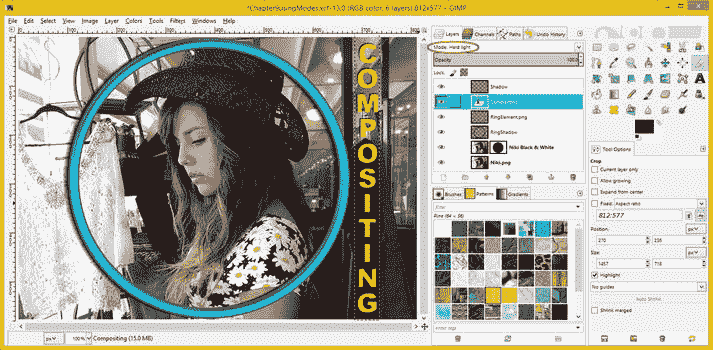
*图 10-14.*

要在 GIMP 中为文本应用彩色玻璃效果，请选择 `Compositing` 图层并设置 `强光` 模式。

现在，你需要解决 `RingShadow` 图层在 `差值` 模式下阻挡 `Niki` 图层像素的问题。在尝试使用 GIMP 模拟我们的 Photoshop 合成结果时，我们必须处理这个问题。

要解决此问题，请选择你的 `RingElement` 图层，然后右键单击它，再次使用 `Alpha 到选区`。接着，点击你的 `RingShadow` 图层将其选中，然后按下 `Delete` 键。

如图 10-15 所示，此过程会移除 `RingElement` 下方黑色的（未使用或不可见）像素。我关闭了图层可见性，以便你能清晰地看到这一点。现在，`差值` 算法可以处理 `Niki` 图层的像素，而你的投影效果仍将保留。

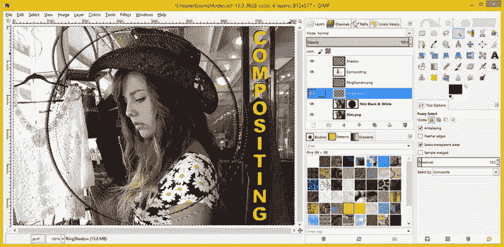
*图 10-15.*

要移除 `RingElement` 下方黑色的（不可见）像素，请选择 `RingShadow` 图层并按下 `Delete`。

现在，通过使用 `选择 ➤ 取消选择` 菜单序列来取消选区，我们收尾吧！

选择你的 `RingElement` 图层，将模式设置回 `差值`，如图 10-16 所示，现在你将得到预期的结果。你已经使用 GIMP 中的六个图层，模拟了之前在 Photoshop 中用四个图层创建的所有效果。

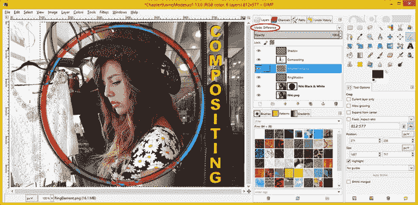
*图 10-16.*

选择 `RingElement` 图层并将模式设置为 `差值`，以使用特效为圆环元素着色。

在这里逐层比较时，重要的是要观察到，你的两个 Photoshop 图层使用了 (fx) 子图层。有人可能会认为，这意味着 Photoshop 也使用了六个图层，这使得两个软件中的图层数量非常接近。

如你所见，这两个 2D 数字图像合成软件都能够通过使用正确的工作流程和正确的模式操作序列（顺序），产生令人惊叹的视觉效果。这正是我本章想要演示的内容，现在我们可以继续探讨特殊效果应用，使用 Photoshop 和 GIMP 中的滤镜菜单。

需要注意的是，如果你想在数字成像软件中安装插件，滤镜菜单就是访问这些专用特效算法的地方。

### 总结

在第十章中，我们详细介绍了 Photoshop 和 GIMP 中的模式操作将如何极大地影响你的数字图像合成努力的成功（和失败）。偶尔，模式设置中的错误也会产生一些非常酷的意外结果，你可以声称这些结果是你有意创造的！

我们还研究了数字图像编辑和合成软件工具、工具选项、图层、通道、选区、模式和菜单如何以模态方式协同工作，根据各自的设置来共同创建最终的合成结果。

你看到，复杂的图像合成并不像表面上看起来那么容易。在我们探讨了模式操作的一些一般考虑因素之后，我们使用 Photoshop 创建了一些更高级的合成作品。

在本章后面，我们使用 GIMP 2.8.14 以及不同的工具、模式操作和工作流程，复制了相同的视觉效果。

你使用 Photoshop 添加了调整图层蒙版，该蒙版仅对 `RingElement` 图层中的圆环元素内部的像素进行着色。为了使你的 GIMP 图像合成与 Photoshop 数字图像合成完全一致，你随后在 GIMP 中模拟了该效果，并为你的 `RingElement` 图层创建了投影效果，为 `Compositing` 文本图层创建了玻璃文字效果。

在第 11 章中，你将了解更多关于数字图像合成软件的第三方插件，以及如何通过两个软件包中的滤镜菜单访问它们以及集成（永久）插件。

