# 11. 数字成像的自动化：插件滤镜

既然我们已经涵盖了数字图像合成中的主要基础主题，让我们花一章的时间来轻松一下，看看插件软件。插件可以通过让你在对话框中简单地设置一些选项并点击 `确定` 按钮，来自动为你实现专门的成像效果！这些插件通常位于你的数字图像合成软件包中的 `滤镜`（Photoshop）或 `过滤器`（GIMP）菜单中。

由于 GIMP 的插件是免费的，我们要做的第一件事就是了解如何为 GIMP 2.8.14 软件包查找、安装和使用插件滤镜。

Photoshop 也有大量的插件，其中大多数已经是 Photoshop CS6 软件包的一部分，并且还有几家第三方公司也为 Photoshop 提供额外的插件。要在互联网上找到这些，请使用关键词“Photoshop 插件”进行谷歌搜索。

之后，我们将研究如何将插件滤镜整合到数字图像合成工作流程中，并继续为你第 10 章的图像合成作品（针对 Photoshop CS6 和 GIMP 2.8.14）应用特效。

## GIMP 插件滤镜：强化 GIMP 2.8

当你购买 GIMP 时，该程序中已安装了数十个插件，其中包括最受欢迎的插件滤镜，它们位于“滤镜”菜单及其众多子菜单下。在本章的这部分，我将向你展示如何从 Gimp.org 网站访问数百个这类插件滤镜，然后在本章剩余部分，我们将探讨如何将插件滤镜运用到你数字图像合成的工作流程中。如果你访问 `gimp.org` 上的 GIMP 主页，你会在主页链接的右下角看到一个蓝色的 `插件注册表` 链接，如图 11-1 所示。此链接可访问插件注册表，你可以在其中找到数百个可供下载的插件。这些插件由个人和公司为其他 GIMP 用户创建，供其在数字图像合成工作流程中使用。你也可以使用 GIMP 附带的 `PyGIMP`、`Scheme` 或 `Script-Fu` 语言编写自己的插件。我将在第 14 章中介绍这一点。

图 11-1. 在 `gimp.org` 主页的右侧，你可以找到一个插件注册表链接

点击蓝色的插件注册表链接后，你将被带到 `registry.gimp.org` 页面，如图 11-2 所示。找到“浏览注册表”部分，其中包含允许你按日期、标签或字母顺序浏览插件的链接。如果你找到任何想要的插件，请点击相应的链接将文件下载到你的硬盘。之后，你可以将文件传输到 `Gimp/Downloads` 文件夹，接下来我将向你展示如何在你的硬盘上找到该文件夹。

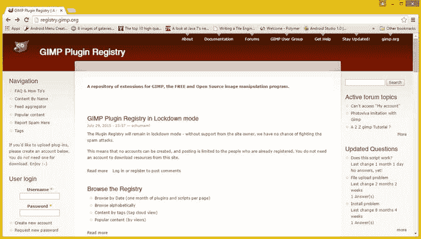

图 11-2. 在 `registry.gimp.org` 页面的“浏览注册表”部分，你可以按各种条件浏览插件

要安装插件，只需将其放入你的 GIMP 插件文件夹，然后重新启动程序。它将会加载到系统内存中。需要注意的是，插件文件夹不在 `C:/Program Files/Gimp 2` 文件夹下，而是位于用户子文件夹中。在我的机器上，该文件夹的路径是 `C:/Users/Default.Default-PC/.gimp-2.8/plug-ins`，如图 11-3 的导航栏所示。

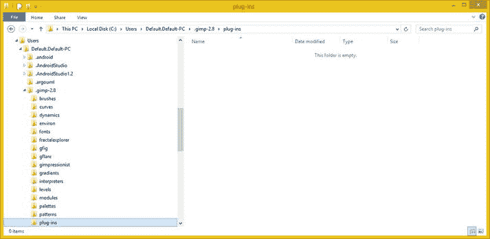

图 11-3. 你可以在用户子文件夹中找到插件文件夹，以我的电脑为例，路径是 `C:/Users/Default.Default-PC/.gimp-2.8/plug-ins`

由于我是为了本书才刚安装 GIMP 2.8，该文件夹是空的，因为作为 GIMP 一部分的插件不再存储在其中。在本章中，我将介绍属于 GIMP 2.8.14 的插件，因为这些插件已经过 GIMP 软件开发团队的挑选和批准。

### GIMP 的滤镜菜单：使用插件滤镜

让我们直接进入正题，开始让我们的数字图像合成项目比以往具有更强的视觉冲击力。我们将通过对背景板（如果你更喜欢这个术语，也可以叫背景图像）应用滤镜来做到这一点，同时我还会向你展示如何使用无损工作流程来做到这一点。在本章中，我们将从 GIMP 的滤镜菜单开始，最后以查看 Photoshop 的滤镜菜单结束。这两个软件包都提供了大量令人印象深刻且功能强大的插件滤镜供你探索和使用，从而增强你的艺术创作。

首先，打开你的 `Chapter10modalOperation.xcf` 原生 GIMP 格式文件，左键点击选择“Niki 黑白”图层。右键点击并选择“复制图层”来复制该图层，以实现你的无损编辑，如图 11-4 所示。

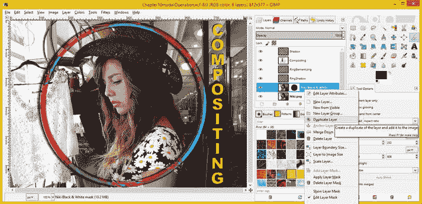

图 11-4. 要使用插件滤镜，首先选择“Niki 黑白”图层，然后右键点击该图层并选择“复制图层”菜单选项

请注意，连同 Niki 的黑白版本，你的图层蒙版（Alpha 通道数据）也被复制了，这样我们就可以给戒指后面的背景应用一个酷炫的像素处理效果，并通过使用图层蒙版保留 Niki 的彩色照片。首先，我双击图层名称（副本），将其重命名为“滤镜特效”。选中这个新图层后，接着我使用 `滤镜 ➤ 艺术效果 ➤ 卡通` 菜单序列打开 `卡通` 对话框，在其中设置 7 像素的蒙版半径和数值为 1.000 的 100% 黑色（使用浮点数术语即为 100%），如图 11-5 所示。

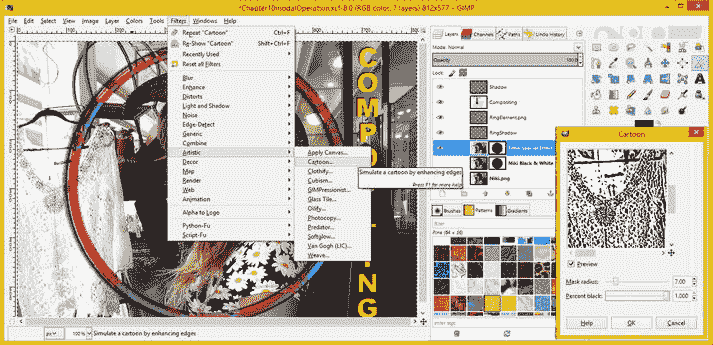

图 11-5. 要打开 `卡通` 对话框，我选择了一个图层并使用了 `滤镜 ➤ 艺术效果 ➤ 卡通` 菜单序列

如果你在任何滤镜对话框中选中“预览”复选框，你将能够看到该滤镜设置的效果。你还可以拖动预览窗口区域，显示你感兴趣预览的图像区域。在这种情况下，我想预览的是蕾丝衬衫，因为我希望通过使用这个卡通滤镜来突出它（让它“跃然眼前”）。

请注意，在图 11-5 和图 11-6 中，选中图层内部的白色轮廓，显示了我在调用滤镜之前为滤镜操作（并用于预览）选择的相应预览图标。这是模态操作的另一个示例，因为滤镜会查看所选图层的预览图标，以确定是对图层图像还是图层蒙版进行操作。

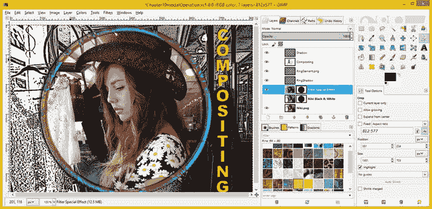

图 11-6. 带蒙版的卡通效果极大地增强了戒指外部的图像背景

这还为你的特效应用提供了更多灵活性，因为你可以将任何这些滤镜应用于图像或蒙版（Alpha 通道），当你想创建视觉上令人印象深刻的特效时，这能提供更多的艺术自由度。

现在，让我们来看看如何在 Photoshop 中使用插件。插件滤镜是 GIMP 和 Photoshop 之间的不同之处之一。滤镜本质上是图像特效算法。在这两个软件包中，你无法在戒指外部背景区域获得完全相同的效果。

然而，你可以通过同时使用 Photoshop 和 GIMP 来获得相同的结果！没错——我一直都在这样做，方法是利用计算机剪贴板功能，在程序的不同图层之间来回传输像素阵列，使用以下模态操作（操作 1 和 2 应用于源图层；操作 3 和 4 应用于目标图层）：

- 选择包含滤镜效果的图层
- `选择 ➤ 全部`，然后：`编辑 ➤ 复制`
- `图层 ➤ 新建图层`（图层堆栈底部）
- `编辑 ➤ 粘贴`（选中新图层的情况下）

我希望这本书能帮助你跳出“数字图像合成”的传统思维框架！

## Photoshop 的滤镜菜单：使用插件滤镜

现在，让我们在 Photoshop 中模拟刚才在 GIMP 中完成的合成过程。由于调整图层没有滤镜蒙版，我们需要更改调整图层的设置，实质上是将其反转，这将会向你展示一些新的模态操作“技巧”（我这么称呼它们），以便设置 Photoshop 合成，使其能够完成我们在 GIMP 合成中所做的事情。

开始你的模态工作流程：打开 第 10 章 的 Photoshop 文件 `Chapter10modalOperation.psd`，并选择底板（底层）背景图像图层。然后使用 `图层 ➤ 复制图层` 菜单序列来打开 `复制图层` 对话框，如图 11-7 所示，并将新图层命名为“插件滤镜效果”。

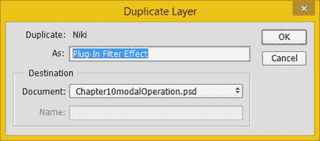

图 11-7. 要在 Photoshop 中启动合成过程，请遵循 `图层 ➤ 复制图层` 菜单序列以打开 `复制图层` 对话框。

此工作流程的第二步，也就是模拟你在 GIMP 中所做的操作，是将这个“插件滤镜效果”图层拖到图层堆栈的底部，使其成为底板，并确保当你对其应用插件滤镜时，它将位于合成管线（像素处理顺序）中所有其他元素的后方或下方。

下一步是将调整图层蒙版图标从橙色调整图层中拖出，并将其放到你的`Niki`图层上，此时`Niki`图层应该直接位于调整图层下方，如图11-8所示。当图标正确悬停在图层上方时，你会在`Niki`图层周围看到一个白色轮廓。看到此轮廓后，松开图层蒙版图标。这将改变此蒙版的名称，从调整图层蒙版变为图层蒙版。

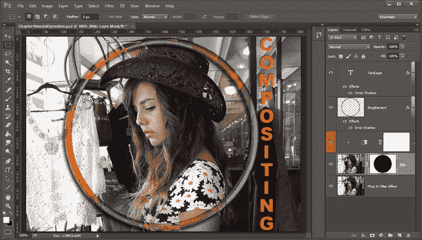

图 11-8. 合成过程的第二步是将调整图层蒙版拖到`Niki`图层上。

调整图层蒙版现在又变回全白色，这正是你对整个底板应用调整所需要的状态。请注意，Photoshop 拥有更高级的拖放功能，例如能够简单地在图层之间拖动图层蒙版数据，而 GIMP 2.8.14 尚不具备此功能。GIMP 3.0 有可能在后续软件开发周期中添加这些功能。

工作流程的下一步是将橙色调整图层拖到你的`Niki`图层下方，但位于“插件滤镜效果”图层之上，如图11-9所示。由于此调整现在仅应用于底板，你不需要“剪切到图层”选项，该选项会将调整（隔离后）仅附加到直接位于其下方的图层。

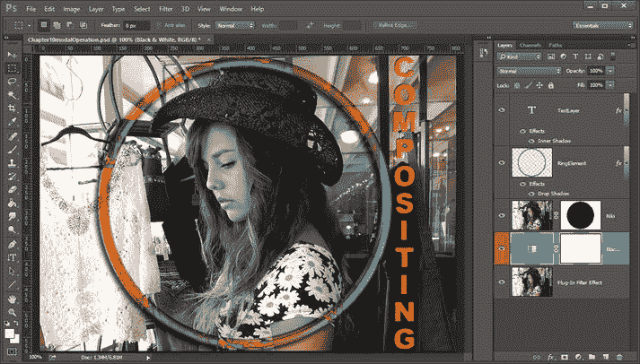

图 11-9. 下一步是将调整图层拖到你的`Niki`图层下方。

如图11-9所示，期望的效果与我们所需的效果相反。如果你需要这个效果，就必须保持`Niki`图层蒙版不变；如果你想要在 GIMP 中创建的效果，则需要反转图层蒙版。

实现该目标的工作流程包括：选择`Niki`图层，然后选择`Niki`图层内的图层蒙版图标，向 Photoshop 表明这是你希望提交进行图像调整处理的数据。

请记住，使用模态操作是成功使用数字图像合成软件的关键。在这种情况下，这涉及在调用`反转调整蒙版`操作之前，先选择`Niki`图层的图层蒙版组件。在 Photoshop CS6 中，我们接下来将通过选择`调整蒙版`并将其反转来执行此操作。

再次强调，你可以看到`Niki`图层以灰色高亮显示，如图11-10所示，而图层蒙版则以带有四个角方块的白色轮廓高亮显示。

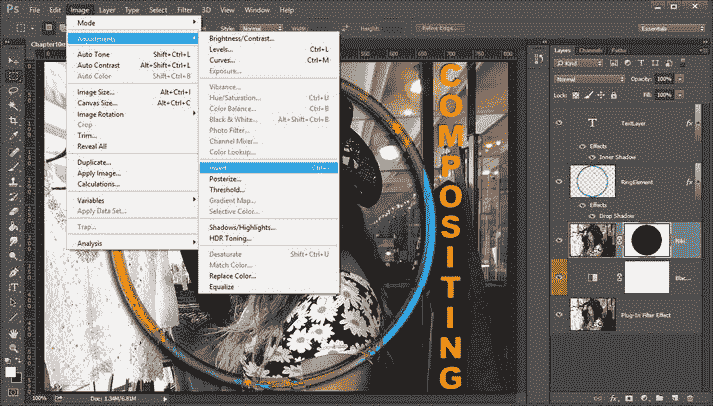

图 11-10. 要反转图层蒙版，请选择`Niki 图层蒙版`并反转图层蒙版像素。

接下来，你将使用`图像 ➤ 调整 ➤ 反转`菜单序列（也显示在图11-10中）来反转所选图层蒙版。这将导致你的`RingElement`图层对象外部变为黑白，而内部变为彩色，这是因为图层蒙版告知调整图层要处理和显示的内容发生了反转。

如图11-11所示，所需的效果现在已经就位。现在你可以选择你的“插件滤镜效果”图层，并使用`滤镜 ➤ 滤镜库`菜单序列来访问 Photoshop CS6 的艺术效果插件滤镜集合。

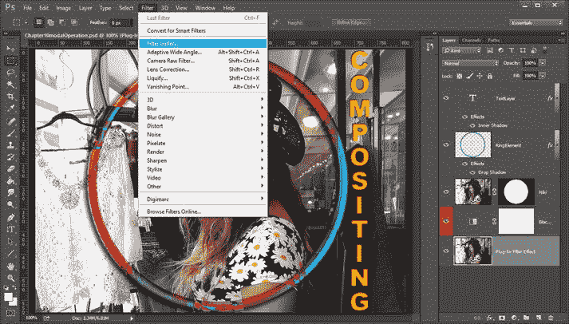

图 11-11. 要访问艺术效果插件滤镜集合，请选择底板并遵循`滤镜 ➤ 滤镜库`菜单序列。

`滤镜库`插件集合曾由单独的插件滤镜组成，所有这些滤镜都可以通过 Photoshop 的滤镜菜单访问。现在它们已被整合到一个用户界面中，如图11-12所示。我选择了`画笔描边`部分，然后点击`墨水轮廓`滤镜来应用它。

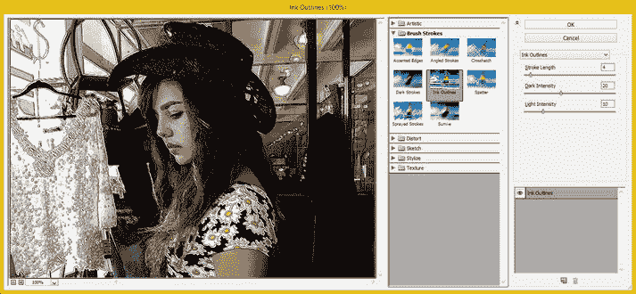

图 11-12. 选择`画笔描边`部分并单击`墨水轮廓`滤镜进行应用后的结果。

如图11-13所示，尽管不完全相同，但你的合成项目已经实现了与在 GIMP 中类似的视觉升级：带有文字的环形元素外部呈现风格化效果，内部则是原始照片级别的图像质量。

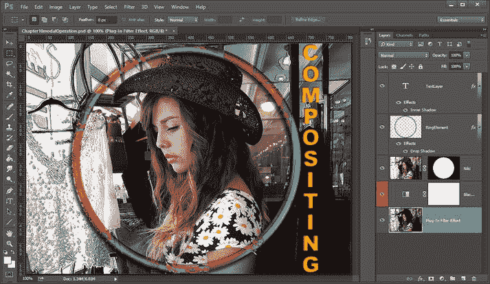

图 11-13. 视觉升级将使底板通过特殊效果进行区分。

在下一章中，我们将更仔细地审视你这个项目的合成管线及其工作原理，同时进一步优化图像合成，并学习 Photoshop CS6 和 GIMP 2.8.14 的一些新软件功能。

### 总结

在这第十一章中，我们详细介绍了 Photoshop 和 GIMP 中的插件滤镜，以及如何将它们用作“程序中的小程序”，为你的数字图像合成管线和项目增添更多特殊效果的震撼力。你了解了 GIMP 的插件仓库，然后使用 GIMP 和 Photoshop 中的滤镜实现了特殊效果。

在 GIMP 中，你通过添加另一个可用于应用特殊效果滤镜的图层，再次实现了无损编辑。这次，基于 GIMP 的工作方式，工作流程（模态操作）更加简单，因为你只需复制一个图层，该图层恰好包含了所需的图层蒙版。

为了在 Photoshop 中实现类似的图像合成处理管线结果，你必须重新调整图层、图层蒙版、调整图层和调整图层蒙版处理管线。这向你展示了如何在 Photoshop CS6 中使用一些非常实用的新技巧、工作流程和艺术滤镜功能。

在 第 12 章 中，我们将学习更多关于数字图像合成软件管线的知识，以及底层究竟发生了什么，从而让你理解为什么模态操作如此重要。