# 12. 数字影像的工作流程：合成

在体验了插件滤镜软件（你可能余生都会乐此不疲地尝试）的乐趣后，是时候回归更高级的“引擎盖下”思考，探究数字图像合成管线的运作方式及其在系统内存中执行的操作。如果你还打算利用本书中的数字图像合成概念和技术，在 `Java`、`JavaFX`、`Android` 或 `HTML5` 等主流平台上开展新媒体编程项目，这至关重要。作为一名程序员，我本身倾向于按此思路思考；在处理复杂的 2D 和 3D 软件包时，了解核心处理层面的运作能带来优势，并帮助你理解软件工具正在执行（以及将要执行）的操作。

正如优秀的程序员能编写出“紧凑”的代码，优秀的图像合成师也能在合成管线（图层堆栈）中使用更少的图层获得更高的效率。我们将在本章探讨这一点，并进一步优化我们试图实现的专业合成项目最终效果。我希望能确保你在本书结束时能完成一个相对复杂的数字图像合成项目。尽管这是一本基础级别的书籍，但我仍力求在信息和体验上都让你物超所值。

本章我们再次从 `GIMP` 开始，以平衡一下学习体验，因为本书大部分章节都是从 `Photoshop CS6` 开始的。你将通过利用现有图层层级中尚未启用的特性，继续完善合成的视觉效果，探索仅使用七个图层能实现多少像素管线处理。我相信你一定会对仅使用 `Photoshop CS6` 和 `GIMP 2.8.14` 中的七个合成图层所能达到的效果感到惊讶。

## GIMP 合成：使用图层特性

要开始在 `GIMP 2.8.14` 中进行数字图像合成，请打开 `Chapter11pluginFilter.xcf` 文件，如图 12-1 所示，然后选择 `Filter Special Effect` 图层，该图层当前包含特效像素和图层蒙版。通过将 `Normal` 模式（表示未启用任何混合模式）更改为 `Value` 混合模式（颜色），为此图层添加混合模式。

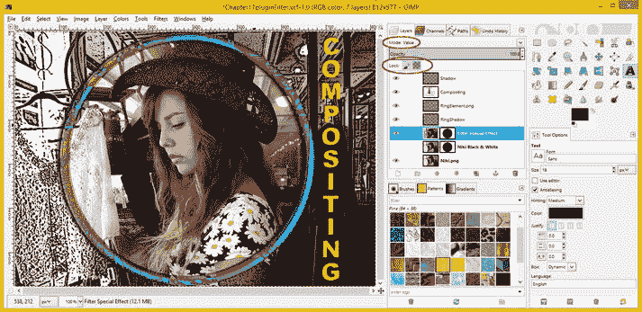

`图 12-1.` 要了解 `GIMP` 中图层特性的使用，首先选择 `Filter Effect` 图层并设置 `Value` 模式

从数字图像合成管线的角度来看，这样做的效果是：从 `Filter Special Effect` 图层下方的 `Niki.png` 图层获取颜色数值，并利用图层蒙版将这些颜色数值应用到特效图层中原来为白色的区域。

由于 `Niki Black & White` 图层被排除在像素处理管线之外（因为眼睛图标（可见性）已关闭），合成引擎会认为颜色 `Niki` 图层位于 `Filter Special Effect` 图层下方。因此，可见性图标不仅会影响你所看到的内容，还会影响图像软件内部合成引擎所处理的内容。

如果你希望合成引擎在不包含颜色数据的情况下重新处理管线，只需通过开启 `Niki Black & White` 图层的可见性来屏蔽颜色数据即可。

如果你已完成对 `Filter Special Effect` 图层的操作，还可以使用 `图层` 面板顶部的 `锁定：画笔` 和 `锁定：Alpha` 图标来锁定该图层的蒙版和像素数据。这些是模态图标，因此你必须先选择要锁定的图层（如图 12-1 所示），然后点击这些图标中的任意一个（或本例中的两个）来锁定图层数据。当你选择不同图层时，若锁定功能已启用，图标会变为蓝色；若未启用，则保持白色。

由于你合成的图像因使用所有这些效果而变得有些“繁杂”，让我们将 `RingElement` 图层重新设置为 `Normal`（无混合）模式，并将金属颜色偏移至酒红色，以更好地衬托金色玻璃文字图层效果。

为此，选择 `RingElement` 图层并将模式设置为 `Normal`，如图 12-2 所示，以恢复青色金属环。接着，使用 `颜色 ➤ 色相-饱和度` 菜单序列打开 `色相-饱和度` 对话框。将 `色相` 在色谱上偏移 140 度，创建出漂亮的酒红色，以平衡你的金色文字。

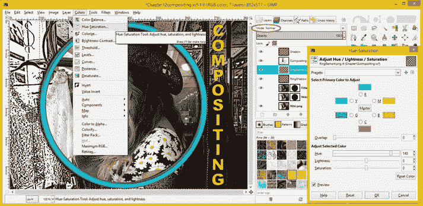

`图 12-2.` 要降低图像中的色彩强度，将 `RingElement` 设置为 `Normal` 模式，并将 `色相` 偏移 140 度

我曾在南加州大学就读，所以这种颜色组合特别吸引人。这个合成图像中接下来需要处理的问题是 `RingElement` 下方投影的真实感。为了使用混合模式添加微妙的暗化效果，选择 `仅变暗` 模式（见图 12-3），并将 `不透明度` 设置为 70%。这将提亮阴影图层，使其看起来更加逼真。

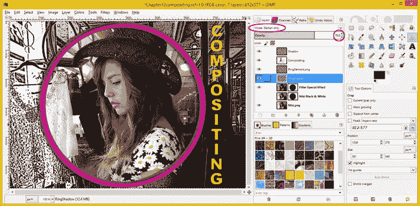

`图 12-3.` 要添加微妙的暗化效果，将 `RingShadow` 设置为使用 `仅变暗` 模式，并将 `不透明度` 设为 70%

`不透明度` 可以通过使用数值微调器设置，也可以在 `不透明度` 级别指示条内拖动灰色区域右侧的垂直条来调整。

既然我们正在利用现有的图层管线，让我们重新开启 `Niki Black & White` 图层，并将其用于增强背景特效中环状区域的细节。

接着，选中 `Niki Black & White` 图层并设置图层混合模式为 `颜色加深`，如图 12-4 所示。这会产生一种彩色玻璃效果，即在将颜色底板像素传递给 `滤镜特效` 图层中的 `明度` 模式进行进一步处理之前，先对其进行过滤。

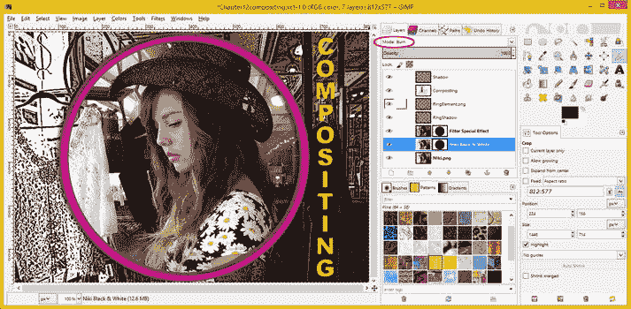

`图 12-4.` 若要创建彩色玻璃效果，请选中 `Niki Black & White` 图层并选择 `颜色加深` 图层混合模式

现在你开始明白，利用本书中我逐章添加的所有内容，如何通过现代合成引擎（借助软件）建立一个相当复杂的像素处理流程。

需要注意的是，你同样可以通过代码来完成所有这些数字图像合成流程中的像素处理，使用的工具包括 `Android Studio`、`Java JDK`、`JavaFX 8`、`HTML5`、`iOS`、`C#`、`JavaScript`，甚至 `CSS3`。

接下来，让我们为当前的合成处理流程增加更多处理，并淡化上一步获得的彩色玻璃效果。我们将再次使用图像合成流程中的 `不透明度` 引擎（滑块）组件来实现。

这一次，我们将利用图层的 `不透明度` 功能，将之前的特效与新的特效进行“混合”，这为我们提供了另一种微调结果的方法。

这将在我们寻求的两种效果之间达成一种视觉上的妥协，从而得到完美的最终视觉效果。

首先，确保仍选中 `Niki Black & White` 图层，然后将 `不透明度` 滑块向左拖动，设置到 `60%`，或者在用户界面的数字输入组件中输入 `60.0`，该输入组件在图 12-5 中 `图层` 选项卡右上角以红色圆圈标出。

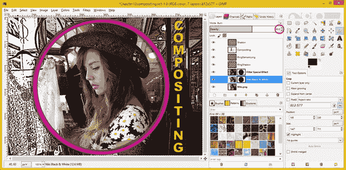

`图 12-5.` 你可以通过将图层 `不透明度` 设置为 `60%` 来减弱 `颜色加深` 模式的效果

这实质上会将两个图层“混合”在一起，并得到如图 12-5 所示的结果。图像包含了一些通过在 `Niki Black & White` 图层中使用 `颜色加深` 模式而产生的强化颜色，其中 60% 的颜色随后会由 `滤镜特效图层` 模式实现的 `明度` 模式进行处理。

现在，让我们从图层的底部（底板或背景图像）向上审视整个合成流程，看看究竟发生了什么。`Niki.png` 是底板 `PNG24` 图像，其图层混合模式设置为 `正常`（无混合），`不透明度` 设置为 `100%`。

`Niki Black & White` 图层通过图层蒙版中的白色像素处理黑白像素图像。这使得其下方的彩色像素能够穿过蒙版的黑色区域，并仅使用蒙版的白色区域将 `颜色加深` 模式算法应用于彩色底板像素。

你的 `滤镜特效` 图层使用相同的蒙版，以 `100%` 强度（`不透明度`）的 `明度` 模式处理了 60% 的 `颜色加深` 模式结果，并将处理结果向上传递给 `RingShadow` 图层。该图层大部分是透明的（包含 Alpha 通道）。它使用几个经过运动模糊处理的像素来应用阴影效果，这些像素以 `70%` 强度（或 `不透明度`）的 `变暗` 模式进行处理，然后向上传递给 `RingElement` 图层。

`RingElement` 图层使用 Alpha 通道，在不使用任何混合模式且 `不透明度`（或像素强度）为 `100%` 的情况下，将色调偏移的葡萄酒色金属环叠加在底部四个图层之上。

`合成文本` 图层也使用 Alpha 通道，使用 `强光` 混合模式，以 `100%` 的 `不透明度`（或像素强度）将文本叠加在底部五个图层上。

`Shadow` 投影效果图层使用 Alpha 通道和“`正片叠底`”模式，以 `100%` 的“`不透明度`”（或强度），将“`内阴影`”效果叠加在“`合成文本`”图层之上。

尝试将这些图层及其 Alpha 通道（或蒙版）、混合模式、“`不透明度`”设置以及像素数据想象成正在通过一个数字图像算法合成流程进行处理。在脑海中形成这个过程的图像，可能有助于你理解幕后发生的事情，并将帮助你成为一名更出色的数字图像合成师。

### Photoshop 合成：图层运用

由于 Photoshop 与 GIMP 拥有不同的代码库和合成管线功能，我们必须采用不同的方式为你的数字图像合成作品添加这些新功能。首先要做的，是选择 `Niki` 图层及其图层蒙版，然后使用 `图层 ➤ 复制图层` 菜单序列进行复制。这将打开 `复制图层` 对话框，如图 12-6 所示，在对话框中，将该图层命名为 `特殊效果颜色混合`，完成图层设置后，该图层功能将提供相应效果。然后，点击 `确定` 按钮创建新图层，以便控制特效中的精细颜色混合。

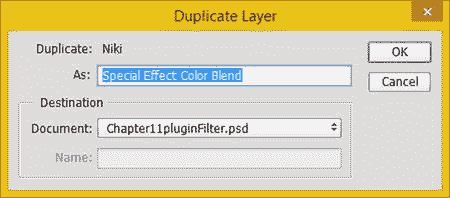

图 12-6. 使用 `复制图层` 对话框将图层命名为“`特殊效果颜色混合`”

你需要控制圆环外部的颜色饱和度混合，因此请反转图层蒙版，如图 12-7 所示。

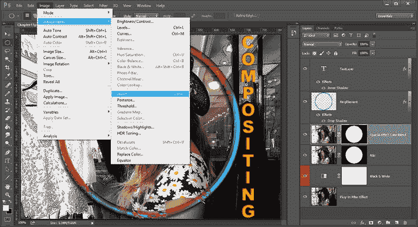

图 12-7. 为控制圆环外部的颜色饱和度混合，请反转 `特殊效果颜色混合` 图层的蒙版

请注意，您可以选择特定图层内的图层蒙版，如图 12-7 所示，通过带有四个边角区域的白色轮廓进行选择。选中后，使用 `图像 ➤ 调整 ➤ 反相` 菜单序列，您会看到图层蒙版已被反转，如图 12-8 所示，并且它现在影响的是 `圆环元素` 的外部区域，而非内部区域。如果将此图层保留为 `正常` 混合模式，并设置 `100% 不透明度`，则无需使用此图层，因为你可以直接操作调整图层来混合颜色。稍后，我们将为其附加高级模式和透明度，以模拟我们本章前面使用 GIMP `2.8.14` 所做的操作。

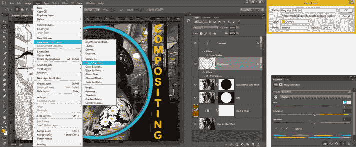

图 12-8. 为 `RingElement` 图层添加调整图层

接下来需要执行的操作是：选择 `圆环元素` 图层，设置 `正常` 模式，并将颜色偏移为酒红色。在 Photoshop 中，这可以通过使用调整图层以非破坏性方式完成。使用 `图层 ➤ 新建调整图层 ➤ 色相/饱和度` 菜单序列，如图 12-8 所示。

将新图层命名为 `圆环色相偏移 140`（指代 140 度），并设置我们用于标记调整图层的橙色。

切勿仅仅为了有趣而给图层着色！你应该有充分的理由；在此例中，我们使用橙色来突出显示调整图层。

Photoshop 的 `色相/饱和度` 对话框与 GIMP 类似，允许你将滑块拖动到 `140` 的设置，或者直接将数值输入右侧的数值文本数据输入字段。

接下来，再次选择 `特殊效果颜色混合` 图层，设置 `颜色`（数值）模式（GIMP 称之为“数值”模式），并将 `不透明度` 值设为 `50%`。

这将降低你在图 12-8 中 `圆环元素` 外部看到的饱和度，并为你带来更微妙（且更专业）的效果。

结果如图 12-9 所示，同时显示了选中的图层，以及用红色圆圈标出的 `模式` 和 `不透明度` 设置，它们位于截图的右上方。

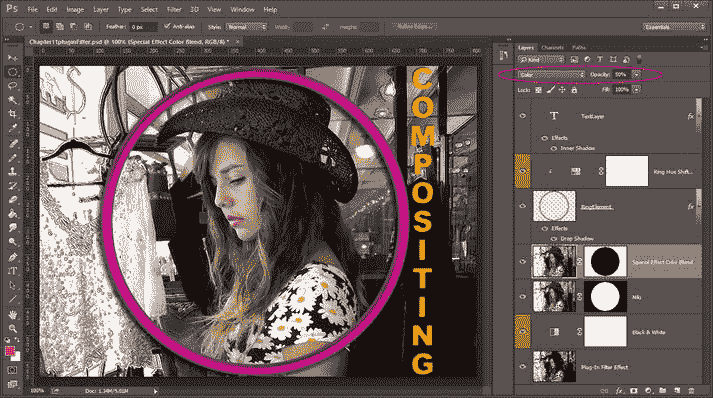

图 12-9. 你可以将 `颜色` 模式和 `不透明度` 设置为 `50%`，以获得特殊效果混合

你在 GIMP 中进行的下一步升级是让圆环的投影看起来更真实。在 Photoshop 中实现此目的的方法是编辑 `投影图层样式`，其对话框如图 12-10 所示。由于我们在 GIMP 中使用了 `仅变暗` 模式，我们将使用下拉菜单选择等效的 `颜色加深` 混合模式，并匹配在 GIMP 中也使用的 `60% 不透明度` 设置。这将提供更真实的阴影。

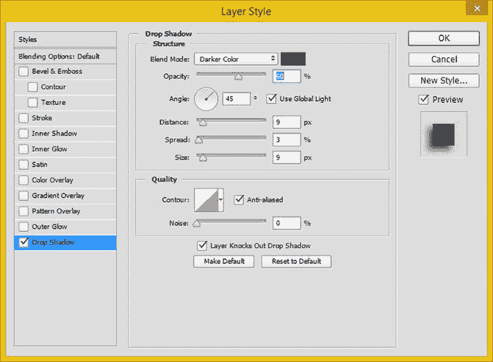

图 12-10. 为了在 Photoshop 中提供更真实的阴影，请将 `投影` 更改为使用 `颜色加深` 模式

我们在 GIMP 中执行的最终操作是，通过在 `Niki.png` 彩色图层上方的 `Niki 黑与白` 图层中应用 `加深` 混合模式，来增强背板特效数字绘画算法（滤镜）应用的颜色和对比度。

在 Photoshop 中，我们可以通过在 `黑白` 调整图层上设置 `颜色加深` 模式来实现这一点！调整图层可以应用其数字图像调整算法，然后将该结果也通过混合模式算法进行处理。这允许你将多个合成管线处理特效“堆叠”到单个图像合成特效图层中。

毕竟，这就是本章的重点：如何最大限度地利用数字图像软件包的合成能力，以便使用最少的图层获得最大的效果。

在图 12-11 中，我将 `不透明度` 设置为 `60%`，以减弱 `颜色加深` 模式算法的应用效果，这与我在 GIMP 中的操作完全相同。如您所见，尽管使用了不同的插件滤镜来创建特效，但您已经获得了同样专业的结果。

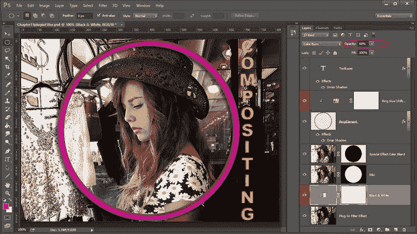

图 12-11. 在 `黑白` 图层上设置 `颜色加深` 模式和 `60% 不透明度` 的结果

让我们从图层堆栈的底部向上查看合成管线流程，了解其内部的实际运作情况。在 Photoshop 中，你的 `插件滤镜效果` 是背板，同样采用 `正常`（无）混合模式和 `100% 不透明度`。这与使用 GIMP 设置此合成的方式显著不同，这一点值得注意。

然后，你的 `黑白` 调整图层使用 `黑白` 算法创建黑白像素图像，并将该数据传递给 `颜色加深` 混合模式算法。

所有这些图层内像素管线处理都应应用于 `插件滤镜效果` 图层的每个像素，正如全白的调整图层蒙版所规定的那样，该蒙版描述了数字图像合成中所有像素的完全不透明度处理。

`Niki` 图层主要使用一个图层蒙版，配合 `正常`（无混合）模式和 `100% 不透明度`，在 `圆环元素` 内部（及其边缘下方）的原始（未处理）模特图像的圆形蒙版区域上叠加图像。

`特殊效果颜色混合` 图层使用同一张 `Niki` 图像，但使用相反（反转）的图层蒙版，在 `圆环元素` 的外部区域（及其边缘下方）叠加彩色像素。

设置 `50% 透明度`（混合），并通过 `颜色` 模式算法处理 `圆环元素` 外部此图层下方图层的像素，使你能够为你应用的 `黑白` 特效滤镜添加一些颜色。

`RingElement` 图层主要利用一个 Alpha 通道和一个 `投影效果 (fx)` 算法子图层，使用 `正常`（无混合）模式和 `100% 不透明度`（全像素强度），在底部四个图层之上叠加一个青色金属环。

你的 `圆环色相偏移 140` 调整图层应用色相偏移算法，调用正向的 `140` 度色相偏移，以复现你在 GIMP 中使用的相同酒红色。