# 13. 数字图像的数据占用：优化

既然我们已经学习了如何使用数字图像合成软件包中的强大功能来创建专业的数字图像（你甚至可以以此为基础开创一份收入丰厚的职业），现在是时候来看看如何将这些数字图像合成作品输出或“导出”为高度优化的文件了。在本章中，你将学习数据占用优化的相关考量，以便你能够根据当前需求，以正确的格式导出（保存）数字图像文件。本章的目标是使用尽可能少的字节数来创建包含你数字图像合成管线成果的文件；也就是说，为你当时所处的任何数字应用场景，提供你最终的视觉图像多媒体资产。

如果你计划使用本书中的合成概念和技术创建的图像，并将其应用于你的新媒体编程项目（例如使用 Java、JavaFX、Android 和 HTML5 这些流行且广泛的平台），这一点至关重要。

由于我是一名程序员，我将在本书的接下来两章中，专门讲解如何优化（第 13 章）和集成（第 14 章）数字图像资产，并与数字交付成果（我习惯这么称呼），例如网站和应用程序，进行衔接。

### Photoshop 优化：存储为 Web 所用格式

要开始优化，请打开 `Chapter12compositing.psd` 文件，如图 13-1 所示，然后依次选择 文件 ➤ 存储为 Web 所用格式 菜单。

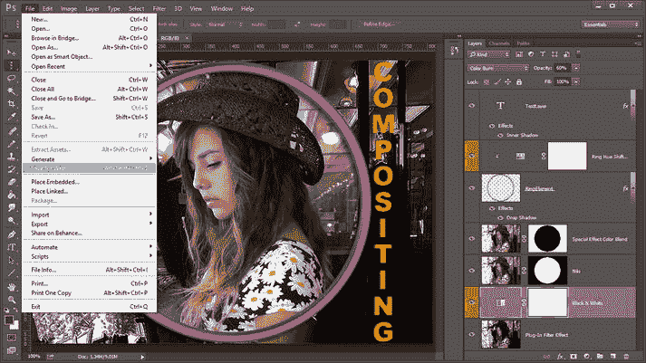

**图 13-1.** 要在 Photoshop 中启动优化过程，请依次选择 文件 ➤ 存储为 Web 所用格式 菜单

这将打开“存储为 Web 所用格式”对话框，如图 13-2 所示，就这个实用工具而言，它更像一个命令控制台。它包含一个预览区域，可显示左侧当前设置的效果，以及用于平移、缩放和颜色取样的工具图标；控制台左下角有数据占用信息打印输出；右上角是设置选项；右下角是缩放（重采样）工具。

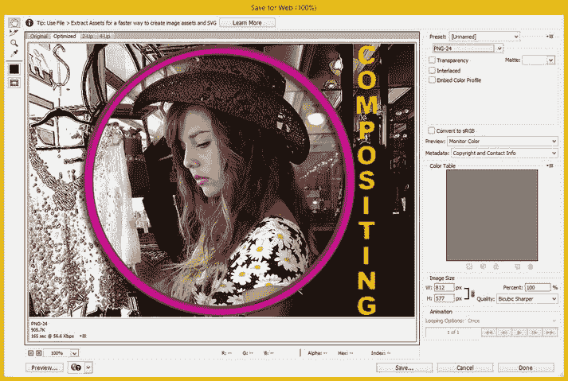

**图 13-2.** 要获得最高质量的结果，请使用文件格式下拉选择器选择 PNG-24

Photoshop 在提供图像数据优化控制面板方面做得非常出色，特别是与 GIMP 中的数据占用优化工作流程相比。它允许你选择设置、查看结果、微调这些结果，甚至完成通常需要退出对话框才能完成的操作，例如图像的重新采样（缩放）。

获得最高质量结果（同时也是最大数据占用）的方式是使用 PNG-24 格式，该格式也可写作 `PNG24`，如图 13-2 所示。

此格式也支持 alpha 通道；因此对话框右上角会出现“透明度”选项。如果勾选此选项，文件将变成 PNG-32（也可写作 `PNG32`），因为你增加了一个 8 位的透明度数据平面。

如果你正在导出一个对象及其蒙版（例如本书中使用的 `RingElement.png`），你应该使用“透明度”选项。“交错”选项可能会增加数据占用的开销，因为它会为文件大小增加额外的字节。该选项允许图像在慢速连接下“流式传输”，这样随着图像数据通过网络到达，图像就能逐步显示在屏幕上。显然，此选项与网页设计、开发和用户体验密切相关。

当你下拉文件格式选项列表时，你会看到还有一个 PNG-8 选项，用于使用索引颜色格式，我们在第 5 章中介绍过。我们接下来就看看这个。

#### 索引颜色格式：使用更少颜色来减小文件大小

通过 `PNG-8` 索引颜色算法选项（如图 13-3 右上角下拉菜单中所选），您可以设置颜色选择算法、颜色数量、抖动类型和程度，以及一个**交错**选项。

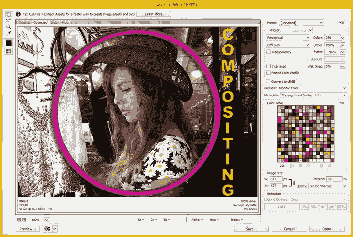

图 13-3. 从文件格式下拉选择器中选择 `PNG-8` 将使您能够从众多额外的索引颜色优化选项中进行选择

如果您选择了**透明度**，则需要一种**蒙版**颜色，因为只支持 1 位（仅黑白，无灰度值）的 Alpha 通道，该通道没有抗锯齿（灰度）值。选择 `PNG-32` 会得到比选择 `PNG-8` 好得多的合成（边缘质量）效果，因为它使用 8 位或 256 级灰度来表示其 Alpha 通道数据。因此，只要可能，请始终使用 `PNG-32`，因为它能以完美的质量呈现任何基于 Alpha 的对象。

`PNG-8` 选项带来的数据体积缩减比 `PNG-24` 高出 332%——从 906K 减小到 273K。当您设置或调整这些不同选项时，此对话框（优化引擎）会计算出新的数据体积，并显示在显示器左下角，同时还会显示对于使用老式 56KB 调制解调器连接的用户，传输所需的时间。

正如您在 Niki 脸颊区域所看到的，使用索引颜色格式时确实存在质量折衷。如果像素足够小，并且您使用了扩散抖动，这将不会引人注意。小像素常见于打印机、高分辨率图像以及现代“超精细点距”消费电子设备中。

`PNG-8` 压缩算法（或称**编解码器**）比 Compuserve 的 `GIF` 索引颜色编解码器更新，因此能提供更好的数据体积效果。我使用相同的设置截取了一张截图（图 13-4），向您展示 `GIF` 压缩结果为 307KB。这多了 12% 的数据体积，因此对于这张图像，单从算法角度看，`PNG-8` 比 `GIF` 效率高 12%。`GIF` 设置及数据体积结果可见图 13-4。我使用 `GIF` 的唯一原因是它的动画功能。这被称为 aGIF、AnimGIF 或动画 GIF 索引颜色文件格式。

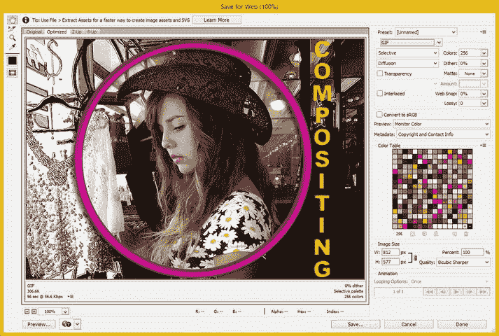

图 13-4. 要比较 `GIF` 的压缩能力，请从右上角的文件格式下拉选择器中选择 `GIF`

因此，如果您使用动画，请使用 `GIF`；如果您使用静态（静止）的索引颜色数字图像，请使用 `PNG-8`。接下来，让我们看看有损的 `JPEG` 编解码器，以便了解它如何改变原始图像数据，从而减小数据体积。

#### 有损压缩：使用 JPEG 减小文件大小

从图 13-5 的下拉菜单中选择 `JPEG` 真彩色算法选项后，您可以设置一个质量级别和数值（程度），这将告诉 `JPEG` 算法可以改变多少原始图像像素质量。在其下方，有一个**渐进式**选项可以勾选；它类似于索引颜色中的**交错**选项，但使用它会导致更小的文件大小，而不是更大的文件大小！

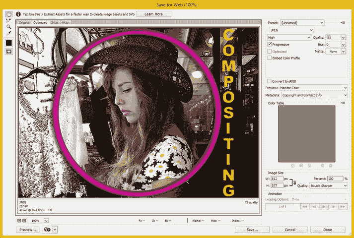

图 13-5. 要设置质量级别和数值（程度），请使用文件格式下拉选择器选择 `JPEG`

您还可以使用右上角的**模糊**复选框对图像应用模糊因子。当与 `JPEG` 算法一起使用时，模糊会减少数据体积，因为边缘，特别是锐利（高相邻像素对比度）的边缘，对于 `JPEG` 算法来说是难以高效优化的。如果您要使用模糊，请在模糊下拉菜单中使用一个较小的值。

正确使用 `JPEG` 算法的方法是调整**质量**百分比，同时观察此对话框左下角的视觉预览质量和最终的数据体积。您必须决定在数据体积缩减和图像质量之间如何权衡，这取决于您对图像的预期用途。在此例中，我使用了 75% 的高质量设置并启用了渐进式下载，得到了 233KB 的数据体积，比 `PNG-24` 的数据体积小了 389%。`JPEG` 质量值在 60% 到 100% 之间通常能带来极佳的视觉效果；低于 20% 的值则通常不行。

#### 图层可见性：选择要保存的像素

在我们探讨遵循相同原理的 GIMP 数据占用优化（因为它使用相同的图像编解码器）之前，我想先向你展示一个同时适用于 Photoshop 和 GIMP 的原则。我只会以 Photoshop 为例来演示这个原则，因为完全相同的原则在 GIMP 中同样适用。

你可能已经自行推测到了，`存储为 Web 所用格式`（Photoshop）和`文件导出`（GIMP）引擎只会将可见图层的数据保存到你的图像文件中。因此，如果你想保存一个包含圆环内 Niki 图像的 `PNG-32` 文件以便在其他地方使用，就需要关闭 `文本图层`、`特效色彩混合`、`黑白`、`插件滤镜效果`和`效果`（`RingElement` 子图层），如图 13-6 所示。

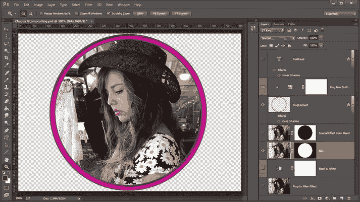

图 13-6.
你可以关闭那些不希望其数据出现在最终导出图像文件中的图层

这将创建一个酒红色的金属环环绕着 Niki，并完美地蒙版在透明背景之上，如图 13-6 以及 Photoshop 的`存储为 Web 所用格式`预览（图 13-7）所示，因为我正在以 `PNG-32` 文件格式导出。

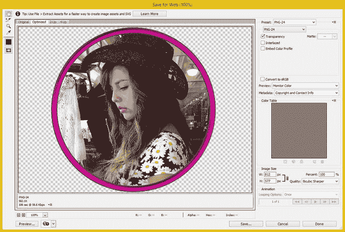

图 13-7.
选择 `PNG-24` 和`透明度`以创建 `PNG-32`

如果你勾选`透明度`选项，如图 13-7 所示，Alpha 通道将显示为棋盘格图案，就像在 Photoshop 中一样。如果你不选择此选项，导出的图像将使用白色背景。

此时，你可能在暗自思忖：如果我在选择`存储为 Web 所用格式`之前，让`投影图层`样式保持选中状态会怎么样呢？我们接下来就会探讨这个问题，看看 Photoshop 是否会自动将 `FX` 设置对话框中的透明度数据放入 alpha 通道中。我相信你会对结果感到满意！

为了观察一下，请点击选中你的`投影效果`可见性眼睛图标，并重新打开 `RingElement` 投影效果，如图 13-8 屏幕右侧灰色（选中）的 `RingElement` 图层下方所示。

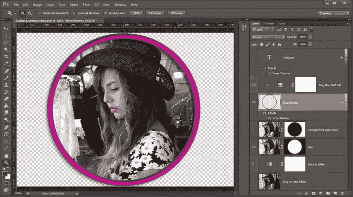

图 13-8.
为了给 `PNG32` 添加投影，请点击选中你的`投影效果`可见性图标

正如你在图 13-9 的`存储为 Web 所用格式`对话框中所见，投影具有你所期望的微妙透明度，因此这个透明对象确实会携带其自身的阴影。

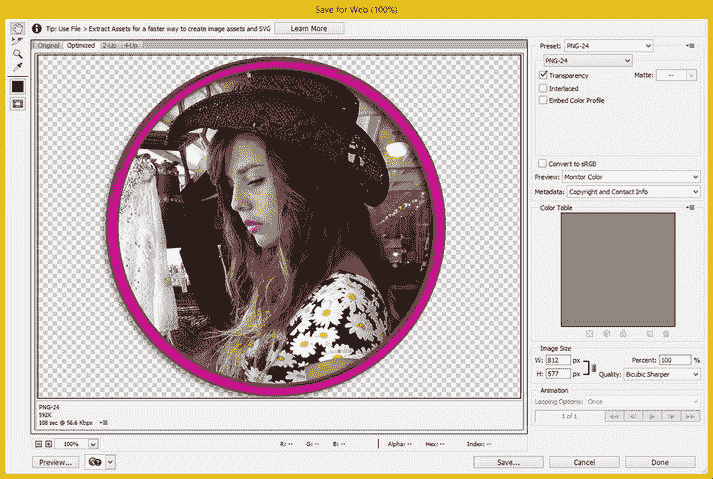

图 13-9.
要创建 `PNG-32`，请选择 `PNG-24` 和`透明度`

如果你打算创建额外的特效，请务必在图像尺寸的底部增加十几个像素的高度，这样投影效果的底部就不会被裁切掉。

正如你已了解到的，这应该通过使用`画布大小`功能来实现，而不是使用`图像大小`功能（后者会缩放图像，只会使被裁切的阴影伪影（错误）变得更大、更明显）。

使用`画布大小`会使画布变大，以便投影特效的底部有足够的空间（像素）来渲染完整的投影，包括使其看起来更逼真的淡出部分。

现在我们准备来看看 GIMP 的 `文件 ➤ 导出为`工作流程，这与 Photoshop 的差别很大。

### GIMP 优化：文件 ➤ 导出为

在 GIMP 中，保存文件或“导出”文件远没有在 Photoshop 中那么直观。然而，如果你了解 GIMP 文件导出系统的工作原理，就可以通过使用 GIMP 的 `文件 ➤ 导出为`菜单序列，完成你可以在 Photoshop 中实现的几乎任何操作。

让我们打开 `Chapter12compositing.xcf` 文件（如图 13-10 所示），来看看文件导出在 GIMP 中是如何工作的。然后，按照 `文件 ➤ 导出为`菜单序列操作，调出`导出图像`对话框，该对话框与任何标准操作系统的`文件保存`对话框非常相似，只是它的按钮上写着`导出`，而不是`保存`。

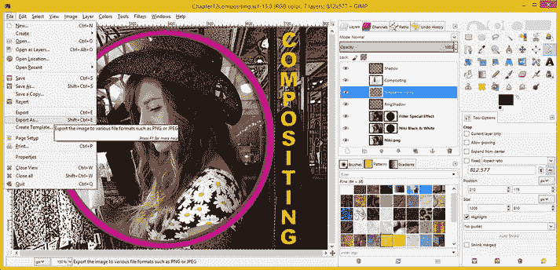

图 13-10.
要在 GIMP 中调出`导出图像`对话框，请使用 `文件 ➤ 导出为`菜单序列

如果在 GIMP 中使用 `文件 ➤ 保存`或 `文件 ➤ 另存为`，你将保存 GIMP 图像合成项目本身，该项目使用 `.XCF` 文件扩展名，这是 GIMP 的原生格式，在许多（甚至任何）其他平台上都不受支持，即使是诸如 `HTML5`、`Java`、`JavaFX` 或 `Android Studio` 这样的开源平台也不例外。

`导出图像`对话框将根据`文件名`扩展名选择图像文件格式编解码器。我们将 `PNG-24` 格式文件命名为 `Chapter12compositing.png`，如图 13-11 中高亮显示的那样。

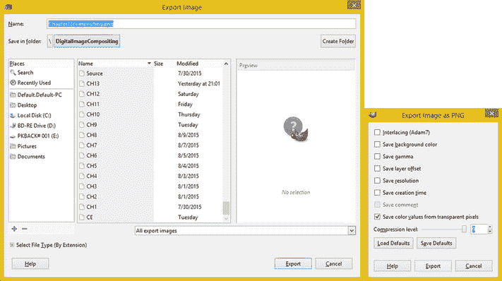

图 13-11.
要在 GIMP 中导出文件，请输入 `filename.png`，选择所需的选项，然后点击`导出`按钮

GIMP 判断是使用 `PNG-24` 还是 `PNG-8` 的方式是查看合成的`颜色模式`设置，我们在第 5 章中介绍过，它位于`图像`菜单下的`模式`子菜单中。

一旦你点击`导出`按钮，它将打开`文件格式选项`对话框——在这个例子中是`将图像导出为 PNG`——允许你选择要使用的选项和`压缩级别`，如图 13-11 右下角所示。

如图所示，我选择了`保存透明像素的颜色值`，并将压缩级别设为最高值 `9`，其他选项保持未选中状态，以节省文件的数据占用空间，因为我正在使用的数字图像合成应用程序不需要这些选项。

注意图 13-11 的右下角，你还可以保存和加载默认设置，因此，如果你有某些选项组合，可以酌情使用唯一的文件名保存它们。这样，在图像数据占用优化工作流程的这个阶段，你就不必每次都勾选选项复选框了。

要将文件保存为 `GIF`，只需将扩展名更改为 `.gif` 并点击`导出`按钮。如果你正在使用`真彩色`模式，GIMP 会将文件转换为索引颜色，并弹出`将图像导出为 GIF` 设置对话框，如图 13-12 所示。我也得到了这个错误对话框，如图右上角所示，所以我选择了`裁剪`选项来修剪未使用的透明区域。

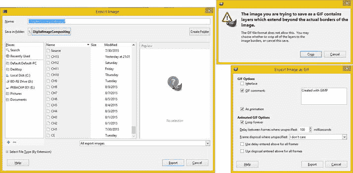

图 13-12.
要将文件保存为 `GIF`，请输入 `filename.gif`，选择所需的选项，然后点击`导出`

如果你想将文件保存为 `JPEG`，请将扩展名更改为 `.jpg`，点击`导出`按钮，然后在`将图像导出为 JPEG` 对话框（如图 13-13 右侧所示）中设置选项。勾选`在图像窗口中显示预览`复选框，即可像使用 Photoshop 的`存储为 Web 所用格式`功能时那样（也需要）预览你的设置效果。

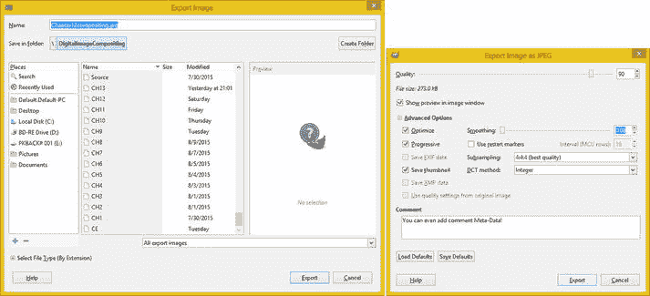

图 13-13.

要将文件保存为 JPEG 格式，请输入 `filename.jpg`，选择所需选项，然后点击**导出**按钮。

**优化**和**渐进式**选项可用于减小 JPEG 文件的体积。你可以使用**保存缩略图**选项为桌面保存一张缩略图。此外，你还可以通过**平滑度**滑块应用模糊效果。我使用了 `0.08` 的值来应用模糊，虽然你看不到这种模糊，但它能提升压缩效率。

你甚至可以指定高级的**子采样**配置，还能指定 JPEG 编解码器主算法将使用哪种 DCT（离散余弦变换）方法。

接下来，让我们复现之前在 Photoshop CS6 中的操作：导出一张 PNG-32 图像，该图像在透明 Alpha 通道背景上居中放置了*环元素*和*Niki* 模特照片。

由于你使用的 GIMP `2.8.14` 数字图像合成结构与 Photoshop 合成结构不同，我们需要采用不同的工作流程来实现此目标。接下来我们就讨论这个问题，完成这部分后，本章关于数据占用空间优化的内容就结束了。

### 在 GIMP 中创建带遮罩的 PNG-32 对象

为了创建带遮罩的 PNG-32 对象，你首先需要将第二层和第三层使用的遮罩转移并反转（我尝试过拖放，但没能成功），然后将其应用到第一层（底层）。

实现此操作的工作流程是：选中第二层或第三层，然后右键点击该图层，选择**将遮罩转换为选区**选项，如图 13-14 所示。

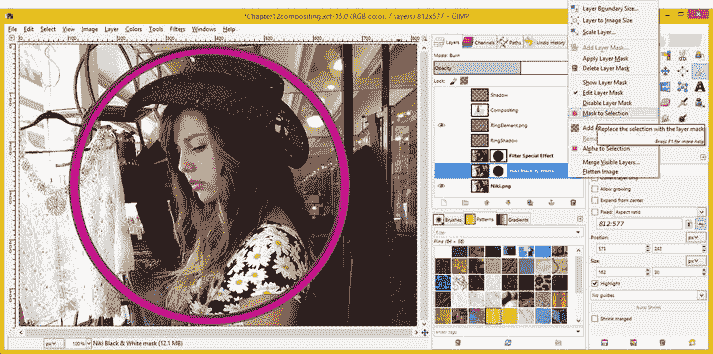

**图 13-14.** 要将图层遮罩传输到临时选区集，请选中该图层遮罩并使用**将遮罩转换为选区**选项。

我们需要使用以下工作流程，将图层遮罩从*滤镜*和*黑白*图层桥接到尚未具有图层遮罩的 `Niki.png` 颜色图层：**将遮罩转换为选区**、**反转选区**、**选择目标图层**以及**添加图层遮罩（选区成为遮罩）**。

接下来，使用 **选择 ➤ 反转**菜单序列反转选区，如图 13-15 所示。

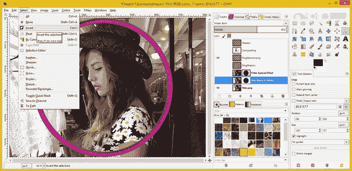

**图 13-15.** 要反转遮罩（作为选区），请使用 **选择 ➤ 反转**。

你选中的源图层是*滤镜特殊效果*还是*Niki 黑白*并不重要，因为它们都拥有相同的图层遮罩，你可以在**反转选区**操作之前将其转换为选区。但是，在使用**添加图层遮罩**之前，你必须选中 `Niki.png` 图层。

需要注意的是，你的选区存储在系统内存中，并不依附于任何特定图层——直到你使用**添加图层遮罩**将其附着到图层上！

现在你可以添加图层遮罩了。为此，请选中你的 `Niki.png` 图层，然后右键点击并选择**添加图层遮罩**选项。在弹出的对话框中，勾选**选区**选项并点击**添加**按钮，如图 13-16 所示。这会将反转后的选区转换为一个图层遮罩，该遮罩看起来与其他两个图层遮罩（白色背景上的黑色圆形区域）完全相反。

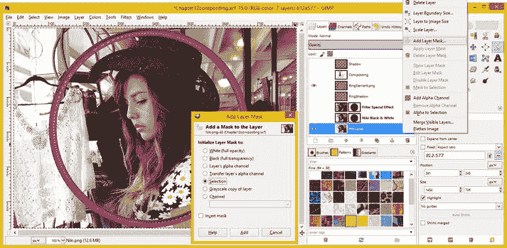

**图 13-16.** 要添加图层遮罩，请选中 `Niki.png` 图层，右键点击选中的图层，然后选择**添加图层遮罩**。

如图 13-17 所示，这为你带来了期望的结果——在一个透明背景上，酒环金属元素内的彩色摄影模特图像——该图像正通过 Alpha 通道数据创建。如果你使用 `.png` 扩展名导出，你将得到一幅 PNG-32 图像，正如你所愿。

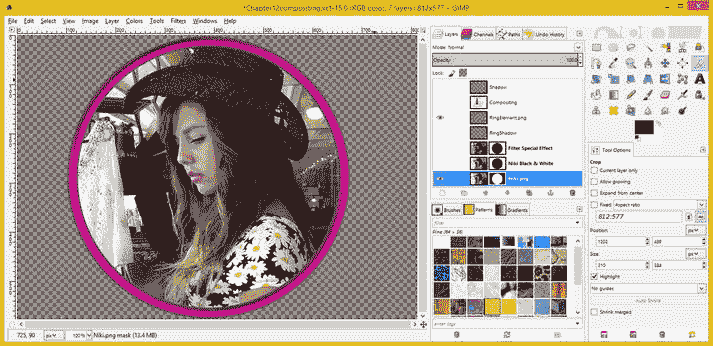

**图 13-17.** 将反转的选区转换为图层遮罩后，`Niki.png` 的图层遮罩现在与第二层和第三层完全相反，如**图层**调板中选中所示。

我们将在第 14 章中继续探讨文件导出，届时我们将介绍如何使用各种开源编程语言和平台“桥接”数字图像合成。

### 本章小结

在本章中，我们回顾了在 Photoshop 和 GIMP 的**文件存储为 Web 所用格式**和**文件导出为**工作流程中的数据占用空间优化。我们研究了针对三种最常用的数字图像文件格式——PNG、GIF 和 JPEG——如何执行这些工作流程。你首先学习了如何在 Photoshop 中优化这些文件，然后了解了图像合成中的图层可见性如何影响保存到文件格式中的内容，最后你了解了可以在 GIMP `2.8.14` 中使用的完全相同的工作流程。

在最后一章中，你将了解更多关于桥接你在数字图像合成软件包中的工作所涉及的一些重要考量，并审视一些最流行的编码环境，如 Python、Java、JavaFX、HTML5、CSS3、JavaScript 和 Android Studio。

