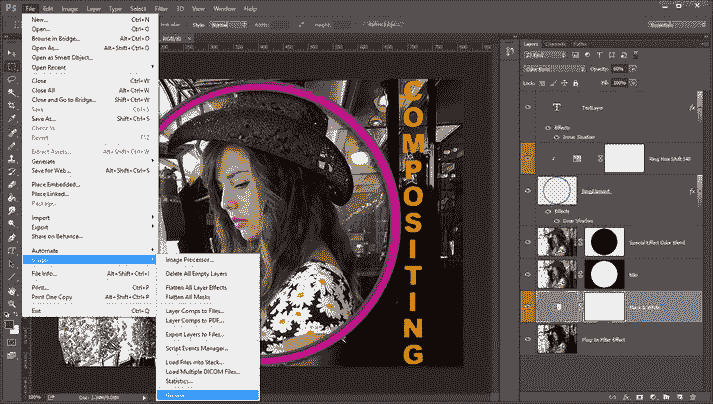
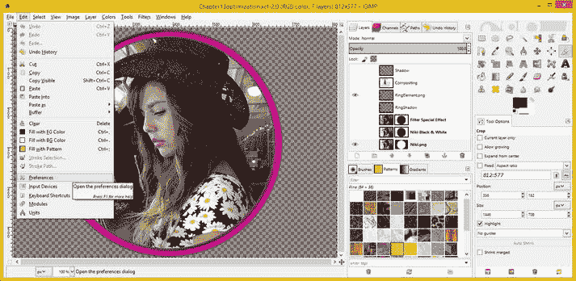
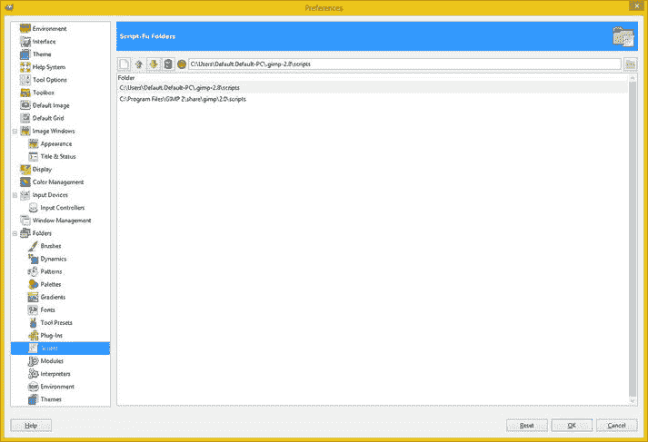
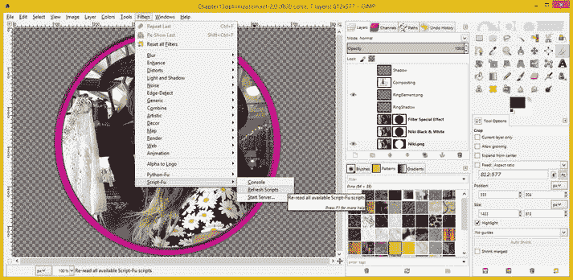
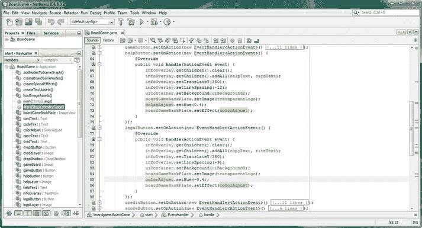
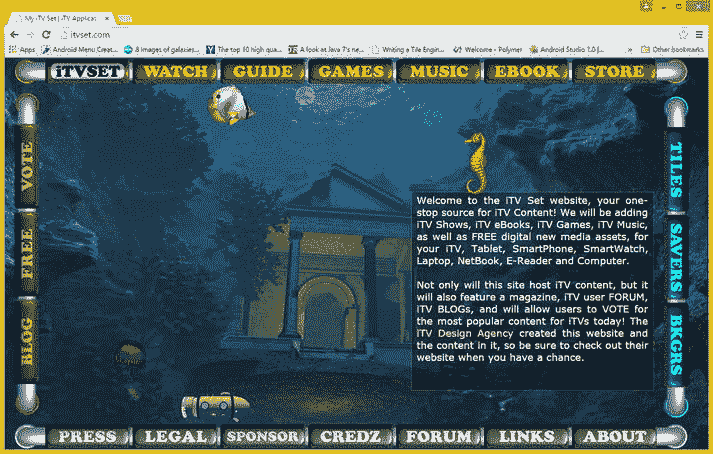
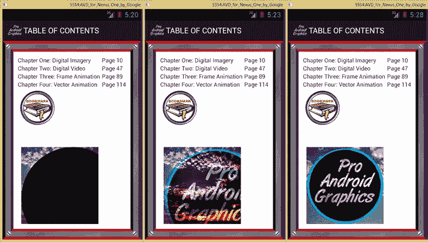
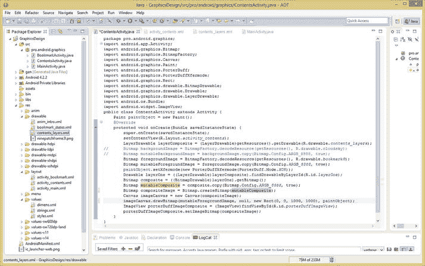

# 14. 数字成像自动化：编程

既然我们已经了解了如何利用这两款数字图像合成软件包中的强大功能创建专业数字图像，并将它们导出为最流行的文件格式，那么是时候来审视这些编程平台本身了，以防你想将自己的数字图像合成职业生涯提升到新的高度。在本章中，你将了解 GIMP（Python）和 Photoshop（JavaScript）使用的内部编程语言，以及支持数字成像的外部编程语言，如 C# (.NET)、ObjectiveC (iOS)、Java (Android Studio, Linux)、JavaFX、JavaScript、HTML5 和 CSS3 (WebKit 浏览器, HTML5 OSs)。

如果你计划在自己的编程项目或开源开发平台中使用本书合成概念和工作流程中的数字图像，或者你有兴趣了解更多关于将编程纳入你丰富技能库的知识，这些都是需要了解的重要信息。

本章将涵盖的平台运行着消费电子行业绝大多数硬件设备，包括 Java（Android Studio 和 WebKit）；JavaFX（Android、iOS、Windows、Linux、Mac OS X、Solaris）；以及带有 CSS3 和 HTML5 脚本的 JavaScript（WebKit 浏览器）。

本章不会教你编程——这需要多本书籍（以及编程经验）才能做到——但如果你将当前的数字图像合成之旅延伸到新媒体软件开发领域，它会向你展示可能实现的目标。本章将要涉及的所有内容均可免费用于商业用途，你可以轻松下载 Android Studio (IntelliJ)、Java 和 JavaFX (NetBeans)、HTML5 (NetBeans) 以及 Python (Eclipse)。

我们将从 Photoshop 和 GIMP 的内部脚本语言开始，然后介绍流行的开放平台。

## 内部脚本语言：自动化

Photoshop 和 GIMP 都包含几种用于在其软件包内自动化工作流程的脚本语言。这种自动化在计算机行业中传统上被称为“批处理”——这个术语源于旧的大型机时代，当时员工在白天输入数据，然后在晚上由计算机在员工睡觉时进行批处理。我将在本章的前两节中介绍 Photoshop 和 GIMP 使用的各种脚本语言，然后在剩余章节中审视其他支持数字图像合成管线的语言。这将向你展示可用的选项，以便将你的数字合成管线从数字成像软件桥接到编程。

### Photoshop 脚本：JavaScript 与 ExtendScript

脚本是一系列编程语句，用于指示数字图像合成应用程序执行一系列任务，或者我称之为“操作”或工作流程。像 Photoshop 这样的 Adobe 应用程序支持基础的脚本语言，包括 JavaScript 和 Adobe 自有的扩展 JavaScript，称为 ExtendScript。JavaScript 是一种脚本语言，最初作为 ECMAScript 开发，用于使网页具有交互性。事实上，它至今仍被用于此目的，并且其功能强大到足以编写休闲游戏。

如果你使用 Mac OSX，还可以选择使用 `AppleScript`；如果使用 Windows，则可以使用 `VBScript`（也称为 `VBA` 或 `Visual Basic`）。`VBScript` 是 `Visual Basic` 的一个版本，由微软开发的编程语言，但不包含该程序的所有高级功能。`VBScript` 可以通过 ActiveX Scripting 与宿主应用程序通信。你可以在互联网上找到许多专业的 `VBScript` 编辑器。如果你使用 Microsoft Office，可以通过 `工具 ➤ 宏 ➤ Visual Basic 编辑器` 菜单序列找到内置的 `Visual Basic` 编辑器。我推荐使用 JavaScript，因为它是开源的，因此不像 `AppleScript` 和 `VBScript` 那样具有专有性。

你应该养成使用 `.jsx` 扩展名（而非标准的 `.js` 扩展名）保存 JavaScript 脚本的习惯，以防你升级使用 Adobe ExtendScript (JSX) Photoshop 脚本语言。

如果你喜欢分享自己的脚本作品，JavaScript 相比 `VBScript` 和 `AppleScript` 还有另一个重要优势：JavaScript 既可以在微软 Windows 操作系统上使用，也可以在苹果 Macintosh OSX 上使用。

在 Photoshop 中，你只能从应用程序内部访问 `.jsx` 文件。使用 JavaScript 的另一个优势是，你必须从应用程序外部运行 `AppleScript` 或 `Visual Basic` 脚本。学习使用开放平台语言进行编程有很多好处，因为这类语言正在被广泛使用。

要编写 JavaScript 脚本，你可以使用文本编辑器，也可以使用 Adobe 应用程序提供的 ESTK ExtendScript 工具包。ESTK 具有许多功能，使其比文本编辑器更容易使用。这些功能包括内置的语法检查器，可以识别脚本中的问题所在，以及无需将脚本保存到文件即可直接从 ESTK 运行脚本的能力。此功能可以为你节省大量的开发时间，因为你需要多次测试脚本才能使其正常工作。

要运行 JavaScript 脚本（无论是由你还是他人编写），请使用 `文件 ➤ 脚本 ➤ 浏览` 菜单序列，如图 14-1 所示。

图 14-1. 要加载 JavaScript，请转到 `文件 ➤ 脚本 ➤ 浏览`

正如你可能已经推测到的，GIMP 中的脚本编写与 Photoshop 中的非常不同，并且使用不同的语言。

### GIMP 脚本：Scheme、Script-Fu 和 Python

GIMP 有两种不同复杂程度的脚本编写方式。GIMP 内置了一种名为 `Scheme` 的 LISP 编程语言变体，它运行一种名为 Script-Fu（嘿，大家跟我一样猜的！）的脚本语言。此外还有 `PyGIMP`，它是一个支持 GIMP 功能的定制版 Python，可以访问底层 API（应用程序编程接口）调用。`PyGIMP` 比 `Scheme` 更强大。因此，如果你要编写复杂的插件，请使用 `PyGIMP`；如果是要自动化工作流程，请使用 Script-Fu。

你可以在网上找到大量免费的 Script-Fu 脚本，通过一个相当简单的工作流程，即可下载并安装到你自己的 GIMP 副本中。下载脚本后，你应该将其复制或移动到你的 GIMP 脚本目录。如果你不知道针对操作系统的脚本目录路径，可以使用 GIMP 的 `文件 ➤ 首选项` 菜单序列打开首选项对话框来查找，如图 14-2 所示。

图 14-2. 要查找操作系统对应的脚本目录路径，请从 `文件 ➤ 首选项` 菜单序列开始操作

打开首选项对话框后，在 `文件夹 ➤ 脚本` 区域查找脚本路径，如图 14-3 所示。我的路径是：`C:/Users/PC-Name-Here/.gimp-2.8/scripts`。

图 14-3. 打开首选项对话框后，在 `文件夹 ➤ 脚本` 区域查找脚本目录的路径

要安装已复制到脚本文件夹的这些脚本，你可以退出并重新启动 GIMP，或者直接刷新 GIMP 的菜单结构。

这可以通过使用 `滤镜 ➤ Script-Fu ➤ 刷新脚本` 菜单序列来完成，如图 14-4 所示。执行此操作后，你的新脚本将出现在某个菜单中。如果找不到它们，请在 `滤镜` 菜单下查找。如果它们没有出现在任何地方，说明 Script-Fu 出现了问题，并产生了语法（编程或脚本）错误。

图 14-4. 你可以通过 `滤镜 ➤ Script-Fu` 菜单序列访问 GIMP 脚本

正如你所见，如果你需要在 GIMP 或 Photoshop 中自动化工作流程，这些编程工具完全可以做到。在下一节中，让我们来看看一些最流行平台上的数字图像合成：Java 和 JavaFX、HTML5 和 CSS3，以及适用于 Android 操作系统的 Android Studio。

## Java 与 JavaFX：`javafx.scene.effect` API

使用 Java 编程语言编写的代码可以构建和控制数字图像合成流水线，如图 14-5 所示。背景板图像为 PNG24 格式，3D 标志为 PNG32 格式，脚本文本图像同样采用 PNG32 格式。Java 有一个名为 JavaFX 的库，它支持丰富的新媒体资源，涵盖数字成像、数字音频、数字视频以及 i3D 实时 OpenGL 渲染。我们在本书中使用的大部分数字成像模式、滤镜和效果都位于 `javafx.scene.effects` 库中。Java 可用于 Android Studio、HTML5 浏览器、Windows、Macintosh OSX、Linux 发行版和 Open Solaris OS。JavaFX 应用可以在 Android 和 iOS 上运行；因此，作为全球最流行的编程语言，Java 7 和 8 真正实现了“一次编写，随处运行”。

图 14-5. 使用 Java 和 JavaFX 的图像合成流水线

我正在为即将由 Apress 在 2016 年出版的《Pro Java Games Development》一书编写的游戏启动界面如图 14-5 所示。左上角象限即为启动界面本身，它使用一张 PNG24 背景板图像，叠加 PNG23 合成图像（两张）、文本元素和用户界面按钮元素。

Java 和 JavaFX 代码如图 14-6 所示。JavaFX API 是 Java API 的一部分；因此，JavaFX 就是 Java。在 JavaFX 被 Sun Microsystems 收购（恰好在被 Oracle 收购之前）之前，这两者是独立的编程语言。

图 14-6. Java 和 JavaFX 代码创建启动界面变体

图 14-6 展示了我为两个按钮编写的代码——即“说明”和“版权”按钮，在 Java 代码中分别称为 `helpButton` 和 `legalButton`。我并非意图在本章教授编码；不过，Java 代码足够易于理解，足以解释图 14-5 所示的特定合成流水线的工作原理。

在图 14-6 中，Java 语句 `boardGameBackPlate.setImage(transparentLogo);` 正在使用您现已从本书中熟悉的术语来更换背景板层中的数字图像资源。

Java 语句 `colorAdjust.setHue(0.4);` 将标志的颜色沿色轮偏移 40%（您之前将其偏移了 140%，从青色变成了酒红色）。Java 代码 `colorAdjust.setHue(-0.4);` 则将标志颜色沿色轮向相反方向偏移 40%。用颜色滑块来可视化，这分别相当于向右（正值）偏移 40% 和向左（负值）偏移 40%。

垂直方向（Y 轴）的像素定位通过 `infoOverlay.setTranslateY(350);` 实现，而 Java 代码中的文本间距则通过 `infoOverlay.setLineSpacing(-12);` 语句实现。这就是使用代码创建图像合成的方式！

接下来，让我们看看仅使用基本标记语言（HTML5 和 CSS3）实现的图像合成流水线。

### HTML5 和 CSS3：标记合成

虽然 Java (JavaFX) 是最流行的编程语言，但就使用范围而言，HTML5 和 CSS3 标记语言最为广泛。这是因为后两者在每个浏览器中都有体现，并使用名为 WebKit 的 API，Android 和 iOS 也类似地使用了该 API，因此 HTML5 和 CSS3 在这些操作系统中也得到支持。毫不意外，目前已有多种 HTML5 操作系统问世，它们来自 HTML5 浏览器的制造商，包括 Chrome OS、Firefox OS 和 Opera OS。这些系统用于智能手机、平板电脑和 iTV 设备。例如，松下 iTV 设备使用 Firefox OS；索尼 Bravia iTV 设备使用 Opera OS；谷歌拥有一系列 Chrome 硬件产品；而阿尔卡特在国际上为其智能手机使用 Mozilla Firefox OS。

我使用无损编解码器，并结合 PNG24 和动画 GIF 用于背景板部分，以及 PNG32 用于所有 i3D UI 元素叠加层，合成了 HDTV 分辨率的网站 [`www.iTVset.com`](http://www.itvset.com/)。如图 14-7 所示，整个网站看起来像是一幅真彩色数字图像，但却具有动画效果和交互性。该网站仅使用 24 行 HTML5 代码编写，并且图形图像资源数据的占用空间总量不到 2MB。

图 14-7. 我使用 HTML5 和 CSS3 标记合成的网站

如此小的数据占用空间得益于这种数字图像合成流水线，因为它允许将数字图像资源细化为更小的文件，从而在互联网上实现更快的数据传输速度。

这种数据细化可以类比为沙漏中的沙粒：沙粒越细，在任何瓶颈场景中流动得就越顺畅、越快。

这里使用了许多索引色资源，使得网站看起来像真彩色，但实际并非如此。例如，页面上的所有六个动画 3D 元素都可以使用带 1 位预乘 Alpha 通道的索引色 animGIF 文件格式。我使用平均背景色对反锯齿颜色进行预乘，以在平均周围背景色值中隐藏反锯齿效果。例如，对于蝴蝶鱼，这是一种淡蓝色的水色值。

i3D 用户界面按钮元素采用 PNG32 格式，其中 Alpha 通道可将 UI 无缝合成到网站任何部分的任何背景图像上，包括数字视频、Java (JavaFX) 应用程序、首页上看到的 3D 动画以及全屏图像。

图形元素存放在 HTML5 的 `
` 标签中，CSS3 则用于混合、透明度、定位和交互性。我的代码绝不会以任何方式妨碍右键点击操作，因此在网站开发的任何时刻，您都可以在网站上右键点击“查看源代码”来查看任何代码。文本由 WebKit 在其自身的 `
` 标签区域内渲染，使用 HTML5 定义内容和元标签，并使用 CSS3 定义透明度、字体、颜色、大小以及边距和内边距（文本 `
` 容器间距）值。

如您所见，与 Java 或 JavaFX 一样，HTML5 和 CSS3 可以为您提供一个几乎与您使用 GIMP 和 Photoshop 创建的自定义图像合成流水线一样强大的图像合成流水线。然而，您需要成为一名富有创造力且精通编程的程序员，才能从这些流行的开源计算机编程语言中“挖掘”出这些能力。我保证，这种努力是值得的！

### Android Studio：PorterDuff 类

Google Android 操作系统平台所驱动的智能手机、电子书阅读器、平板电脑、智能电视、游戏机、智能手表以及物联网设备，数量远超历史上任何其他操作系统平台。事实上，从 2013 年到 2016 年，我为 Apress 撰写了一系列 Pro Android 专业书籍，包括《Pro Android Graphics》（2013）、《Pro Android UI》（2014）和《Pro Android Wearables》（2015），目前我正在撰写《Pro Android IoT》（2016）。我在《Pro Android Graphics》中详细讲解了如何使用 `PorterDuff` 像素混合与像素传输模式进行编码。

图 14-8 展示了该书中的一张截图，显示了 Eclipse IDE 中 Nexus One 模拟器上使用的三种不同混合模式。自 Android 5 起，IntelliJ IDE 已成为 Android Studio 开发者进行 Android 应用开发的主要集成开发环境。

图 14-8. 《Pro Android Graphics》中使用 PorterDuff 模式示例的截图

组装这个合成管道的 Java 代码相当复杂，包括一个 PNG24 背景板、一个 PNG32 环形元素、一个 PNG32 3D 标志，以及一个由蒙版（Alpha 通道）控制的黑色填充色，如图 14-9 所示。

图 14-9. 实现合成管道的 Java 代码

下面我将逐一讲解图 14-9 中每条语句的作用，这样你可以看到一个与本书前面章节中熟悉的基于图层的合成管道相匹配的代码合成管道。

在 Android 中，图层被称为 `LayerDrawable`，因此第一行代码通过 `getResources().getDrawable()` 方法调用（即“点链”）将 `contents_layers.png` 资源加载到 `LayerDrawable` 中。

为了测试，我注释掉了 `backgroundImage` 板，因此这里只介绍 `foregroundImage` 板的代码。为了创建图像图层，我创建了一个名为 `foregroundImage` 的 `Bitmap` 对象，然后通过 `BitmapFactory.decodeResource()` 方法调用将名为 `cloudsky.png` 的图像资源加载到其中。

接着，我通过 `.copy()` 方法调用将该 `Bitmap` 对象放入内存，并指定 32 位 ARGB 颜色深度（这也称为“色彩空间”），使其成为可变的（即可更改的）。`ARGB_8888` 表示每个通道使用 8 位数据值。

然后，我在一个 `Paint` 对象上通过 `.setXfermode()` 方法设置了一个 PorterDuff 传输模式（有时称为“混合模式”，尽管严格来说，某些混合模式会传输像素，而不是将它们混合在一起），这里使用了 XOR 模式。

接下来，我创建了一个名为 `layerOne` 的 `Drawable` 对象，然后将一个名为 `composite` 的 `Bitmap` 对象加载到其中，并作为 `mutableComposite` 加载到内存中。

使用该对象，我创建了一个名为 `compositeImage` 的 `Bitmap` 对象。接着，我创建了一个用于绘制的 `Canvas` 对象，命名为 `imageCanvas`，然后将 `compositeImage` 这个 `Bitmap` 对象加载到该 `Canvas` 对象中。

之后，我使用 `imageCanvas.drawBitmap()` 方法调用在 `Canvas` 对象上绘制 `Bitmap` 对象，该方法使用一个 1000 像素的正方形 `Rect` 对象指定绘制区域，并通过 `paintObject` 和作为 `Bitmap` 对象的 `mutableForegroundImage` 来应用混合模式。这就是我指定颜色深度或色彩空间为 32 位（即 `ARGB_8888`）的位图或光栅图像。

我在用户界面设计中创建了一个名为 `porterDuffImageComposite` 的 `ImageView` 来承载（显示）这个数字图像合成管道，然后通过 `.setImageBitmap()` 方法调用加载了该 `ImageView`。

如你所见，这段 Java 代码中包含了许多我在本书中讲解过的元素，而且可以肯定，所有这些概念都得到了本章所涉及的每个主流平台（Java、JavaFX、HTML5、CSS3、JavaScript、Android）领域的支持。

这很大程度上是因为这些平台都是开源的，同样开源的还有所有 Porter Duff 模式、OpenGL、JPEG、GIF 和 PNG 格式、Alpha 通道，甚至包括 GIMP 数字图像合成软件。

由于数字图像合成的所有领域都将“免费用于商业用途”，因此开源平台完全整合这些技术是合情合理的。

对于所有数字图像合成爱好者来说，这无疑是个极好的消息！我希望你们在阅读这十四个章节的过程中，都能享受到学习各种数字图像合成基础知识所带来的乐趣。

### 总结

在这第十四个也是最后一个章节中，我们深入探讨了一些与计算机编程相关的高级主题，以及不同的编程语言如何在数字图像合成软件内部（作为工作流程或特效插件脚本工具）或外部，支持你的数字图像合成工作。这些语言可以通过添加交互性以及其他有用功能，将你的创作提升到新的水平；其可能性仅受限于你的想象力！

首先，我们介绍了 Photoshop 中使用的 VBScript、AppleScript、JavaScript 和 ExtendScript 语言。接着，我们探讨了 GIMP 中用于脚本编程的基于 LISP 的 Scheme 和基于 Python 的 PyGIMP 语言，以及如何在数字图像合成软件包中访问它们，方便你直接使用第三方编写的其他脚本。之后，我们回顾了一些流行的开源平台编程语言，以及如何利用它们创建与 Photoshop 和 GIMP 中相同的数字图像合成效果配置。

我们首先介绍了 Java 及其 JavaFX 新媒体引擎，并看到了该平台如何支持数字图像合成，以及高级混合模式和特效算法。然后，我们审视了 HTML5 和 CSS3，并发现该平台也能仅使用标记语言来实现你在本书中学到的数字图像合成概念和技术，用于网站和 HTML5 操作系统应用等交付成果。

最后，我们探讨了目前使用 Java 7 的 Android 5.3 操作系统，但未来它将能运行 HTML5 和 JavaFX 应用。我们研究了 `PorterDuff` 类和一些高级代码，展示了在 Android 中如何为精通数字图像合成的先进应用编写包含混合模式的合成管道。

我希望你喜欢这本书，以及我在其中讲解的数字图像合成概念、技术和基础知识。现在，去实践吧，并融入你周围的环境！