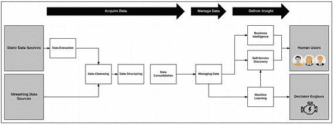
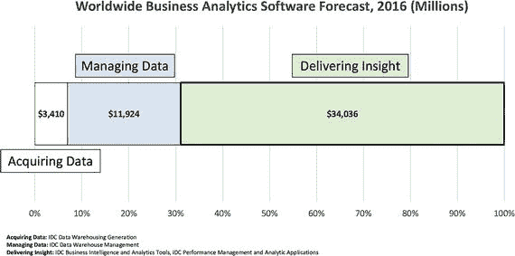

# 1. 基础

## 分析价值链中的颠覆

分析业务正蓬勃发展。技术咨询公司 IDC 估计¹，2015 年分析服务、软件和硬件的总支出超过 1200 亿美元；到 2019 年，IDC 预测支出将增至 1870 亿美元，年复合增长率为 11%²。

那么，既然分析领域如此热门，为何行业领导者却举步维艰？

- Oracle 的云收入增长³未能抵消软件和硬件销售的下降⁴。

- SAP 的云收入增长，但软件总收入持平⁵。

- IBM 报告⁶连续 16 个季度收入下滑，随后进行了大规模裁员⁷。

- 尽管 Azure 云收入增长 120%，微软的表现仍低于⁸分析师预期。

- 预测分析领导者 SAS 报告⁹连续五年收入仅有个位数低增长；执行副总裁离职¹⁰。

- 数据仓库领导者 Teradata 在产品收入连续四年下滑后重组了领导团队¹¹。

产品质量并非问题所在。每家公司都提供被行业分析师高度评价的产品：

- Forrester 和 Gartner 均¹²认可¹³IBM、SAS、SAP 和 Oracle 为数据质量工具的领导者。

- Gartner 评定¹⁴Oracle、SAP、IBM、Microsoft 和 Teradata 为数据仓库领域的领导者。

- Forrester 评定¹⁵Microsoft、SAP、SAS 和 Oracle 为敏捷商业智能领域的领导者。

- Gartner 认可 SAS 和 IBM 为高级分析领域的领导者¹⁶。

答案，一言以蔽之，就是颠覆 ¹⁷。强大的力量正在重塑整个行业：

- 经济数字化转型以及存储成本急剧下降，催生了数据洪流。

- 数据源数量呈爆炸式增长。数据源无处不在：本地、云端、消费者口袋、车辆、RFID 芯片等。

- 数据治理因数据所有权分散而变得复杂，职能部门高管控制着日益增长的技术支出份额。

- 开源软件商业模式提供了越来越有吸引力的替代方案，取代了商业软件许可。

- Hadoop 生态系统日益取代传统数据仓库；R 和 Python 取代了商业分析软件。

- 云计算实现的弹性商业模式削弱了传统的软件许可和供应模式。

- 广泛可用且成本低廉的计算能力，使得深度学习等计算密集型技术得以实践。

来看看 Teradata 的遭遇。2012 年底，该公司开始未能实现销售目标；2013 年初，它报告销售额绝对下降，令投资者震惊。管理层找出了各种借口；华尔街则惩罚了其股票，在整体牛市中将其股价腰斩。

从 2013 年到 2016 年初，Teradata 持续未能实现销售和盈利目标；华尔街将其股价打压至仅为 2012 年峰值的一小部分。虽然人们倾向于将问题归咎于领导不力，但 Teradata 屡次未能准确预测自身销售和利润，这表明情况有误。世界已经改变；曾经助力 Teradata 崛起成为领导者的价值网络已不复存在；管理者用来理解市场的思维模式也已失效。

## 颠覆性创新

哈佛商学院的克莱顿·克里斯坦森于 1997 年提出了颠覆性创新理论¹⁸。我们在此简要总结该理论；如需深入探讨，请阅读克里斯坦森的著作：

- 行业由价值网络构成，包含由各种关系联结的供应商、渠道和买方的集合。

- 当创新创造出新的价值网络时，便会颠覆行业。

- 并非所有创新都具有颠覆性。许多创新是由市场领导者为维持其竞争地位而引入的。

- 颠覆性创新往往由外来者引入。

- 纯粹的技术创新并不具有颠覆性；关键在于新技术所支撑的商业模式。

克里斯坦森指出了两种颠覆形式。**低端颠覆**发生在行业领导者提升产品的速度快于客户接受这些提升的速度时；颠覆者以“足够好”的产品和更优的价值主张进入市场。颠覆者的创新使其能够以低于行业领导者的成本为客户服务。

**新市场颠覆**发生在颠覆者通过创新服务于那些未被行业领导者覆盖的客户时。

在本书中，我们将讨论两种颠覆。第一种是分析价值链内部的颠覆性创新（我们将在本章稍后探讨这一概念）。第二种是由分析创新带来的行业颠覆。

分析价值链内部存在许多颠覆的例子：

- `Hadoop` 从底层颠覆了数据仓库行业。`Hadoop` 并不能做到关系型数据库能做的所有事情；但它做得足够好，能为合适的用例提供有吸引力的价值主张。刚推出时，相对于数据仓库设备，`Hadoop` 的功能相当有限。但对于那些不需要数据仓库设备性能和特性的应用来说，`Hadoop` 的灵活性和低成本极具吸引力。当老牌供应商在努力维持停滞甚至下滑的收入时，`Hadoop` 分销商却以两位数的速度增长。

- `Tableau` 几乎开创了敏捷自助式发现的市场。`Tableau` 本身并没有提供主流商业智能工具所不具备的图表和可视化功能。但是，当商业智能供应商瞄准大型企业的 `IT` 部门并不断添加功能时，`Tableau` 却以一款简单、易用且功能多样的工具瞄准了最终用户。结果，`Tableau` 在五年内收入增长了十倍，超越了许多其他商业智能供应商。

由分析带来的行业颠覆例子相对较少，但也确实存在：

- `Fair, Isaac and Co.` 于 1987 年推出的通用信用评分几乎开创了全国性的信用卡市场。在此之前，银行只向与其有既定关系的本地客户发行信用卡。统一的信用评分使得少数几家大型发卡机构能够在没有先前关系的情况下，从普通人群中识别出有信用价值的客户。

- 当美国证券交易委员会于 1998 年批准受监管证券的电子交易时，市场参与者迅速开始开发算法，以便在市场间套利、在指数和标的股票之间套利，并利用其他短期机会。那些最有效地将机器学习应用于电子交易的交易者，以其他交易者的损失为代价获得了增长。

这两种颠覆的相对重要性取决于读者的视角。对于计划为其组织投资分析技术的读者来说，分析价值链内部的颠覆十分重要。面临颠覆风险的技术是高风险投资；它们可能使用寿命缩短，其供应商也可能遭受业务冲击。对面临颠覆的技术采取“观望”态度是明智之举，仅仅因为未来价格很可能会下降。

对于初创公司和分析从业者来说，由分析带来的颠覆是关键。为了成功，初创公司必须颠覆其所在行业。利用分析来使产品差异化，是创建颠覆性商业模式或开拓新市场的一种方式。

要理解颠覆性分析，我们首先必须了解分析的现状及其驱动因素。在本章的剩余部分，我们将讨论推动分析需求的因素，并概述分析价值链。最后，我们将概述本书其余章节的内容。

## 对数据驱动洞察的需求

在一个被颠覆的世界中，生存的关键是残酷地重新审视业务流程，从问题出发反向思考。

分析是从数据中系统地产生有用洞察的过程。在商业中，人们利用洞察来解决五个核心问题之一：

- 制定业务战略。

- 管理业务单元。

- 优化业务流程。

- 开发产品和服务。

- 使产品和服务差异化。

这些问题中的每一个都需要不同类型的洞察，而提供这些洞察需要特定的人员、流程和工具。

### 制定业务战略

我们将“战略”狭义地定义为组织最高领导层（即“高管层”）做出的选择。许多人可能参与战略的制定，但在每个组织中，最终责任都有一个明确的承担者。战略分析是指任何支持战略决策的分析。

什么使一个问题具有“战略性”？战略性的问题和议题有四个显著特征：

- 风险很高；做出正确选择与否会带来重大后果。（否则，该问题会被授权处理。）

- 该问题超出了现有政策的范围；没有既定的规则允许在较低层级做出决策。（可能存在政策冲突，或者情况史无前例。）

- 战略性问题不可重复；在大多数情况下，组织只处理一次战略性问题，之后便不再重复。（可重复的决策通过政策在较低层级处理。）

- 对于最佳选择没有明确的共识。（如果每个人从一开始就认同最佳选择，那就没有分析的必要了）。

战略性主题的例子包括：

- 技术或产品投资

- 并购

- 业务组合重组

- 业务重组

- 品牌建设、品牌重塑和产品定位

- 危机管理

由于战略分析的风险很高，紧迫感也同样强烈；一些决策，如并购提案，可能有严格的时间限制。由产品故障、自然灾害或其他问题引发的危机可能具有实际的生死攸关的影响。

战略分析的交付物包括报告、图表、可视化内容和演示文稿。由于决策风险高，高管们会仔细审查提交的分析。分析必须“无懈可击”，特别是当结果与领导层的先验信念不符时。用于产生分析的方法必须清晰。

由于战略分析具有临时性和不可重复性，企业数据仓库（`EDW`）最多只能发挥辅助作用。在大多数情况下，`EDW` 中的数据是内部的，并且支持具有明确定义需求的现有流程。支持战略决策所需的数据通常来自外部来源，可能难以获取，并且可能只需要使用一次。

企业经常聘请外部顾问来提供战略分析。虽然内部人员可能缺乏处理特定类型问题的经验，但外部专家在类似问题上拥有深厚的经验。公司也重视顾问的独立性和中立性，因为战略决策需要解决内部相互竞争的利益。

### 管理业务单元

管理分析为组织中最高领导层下一级的决策提供支持。在此层面，分析需求与特定职能相关联，例如财务部、产品管理、市场营销、商品运营、运营部等。

管理分析有三种不同的应用场景：

- 绩效衡量

- 绩效优化

- 业务规划

绩效衡量是企业商业智能（`BI`）系统的优势领域。当数据及时可靠、报告易于使用且指标与业务目标保持一致时，`BI` 的效果非常显著。大多数组织希望以统一的方式衡量业务单元，因此通常会集中实施报告系统，而不是让业务单元管理者自行评估。

# 分析价值链条

## 概述

指标能告知管理者哪些实体（例如品牌、产品、营销活动、门店和销售代表）表现良好，哪些表现不佳。优化则提供指导，说明如何通过调整预算投入来改善或优化绩效。例如，营销组合分析会估算不同渠道和项目上的支出所带来的收入影响，从而使组织能够将营销预算重新分配到最具成效的用途上。

最后，业务规划是一个跨职能设定目标并使其保持一致的过程，管理者在此过程中为其运营支出和资本支出提供依据。在大型组织中，业务规划流程高度模板化和结构化。预测是业务规划的重要工具。

管理分析的交付成果与战略分析类似。详细的分析和预测可能以可查询的“多维数据集”或交互式工具的形式呈现。

### 优化业务流程

此层面的优化比职能领导层面的优化更为精细。例如，在市场营销中，`CMO` 需要所有主要项目有效性的概要信息；`CMO` 的优化问题涉及在各项目之间调整预算。而项目管理者则致力于最优化地将项目、价值主张和创意方案匹配给个人客户和客户细分群体。

分析可以通过多种方式优化业务流程。示例如下：

- 自动化决策引擎

- 目标定位与路由系统

- 运营预测系统

自动化决策引擎应用旨在平衡风险与回报的规则。嵌入式分析有助于优化标准并确保决策规则反映实际经验。决策引擎比人类决策者速度更快，并能做出更优决策。例如支付授权系统和信用审批系统。

目标定位与路由系统会评估传入消息或请求的特征，并将其引导至相应的代理或子系统。分析技术能从请求中提取关键信息，从而省去人工评估和分类环节。例如客户服务运营中的邮件路由系统以及银行反洗钱系统中的 `SAR` 调查路由系统。

运营预测系统预测影响运营的关键指标，使组织能够相应地调配资源。分析技术利用历史数据检测流量模式，并将资源转移到最需要的地点或班次。例如根据预期店内客流量来安排班次的零售排班系统，以及将警员引导至预测的高犯罪率区域的警察巡逻路线系统。

优化业务流程的分析通常嵌入在生产系统中，并且通常必须实时运行。这意味着需要流式分析，我们将在第六章中介绍。其分析交付成果是以软件形式实现的可被机器消费的模型。

### 开发产品与服务

组织中的开发过程涵盖了从创意头脑风暴到正式科学研究（例如制药实验室）再到“臭鼬工厂”原型开发的方方面面。因此，可能涉及的分析范围极其广泛。开发分析可分为两大类：

- 用于生成假设的分析

- 用于检验假设的分析

管理者执行或委托他人进行假设生成分析，以识别未满足的消费者需求或现有产品中的空白。这包括分析外部数据（如消费者调查和消费数据）、分析运营数据，或评估针对某种疾病的临床治疗报告等活动。

在产品开发过程的后期阶段，管理者会检验关于特定产品概念、原型或小批量试产的假设。此阶段的分析可能包括分析临床试验数据以确定药物疗效；以及分析测试市场数据以评估产品特性的价值，或类似的活动。

对于从业者而言，在该领域，专业领域知识比纯粹的分析技能更为重要。（人们不会期望一位专门研究帕金森病的生物医学专家能轻易转而为一支对冲基金开发交易算法。）分析流程必须高度灵活且敏捷，根据产品开发周期来适应手头的特定问题。

### 差异化产品与服务

我们区分支持产品开发的分析与作为产品本身的分析或嵌入式分析。

对于前述四种用例而言，洞察力的“消费者”在组织内部——可能是最高管理层、职能经理、流程参与者或产品开发人员。然而，越来越多地，分析为组织外部的终端消费者提供洞察。在这些情况下，分析使产品差异化，并使其在市场中脱颖而出。

随着消费者可获取信息的数量和种类呈爆炸式增长，洞察力本身成为了一种有价值的商品。在这个世界里，最强大的分析应用往往不被人视为分析技术。谷歌是分析应用吗？谷歌使用了分析技术，包括内容分析和图分析，并产生了一种特定的洞察。

在线零售能够提供比实体零售商多得多的大量独特商品，这给消费者带来了购物难题：面对如此多的商品可供选择，我们应该买什么？推荐引擎被广泛使用，它利用机器学习为个人客户寻找最优商品。大多数读者应该熟悉一些突出的例子，这些例子都使用了机器学习：

- 脸书利用用户的个人资料和点赞来优化信息流。

- 网飞等流媒体视频网站利用用户的评分和其他信息来个性化推荐。

- 探探依据用户资料和“左滑/右滑”来配对用户。

- 亚马逊利用数据驱动的相似度评级来展示与用户已选商品兼容的产品。

- 声田利用用户先前的偏好和内容分析来优化音乐流。

嵌入式分析的成功取决于软件工程；最终产品必须经过严密封装以确保可靠性和易用性；在大多数情况下，它必须实时运行。

## 分析价值链条详解

一旦我们理解了洞察的需求，就可以定义一个价值链条。分析价值链条始于数据，终于洞察，通过一系列步骤将数据从低价值逐步转化为高价值，如图 1-1 所示。

图 1-1. 分析价值链条

当然，我们也可以比这里展示的更精细地定义价值链条。从宏观层面来看，分析价值链条包含三个主要组成部分：获取数据的步骤、管理数据的步骤以及交付洞察的步骤。将洞察交付给人类或机器用户是链条中的关键环节；一个能够成功获取和管理数据却无法交付洞察的系统是失败的。

### 获取数据

所有数据都来源于原始出处；从数据源捕获数据是价值链条的第一步。捕获和管理数据的流程有各种不同的称呼，例如 `提取/转换/加载` (`ETL`)、`数据集成` 或 `主数据管理` (`MDM`)。`ETL` 指的是数据的物理移动；数据集成解决跨数据源整合的挑战；而 `MDM` 则负责流程的治理和管理。商业软件供应商提供软件来管理通过价值链条的数据流、清理数据并将其加载到分析数据存储中。根据 IDC 的报告，Informatica 在商业市场中处于领先地位，其次是 SAS 和 IBM。Talend、Pentaho 和 JasperSoft 提供开源核心软件，而 Apache NiFi 是一个完全开源的项目，用于管理数据流。（我们将在第三章讨论开源软件的商业模式。）

### 数据源

任何产生数据的系统或设备都是分析的潜在数据源。大多数数据源本身并不适合作为分析平台，原因如下：

- 分析的大部分价值来自于跨数据源的数据整合。很少有单一数据源能够丰富到足以单独提供有价值的洞察。

- 生产系统和设备很少保留重要的历史数据，会截断对于即时事务处理需求并非必要的数据。

- 生产系统和设备通常设计用于支持事务处理工作负载，而非分析工作负载。

数据源可以是静态的或流式的。静态数据源会积累新数据，直到用户通过查询或提取操作请求数据。流式数据源则持续发布数据，将数据“推送”给订阅者。

### 数据提取

价值链条的第一步是从一个或多个静态源系统中“提取”数据。虽然通常被称为“提取”，但在大多数情况下，数据是被复制而非提取。

对于流式数据源，此步骤并非必要。

管理生产系统的组织（例如 IT 组织）很少允许自由访问生产系统，原因有二：

- 提取操作不能干扰事务处理。

- 生产系统通常包含必须遵守数据安全协议的敏感信息。

因此，拥有生产系统的组织通常控制提取过程，并根据服务级别协议实施该程序。

在 20 世纪 80 年代数据仓库时代初期，IT 组织“拥有”几乎所有潜在的分析数据源。正如我们在第二章中讨论的，业务流程的数字化转型导致由职能部门高管控制的技术支出份额不断增加。这反过来意味着职能部门高管也控制着数据源。

与数据仓库早期相比，另一个根本性的变化是生产系统越来越多地使用云计算和 `软件即服务` 平台。这意味着数据源位于本地物理环境的可能性越来越小。

### 数据清洗

来自源系统的数据可能是“脏”的：可能不准确、不完整或包含错误。数据清洗软件会扫描传入的数据，并检查各项是否满足有效性测试且内部一致。当软件发现异常时，它会强制清洗该项，或者将其排队放入异常文件中以供人工分析。

数据清洗确保数据符合业务逻辑，但不能保证数据的准确性。验证准确性需要与参考值进行比较，而这种参考值通常只在实验室条件下才能存在。

很少有组织拥有足够的资源来持续研究数据清洗的异常情况。在实践中，大多数数据问题都是由具有特定领域知识的实际用户发现的。

在分析价值链条中清洗数据违反了质量大师 W. 爱德华兹·戴明提出的企业转型 14 条原则¹⁹中的第三条：

> 停止依赖检验来达成质量。消除大规模检验的必要，改为从一开始就将质量融入产品之中。

与其在装配线末端检验汽车并报废不合格的产品，更明智的做法是将质量设计到流程中，制造高质量的汽车。同样，在生成数据的源系统中直接构建数据质量，比在链条下游捕获和纠正错误要明智得多。

### 数据结构化

在本书中，我们避免使用“非结构化数据”这个术语。所有数据都有结构。有些数据的结构尚不为人所知，有些数据则很难或无法映射到作为关系数据库基础的实体-关系框架中。此类数据的示例包括文本、音频、视频、图像和日志文件。

在传统的数据仓库实践中，数据整合过程也是一个标准化过程。这解决了数据结构上的差异，使所有数据都符合统一的数据模型——否则，数据就无法整合。

有些数据从一开始就是结构化的，因为生成数据的源系统使用关系数据库进行存储。如果源系统的数据模型与分析价值链条中管理结构化数据的数据模型一致，那么这些数据就可以直接使用。

然而，即使源数据是结构化的，它也可能与分析价值链条中的数据模型不一致。在这种情况下，数据必须被重新结构化或映射到所需的数据模型。

有些数据是半结构化的：数据本身包含了关于其结构的信息。在这种情况下，组织必须决定是在存储之前就对数据进行结构化，还是仅仅对其进行编目，并将结构化推迟到使用时再进行。

日志文件可以使用特殊工具进行解析和结构化处理。文本、音频、视频和图像通常无法结构化到实体-关系框架中；然而，机器学习工具（本章后面会讨论）可以扫描内容以识别重复项或将其分类。

### 数据整合

为了获得洞察，组织会整合来自多个数据源的信息。在大多数情况下，数据源缺乏共同的数据结构，原因如下：

*   数据源可能包含来自不同制造商、按不同标准生成数据的系统和设备。

*   大型组织可能有许多在不同时间实施或通过并购获得的不同系统。

*   源系统和设备可能产生难以映射到关系数据模型的数据，例如日志文件。

近来，随着文本、图像、音频和视频数据的增长，标准化变得困难甚至不可能。在这种环境下，“整合”仅仅意味着文件的聚合，而结构化则被推迟到分析的查询阶段。

### 数据管理

分析型数据存储是指以利于分析的格式，存储从原始来源收集的数据的任何存储库。每个分析价值链都有一个或多个中间数据存储，它们有不同的名称：数据仓库、数据集市和数据湖。在大型、成熟的组织中，可能存在许多分析型数据存储。

每个分析型数据存储都应服务于三个主要目的：

- 积累历史数据

- 跨数据源收集数据

- 对数据进行编目和组织

积累历史数据是分析型数据存储的关键功能，因为原始数据源通常不执行此功能。未保留在分析型数据存储中的数据将直接丢失。

如前所述，产生洞察通常需要结合来自多个来源的数据。将数据整合到单个存储库中，通过为分析师节省时间来增加价值，就像超市为食品购物者节省时间一样，否则他们需要分别前往肉铺、农产品店、面包店等。

未经编目的数据等同于丢失。想象一个没有索引的巨大图书馆，书籍只是随机堆放在书架上。谁会使用这样的图书馆？在分析型数据存储中，数据经过索引且可搜索，其血缘关系也得到记录。

分析型数据存储还必须支持组织的数据安全策略。由于数据保存是一个关键优先事项，它们必须具备备份、恢复和灾难恢复能力。

理论家们就数据仓库、数据集市和数据湖等术语的定义展开了漫长的辩论；他们还争论每种架构的相对优势。这些辩论是学术性的，且浪费时间；没有哪个组织可以在不参考实际最终用户的情况下，抽象地为分析型数据存储选择最优架构。

当然，当数据被创建时，我们不一定知道最终用户将如何想要产生洞察。在没有明确需求的情况下，组织应以尽可能低的成本，以原子形式对数据进行编目和归档，将更复杂的数据集成工作推迟到出现明确的业务案例时再进行。

甲骨文在构建分析型数据存储的软件商业市场中处于领先地位，其次是 IBM、微软、Teradata 和 SAP。根据 IDC 的数据，前五大供应商控制了 80% 的市场份额。在第四章中，我们将讨论 Hadoop 生态系统，它是主流商业平台的开源替代方案。

### 交付洞察

获取和管理数据是分析价值链的重要组成部分，但交付洞察能产生最大的价值。图 1-2 显示了 IDC 按高级类别预测的全球商业分析软件支出；约三分之二的预计支出用于向最终用户交付洞察的软件。这包括用于查询、报告和分析工具；高级分析和预测分析工具；空间分析工具；内容分析工具；以及绩效管理和分析应用的支出。

图 1-2. 分析价值链中的软件支出

在接下来的章节中，我们将概述产生洞察的三大类工具和流程：商业智能、自助式发现和机器学习。

#### 商业智能

我们可以通过简单的量化来解决许多业务问题：

- 我们在 Y 地区销售了多少箱 X 产品？

- 我们每位销售代表在第一季度的销售额是多少？

- 在过去四个季度中，我们按类别划分的销售量是多少？

在每个案例中，都可以通过按维度将事实聚合为度量来回答该问题。例如，在第一个例子中，事实是销售交易；度量是“箱数”；维度是产品和地区。

对于这种形式的问题，使用结构化查询语言 (`SQL`) 对关系数据库进行查询即可提供所需的答案。在第二章中，我们将结合历史背景讨论 `SQL`。

大多数业务用户更倾向于通过商业智能 (`BI`) 工具与数据交互，而不是直接使用 `SQL`。商业智能工具提供图形用户界面和“对业务友好”的数据视图。然而，在后台，`BI` 工具会生成 `SQL` 或另一种查询竞争标准 `MDX`。

报表是数据的格式化视图，通常包含许多单项。通常以表格或交叉表的形式出现，报表包含主要的度量及其计算出的统计量。例如，一个显示按地区划分的销售交易数量及其美元价值的报表，也可以显示根据这些度量计算出的统计量，例如按地区划分的平均交易价值，或跨地区的销售百分比分布。

仪表盘是单个度量、报表和图形化展示的集合，用于汇总关键指标。组织会构建预定义的仪表盘来支持持续的倡议；例如，客户服务部门可能会开发一个仪表盘，汇总许多关键的服务质量指标。

在企业中，量化主要有三种应用。第一种是绩效衡量。管理者在采取行动后，希望衡量其成功与否。此外，管理者对其管辖领域的绩效有着持续的兴趣，前提是“你无法管理你无法衡量的东西”²⁰。

管理者非常看重基于明确定义指标的准确、一致且及时的绩效报告。他们也重视与组织目标明确关联的指标。商业智能工具在绩效衡量方面表现出色，因为它们擅长向大量受众交付一致且可重复的指标。

第二种应用是支持项目和产品开发的交互式探索。对于这种应用，问题的定义不如绩效衡量那么明确；一个问题的答案会引发许多其他问题，类似于剥洋葱。

传统的商业智能工具在这方面的表现不如在绩效衡量中的表现；它们往往相对不灵活，更适合于生产型报表，而非敏捷探索。为维度分析而设计的 `OLAP` 工具比报表工具稍微灵活一些，但对交互性需求高的业务用户可能会直接使用 `SQL`。

第三种应用——业务规划——既需要历史分析，也需要预测。大多数商业智能工具支持简单的时间序列分析，这对许多管理者来说已经足够。在其他情况下，管理者可能会将商业智能工具中的历史数据与专家开发的预测相结合，在电子表格或演示工具中合并这两组数值。

虽然查询、报表和仪表盘是强大的工具，但它们仅限于低维度问题，即问题可以在事实、度和维度的框架内解决。维度是这些工具的一个关键问题。分析师可以轻松地处理显示一维、二维或三维数据的报表；借助图形，四维甚至五维也是可行的。当需要考虑超过五个维度时，分析师必须将问题分解为独立的低维分析；可能的组合数量会随着维度的增加呈指数级增长。

#### 自助式探索

传统商业智能工具过于僵化，无法支持交互式探索。而自助式探索工具则非常适合此类应用。

虽然这类工具有时被称为“可视化”工具，但其图表和图形功能并不比市场上许多其他分析软件包更出色。它们具有三个突出特点：

- 简化了用户界面，易于学习和使用

- 基本的图表和图形功能，与大多数管理者的需求高度契合

- 灵活的“后端”，简化了与多种不同数据源的连接

在商业供应商中，`Tableau Software` 和 `Qlik` 是市场领导者。`Microsoft PowerBI` 和 `SAP Lumira` 在分析师评估中得分也很高[²¹]。

我们将在第九章中更详细地介绍自助式分析。

#### 机器学习

机器学习是一系列算法及其应用规范的学科。它能识别人类用户无法触及的数据模式，并以人类或机器可消费的形式输出结果。

机器学习技术繁多，包含数百种算法及其数千种软件实现。我们在本章和第八章从管理层面讨论机器学习。关于该主题的技术性探讨，已有多本优秀著作[²²]全面介绍机器学习学科及具体技术。

数据科学家将技术分为监督学习和无监督学习。监督学习技术需要包含已知预测结果的训练数据。例如，若想预测哪些潜在客户会响应营销活动，就需要包含目标客户是否响应的数据。

监督学习技术为预测和分类问题提供了强大工具。在分类问题中，待预测结果是类别型（如响应或不响应）；在预测问题中，待预测结果是数值型（如客户未来消费额）。

然而，我们往往无法预知事件的“最终”结果。例如在某些欺诈案例中，交易发生后很久才可能发现其欺诈性质。此时，与其试图预测哪些交易是欺诈，不如用机器学习识别异常交易并标记待查。当我们对特定结果缺乏先验知识，但仍想从数据中提取有价值洞察时，便会使用无监督学习[²³]。

虽然某些机器学习技术表现持续优于其他技术，但很少能预先断定哪种方案最适合特定问题。因此，大多数数据科学家倾向于尝试多种技术并选择最佳模型。正因如此，高性能至关重要——它使数据科学家能尝试更多选项，构建出最优模型[²⁴]。

机器学习在组织中的应用场景极为广泛。监督学习的三种最常见用例是：

**预测。** 估计未来发生但未知的指标发生率或数值。例如，银行在审批贷款申请时预测借款人按期偿还概率；零售商在排班时预测下周客流量。时间维度在此起关键作用。

组织大规模运用预测支持运营决策。例如，现代信用卡业务之所以可行，正是因为发卡机构能快速决策授信额度与授权交易。这类业务依赖基于机器学习开发的预测模型。

**推断。** 估计非未来事件的未知指标概率或数值。例如，零售商通过分析姓氏、街道地址和购买行为推断客户种族。

**归因。** 分解多个因素对目标结果的贡献度。例如，电商平台评估广告曝光对销量的影响；运动队衡量每位球员对获胜的贡献。管理者依赖归因进行预算分配、项目存续等管理和战略决策。

机器学习在内容分析中也有大量应用：

- 文本处理应用从文本中提取特征用于可视化或纳入预测模型。

- 机器学习可进行文档匹配以检测重复或识别抄袭。

- 图像处理可对图像分类，在癌症筛查中识别恶性肿瘤等。

虽然 `SAS` 和 `IBM` 合计占据²⁵机器学习商业软件市场不足 50%的份额，但整体市场集中度低于商业分析其他领域。这主要归因于机器学习的快速创新，以及潜在应用领域的急剧扩张。

来自 `Amazon Web Services`、`Microsoft` 和 `Google` 的云服务有潜力颠覆现有领导者；我们将在第七章讨论。像 `R`、`Python`、`Spark` 和 `H2O` 这样的开源产品正以牺牲商业供应商为代价获取用户；我们将在第三、五和八章讨论。

## 本书概览

第二章简要介绍了商业分析的发展史，涵盖了过去 50 年间分析领域的创新，为理解当前正在影响分析价值链的各项创新提供了背景。

在第三章中，我们探讨了开源商业模式，包括许可和分发。如今，价值链的各个环节都有开源选项可供选择，且企业采用率正在上升。

第四章介绍 Hadoop 生态系统。鉴于 SQL 处理在分析领域的重要性，我们在本章中也涵盖了开源 SQL 引擎。

在第五章中，我们记录了计算机内存成本的快速下降以及大规模内存计算（包括内存数据库和 Apache Spark）的相应兴起。

第六章对流式分析进行了调查。我们简要回顾了流式分析的发展史作为背景，并向读者介绍了开源流式处理平台。

云计算和弹性商业模式正在颠覆软件行业。弹性商业模式尤其适用于分析领域。我们在第七章中探讨了云端分析。

我们在本章中简要总结了机器学习。在第八章中，我们讨论了机器学习领域的最新创新，尤其侧重于深度学习。

在第九章中，我们介绍了自助式分析。Tableau 的自助式模型是分析价值链颠覆的最佳实例之一。

最后，在第十章中，我们提供了一份面向管理者的颠覆性分析手册。我们调查了构建颠覆性平台所需的关键要素——人员、流程和工具。

脚注

1  [`https://www.idc.com/getdoc.jsp?containerId=IDC_P33195`](https://www.idc.com/getdoc.jsp?containerId=IDC_P33195)

2  [`http://www.cio.com/article/3074238/analytics/big-data-and-analytics-spending-to-hit-187-billion.html`](http://www.cio.com/article/3074238/analytics/big-data-and-analytics-spending-to-hit-187-billion.html)

3  [`http://www.forbes.com/sites/laurengensler/2016/03/15/oracle-third-quarter-earnings/#286720039d5d`](http://www.forbes.com/sites/laurengensler/2016/03/15/oracle-third-quarter-earnings/#286720039d5d)

4  [`http://investor.oracle.com/financial-news/financial-news-details/2016/Oracle-Reports-GAAP-EPS-of-050-Non-GAAP-EPS-of-064-Without-the-Effect-of-US-Dollar-Strengthening-Both-Would-Have-Been-4-Cents-Higher/default.aspx`](http://investor.oracle.com/financial-news/financial-news-details/2016/Oracle-Reports-GAAP-EPS-of-050-Non-GAAP-EPS-of-064-Without-the-Effect-of-US-Dollar-Strengthening-Both-Would-Have-Been-4-Cents-Higher/default.aspx)

5  [`http://go.sap.com/docs/download/investors/2016/sap-2016-q1-statement.pdf`](http://go.sap.com/docs/download/investors/2016/sap-2016-q1-statement.pdf)

6  [`https://www-03.ibm.com/press/us/en/pressrelease/49554.wss`](https://www-03.ibm.com/press/us/en/pressrelease/49554.wss)

7  [`http://fortune.com/2016/05/20/ibm-layoff-employees-may/`](http://fortune.com/2016/05/20/ibm-layoff-employees-may/)

8  [`http://www.reuters.com/article/us-microsoft-results-idUSKCN0XI2NG`](http://www.reuters.com/article/us-microsoft-results-idUSKCN0XI2NG)

9  [`http://www.sas.com/en_us/company-information.html#stats`](http://www.sas.com/en_us/company-information.html#stats)

10 [`http://www.newsobserver.com/news/business/article48668040.html`](http://www.newsobserver.com/news/business/article48668040.html)

11 [`http://www.mydaytondailynews.com/news/news/teradata-leadership-change-comes-as-company-strugg/nrHwg/`](http://www.mydaytondailynews.com/news/news/teradata-leadership-change-comes-as-company-strugg/nrHwg/)

12 [`http://www.sas.com/en_us/news/analyst-viewpoints/forrester-names-sas-leader-in-data-quality-solutions.html`](http://www.sas.com/en_us/news/analyst-viewpoints/forrester-names-sas-leader-in-data-quality-solutions.html)

13 [`http://www.sas.com/en_us/news/analyst-viewpoints/gartner-names-sas-leader-in-data-quality-tools.html`](http://www.sas.com/en_us/news/analyst-viewpoints/gartner-names-sas-leader-in-data-quality-tools.html)

14 [`http://www.gartner.com/doc/reprints?id=1-2ZFVZ5B&ct=160225&st=sb`](http://www.gartner.com/doc/reprints%3Fid=1-2ZFVZ5B%26ct=160225%26st=sb)

15 [`http://www.forrester.com/pimages/rws/reprints/document/116447/oid/1-SFDMEH`](http://www.forrester.com/pimages/rws/reprints/document/116447/oid/1-SFDMEH)

16 [`http://www.sas.com/en_us/news/analyst-viewpoints/2016-gartner-magic-quadrant-advanced-analytics.html`](http://www.sas.com/en_us/news/analyst-viewpoints/2016-gartner-magic-quadrant-advanced-analytics.html)

17

[`http://blogs.forrester.com/brian_hopkins/15-11-03-ibm_and_teradata_a_tale_of_two_vendors_struggle_with_disruption`](http://blogs.forrester.com/brian_hopkins/15-11-03-ibm_and_teradata_a_tale_of_two_vendors_struggle_with_disruption)

18  

Christensen, Clayton M. (1997), The innovator’s dilemma: when new technologies cause great firms to fail, Boston, Massachusetts, USA: Harvard Business School Press, ISBN 978-0-87584-585-2.

19  

Deming, W. Edwards (1986). Out of the Crisis. MIT Press.

20  

[`http://management.about.com/od/metrics/a/Measure2Manage.htm`](http://management.about.com/od/metrics/a/Measure2Manage.htm)

21  

[`http://www.forrester.com/pimages/rws/reprints/document/116447/oid/1-SFDMEH`](http://www.forrester.com/pimages/rws/reprints/document/116447/oid/1-SFDMEH)

22  

例如，Hastie, Tibshirani 和 Friedman 合著的《统计学习基础》(The Elements of Statistical Learning)，Springer 出版社 (2011 年)；Provost 和 Fawcett 合著的《数据科学用于商业》(Data Science for Business)，O'Reilly Media 出版社 (2013 年)。

23  

[`http://www.infoworld.com/article/3010401/big-data/machine-learning-a-practical-introduction.html`](http://www.infoworld.com/article/3010401/big-data/machine-learning-a-practical-introduction.html)。

24  

[`http://university.h2o.ai/business-101/downloads/practical-guide-to-machine-learning.pdf`](http://university.h2o.ai/business-101/downloads/practical-guide-to-machine-learning.pdf)。

25  

[`http://www.sas.com/content/dam/SAS/en_us/doc/analystreport/idc-apa-software-market-shares-108013.pdf`](http://www.sas.com/content/dam/SAS/en_us/doc/analystreport/idc-apa-software-market-shares-108013.pdf)

