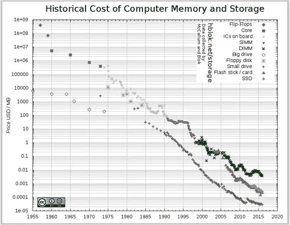

# 5. 内存分析

满足对速度的需求

“内存分析”是一种误称：所有分析都在内存中运行，并且历来如此。现代内存分析有两个特点：

- 能够在内存中持久保存大量数据，因此无需磁盘读取操作即可立即用于分析。
- 横向扩展能力，即能够将大量内存工作负载分布到多台服务器上。

现代内存分析的发展，部分归因于数据库设计的技术创新。数据库架构师已经开发出通过复制、快照和其他方法来应对内存数据结构固有易失性的方法，以确保容错性和数据持久性。

但可以说，内存分析背后的主要驱动力是内存成本的下降。虽然内存价格仍比磁盘存储高一个数量级，但自 1990 年以来，其成本已下降了四个多数量级，如图 5-1 所示。

**图 5-1.** 内存和存储的历史成本（来源：McCallum 和 Blok，`hblok.net/storage`）

由于我们不太可能随时需要立即访问所有数据，因此设计具有比内存更持久存储的系统是合理的。¹ 这是分析架构中的一个关键问题：如何权衡内存操作的速度与额外成本。

在本章的第一节中，我们将讨论关系数据库内存技术的发展。在第二节中，我们讨论开源、以内存为中心的处理框架，包括 Apache Spark、基于内存的文件系统和内存缓存框架。

## 内存数据库

在最简单的形式下，一次分析操作包含三个部分：

*   从持久化存储中读取数据。
*   在内存中利用数据进行计算。
*   将结果写回持久化存储。

计算机在随机存取存储器（`RAM`）中执行分析计算。自最早的计算机以来，实际使用的内存技术已经发生了巨大变化，从硬连线电路到单列直插式内存模块（`SIMM`），再到如今使用的双列直插式内存模块（`DIMM`）。但原理始终如一：所有计算都在某种内存中完成。

`DIMM` 与大多数早期的内存技术一样，都是易失性的：如果机器断电，内存中的信息就会丢失。为了避免这种损失，我们将计算产物保存到断电也能保留信息的持久化且耐用的存储设备中。在关系型数据库时代，这种存储设备通常是指磁盘驱动器。

`RAM` 的运行速度远快于将数据在存储设备和内存之间来回移动的输入/输出（`I/O`）操作。因此，完成分析操作的总时间主要取决于读写所需的时间。将一项数据从磁盘移动到内存只需不到一秒钟；对于大多数需要单记录查找的传统事务处理工作负载而言，如果数据库配置和调优得当，这种数据传输不会造成性能瓶颈。

另一方面，对于大数据集的分析而言，这种在数百万或数十亿数据项之间的内部数据移动所产生的累积效应是显著的。当计算所需的数据集大小超过可用内存时，问题就更加严重了。在某些分析软件中，操作会直接失败；在其他软件中，则会将数据从内存交换到磁盘，严重损害性能。

第一章讨论的列式序列化通过组织存储数据的方式以加快检索速度，从而缓解了这个问题。然而，它并未消除`I/O`瓶颈，在数据量达到太字节（TB）和拍字节（PB）级别时，该瓶颈依然可被测量。

在内存中缓存对象是消除瓶颈的一种方法。如果一个任务需要对同一组数据进行一系列计算，我们可以将数据保留在内存中（即缓存），直到这一系列计算结束，从而节省时间。此时，我们可以从内存中截断（丢弃）这些对象，为下一个任务腾出空间；也可以保留它们，以防用户决定再次运行该任务。但无论哪种方式，我们使用缓存的能力都取决于可用内存的大小。

虽然缓存减少了对后续读取操作的需求，但它并未消除最初的读取。一种更复杂的缓存形式是主动式或预测式缓存：它不是等待进程请求数据，而是（例如，基于历史使用模式）预判请求，并将数据加载到内存中。这种方法可能无法帮助临时用户解决所有问题，但对于最常用的操作是很有帮助的。

当然，如果我们在内存缓存中维护对象，就需要关注如何保持数据与磁盘数据存储的一致性。为此，我们需要写通（Write-Through）、读通（Read-Through）和写后（Write-Behind）能力。写通意味着内存缓存会将内存中的更新传播到磁盘数据存储。读通意味着，如果一个操作请求缓存中尚未加载的数据，缓存会从磁盘数据存储中检索该项数据。写后意味着缓存会异步地更新磁盘数据存储；换句话说，它先完成对请求应用的内存更新，然后在后台更新磁盘数据存储。

一个完整的内存数据库会将整个数据库复制到内存中，并使用写通、读通和写后操作来维持与磁盘上镜像数据库的一致性。这减少了对预测性缓存的需求，因为所有数据时刻都驻留在内存中。当然，与所有关系型数据库一样，组织会选择哪些数据包含在数据库模式中，哪些排除在外；因此，内存数据库并不能消除组织数据和设定优先级的需求。

2010 年之前，三个关键限制因素制约了内存数据库的部署：成本、内存可用性以及持久性。

正如本章开头所述，内存的绝对成本已大幅下降；在 2003 年至 2014 年间，每太字节内存存储的成本下降了 95%。这为十年前尚不可行的内存数据库用例打开了大门。

磁盘存储的成本也以同样的幅度下降，但内存的价格仍然比磁盘存储高出两个数量级。因此，在数据优先级设定方面仍存在经济动机，即只将最有价值的数据保留在内存中。

此外，请记住，一个内存数据库实际上是两个数据库：磁盘上的持久化数据库及其内存中的镜像；数据库架构师并非在磁盘和内存之间二选一，而是平衡两者的比例。加上用于确保持久性的复杂工具所带来的额外成本，内存数据库每太字节的成本仍然远高于任何其他主流数据管理技术。

第二个限制因素是能否获得足够数量的内存来支持大型数据库。在 20 世纪 90 年代，服务器供应商出货的机器最多只有几千兆字节（GB）的内存；如今，他们已将支持的最大内存提升到太字节（TB）级别，但数据量的增长速度远超可用内存的增长速度。

为了解决这个限制，数据库架构师将数据分布到多台服务器上。我们在第四章讨论了分布式架构的一般原理。分布式数据库的历史可以追溯到 20 世纪 70 年代，但随着工程师们解决了关键的架构问题，它们已逐渐成为主流。对`Hadoop`和分布式`NoSQL`数据库的日益接受，反映了在大型数据管理中横向扩展架构的日益普及。

术语`ACID`是原子性（Atomicity）、一致性（Consistency）、隔离性（Isolation）和持久性（Durability）的首字母缩写，这是一组数据库事务的理想属性。

内存数据库的第三个问题是数据的持久性：即`ACID`中的“D”。数据库设计者使用多种技术来确保组织在数据库关闭时不会丢失数据：

*   快照或检查点，用于记录数据库在某一时刻的状态
*   事务日志记录，用于将数据库的变更记录在日志中
*   非易失性随机存取存储器（Non-volatile RAM），一种断电时仍能保留信息，并能可靠地还原关闭时内存状态的存储器
*   在集群计算机上复制数据，并在节点故障时自动进行故障转移

快照的可靠性仅止于最近一次快照，而最近一次快照之后记录的任何活动都会丢失。为避免数据丢失，必须频繁地创建快照。实时数据库更新和高速度数据的增长使得这种方法已经过时。

事务日志记录是快照的一个合理替代方案。然而，在工作负载繁重的数据库中，重建数据库关闭时的状态可能需要相当长的时间。

非易失性存储（即闪存）的成本下降幅度甚至超过了易失性内存，如今每 TB 的价格已低于传统的 `DIMM` 内存。对于企业级应用而言，闪存存在一些劣势——它在频繁读写场景下的耐久性较差——因此其使用在很大程度上仍处于实验阶段。2015 年，麻省理工学院的研究人员使用一个基于闪存的服务器集群展示了这项技术的潜力，声称其性能和成本效益可与基于 `RAM` 的服务器相媲美。

通过复制实现的高可用性是分布式横向扩展架构的一个重要副产品。`Hadoop` 的原始开发者设想在大型商用硬件集群上进行部署，并预期节点故障的发生率会很高。因此，他们在 `Hadoop` 分布式文件系统（`HDFS`）中构建了冗余机制，数据以三个副本的形式分布在集群中。

大多数分析型数据库以只读模式运行；换句话说，用户消费和分析数据，但很少创建数据或写回数据存储。因此，许多数据仓库遵循“备份即重载”原则：如果数据库宕机，只需重复最初创建它时的加载过程即可恢复。因此，对于事务型数据库至关重要的“持久性”问题，对分析型数据存储来说就不那么重要了。

现在有更多的内存容量可用于支持内存数据库。为了在单台机器上进行纵向扩展，服务器制造商现在可以提供数 TB 的内存容量。为了进行横向扩展，现在可以将内存数据库分布到多台机器上。内存数据库尚无法支持最大的数据库，但企业软件供应商 `SAP` 已在其 `HANA` 设备上展示了 100TB 的数据库。

领先的商业分析供应商已在很大程度上吸收了内存技术。

在数据仓库平台收入方面领先的 `Oracle`，将其 `Oracle Database` 系统定位为混合技术，使用术语“系统全局区”来指代共享内存领域。需支付额外许可费用，`Oracle` 客户可以许可`Oracle Database In-Memory`，这是一个与 `Oracle Database` 紧密集成的列式内存数据存储。当部署在 `Oracle` 设备上时，`Oracle` 会在多个节点上镜像数据以实现容错和持久性。`Oracle` 还销售 2007 年收购的内存数据网格 `Coherence`。

企业软件供应商 `SAP` 已将其数据仓库战略聚焦于其 `HANA` 内存列式数据库。`SAP` 通过整合多项收购的技术（包括 `TREX` 列式搜索引擎、`P*TIME` 内存 `OLTP` 平台和 `MaxDB` 内存缓存技术）开发了 `HANA`。`SAP` 对内存技术的早期采用，加上其庞大的现有客户群，共同促成了其在数据仓库领域两位数的收入增长。

具有特色的是，`IBM` 将其内存投资分散到了众多平台和产品中。`IBM BLU Acceleration` 是一套技术捆绑包，可用于 `DB2`、`Informix`，或作为云服务（品牌名为 `DashDB`）进行部署。`BLU` 包含一个具有数据压缩和基于硬件的 `CPU` 加速功能的列式内存数据存储。

`Microsoft SQL Server 2014` 包含一项将整个表保留在内存中的功能。该功能被品牌化为 `Hekaton` 和 `SQL Server In-Memory OLTP`，它专为事务处理工作负载而非分析性工作负载而设计。

`Teradata` 并未提供完整的内存数据库。相反，它提供了其品牌名为 `Teradata Intelligent Memory` 的产品，这是一种预测性缓存能力，可以跟踪数据使用情况并将最常使用的数据保留在内存中。

在利用内存数据库技术的初创公司中，最有前景的建立在开放核心商业模式之上，并瞄准新市场。有两家初创公司 `MemSQL` 和 `VoltDB`，在所谓的 `NewSQL` 类别中脱颖而出，针对混合事务/分析处理（`HTAP`）用例。这两家公司都提供其内存数据库的开源版本，并强调与开源 `Hadoop`、`Spark` 和 `Kafka` 的集成。这些公司押注实时分析的未来在于开源生态系统。

`MemSQL` 成立于 2011 年，由领先的风险投资家资助，于 2012 年 6 月首次发布其产品。该公司的同名数据库软件是一个分布式内存平台，它使用预写日志和数据库快照来保证数据持久性。对于高级分析，该产品支持地理空间函数和 `Apache Spark` 接口。在 2015 年对内存数据库供应商的分析中，`Forrester` 估计 `MemSQL` 拥有约 50 个客户。

`VoltDB` 支持 `H-Store` 的商业版本，`H-Store` 是由麻省理工学院的 `Michael Stonebraker` 领导的一个学术项目。与 `MemSQL` 一样，`VoltDB` 是一个分布式内存数据库，具有事务日志记录和快照功能以确保数据持久性。2015 年发布的 `VoltDB 5.0` 包括用于 `Kafka` 的导入和导出集成、与 `HP Vertica` 的导入集成，以及对 `Apache Hive` 和 `Apache Pig` 的支持。

其他开源内存数据库包括 `Aerospike`、`Apache Geode`、`Hazelcast`、`MonetDB` 和 `Redis`。专有产品包括 `EXASOL` 的 `EXASolution` 和 `Kognitio` 的 `Kognitio Analytical Platform`。

## Apache Spark

Apache Spark 是一个用于快速、通用大规模数据处理的开源系统。它提供了多种形式的高性能、低延迟执行运行时环境，包括数据探索、流处理、即席 SQL、机器学习和图分析。Spark 为用户提供了一个具备容错性和隐式并行接口，用于操作分布式数据。

Spark 的基础是一种名为弹性分布式数据集（`RDD`s）的抽象数据结构。`RDD`s 是分布在机器集群上的只读分区记录集合。Spark 通过对稳定数据或其他 `RDD`s 执行确定性操作来创建 `RDD`s。`RDD`s 包含数据血统信息以及数据转换和持久化指令。它们具有容错性；如果某个操作失败，可以重建该操作。

Spark 用户既可以将 `RDD` 保留在内存中，也可以将结果写入持久化存储。这与 MapReduce 形成了鲜明对比，后者要求用户在每次 Reduce 操作结束时将数据写入存储。这种内存中的持久化能力使得编写迭代算法、交互式查询数据或执行流式操作成为可能。

（截至 2016 年 4 月）已有超过 1000 名开发者为 Spark 做出了贡献。在整个项目生命周期中，提交次数超过 30,000 次，仅 2015 年就超过了 10,000 次，Spark 是目前最活跃的大数据项目。

Matei Zaharia 及其在加州大学伯克利分校 AMPLab（一个合作实验室）的同事于 2009 年启动了 Spark，作为针对大规模数据集进行机器学习的研究项目。2010 年初，他们以 BSD 许可证将软件开源发布。加州大学将软件资产捐赠给了 Apache 软件基金会，该基金会于 2013 年 6 月接受了该项目进入孵化器状态。2014 年 2 月，Spark 毕业成为 Apache 顶级项目。

Databricks 是一家成立于 2013 年的商业公司，主导着 Apache Spark 的开发。通过两轮风险融资，截至 2016 年初，Databricks 共筹集了 4700 万美元。在最近一轮融资中，即 2014 年 6 月，由 New Enterprise Associates、Andreesen Horowitz 和 Data Collective 领投的集团在 B 轮融资中投资了 3300 万美元。

Spark 遵循标准的 Apache 治理模式。由一个由 35 名提交者（截至 2016 年 4 月）组成的项目管理委员会（PMC）负责监督项目的开发。Databricks 的员工占据了 35 个席位中的 13 个；其他代表的实体包括加州大学伯克利分校、Cloudera、雅虎、IBM、英特尔以及其他八个组织。截至 2016 年 4 月，共有 44 名 Spark 提交者，其中 17 名是 Databricks 员工，5 名隶属于加州大学伯克利分校。

Spark 开发遵循 Apache 的投票流程，代码的更改需通过提交者达成共识才能批准。团队采用先审查后提交的模型，即至少有一名除补丁作者之外的提交者在补丁合并前对其进行审查和批准，并且任何提交者都可以投反对票。

PMC 已指定个别提交者作为特定模块的维护者，以确保公共 API 和复杂组件的设计一致性。受影响的模块维护者会在代码合并前审查补丁。

与所有 Apache 项目一样，参考代码可直接从 Apache 软件基金会获取。所有主要的 Hadoop 发行版都包含了 Spark：Cloudera、Hortonworks、MapR、IBM 和 Amazon Web Services。2015 年 9 月，Cloudera 宣布了其所谓的“统一平台计划”，计划将 Spark 作为其 Hadoop 版本的主要计算平台，将 MapReduce 降级为次要地位。

Databricks 已认证了来自多家供应商的额外发行版，包括：

- BlueData，一家私有云供应商
- DataStax，Cassandra NoSQL 数据库的发行商
- Guavus，一家运营智能供应商
- 华为，一家电信解决方案供应商
- Lightbend（前身为 Typesafe），Scala 语言的开发者和发行商
- Oracle，用于 Oracle 大数据一体机
- SAP，一家企业软件供应商
- SequoiaDB，一家 NoSQL 数据库发行商
- Stratio，一家大数据平台供应商
- Transwarp，一家总部位于上海的大数据供应商

Spark 用户可以将软件部署在单台机器上；部署在独立集群中；部署在 Hadoop 中（在 YARN 下运行）；部署在 Apache Mesos（一种分布式资源管理器）上；部署在云平台上，包括 Amazon Web Services、Microsoft Azure、Google Compute Engine 以及 OpenStack；也可以部署在 Docker 或 Kubernetes 容器中。对于不愿意自己配置和安装软件的用户，有许多提供商将 Spark 作为托管服务提供，包括 Altiscale、Amazon Web Services、Databricks、Google、IBM、Microsoft 和 Qubole。

Spark 没有原生的文件系统。相反，它包含了适配器，使其能够与许多数据平台协同工作：

- Hadoop 分布式文件系统（HDFS）
- 云数据存储，例如 AWS S3 和 Redshift
- 关系型数据库，例如 MySQL、PostgreSQL 以及任何符合 JDBC 规范的 RDBMS
- 常见的 Hadoop 格式，例如 ORC、Parquet 和 Avro 文件
- NoSQL 数据存储，例如 Cassandra、Cloudant、Couchbase、HBase、MongoDB 和 SequoiaDB
- 流数据源，例如 Apache Kafka
- 内存文件系统，例如 Alluxio
- 搜索引擎，例如 Elasticsearch
- 应用程序连接器，例如 Salesforce.com 和 SAS
- 大型机数据
- ESRI Magellan 地理空间库
- 其他杂项数据源，例如 Cookie 数据集、Google 电子表格等

### 能力

Spark 核心包含基础能力，包括任务分发、调度和基本输入/输出。通过使用 Spark API，用户通过向 Spark 传递函数来调用对 `RDD`s 的并行操作，Spark 会在集群上调度并行执行。

每个操作以一个或多个 `RDD` 作为输入，并生成新的 `RDD`。Spark 会跟踪 `RDD` 的血统，因此如果一台或多台机器发生故障，它可以重建任何操作。Spark 采用惰性求值，这意味着它会将表达式的求值推迟到需要时再进行；这提高了性能并最大限度地减少了内存使用，因为它避免了不必要的计算。

用户通过 Scala、Java、Python 和 R 的编程接口与 Spark 交互。每个 API 中可用的 Spark 函数略有不同；Scala API 开发最为完善，而 R API 开发程度最低。

除了用于分布式数据处理的 Spark 核心之外，Spark 项目还包含四个库：

- Spark SQL，一套用于处理结构化数据的工具
- Spark Streaming，用于流分析
- Spark MLLib，用于机器学习
- GraphX，用于图并行处理

该项目还包含 Spark Packages 库，其中包含由第三方开发者贡献的 200 多个额外的包。

#### SQL 处理

Spark SQL 是 Apache Spark 的一个组件，支持对结构化数据进行类似 SQL 的处理。由初创公司 Databricks 在 2015 年进行的一项针对 Spark 用户的调查报告⁸显示，用户使用 Spark SQL 及其支持的 DataFrame 的频繁程度超过了其他任何 Spark 组件。

2011 年，加州大学伯克利分校 AMPLab 的开发者开始研发一个名为 `Shark` 的 SQL 引擎。`Shark` 项目以 Hive 代码库为基础，并将其执行引擎替换为 Spark 的内存处理。这种方法显著提升了查询运行时间；然而，团队发现 Hive 庞大的代码库既笨重又难以优化。

Spark 开发团队在 2014 年 5 月将 Spark SQL 作为 alpha 组件引入⁹。2014 年 7 月，开发团队宣布¹⁰他们将停止对 `Shark` 的进一步开发，并将所有未来工作重点集中在 Spark SQL 上。Spark SQL 于 2015 年 3 月随 Spark 1.3 版本发布正式毕业¹¹，脱离 Alpha 阶段。

Spark SQL 使用户能够将 SQL 简洁声明式的语法与过程式编程语言的功能结合起来。它通过两个组件实现这一点：DataFrame API 和支持关系（SQL）运算的 Catalyst 优化器，后者是一个将 SQL 表达式转换为高效 Spark 运算的引擎。

DataFrame 是带有命名列的结构化数据的分布式集合；它们是用于选择、过滤、聚合和绘制结构化数据的抽象。Spark 用户通过 Spark 的过程式 API 或关系式（SQL）API 来操作 DataFrame。¹²

Spark 用户可以从现有的 Spark 弹性分布式数据集（RDD）、Hive 表或直接通过数据源创建 DataFrame。Spark 支持与 Parquet 数据集、JavaScript 对象表示法（JSON）数据集、Hive 表或通过 Java 数据库连接（JDBC）连接的关系数据库进行原生集成。

用户可以直接通过 SQL、编程工具、其他 Spark 组件或外部 BI 工具与 DataFrame 交互。对于 SQL 用户，Spark SQL 目前支持 HiveQL 语法，包括 UDF 和 UDAF。其他 Spark 组件，例如机器学习库，也可以创建和使用 DataFrame。像 Tableau、Zoomdata 和 Qlik 这样的 BI 工具可以通过标准 JDBC 连接器与 DataFrame 交互。

内置于 Scala 编程语言的 Catalyst 优化器，会将 SQL 表达式的逻辑转换为在 Spark 中执行的最优物理计划。分离逻辑计划和物理计划使得 Spark 的开发者及第三方可以轻松地添加新的数据源以及新的语言绑定。Catalyst 优化器还能确保跨语言 API 的性能一致性。该优化器本身易于通过添加新的优化规则和代码生成方法来进行扩展和增强。

对于 SQL 流处理，英特尔的开发者贡献¹³了一个与 Spark SQL 协同工作的开源库。该库支持基于时间的窗口聚合和连接。截至 2015 年底，它仅支持 Scala 接口。

#### 流式分析

Spark Streaming 是 Spark 的一个扩展，于 2013 年添加，支持对实时数据流进行高吞吐量的容错处理。

Spark Streaming 从流数据源获取数据，处理数据，并将其推送到目标系统。流数据源可以包括 Kafka、Flume、Twitter、ZeroMQ、Kinesis 或 TCP 套接字等。处理过程包括表示为高级函数的复杂转换，例如 `map`、`reduce`、`join` 和 `window`。目标系统可以包括文件系统、数据库、用于实时可视化的 BI 系统或其他 Spark 库。

为了处理流数据，Spark Streaming 将数据划分为微批次，并通过 Spark 引擎进行处理。用户可以将批次窗口的持续时间定义到半秒级别。Spark Streaming 提供了称为 DStreams（离散化流）的高级抽象，表示为弹性分布式数据集（RDD）的序列，Spark 将这些数据集保存在内存中。

Spark Streaming 的转换示例包括：

*   `Map`：通过将源 DStream 的每个元素传递给指定函数，返回一个新的 DStream。
*   `Filter`：通过仅选择源 DStream 中函数评估为真的那些记录，返回一个新的 DStream。
*   `Union`：返回一个新的 DStream，其中包含源 DStream 和另一个指定 DStream 元素的并集。
*   `Count`：通过计算源 DStream 中每个 RDD 的元素数量，返回一个新的 DStream。
*   `Reduce`：通过使用一个关联函数聚合源 DStream 中每个 RDD 的元素，返回一个新的 DStream。

转换会创建新的 DStream 和 RDD，而不会改变源 DStream 和 RDD。因此，在发生系统或节点故障时，Spark 能够重建包含所有更改的数据。

2016 年春季发布的 Spark 2.0 采用了流处理的新方法——结构化流（Structured Streaming），它在单个 API 中处理低延迟、交互式和批处理元素。结构化流将流定义为一个高级概念，类似于 SQL 中的表。用户只需将流指定为操作的目标；在后台，Spark 优化器会根据需要将查询路由到适当的静态数据或数据流。针对有限表的查询会在所有记录处理完毕后结束，而针对流的查询则会一直运行，直到被用户终止。

像其他 Spark 库一样，Spark Streaming 支持 Scala、Java 和 Python API。

#### 机器学习

Spark 有两个原生的机器学习库和一组位于 Spark Packages 下的第三方库。这两个原生库是：

*   `MLlib`，直接构建在 Spark RDD 上的原始 API
*   `ML`，构建在 Spark DataFrame 上的更高级别 API

这两个库之间有一些功能重叠。`ML` API 最初在 Spark 1.2 中引入，更易于使用，推荐给新用户。虽然 Spark 团队计划继续支持 `MLlib`，但所有新算法都将贡献给 `ML` 库。

我们将在第八章详细介绍 Spark 的机器学习能力。

#### 图分析

Spark 包含 GraphX 图引擎。GraphX 支持广泛使用的图分析方法，如 PageRank（网页排名）、Connected Components（连通分量）和 Triangle Counting（三角形计数）。

与 Apache Giraph 类似，GraphX 的灵感来源于 Google Pregel 论文，并使用批量同步处理模型进行图分析。与在 MapReduce 上用 Java 实现的 Giraph 不同，GraphX 运行在 Spark 上。GraphX 的开发节奏比其他 Spark 库要慢。

### Spark 实战

为了说明组织如何采用和使用 Spark，我们给出 10 个 Spark 实战的简短示例。

巴克莱银行，一家领先的跨国银行和金融服务公司，使用 Spark 支持一个“洞察引擎”：该应用结合数百个查询，为商业银行客户计算关键绩效指标（KPI）。针对 275,000 个客户中的每个客户执行 1,296 个查询（涉及 7 亿条记录），巴克莱银行无法在其 Teradata 数据仓库中运行此分析。在 Spark 中，该分析可在 30 分钟内完成。¹⁴

贝莱德，一家领先的投资和风险咨询公司，管理或建议的资产及衍生品投资组合总值超过 8 万亿美元。在 2008 年金融危机之后，发行方披露了更多关于由抵押贷款、信用卡及其他类型消费债务支持的资产的详细信息；然而，这些数据往往非常嘈杂，传统的数据质量工具无法扩展。贝莱德使用基于 Spark 的框架，在 TB 级数据集上创建、运行和管理数据质量测试。¹⁵

康卡斯特收集了关于其客户的大量数据，包括使用点击流以及电话销售和电子邮件等联系事件。这些数据的体量、多样性和速度使得传统的机器学习算法不切实际。康卡斯特使用 Spark 检测客户活动中的异常，这些异常可能表明服务中断。¹⁶

高盛将其核心竞争力投入分析领域，在其内部平台上构建了强大的数据计算框架。如今，高盛积极使用 Spark 来构建数据管道、为报告处理数据以及利用流式数据。通过与 Spark 和 R 合作，用户可以处理和缩减数据以进行本地分析、绘图和报告，而其他用户则在 Spark 中运行基于 Python 的模拟。¹⁷

MediaMath，一家数字媒体购买服务公司，使用内置于 Spark 中的蒙特卡洛模拟来测试数字广告的提升效果和有效性。Cookie 被随机分配到测试组或对照组，测试组用户会看到广告，而对照组则不会。Spark 为 MediaMath 提供了处理能力，使其能够对数千万模拟消费者快速测试数百万次试验。¹⁸

奈飞使用 Apache Spark 构建了一个客户模拟器，使其能够对其推荐引擎的策略和变更进行“回测”。该模拟器允许数据科学团队评估算法改进的影响，或仅仅是尝试新想法。通过使用模拟器，测试不会对生产服务造成压力，数据科学团队也无需等待历史数据的积累。¹⁹

NBC 环球为国际有线电视分发存储了数百 TB 的媒体文件；高效管理这一在线资源对于支持向国际客户的分发至关重要。该公司使用 Spark 的机器学习库，基于多种指标的组合来预测每项资产的未来需求。根据这些预测，公司将预测需求较低的媒体转移到低成本的离线存储。机器学习做出的预测远比基于单一指标（如文件年限）的任意规则有效。因此，NBC 环球在保持客户满意度的同时降低了总体存储成本。²⁰

诺华使用 Spark 分析从化验（即用于检验关于疾病生物学假说的实验室实验）中捕获的数据。由于生物技术的进步，如今单个筛选化验就能产生数万亿个数据点。通过将 Spark 与可视化工具及 Cassandra NoSQL 数据存储结合使用，诺华执行了复杂的分析：针对对照进行归一化、减少高度相关的特征、多参数分类等。最终结果是：更快的分析、更短的实验周期以及更短的时间达成发现。²¹

维亚康姆，一家全球媒体公司，发现传统的数据仓库方法对其业务来说太慢了。传统数据仓库要求开发人员在将数据发布给最终用户之前，先对数据进行结构化和建模。相反，维亚康姆现在使用在 Amazon Web Services 上运行的 Spark 和 Databricks 来交付“即时”数据仓库。在这种方法中，最终用户在需要解决问题的上下文中定义数据结构；数据质量问题在出现时得到解决；开发人员和最终用户协作互动地回答业务问题。最终结果是：更快的价值实现时间，以及业务用户对数据参与度的提高。²²

天气公司（TWC）汇总来自政府机构的天气信息并分发给最终用户。每天，它处理来自 1.2 亿活跃移动用户的约 300 亿个 API 请求，这些请求产生了 360 PB 的流量。TWC 使用 Spark Streaming、Cassandra、Parquet 和 Spark SQL（均在 AWS 云中运行），为高管和经理提供一个实时的自助服务平台，用于商业智能和数据科学。²³

## Apache Arrow

在第四章中，我们讨论了 Apache Drill 项目，这是一个基于 Google Dremel 框架构建的、无模式 SQL 查询引擎。Apache 软件基金会于 2012 年 9 月接纳 Drill 为一个孵化器项目。

在致力于 2013 年 9 月发布第一个版本的过程中，Drill 的开发者们发现需要在内存中表示复杂的列式数据。当时，已有方法可以用预定义模式在内存中表示结构化数据，而 Apache Parquet 项目已开发出一种在磁盘上表示复杂列式数据的方法，但这两种格式都无法满足 Drill 开发者的需求。为弥补这一差距，Drill 团队开发了一种名为 Value Vectors 的数据结构。

认识到 Value Vectors 也能满足其他数据处理引擎的需求后，Apache 软件基金会于 2016 年 2 月宣布 Apache Arrow 成为一个顶级项目，跳过了标准的孵化器流程。该项目的提交者包括来自其他 Apache 项目的开发者，如 Calcite、Cassandra、Drill、Hadoop、HBase、Ibis、Impala、Kudu、Pandas、Parquet、Phoenix、Spark 和 Storm。

Apache Arrow 使诸如 Spark 之类的执行引擎能够利用现代处理器中包含的最新操作，以实现快速的分析数据处理。数据的列式布局还允许通过将所有与列操作相关的数据以尽可能紧凑的格式放置，来更好地利用 CPU 缓存。

标准化的格式允许应用程序无缝地共享数据。目前，每个执行引擎都以自己的方式在内存中表示数据，因此从一个引擎到另一个引擎的任何交接都需要耗时的转换。标准化引擎在内存中表示数据的方式简化了集成并加快了处理速度。

Apache Arrow 软件根据 Apache 许可证 2.0 版提供。

Dremio，一家由 Apache Drill 和 Apache Arrow 项目管理委员会主席 Jacques Nadeau 领导的初创公司，主导了开发工作。2015 年 9 月，Dremio 宣布²⁴获得了 1000 万美元的初始融资。

## Alluxio

`Alluxio`（原名 `Tachyon`）是一个分布式存储系统，支持跨集群作业以内存速度进行容错数据共享。`Alluxio` 软件位于计算框架（包括 `Spark`、`MapReduce`、`Flink`、`Zeppelin`、`HBase` 和 `Presto`）与存储系统（例如 `HDFS`、`Amazon S3`、`GlusterFS`、`OpenStack Swift` 和 `NFS`）之间。现有的 `MapReduce` 和 `Spark` 程序在 `Alluxio` 上运行速度更快，且无需修改代码。

加州大学 AMPLab 的李浩源、Ali Ghodsi、Matei Zaharia、Scott Shenker 和 Ion Stoica 发表的一系列论文定义了 `Alluxio` 的理论框架。²⁵ 李浩源于 2012 年圣诞节期间构建了第一个版本，并于 2013 年 4 月将代码开源。此后，`Alluxio` 吸引了来自 50 多家公司的 200 多名贡献者，代码量近 20 万行，大部分用 `Java` 编写。

`Alluxio` 已有数百台机器的生产部署报告。`Alluxio` 的实际应用案例包括：

* 最大的中文搜索引擎百度使用 `Alluxio` 后，`Spark SQL` 查询速度提高了 30 倍。²⁶
* 巴克莱银行发现 `Alluxio` 将复杂的 `Spark` 工作流运行时间从几小时缩短到几秒。²⁷

2015 年 3 月，李浩源创立了 `Alluxio Inc.`（当时名为 `Tachyon Nexus`）以实现该软件的商业化，并宣布了由 Andreessen Horowitz 投资的 750 万美元初始融资。²⁸

## Apache Ignite

`Apache Ignite` 是一个开源项目，其代码库于 2014 年 10 月由 `GridGain Systems` 捐赠给 `Apache Software Foundation`。`GridGain` 仍参与该项目，其公司高管担任 `PMC Chair` 并在 `PMC` 中拥有多个席位。`GridGain` 采用开放核心商业模式，继续提供商业许可的增值版本软件。

`Ignite` 结合了符合 `ACID` 且容错的内存键值存储以及数据管理工具。其嵌入式 `SQL` 引擎支持 `ANSI-99` 语法。该项目还包括：

* 一个用于隐式并行程序执行的容错框架。
* 针对持续不间断数据流的可扩展且容错的处理能力。
* 用于在节点间交换数据的高性能集群范围消息功能。

`Ignite` 可作为数据库缓存，使用户能够将最常访问的数据保留在内存中。为此，它提供了写透、读透和异步写功能。

`Ignite File System`（`IGFS`）是一个分布式内存文件系统，其工作方式类似 `HDFS`，但位于内存中。`IGFS` 将每个文件的数据分割成独立的数据块，并使用哈希函数确定文件位置，将其存储在分布式内存缓存中。`IGFS` 可以独立部署，也可以部署在 `HDFS` 之上，在这种情况下，它成为 `HDFS` 的缓存层（类似于 `Alluxio`），具有写透和读透能力。`Apache Ignite` 包含 `MapReduce` 的内存实现。

`Ignite` 提供了 `Spark RDDs` 的实现，使 `Spark` 作业能够在同一 `Spark` 应用程序内或不同 `Spark` 应用程序之间，在内存中共享对象。使用 `Ignite RDDs` 运行 `Spark SQL` 查询比直接使用数据运行要快，主要是因为 `Ignite` 在内存中索引了数据。

`Apache Ignite` 可独立运行，也可在集群、`Docker` 容器、`Apache Mesos` 以及 `YARN` 下运行。它原生集成了 `Amazon Web Services` 云和 `Google Compute Engine`。

`GridGain Systems` 提供 `Apache Ignite` 的专业版和企业版，并为其提供技术支持。专业版是该软件的二进制构建版本，包含尚未在开源版本中发布的错误修复。企业版包括跨平台传输内存对象的能力、管理和监控环境的工具、网络分段、可恢复的本地存储、滚动生产更新以及数据中心复制功能。

## 新一代内存分析技术

与颠覆性创新理论相吻合的是，数据仓库行业的领导者们已基本吸收内存技术，并将其融入自身产品。随着内存成本绝对下降，各种形式的内存数据库已成为主流，内置于甲骨文、SAP、IBM、微软和天睿公司的产品中。

采用商业许可模式、主打内存数据库的初创公司，例如`EXASOL`和`Kognitio`，并未颠覆市场。（这两家供应商都已运营至少 15 年。）另一方面，遵循开放核心商业模式的 NewSQL 供应商`MemSQL`和`VoltDB`，则成功开拓了新型混合事务/分析处理（`HTAP`）应用场景，并展现出相应的增长势头。

最具市场颠覆潜力的力量来自 Apache Spark 及相关开源项目，它们将内存分析的能力和速度带到了 Hadoop 和 NoSQL 领域。这种颠覆性力量并未被开源社区忽视，社区已通过将`Spark`打造成当今大数据领域最活跃的项目来予以回应。

脚注

1. 固态存储设备和闪存为系统架构带来了新的机遇。截至 2016 年，在分析型数据存储中使用 SSD 和闪存仍是一项新兴技术。

2. `http://www.phuse.eu/download.aspx?type=cms&docID=2847`

3. `http://www.computerworld.com/article/2947614/cloud-storage/mit-proves-flash-is-as-fast-as-ram-and-cheaper-for-big-data.html`

4. `http://siliconangle.com/blog/2012/05/16/sap-hana-now-the-biggest-in-memory-database-in-the-world/`

5. `https://www.forrester.com/The+Forrester+Wave+InMemory+Database+Platforms+Q3+2015/fulltext/-/E-res120222`

6. `http://techcrunch.com/2014/06/30/databricks-snags-33m-in-series-b-and-debuts-cloud-platform-for-processing-big-data/`

7. 截至 2016 年 6 月中旬，共有 234 个软件包。

8. `https://databricks.com/blog/2015/09/24/spark-survey-results-2015-are-now-available.html`

9. `http://spark.apache.org/releases/spark-release-1-0-0.html`

10. `https://databricks.com/blog/2014/07/01/shark-spark-sql-hive-on-spark-and-the-future-of-sql-on-spark.html`

11. `http://spark.apache.org/releases/spark-release-1-3-0.html`

12. `http://people.csail.mit.edu/matei/papers/2015/sigmod_spark_sql.pdf`

13. `https://github.com/Intel-bigdata/spark-streamingsql`

14. `http://www.slideshare.net/SparkSummit/hundreds-of-queries-in-the-time-of-one-gianmario-spacagna`

15. `http://www.slideshare.net/SparkSummit/topnotch-systematically-quality-controlling-big-data-by-david-durst`

16. `http://www.slideshare.net/SparkSummit/petabyte-scale-anomaly-detection-using-r-spark-by-sridhar-alla-and-kiran-muglurmath`

17. `http://www.slideshare.net/SparkSummit/how-spark-is-making-an-impact-at-goldman-sachs-by-vincent-saulys`

18. `http://www.slideshare.net/SparkSummit/monte-carlo-simulations-in-adlift-measurement-using-spark-by-prasad-chalasani-and-ram-sriharsha`

19. `http://www.slideshare.net/SparkSummit/distributed-time-travel-for-feature-generation-by-db-tsai-and-prasanna-padmanabhan`

20. `https://spark-summit.org/2015/events/use-of-spark-mllib-for-predicting-the-offlining-of-digital-media/`

21. `http://www.slideshare.net/SparkSummit/escaping-flatland-interactive-highdimensional-data-analysis-in-drug-discovery-using-spark-by-josh-snyder-victor-hong-and-laurent-galafassi`

22. `http://www.slideshare.net/SparkSummit/building-a-just-in-time-data-warehouse-by-dan-morris-and-jason-pohl`

23. `http://www.slideshare.net/SparkSummit/lambda-at-weather-scale-by-robbie-strickland`

24. `http://venturebeat.com/2015/09/25/apache-drill-gurus-at-dremio-raise-more-than-10m-from-redpoint-and-lightspeed/`

25. `http://www.cs.berkeley.edu/~haoyuan/papers/2013_ladis_tachyon.pdf`
    `http://www.cs.berkeley.edu/~haoyuan/papers/2014_EECS_tachyon.pdf`
    `http://www.cs.berkeley.edu/~haoyuan/papers/2014_socc_tachyon.pdf`

26. `http://www.alluxio.com/assets/uploads/2016/02/Baidu-Case-Study.pdf`

27. `https://dzone.com/articles/Accelerate-In-Memory-Processing-with-Spark-from-Hours-to-Seconds-With-Tachyon`

28.

[`http://blogs.wsj.com/venturecapital/2015/03/17/andreessen-horowitz-invests-7-5m-in-big-data-startup-tachyon/`](http://blogs.wsj.com/venturecapital/2015/03/17/andreessen-horowitz-invests-7-5m-in-big-data-startup-tachyon/)

