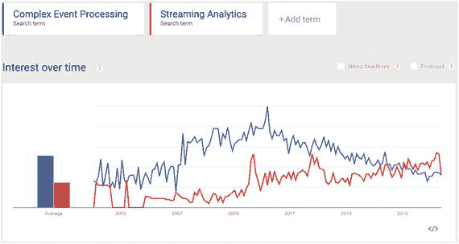

# 6. 流式分析

洞察动态数据

流式分析是将分析操作应用于流式数据，适用于以下场景：

*   算法交易
*   客户交互管理
*   情报与监控
*   患者监护
*   供应链优化
*   网络监控
*   油气开采优化
*   车辆追踪与路线监控

市场研究公司 Markets and Markets 估计¹2015 年流式分析的总支出为 5.02 亿美元，并预测到 2020 年将保持 31%的年增长率。虽然这本身是一个可观的市场，但请记住，这仅占全球商业分析软件支出的约 1%。²

在本书中，我们使用术语“实时分析”来描述一种特定类型的操作，详情如下。我们使用“流式分析”来描述实时分析中所使用的技术，并使用“低延迟分析”来描述一个期望的结果，即最小化延迟。这些区别非常重要；虽然大多数实时分析的例子都是低延迟的，但反过来却不一定成立。

Gartner 对“实时”计算的定义是：

> 描述一种操作系统，它能在短且可预测的时间范围内响应外部事件。与批处理或分时操作系统不同，实时操作系统为独立的持续物理过程提供服务或控制。它通常具备中断能力（以便将较不重要的任务搁置一旁）和优先级调度管理方案。³

换句话说，实时分析：

1.  必须在定义的时间窗口内完成。
2.  由外部过程（如传入数据）启动。
3.  具有高于其他操作的优先级。

实时操作并非“零延迟”。由于任何操作都需要时间来完成，所有操作都必然产生一些延迟，即使只有一毫秒。然而，由于实时操作由外部过程启动（此处引用的第二个标准），并且优先级高于其他操作，因此它们不会经历由排队引起的等待时间。

实时分析并非通过任何绝对的延迟水平或执行时间窗口来区分；具体用例决定了时间窗口。在电子市场中，超低延迟交易可在不到一毫秒内完成。⁴ 在板块构造学领域，年度测量值也可被称为“实时”。

忽略这种区别会导致围绕“实时”准确定义的奇怪争论：

*   TIBCO（一家以实时分析为核心基因的公司）创始人 Vivek Ranadivé撰写了关于“两秒优势”的文章。⁵
*   Forrester 分析师 Mike Gualtieri 断言，“实时”是指任何延迟低于一秒的情况。⁶
*   Capital One 的 Slim Baltagi 认为⁷ Apache Spark 不适合实时分析，因为它“只能”将延迟降低到半秒。

实时意味着“两秒或更短”、“不到一秒”还是“不到半秒”？答案可能是以上所有情况，也可能全都不对。这完全取决于具体的应用场景。

实时分析的潜力催生了许多夸张言论。Navigant Research 的 Eric Woods 写道：

> 我们在实现实时分析这一目标上做得如何，将在很大程度上揭示我们系统和管理架构的真实成熟度。⁸

他写下这段话是在 2002 年。

实时分析的倡导者往往高估了它在商业分析领域的重要性。1941 年 12 月 7 日，驻珍珠港的美国太平洋舰队总司令哈斯本·E·金梅尔上将并不缺乏关于日本袭击的实时信息。他真正需要的是预测。

本章首先简要介绍流式分析的历史，随后回顾流式处理的基本原理。在本章的第三部分，我们回顾了流行的流式数据源，例如 Apache Kafka 和 Amazon Kinesis，然后概述了顶级的开源流式处理引擎。最后，我们将通过一些实际应用中的流式分析示例，以及关于流式处理经济性的一些观察来结束本章。

## 流式分析简史

如第二章所述，企业的数字化转型为分析技术创造了新的机遇。20 世纪 80 年代，金融市场刚刚开始从公开喊价系统（一种基于人类交易员在同一地点进行拍卖的系统）向电子化交易转型。`NASDAQ` 是第一个实现这一转型的美国市场，随后芝加哥商品交易所也跟进。

时年 28 岁、毕业于麻省理工学院和哈佛商学院的维韦克·拉纳迪维看到了加速系统集成的机遇，并于 1986 年创立了 Teknekron 软件系统公司。Teknekron 开发了一款软件总线，用于连接软件程序并在它们之间高速传输信息，并以 `Information Bus` 商标销售该产品。Teknekron 对该产品的描述是：

> 一种计算机软件，用于辅助一台计算机从另一台计算机获取数据的过程，通过接收按主题分类的数据请求，将主题映射到网络中能够提供该数据的特定计算机，并在不兼容的格式之间执行任何必要的格式转换操作，以便请求的计算机能够使用接收到的主题数据。

高盛集团委托 Teknekron 开发一套股票交易系统。富达投资、第一州际银行和所罗门兄弟公司投资了基于 Teknekron 的 `Information Bus` 构建的系统，用于整合并向交易员提供股票报价、新闻及其他金融信息。由于 20 世纪 80 年代大多数金融市场仍通过公开喊价方式运作，投资者和经纪商主要专注于为人类交易员整合信息，而非算法交易。

与此同时，在信用卡业务中，欺诈问题日益严重。Visa 和 MasterCard 交换系统在全球范围的部署，催生了对实时欺诈检测日益增长的需求。1992 年，HNC 软件公司推出了其 `Falcon` 应用程序，这在第二章中已有讨论。`Falcon` 在每笔信用卡交易被提交授权时进行分析，在 Visa/MasterCard 规则规定的时间窗口内标记可疑交易。

HNC 基于主流的客户端-服务器技术（使用索引文件系统实现快速用户档案查找）构建了 `Falcon`。`Falcon` 能够以每秒 120 笔交易的速度分析并处理授权请求，这在当时绰绰有余。十年之内，`Falcon` 处理了全球 80% 的 Visa/MasterCard 交易授权。

万维网的普及为实时客户交互管理创造了机遇。20 世纪 90 年代初，在巴黎大学工作期间，Khai Minh Pham 博士开发了一种他称之为 `Agent Network Technology`（`ANT`）的预测建模技术。1994 年，他创立了 `DataMind` 公司，推出了品牌名为 `DataCruncher` 的产品；该公司于 1996 年成立，获得了 470 万美元的风险投资，并为 `ANT` 技术申请了专利。

1998 年，`DataMind` 更名为 `Rightpoint`，并将其产品重新定位为实时客户交互管理平台。利用“自学习”的 `ANT` 技术，`Rightpoint` 为客户提供了点击流跟踪、协同过滤和实时用户画像等功能，以驱动优惠推荐和个性化内容。1999 年，CRM 供应商 `E.piphany Inc.` 以 3.93 亿美元（按 2016 年币值计算为 5.62 亿美元）收购了 `Rightpoint`。

在 Khai Minh Pham 开发 `ANT` 并创立 `DataMind` 的同时，斯坦福大学的 David Luckham 向美国国防高级研究计划局提出了一个关于离散事件模拟的研究项目。该项目（名为 `Rapide`）的一个关键要素是能够对并发事件的模式进行建模——换句话说，就是从时间上紧密间隔的众多离散事件中推断出更高级别的事件。

从 1993 年开始，Luckham 及其团队开发了 `Rapide` 语言及相关技术，用于从关于更原子化事件的消息流中推断模式或高级别事件。这项工作最终于 1998 年以发表论文《分布式系统中的复杂事件处理》达到顶峰。

与此同时，在剑桥大学，John Bates 发展了一套与 Luckham 相似的复杂事件推断理论。由于缺乏描述和处理复杂事件模式的工具，Bates 及其团队开发了必要的软件。1999 年，Bates 和同事 Giles Nelson 创立了一家名为 `APAMA` 的公司，将该软件商业化，目标客户为金融市场的交易员和投资者。（他们于 2005 年以 2500 万美元的价格将公司卖给了 `Progress Software`。）

同年，一个由前 Cray 高管组成的团队创立了 `Aleri Group`。`Aleri` 提供了一个基于向量数据库构建的高性能平台，该技术提供了管理和分析高速海量交易数据所需的吞吐量。

维韦克·拉纳迪维于 1993 年以 1.25 亿美元（按 2016 年币值计算为 2.06 亿美元）将 `Teknekron` 卖给了 `Reuters`；利用这笔收益，他于 1997 年创立了 `TIBCO Software`。与 `APAMA` 和 `Aleri` 不同，`TIBCO` 专注于中间件，即连接各系统并实现低延迟通信的基础设施。恰逢 20 世纪 90 年代末的互联网热潮，该公司增长迅速；营收从 1998 年的 5300 万美元增长到 1999 年的 9600 万美元。`TIBCO` 于 1999 年以 10 美元的发行价首次公开募股，公司估值超过 3 亿美元。

华尔街对 `TIBCO` 的股票青睐有加，到 2000 年夏季，其股价飙升至 IPO 价格的 12 倍。随后，随着互联网泡沫破裂，到 2001 年，其股价跌至个位数。

同年，麻省理工学院的 Michael Stonebraker 与布兰迪斯大学和布朗大学的科学家们合作，启动了用于数据流管理的 `Aurora` 项目。该团队设计 `Aurora` 是为了处理大量基于异步推送的数据流（这与关系数据库不同，用户通过离散的请求从关系数据库中“拉取”数据）。`Aurora` 将流处理过程表示为一个有向图，该图映射了数据从源头、经过流处理算子、最终到达消费应用的流程。

`Aurora` 用户可以使用标准的过滤、映射、窗口和连接操作构建持续运行的查询。窗口操作支持超时和松弛参数，使引擎能够处理缓慢和乱序的操作。

Stonebraker 等人于 2003 年创立了 `StreamBase Systems`，将企业级版本的 `Aurora` 引擎商业化。与 `Aurora` 一样，`StreamBase` 独特地将流处理操作和 SQL 操作集成到一个单一平台中。在 500 万美元风险投资的支持下，`StreamBase` 于 2004 年 8 月发布了其首批产品，并于 2005 年 1 月完成了 1100 万美元的 B 轮融资，计划向投资银行、对冲基金和政府机构销售。

金融市场在这个时期迅速转变。美国证券交易委员会于 1998 年授权在监管证券中进行电子交易。电子交易为算法交易创造了机会，使其能够发现并执行利用短暂机会的交易。这些机会包括市场间套利、指数与标的股票之间的套利，以及合法与非法策略。

降低市场交易延迟使市场更高效。然而，交易本身是一场零和游戏，收益归于能够比其他所有交易者更快积累和处理信息的交易者。从 1999 年到 2010 年间，市场参与者大力投资于所需工具和基础设施，以消除其交易运营中的延迟，这形成了一场军备竞赛。完成交易所需的时间降至毫秒级，甚至微秒级。2010 年，一位英格兰银行高管预测，交易时间将缩短至纳秒级²³。

流式分析的关键参与者从对低延迟分析日益增长的兴趣中获利。在整个 2000 年代，`TIBCO`持续向不断扩大的行业提供低延迟基础设施：移动通信、航空业（行李处理、票务和值机）、保险业（理赔处理）以及博彩业。`Amazon.com`采用`TIBCO`中间件支持其推荐引擎，`FedEx`则将其用于包裹追踪。直到 2009 年，`TIBCO`的收入保持了两位数的增长。

同期，在`Progress Software`的管理下，`APAMA`在华尔街的算法交易以及零售银行、电信、物流、政府、能源和制造业领域的影响力不断扩大。`APAMA`的强项在于其可视化界面，使业务分析师能够轻松设置和运行流式应用。

流式分析行业在 2000 年代末期开始整合。2009 年，`Aleri`与竞争对手`CEP`供应商`Coral8`合并。合并后的实体提供了一套软件，用于流动性管理、跨市场低延迟交易、低延迟风险管理和压力测试。数据库供应商`Sybase`于 2010 年 3 月收购了`Aleri`的资产，两个月后，企业软件供应商`SAP`收购了`Sybase`²⁴。

`IBM`于 2009 年进入流式分析市场。`IBM Research`花费多年时间开发了其称为“`System S`”的流式平台²⁵。`IBM`以新词“永久分析”（一个未能流行起来的概念）来宣传该系统，并发布了以`IBM Infosphere Streams`为品牌的产品²⁶。

为了实现高性能和高吞吐量，`IBM`将`Streams`设计为将工作负载分布到集群服务器上。`IBM`为流式分析发明了两种新语言²⁷——流处理应用声明式引擎（`SPADE`²⁸）和带运行时调用与编排的混搭自动化（`MARIO`）——这两种语言在`IBM`之外均未获得任何认可。`Infosphere Streams`在性能和可扩展性测试中表现良好，并在基于`Eclipse`的集成开发环境中支持全面的运算符和开发工具。

尽管技术实力雄厚，`StreamBase`在实时分析这一狭窄利基市场中仍难以竞争。在声明其 2005 年的风险投资将是最后一轮私募融资后，`StreamBase`于 2007 年又完成了一轮融资，随后在 2009 年 CEO `Barry S. Morris`离职后不久接受了一轮“贬值”融资。2013 年，`TIBCO`以 4970 万美元收购了`StreamBase Systems`²⁹。

两天后，`Progress Software`以 4400 万美元将`APAMA`出售给`Software AG`³⁰。`Software AG`用一套用于订单路由、交易前风险和其他资本市场解决方案构建块的工具；一个可与离线训练并通过`PMML`导入的预测模型配合使用的独立评分引擎；以及一个仪表盘应用，来补充核心`APAMA`软件。

截至 2016 年，`Software AG`、`IBM`、`SAP`、`TIBCO`和`Oracle`主导着流式分析的商业市场（`Oracle`于 2008 年通过收购`BEA Systems`进入市场）。`Forrester`在其年度市场调查中将这五家公司连同初创公司`SQLstream`和`DataTorrent`一起评为“领导者”³¹。

## 流式分析基础

在本节中，我们将涵盖流式分析的基础知识：流处理的定义、流式操作、复杂事件处理、流式机器学习以及异常检测。

### 流处理

“流式分析”一词融合了两个概念：流式数据处理和低延迟分析。流式数据处理是一种系统范式或架构，它在数据到达时即进行处理。低延迟分析是一种期望的结果，即事件在现实世界中发生后，尽可能快地提供关于这些事件的洞察。组织将流式数据处理作为实现低延迟分析这一目标的手段。

我们将流式数据处理与批处理进行对比。在批处理模式下，程序处理的是以离散集合或批次收集的有限数据集。程序运行直至处理完该批次中包含的所有数据，然后终止。

批处理可以按固定计划运行，例如每天午夜执行。它也可以在累积的数据达到某个阈值时运行，或者由操作员手动控制，按临时计划运行。

批处理效率很高，但它会在流程中引入延迟。在批处理过程中，总延迟等于到达的记录在队列中等待的时间，加上对数据执行操作所需的时间。当这些信息或洞察对组织的运营至关重要时，这种延迟会变得非常明显。

流式数据处理则以不同的方式工作。在流式数据处理中，程序在数据到达时立即处理，一次处理一个单元。一旦数据流开始，处理就会随着数据的到达尽快进行，并且会持续进行，没有预设的终点。

由于流处理是持续运行的，无需启动或清理，因此它必须具有容错能力，能够将处理从故障节点转移到正常节点，并在进程失败时重建数据。

除了减少延迟外，设计良好的流处理还能将工作负载分散到全天。相比之下，批处理需要“峰值”工作负载，这可能更难以管理。组织可以将批处理操作安排在非高峰时段运行；但随着组织使用云计算和虚拟化来转移工作负载，基础设施空闲的非高峰时段越来越少。

流处理系统必须强制执行三种处理语义之一：

-   至少一次处理确保源系统发送的消息不会被接收系统遗漏。
-   至多一次处理确保接收系统中不会出现重复的消息。
-   精确一次处理确保源系统发送的每条消息都能在接收系统中被捕获且仅被捕获一次。

我们使用“流式分析引擎”这个术语来描述具有执行分析操作（本章后面会定义）能力、但不具备存储能力的流式平台。因此，流式分析引擎接收流式输入，执行操作，并将结果传递给其他应用程序进行存储或使用。

执行分析操作的能力，使得流式分析引擎有别于单纯的流式数据源（后者仅负责收集和转发流式数据）。然而，我们预计这两类产品将趋于融合，因为流行的流式数据源正在增加分析功能。

数据库也可以具备流式处理能力。然而，在 2004 年的一篇论文³²中，麻省理工学院的迈克尔·斯通布雷克详细阐述了关系型数据库与专用流式引擎之间的重要差异。斯通布雷克的团队比较了在 `StreamBase` 和一款领先的关系型数据库上运行包含 22 个操作符的工作流的吞吐量。`StreamBase` 以每秒 160,000 条记录的速度处理数据；相比之下，该团队使用关系型数据库每秒仅能处理 900 条记录。

斯通布雷克将这种极端的性能差异归因于关系型数据库对传入记录强制执行的存储操作。`StreamBase` 则将初始存储设为可选，因此传入的记录可以在内存中处理，然后要么存储，要么传递给另一个应用程序。简而言之，操作的顺序很重要；一个先存储数据、再执行计算的数据库，看起来会比一个只执行计算、然后将数据传递给另一个应用程序进行存储的内存引擎慢。当然，从数据接收到存储的总处理时间很重要；但对于某些应用而言，先执行计算再在后台存储数据是合理的。

自 2004 年以来，数据库已经发生了巨大的演变；如今许多数据库在存储之前就允许进行内存预处理。此外，第五章中介绍的内存数据库的增长，往往模糊了纯流式引擎与数据库之间的界限。例如，初创公司 `MemSQL` 和 `VoltDB` 正将其内存数据库定位在流式分析的市场中。

### 流式操作

传统关系型数据库在处理查询时，会一直执行直到查询中引用的所有表都达到表结束标志。在流式数据库中，由于新记录不断到达，数据库持续更新，因此不存在等同于表结束的概念。

分析师在流上执行的许多操作，与他们在静态表上执行的操作相同。然而，有些操作是流式数据所独有的：包括流连接、聚合、过滤、窗口和告警。

**流连接**。为了获得洞察，分析师可能需要将多个流相互连接。例如，车队运营商可能拥有车队中每辆车到达的数据流；为了监控车队级别的统计数据，必须将所有单独的数据流连接成一个单一的数据流。

为了提供上下文，分析师可能还需要将流与静态表进行连接。例如，假设我们正在处理来自数百家零售店发布的事务流，并希望按区域进行分组。传入流中的事务记录包含商店代码，但不包含区域代码；为此，我们必须将流与一个静态的商店主表进行连接，以获取区域代码。

**聚合**。流式 SQL 的一个关键能力是能够计算并保留传入流的聚合数据。例如，我们可能希望在事务到达时计算其累计计数和总和。当与窗口化结合使用时，聚合非常有用，这样计算出的度量值就对应于离散且有限时间间隔内的统计数据。

**过滤**。过滤数据流在概念上类似于过滤静态数据集。我们进行过滤有两个原因：

-   去除噪声和无关数据。
-   将分析范围限制在数据的特定子集。

在第一种情况下，数据流可能包含测试记录、不完整的事务、编码错误的数据，或其他类型的“垃圾数据”，这些只会给我们的分析增加噪声。

业务问题很少需要整个可用的数据范围。相反，我们通常需要关于特定产品、商店、人员、客户、地理位置和时间段（或这些属性的复杂组合）的信息。

**窗口化**。流式数据以任意时间间隔持续到达。然而，为了获得洞察和分析，最终用户希望看到固定时间间隔的统计数据：秒、分钟、小时或其他间隔。窗口函数使用户能够定义一个时间段（即窗口）以及要包含在窗口中的数据。分析师可以使用通过窗口化聚合的统计数据来进行累计总数、移动平均值以及其他更复杂的分析。

**告警**。告警可以说是最重要的流式操作符。流式分析理论认为，(a) 信息的价值会随时间流逝而降低，(b) 信息只有在可采取行动时才有价值。因此，定义和调整告警是任何流式分析系统的核心任务。

基于规则的告警有三种类型，复杂度依次递增：

-   基于普遍应用的固定规则的告警。例如，“选择所有金额大于 1,000 美元的交易”。
-   基于按群体内不同组别或实体区分的规则的告警。例如，“选择所有金额大于该客户平均交易额两倍的交易”。
-   基于按组别或实体随时间变化的规则的告警。例如，“选择所有金额大于该客户在过去一个月内平均交易额两倍的交易”。

在任何流式系统中，定义和调整告警都需要谨慎平衡误报和漏报。告警会驱动行动，例如欺诈调查、交易拒绝或税务审计；某些行动成本高昂，或者可能对客户的好感度产生负面影响。

误报就像假警报：系统关注了一个交易，但经过进一步调查后发现无需采取行动。漏报则是错失的机会；系统未能关注到一个本应采取行动的交易。

如果我们将告警定义得过于狭窄，系统产生的告警太少，就会导致大量漏报。例如，在信用卡欺诈检测系统中，结果将是高额的欺诈损失。

另一方面，如果我们将告警定义得过于宽泛，系统会产生过多的告警，其中许多是假警报；系统会在用户中失去可信度。在信用卡欺诈检测系统中，结果将是愤怒的客户和过度劳累的调查人员。

在实践中，基于流式数据的告警必须经过精心设计、开发、测试、验证、调整和监控。这些需求推动了商业流式分析平台中许多支持工具和功能的发展。

流中的事件很少能单独提供有用的洞察；我们需要上下文来区分重要事件。考虑以下示例：

-   周六上午 11:41，张三在芝加哥的一家特定商店出示他的信用卡，进行一笔 500 美元的消费。

如果我们想检测信用卡欺诈，仅凭这笔交易本身几乎无法告诉我们任何信息。但现在考虑以下上下文：

-   在过去 12 个月中，这家商店的信用卡交易中有很高比例是欺诈性的。
-   对于此类商店，超过 100 美元的交易具有更高的欺诈发生率。

添加一些关于商户和商户类别的历史信息，提高了我们对这笔交易的疑虑。检查张三的资料后，我们发现他住在费城，这可能足以触发向商店收银员核实客户身份的请求。现在考虑以下额外事实：

-   今天上午 11:01，张三在费城的一家加油站出示了同一张卡。

由于客户不可能在两个相距遥远的城市出示同一张信用卡，我们现在知道至少有一张卡是伪造的，可以采取进一步行动。

这个例子展示了流式分析的一个关键原则：为了获得洞察，我们必须将一个流式事实与其他流式事实以及存储的上下文数据结合起来。仅对单个流式事实进行操作会产生无意义的结果。

在一个相关的例子中，假设我们关注一家在线银行的客户忠诚度和留存率。在过去三年的每一天，李四都会登录查看她的账户余额。3 月 1 日，她没有登录。就像福尔摩斯故事中那只没有叫的狗一样，重要的恰恰是一笔交易的缺失，而只有当我们把流式事实与历史数据结合起来时，才能理解这一点。

我们引用这两个例子是为了说明，对于大多数业务分析来说，流式数据不能与历史数据分离；两者必须结合使用。反映了这一关键点，用于分析流式数据和静态数据的工具正在融合；不再是针对流式数据的独立工具，我们看到的是一类能够同时处理两种数据类型、位于分析工具内部的流式操作符。

### 复杂事件处理

在本章前面的历史回顾中，我们曾提到，复杂事件处理（CEP）出现于 20 世纪 90 年代。当时涌现的流分析初创公司普遍将 CEP 作为与用户交互的组织原则。

Gartner 将 CEP 定义为：

> 一种计算方式，其中关于事件的输入数据被提炼为更有用、更高级别的“复杂”事件数据，从而洞察正在发生的事情。CEP 是事件驱动的，因为计算由事件数据的接收触发。CEP 用于高要求、持续智能的应用，这些应用能够增强态势感知并支持实时分析。[³⁴]

如图 6-1 所示，人们对 CEP 的兴趣在 2010 年左右达到顶峰。

图 6-1. Google 上对 CEP 的搜索兴趣（来源：Google Trends）

CEP 是一个分析框架，能够从多个流数据源推断出高层次模式或事件。例如，在资本市场中，交易员可能试图使用 CEP 从流式新闻推送、短信、社交媒体、市场数据、天气报告和其他数据（统称为事件云）中推断证券的买入和卖出信号。

假设我们在辆一级方程式赛车上安装了大量传感器，这些传感器每隔几分之一秒测量一次油压、水压、废气颗粒物和功率输出等数据。我们希望尽早检测到发动机爆缸，以便自动关闭其他系统以避免损坏，并通知驾驶员将车开到安全地带。

通过分析，我们得知油压和水压的快速下降，同时引擎功率输出降低且废气中颗粒物增加，意味着发动机爆缸。利用 CEP，我们可以对这些关系进行建模；然后，使用 CEP 软件，利用来自传感器的数据流构建一个自动关闭程序。

CEP 并非一种算法，而是一类问题的概念模型。在这类问题中，有用的模式需要结合来自不同流数据源的信息，并且感兴趣的事件是在时间上定义的。CEP 不会告诉用户事件之间存在何种关系；它只是允许用户描述这些关系。在这方面，CEP 类似于 SQL；它使用户能够表达一种模式并据此生成数据，但不会帮助用户发现模式。

理论上，分析师可以使用机器学习来推断高层事件与详细数据之间的关系。实践中，大多数现有应用更依赖于基于规则的推理，因为规则对业务用户来说更容易理解。

### 流式机器学习

通常情况下，当管理者谈论流数据的机器学习时，他们指的是对流数据进行评分。换句话说，他们希望使用一个用静态数据训练好的预测模型，对流数据生成预测。在低延迟评分中，模型本身保持稳定；我们仅仅是将一个稳定的模型以最小延迟应用于生成预测。组织在各种自动化决策中使用此类预测，例如对实时信用卡交易进行欺诈风险评估。

大多数流式引擎和低延迟决策引擎能够接收 `PMML` 模型，并且也可以支持将预测模型管道作为自定义代码。从模型开发者的角度来看，训练将部署于流数据的预测模型与其他任何部署场景并无不同，尽管模型开发者可能需要留意在低延迟环境中哪些数据实际上可用。

能够从流数据中持续学习的进化机器学习算法代表了另一种完全不同的模型类型。当我们试图建模的过程随时间不稳定时，进化模型是合适的。由于法律、监管和管理方面的担忧，此类算法很少（即便有过）被用于支持业务决策。目前的实际应用往往局限于实验性用例，或分析结果用于洞察和发现的场景。

进化模型的两个关键问题是数据的新近度和时间窗口。新近度指的是新交易进入模型训练数据的快慢程度以及模型本身根据新观测值进行调整的速度。模型的时间窗口是指训练数据中包含的历史数据量；模型可以使用滑动窗口（例如过去 24 个月的数据）、固定窗口（2014 年 1 月 1 日之后捕获的所有数据）或曾经捕获的所有数据。

时间窗口非常长的进化模型产生的结果与静态模型非常相似。频繁更新的静态模型产生的结果与进化模型非常相似，除非我们试图建模的过程高度不稳定——在这种情况下，预测建模本身的价值就会受到质疑。

至少在理论上，存在支持向量机³⁵、神经网络³⁶和贝叶斯网络³⁷的增量版本。在 Apache Spark 中，有 `k-means` 聚类³⁸和线性回归³⁹的增量版本的实际实现。

### 异常检测

异常检测是指在流中识别不符合预期模式或流中其他项目的项。从技术上讲，异常检测并不仅限于流处理，也可以应用于批量数据。然而在实践中，组织将异常检测用于低延迟应用，例如网络安全，其目标是尽快评估事件。

与 CEP 类似，异常检测既不是一种精确定义的技术，也不是一个特定的用例；它是一种通用应用，可以应用于广泛的业务问题，包括欺诈检测、医疗质量保证、运营管理和安全应用。适用于异常检测的机器学习技术包括：

*   **监督学习技术**，其中异常事件被明确定义，并且我们有一组可用于训练模型的示例。
*   **无监督学习技术**，我们无法预先定义异常，只是试图识别出不同的情况。

实践者们已经成功地使用 `k-近邻`、支持向量机、神经网络、聚类、关联规则和集成模型来构建异常检测应用。基于无监督学习的异常检测系统会生成警报，并将其发送给人类分析师进行调查和处理。

## 流数据源

本节详细介绍的流数据平台与本章后面介绍的低延迟分析平台不同，因为它们缺少分析操作算子。相反，它们被设计为在生成数据的源系统和消费数据的分析系统之间充当代理。

我们注意到，流数据源和流引擎之间的区别在未来可能会变得模糊，因为流行的数据源正在增加分析能力。亚马逊网络服务（Amazon Web Services）已经宣布了 Kinesis Analytics（预计 2016 年末可用）。

### Apache ActiveMQ

`Apache ActiveMQ` 是一个基于 Java 的开源消息代理。`ActiveMQ` 于 2005 年 12 月进入 Apache 孵化器，并于 2007 年 2 月晋升为顶级项目。`ActiveMQ` 被广泛使用并嵌入到至少 16 个其他 Apache 项目中。  
Red Hat 发行了 `JBoss A-MQ`，这是 `ActiveMQ` 的一个商业支持版本。其他几家公司也为通用开源版本提供培训、咨询和支持。  
`ActiveMQ` 的代码库在 2010 年底之前迅速扩张，此后扩张速度放缓。

### Apache Kafka

`Apache Kafka` 是一个开源的消息代理软件项目。LinkedIn 的一个团队开发了原始代码；LinkedIn 于 2011 年将该代码贡献给 Apache 软件基金会。`Kafka` 于 2012 年 10 月晋升为 Apache 顶级项目。  
`Kafka` 为流数据提供非常高的吞吐量。单个 `Kafka` 服务器（“代理”）可以每秒处理来自数千个来源的数百兆字节的读写操作。  
`Kafka` 采用分布式横向扩展架构，以实现持久性和容错性。该软件在集群内保存和复制消息，因此可以在节点出现故障时重建消息。  
单个 `Kafka` 集群可以作为大型组织的中央数据骨干。该集群可以在不中断服务的情况下进行扩展和收缩。`Kafka` 对数据流进行分区并将其分布到机器集群上，以支持单台机器无法处理的过大数据流。  
组织使用 `Kafka` 的一些方式包括：

- LinkedIn 使用 `Kafka` 处理活动流数据和运营指标，并为 LinkedIn Newsfeed 和 LinkedIn Today 等产品提供支持。
- Netflix 使用 `Kafka` 处理其低延迟事件处理管道。
- Spotify 使用 `Kafka` 作为日志交付系统的一部分，每天摄取 20 TB 的数据。
- Square 使用 `Kafka` 通过低延迟管道将系统事件（包括指标和日志）传输到 `Splunk` 和 `Graphite` 等消费系统。
- Cisco 的 `OpenSOC` 项目致力于开发一个可扩展且可伸缩的高级安全分析工具。`OpenSOC` 使用 `Kafka` 从流量复制器和遥测源收集流数据，并将数据传递给 `Apache Storm` 进行低延迟分析。
- Retention Science 使用 `Kafka` 收集和处理点击流数据。

`Kafka` 的代码库相对较小，但自 2015 年年中以来，贡献量显著加速。  
成立于 2014 年的初创公司 `Confluent` 主导着 `Kafka` 的开发，并提供培训、咨询和商业支持。

### Amazon Kinesis

`Amazon Kinesis` 是亚马逊云服务 (`AWS`) 上的一个流数据处理平台。该服务使用户能够加载和分析流数据，并构建流式应用程序。该平台包含三项服务：

- `Amazon Kinesis Firehose`，一项用于处理流数据的基础服务。
- `Amazon Kinesis Analytics`，一项用于流数据的 SQL 服务（计划于 2016 年底可用）。
- `Amazon Kinesis Streams`，一项用于构建处理流数据的应用程序的服务。

`Amazon Kinesis Firehose` 捕获流数据并自动将其加载到 `Amazon S3` 和 `Amazon Redshift` 中。`AWS` 将 `Firehouse` 作为托管服务提供，该服务可自动上下扩展，以一致吞吐量处理数据量的变化。  
`Amazon Kinesis Streams` 使用户能够构建自定义应用程序，持续从网站点击流、金融交易、社交媒体推送、IT 日志和位置跟踪事件等来源捕获和处理数据。`AWS` 提供了一个预构建应用程序库，用于常见任务，例如构建低延迟仪表板、警报、动态定价等。用户还可以将数据从 `Kinesis` 传输到其他 `AWS` 服务，例如 `S3`、`Redshift`、`Amazon Elastic Map Reduce` (`EMR`) 和 `AWS Lambda`。

### RabbitMQ

`RabbitMQ` 是一个开源消息代理，它在开放电信平台 (`OTP`) 集群框架上实现了一种称为高级消息队列协议 (`AMQP`) 的标准。`Pivotal Software` 的子公司 `Rabbit Technologies, Limited` 领导其开发并提供商业支持。  
`RabbitMQ` 拥有活跃的贡献者名单，并且代码库在逐步扩大。

## 流式分析平台

截至 2016 年初，有五个 Apache 开源项目支持流式分析：`Apache Apex`、`Apache Flink`、`Apache Samza`、`Apache Spark`（流式处理）和 `Apache Storm`。`Apex`、`Flink`、`Samza` 和 `Storm` 是“纯”流式处理引擎，而 `Spark` 是一个具有流式处理功能的通用分析平台。这些项目的数量反映了潜在用户和贡献者对流式处理的兴趣迅速增长。  
在 `R`、`Python` 和其他开源库中也有可用的流式处理工具。我们重点关注 Apache 项目，因为它们都支持容错分布式计算。

### Apache Apex

`Apache Apex` 是一个流式和批处理引擎的开源版本，最初由成立于 2015 年的商业风投公司 `DataTorrent` 开发。`Apex` 的大部分代码提交来自 `DataTorrent` 的员工。`Apex` 于 2015 年 8 月进入 Apache 孵化器状态，并于 2016 年 4 月晋升为顶级项目。  
为了补充核心 `Apex`，其开发人员创建了 `Malhar` 库，其中包含实现常见业务逻辑功能的运算符，这些功能是希望快速开发应用程序的客户所需要的。其中包括：

- 访问文件系统，包括 `HDFS`、`S3` 和 `NFS`。
- 与消息代理集成，包括 `Kafka`、`ActiveMQ`、`RabbitMQ`、`JMS` 和其他系统。
- 数据库访问，包括连接到 `MySQL`、`Cassandra`、`MongoDB`、`Redis`、`HBase`、`CouchDB` 和其他数据库的连接器，以及 `JDBC` 连接器。

`Malhar` 库还包括常见的业务逻辑模式，可帮助用户缩短投入生产的时间。  
在其向 Apache 软件基金会提交的提案中，`Apex` 的赞助者通过论证为非 Hadoop 平台编写的应用程序通常需要进行重大重写才能与 `Hadoop` 配合使用，从而将该项目与其他项目区分开来。

> 这种重写在资源（专业知识）方面造成了重大瓶颈，进而危及此类尝试的可行性。获取大数据专业知识已经足够困难；需要额外的专业知识来进行重大的代码转换，使得项目成功迁移到 `Hadoop` 成为一个非常棘手的问题。

`Apex` 团队报告目前没有生产用户。在 2014 年初快速增长后，其代码库此后基本保持不变。

### Apache Flink

Apache Flink 是一个用 Scala 和 Java 编写的开源分布式数据流引擎。Flink 的运行时支持批处理和流处理，以及迭代算法。

数据流编程是一种将程序建模为操作间数据流动的有向图的方法。数据流编程关注数据的移动，并将程序建模为一系列连接。

Flink 没有存储系统，因此输入数据必须存储在像 `HDFS` 或 `HBase` 这样的文件系统中，或者必须来自像 `Apache Kafka` 这样的消息系统。

柏林工业大学、柏林洪堡大学和哈索·普拉特纳研究所的研究人员于 2010 年启动了一个名为 `Stratosphere`⁴⁹ 的合作项目。在发布了三个 `Stratosphere` 版本后，该联盟将该项目的分支捐赠给了 `Apache 软件基金会`，该基金会于 2014 年 3 月接受了该项目进入孵化器状态。2014 年 12 月，`Flink` 晋升为顶级项目。

组织使用 `Flink` 的一些方式包括：

- `Capital One` 使用 `Flink` 进行低延迟的客户活动监控。
- `Bouygues Telecom` 使用 `Flink` 进行低延迟的事件处理和分析。
- `ResearchGate` 使用 `Flink` 进行网络分析和重复检测。

其他应用包括用于税务评估的语义大数据分析和推理，以及分布式图分析的研究。

`Flink` 包含几个模块化库，包括：

- `Gelly`，一个用于 `Flink` 的图 API，提供简化图分析应用程序开发的工具。
- `ML`，一个机器学习库。
- `Table`，一个支持类 `SQL` 表达式的 API。

总部位于德国柏林的初创公司 `DataArtisans` 领导开发工作，提供商业支持，并组织 `Flink Forward` 会议。`Flink` 目前在任何商业 `Hadoop` 发行版中均不受支持。

Flink 的代码库⁵⁰ 在 2015 年年中之前稳步增长，但此后基本持平。

### Apache Samza

Apache Samza 是一个计算框架，通过简单的 API 提供容错、持久且可扩展的有状态流处理。它使用 `Kafka` 进行消息传递，并在 `YARN` 下运行。`LinkedIn` 的一个团队与 `Kafka` 一起开发了 `Samza`，以支持流处理用例。`LinkedIn` 于 2013 年将该项目捐赠⁵¹给开源社区；它于 2013 年 7 月进入 Apache 孵化器状态，并于 2015 年 1 月晋升为顶级项目。

组织使用 `Samza` 的一些方式包括：

- `LinkedIn` 使用 `Samza` 处理跟踪和服务日志数据，以及用于数据提取管道。
- `Intuit` 使用 `Samza` 从各种来源用更多上下文数据丰富事件，以协助运维人员。
- `Metamarkets` 使用 `Samza` 转换和连接低延迟事件流，以进行交互式查询。
- `Uber` 使用 `Samza` 进行指标聚合、数据库更新、欺诈检测和根本原因分析。
- `Netflix` 使用 `Samza` 每天将超过 7000 亿个事件从 `Kafka` 路由到 `Hive`。

其他应用包括低延迟分析、多渠道通知、安全事件日志处理、来自可穿戴传感器用于医疗健康管理的数据流的低延迟监控，以及社交媒体分析。

目前没有任何 `Hadoop` 供应商支持 `Samza`。贡献者活跃度⁵² 较低。

### Apache Spark Streaming

我们在第五章的内存分析部分讨论了 Apache Spark 的流处理能力。

### Apache Storm

Apache Storm 是一个开源的低延迟计算系统。一家名为 `BackType` 的初创公司的团队使用 Clojure 编程语言编写了 `Storm`。当 `Twitter` 收购 `BackType` 时，它将 `Storm` 作为一个开源项目发布。`Storm` 于 2013 年 9 月进入 Apache 孵化器状态，并于 2014 年 9 月晋升为顶级项目。

`Storm` 应用程序将数据转换表示为一个有向无环图，其中顶点或节点表示数据源或转换，边表示从一个顶点流向另一个顶点的数据流。表示流数据源的节点称为 `spout`；处理一个或多个输入流并产生一个或多个输出流的节点称为 `bolt`；`spout`、`bolt` 和流的完整网络称为 `topology`。

Storm 的消息接口足够灵活，可以与任何流数据源集成。目前有完善文档的队列集成包括 `Kestrel`、`RabbitMQ`、`Kafka`、`JMS` 和 `Amazon Kinesis`。

`Topology` 本质上是并行的，并在机器集群上运行。⁵³ `topology` 的不同部分可以通过操纵其并行度进行单独扩展。Storm 固有的并行性意味着它可以在极低的延迟下处理非常高的消息吞吐量。

`Storm` 具有容错能力：如果一个或多个进程失败，`Storm` 将自动重启它。如果进程反复失败，`Storm` 会将其重新路由到另一台机器并在那里重启。

在其标准配置下，`Storm` 保证“至少一次”处理，这确保每个传入消息都将被处理。对于精确一次处理（这是金融系统中的关键要求），`Storm` 支持一个名为 `Trident` 的覆盖应用程序。

一旦启动，`Storm` 应用程序将无限期运行，并在数据到达时以低延迟处理数据。

组织使用⁵⁴ `Storm` 的一些方式包括：

- `Groupon` 使用 `Storm` 构建低延迟数据集成系统，该系统可以分析、清洗、规范化和解析大量数据。
- `Spotify` 使用 `Storm` 进行低延迟音乐推荐、监控、分析和广告定向。
- `Cerner` 使用 `Storm` 低延迟处理临床数据。
- `淘宝` 使用 `Storm` 从机器日志中提取有用信息。
- `TheLadders` 使用 `Storm` 发送招聘提醒；当招聘人员发布职位时，`Storm` 处理该事件并聚合匹配所需资料的求职者。

其他应用包括同步联系人列表、系统监控、热点话题检测、社交媒体情感分析、安全监控等等。

`Hortonworks` 和 `MapR` 分发并支持 `Storm`。自 2015 年年中以来，代码贡献⁵⁵ 显著加速。

## 实时流分析实战

目前，各类组织将流式分析用于多种场景，包括风险管理、电信运营、基础科学和医学研究等。以下列举七个案例。

**信用卡欺诈检测。** ⁵⁶`Shopify`为线上商店和零售销售点系统提供电子商务平台服务。截至 2015 年底，该公司报告其平台支持超过 20 万商户，总销售额达 120 亿美元，每秒处理事件数达 14,000 个。处理信用卡交易存在风险，而该公司仅有 7 名分析师负责调查潜在欺诈行为。`Shopify`通过`Spark Streaming`处理来自`Apache Kafka`的交易数据，筛选出风险最高的交易，并将其路由至案件管理软件进行调查。

**信用卡运营管理。** ⁵⁷为检测异常行为，`ING`银行根据使用模式对商户进行聚类，随后通过`Spark Streaming`监控交易流，识别出聚类归属发生变化的商户。分析师对异常情况进行调查，以确定异常行为的成因。

**客户体验管理。** ⁵⁸美国领先的消费与商业银行`Capital One`的整体技术战略旨在将数据处理从批处理转向流处理。在数字运营中，该银行以低延迟监控客户活动，主动检测并解决问题，防止系统故障对客户产生负面影响，并确保提供完美的数字体验。`Capital One`此前使用的昂贵专有工具在低延迟高级分析方面能力有限。该银行开发了一套新系统，利用`Apache Flink`处理来自`Apache Kafka`的事件，生成低延迟警报、时间窗口聚合结果及其他操作。`Flink`还帮助该银行实现了高级窗口操作、事件关联、欺诈检测、事件聚类、异常检测和用户会话分析。

**电信网络监控。** ⁵⁹`Bouygues Telecom`是法国最大的通信服务提供商之一，拥有超过 1100 万移动用户和 250 万固定线路客户，收入超过 50 亿欧元。`Bouygues`的“记录用户体验”（LUX）系统从网络设备中捕获海量日志数据，并生成低延迟诊断结果和警报。`Flink`以平均每秒 20,000 个事件的速度从`Apache Kafka`收集日志事件，将原始数据转换为可用且增强的格式，再返回至`Kafka`进行进一步处理。如果检测到故障超过阈值，`Flink`还会生成告警。

韩国最大无线运营商`SK Telecom`提供了⁶⁰另一个案例。`SKT`每天捕获 250TB 的网络日志，并将其加载至目前拥有超过 1400 个节点的`Hadoop`集群中。对于低延迟分析，该公司使用`Spark Streaming`从`Kafka`捕获事件，生成关于网络利用率、质量和故障分析的低延迟指标。

**神经科学研究。** ⁶¹霍华德·休斯医学研究所珍妮莉亚研究园区的弗里曼实验室，致力于在群体规模和整个大脑的尺度上研究行为动物的神经计算。为支持此项工作，该实验室开发了三个开源软件包：`thunder`⁶²——运行在`Apache Spark`上的大规模成像和时间序列分析工具；`lightning`⁶³——生成网络可视化的工具；以及`binder`⁶⁴——用于在`Jupyter`和`Kubernetes`上进行可复现计算的软件。斑马鱼的大脑约有 10 万个神经元（相比之下，人类大脑有 1000 亿个神经元）。一台扫描电子显微镜在处理斑马鱼大脑时，每小时会产生 2TB 的数据。为了测量对不同刺激的反应，实验室的研究人员使用低延迟分析来捕获关键指标，进行降维、聚类和回归分析，并将结果传输至可视化工具。

**医学研究。** ⁶⁵迈克尔·J·福克斯基金会与`Intel`及多家医院、康复诊所和临床试验机构合作，开展帕金森病研究。研究人员面临的一个关键挑战是缺乏对该疾病身体症状（包括震颤）的客观测量手段；这些症状进展缓慢，变化难以察觉。通过使用可穿戴设备以及包含`Apache Kafka`和`Apache Spark Streaming`在内的开源组件堆栈，科学家能够监测患者的活动、症状和睡眠模式，并将这些数据与药物摄入情况相关联。

## 流计算经济学

在分析领域，低延迟有多重要？在本章及前几章中，我们确定了两个颠覆性分析的典型案例，其中降低延迟是成功的关键因素：

-   在金融市场中，交易算法运行在一个适者生存的世界里，微秒之差便至关重要。
-   在欺诈检测中，信用卡发卡机构必须在极短的时间窗口内发现欺诈行为，否则就得承担损失。

我们还介绍了流计算分析在多个领域的应用实例：信用卡欺诈检测、信用卡业务运营、客户交互管理、医学研究以及电信业务运营。这些例子大多属于运营层面，而非战略层面，且似乎具有颠覆性。这些应用本身均非第一章所定义的颠覆性应用，*可能*唯一的例外是医学研究的例子，它可能对帕金森病的研究产生深远影响。

总的来说，除了少数明确的应用场景外，流计算分析的经济影响非常有限。在本章开头，我们提到，流计算分析软件的支出仅占商业分析软件总支出的约 1%。流计算分析支出的增长速度确实快于整体类别，但即使按照最乐观的预测，到 2020 年，其在整体类别中的占比也不太可能超过 2%。这只是一个利基市场。

`TIBCO` 专注于提供一系列广泛的工具来降低延迟，它在十多年的时间里成功构建了价值数十亿美元的业务。而市场上的其他参与者则没那么成功：

-   当 `Sybase` 在 2010 年收购 `Aleri` 时，它收购的是该公司的“特定资产”，而非整个公司——这意味着 `Aleri` 当时已濒临失败，不再是一个持续经营的主体。
-   `Progress Software` 在 2005 年以 2500 万美元收购了 `APAMA`，并于 2013 年以 4400 万美元将其出售，获得了小幅收益。但在出售前的两年里，该产品线的收入下降了 61%。请记住，`APAMA` 当时和现在都是该类别中的市场份额领导者。
-   当 `TIBCO` 在 2013 年收购 `StreamBase` 时，4900 万美元的收购价格勉强覆盖了 `StreamBase` 总计 4400 万美元的资本。

换句话说，在 2005 年之前进入流计算分析市场的公司中，没有一家成为独角兽企业。

即使是 `TIBCO`，在 2014 年将自己出售⁶⁶给一家私募股权买家时，其估值也仅为年收入的四倍左右，这是一个适合增长前景有限的成熟公司的估值。在交易发生时，`TIBCO` 的收入已经下滑了一年多，其首席执行官将这一问题归因于向订阅定价模式的转型⁶⁷——这无疑是颠覆的迹象。

实时分析市场还见证了 CRM 提供商 `E.piphany Inc.` 引发的最大炒作泡沫案例之一。`E.piphany` 成立于 1996 年，于 1999 年 9 月上市，发行价为 16 美元。两个月后，股价涨至 80 美元。

1999 年 11 月，`E.piphany` 宣布以 3.92 亿美元收购实时客户交互管理公司 `Rightpoint`。投资者为之疯狂，将股价推高至 158 美元。

四个月后，当股价达到 317 美元时，`E.piphany` 宣布以 32 亿美元收购另一家实时客户交互管理提供商 `Octane`⁶⁸，该价格是其预期收入的 91 倍。

`E.piphany` 的收入在 2000 年达到顶峰，随后急剧下滑。到 2004 年，股价跌至 3.50 美元。ERP 供应商 `SSA Global` 在 2005 年以每股 4.20 美元的价格收购⁶⁹了这家公司。

流计算和实时分析市场中的公司能否取得商业成功，只是衡量一项技术对分析价值链影响的间接指标。然而，当该类别中的大多数公司都在努力创造价值时，其隐含的意义是，可供创造的价值本身就很有限。

当然，过去并不能完全预示未来。`TIBCO` 自 2012 年左右开始的困境，暗示着云和开源流计算技术的快速采用，其商业模式可能使流计算在新的应用场景中更具吸引力。

流计算的支持者们对其在物联网（IoT）领域的潜力感到兴奋。物联网（IoT）是一个由物体和设备组成的网络，包括车辆、机器、建筑物以及其他嵌入传感器并与其他设备连接的装置。例如智能电网、智能汽车、智能家居等等。互联设备会生成海量的流数据。

我们注意到，在撰写本文时，物联网正处于其炒作周期⁷⁰的顶峰。

管理者必须将流数据处理成本与降低延迟带来的收益区分开来。

对于人类参与的商业智能（BI）和交互式查询工作负载而言，以秒为单位的延迟已完全足够；很少有通过 BI 系统追踪事件的人类分析师能从低于这个延迟水平中获益。⁷¹ 此外，也很难有一家公司会因为初级项目分析师需要多等几分钟才能看到创造性测试的结果而蒙受损失。

流计算分析的真正潜力在于自动化流程。在这些流程中，流计算引擎能够以比人类可能达到的更高吞吐量和更低延迟，以一致的方式做出决策。当流计算分析应用于高度劳动密集型的重复性操作、人类表现不佳的操作或人类无法完成的操作时，它将产生最大的经济效益。

### 脚注

1

[`http://www.marketsandmarkets.com/PressReleases/streaming-analytics.asp`](http://www.marketsandmarkets.com/PressReleases/streaming-analytics.asp)

2

[`https://www.idc.com/getdoc.jsp?containerId=257402`](https://www.idc.com/getdoc.jsp?containerId=257402)

3

[`http://www.gartner.com/it-glossary/real-time`](http://www.gartner.com/it-glossary/real-time)

4

[`http://home.business.utah.edu/finmh/moallemi.pdf`](http://home.business.utah.edu/finmh/moallemi.pdf)

5

[`http://www.amazon.com/Two-Second-Advantage-Succeed-Anticipating-Future--Just/dp/0307887650/ref=sr_1_1?s=books&ie=UTF8&qid=1462718451&sr=1-1&keywords=the+two+second+advantage`](http://www.amazon.com/Two-Second-Advantage-Succeed-Anticipating-Future%2D%2DJust/dp/0307887650/ref=sr_1_1%3Fs=books%26ie=UTF8%26qid=1462718451%26sr=1-1%26keywords=the+two+second+advantage)

6

[`https://spark-summit.org/east-2016/events/5-reasons-enterprise-adoption-of-spark-is-unstoppable/`](https://spark-summit.org/east-2016/events/5-reasons-enterprise-adoption-of-spark-is-unstoppable/)

7

[`http://www.slideshare.net/sbaltagi/flink-vs-spark`](http://www.slideshare.net/sbaltagi/flink-vs-spark)

8

[`http://www.computerweekly.com/opinion/Why-real-time-CRM-analytics-is-hot`](http://www.computerweekly.com/opinion/Why-real-time-CRM-analytics-is-hot)

9

[`http://www.trademarkia.com/information-bus-74089524.html`](http://www.trademarkia.com/information-bus-74089524.html)

10

[`http://www.risk.net/operational-risk-and-regulation/feature/1507883/goldman-to-roll-out-teknekron-middleware-transaction-platform`](http://www.risk.net/operational-risk-and-regulation/feature/1507883/goldman-to-roll-out-teknekron-middleware-transaction-platform)

11

[`http://www.amazon.com/Business-Applications-Neural-Networks-State/dp/9810240899`](http://www.amazon.com/Business-Applications-Neural-Networks-State/dp/9810240899)

12

[`http://www.cbronline.com/news/datamind_boosts_business_intelligence`](http://www.cbronline.com/news/datamind_boosts_business_intelligence)

13

[`http://www.nytimes.com/1999/11/17/business/company-news-epiphany-agrees-to-acquirerightpoint.html.`](http://www.nytimes.com/1999/11/17/business/company-news-epiphany-agrees-to-acquirerightpoint.html.)

14

1996 年 3 月更名为国防高级研究计划局。

15

[`http://citeseerx.ist.psu.edu/viewdoc/download?doi=10.1.1.56.876&rep=rep1&type=pdf`](http://citeseerx.ist.psu.edu/viewdoc/download%3Fdoi=10.1.1.56.876%26rep=rep1%26type=pdf)

16

[`http://www.softwareag.com/special/thingalytics/john-bates.html`](http://www.softwareag.com/special/thingalytics/john-bates.html)

17

[`https://www.finextra.com/news/fullstory.aspx?newsitemid=13477`](https://www.finextra.com/news/fullstory.aspx?newsitemid=13477)

18

[`http://www.computerweekly.com/feature/What-can-science-do-for-IT`](http://www.computerweekly.com/feature/What-can-science-do-for-IT)

19

[`http://www.nytimes.com/1993/12/18/business/company-news-reuters-is-buying-teknekron.html`](http://www.nytimes.com/1993/12/18/business/company-news-reuters-is-buying-teknekron.html)

20

[`http://cs.brown.edu/research/aurora/sigmoddemo.pdf`](http://cs.brown.edu/research/aurora/sigmoddemo.pdf)

21

[`http://www.siliconinvestor.com/readmsgs.aspx?subjectid=34520&msgnum=23107&batchsize=10&batchtype=Next`](http://www.siliconinvestor.com/readmsgs.aspx%3Fsubjectid=34520%26msgnum=23107%26batchsize=10%26batchtype=Next)

22

[`http://www.prnewswire.com/news-releases/streambase-systems-secures-11-million-to-expand-sales-and-marketing-activities-66325312.html`](http://www.prnewswire.com/news-releases/streambase-systems-secures-11-million-to-expand-sales-and-marketing-activities-66325312.html)

23

[`http://www.bis.org/review/r100909e.pdf`](http://www.bis.org/review/r100909e.pdf)

24

[`http://blogs.forrester.com/holger_kisker/10-05-13-sap_acquires_sybase_%E2%80%93_what%E2%80%99s_strategic_intent_behind_deal`](http://blogs.forrester.com/holger_kisker/10-05-13-sap_acquires_sybase_%E2%80%93_what%E2%80%99s_strategic_intent_behind_deal)

25

[`http://www.geek.com/chips/ibm-releases-system-s-real-time-stream-computing-analysis-and-reporting-773531/`](http://www.geek.com/chips/ibm-releases-system-s-real-time-stream-computing-analysis-and-reporting-773531/)

26

[`http://www-03.ibm.com/press/us/en/pressrelease/27508.wss`](http://www-03.ibm.com/press/us/en/pressrelease/27508.wss)

27

[`http://www.enterrasolutions.com/media/docs/2012/01/SystemS_2008-1001.pdf`](http://www.enterrasolutions.com/media/docs/2012/01/SystemS_2008-1001.pdf)

28

[`http://cs.ucsb.edu/~ckrintz/papers/gedik_et_al_2008.pdf`](http://cs.ucsb.edu/%7Eckrintz/papers/gedik_et_al_2008.pdf)

29

[`http://www.sec.gov/Archives/edgar/data/1085280/000108528014000020/tibx1130201310k.htm`](http://www.sec.gov/Archives/edgar/data/1085280/000108528014000020/tibx1130201310k.htm)

30

[`https://www.sec.gov/Archives/edgar/data/876167/000087616714000013/a201310-kmaster.htm`](https://www.sec.gov/Archives/edgar/data/876167/000087616714000013/a201310-kmaster.htm)

31

[`https://www.forrester.com/report/The+Forrester+Wave+Big+Data+Streaming+Analytics+Q1+2016/-/E-RES129023`](https://www.forrester.com/report/The+Forrester+Wave+Big+Data+Streaming+Analytics+Q1+2016/-/E-RES129023)

32

[`https://cs.brown.edu/~ugur/fits_all.pdf`](https://cs.brown.edu/%7Eugur/fits_all.pdf)

33

[`http://www.thenational.ae/business/the-curious-case-of-the-dog-that-did-not-bark`](http://www.thenational.ae/business/the-curious-case-of-the-dog-that-did-not-bark)

34

[`http://www.gartner.com/it-glossary/complex-event-processing`](http://www.gartner.com/it-glossary/complex-event-processing)

35

[`http://www.isn.ucsd.edu/pubs/nips00_inc.pdf`](http://www.isn.ucsd.edu/pubs/nips00_inc.pdf)

36

`ftp://ftp.sas.com/pub/neural/FAQ2.html#A_styles_batch_vs_inc`

37

[`http://research.microsoft.com/apps/pubs/default.aspx?id=69588`](http://research.microsoft.com/apps/pubs/default.aspx?id=69588)

38

[`http://spark.apache.org/docs/latest/mllib-clustering.html#streaming-k-means`](http://spark.apache.org/docs/latest/mllib-clustering.html#streaming-k-means)

39

[`http://spark.apache.org/docs/latest/mllib-linear-methods.html#streaming-linear-regression`](http://spark.apache.org/docs/latest/mllib-linear-methods.html#streaming-linear-regression)

40

[`https://www.openhub.net/p/activemq`](https://www.openhub.net/p/activemq)

41

[`https://cwiki.apache.org/confluence/display/KAFKA/Powered+By`](https://cwiki.apache.org/confluence/display/KAFKA/Powered+By)

42

[`http://cdn.oreillystatic.com/en/assets/1/event/118/The%20Evolution%20of%20Hadoop%20at%20Spotify-%20Through%20Failures%20and%20Pain%20Presentation.pdf`](http://cdn.oreillystatic.com/en/assets/1/event/118/The%20Evolution%20of%20Hadoop%20at%20Spotify-%20Through%20Failures%20and%20Pain%20Presentation.pdf)

43

[`http://opensoc.github.io/`](http://opensoc.github.io/)

44

[`https://www.openhub.net/p/apache-kafka`](https://www.openhub.net/p/apache-kafka)

45

[`https://www.openhub.net/p/rabbitmq`](https://www.openhub.net/p/rabbitmq)

46

[`http://apex.apache.org/announcements.html`](http://apex.apache.org/announcements.html)

47

[`https://wiki.apache.org/incubator/ApexProposal`](https://wiki.apache.org/incubator/ApexProposal)

48

[`https://www.openhub.net/p/apache_apex`](https://www.openhub.net/p/apache_apex)

49

[`http://stratosphere.eu/`](http://stratosphere.eu/)

50

[`https://www.openhub.net/p/flink`](https://www.openhub.net/p/flink)

51

[`https://engineering.linkedin.com/data-streams/apache-samza-linkedins-low-latency-stream-processing-framework`](https://engineering.linkedin.com/data-streams/apache-samza-linkedins-low-latency-stream-processing-framework)

52

[`https://www.openhub.net/p/samza`](https://www.openhub.net/p/samza)

53

[`https://storm.apache.org/about/scalable.html`](https://storm.apache.org/about/scalable.html)

54

[`http://storm.apache.org/documentation/Powered-By.html`](http://storm.apache.org/documentation/Powered-By.html)

55

[`https://www.openhub.net/p/apache-storm`](https://www.openhub.net/p/apache-storm)

56

[`http://www.slideshare.net/SparkSummit/realtime-risk-management-using-kafka-python-and-spark-streaming-by-nick-evans`](http://www.slideshare.net/SparkSummit/realtime-risk-management-using-kafka-python-and-spark-streaming-by-nick-evans)

57

[`http://www.slideshare.net/SparkSummit/realtime-anomoly-detection-with-spark-mlib-akka-and-cassandra-by-natalino-busa`](http://www.slideshare.net/SparkSummit/realtime-anomoly-detection-with-spark-mlib-akka-and-cassandra-by-natalino-busa)

58

[`http://www.slideshare.net/FlinkForward/flink-case-study-capital-one`](http://www.slideshare.net/FlinkForward/flink-case-study-capital-one)

59

[`http://data-artisans.com/flink-at-bouygues-html/`](http://data-artisans.com/flink-at-bouygues-html/)

60

[`http://www.slideshare.net/SparkSummit/big-telco-yousun-jeong`](http://www.slideshare.net/SparkSummit/big-telco-yousun-jeong)

61

[`http://www.jeremyfreeman.net/share/talks/spark5/`](http://www.jeremyfreeman.net/share/talks/spark5/) `#/`

62

[`http://thunder-project.org/`](http://thunder-project.org/)

63

[`http://lightning-viz.org/`](http://lightning-viz.org/)

64

[`http://mybinder.org/`](http://mybinder.org/)

65

[`http://www.slideshare.net/SparkSummit/enable-breakthrough-in-parkinson-disease-research-ido-karavany`](http://www.slideshare.net/SparkSummit/enable-breakthrough-in-parkinson-disease-research-ido-karavany)

66

[`http://www.tibco.com/company/news/releases/2014/tibco-to-be-acquired-by-vista-equity-partners-for-24-00-per-share-in-cash`](http://www.tibco.com/company/news/releases/2014/tibco-to-be-acquired-by-vista-equity-partners-for-24-00-per-share-in-cash)

67

[`http://www.it-director.com/blogs/banks-statement/2014/9/is-tibco-a-worrying-sign-of-a-different-malaise/`](http://www.it-director.com/blogs/banks-statement/2014/9/is-tibco-a-worrying-sign-of-a-different-malaise/)

68

[`http://www.internetnews.com/bus-news/article.php/321151/Epiphany+Buys+Octane+Software+for+32+Billion.htm`](http://www.it-director.com/blogs/banks-statement/2014/9/is-tibco-a-worrying-sign-of-a-different-malaise/)

69

[`http://searchcrm.techtarget.com/news/1112932/SSA-Global-buys-into-CRM-with-Epiphany-acquisition`](http://searchcrm.techtarget.com/news/1112932/SSA-Global-buys-into-CRM-with-Epiphany-acquisition)

70

[`http://www.gartner.com/newsroom/id/3114217`](http://www.gartner.com/newsroom/id/3114217)

71

可用性研究人员报告了不同的最大可接受响应时间；具体情况需考虑上下文。例如，有关面向客户应用的标准讨论，请参见[`https://www.nngroup.com/articles/powers-of-10-time-scales-in-ux/`](https://www.nngroup.com/articles/powers-of-10-time-scales-in-ux/)。对于内部应用，标准较低。请参见[`https://www.microstrategy.com/it/press-releases/microstrategy-introduces-new-high-performance-standards-for-business-intelligence`](https://www.microstrategy.com/it/press-releases/microstrategy-introduces-new-high-performance-standards-for-business-intelligence)。

