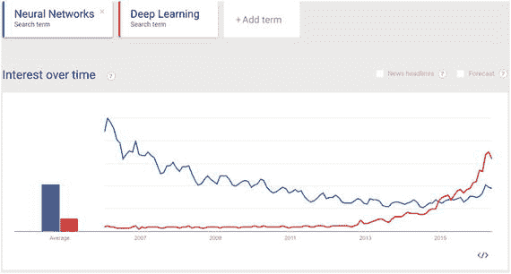
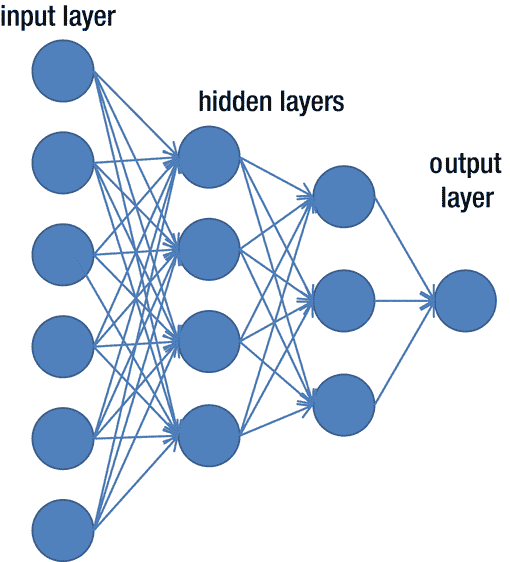
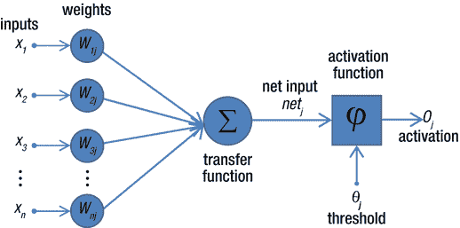
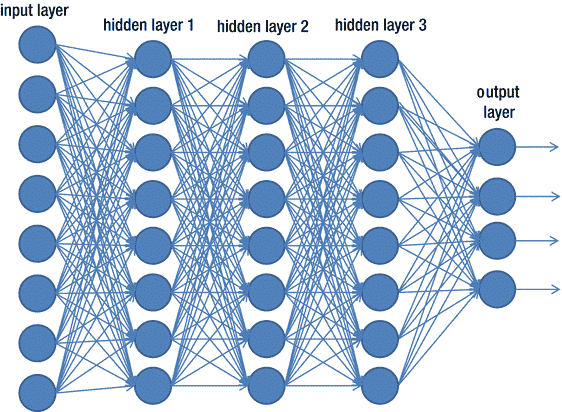

# 8. 机器学习

会学习的软件

在第二章中，我们从整体上回顾了商业分析的历史，指出统计学和机器学习是独立于数据仓库与商业智能而发展的。在本章中，我们将接续第二章的内容，回顾机器学习的最新趋势。

机器学习的大部分关键创新都以开源软件的形式发布，我们在第三章中对此进行了讨论。关于机器学习横向扩展架构的讨论，则是对第四章中 Hadoop 分析应用的延伸。

在第五章中，我们介绍了 Apache Spark，这是一个分布式内存平台，也是讨论分布式机器学习的核心。我们在第六章中简要介绍了流式机器学习，并在第七章中介绍了基于云的机器学习。

鉴于深度学习的重要性，我们专门用一个章节来介绍这项技术。本章最后，我们将调研现代机器学习的主要工具。

## 机器学习的最新趋势

当前影响机器学习的最重要趋势包括：

- 统计学与机器学习的融合
- 正式机器学习竞赛的增长
- 集成学习的普及度提升
- 大数据机器学习可扩展技术的发展
- 深度学习的兴起

预测这些趋势对未来产生的影响需要一定的推测；但毫无疑问，它们正在影响着当今的机器学习领域。

### 融合

2001 年，加州大学伯克利分校统计学名誉教授**列奥·布雷曼**撰文¹，描述了预测分析领域的“两种文化”。他称之为“数据建模者”的第一种文化，通过检验数据是否符合几种既定函数形式之一的假设来处理预测建模问题。

他称之为“算法派”的第二种文化，则在无假设的情况下解决问题，并利用机器学习工具来发现对当前数据预测能力最强的模型。布雷曼使用了自创的术语，但很明显，“数据建模”标签适用于统计学界，而“算法派”则适用于机器学习界。

“文化鸿沟”甚至比布雷曼描述的还要严重。在机器学习社区内部，围绕不同的核心技术（如决策树、神经网络、支持向量机、基于记忆的推理等）形成了众多亚文化。

机器学习技术各自独立发展，根植于不同的学科。每项技术都发展出了自己的语言和工具。实践者们掌握了单一方法的技能和专业知识，然后激烈地争论“他们的”方法优于所有其他方法。每种方法都有自己的软件实现，这使得比较变得困难。

如今，争论基本已经结束，布雷曼所描述的文化鸿沟也已消失。在很大程度上，“算法派”阵营取得了胜利；拥有资格证书的统计学家和精算师们可以自由地将机器学习工具与统计技术结合使用。诸如正则化之类的流行技术，不能轻易地归入某一特定阵营。

正则化是机器学习中用来控制过拟合的一种技术，过拟合是指算法“学习”训练数据特性的趋势。过拟合会产生一个在训练数据上预测良好，但在新数据上预测不佳的模型。正则化通过惩罚向模型中每增加一个变量所带来的损失函数来控制这个问题。

这种融合有三个原因。首先，机器学习方法比统计方法更符合业务需求。布雷曼的“数据建模”文化通过方法的“正确性”来定义成功，并使用统计学的“拟合优度”指标来衡量成功。但大多数企业领导者并未接受过统计培训，对`F 检验`、`T 检验`和`R 平方`等指标毫无兴趣；另一方面，他们能立即理解诸如准确率和精确率这样的指标，并理解在历史数据上测试预测的含义。

其次，机器学习社区已经开发出能够控制偏差或过拟合问题的方法和流程。诸如样本外测试、时间外测试、交叉验证和偏依赖分析等方法非常强大，以至于如今它们既与统计技术一起使用，也与机器学习技术一起使用。

最后，20 世纪 90 年代引入的数据挖掘工作台，将不同的机器学习技术与统计技术结合了起来。这些集成平台使得实践者能够轻松测试多种不同的技术，并选择最适合当前问题的那一种。

### 竞争

竞争性机器学习，即团队和个人为了赢得奖金而竞相构建最佳模型，对该学科贡献巨大。竞赛充当了机器学习最佳实践的实验室，并提高了新技术的能见度。

自 1997 年以来，美国计算机协会的知识发现与数据挖掘特别兴趣小组（SIGKDD）每年都会赞助一项名为 KDD Cup 的竞赛。每年的竞赛都会邀请参与者完成一个特定的挑战，例如对互联网搜索查询进行分类（2005 年）；检测乳腺癌（2008 年）；或预测教育资助提案的评分（2014 年）。

随着时间的推移，竞赛变得越来越复杂，从 1997 年一个简单的分类问题，发展到 2016 年的竞赛，要求团队在社交图谱中测量研究机构的相对影响力。越来越多的挑战要求参赛者将多种工具和技术融合到一个集成的解决方案中。

Netflix Prize 是一项从 2006 年持续到 2009 年的备受瞩目的竞赛。在线 DVD 租赁和视频流媒体服务公司 Netflix 悬赏 100 万美元，奖励给能够以至少 10%的优势击败其现有协同过滤算法的团队。在竞赛期间，Netflix 每年都会向表现最佳的团队颁发进步奖。为了此次竞赛，Netflix 提供了用于模型训练和模型评估的数据集，并指定均方根误差（RMSE）作为衡量模型准确性的指标。

Netflix 于 2006 年 10 月 2 日启动了该竞赛。六天之内，就有一支团队击败了 Netflix 的基准线²。在第一年和第二年竞赛结束时，由于没有任何团队超过 10%的门槛，Netflix 颁发了进步奖。

最终，在 2009 年 6 月，有两支团队突破了 10%的门槛。在整个竞赛期间，共有 5169 支团队提交了 44014 个参赛方案；顶尖的两支团队实力非常接近，他们的 RMSE 分数分别为 0.8554 和 0.8553。Netflix 将 100 万美元奖金授予了一个由来自奥地利和美国的七名研究人员组成的团队。

受到 Netflix Prize 影响力的启发，安东尼·戈德布卢姆和本·哈默于 2010 年创立了 Kaggle，作为一个预测建模和分析竞赛的平台。在 Kaggle 的模式下，主办机构赞助竞赛、制定规则并提供奖金。Kaggle 则提供平台来托管数据、接收提交方案、维护排行榜并执行规则。

迄今为止，Kaggle 已经为包括 Allstate、Caterpillar、GE、Heritage Health、Home Depot、Liberty Mutual、Merck、Prudential、Santander 和 State Farm 在内的各类赞助商举办了超过 200 场公开竞赛。一等奖的奖品包括知识、赞誉、纪念品、工作机会，以及高达 50 万美元的现金。

凭借超过 50 万的注册用户，Kaggle 声称拥有世界上最大的数据科学家社区。Kaggle 通过排行榜追踪注册用户的表现。在缺乏明确定义的数据科学家资质认证的情况下，Kaggle 排行榜界定了一个由专家组成的精英社区。

许多其他竞赛也支持着专业领域的发展，例如手写识别、交通标志识别、脑部图像分类、乳腺癌诊断等等。这些竞赛中的成功努力极大地促进了人们对深度学习的重新关注，我们将在本章后面讨论这一点。

机器学习竞赛的影响力再怎么强调也不为过。竞赛吸引了机器学习社区的极大兴趣，成功的技术得以迅速传播。此外，竞争环境展示了在高级分析中协作与团队合作的价值，并验证了众包方法的有效性。

### 集成学习

当一些研究人员开发出从根本上训练模型的新方法时，另一些研究人员则找到了通过以多种方式组合技术来改进模型的方法。集成学习技术使用多个模型来生成一个聚合模型，其预测能力优于单独使用的单个模型。这些技术计算量很大；而可用计算能力的增长使得集成学习对主流用户来说变得可行。

组合模型的多种方式可归结为三种：**提升法（Boosting）**、**装袋法（Bagging）**和**混合法（Blending）**。提升法以迭代方式运行，在先前每个模型的错误基础上依次构建模型。`ADABoost`（自适应提升法）于 1995 年提出，是集成学习最流行的方法之一。`ADABoost`元算法迭代运行，利用关于错误分类案例的信息来开发一个强大的聚合模型。在每次迭代中，`ADABoost`会测试可能的分类规则，并根据它们对提升模型整体预测能力的贡献程度重新加权。

1996 年，Leo Breiman 开发了一种装袋算法。装袋法从原始训练数据集中选取多个子样本，为每个子样本构建一个模型，然后通过平均（用于回归）或投票程序（用于分类）来构建一个解决方案。装袋法的主要优势在于它能够构建更稳定的模型；其主要缺点是计算复杂度高以及对更大数据集的需求。高性能计算的发展缓解了这些缺点。

斯坦福大学的统计学家 Jerome H. Friedman 于 1999 年提出了梯度提升法及其变体随机梯度提升法。梯度提升法的工作方式与 `ADABoost` 类似，但使用不同的度量来确定错误的代价。随机梯度提升法将梯度提升法与随机子采样相结合。除了提高模型准确性外，这种增强功能还使分析人员能够预测模型在训练样本之外的性能。

2001 年，Breiman 和 Adele Cutler 提出了一项他们注册了商标的技术，称为“随机森林”。随机森林算法将装袋法（从训练数据中随机选择子集）与随机选择特征（或预测变量）相结合。该算法从训练数据集中随机选择的子样本中训练大量决策树，然后输出这些单个树输出的类别中的众数类别。与其他集成技术相比，随机森林的主要优势在于其模型在训练样本之外具有良好的泛化能力。此外，随机森林会产生对特征选择有用的变量重要性度量。

与其他技术相比，混合模型或堆叠模型相对较新，但已在一些备受瞩目的竞赛中取得了巨大成功。混合模型利用其他模型的预测来生成一个平均预测；混合模型的性能优于任何单个模型。混合模型的训练更为复杂，因为分析人员在构建混合模型之前必须先训练多个基础模型；它们生成预测所需的时间也更长，可能不适用于实时应用。

### 扩展至大数据

一些软件供应商在 20 世纪 70 年代、80 年代和 90 年代开发了用于统计的软件。SAS 研究所通过与 IBM 的紧密合作，凭借其对 IBM 大型主机的投入，奠定了其作为统计领域“企业级”供应商的声誉。1975 年从芝加哥大学全国民意研究中心分离出来的 SPSS 则采取了不同的方法，在 1984 年个人电脑问世时便迅速拥抱了它。SPSS 于 1992 年推出了首个基于 Windows 的统计软件，并通过瞄准商业用户实现了快速增长。

在 20 世纪 90 年代，SAS 开发了在单机上以单线程运行的软件。随着分析数据集在 20 世纪 90 年代和 21 世纪初变得越来越大，SAS 的硬件合作伙伴推荐使用越来越大、计算能力更强的服务器来处理增加的工作负载。计算专业人士将这种方法称为“纵向扩展”——为了获得更强的计算能力，在功能更强大的计算机上部署软件。

随着数据集变得越来越大，纵向扩展引发了许多问题。首先，即使最大的服务器对于某些项目来说也仍然太小。单台服务器的限制迫使从事大型任务的分析人员将数据分片并串行处理；结果，大型任务可能需要运行数天甚至数周。

硬件供应商为支持纵向扩展而推广的“大型机箱”的成本是另一个问题。大型机器可能耗资数百万美元。此外，基于大型机器的计算架构难以调整规模和管理，因为计算能力的每一次增量增加都很昂贵。“大型机箱”架构有一种类似于高速公路的趋势：新的时候快速且宽敞，但不久之后就会变得拥挤和阻塞。

因此，大多数组织已转向“横向扩展”计算模型，即应用程序在大量低成本商品化服务器上运行。横向扩展模型更容易与需求对齐，因为计算基础设施可以小规模增量扩展。横向扩展架构是组织采用 Hadoop 的主要原因之一。

某些分析任务在横向扩展环境中很容易实现；我们将这些任务称为“令人尴尬地并行”（请参阅下面的注释）。大多数模型训练算法并非“令人尴尬地并行”。有些是迭代的，需要多次遍历数据；对于其他算法，项目级计算部分依赖于其他项目级通信，并需要分布式计算节点之间的交互。

如果每个数据项的计算独立于所有其他数据项的计算，并且结果是分布式计算的线性组合，则该操作就是“令人尴尬地并行”。示例包括 SQL `SELECT` 语句；对线性模型进行评分；以及计算统计均值。

非“令人尴尬地并行”的任务必须重写才能在横向扩展环境中运行。这样做成本高昂，而且正如我们将在本章后面展示的那样，目前市场上只有少数几个分布式引擎。

扩展至大数据意味着处理更大的数据集，但也意味着处理多样化的类型（多样性）和动态数据（高速性）。我们将在后续的深度学习部分讨论涉及图像、音频、视频、语音和其他类型数据的机器学习，并在第六章讨论了流式分析。

我们倾向于根据表格中的条目或行数来考虑数据量——十亿行是一个非常大的数据集。然而，数据集的宽度——列、变量或特征的数量——对机器学习的影响要大得多。科学家们很早就认识到“维度灾难”，即分析与大量维度相关的数据时所遇到的计算问题。

## 列、变量、特征与维度

`Column`、`variable`、`feature` 和 `dimension` 是紧密相关的概念，许多人会混用它们。`column` 是关系数据库表中的一组值；`variable` 是计算机编程中一个可变化值的符号名称；`feature` 是观测现象的一个可测量属性；`dimension` 是一个数学属性。一个事物具有 `feature`；在关系数据库中，`feature` 映射到 `column`；在计算机程序中，`column` 映射到 `variable`；在问题的数学讨论中，`variable` 映射到 `dimension`。

高维数据给分析人员带来了若干问题。问题的计算复杂度随维度数量迅速增加。额外的维度也增加了模型可能被指定的方式数量，从而要求进行更多实验来训练和调优模型。此外，在线性回归的情况下，大量维度会增加其中某些维度相关的可能性，导致有偏的参数估计。

机器学习研究人员已经开发了几种不同的特征选择方法，这是一种在模型训练之前实施的预处理步骤。逐步回归是一种迭代添加或删除变量并重新训练模型的方法，在 20 世纪 90 年代曾是一种流行技术。然而，它已不再流行[⁵]，转而采用嵌入式方法，例如正则化（`regularization`），它会逐步惩罚额外的变量。

## 深度学习

三个因素促成了现代深度学习的成长。第一个因素是 21 世纪初通用计算图形处理器（GPU）的引入。图形处理器（`GPU`）是专门为支持计算机游戏和图像处理而开发的特殊芯片。`GPU` 在特定类型的任务上比标准 `CPU` 强大得多，并且具有高度并行的架构。对浮点运算的支持以及诸如 `CUDA` 等通用计算 `API` 的研发，使得将计算从 `CPU` 卸载到 `GPU` 变得可行。

统一计算设备架构（`CUDA`）由 `GPU` 芯片供应商英伟达（Nvidia）创建，是一个软件层，使程序员能够使用高性能 `GPU` 芯片进行通用计算。

促成深度学习的第二个因素是知识和启发式方法的发展，使从业者能够有效训练模型。机器学习学科不会凭空突然出现；成功的应用是长期实验和学习过程的最终结果。研究人员花费多年时间试图解决“异或”问题；由于深度学习模型的极高复杂性，机器学习社区花了多年时间才开发出使该方法行之有效所需的技能和知识。

第三个因素是数字化内容——文本、文档、图像、音频和视频——的巨量扩张，这一点在本书第一章中已有记载。数字内容的巨量扩张——我们现在称之为大数据——为机器学习在情感分析、自然语言处理、主题建模、图像识别、图像搜索和语音识别等领域创造了全新的应用。现有的机器学习方法不太适合这些问题，这些问题要求在大规模“宽”集的无标签数据中搜索隐藏或潜在模式。

深度学习的早期里程碑出现在 2007 年，当时多伦多大学的杰夫·辛顿（Geoff Hinton）发表了一篇开创性论文[⁶]，概述了如何逐层训练具有多个隐藏层的深度神经网络，从而将计算挑战分解为更小、更易处理的问题。在此之前，语音和手写识别领域的研究已转向所谓的生成模型。

生成模型是一类通过为每个数据点学习联合概率分布来建模关系的统计模型，与学习条件概率分布的判别模型形成对比。生成模型的示例包括高斯混合模型（`Gaussian Mixture Models`）、隐马尔可夫模型（`Hidden Markov Models`）、潜在狄利克雷分配（`Latent Dirichlet Allocation`）和受限玻尔兹曼机（`Restricted Boltzmann Machines`）。

凭借更强的计算能力和更好的方法，从事深度学习的研究人员开始取得成果。从 2009 年开始，微软研究院大力投资将深度学习应用于语音识别，并能够显著降低错误率[⁷]，优于其他方法[⁸]。

谷歌在图像识别领域的类似努力也取得了回报。2012 年，《纽约时报》报道[⁹]，一个谷歌大脑团队利用部署在超过 16000 台计算机上的深度学习，从 YouTube 数百万张图像中识别出未标记的图像。

因此，尽管对神经网络的兴趣在过去十年中有所下降，但对深度学习的兴趣却在增长——自 2012 年以来尤为明显（见图 8-1）。同年，《纽约时报》[¹¹]和《纽约客》[¹²]等主流刊物刊登了关于苹果、微软和谷歌等公司如何使用深度学习解决语音识别、图像识别、三维物体识别和自然语言处理问题的报道。

图 8-1. 神经网络与深度学习的搜索兴趣（来源：Google Trends）

2015 年，谷歌、Facebook 和微软将它们的开源深度学习框架发布为开源软件。我们将在本章稍后部分介绍这些框架。

## 深度学习基础

在本节中，我们将向读者介绍神经网络和深度学习中的一些最重要概念。

### 神经网络

由于深度学习依赖于神经网络技术，我们首先介绍该领域的关键概念。本概述做了必要的简化；该领域存在大量关于细分主题的著作，并且相关研究仍在不断发展。

动物的大脑是神经网络：由更小的细胞（即神经元）通过突触连接而成的网络。随着生物学家研究动物大脑，他们构建了神经网络的类比模型：利用电线和灯泡尽可能模拟大脑功能的物理装置。这些精巧的装置就是人工神经网络。

我们今天所熟知的神经网络是用计算机语言编写的、对大脑功能的符号化表征。神经网络将问题表征为由有向图（“突触”）连接的节点（“神经元”）网络。与动物大脑一样，它们能够“学习”和“记忆”。图 8-2 展示了一个神经网络示例。

图 8-2. 神经网络

神经科学家开发神经网络是为了模拟动物的学习过程。然而，他们开发的方法广泛适用于其他领域。

在神经网络中，每个神经元接收数学输入，通过传递函数处理这些输入，并通过激活函数产生数学输出。神经元独立处理其本地数据以及其他神经元的输入。图 8-3 展示了一个神经元及其功能。

图 8-3. 神经元

神经网络中的神经元使用各种数学函数作为激活函数。这些函数是数学表达式，描述了神经元如何将从其他神经元接收的输入数据转换后传递给其他神经元的输出数据。原则上，激活函数可以是任何数学函数；其限制仅在于软件能力和可用计算能力。

虽然神经网络可能使用线性函数，但分析师在实践中很少这样做；使用线性激活函数且无隐藏层的神经网络产生的结果与线性回归模型相同。分析师更可能使用非线性激活函数，例如逻辑函数；如果线性函数足以对目标进行建模，那就没有理由使用神经网络。

神经网络的神经元或节点形成层。输入层接受来自网络外部的数学输入，而输出层接受来自其他神经元的数学输入并将结果传递到网络外部。神经网络可能还有一个或多个隐藏层，用于处理输入层和输出层之间的中间计算。深度神经网络是指至少有两个隐藏层的神经网络。图 8-4 展示了一个深度神经网络。

图 8-4. 深度神经网络

神经网络的输入层和输出层通常代表现实世界的事实：输入层代表我们想要用作预测变量的数据向量，输出层代表目标变量。¹³ 另一方面，隐藏层代表与统计因子分析中的因子类似的抽象概念，区别在于它们不可直接解释，仅用于提高模型的准确性。隐藏层使神经网络能够学习任意复杂的函数。

从业者根据网络拓扑结构、网络内的信息流、数学函数和训练方法来分类神经网络架构。两种最广泛使用的架构是：

-   **多层感知器。** 多层感知器是一种前馈网络；这意味着某一层的神经元接受来自前一层神经元的输入，但不接受来自同一层或后续层神经元的输入。在多层感知器中，模型的参数包括分配给每个连接的权重以及每个神经元中激活函数的权重。从业者使用一种称为反向传播的技术来训练网络。

-   **径向基函数网络。** 径向基函数网络使用径向基函数（一种特定类型的数学函数）作为神经元中的激活函数。这种类型的神经网络非常适合函数逼近、分类以及动态系统建模。

分析师通过使用众多优化算法之一来训练神经网络。反向传播技术使用一个数据集，其中目标（输出层）的值是已知的，从而推断出能使误差最小化的参数值。该方法迭代进行；首先使用训练数据计算目标值，然后利用预测误差的信息来调整网络中的权重。

有几种反向传播算法；最广泛使用的是梯度下降和随机梯度下降。梯度下降对模型参数使用任意起始值，并计算误差曲面；然后在误差曲面上寻找使预测误差最小化的点。梯度下降在每次迭代时都会评估训练数据集中的所有案例。随机梯度下降则从训练数据集中随机抽取样本案例进行处理。因此，随机梯度下降比梯度下降收敛得更快，但可能产生准确性较低的模型。

神经网络是复杂的技术，需要从业者做出许多选择。然而，相对于其他机器学习技术，人工神经网络有四个关键优势：能够自动检测和建模特征间的复杂交互；能够从经过最少处理的原始数据中学习低级特征；能够处理大量类别；以及能够处理未标记数据。

总的来说，这四大优势意味着人工神经网络可以在其他方法失效时产生有用的结果，并且有潜力构建出比其他方法更准确的模型。

未标记数据缺少关于其代表内容的信息。例如，一张未标记的位图照片，是一串表征二维空间中点值的流式数据，但不包含关于照片主题的数据。

### 深度学习架构

在神经网络的基础上，深度学习实践者们使用了精巧的新型架构，这些架构非常适合处理由大数据浪潮带来的内容分析中的关键问题。一些最受欢迎的架构包括：

`受限玻尔兹曼机（Restricted Boltzmann Machine，RBM）`是一种浅层网络，包含两层：输入层（或称可见层）和隐藏层。输入层中的神经元或节点映射到输入数据中的特征；例如，如果一组文本有 5000 个不同的单词，那么输入层中每个单词就对应一个节点。隐藏层中的节点则代表输入层中所表示实体之间的关系；它们在概念上类似于统计因子分析中的因子。

`深度信念网络（Deep-Belief Networks，DBN）`是多个受限玻尔兹曼机的堆叠。堆叠中，每个`RBM`的隐藏层作为其上方`RBM`的输入层。分析人员使用`DBNs`来挖掘文本分析中的词向量、进行图像和视频识别以及语音识别。

`深度自编码器（Deep Autoencoder）`包含两个对称的`深度信念网络`，每个网络由四到五个`受限玻尔兹曼机`分层排列而成。深度自编码器在主题建模中非常有用，其目标是建模分布在多篇文档中的抽象主题。它们也用于数据压缩以及图像搜索应用，在这些应用中，图像首先被压缩成固定长度的数值向量。

`递归神经张量网络（Recursive Neural Tensor Networks）`具有树状结构，树的每个节点上都有一个神经网络。它们在文本分析中很有用，能够处理词向量。

`堆叠降噪自编码器（Stacked Denoising Autoencoders，SDA）`是另一种称为自编码器的神经网络的堆叠形式。自编码器的目标是学习一组数据的一种表示，从而降低其维度；一个`SDA`有多个隐藏层，每一层都是一个自编码器。`SDAs`可用于有监督的文档分类；例如，如果我们想将一批文档中的每一篇分类到几个组中的一个，以便后续路由分发。

`卷积神经网络（Convolutional Neural Networks，CNN）`是一种受动物视觉皮层结构启发的深度神经网络；它们用于图像中的物体识别。与神经元全连接的*多层感知机*不同，`CNN`中的神经元只与邻近区域的神经元局部连接。例如，在图像识别中，一个神经元代表图像中的一个像素；在`CNN`中，该像素可能连接到周围的像素，但不会连接到图像远角处的像素。这种方法在处理图像时非常高效。

`循环神经网络（Recurrent Networks，RNN）`用于识别数据序列中的模式：时间序列数据、手写体、文本、语音或基因组数据。前馈网络一次处理一个数据实例，在遍历数据的过程中调整权重以最小化误差。而`RNNs`则同时从当前实例和前一个实例的输出状态中学习，后者起到了一种记忆的作用。与前馈网络不同，在`RNN`中，神经元可以连接到任何层中的任何其他神经元，而不仅仅是前几层的神经元。

## 机器学习实战

本节展示了 12 个机器学习实际应用的案例。

**百度。**¹⁴ 2014 年，中国搜索引擎公司百度宣布开发了一种名为`Deep Speech`的语音识别系统。¹⁵ 百度声称，在像餐厅这样的嘈杂环境中，该系统的准确率达到了 81%，相较于市面上的语音识别软件有显著提升。该语音识别系统使用了`循环神经网络（RNN）`。百度报告称¹⁶ 使用了一个计算机集群，该集群能够支持拥有约 1000 亿个神经连接（或称突触，而非神经元）的深度学习模型。

**卡罗来纳医疗保健系统。**¹⁷ 对于医院来说，患者再次入院是一个严重的问题，这不仅仅是因为对患者健康和福祉的关切；美国联邦医疗保险和私营保险公司会对再入院率高的医院进行处罚，因此，确保只在患者身体状况足以保持健康时才让其出院，对医院有直接的经济利益关系。卡罗来纳医疗保健系统（CHS）使用机器学习来构建患者风险评分，病例管理员根据这些评分做出出院决定。该系统能够更好地利用护士和病例管理员资源，根据病例的风险和复杂程度对患者进行优先排序。结果，CHS 将再入院率从 21%降低到了 14%。

**思科。**¹⁸ 营销人员使用“购买倾向”模型作为工具来确定最佳的销售和营销对象以及最值得推荐的产品。思科提供从路由器到有线电视机顶盒等种类繁多的产品，其营销分析团队在数小时内训练了 60,000 个模型并对 1.6 亿个潜在客户进行了评分。通过尝试从决策树到梯度提升机等一系列技术，该团队极大地提高了模型的准确性——这直接转化为了更高的销售额、更少的无效销售电话以及更满意的销售代表。

**康卡斯特。**¹⁹ 康卡斯特为其 X1 互动电视服务的客户，基于每个客户之前的收视习惯，提供个性化的实时内容推荐。康卡斯特利用数十亿条历史记录，运用机器学习技术为每位客户建立独特的“品味档案”，然后将品味相近的客户归入不同的群组。针对每个客户群，康卡斯特实时追踪并展示最受欢迎的内容，以便客户了解当前的热门趋势。最终结果是：更精准的推荐、更高的利用率以及更满意的客户。

**Dstillery。**²⁰ 广告技术公司 Dstillery 使用机器学习帮助威瑞森和威廉姆斯-索诺玛等公司，在实时竞价（RTB）平台上进行数字展示广告定向投放。利用收集到的个人浏览历史、访问、点击和购买数据，Dstillery 每秒进行数千次预测，同时处理数百个广告活动；这使得该公司能够显著超越人工营销人员的表现，确保每一分钱都能产生最佳的广告效果。

**GenomeDx Biosciences。**²¹ GenomeDx Biosciences 是一家专注于基因组检测的初创公司。为了评估一项基因组测试在改善前列腺癌诊断方面的效力，GenomeDx 与多家主要医院和医学院合作，开展了一项包含 1537 名患者的临床试验。该基因测试产生了一个包含 46,000 个特征的特征向量，数量之多使得传统方法难以分析。通过使用`深度神经网络（Deep Neural Network）`，GenomeDx 构建了一个分类器，其在预测癌症患者术后结果方面，比任何其他现有方法都更为有效。

捷豹路虎。²² 捷豹路虎生产的新车搭载了 60 台车载电脑，每天通过超过 20,000 项指标产生 1.5 GB 数据。该公司工程师利用机器学习来提炼这些数据，以了解客户实际如何使用车辆。通过分析实际使用数据，设计师可以预测部件故障和潜在安全问题；这有助于他们根据预期工况合理设计车辆。

微软。²³ 2015 年 3 月，微软团队发表²⁴了一篇论文，记录了其基于深度卷积网络（`CNN`）的计算机视觉系统的成果。该团队在`ImageNet 2012`分类数据集上测试了该系统，该数据集包含 120 万张训练图像、5 万张验证图像和 10 万张测试图像。系统的任务是将每张图像归入 1000 个类别之一。微软系统实现了 4.94%的错误率，实际上优于人类——人类对同一批图像的分类错误率为 5.1%。

NBC 环球。²⁵ NBC 环球为国际有线电视分发存储了数百 TB 的媒体文件；必须高效管理这一在线资源，以支持对国际客户的分发。该公司利用机器学习，基于多种指标的组合来预测每个项目的未来需求。根据这些预测，公司将预测需求低的媒体迁移至低成本离线存储。机器学习的预测远优于基于单一指标（如文件年龄）的任意规则。因此，NBC 环球在维持客户满意度的同时降低了总体存储成本。

PayPal。²⁶ 在线支付公司 PayPal 每月处理超过 100 亿美元的资金交易。在此规模下，欺诈检测与预防方面的微小改进都会对利润产生显著影响：预测准确率每提高 1%，运营贡献额便增加 100 万美元。该公司机器学习团队基于包含 1.6 亿条记录和 1500 个特征的数据集，持续更新其欺诈检测模型，寻求小幅改进。公司报告称，自数年前开始使用非线性方法以来，其能力实现了“重大飞跃”，而自三年前开始使用深度学习以来，又获得了额外提升。PayPal 的深度学习算法能够分析数千个潜在特征，如时间信号、行为主体和地理位置，与之前的顶级欺诈检测模型相比，实现了 10%的改进。

Spotify。²⁷ Spotify 的一个团队使用混合深度卷积网络，基于音频信号的频谱图学习歌曲之间的异同。该网络以 Spotify 上最受欢迎的 100 万首歌曲中提取的 30 秒音轨进行训练，学会了预测通过协同过滤模型获得的歌曲潜在表征。（通过这种方式，Spotify 可以在几乎没有或完全没有历史使用数据的情况下推荐播放列表。）

美国能源部。²⁸ 国家能源研究科学计算中心（`NERSC`）与劳伦斯伯克利国家实验室合作，利用深度学习分析气候模拟模型产生的 PB 级数据。通过使用深度学习进行模式识别，`NERSC`报告称，在检测极端天气事件（如热带气旋、大气河流和天气锋）方面达到了 95%的准确率。

### 新型机器学习软件

在本节中，我们将简要介绍可扩展的机器学习和深度学习软件平台，分为四类：

*   开源分布式引擎
*   商业分布式引擎
*   数据库内库
*   深度学习框架

我们不包含开源`R`和`Python`库，这些已在第四章讨论过。虽然这些语言是宝贵的开发工具，但它们本身不具备可扩展性；处理大型数据集的`R`和`Python`用户最好使用此处列出的某个可扩展引擎。

许多流行的最终用户工具会将处理过程下推到本章列出的某个引擎中。我们将在第九章介绍这些工具。

本节描述的分布式机器学习引擎最初是为在集群服务器或专用设备上运行而开发的；它们并非最初设计用于在`Hadoop`上运行。在`Hadoop 2.0`（`YARN`发布后）下，所有这些引擎都迅速被改造以在`YARN`管理的`Hadoop`集群上运行。

#### 开源分布式引擎

目前只有两种面向机器学习的开源通用分布式引擎：`Apache Spark`和`H2O`。还有许多其他开源机器学习包，例如`Weka`或`Vowpal Wabbit`，它们不支持分布式模型训练。也有一些机器学习工具，例如`XGBoost`，支持单一算法。我们将讨论范围限定在支持多种算法的软件上。

#### Apache Spark 机器学习

Apache Spark MLlib 是一个运行在 Spark 之上的机器学习库。MLlib 有两个主要的 API：一个是用于 Spark RDD（参见第五章）的原始 API，另一个是用于 Spark DataFrame 的新 API。（PySpark 和 SparkR API 也支持机器学习功能。）虽然 Spark 团队会继续支持基于 RDD 的 API，但所有新的开发工作都在 DataFrame API 上进行。

基于 RDD 的 API 包含基本的统计工具，包括摘要统计、相关性、分层抽样、假设检验、流式显著性检验和随机数据生成。对于机器学习，该库包含：

- 特征提取和转换，包括用于特征向量化、文本挖掘、标准化、归一化、特征选择和向量转换的工具。
- 使用线性支持向量机、逻辑回归、决策树、随机森林、梯度提升树和朴素贝叶斯分类器进行二元分类。
- 使用线性最小二乘法、套索算法、岭回归、决策树、随机森林、梯度提升树和保序回归进行回归分析。
- 降维，包括奇异值分解（SVD）和主成分分析（PCA）。
- 使用 k-means、高斯混合模型、幂迭代聚类（PIC）、潜在狄利克雷分配（LDA）、二分 k-means 和流式 k-means 进行聚类。
- 使用 FP-Growth、关联规则和用于序列分析的 PrefixSpan 进行频繁模式挖掘。
- 使用交替最小二乘法进行协同过滤。

该 API 还包括一套完整的用于模型评估的统计指标，包括常见指标，如精确率、召回率、F 值、ROC 和 AUC。用户还可以为选定的算法导出 PMML 模型。

对于希望创建自己算法的开发者，Spark 公开了优化原语，包括梯度下降、随机梯度下降和有限内存 BFGS（L-BFGS）算法。

基于 DataFrame 的 API 对完整的机器学习流水线进行建模。用户处理的是在 Spark SQL 中定义的 DataFrame，而不是直接处理 RDD。该 API 的基本元素是转换器和估计器。转换器是对一个 DataFrame 执行操作以生成另一个 DataFrame 的算法；例如，对数据集中所有变量进行标准化的操作。估计器是在 DataFrame 上操作以创建转换器的算法；例如，线性回归算法生成一个线性模型，该模型是一个转换器，用户可以将其应用于另一个 DataFrame。

该库包含三种类型的预构建转换器：

- 特征提取器，使用 TF-IDF 和 Word2Vec 等算法从原始数据中创建特征。
- 特征转换器，用于缩放、转换或修改特征。
- 特征选择器，从更大的特征集中选择一个子集。

机器学习功能正在迅速扩展：

- 使用逻辑回归、决策树、随机森林、梯度提升树和多层感知器进行二元分类。
- 通过与二元分类器一起使用的“一对多”算法进行多类分类。
- 使用线性回归、决策树、随机森林、梯度提升树和生存回归进行回归分析。
- 使用 k-means 和潜在狄利克雷分配（LDA）的聚类算法。

Spark 包通过第三方贡献的独特创新功能进一步扩展了 Spark 的机器学习能力。截至 2016 年初，已有超过 50 个用于机器学习的包。

对于 R 语言用户，SparkR 接口提供了一系列机器学习算法，包括高斯 GLM 模型和二项 GLM 模型。Spark 团队将 SparkR 设计为以类似于其他 R 包的方式运行。

除了 Spark 原生的机器学习库和 Spark 包之外，我们还注意到 Apache SystemML，这是一个运行在 MapReduce 和 Spark 之上的模块。

SystemML 是一个声明式机器学习系统，由 IBM 开发并捐赠给 Apache 基金会；它目前是 Apache 孵化器项目。用户通过 Python 和 R API 与该软件交互，指定要运行的机器学习算法；SystemML 会生成本地执行或在 MapReduce 或 Spark 中执行的优化运行时计划。

截至 2016 年初，SystemML 支持：

- 描述性统计，包括单变量、双变量和分层双变量统计。
- 分类技术，包括多项逻辑回归、支持向量机、朴素贝叶斯、决策树和随机森林。
- k-means 聚类。
- 回归技术，包括线性回归、逐步线性回归、广义线性模型和逐步广义线性模型。
- 矩阵分解技术，包括主成分分析。
- 生存分析，包括 Kaplan-Meier 和 Cox 比例风险方法。

用户通过一种高级语言（DML）与 SystemML 交互，其语法类似于 R 或 Python。DML 包含线性代数原语、统计函数和特定于 ML 的概念。这些算法是完全可定制的，会根据数据和集群特性进行动态编译和优化。

Apache SystemML 拥有稳步增长的代码库和活跃的贡献者社区。

#### H2O

H2O 是一个开源的分布式内存计算平台，专为在 Hadoop、独立集群或云中部署而设计。H2O 拥有自己的分布式计算引擎；它可与 HDFS、S3、SQL 和 NoSQL 数据存储中的数据一起使用，并通过 Sparkling Water 接口与 Apache Spark 一起使用。

当前功能包括深度学习、广义线性模型、梯度提升分类和回归、k-means 聚类、朴素贝叶斯分类器、主成分分析和随机森林。该软件还包括用于数据转换、模型评估和评分的工具。H2O 将评分对象导出为普通的 Java 对象（POJO）。

用户通过 Java、Scala、Python 和 R API，或通过易于使用的 Web 界面与该软件交互。

H2O.ai 为该开源软件提供商业支持。2014 年 7 月，H2O.ai 从一群投资者那里获得了 890 万美元的 A 轮融资；随后，在 2015 年 11 月，该公司宣布了 2000 万美元的 B 轮融资。该公司声称拥有许多公开的参考客户，包括 AT&T、康卡斯特、凯撒医疗机构、Progressive Insurance、Transamerica、沃尔格林和 Zurich Insurance。H2O 的用户社区正在快速增长；H2O.ai 声称在超过 5000 个组织中拥有超过 40000 名用户。

H2O 拥有庞大且稳步增长的代码库。

#### 商业分布式引擎

三家软件供应商提供商业许可的分布式机器学习引擎；SAS 提供了三种不同的引擎。

#### SAS 高性能分析

行业领导者 SAS 于 2012 年底推出了`SAS High Performance Analytics`（`HPA`）。`HPA`是一个分布式内存分析平台，专为在 Oracle、Pivotal 或 Teradata 的特制设备上运行而设计，随后又被重新用于商品硬件集群。`HPA`作为`SAS Enterprise Miner`和其他 SAS 客户端的后端组件，使选定的 SAS 过程能够在集群硬件上以分布式模式运行。

虽然该产品支持多种数据库，但它缺乏开放的`API`，只能从 SAS 调用。`HPA`通过并行加载将数据快速读入内存，但不会将数据保留在内存中，也不支持高并发。

SAS 于 2013 年推出了`LASR Analytics Server`，作为一款新的可视化产品（`SAS Visual Analytics`）的后端。与`HPA`不同，`LASR Analytics Server`将数据保留在内存中，并支持高并发。这两种架构都不具备与真正内存数据库等效的功能，例如持久性保证或无需重新加载整个数据集即可更新数据的能力。

2016 年 4 月，SAS 发布了第三种现代架构，品牌名为`SAS Viya`，该公司将其定位为“开放、弹性且可扩展”。截至 2016 年 8 月，该软件仅面向现有 SAS 客户提供有限预览，计划于 2016 年第三季度晚些时候全面上市。

#### Microsoft R Server

`Microsoft R Server`是一个商业许可的软件包，包含`Microsoft R Open`（一个增强版的`R`发行版）、集成与连接工具，以及`ScaleR`（一个具有`R`接口的、用于预测分析的分布式算法库）。该软件可在 Linux 上运行；它可以部署在 Cloudera、Hortonworks 或 MapR 的 Hadoop 发行版中，或部署在 Teradata 数据库中。微软通过`SQL Server 2016`的`R Services`在 Windows 上提供该软件。

`Microsoft R Server`支持处理文本文件、HDFS、关系型数据库、SAS 数据集以及其他常见格式的数据。`ScaleR`支持的功能包括数据转换、描述性统计、线性和逻辑回归、广义线性模型、决策树、集成模型以及`k-means`聚类。该软件通过`PMML`支持本地模型评分和模型导出。其部署接口支持与 Tableau、Qlik 以及自定义 Web 应用程序的集成。

#### Skytree

Skytree 是一家总部位于硅谷的初创公司，致力于开发和销售用于机器学习的商业软件。Skytree 的核心软件最初是一个学术性的机器学习项目（佐治亚理工学院的`FastLab`）；开发者于 2013 年 1 月将公司作为商业软件供应商推出。该软件运行在 Cloudera、Hortonworks、MapR 和 Amazon EMR 的 YARN 之上，并与 Apache Spark 集成，以创建该公司所称的统一机器学习平台。

该软件支持数据可视化、特征工程，以及用于分类、回归、聚类、推理和降维的机器学习算法。Skytree 声称拥有一种自动模型选择能力，商标名为`AutoModel`，并正在为其申请专利。

用户可以通过 Skytree 命令行界面（`CLI`）、Java 和 Python 应用程序接口（`API`）或基于浏览器的图形用户界面（`GUI`）与该软件进行交互。

#### 数据库内库

数据库内机器学习库通过表函数在关系型数据库中工作。用户通过 SQL，或能够通过开放接口向数据库传递 SQL 的应用程序，与机器学习库进行交互。

我们在此仅收录那些能够支持多种数据库平台的机器学习库。这排除了 IBM DB2、IBM Netezza、Microsoft SQL Server、Oracle Database 和 Teradata Database 中内置的原生机器学习工具。虽然这些数据库的机器学习功能可能很有用（尤其是在完全依赖这些数据库平台的组织中），但大多数组织最好投资于不绑定单一供应商的技术。

#### Apache MADlib

`Apache MADlib`是一个开源的机器学习算法库，旨在无需移动数据的情况下，在大规模并行数据库中运行。其开发始于 2010 年，由加州大学伯克利分校的研究人员与 EMC Greenplum（现为 Pivotal Software）的数据科学家合作进行。

Pivotal 于 2015 年将该软件资产捐赠给 Apache 软件基金会，该项目随后进入 Apache 孵化器状态。虽然该项目旨在拓宽其贡献者基础，但最近的代码提交主要来自两名 Pivotal 员工。

该项目明确支持 PostgreSQL、Pivotal Greenplum Database 和 Pivotal Hawq；原则上，用户可以在任何支持用户自定义聚合（`UDA`）的数据库（如 Impala）中实现该库。

`MADlib`算法在数据库中作为表函数运行；用户通过 SQL 调用它们。`MADlib`还支持从文本中提取特征和低秩矩阵分解，以及一系列用于发现、验证和模型实现的实用程序。机器学习能力包括 10 种不同的回归方法、线性系统、矩阵分解、基于树的方法、关联规则、聚类、主题建模、文本分析、时间序列分析和降维技术。

目前，`MADlib`的商业支持尚不明确。大多数`MADlib`用户是 Pivotal Software 的客户，该公司提供咨询和技术支持。戴尔近期收购了 Pivotal Software 的母公司 EMC；同时，将项目治理从 Pivotal 转移到 Apache 可能会扩大用户和贡献者基础。

#### Fuzzy Logix DB Lytix

`DB Lytix`是 Fuzzy Logix 公司的一款商业软件产品，是一个包含 800 多个函数的库，用于机器学习和高级分析。这些函数作为数据库表函数在关系型数据库（Informix、MySQL、Netezza、ParAccel、SQL Server、Sybase IQ、Teradata Aster 和 Teradata Database）中运行，并通过 Hive 在 Hadoop 中运行。`DB Lytix`也可以在图形处理器（`GPU`）设备上运行；Fuzzy Logix 提供了`Tanay Zx`设备用于基于 GPU 的分析。

用户通过 SQL、R、商业智能（`BI`）工具或自定义 Web 界面来调用`DB Lytix`函数。这些函数支持广泛的机器学习能力，包括特征工程、使用丰富算法组合的模型训练，以及模拟和蒙特卡洛分析。所有函数都支持原生的数据库内评分。该软件高度可扩展，Fuzzy Logix 拥有一支高素质的顾问和开发人员团队，用于定制应用程序。

2015 年 11 月，Fuzzy Logix 宣布获得了 550 万美元的风险投资。

#### 深度学习框架

VentureBeat 最近的一篇文章列出了不少于 15 种用于深度学习的软件框架。在以下章节中，我们将描述一些最有前途的开源项目。

#### CNTK

`计算网络工具包（CNTK）`是微软研究院的产品。微软开发 `CNTK` 旨在改进计算机语音识别，并在 `Windows Cortana`、`Skype Translator` 和 `Project Oxford Speech APIs` 等产品中使用它。微软于 2016 年 1 月将该软件开源。

与 `TensorFlow` 和 `Theano` 类似，`CNTK` 将网络表示为一张图，其中节点代表数学运算；节点之间的边代表多维数据数组。这种方法允许用户创造新的网络架构和层类型。该软件可在标准 `CPU`、图形处理单元（`GPU`）、多 `GPU` 机器上运行，并可分布在一个多 `GPU` 机器集群上。

用户与 `CNTK` 交互的方式是：首先创建一个配置文件，然后从命令行界面运行该软件。没有 `API`。

`CNTK` 基于 `C++`，因此开发者可以编译训练好的模型并跨平台部署。

#### TensorFlow

`TensorFlow` 是由谷歌科学家和工程师开发的第二代机器学习系统。谷歌在许多应用中使用其第一代系统 `DistBelief`，包括搜索、语音搜索、照片识别和视频匹配。`DistBelief` 从未标注的 `YouTube` 图像中学习“猫”等概念，并改进了谷歌应用中的语音识别。它在 2014 年赢得了 `ImageNet` 的大规模视觉识别挑战赛。

谷歌工程师简化并重构了 `DistBelief` 的代码以创建 `TensorFlow`；2015 年 11 月，谷歌在 `Apache` 许可证下发布了其参考实现。尽管谷歌内部版本的 `TensorFlow` 可以在集群机器上分配工作负载，但开源版本仅在单机上运行。它通过 `CUDA` 扩展支持 `GPU`。支持的操作系统包括 `Linux` 和 `Mac OS`。该包支持 `Python` 和 `C++ APIs`。

`TensorFlow` 以图的形式对机器学习操作进行建模，图中节点代表数学运算；节点之间的边代表多维数据数组（谷歌术语中的“张量”）。尽管谷歌工程师开发 `TensorFlow` 是为了深度学习，但该系统可推广到其他机器学习操作。

开发者可以编译训练好的模型并将其部署在各种设备上。然而，截至 2016 年春季，它们无法在 `Windows` 上部署。

2016 年 2 月，谷歌发布了 `TensorFlow Serving`，这是一个旨在简化训练模型部署的软件包。该软件原生支持 `TensorFlow`，也可以支持其他工具。

#### Theano

`Theano` 是一个由蒙特利尔大学的科学家开发的用于数值计算的 Python 库。它允许用户高效地定义、优化和评估涉及多维数组的数学表达式。虽然 `Theano` 的能力不限于深度学习，但其对 `GPU` 处理的透明支持使其成为深度学习从业者的热门平台。

与 `CNTK` 和 `TensorFlow` 类似，`Theano` 将神经网络表示为符号图。`Theano` 是第一个这样做的，由于其成熟度，大多数最先进的网络架构在该平台上都是可用的。

由于 `Theano` 缺乏低级接口，并且由于 `Python` 开销，它不太适合生产应用。在性能基准测试中，`Theano` 落后于其他深度学习框架，如 `TensorFlow`、`Caffe` 和 `CNTK`。它仅支持单 `GPU` 机器。

#### DL4J

`Deeplearning4j (DL4J)` 是一个用 `Java` 编写的、支持深度学习算法的开源计算框架。总部位于旧金山的小型初创公司 `Skymind` 主导该项目的软件开发并提供商业支持。`Skymind` 在 `Apache 2.0` 许可证下分发 `DL4J`。

`DL4J` 是一个分布式多线程框架；它与 `Hadoop` 和 `Spark` 集成，并在集群内训练模型。在分布式环境中，`DL4J` 对大型数据集进行分片或拆分，并将分片传递给工作节点执行。每个节点在其本地数据上训练模型；然后 `DL4J` 迭代地平均参数以产生单个模型。

用 `Java` 编写，`DL4J` 还为相关的 `Scala` 和 `Clojure` 语言提供 `API`。它支持标准的 `CPU` 和 `GPU`。

#### Caffe

`Caffe` 是一个由伯克利视觉与学习中心（`BVLC`）开发并在开源 `BSD` 许可证下发布的深度学习框架。源于 `BVLC` 在视觉和图像识别方面的工作，`Caffe` 的核心优势在于其建模卷积神经网络（`CNN`）的能力。

`Caffe` 是用 `C++` 编写的。用户通过 `pycaffe`（一个 `Python` 包）或通过命令行界面与 `Caffe` 交互。用 `Caffe` 训练的深度学习模型可以被编译以在大多数设备上运行，包括 `Windows`。

2016 年 2 月，雅虎发布了 `CaffeOnSpark`，这是一个允许 `Spark` 用户将 `Caffe` 深度学习嵌入到 `Spark` 进程中的包。雅虎已成功将 `CaffeOnSpark` 应用于图像识别问题，通过使用来自雅虎 `Webscope Flickr Creative Commons` 数据集的数百万张照片进行训练，显著提高了图像识别的准确性。

#### Apache SINGA

当前处于 `Apache` 孵化器状态，`Apache SINGA` 是一个用于在大型数据集上训练深度学习模型的开源分布式深度学习平台。来自新加坡国立大学的研究人员领导开发团队。

该平台目前支持前馈模型、卷积神经网络、受限玻尔兹曼机和递归神经网络。该项目包含一个用于模型训练的随机梯度下降算法。

`SINGA` 目前支持单节点上的 `GPU` 处理。在 `GPU` 集群上进行训练正在开发中。

#### Torch

`Torch` 是一个由来自 `Facebook`、谷歌和 `Twitter` 的工程师团队开发的开源科学计算框架。该软件于 2002 年首次发布，在 `BSD` 许可证下可用。

`Torch` 支持用于多维张量、神经网络、优化、2D 和 3D 绘图、文件操作和图像处理的包。用户可以构建卷积神经网络（`CNN`），包括时序卷积，以及递归神经网络（`RNN`）。

该包提供 `LuaJIT`（一种易于使用的脚本语言）的 `API`，因此定义新的网络架构很简单。虽然 `LuaJIT` 易于学习和使用，但将其集成到生产流水线中则更为困难。

## 新机器学习

统计学技术与机器学习技术拥护者之间的论战已基本尘埃落定。除了少数坚守者外，机器学习阵营及其务实方法已赢得胜利。实践者们运用机器学习社区完善的方法和工具，自由地混合使用两个阵营的技术。

高知名度的竞赛推动了这一融合趋势。使用不同技术提交的结果对所有人都是透明的。采用最强大技术的团队获胜；不愿放弃传统技术的团队则会失败。

集成学习技术最早于 20 世纪 90 年代开发，如今日益成为主流。推动这一发展的因素包括：高质量开源软件实现、计算能力提升带来的成本降低，以及在机器学习竞赛中的显著成功。

随着分析师应对大数据问题，软件开发者推出了采用横向扩展架构的分布式机器学习引擎。向分布式引擎的转变是市场的一个分水岭。基于单线程服务器的机器学习软件正逐渐被视为过时，这为初创企业创造了机会。构建分布式计算平台成本高昂且困难重重，因此许多开发者利用现有的开源框架，例如`Apache Spark`。

深度学习已成为解决机器学习中最具挑战性问题（如语音和图像识别）的实用技术。计算成本的下降以及基于 GPU 的高性能低成本平台的出现，加速了深度学习的采用和应用。

面向商业用户的自助式机器学习正受到越来越多的关注。我们将在第九章中与自动化机器学习一同对此进行介绍。

### 脚注

1. [`https://projecteuclid.org/euclid.ss/1009213726`](https://projecteuclid.org/euclid.ss/1009213726)
2. [`http://www.hackingnetflix.com/2006/10/netflix_prize_r.html`](http://www.hackingnetflix.com/2006/10/netflix_prize_r.html)
3. [`http://link.springer.com/article/10.1023%2FA%3A1010933404324`](http://link.springer.com/article/10.1023%25252fa%25253a1010933404324)
4. [`http://www.infoworld.com/article/2984534/application-development/hadoop-in-trouble-only-in-gartner-land.html`](http://www.infoworld.com/article/2984534/application-development/hadoop-in-trouble-only-in-gartner-land.html)
5. [`http://www.lexjansen.com/pnwsug/2008/DavidCassell-StoppingStepwise.pdf`](http://www.lexjansen.com/pnwsug/2008/DavidCassell-StoppingStepwise.pdf)
6. [`http://www.cs.toronto.edu/~fritz/absps/tics.pdf`](http://www.cs.toronto.edu/%7Efritz/absps/tics.pdf)
7. [`http://ieeexplore.ieee.org/xpl/articleDetails.jsp?arnumber=6296526`](http://ieeexplore.ieee.org/xpl/articleDetails.jsp?arnumber=6296526)
8. [`http://blogs.technet.com/b/inside_microsoft_research/archive/2015/12/03/deng-receives-prestigious-ieee-technical-achievement-award.aspx`](http://blogs.technet.com/b/inside_microsoft_research/archive/2015/12/03/deng-receives-prestigious-ieee-technical-achievement-award.aspx)
9. [`http://www.nytimes.com/2012/06/26/technology/in-a-big-network-of-computers-evidence-of-machine-learning.html`](http://www.nytimes.com/2012/06/26/technology/in-a-big-network-of-computers-evidence-of-machine-learning.html)
10. 根据`Google Trends`的测量。
11. [`http://www.nytimes.com/2012/11/24/science/scientists-see-advances-in-deep-learning-a-part-of-artificial-intelligence.html`](http://www.nytimes.com/2012/11/24/science/scientists-see-advances-in-deep-learning-a-part-of-artificial-intelligence.html)
12. [`http://www.newyorker.com/news/news-desk/is-deep-learning-a-revolution-in-artificial-intelligence`](http://www.newyorker.com/news/news-desk/is-deep-learning-a-revolution-in-artificial-intelligence)
13. [`http://neuralnetworksanddeeplearning.com/chap1.html`](http://neuralnetworksanddeeplearning.com/chap1.html).
14. [`https://gigaom.com/2014/12/18/baidu-claims-deep-learning-breakthrough-with-deep-speech/`](https://gigaom.com/2014/12/18/baidu-claims-deep-learning-breakthrough-with-deep-speech/)
15. [`http://arxiv.org/pdf/1412.5567.pdf`](http://arxiv.org/pdf/1412.5567.pdf)
16. [`http://www.bloomberg.com/news/articles/2014-09-04/baidu-builds-largest-computer-brain-for-online-queries`](http://www.bloomberg.com/news/articles/2014-09-04/baidu-builds-largest-computer-brain-for-online-queries)
17. [`http://www.healthcareitnews.com/news/predictive-analytics-lowers-readmissions`](http://www.healthcareitnews.com/news/predictive-analytics-lowers-readmissions)
18. [`http://www.datanami.com/2015/01/12/inside-ciscos-machine-learning-model-factory/`](http://www.datanami.com/2015/01/12/inside-ciscos-machine-learning-model-factory/)
19. [`https://spark-summit.org/east-2015/talk/real-time-recommendations-using-spark`](https://spark-summit.org/east-2015/talk/real-time-recommendations-using-spark)
20. [`http://bostinno.streetwise.co/channels/machine-learning-marketing/`](http://bostinno.streetwise.co/channels/machine-learning-marketing/)
21. [`http://www.slideshare.net/0xdata/h2o-world-h2o-for-genomics-with-hussam-aldeen-ashab`](http://www.slideshare.net/0xdata/h2o-world-h2o-for-genomics-with-hussam-aldeen-ashab)
22. [`http://diginomica.com/2015/09/11/using-hadoop-inside-jaguar-land-rover-zurich-insurance-and-the-home-office/#.Vg1iqxNVhBc`](http://diginomica.com/2015/09/11/using-hadoop-inside-jaguar-land-rover-zurich-insurance-and-the-home-office/#.Vg1iqxNVhBc)
23. [`http://blogs.technet.com/b/inside_microsoft_research/archive/2015/02/10/microsoft-researchers-algorithm-sets-imagenet-challenge-milestone.aspx`](http://blogs.technet.com/b/inside_microsoft_research/archive/2015/02/10/microsoft-researchers-algorithm-sets-imagenet-challenge-milestone.aspx)
24. [`http://arxiv.org/abs/1502.01852`](http://arxiv.org/abs/1502.01852)
25. [`https://spark-summit.org/2015/events/use-of-spark-mllib-for-predicting-the-offlining-of-digital-media/`](https://spark-summit.org/2015/events/use-of-spark-mllib-for-predicting-the-offlining-of-digital-media/)
26. [`https://gigaom.com/2015/03/06/how-paypal-uses-deep-learning-and-detective-work-to-fight-fraud/`](https://gigaom.com/2015/03/06/how-paypal-uses-deep-learning-and-detective-work-to-fight-fraud/)
27. [`http://benanne.github.io/2014/08/05/spotify-cnns.html`](http://benanne.github.io/2014/08/05/spotify-cnns.html)
28. [`http://www.nersc.gov/news-publications/nersc-news/science-news/2015/nersc-berkeley-lab-explore-frontiers-of-deep-learning-for-science/`](http://www.nersc.gov/news-publications/nersc-news/science-news/2015/nersc-berkeley-lab-explore-frontiers-of-deep-learning-for-science/)

29

[`https://www.openhub.net/p/apache-systemml`](https://www.openhub.net/p/apache-systemml)

30

[`https://thomaswdinsmore.com/2015/02/17/software-for-high-performance-advanced-analytics/`](https://thomaswdinsmore.com/2015/02/17/software-for-high-performance-advanced-analytics/)

31

[`http://techcrunch.com/2015/11/09/h2o-ai-raises-20m-for-its-open-source-machine-learning-platform/`](http://techcrunch.com/2015/11/09/h2o-ai-raises-20m-for-its-open-source-machine-learning-platform/)

32

[`https://www.openhub.net/p/h2o_by_0xdata`](https://www.openhub.net/p/h2o_by_0xdata)

33

[`https://thomaswdinsmore.com/2015/02/17/software-for-high-performance-advanced-analytics/`](https://thomaswdinsmore.com/2015/02/17/software-for-high-performance-advanced-analytics/)

34

[`https://www.facebook.com/notes/facebook-engineering/scaling-apache-giraph-to-a-trillion-edges/1015`](https://www.facebook.com/notes/facebook-engineering/scaling-apache-giraph-to-a-trillion-edges/1015)

35

[`http://www.businesswire.com/news/home/20151103006068/en/Fuzzy-Logix-Raises-5.5-Million-Science-Ventures`](http://www.businesswire.com/news/home/20151103006068/en/Fuzzy-Logix-Raises-5.5-Million-Science-Ventures)

36

[`http://venturebeat.com/2015/11/14/deep-learning-frameworks/`](http://venturebeat.com/2015/11/14/deep-learning-frameworks/)

37

[微软语音识别技术：听懂人言的长期探索](http://news.microsoft.com/features/speak-hear-talk-the-long-quest-for-technology-that-understands-speech-as-well-as-a-human/)

38

[微软计算网络工具包提供最高效的分布式深度学习计算性能](http://blogs.technet.com/b/inside_microsoft_research/archive/2015/12/07/microsoft-computational-network-toolkit-offers-most-efficient-distributed-deep-learning-computational-performance.aspx)

39

[微软在 GitHub 上发布开源深度学习工具包 CNTK](http://blogs.microsoft.com/next/2016/01/25/microsoft-releases-cntk-its-open-source-deep-learning-toolkit-on-github/)

40

[谷歌开源 Google Photos 搜索、智能回复等背后的机器学习技术](http://techcrunch.com/2015/11/09/google-open-sources-the-machine-learning-tech-behind-google-photos-search-smart-reply-and-more/)

41

[`http://googleresearch.blogspot.com/2014/09/building-deeper-understanding-of-images.html`](http://googleresearch.blogspot.com/2014/09/building-deeper-understanding-of-images.html)

42

[`http://www.wired.com/2015/11/google-open-sources-its-artificial-intelligence-engine/`](http://www.wired.com/2015/11/google-open-sources-its-artificial-intelligence-engine/)

43

[`http://www.wired.com/2015/11/googles-open-source-ai-tensorflow-signals-fast-changing-hardware-world/`](http://www.wired.com/2015/11/googles-open-source-ai-tensorflow-signals-fast-changing-hardware-world/)

44

[`http://venturebeat.com/2016/02/16/google-open-sources-tensorflow-serving-for-deploying-machine-learning-models/`](http://venturebeat.com/2016/02/16/google-open-sources-tensorflow-serving-for-deploying-machine-learning-models/)

45

[`http://blogs.microsoft.com/next/2016/01/25/microsoft-releases-cntk-its-open-source-deep-learning-toolkit-on-github/`](http://blogs.microsoft.com/next/2016/01/25/microsoft-releases-cntk-its-open-source-deep-learning-toolkit-on-github/)

46

[`http://yahoohadoop.tumblr.com/post/139916563586/caffeonspark-open-sourced-for-distributed-deep`](http://yahoohadoop.tumblr.com/post/139916563586/caffeonspark-open-sourced-for-distributed-deep)

