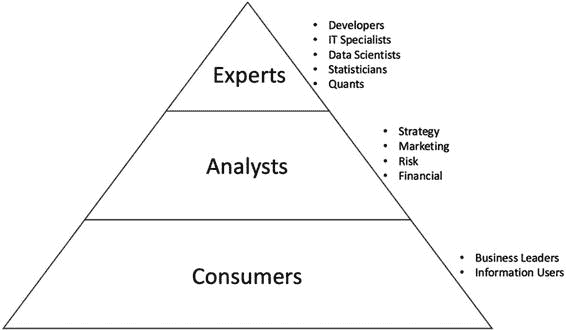
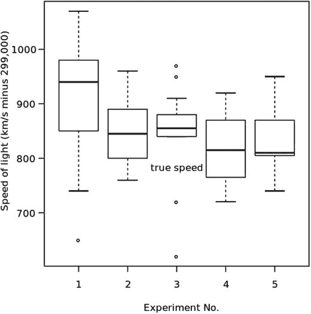
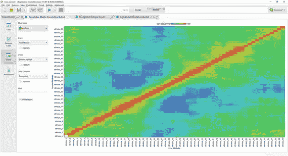
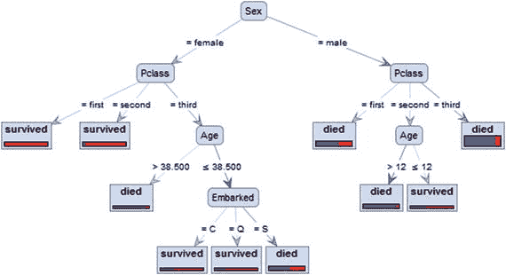
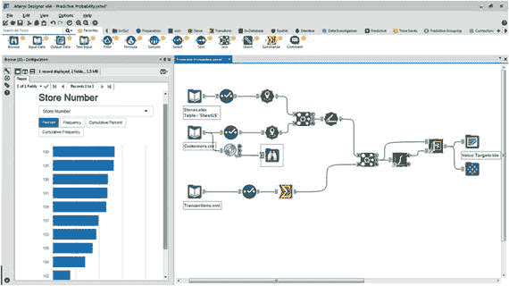
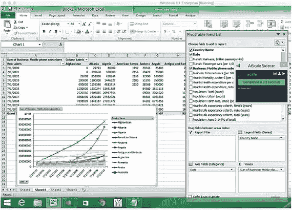
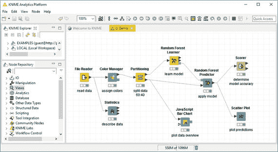
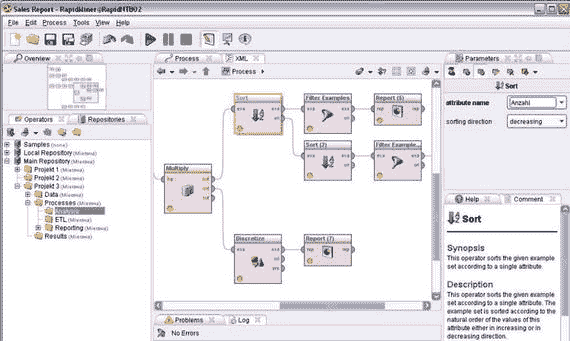

# 9. 自助分析

## 热潮与现实

大约 15 年前，作者参加了一场由某供应商举办的销售演示会，会上他们极力推销一款自动化预测分析工具。该供应商的价值主张是：“购买我们的软件，你就可以解雇你的 SAS 程序员了。”

不幸的是，对于那位销售代表来说，当时在座的每位客户都是 SAS 程序员。

这个故事凸显了那些相信软件能够实现分析民主化的人面临的一个基本问题：最关心分析、对分析最富热情的人，并不害怕学习`SAS`、`Python`和`R`这类分析编程语言。

此外，由于他们对自己交付成果的准确性和有效性负有责任，因此他们需要的工具必须能让他们掌控整个过程。这就是为什么分析就业市场上的专家坚称，编写代码的能力是做这份工作绝对不可或缺的。¹

所谓“公民数据科学家”的想法，到此也就止步了。

三十年来，商业供应商一直宣称他们的分析软件“易于使用”或“自助式”，然而，除了`Microsoft Excel`之外，其他工具的采用率仍然很低。原因有以下几点：

*   许多管理者对分析工作缺乏需求感或兴趣。
*   对于确实看重分析的管理者来说，将具体工作委托给他人相对容易。
*   让软件易于使用是一回事；让数据易于访问和导航则完全是另一回事。经过二十年的数据仓库建设，企业数据对于管理者的问题而言，仍然混乱、不完整或毫无关联。

与此同时，对分析编程语言的兴趣正在蓬勃发展，数据科学家的就业市场也十分强劲。这是因为严重的分析问题需要严肃认真的人去解决——那些有动力深入挖掘数据的人。

在本章中，我们将审视自助分析的逻辑——它在哪些场景下合理，在哪些场景下又不合理。我们将描述组织中截然不同的用户角色，并讨论专家在高级分析中的作用。最后，我们将通过调研自助分析领域的六项创新来结束本章。

## 自助分析的逻辑

供应商主导的关于自助分析的讨论，往往存在于一个每个人拥有相同技能和兴趣的魔幻世界中。管理者最好能对其组织中的实际用户角色，以及自助分析适用的用例保持现实的认识。

### 用户金字塔

在大多数组织中，员工的分析技能差异巨大——从几乎毫无技能的一端到世界级专家的另一端。造成这些差异的因素有很多：背景、教育、培训、组织角色以及内在动力。

在大型组织中，分析用户往往呈“金字塔”结构，如图 9-1 所示。我们将纯粹分析技能最低的用户称为“消费者”，他们目前是规模最大的群体；在大型组织中，这类用户可能有数千人之多。需要指出的是，这里仅指纯粹的分析技能；人们可能在其它领域拥有高超的技能，但在数据分析方面培训有限或兴趣不足。

图 9-1. 用户金字塔

另一方面，分析专家通常人数较少。然而，他们通过分析创造了与之不成比例的巨大价值。

商业软件供应商倾向于通过“易用”的应用程序瞄准普通用户。普通用户是最大的受众群体，有潜力销售更多“席位”，且对现有工具忠诚度较低。而专业用户和专家用户则往往对现有工具非常忠诚。他们投入了多年时间来培养技能，掌握了所选工具，并且对“易用”工具并不感兴趣。

### 价值链中的角色

关于组织中分析工作的严肃讨论，应首先认识到用户需求各异、不尽相同。这看似显而易见，但人们经常听到供应商将其工具描述为企业的完整解决方案，仿佛所有用户都有着相同的需求。

用户画像是一种描述某类用户如何与系统交互的模型。当然，每个用户都不同，每个组织也各有差异。在硅谷，有些初创公司的“业务用户”活跃地使用着`SQL`和`Python`；而另一些公司里，“业务用户”却在为 Microsoft Excel 而挣扎。我们提出这个模型并非为了给人们贴标签，而是将其作为一个框架，帮助管理者理解其所在组织的需求。

#### 专家

专家用户精通分析软件和编程语言。他们将 100% 的时间用于分析工作。他们将分析视为职业选择和职业发展路径，并投入了必要的教育和培训。他们的头衔和背景在不同行业以及同行业内各不相同。

**开发者。** 这些用户接受过关于组织数据和软件的深入培训，其主要角色是开发分析应用程序。除了技术培训，开发人员对组织的数据源有透彻理解，能够编写复杂的`SQL`表达式，并接受过一种或多种编程语言的培训。虽然传统上他们隶属于 IT 部门，但当业务部门希望控制优先级和任务排队时，他们也可能雇佣自己的开发者。

**数据科学家。** 数据科学家是主要角色为从复杂数据中产生洞见，并为应用程序开发部署预测模型的个人。他们的背景和培训涵盖编程语言、统计学和机器学习。数据科学家通常具有工程或计算机科学背景，并且偏好使用诸如`Scala`、`Java`或`Python`之类的编程语言。他们往往对开源分析工具有强烈偏好；最优秀的数据科学家会积极为一个或多个开源项目做出贡献，并可能参与数据科学竞赛。

**分析专家。** 分析专家担任诸如统计学家、生物统计学家、精算师或风险分析师等职位，通常拥有在高级分析领域具有历史渊源的学科背景学位。他们理解统计学和机器学习，并在应用分析领域拥有丰富的工作经验。分析专家倾向于使用类似`SAS`或`R`这样的高级分析编程语言进行工作，相对于带有图形用户界面的软件包，他们更偏爱这些语言。他们的工作成果可能是管理报告、图表和表格，或预测模型规范。

#### 分析师

这些用户精通使用终端用户分析软件，例如`Excel`、`SPSS`或`Tableau`。他们在工作中积极使用分析工具，但不会创建生产级应用程序。他们通常认同于某个业务职能部门，如市场或财务，并将分析视为实现该目标的手段。

**战略分析师。** 战略分析师的主要角色是为高级管理人员执行临时分析；他们可能隶属于某个业务部门，或隶属于一个专门为高管团队提供支持的团队。战略分析师非常了解其组织及行业，并熟悉数据源。他们能够执行简单的`SQL`查询，并且能将`SQL`与其他工具结合使用。他们偏好带有图形用户界面的工具。战略分析师的工作成果侧重于图表、可视化和故事叙述。

**职能分析师。** 职能分析师的主要角色是承担某项分析工作职能，例如信用分析师或市场分析师。这些角色需要一定的分析技能以及领域知识。职能分析师偏好使用相对易用、带有图形界面的工具。他们可能接受过一些统计学和机器学习的培训。与战略分析师类似，他们也许能够执行简单的`SQL`查询。他们精通 Microsoft Office，并偏好使用能与 Office 直接集成的工具。职能分析师的工作成果可能是电子表格、报告或演示文稿。

#### 消费者

信息消费者的工具相关技能最少，更倾向于信息以易于检索和消化的形式呈现。

**业务领导者。** 业务领导者对组织的绩效指标非常关注，他们要求这些指标及时、准确，并能发送到移动设备或浏览器。他们可能对有限的向下钻取功能感兴趣，但很少愿意花费大量时间搜索信息。

**信息用户。** 信息用户是需要信息来执行特定工作角色的员工，例如处理客户服务电话、审核保险索赔、执行律师助理任务等。他们在业务流程中的角色决定了其信息需求。虽然信息用户可能不涉及数学计算，但他们关心所用系统的整体效用、性能和可靠性。

### 专家的角色

软件供应商总是吹嘘其产品“易于使用”。这并非新鲜事。在 20 世纪 80 年代和 90 年代，分析软件供应商 SPSS 将其基于 Windows 的界面定位为 SAS 的简易替代品，而 SAS 直到 2004 年推出 SAS Enterprise Guide 才提供类似的用户界面。在 90 年代和 21 世纪初，Cognos 声称其产品针对的是业务用户，以区别于 Business Objects 和 MicroStrategy 等更复杂的产品。

尽管供应商的说法与此相反，但自助式分析仍是一个难以实现的目标。大型企业拥有成千上万的 BI 工具用户，但绝大多数是“消费者”，他们使用的是由专家开发的报告、视图或仪表板中的信息。大多数组织仍保留着专家团队，其唯一职责就是开发供他人使用的报告或 OLAP 多维数据集。

BI 专家之所以长期存在，主要有两个原因：

-   **一致性**。衡量绩效仍然是商业智能的主要用例。大多数组织希望跨职能进行一致的衡量，而不希望各团队自行衡量或“操纵”指标。
-   **数据集成**。很少有组织能实现理论家所构想的数仓“理想国”。虽然 BI 工具拥有设计精良的用户端“界面”，但集成数据源的“后端”却和源数据本身一样混乱复杂。

`Hadoop` 使用的普及加剧了 BI 的数据集成问题，至少暂时如此。大多数传统 BI 平台无法与 `Hadoop 1.0` 配合使用。像 Datameer 和 Pentaho 这样的初创公司试图填补这一空白，但收效甚微；而对于希望标准化单一 BI 平台的企业来说，仅用于 `Hadoop` 的专用工具并不令人满意。

即使是相对熟练的用户，`Hadoop` 也会带来问题。习惯于在数据仓库设备上使用 `SQL` 进行交互式分析的分析师，若要在 `Hadoop` 上使用 `Hive` 或 `Pig` 进行同样的分析将会举步维艰。正如第四、五章所述，`Hadoop` 的交互式查询工具在过去几年中已大有改进，但早期投资于 `Hadoop` 的公司也为此增加了具备必要技能的新专家层。

预测分析仍然是专家的领域，尽管易用的工具已经面世多年。在诸如欺诈检测和风险管理等战略性及“硬性资金”应用中尤其如此，在这些领域，预测模型的质量可能意味着业务成功与失败的差别。

分析专家为高管提供审计师所称的“认证功能”——对分析结果的正确性和完整性进行独立认证。对于预测模型，专家要证明模型预测良好，能恰当地将误报和漏报降至最低，并且不会鼓励逆向选择。很少有高管具备必要的培训和知识，能够自行验证复杂分析的质量。对独立认证的需求是组织将战略分析项目外包给顾问的主要原因之一。

简而言之，组织雇佣专家和专业人员并不是因为他们掌握分析编程语言的技能。雇佣他们主要是看中他们的领域专业知识、对自己所提供分析结果的负责能力，以及愿意为其分析的有效性承担责任。

借用医学领域的类比，机器人现在能够执行最复杂的开心手术。这并不会消除对心脏病专家的需求，尽管可能会改变工作的性质。病人不太可能完全将诊断交给机器，机器也不具备病人所看重的“床边关怀”方式。

## 对自助服务的平衡看法

虽然绩效衡量和战略分析仍将掌握在专家和专业人员手中，但自助式分析在两种用例下最为适用：探索和业务规划。

**探索与洞察**。在采取行动之前，管理者希望了解问题或机遇的基本面貌。这自然引出了诸如以下问题：

-   我们在新泽西州有多少客户？

-   上周有多少购物者购买了我们的品牌狗粮？

-   我们在五大湖区的门店销售趋势如何？

探索非常适合自助式分析，原因有三。首先，将工作交给专家会减慢流程。专家通常积压了大量工作；一项任务可能专家只需一小时完成，但由于队列中的先前请求，请求者可能要等上一周才能看到结果。

其次，将分析工作交给专家会产生潜在的误解。请求者必须准备一份规范说明；请求会变得越来越详细，而专家则养成了完全按照请求者要求去做的习惯，而不是深入洞察请求者试图解决什么问题。

第三，探索本质上是迭代的；一个问题的答案会引出更多问题。专家模式不利于迭代，因为每个周期都需要再次提出请求，再次排队等待，并增加更多产生误解的可能性。

从功能角度看，交互式查询和可视化是探索工具的关键需求。一个灵活的后端，能够轻松集成多种不同数据源，是绝对必要的。管理者在探索中可能需要的额外功能包括简单的时间序列分析、简单的预测建模、基本内容分析和地图功能。

**业务规划**。管理者确定机遇后，下一步是行动计划；这反过来又会引发许多战术性问题。例如，一旦决定在现有客户中开展营销活动以刺激特定产品的购买，管理者可能想知道：

-   有多少客户购买过此产品？

-   这些客户的平均购买量是多少？

-   有多少客户在过去 12 个月内购买过该产品，但在过去 3 个月内没有购买？

与探索一样，管理者在制定业务计划时非常看重速度和自助服务。然而，在规划中，管理者更需要量化和数值分析，而非简单的可视化。此时，有趣的趋势和假设远没有硬数字来得重要。

预测分析在业务规划中扮演着更重要的角色。管理者关心的是预测特定决策的影响：

-   预期的响应率和转化率是多少？

-   我们可以预期多少信贷损失？

-   如果我们不采取行动，预期的流失率是多少？

因此，用于预测分析的自助式工具可以在业务规划中发挥作用，前提是它们完全透明且“防傻瓜”。一个“防傻瓜”工具具有内置的约束和指导原则，可防止经验不足的用户得出虚假的洞见。

## 自助分析领域的创新

在接下来的部分中，我们将讨论六项自助分析创新：

-   数据可视化：`Tableau` 将简洁的界面（适用于基础可视化）与强大的数据访问引擎相结合。

-   数据混合：`Alteryx` 和 `ClearStory Data` 在处理来自不同数据源的数据混合问题方面采取了截然不同的方法。

-   Hadoop 上的 BI：`AtScale` 和 `Platfora` 展示了在 Hadoop 上实现商业智能的两种不同方式。

-   洞察即服务：`Domo` 帮助高管避开 IT 瓶颈。

-   业务用户分析：`KNIME`、`RapidMiner` 和 `Alpine` 为业务用户提供了不同的可扩展分析方法。

-   自动化机器学习：`DataRobot` 提供了一个自动化机器学习平台。

在前面的章节中，我们重点介绍了开源工具。本章中我们介绍的所有软件均采用商业许可。在每个类别中，我们都会介绍一个或多个体现该创新点的供应商。

## 数据可视化

一图胜千言。

数据可视化旨在通过统计图形、图表和信息图来进行探索、交流信息以及说服他人。作为一种探索工具，可视化能帮助分析师快速识别数据中有意义的模式，而这些模式仅凭数值分析很难发现。作为一种交流工具，可视化能让复杂的关系变得清晰易懂。可视化也是一种强大的说服工具。

同时，可视化也是一种说谎和误导他人的好方法。数据可视化本身并不比其使用者期望的更具“科学性”。每个管理者都应该理解可视化的修辞手法，哪怕只是为了识别欺骗。

与分析世界中的多数事物一样，可视化并非新鲜事物。统计学家早已认识到数据可视化的价值。1977 年，普林斯顿大学统计学系创始主任约翰·图基提出了箱线图的概念。如图 9-2 所示的箱线图，是一种比较多个数据分布的便捷方式。

图 9-2. 箱线图

耶鲁大学政治学、统计学和计算机科学教授爱德华·塔夫特于 1982 年出版了《定量信息的视觉呈现》。由于出版商缺乏兴趣，塔夫特自行出版了这本书；如今，它仍是 `Amazon.com` 上的畅销书。塔夫特引用了可追溯至 1686 年的可视化案例，指出许多最佳可视化作品诞生于计算机时代之前，那时艺术家们用手工绘制图表。

数据可视化顾问、《信息仪表盘设计》一书的作者斯蒂芬·菲认为，视觉信息仅有八种类型：

-   时间序列图，展示数值随时间的变化

-   按数量排序的排名

-   部分与整体的关系

-   两组数值之间的差异，例如预测收入与实际收入

-   按区间统计的数值计数或频率

-   两组配对数值的比较，以显示相关性（或缺乏相关性）

-   一组无序项目的名义比较

-   数据的地理空间展示，在地图上显示数值或度量

在初步数据分析中，统计学家和预测建模者会使用散点图和频率分布来理解数据中的关系。散点图显示两个变量之间的线性和非线性关系，这有助于加速模型开发。简单的图形也是一种极佳的数据质量检查手段，因为分析师可以通过几个可视化图快速识别数据中的问题。

统计学家和市场研究人员使用可视化来传达复杂的发现。当以数字表格形式呈现时，多个变量之间的相关性难以解释；但若以热力图形式呈现（如图 9-3 所示），模式则更容易掌握。

图 9-3. 在 `RapidMiner` 中创建的关联热力图

像决策树这样的技术之所以流行，是因为它们易于可视化。例如，图 9-4 展示了泰坦尼克号沉没时幸存者的特征：头等舱和二等舱的女性、三等舱的年轻女性，以及 13 岁以下的男孩，其存活率远高于其他乘客。

图 9-4. 泰坦尼克号幸存者决策树（来源：`RapidMiner`）

### 论证可视化的重要性

为了论证可视化的重要性，`SAS` 于 1980 年在其统计软件中新增了 `SAS/GRAPH`。`SAS/GRAPH` 是 `SAS` 推出的首个新功能扩展。虽然它面向批处理任务，但功能极其强大；`SAS` 程序员只需几行代码就能生成数百张图表。作为项目导入数据后的第一步，分析师可以利用图表全面审视潜在预测因子，并制定后续分析计划。

20 世纪 90 年代涌现的商业智能供应商，包括 `Business Objects`、`Cognos` 和 `MicroStrategy`，均在其产品中集成了图形与可视化功能，并配备了报表和仪表盘工具。

图形功能也在开源软件 `R` 及其生态系统包的吸引力中占据了重要地位。`R` 用户可以从广泛的标准图表和专用图表中做出选择，构建图形应用程序，并发布交互式图形。2007 年推出的 `ggplot2` 包因其相对易用且功能多样，吸引了大量新用户加入 `R` 的阵营。

讨论近期自助式可视化的兴起时，不能不提 `Tableau`。斯坦福大学的研究人员于 2003 年创立了 `Tableau Software`，旨在将他们研发的创新可视化工具商业化。`Tableau` 稳步增长，2011 年收入达到 6200 万美元；随后业绩腾飞，收入增长了十倍，达到 6.54 亿美元。

通过这种方式，`Tableau` 超越了 `Actuate`、`Hexagon`、`Panorama Software`、`Autodesk`、`TIBCO`、`Information Builders`、`ESRI`、`Qlik Tech` 和 `MicroStrategy`，在 `IDC` 的商业智能和分析工具软件排名中位列第六。`Tableau` 还超过了行业资深企业 `FICO`、`Infor`、`Adobe` 和 `Informatica`，在 `IDC` 的整体商业分析软件行业排名中升至第八位。

`Tableau` 于 2013 年 5 月上市，估值达到 30 亿美元。从创立到首次公开募股，`Tableau` 为投资者创造的价值⁴ 在 2009 年至 2014 年间仅次于另外三家初创公司。

考虑到 `Tableau` 的图形能力并不比大多数竞争性商业智能工具更强，甚至远不及用户在 `SAS` 和 `R` 中能实现的功能，其成功令人惊讶。`Tableau` 与其他工具的关键区别在于其简单性和数据源连接能力。传统的 BI 工具旨在与组织的数据仓库集成。虽然它们的图形功能不难使用，但每个数据源都需要复杂的配置。这使得它们缺乏灵活性，进行临时分析需要较高的技能水平。

对于 `SAS` 和 `R` 这类工具来说，可视化是一个两步过程：第一步检索数据，第二步创建可视化。虽然这些工具功能强大且高度灵活，但需要专业知识才能成功使用。`Tableau` 的核心创新⁵ 是一种名为 `VizQL`（可视查询语言）的查询语言。`VizQL` 结合了 `SQL` 和一种用于渲染图形的语言，使得临时可视化仅需一步即可完成。`Tableau` 将其查询语言与极其广泛的数据源连接能力相结合，这些数据源包括 `Microsoft Excel` 和 `Access`；文本文件；来自 `SAS`、`SPSS` 和 `R` 的统计文件；关系数据库；`NoSQL` 数据存储；`Hadoop`；`Apache Spark`；企业应用程序（包括 `SAP` 和 `Salesforce`）；`Google Analytics`；以及其他众多数据源。

可以说，`Tableau` 的成功并非因为其功能繁多，而是因为它将少数几件事做得非常出色，而它做得出色的正是用户所需。`Tableau` 的简洁性使其易于使用。结合其强大的数据源连接能力，`Tableau` 在多样化和复杂的数据中作为临时探索工具表现出色。根据传统数据仓库理论，这种用例本不应存在，因为数据仓库理论要求将数据整合到单一数据存储中。`Tableau` 非凡的商业成功证明了传统数据仓库理论在多大程度上已不再适用。

### 数据混合

数据混合工具使业务用户能够混合和清理来自多个来源的数据。这些工具提供了丰富的功能来访问不同的数据源、选择数据、转换数据，并将其组合成一个单一数据集用于分析。大多数工具还具备一定能力来分析混合后的数据。

根据数据仓库理论，终端用户不应需要数据混合工具；原则上，数据仓库流程应执行所有必要的处理步骤，向终端用户呈现已经过清理、标准化并适合分析形式的数据。

-   在许多组织中，预算限制使数据仓库团队无法跟上数据的爆炸式增长。

-   即使是资金充足的数据仓库团队，也会有大量积压工作，导致将新数据源纳入仓库的时间大幅延迟。

-   许多分析是临时性的，不值得投资于永久性的数据仓库数据供给。

关于最后一点，一个例子是，许多营销项目使用外部供应商，而营销活动可能只进行一两次。寻求准备活动分析报告的营销分析师，必须将外部供应商提供的数据与组织数据仓库中的数据合并，以生成一份完整的报告。

许多初创公司提供数据混合工具，包括 `Alteryx` 和 `ClearStory Data`。

1997 年，三位企业家创立了一家名为 `SRC LLC` 的咨询公司；该公司提供地图绘制和人口统计分析的自定义解决方案。两年后，`SRC` 中标成为美国人口调查局的技术提供商；在接下来的几年里，该公司开发了几款用于地理空间分析的新软件产品。

`SRC` 于 2006 年推出了 `Alteryx`。`Alteryx` 是一个提供用于分析空间和非空间数据的统一环境的软件包，简化了混合来自多个数据库的数据的任务；精简了空间分析；并使用户能够发布包含地图、图表、表格和图形的集成报告。

2010 年，`SRC` 的创始人将公司更名为 `Alteryx Inc.`，以便专注于这一产品⁶。`Alteryx` 已通过三轮风险投资共筹集了 1.63 亿美元；最近一轮融资额为 8500 万美元，于 2015 年 10 月结束。

截至 2016 年 6 月，`Alteryx Analytics` 已发布第 10 版。`Alteryx Designer` 环境使业务用户能够构建工作流，以准备、混合和分析来自广泛来源和数据类型的数据，包括：

-   数据仓库和关系数据库

-   云和企业应用程序

-   `Hadoop` 和 `NoSQL` 数据存储

-   社交媒体平台

-   来自诸如 `Experian`、`Dun & Bradstreet` 和美国人口调查局等供应商的打包数据

-   `Microsoft Office` 和统计软件包

为了进行更深入的分析，`Alteryx` 提供了基于开源软件 `R` 构建的基本描述性和预测性分析，以及地理空间分析。用户可以将分析结果导出为 `Microsoft Office` 格式、`Adobe PDF`、`HTML` 和其他常见格式。`Alteryx` 与领先的可视化工具（如 `Tableau`、`Qlik`、`Microsoft Power BI` 和 `Salesforce Wave`）集成。

图 9-5 显示了 `Alteryx Designer` 桌面界面。

图 9-5. Alteryx Designer

`Alteryx Server` 版本运行在 `Microsoft Windows Server` 上。`Alteryx Server` 通过下推 SQL 支持可扩展分析，该技术将用户请求传输到数据存储进行本地执行，无需移动数据。第 10 版支持针对 `Amazon Redshift`、`Apache Hive`、`Apache Impala`、`Microsoft SQL Server` 和 `Azure SQL Data Warehouse`、`Oracle Database`、`Apache Spark SQL` 和 `Teradata Database` 的下推 SQL。

#### ClearStory Data 采用与众不同的数据混合方法

`ClearStory Data` 成立于 2011 年，并于 2013 年将其 `ClearStory` 产品推向市场。`ClearStory` 是一款内存可视化与协作应用，集成了推理引擎和数据混合能力。该平台完全在 `Apache Spark` 上运行（本章前面章节以及第二章已讨论过 `Spark`）。

基于 `Spark` 的数据摄取能力，`ClearStory` 使组织能够整合不同的内部和外部数据源。支持的内部数据源包括：

- 关系型数据库，包括 `Oracle`、`SQL Server`、`Amazon Redshift`、`MySQL` 和 `PostgreSQL`

- `Hadoop`

- 多种格式的文件

- 适用于企业应用的 API，例如 `Salesforce`

通过与数据提供商合作，`ClearStory` 提供了多个预定义的外部数据源：

- 人口统计数据，包括特定地点的美国人口普查数据

- 来自多家提供商的企业概况数据

- 市场与销售情报数据，包括媒体支出和按产品品类划分的销售额

- 宏观经济数据，如 `GDP`、通货膨胀率、失业率和商品价格

- 来自 `Twitter` 及其他平台的社交媒体数据

- 天气数据

一旦数据源在 `ClearStory` 中注册，应用的推理引擎会收集描述数据形态的关键统计信息，以及关于其结构和语义的信息。当用户请求分析时，`ClearStory` 会利用这些信息，根据用户试图解决的问题推荐其他数据。`ClearStory` 的数据混合引擎将数据与公共维度进行匹配，使用户能够整合来自不同来源的数据。

截至 2015 年底，投资者已向 `ClearStory Data` 提供了 3000 万美元的风险投资。最近一轮融资发生在 2014 年 3 月，是由 `DAG Ventures` 领投的 2100 万美元 B 轮融资，`Andreessen Horowitz`、`Google Ventures`、`Khosla Ventures` 以及 `Kleiner Perkins Caufield & Byers` 参与了投资。

### Hadoop 上的 BI

如第四章所述，组织正在大力投资 `Hadoop`。与传统数据仓库相比，`Hadoop` 的成本显著降低，使其成为一种颇具吸引力的替代方案，尤其适用于价值尚未确定的数据。

然而，`Hadoop` 的使用难度远高于传统数据仓库。对于习惯于配合数据仓库使用商业智能工具的最终用户来说，`Hadoop` 的使用几乎难如登天。即便是比 `MapReduce` 更容易使用的 `Hive` 和 `Pig` 等工具，也仅适合高级用户。

随着存储在 `Hadoop` 中的数据量不断增长，对能够处理这些数据的商业用户工具的需求也日益增加。`AtScale` 和 `Platfora` 是两家初创公司，它们解决此问题的方法截然不同。`AtScale` 提供了一个中间层，使现有的商业智能工具能够处理 `Hadoop` 数据。而 `Platfora` 则创建了一个专用的数据集市来支持其自身的最终用户工具。我们接下来将讨论这两家初创公司。

#### AtScale

AtScale 由雅虎资深员工于 2013 年创立，于 2015 年 4 月从隐身模式中亮相；同时，它宣布了 700 万美元的 A 轮融资。与本章介绍的其他 BI 初创公司不同，AtScale 不提供自己的 BI 最终用户客户端。相反，AtScale 遵循的原则是，大多数组织已经配备了 BI 工具，因此它在后台运行，使这些工具能够与 Hadoop 数据存储协同工作。

理论上，大多数 BI 工具可以通过 `JDBC API` 直接连接到 `Hive` 表或 `Spark DataFrame`。但实际上，除非数据已经结构化，并且按照所有需要的度量、维度和关系进行了聚合，否则用户将不得不在 BI 工具和 `Hive`、`Pig` 或编程 API 之间来回切换。很少有业务用户具备执行此操作所需的技能，因此组织必须指派一名开发人员，将数据迁移到别处，或实施并维护一个专用的“`BI-on-Hadoop`”工具。

边缘节点是位于 `Hadoop` 集群外围的一台服务器，通常用于协调与其他应用的交互。边缘集群与边缘节点类似，但它由 `Hadoop` 集群外围的一组服务器组成，而非单台服务器。

`AtScale` 引擎位于 `Hadoop` 集群的一个边缘节点上。通过用户通过基于 web 的 `AtScale Cube Designer` 输入，AtScale 与 `Hive` 元数据存储进行交互，以创建和维护一个虚拟的维度数据模型，即“多维数据集”。用户可以根据需要指定用于下钻的层级结构、计算字段和其他维度，以表示当前的业务问题。基础数据不会更改或移动，因此用户可以根据同一数据为不同目的指定不同的多维数据集。BI 工具（如 `Microsoft Excel` 或 `Tableau`）通过 `ODBC`、`JDBC` 或 `OLE DB` 向 AtScale 提交 `SQL` 或 `MDX` 请求。最终用户可以直接从 `Excel` 等工具中进行操作，如图 9-6 所示。

图 9-6. 搭载 AtScale 侧车的 `Microsoft Excel`

`AtScale` 通过可用的 `SQL` 引擎（例如 `Hive on Tez`、`Spark SQL` 或 `Cloudera Impala`）开发并提交优化后的查询，然后将结果返回给 BI 工具，供其进一步处理并呈现给最终用户。用户可以选择保留或删除已创建的任何聚合表。`AtScale` 提供了用于管理聚合表的工具，以及安排多维数据集生成和更新的能力。

#### AtScale 支持的 BI 工具与生态系统

`AtScale` 支持流行的 BI 工具：`Tableau`、`Microsoft Excel`、`Qlik`、`Spotfire`、`MicroStrategy`、`PowerBI`、`JasperSoft`、`SAP Business Objects` 和 `IBM Cognos`。它适用于 `Cloudera`、`Hortonworks`、`MapR` 和 `HDInsights` Hadoop 发行版；`Hive on Tez`、`Spark SQL` 和 `Cloudera Impala` SQL 引擎；以及广泛的数据存储格式选择，包括 `Parquet`、`RC`、`ORC`、`Sequence`、文本文件和 `Hive SerDe`。在安全性方面，该软件提供基于角色的访问控制，以选择性地向跨部门和跨组织的用户授予数据访问权限。该应用程序维护已执行查询的审计跟踪，以便组织能够跟踪请求量、请求的数据和运行时间。

`Ben Werther`，一位来自 `Siebel`、`Microsoft` 和 `Greenplum` 的资深人士，于 2011 年创立了 `Platfora`，获得了由 `Andreessen Horowitz` 领投的风险投资家提供的 570 万美元资金⁸。该公司于 2012 年 10 月结束隐秘模式，并在此后不久完成了 2000 万美元的“B”轮融资⁹。该公司于 2014 年 3 月又筹集了 3800 万美元¹⁰。（作者注：2016 年 7 月 21 日，基于云的软件供应商 `Workday` 宣布计划以未公开金额收购 `Platfora`。）

#### Platfora 平台概述

`Platfora` 提供了一个端到端的数据仓库和 BI 平台，运行在 `Hadoop` 旁边的边缘集群上。`Platfora Server` 是一个分布式内存引擎；它操作从 `Hadoop` 中提取的数据副本。

在最终用户处理数据之前，管理员会从源数据中定义结构化的 `Platfora` 数据集。除了定义数据结构，管理员还定义数据集的访问权限。

最终用户（通过浏览器界面操作）使用已定义的数据集来指定他们所需数据的视图。`Platfora` 将这些请求转换为 `MapReduce` 或 `Spark` 作业，提交执行，并将结果以 `Platfora` 专有的文件格式写回 `HDFS`。它还会在本地磁盘上保留一份视图副本，并在目录中注册关于该视图的元数据。

`Platfora` 提供了一个用户友好的界面，便于业务用户使用。当用户探索和分析数据时，`Platfora` 会针对本地视图副本生成内存中的查询。如果要查询的数据超过 `Platfora` 集群的可用内存，查询会溢出到磁盘或失败。

在大多数情况下，`Platfora` 仅处理已加载到 `Hadoop` 中的数据；它从其他来源拉取小型数据集的能力有限。`Platfora` 适用于大多数 `Hadoop` 发行版；它可以使用存储在 `HDFS`、`Hive`、`MapR FS`、上传文件中的数据，也可以使用 `Amazon Web Services` 的 `S3` 文件系统。

### 洞察即服务（Insight-as-a-Service）

许多高管对他们所认为的 IT 组织缺乏响应性和服务质量差感到沮丧。出于对速度的需求，他们寻求能够立即提供所需绩效指标和洞察的服务。

过去，绕过 IT 组织很困难，因为 IT 实际控制着所有数据。如今，随着许多业务流程通过托管服务和软件即服务（`Software-as-a-Service`）交付，大量数据已经驻留在云端。此外，随着职能领导越来越多地控制技术支出，他们实际上“拥有”数据。

提供预打包云解决方案的供应商满足了这些高管的需求。其中一家供应商 `Domo` 展示了洞察即服务概念的力量。

`Domo`，一家位于犹他州盐湖城的初创公司，采用了一种截然不同的 BI 方法。`Domo` 不再推广另一套工具，而是将自己定位为面向繁忙高管的解决方案，这些高管因传统 BI 工具的延迟和局限性而感到沮丧。`Domo` 通过打包的基于云的软件即服务交付模式，为这些高管提供了完全绕过 IT 瓶颈的手段。

成功企业家 `Josh James` 于 2010 年创立了该公司。`James` 于 1996 年共同创立了成功的网络分析初创公司 `Omniture`，并带领该公司于 2009 年以 18 亿美元成功出售给 `Adobe Systems`。2010 年末，`James` 收购了一家提供可视化软件的小公司，并将合并后的实体更名为 `Domo`。凭借充足的资本——来自 45 位投资者的 4.84 亿美元，共计八轮融资，包括 `Andreessen Horowitz`、`Fidelity Investments`、`Jeff Bezos`、`Morgan Stanley` 和 `T. Rowe Price`——`Domo` 在隐秘模式下运营了近五年，以开发和改进其产品。

一家以隐秘模式运营的公司不会向公众披露其产品或服务的信息；这样做是为了让潜在竞争对手无法预判其产品，并留出足够时间来开发适销对路的产品。公司可能会向投资者或顾问披露信息，但必须严格遵守保密协议。由于不进行营销，以隐秘模式运营的公司很少有收入或客户，因此公司可能需要大量资金才能长期保持隐秘模式。

`Domo` 于 2015 年 4 月结束隐秘模式¹¹，并推出了一款高度成熟的产品。围绕标准 BI 功能（包括查询、报表、仪表板和警报）的核心，`Domo` 提供预构建的基于角色和基于行业的解决方案以及专为决策支持设计的应用程序。面向用户的功能运行在 `Amazon Web Services`¹² 上经过修改的 `MPP` 列式数据库上。

`Domo` 还预构建了超过 350 个数据源连接器，以加速数据集成。这个连接器库包括最广泛使用的数据库和应用程序；仅营销领域就有 51 个连接器，包括 `Adobe Analytics`、`Facebook`、`Google AdWords`、`HubSpot`、`IBM Digital Analytics`、`Klout`、`Marketo`、`Salesforce`、`SurveyMonkey`、`Twitter`、`Webtrends`、`YouTube` 等。

结合从本地系统安全传输数据的功能，这些预构建的连接器和解决方案使 `Domo` 能够承诺快速实现价值。此外，`Domo` 专注于提供集成且可定制的基于角色的决策解决方案，这使其与传统 BI 工具有所区别。

当 `Domo` 于 2015 年 4 月结束隐秘模式时，它声称拥有超过 1,000 家付费客户，并在 2014 年实现了 5000 万美元的年销售额。

#### 商业用户分析

商业供应商们积极竞相推出既易用又强大的预测分析软件。这并非新现象；以下列表列出了五款此类产品及其推出年份。

- `Angoss KnowledgeSeeker` (1984 年)
- `SAS JMP` (1989 年)
- `Dell Statistica` (1986 年)
- `IBM SPSS Modeler` (1994 年)
- `SAP InfiniteInsight` (1998 年)

有三款相对较新的产品值得更详细地讨论：`KNIME` 和 `RapidMiner` 于 2006 年推出，以及 `Alpine` 于 2011 年推出。`KNIME` 和 `RapidMiner` 采用开放核心模型运营；各自提供开源版本以及商业许可的扩展插件。这三款产品都适用于大数据，能与 `Hadoop` 进行下推式集成；`Alpine` 还提供与特定数据仓库设备的集成。

## KNIME

`KNIME`（与“lime”押韵）是一个用于数据集成、商业智能和高级分析的开源平台。该平台基于 `Eclipse`，使用 `Java` 编写，其特点是拥有采用工作流模式的图形用户界面。用户通过拖放工具构建任务管道，并以交互模式或批处理执行模式运行它们。图 9-7 展示了 `KNIME Analytics Platform` 桌面的视图。

**图 9-7.** KNIME Analytics Platform 桌面

商业企业 `KNIME.com AG` 总部位于瑞士苏黎世，它根据免费且开源的 `GPL` 许可分发 `KNIME Analytics Platform`，此许可有一个例外条款允许第三方使用其 `API` 开发专有扩展。该公司为私人持有，不披露其所有权细节。目前没有该公司获得风险投资的记录。

免费且开源的 `KNIME Analytics Platform` 包括以下功能，所有这些功能都通过图形用户界面实现：

- 从文本文件、数据库和 Web 服务进行数据集成
- 数据转换
- 通过捆绑的开源商业智能与报表工具（`BIRT`）生成报告
- 单变量和多变量统计分析
- 使用交互式关联图进行可视化
- 机器学习和数据挖掘
- 时间序列分析
- Web 分析
- 内容分析，包括文本和图像挖掘
- 图分析，包括网络和社交网络分析
- 原生评分，以及 `PMML` 的导入和导出
- 用于与其他开源项目及商业工具集成的开放 `API`

`KNIME.com AG` 还分发许多商业许可的扩展插件，这些插件提供了开源平台中不包含的额外功能。它们包括：

- 用于构建工作流的增强工具
- 用于创建自定义扩展的开发工具
- 用于文件和工共享的协作工具
- 用于增强安全性、协作、调度和 Web 访问的基于服务器的工具
- 可在 `Apache Hive`、`Apache Impala` 和 `Apache Spark` 中实现下推执行的连接器
- 用于管理集群服务器上作业执行的工具

`KNIME Analytics Platform` 在运行 `Linux`、`Windows` 或 `Mac OS` 的单机上进行内存操作。该软件支持多线程，以便利用单机上的多核处理器。服务器和云扩展版本运行在相同的操作系统上。`KNIME.com AG` 在 `Cloudera`、`Hortonworks` 和 `MapR Hadoop` 发行版上支持 `Hive` 和 `Impala` 扩展；并在 `Cloudera` 和 `Hortonworks` 上支持 `Spark` 扩展。

由于 `KNIME` 会将数据缓冲到磁盘，理论上它可以处理任何超过内存容量的大型数据集。然而，磁盘缓冲会影响性能，并可能导致运行时间变长。

`KNIME 大数据扩展` 使得 `KNIME` 用户能够通过 `Apache Hive` 或 `Apache Impala` 将 `SQL` 工作负载下推至 `Hadoop` 中，并能运行 `Apache Spark` 应用程序。`Spark Executor` 作为 `Spark MLlib` 包的接口，使用户能够在 `Spark` 中运行分类、回归、聚类、协同过滤和降维等任务。该软件包含一个用于在 `Spark` 中进行预测的 `PMML 4.2` 接口，并且还允许用户使用 `Spark` 进行数据预处理和操作。

`KNIME.com AG` 为扩展软件提供商业技术支持。对于开源的 `KNIME Analytics Platform`，它提供详尽的产品文档和一个用于问题排查的社区论坛。该公司还认证提供咨询和支持服务的合作伙伴及经销商。

## RapidMiner

`RapidMiner` 是由位于马萨诸塞州剑桥市的 `RapidMiner, Inc.` 开发和分发的一个混合商业与开源的先进分析软件平台。`RapidMiner` 最初是多特蒙德工业大学的一个预测分析项目，其后能力已扩展至涵盖整个高级分析流程，从数据集成到部署。

`RapidMiner, Inc.` 于 2006 年（公司名称为 `Rapid-I`）成立，以推动软件开发、支持和分发。该公司于 2013 年将总部迁至美国，并更名为 `RapidMiner`。此后，它通过三轮融资获得了 3600 万美元的风险投资。最近的一轮是 2016 年 1 月完成的 1600 万美元的“C”轮融资¹³。

按照一种称为“商业源头”的模式，`RapidMiner` 分发了三个软件版本：

- **基础版：** 根据免费开源许可提供。
- **社区版：** 根据免费商业许可提供，需要注册。
- **专业版：** 根据付费订阅的商业许可提供。

核心的 `RapidMiner` 平台（基础版）包括：

- 从 `Excel`、`CSV` 和开源数据库的数据摄取，数据混合及数据清洗功能。
- 诊断、预测和规范分析建模功能。
- `R` 和 `Python` 脚本执行。

免费的社区版还包括：

- 一个小型云实例。
- 社区技术支持。
- 访问 `RapidMiner` 市场。
- “群体智慧（Wisdom of Crowds）”功能。`RapidMiner` 从其用户社区收集详细的使用信息，并利用这些信息提供推荐的操作¹⁴。

专业版还包括：

- 用于 `Design Studio` 的可复用构建模块和流程。
- 访问商业数据库、云数据源、`NoSQL` 数据存储和其他文件类型。
- 一个更大的云实例。

`RapidMiner` 提供了一个工作流界面，使用户能够构建复杂的分析“管道”，如图 9-8 所示。

**图 9-8.** RapidMiner

除了桌面版，`RapidMiner` 还以商业许可方式提供用于服务器和 `Hadoop` 的软件（品牌名为“`Radoop`”）。服务器版本支持协作、性能优化和部署功能；`Radoop` 支持与 `Hive`、`MapReduce`、`Mahout`、`Pig` 和 `Spark` 的下推式集成。`RapidMiner` 在 `Cloudera CDH`、`Hortonworks HDP`、`Apache Hadoop`、`MapR`、`Amazon EMR` 和 `Datastax Enterprise` 上支持 `Radoop`。

`RapidMiner` 在 `Spark` 中实现了约 1500 个函数，并允许用户嵌入 `SparkR`、`PySpark`、`Pig` 和 `HiveQL` 脚本。`RapidMiner` 通过开源的 `Apache Hadoop` 发行版，以及来自 `Cloudera`、`Hortonworks`、`Amazon Web Services` 和 `MapR` 的发行版；`DataStax Enterprise` NoSQL 数据库；`Apache Hive` 和 `Apache Impala`；以及 `Apache Spark` 来支持该软件。

RapidMiner 的主要优势在于其易于使用的界面、广泛的功能以及与 Hadoop 的强大集成能力。尽管 RapidMiner 的预测分析和优化功能十分强大，但其可视化和报告能力有限，这使得它对某些用户来说并不适用。

## Alpine Data Labs

Alpine Data Labs 成立于 2011 年，提供`Alpine ML`软件，该软件具有可视化的流程导向界面，并支持向关系型数据库、Hadoop 和 Spark 进行下推集成。Alpine 声称支持所有主要的 Hadoop 发行版和多种 MPP 数据库，但在实践中，大多数客户将 Alpine 与 Pivotal Greenplum 数据库结合使用¹⁵（Alpine 和 Greenplum 在 EMC 生态系统中有着共同的渊源）。`Alpine ML`支持数据摄入、特征工程、机器学习和评分功能，所有这些功能都在数据存储中执行。

`Alpine Enterprise`（此前品牌名为`Chorus`）可促进数据科学团队成员的协作，并提供数据编目和搜索功能。新产品`Alpine Touchpoints`提供了将预测嵌入交互式应用的工具。

2013 年 11 月，Alpine 完成了 1600 万美元的 B 轮风险融资。

### 自动化机器学习

# 自动化机器学习与数据分析

精通机器学习的分析师供不应求。VentureBeat¹⁶、《华尔街日报》¹⁷、《芝加哥论坛报》¹⁸等诸多媒体都指出了这一短缺现象；麦肯锡的一份报告¹⁹预测，到 2018 年为止，具备分析技能的人才将持续短缺。这种短缺如此紧迫，以至于《哈佛商业评论》建议²⁰你停止寻找，或者降低你的标准。

我们能否将数据科学家的工作自动化？在 IT 商业边缘网站，Loraine Lawson 思考²¹人工智能是否会取代数据科学家。在《福布斯》杂志上，技术思想领袖 Gil Press 自信地断言²²数据科学家将被工具取代；社交媒体整合商 Gnip 的首席数据科学家 Scott Hendrickson 对此表示赞同²³。

面向数据科学家的数据挖掘网站 KDnuggets，最近发布了一项²⁴针对其成员的民意调查，询问大多数专家级数据科学家的工作何时会被自动化？只有 19%的受访者认为这些工作永远不会被自动化；51%的人表示将在未来 10 年内实现自动化。

自动化建模技术并非新鲜事物。1995 年，Unica Software 推出了模式识别工作台（PRW），这是一个通过自动化测试与学习来优化神经网络模型调优的软件包。三年后，Unica 与 Group 1 Software（现归必能宝所有）合作，推出了 `Model 1` 工具，该工具能对四种预测模型进行自动化模型选择。历经数次品牌重塑，最初的 PRW 产品如今以 `IBM PredictiveInsight` 的形式存在，作为 IBM 企业营销管理套件²⁵的一部分，以一组向导工具的形式销售。

KXEN 成立于 1998 年，总部位于法国，其分析引擎围绕一种称为结构风险最小化的自动化模型选择技术²⁶构建。最初的产品具有基本的用户界面，主要依赖合作伙伴应用的 API 调用；最近，KXEN 将自身重新定位为一种易于使用的营销分析解决方案，并试图直接向 C 级高管销售。这一努力取得了一定成功，促使该公司于 2013 年以约 4000 万美元²⁷的价格出售给 SAP。

来自 Unica、MarketSwitch 和 KXEN 早期的自动化尝试通过狭隘地定义问题“解决”了难题；它们将解决方案搜索的范围限制在少数算法上，以牺牲模型质量和鲁棒性为代价，将工程工作量降至最低。其次，通过将他们的工具定位为消除对专家分析师需求的手段，他们疏远了客户组织中那些对产品足够了解并能够充当拥护者²⁸的少数人。

数据科学家称²⁹，他们 50-80%的时间都花在了数据整理上。理论上，这意味着组织可以通过改进数据仓库和管理实践来缓解数据科学家的短缺；在实践中，这并不容易做到。数据仓库建设成本高昂，而且数据科学家通常支持的前瞻性项目进展速度之快，是典型的数据仓库组织难以跟上的。大多数数据科学家认为数据整理是必要且不可避免的，而且在很大程度上他们是对的。

自动化虽然无法完全替代人工，但可以显著减少数据整理（data wrangling）所耗费的时间、成本和精力。例如，与广泛使用的数据源的内置集成，最大限度地减少了提取和移动数据的时间和成本。数据仓库和商业智能平台的接口使数据科学家能够直接利用已经清洗过的数据，最大限度地减少重复劳动。能够自动检测和处理缺失数据、异常值、复杂分类字段或其他“有问题”数据类型的功能，使数据科学家能够“按原样”处理数据，并消除了手动处理的需要。

除了基本的数据清洗和整合外，数据转换（“特征工程”）的要求完全取决于用于模型训练的算法。例如，某些算法仅适用于分类预测变量，因此输入数据集中的任何连续变量都必须进行分箱处理；而其他算法则有相反的要求。由于自动化特征工程与自动化模型规范和选择是内在关联的，因此二者必须联系起来。

为给定问题和数据集确定正确算法的最佳方法是测试-学习法（test-and-learn approach），即数据科学家测试大量技术，并选择在最新数据上表现最佳的一种。（[没有免费午餐定理](http://www.no-free-lunch.org/) ³⁰ 正式阐述了这一概念。）潜在算法有数百种；最近的一项基准研究仅针对分类问题就测试了 ³¹ 179 种算法。

在过去计算能力稀缺且昂贵时，建模人员通过将搜索范围限制在单一算法（或至多几种算法）来应对这一限制。他们通过贬低预测准确性的重要性，或坚持认为某一种技术优于所有其他技术来为这种做法辩护。这导致了不同算法倡导者之间无休止的、缺乏经验证据的争论。

廉价且普及的计算能力一劳永逸地终结了这些争论；现在可以测试多种算法的能力，并选择最适合特定问题的算法。在高风险、高投入的分析领域——例如交易算法、灾难性风险分析和欺诈检测——模型准确性的微小改进都会对利润产生重大影响 ³²，数据科学家有责任为客户提供最佳的预测结果。

`SAS` 和 `IBM` 最近将自动化建模功能引入了它们的数据挖掘工作台。2010 年，`SAS` 推出了 `SAS Rapid Predictive Modeler`（一款 `SAS Enterprise Miner` 的插件）。`Rapid Predictive Modeler` 是一组 SAS 宏，支持诸如异常值识别、缺失值处理、变量选择和模型选择等任务。用户指定数据集和响应度量；`Rapid Predictive Modeler` 会制定并执行一个测试计划，测量每次实验的结果。用户通过选择基本、中级或高级方法来控制执行时间。2015 年，`SAS` 推出了 `SAS Factory Miner`，一款基于 `SAS Enterprise Miner` 的更高级产品。

`IBM SPSS Modeler` 包含一组自动化数据准备功能，以及自动分类器、自动聚类和自动数值节点。自动化数据准备功能可以执行诸如缺失值插补、异常值处理、日期和时间准备、基本值筛选、分箱和变量重铸等任务。这三个建模节点使用户能够指定要包含在测试计划中的技术、指定模型选择规则，并设置模型训练的限制。

开源 `R` 语言中的 `caret` 包是一套生产力工具，旨在加速模型规范和调优。该包包含用于虚拟编码、检测零方差预测变量以及识别相关预测变量的预处理工具；该包还包含支持模型训练和调优的工具。`caret` 中的训练函数目前支持 217 种建模技术；它还支持选定技术内的参数优化，但不支持跨技术优化。用户编写 `R` 脚本来调用该包，运行所需的训练任务并捕获结果。

`Auto-WEKA` 是另一个用于自动化机器学习的开源项目。`Auto-WEKA` 于 2013 年首次发布，是由不列颠哥伦比亚大学和弗赖堡大学的四位研究人员共同推动的合作项目。`Auto-WEKA` 目前仅支持分类问题。该软件从 39 种可用算法中选择一种学习算法，包括 2 种集成方法、10 种元方法和 27 种基础分类器。由于每种分类器都有许多可能的参数设置，搜索空间非常大；开发者使用贝叶斯优化来解决这个问题。

机器学习挑战赛（`Challenges in Machine Learning`）是一个由美国国家科学基金会和商业赞助商支持的非营利组织。该组织每年组织 AutoML 挑战赛，旨在构建能够自动化机器学习（用于回归和分类）的软件。最近一次会议于 2015 年 7 月在法国里尔举行，会上展示了自动化机器学习的最新进展，并举办了一场编程马拉松。

`DataRobot` 是一家由保险行业资深人士创立的波士顿初创公司，提供一种结合了内置专业知识和测试-学习法的机器学习平台。通过加快机器学习过程，`DataRobot` 使组织能够显著提高数据科学家的生产力，并扩大分析师队伍，同时不牺牲质量。`DataRobot` 组建了一支由 Kaggle 竞赛获奖数据科学家组成的团队，利用他们的专业知识来识别新的机器学习算法、特征工程技术和优化方法。

`DataRobot` 平台使用并行处理来训练和评估 R、Python、H2O、Spark 和 XGBoost 中的数千个候选模型。它会搜索数百万种可能的算法、预处理步骤、特征、转换和调优参数组合，以为给定的数据集和预测问题识别最佳模型。

`DataRobot` 利用云（亚马逊网络服务）按需配置服务器，以满足大规模实验的需求；该软件也可用于本地部署和 Hadoop 环境。用户通过基于浏览器的界面或通过 `R API` 与该软件进行交互。

2014 年 8 月，`DataRobot` 在 A 轮风险投资融资中筹集了 2100 万美元。总部位于东京的 Recruit Holdings 于 2015 年 11 月宣布了对 `DataRobot` 的投资。2016 年 2 月 11 日，`DataRobot` 宣布在 B 轮融资中额外获得 3300 万美元。

## 新一代自助式分析

在本章中，我们探讨了自助式分析的六项关键创新：

- 通过 `Tableau` 及其仿效者实现的自助式可视化。
- 通过 `Alteryx` 及类似产品实现的自助式数据混合。
- `Hadoop` 中的商业智能（BI），尤其是像 `AtScale` 这样的中间件，使组织能够利用现有的 BI 资产。
- 基于云的预建服务，如 `Domo`，使职能部门经理能够绕过 IT 瓶颈。
- 面向业务的开源核心分析平台，如 `RapidMiner` 和 `KNIME`，支持专家与业务用户之间的协作。
- 用于机器学习的开放透明专家系统，如 `DataRobot`，让更广泛的用户群体能够接触机器学习。

# 数据分析工具概览

像 `Tableau` 这样的自助式可视化工具，由于缺乏强大的数据混合能力，在处理单一的清洁数据表时效果最佳。因此，它们通常位于分析价值链的末端，便于专家与非专家用户之间的协作。例如，使用 `Tableau` 的最终用户可以通过多种不同的方式对数据进行可视化；这为专家分析师节省了大量时间，因为他们只需提供一个表格或数据集，而无需制作数百张图表。

将数据混合工具（如 `Alteryx`）和数据可视化工具（如 `Tableau`）相结合，能够提供一套强大的自助式能力。对于粗糙数据源的复杂数据混合，需要相对较高的 `Alteryx` 技能水平，因此这种组合更适合业务分析师，而不适合普通信息用户。

企业应努力实现“无处不在的 BI”——即最终用户应能使用相同的自助式工具，无论数据实际存储在何处。`Tableau` 部分实现了这一目标，因为它拥有灵活且易于配置的后端，可与多种数据存储方案配合使用。然而，直接将 `Tableau` 指向 `Hadoop` 中的 `Hive` 元存储并非易事。`AtScale` 中间件使得访问 `Hadoop` 集群变得像访问关系型数据库一样简单。

像 `Domo` 这样的分析即服务产品，旨在支持整个分析价值链。其价值主张在于为职能部门经理提供速度和简便性；通过预定义的报告和仪表板，他们可以快速交付关键信息，在很大程度上完全绕开 IT 部门。

像 `RapidMiner` 和 `KNIME` 这样的分析平台，介于分析编程语言（如 `Python` 和 `R`）与简单的桌面分析工具之间。凭借面向工作流的拖拽式界面，它们为业务分析师节省了时间，同时提供了丰富的分析功能。此外，它们还具有高度可扩展性，允许在工作流中嵌入用户自定义函数。

像 `DataRobot` 这样的自动化机器学习工具，为专家数据科学家节省了大量时间，同时也扩大了组织内能够构建预测模型的人员范围。由于能够与生产系统紧密集成，它们极大地缩短了机器学习实现价值的时间。

组织中的人员对分析有着多样化的需求；没有任何单一工具能够满足所有需求。即使企业在投资于具有广泛吸引力的简单工具，它们仍将继续雇佣专家。如果说有什么不同的话，那就是专家人才的市场比以往任何时候都更加紧俏。

## 脚注

[1](http://www.kdnuggets.com/2014/11/9-must-have-skills-data-scientist.html)

[2](http://www.investopedia.com/terms/a/attest-function.asp)

[3](http://www.perceptualedge.com/articles/misc/Graph_Selection_Matrix.pdf)

[4](https://www.cbinsights.com/blog/capital-efficient-tech-exits-top-25/)

[5](http://dl.acm.org/citation.cfm?id=1142473.1142560)

[6](http://www.alteryx.com/press-releases/src-llc-is-now-alteryx)

[7](http://techcrunch.com/2014/03/31/clearstory-raises-21m-from-dag-ventures-kpcb-a16z-to-bring-data-intelligence-to-the-masses/)

[8](http://techcrunch.com/2011/09/08/andreessen-horowitz-leads-5-7m-round-in-analytics-platform-for-hadoop-data-platfora/)

[9](http://www.finsmes.com/2012/11/platfora-closes-20m-series-funding.html)

[10](http://techcrunch.com/2014/03/19/big-data-analytics-company-platfora-raises-38m/)

[11](http://venturebeat.com/2015/04/08/domo-comes-out-of-stealth-after-five-years-and-raises-200m-at-2b-valuation/)

[12](https://web-assets.domo.com/blog/wp-content/uploads/2015/08/Domo_-Impact-Report_-451-Research_-7-May-2015.pdf)

[13](https://www.pehub.com/2016/01/rapidminer-raises-16-mln/)

[14](https://rapidminer.com/wisdom-crowds-guiding-light/)

[15](https://thomaswdinsmore.com/2015/02/17/software-for-high-performance-advanced-analytics/)

[16](http://venturebeat.com/2015/03/17/why-data-scientists-and-marketing-technologists-are-the-hottest-jobs-of-2015/)

[17](http://blogs.wsj.com/cio/2014/11/10/for-cios-universities-cant-train-data-scientists-fast-enough/)

[18](http://www.chicagotribune.com/business/ct-indeed-survey-0514-biz-20150514-story.html)

[19](http://www.mckinsey.com/features/big_data)

[20](https://hbr.org/2014/09/stop-searching-for-that-elusive-data-scientist/)

[21](http://www.itbusinessedge.com/blogs/integration/will-artificial-intelligence-replace-the-data-scientist.html)

[22](https://web-assets.domo.com/blog/wp-content/uploads/2015/08/Domo_-Impact-Report_-451-Research_-7-May-2015.pdf)

[`http://www.forbes.com/sites/gilpress/2012/08/31/the-data-scientist-will-be-replaced-by-tools/`](http://www.forbes.com/sites/gilpress/2012/08/31/the-data-scientist-will-be-replaced-by-tools/) 23

[`https://blog.gnip.com/data-scientist-vs-data-tools/`](https://blog.gnip.com/data-scientist-vs-data-tools/) `#` 24

[`http://www.kdnuggets.com/polls/2015/analytics-data-science-automation-future.html`](http://www.kdnuggets.com/polls/2015/analytics-data-science-automation-future.html) 25

[`https://www.datarobot.com/blog/automated-machine-learning-short-history/`](https://www.datarobot.com/blog/automated-machine-learning-short-history/) 26

[`http://www.svms.org/srm/`](http://www.svms.org/srm/) 27

[`https://451research.com/report-short?entityId=79713`](https://451research.com/report-short?entityId=79713) 28

[`https://www.datarobot.com/blog/automated-machine-learning-short-history/`](https://www.datarobot.com/blog/automated-machine-learning-short-history/) 29

[`http://www.nytimes.com/2014/08/18/technology/for-big-data-scientists-hurdle-to-insights-is-janitor-work.html`](http://www.nytimes.com/2014/08/18/technology/for-big-data-scientists-hurdle-to-insights-is-janitor-work.html)

30

[`http://www.no-free-lunch.org`](http://www.no-free-lunch.org)

31

[`http://jmlr.org/papers/v15/delgado14a.html`](http://jmlr.org/papers/v15/delgado14a.html)

32

[`https://thomaswdinsmore.com/2014/04/09/automated-predictive-modeling/`](https://thomaswdinsmore.com/2014/04/09/automated-predictive-modeling/)

33

`o14a.html`

`support.sas.com/resources/papers/proceedings10/113-2010.pdf`

34

`-营销技术专家是 2015 年最热门的职位`

35

`/`

[`http://blogs.wsj.com/cio/2014/11/10/for-cios`](http://blogs.wsj.com/cio/2014/11/10/for-cios) `-`

36

[`https://www.datarobot.com/blog/automated-machine-learning-short-history/`](https://www.datarobot.com/blog/automated-machine-learning-short-history/)

37

`大学无法以足够快的速度培养数据科学家/`

[`http://www.chica`](http://www.chica)

38

`gotribune.com/business/ct-`

39

`indeed-survey-0514-biz-201505`

40

`14-story.html`

[`http://www.mckinsey.com/features/big_data`](http://www.mckinsey.com/features/big_data)

41

[`https://hbr.org/2014/09/stop-s`](https://hbr.org/2014/09/stop-s)

42

[`http://venturebeat.com/2015/08/19/this-guy-is-the-superman-of-data-scientists/`](http://venturebeat.com/2015/08/19/this-guy-is-the-superman-of-data-scientists/)

43

[`http://www.techstars.com/content/blog/sponsorship-in-action-datarobot-and-aws/`](http://www.techstars.com/content/blog/sponsorship-in-action-datarobot-and-aws/)

44

[`https://medium.com/aws-activate-startup-blog/datarobot-leverages-aws-for-predictive-modeling-dae62ba2a523#.xrwen5lxd`](https://medium.com/aws-activate-startup-blog/datarobot-leverages-aws-for-predictive-modeling-dae62ba2a523#.xrwen5lxd)

45

[`http://blogs.wsj.com/venturecapital/2014/08/15/datarobot-run-by-worlds-top-data-scientists-raises-21m-series-a/`](http://blogs.wsj.com/venturecapital/2014/08/15/datarobot-run-by-worlds-top-data-scientists-raises-21m-series-a/)

46

[`http://www.recruit-rgf.com/news_data/release/2015/1117_7730.html`](http://www.recruit-rgf.com/news_data/release/2015/1117_7730.html)