# 1. 引言

Joshua Cook (1) 美国加利福尼亚州圣莫尼卡

典型的数据科学家脑海中始终萦绕着一系列极其复杂的问题，这些问题超越了系统基础设施方面的考量。然而，基础设施问题终究会不可避免地出现。简单来说，我们可以区分“建模问题”和“工程问题”。数据科学家在解决前者方面具有独特优势，但在解决后者时往往力不从心。`Docker` 已被系统管理员和 `DevOps` 社区广泛采用，作为应对高可用性和高性能计算挑战的现代解决方案。`Docker` 被用于以下方面：将传统应用迁移到更现代的“微服务”架构、促进新代码集成的持续集成与持续部署，以及优化基础设施资源利用。在本书中，我将探讨 `Docker` 作为数据科学家工具的应用，特别是与流行的交互式编程平台 `Jupyter` 的结合使用。通过使用 `Docker` 和 `Jupyter`，数据科学家可以轻松掌控系统配置与维护，快速构建易于部署和扩展的数据解决方案，并能轻松克隆整个系统以实现可复现性和沟通。简而言之，我认为掌握 `Docker` 技能足以让数据科学家在系统运维方面具备“危险”的能力。在此基础上，我提出 `Docker` 可以为数据科学家的工具箱增添高性能和高可用性工具，并从根本上改变模型的开发、原型设计和扩展方式。

## “大数据”

即便是最资深的数据巫师，也难以给出“大数据”的精确定义。我倾向于认为，大数据是指那些若不明确考虑其规模就无法有效管理的数据范围。这无疑会因个人和开发团队而异。我相信，掌握本文介绍的 `Docker` 相关概念和技术，将极大地提升任何读者对大数据规模与范围的理解。

## 推荐学习方法

在第一章中，你将直接开始在云系统上使用 `Docker` 和 `Jupyter`。我希望读者能扎实掌握 `Python` 数值计算栈，尽管我相信只要具备足够的好奇心并善于利用搜索引擎，几乎任何人都能顺利阅读本书。为了完成本书的学习，我建议使用沙盒系统。如果你能在隔离的、非关键任务的环境中安装 `Docker`，就可以在无需担心“搞坏东西”的情况下完成本书的学习。为此，我将介绍如何使用亚马逊云服务（`AWS`）搭建一个基于云的最小化系统来运行 `Docker`。在撰写本书时，`AWS` 是主流的云服务提供商。我并不认为其主导地位是使用其服务的先验理由。相反，我在此提供 `AWS` 解决方案，是因为它最容易被大多数人所采用。此外，我相信这种方法也适用于其他云服务提供商，如 `DigitalOcean` 或 `Google Cloud Platform`，前提是读者能通过安全外壳（`ssh`）访问这些系统，并且它们运行的是 `Linux` 变体。我将介绍如何使用弹性计算云（`EC2`）配置系统。新用户在其 `T2.micro` 平台上可获得 750 小时的免费使用时长，我相信这对于典型读者完成本书的学习绰绰有余。在接下来的几页中，我将概述为完成本书学习而配置 `AWS EC2` 系统的过程。该过程包括：

1. 配置密钥对

2. 创建新的安全组

3. 创建新的 `EC2` 实例

4. 配置新实例以使用 `Docker`

### 设置新的 AWS 账户

首先，如果你还没有 `AWS` 账户，请先创建一个。注意：此操作可在任何区域进行，但建议读者记下所选的工作区域（图 1-1）。出于我已遗忘的原因，我选择在 `us-west-2` 区域工作。

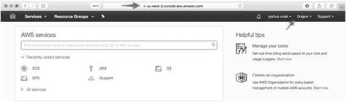

图 1-1. 读者应注意自己工作的区域

### 配置密钥对

为了与运行在 `AWS EC2` 上的沙盒系统交互，你需要一个 `ssh` 密钥对。Amazon `EC2` 使用公钥加密技术来促进与运行中 `EC2` 实例的所有连接。对你而言，这意味着需要在本地系统与将在 `EC2` 实例上配置的沙盒系统之间建立安全连接。为此，你需要在本地创建一个 `ssh` 密钥对，并将密钥对的公钥部分导入 `AWS`。当你创建新实例时，`AWS` 会使用该公钥配置新实例，这样你就可以使用本地的私钥连接到该实例。注意：建议 Windows 用户使用 `Git for Windows` 软件包中提供的优秀 `Git BASH` 工具，下载地址为：[`git-for-windows.github.io`](https://git-for-windows.github.io)。`Git BASH` 将包含你所需的所有命令行工具，包括 `ssh-keygen` 和 `ssh`。在代码清单 1-1 中，你使用 `ssh-keygen` 工具在本地系统上创建密钥对。为此目的（即一个可丢弃的沙盒 `AWS` 系统），你可以将所有字段留空，包括使用 `ssh` 密钥的密码短语。密钥的保存位置因系统而异。我系统上的默认位置是 `~/.ssh/id_rsa`，其中 `~` 表示当前用户的主目录。此过程将创建 `id_rsa` 和 `id_rsa.pub` 这一密钥对。你需要将 `id_rsa.pub` 密钥放入希望访问的系统中，从而能够使用 `id_rsa` 文件通过 `ssh` 连接到这些系统。

```
$ ssh-keygen -t rsa
正在生成公钥/私钥 rsa 密钥对。
输入保存密钥的文件（/home/ubuntu/.ssh/id_rsa）：
输入密码短语（空表示无密码短语）：
再次输入相同密码短语：
您的身份信息已保存在 /home/ubuntu/.ssh/id_rsa 中。
您的公钥已保存在 /home/ubuntu/.ssh/id_rsa.pub 中。
密钥指纹为：
SHA256:g5IYNQMf1n1jW5p36Y9I/qSPxnckhT665KtiB06xu2U ubuntu@ip-172-31-43-19
密钥的随机艺术图像为：
+---[RSA 2048]----+
|  ..*. .         |
|   + +. . + .    |
|  . .    o *   o |
|   o . .. + . + .|
|  . o . So . + . |
|     .  +.  . = .|
|       o oE+.o.* |
|        =o.o*+o o|
|       ..+.o**o. |
+----[SHA256]-----+
```

代码清单 1-1. 创建新的密钥对

在代码清单 1-2 中，你使用 `cat` 工具验证密钥的内容。你显示了一个在远程 `Ubuntu` 系统上创建的公钥，这可以从密钥末尾（`ubuntu@ip-172-31-43-19`）看出。这在任何系统上都应类似。

```
$ cat ~/.ssh/id_rsa.pub
ssh-rsa AAAAB3NzaC1yc2EAAAADAQABAAABAQDdnHPEiq1a4OsDDY+g9luWQS8pCjBmR64MmsrQ9MaIaE5shIcFB1Kg3pGwJpypiZjoSh9pS55S9LckNsBfn8Ff42ALLjR8y+WlJKVk/0DvDXgGVcCc0t/uTvxVx0bRruYxLW167J89UnxnJuRZDLeY9fDOfIzSR5eglhCWVqiOzB+OsLqR1W04Xz1oStID78UiY5msW+EFg25Hg1wepYMCJG/Zr43ByOYPGseUrbCqFBS1KlQnzfWRfEKHZbtEe6HbWwz1UDL2NrdFXxZAIXYYoCVtl4WXd/WjDwSjbMmtf3BqenVKZcP2DQ9/W+geIGGjvOTfUdsCHennYIEUfEEP ubuntu@ip-172-31-43-19
```

代码清单 1-2. 验证新创建的 `ssh` 密钥

### 在 AWS 上创建新的密钥对

登录 AWS 控制面板，导航至 EC2 控制面板，如图 1-2 所示。首先，访问“服务”（图 1-2，#1），然后访问“EC2”（图 1-2，#2）。可以从 AWS 网站的任何页面访问“服务”链接。

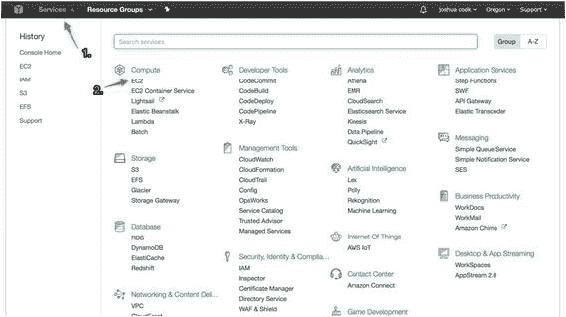

图 1-2. 访问 EC2 控制面板

进入 EC2 控制面板后，使用任一链接访问密钥对窗格（图 1-3）。

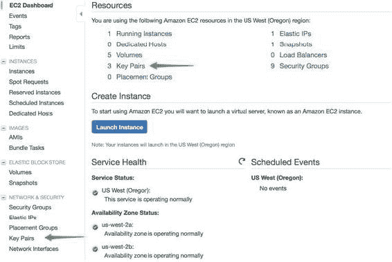

图 1-3. 在 EC2 控制面板中访问密钥对

在密钥对窗格中，选择“导入密钥对”。这将激活一个模态窗口，您可以使用它来创建一个与 AWS 账户上某个区域关联的新密钥对。请确保为密钥对指定一个对计算机友好的名称，例如 `from-MacBook-2017`。将您的公钥（`id_rsa.pub`）的内容粘贴到公钥内容中。在单击“导入”之前，您的密钥应如图 1-4 所示。单击“导入”以创建新密钥。

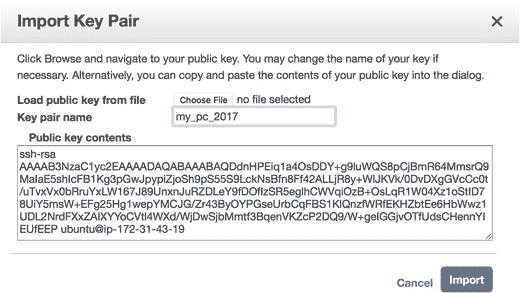

图 1-4. 导入新的密钥对

> **注意**
>
> 许多 AWS 资源是按区域唯一创建的。在一个区域创建的密钥对在另一个区域不可用。

您已在 AWS 和本地系统之间创建了一个密钥对。当您创建新实例时，您将指示 AWS 使用此密钥对配置该实例，从而您可以从本地系统访问基于云的系统。

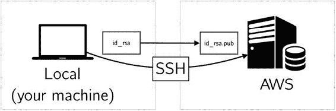

图 1-5. 使用 SSH 密钥从本地机器连接到 AWS

> **注意**
>
> 术语可能有点令人困惑。AWS 将上传的公钥称为“密钥对”。需要明确的是，您上传的是在本地系统上创建的密钥对的公钥部分（例如 `id_rsa.pub`）。私钥将保留在您的系统上（例如 `id_rsa`）。

### 创建新的安全组

在 EC2 控制面板中，使用任一链接访问安全组窗格（图 1-6）。

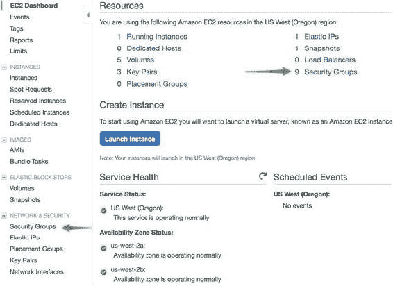

图 1-6. 在 EC2 控制面板中访问安全组

在安全组窗格中，单击“创建安全组”。为安全组指定一个对计算机友好的组名，例如 `jupyter_docker`。为安全组添加描述，例如“开放 Jupyter 和 Docker 默认端口的访问”。使用默认 VPC。访问“入站”选项卡并配置以下安全规则：

*   SSH：端口范围：22，来源：任意位置
*   HTTP：端口范围：80，来源：任意位置
*   HTTPS：端口范围：443，来源：任意位置
*   自定义 TCP 规则：端口范围：2376，来源：任意位置
*   自定义 TCP 规则：端口范围：8888，来源：任意位置

添加完所有这些规则后，应如图 1-7 所示。表 1-1 列出了端口以及通过这些端口可访问的服务。

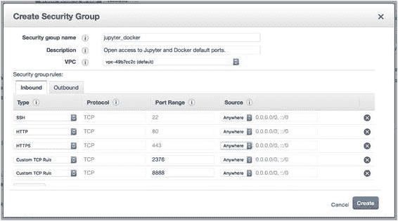

图 1-7. 新安全组的入站规则

**表 1-1. 端口及用途**

| 端口 | 可用服务 |
|------|----------|
| 22   | SSH      |
| 80   | HTTP     |
| 443  | HTTPS    |
| 2376 | Docker Hub|
| 8888 | Jupyter  |

### 创建新的 EC2 实例

要创建新实例，请从 EC2 控制面板开始，然后点击“启动实例”按钮（图 1-8）。

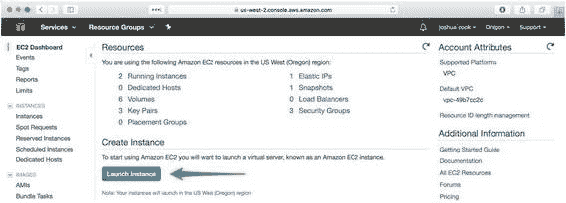

图 1-8. 启动新实例

启动新实例是一个多步骤的过程，引导用户完成所有必要的配置。第一个选项卡是“选择 AMI”。AMI 是亚马逊机器镜像⁷，包含运行沙盒机器所需的软件。我建议选择符合免费套餐资格的最新稳定版 Ubuntu Server。在撰写本文时，该版本为 `ami-efd0428f`，Ubuntu Server 16.04 LTS (HVM)，SSD 卷类型（图 1-9）。

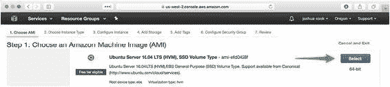

图 1-9. 选择最新的稳定版 Ubuntu Server 作为 AMI

第二个选项卡是“选择实例类型”。在使用中，我发现免费套餐 `t2.micro`（图 1-10）足以满足许多应用，尤其是在阅读本书时可能进行的沙盒类工作。也就是说，在阅读本书的过程中，你可能不会对数据集进行长时间处理，而是学习如何配置不同的系统。因此，你的内存需求可能会降低。最终目标是让读者能够随意创建和销毁机器。达到这种掌握程度后，读者可以为任何应用选择最低要求。

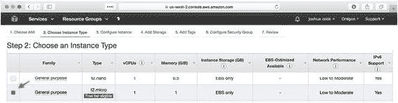

图 1-10. 使用 `t2.micro` 类型

第三个选项卡“配置实例”可以安全地忽略。第四个选项卡是“添加存储”。此选项也取决于预期用途。需要注意的是，Jupyter Docker 镜像在本地镜像缓存中可能占用超过 5GB 的磁盘空间。因此，建议将默认的 8GB 提高到 20GB 左右。

第五个选项卡“添加标签”可以安全地忽略。第六个选项卡“配置安全组”对于系统的正常运行至关重要。之前，你配置了一个新的安全组供系统使用。你需要将刚刚创建的安全组 `jupyter_docker` 分配给你正在配置的实例。选择“选择现有安全组”，然后选择你刚刚创建的安全组。验证选项卡底部的入站规则中是否开放了端口 22、80、443、2376 和 8888（图 1-11）。

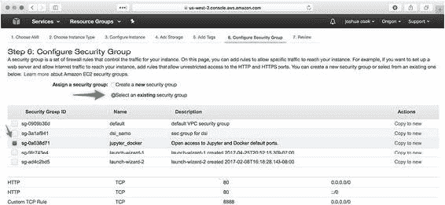

图 1-11. 为所有流量配置安全组

> **注意**
>
> 大多数读者在最后阶段会收到来自 AWS 的警告，大意是“提高实例的安全性。您的安全组 `jupyter_docker` 对世界开放。”作者认为，可以安全地忽略此警告。该警告告知我们，我们准备启动的实例可以在开放网络上访问。这是有意为之且经过设计的。在第一次也是最后一次关于系统安全的讨论中，我们将忽略这个担忧，并迅速转向开发短生命周期的可扩展系统。

最后，点击“审核和启动”。在这里，你将看到要创建的 EC2 实例的具体配置。验证你正在创建一个 `t2.micro` 实例，运行最新且符合免费套餐资格的 Ubuntu Server 版本，并且对所有流量开放，然后点击“启动”按钮（图 1-12）。

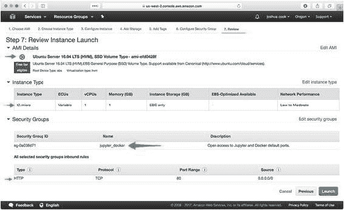

图 1-12. 启动新的 EC2 实例

在最后的确认步骤中，你会看到一个标题为“选择现有密钥对或创建新密钥对”的模态框。选择你之前创建的密钥对。勾选确认可以访问该密钥对的复选框，然后启动实例（图 1-13）。

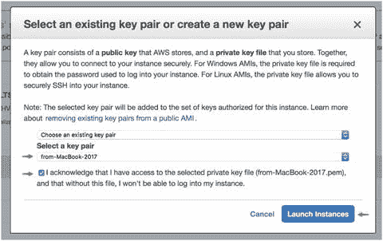

图 1-13. 选择之前导入的密钥对

你应该会看到一条通知，提示实例正在运行。点击右下角的“查看实例”选项卡，进入 EC2 控制面板的“实例”窗格，你应该会看到新实例正在运行。记下新实例的 IP 地址（图 1-14）。

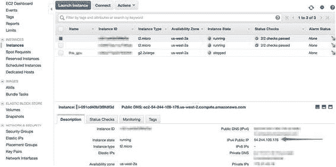

图 1-14. 记下正在运行的实例的 IP 地址

#### 配置新 EC2 实例以使用 Docker

设置好 EC2 实例后，你使用刚获得的 IP 地址通过 `ssh` 登录到该实例，以便为新实例配置 Docker（清单 1-3）。

```
$ ssh ubuntu@54.244.109.176
Welcome to Ubuntu 16.04.2 LTS (GNU/Linux 4.4.0-64-generic x86_64)
...
```

清单 1-3. 通过 SSH 登录 EC2 实例

> **注意**
>
> 首次访问 EC2 实例时，你应该会看到以下消息：
>
> `The authenticity of host '54.244.109.176 (54.244.109.176)' can't be established ... Are you sure you want to continue connecting (yes/no)?`
>
> 这是预期行为。你应该按 `<ENTER>` 键接受，或输入 `yes` 然后按 `<ENTER>` 键。

接下来（清单 1-4），你使用 Docker 团队提供的便捷安装脚本来安装和配置 Docker。该脚本从 `get.docker.com` 获取，并通过管道（`|`）传递给 shell（`sh`）。

```
$ curl -sSL https://get.docker.com/ | sh
apparmor is enabled in the kernel and apparmor utils were already installed
+ sudo -E sh -c sleep 3; apt-get update
...
+ sudo -E sh -c docker version
Client:
 Version:      17.04.0-ce
 API version:  1.28
 Go version:   go1.7.5
 Git commit:   4845c56
 Built:        Mon Apr  3 18:07:42 2017
 OS/Arch:      linux/amd64
Server:
 Version:      17.04.0-ce
 API version:  1.28 (minimum version 1.12)
 Go version:   go1.7.5
 Git commit:   4845c56
 Built:        Mon Apr  3 18:07:42 2017
 OS/Arch:      linux/amd64
 Experimental: false
...
```

清单 1-4. 通过 Shell 脚本安装 Docker

在清单 1-5 中，你将 `ubuntu` 用户添加到 `docker` 组。默认情况下，命令行 `docker` 客户端需要 `sudo` 权限才能向 `docker` 守护进程发出命令。你可以将 `ubuntu` 用户添加到 `docker` 组，以允许 `ubuntu` 用户无需 `sudo` 即可向 `docker` 发出命令。

```
$ sudo usermod -aG docker ubuntu
```

清单 1-5. 将 Ubuntu 用户添加到 Docker 组

最后，为了强制更改生效，你重新启动系统（清单 1-6）。作为重启系统的替代方案，用户可以简单地断开并重新连接到远程系统。

```
$ sudo reboot
```

清单 1-6. 重启 Docker 守护进程

重启将导致与 EC2 实例的安全 shell 连接关闭。等待片刻后，重新连接到系统。此时，你的系统就可以使用了。向 `docker` 客户端发出命令时，应该不再需要 `sudo`。你可以通过连接到远程系统并检查 `docker` 版本来验证这一点（清单 1-7）。

```
$ ssh ubuntu@54.244.109.176
$ docker -v
Docker version 17.04.0-ce, build 4845c56
```

清单 1-7. 登录远程系统并检查 Docker 版本