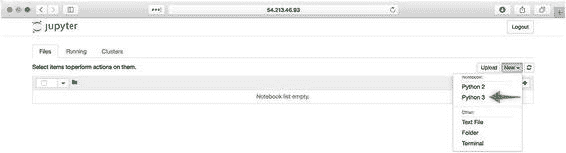
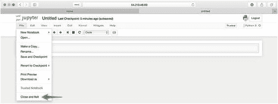
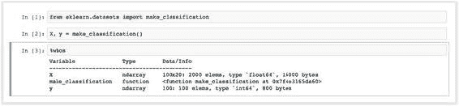
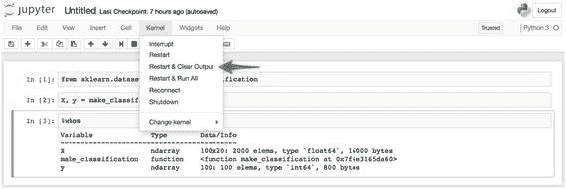
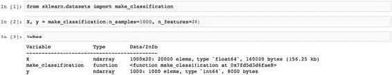
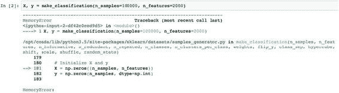
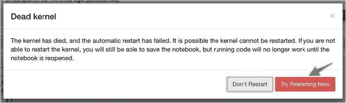
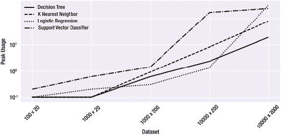

# 数据的基础设施限制

在开始使用 Docker 和 Jupyter 构建可扩展的计算编程系统之前，让我们先在这个新的 AWS 实例上进行一系列简单的实验。你将通过一系列简单的问题开始：

> 对于 `t2.micro` 实例来说，多大的数据集会大到无法加载到内存中？在 `t2.micro` 实例上，多大的数据集会导致 Jupyter 无法拟合不同类型的简单机器学习分类模型（例如 K 近邻模型）？决策树模型呢？逻辑回归模型呢？支持向量分类器呢？

为了回答这些问题，你将按照以下步骤进行：

1.  在你的 AWS 实例上使用 Docker 运行 `jupyter/scipy-notebook` 镜像。
2.  在运行时以及加载每个数据集时，使用 `docker stats` 监控内存使用情况。
3.  使用 `sklearn.datasets.make_classification` 函数在 Jupyter Notebook 中创建任意大小的数据集，并执行拟合操作。
4.  在每次模型拟合完成后，重启 Python 内核。
5.  记录导致内存异常的数据集大小。

## 拉取 `jupyter/scipy-notebook` 镜像

由于你正在一个全新配置的 AWS 实例上工作，你必须首先拉取你想要使用的 Docker 镜像，即 `jupyter/scipy-notebook`。这可以使用 `docker pull` 命令来完成，如清单 1-8 所示。该镜像从 Project Jupyter 的公共 Docker Hub 账户中拉取。

```
ubuntu@ip-172-31-6-246:~$ docker pull jupyter/scipy-notebook
Using default tag: latest
latest: Pulling from jupyter/scipy-notebook
693502eb7dfb: Pull complete
a3782c2efb41: Pull complete
9cb32b776a40: Pull complete
e539f5722cd5: Pull complete
b4690d4047c6: Pull complete
121dc465f5c6: Pull complete
c352772bbcfd: Pull complete
eeda14d1c421: Pull complete
0057b9e76c8a: Pull complete
e63bd87d75dd: Pull complete
055904fbc069: Pull complete
d336770b8a83: Pull complete
d61dbef85c7d: Pull complete
c1559927bbf2: Pull complete
ee5b638d15a3: Pull complete
dc937a931aca: Pull complete
4327c0faf37c: Pull complete
b37332c24e8c: Pull complete
b230bdb41817: Pull complete
765fecb84d9c: Pull complete
97efa424ddfa: Pull complete
ccfb7ed42913: Pull complete
2fb2abb673ce: Pull complete
Digest: sha256:04ad7bdf5b9b7fe88c3d0f71b91fd5f71fb45277ff7729dbe7ae20160c7a56df
Status: Downloaded newer image for jupyter/scipy-notebook:latest
```

清单 1-8. 拉取 `jupyter/scipy-notebook` 镜像。

一旦你拉取了镜像，它就会出现在你的 `docker images` 缓存中。任何时候你想运行一个新的 Jupyter 容器，Docker 都会从缓存中的镜像加载该容器。

## 运行 `jupyter/scipy-notebook` 镜像

在清单 1-9 中，你使用最小可行的 `docker run` 命令运行了一个 Jupyter Notebook 服务器。这里，`-p` 标志用于将主机（你的 EC2 实例）上的端口 8888 链接到 Docker 容器中 Jupyter Notebook 服务器运行的端口 8888。

```
$ docker run -p 8888:8888 jupyter/scipy-notebook
[I 22:10:01.236 NotebookApp] Writing notebook server cookie secret to /home/jovyan/.local/share/jupyter/runtime/notebook_cookie_secret
[W 22:10:01.326 NotebookApp] WARNING: The notebook server is listening on all IP addresses and not using encryption. This is not recommended.
[I 22:10:01.351 NotebookApp] JupyterLab alpha preview extension loaded from /opt/conda/lib/python3.5/site-packages/jupyterlab
[I 22:10:01.358 NotebookApp] Serving notebooks from local directory: /home/jovyan/work
[I 22:10:01.358 NotebookApp] 0 active kernels
[I 22:10:01.358 NotebookApp] The Jupyter Notebook is running at: http://[all ip addresses on your system]:8888/?token=7b02e3aadb29c42ff066a7290d81dd48e44ce62bd7f2bd0a
[I 22:10:01.359 NotebookApp] Use Control-C to stop this server and shut down all kernels (twice to skip confirmation).
[C 22:10:01.359 NotebookApp] 
    Copy/paste this URL into your browser when you connect for the first time, to login with a token:
    http://localhost:8888/?token=7b02e3aadb29c42ff066a7290d81dd48e44ce62bd7f2bd0a
```

清单 1-9. 运行 Jupyter Notebook 服务器

正在运行的 Jupyter Notebook 服务器的输出为你提供了一个身份验证令牌（`token=7b02e3aadb29c42ff066a7290d81dd48e44ce62bd7f2bd0a`），你可以使用它通过浏览器访问 Notebook 服务器。你可以使用提供的 URL 来执行此操作，但需要将 `localhost` 替换为你的 EC2 实例的 IP 地址（清单 1-10）。

```
http://54.244.109.176:8888/?token=1c32913725d84a76e7b3f04c45b91e17b77f3c3574779101
```

清单 1-10. 在 AWS 上运行的 Jupyter 实例的 URL，其中访问令牌作为查询参数传递

## 监控内存使用情况

在清单 1-11 中，你使用 `docker ps` 命令查看正在运行的容器。你将看到一个使用 `jupyter/scipy-notebook` 镜像运行的容器。

```
$ docker ps
CNID  IMAGE      COMMAND    CREATED     STATUS     PORTS           NAMES
cfef  jupyter/   scipy...   "tini..."  10 min ago  Up 10 min  0.0.0.0:8888->  friendly_
                                                                   8888/tcp        curie
```

清单 1-11. 监控正在运行的 Docker 容器

接下来，你使用 `docker stats` 来监控正在运行容器的活动内存使用情况（清单 1-12）。`docker stats` 是一个活动进程，你将用它来全程监控内存使用情况。

```
$ docker stats
CONTAINER     CPU %  MEM USAGE / LIMIT    MEM %  NET I/O    BLOCK I/O   PIDS
cfef9714b1c5  0.00%  49.73MiB / 990.7MiB  5.02%  60.3kB /   10.4MB / 0B 2
                                                         1.36MB
```

清单 1-12. 监控 Docker 内存使用情况

你可以在这里看到与上述问题相关的几件事。服务器当前没有使用任何分配的 CPU。你可以看到 Docker 容器有近 1GB 的可用内存，其中使用了 5%，大约 50MB。这 1GB 与你对 `t2.micro` 可用内存量的预期相符。

## 多大的数据集会导致内存异常？


您将使用 Jupyter Notebook 来运行测试。首先，您需要使用 Python 3 内核创建一个新的 notebook（图 1-15）。



**图 1-15.** 创建一个新的 notebook

在代码清单 1-13 中，您将再次检查内存使用情况。（启动一个新的 notebook 后，当前内存使用量增加到约 1GB 的 9%。）

```
$ docker stats
CONTAINER     CPU %  MEM USAGE / LIMIT    MEM %  NET I/O   BLOCK I/O    PIDS
cfef9714b1c5  0.01%  87.18MiB / 990.7MiB  8.80%  64.2kB /  12.6MB /     13
                                                 1.48MB    217kB
```

**代码清单 1-13.** 监控 Docker 内存使用情况

如果您关闭并停止（图 1-16）正在运行的 notebook，您可以看到内存使用量恢复到约 1GB 的 5% 的基线水平（代码清单 1-14）。



**图 1-16.** 关闭并停止正在运行的 notebook

```
$ docker stats
CONTAINER     CPU %  MEM USAGE / LIMIT    MEM %  NET I/O   BLOCK I/O    PIDS
cfef9714b1c5  0.00%  55.31MiB / 990.7MiB  5.58%  109kB /   12.4MB /     4
                                                 1.56MB    397kB
```

**代码清单 1-14.** 监控 Docker 内存使用情况

Python 机器学习库 `scikit-learn` ¹¹ 有一个专门用于加载规范数据集和生成合成数据集的模块：`sklearn.datasets`。重新启动您的 notebook，并从该模块加载 `make_classification` 函数（代码清单 1-15，图 1-17），使用从模块导入函数的标准 Python 语法。再次检查内存使用情况（代码清单 1-16）。


**图 1-17.** 导入 `make_classification`

```
In [1]: from sklearn.datasets import make_classification
```

**代码清单 1-15.** 导入 `make_classification`

```
$ docker stats
CONTAINER     CPU %  MEM USAGE / LIMIT    MEM %   NET I/O  BLOCK I/O    PIDS
cfef9714b1c5  0.04%  148.3MiB / 990.7MiB  14.97%  242kB /  49.3MB /     13
                                                  4.03MB   340kB
```

**代码清单 1-16.** 监控 Docker 内存使用情况

接下来（代码清单 1-17，图 1-18），您将使用默认值创建一个新的分类数据集。然后，您将使用 `%whos` IPython 魔法命令 ¹² 来显示数据集在内存中的大小。之后，您将检查内存使用情况（代码清单 1-18）。



**图 1-18.** 导入 `make_classification`

```
In [2]: X, y = make_classification()

In [3]: %whos
Variable              Type        Data/Info
-------------------------------------------
X                     ndarray     100x20: 2000 elems, type 'float64', 16000 bytes
make_classification   function    <function make_classification at 0x7feb192669d8>
y                     ndarray     100: 100 elems, type 'int64', 800 bytes
```

**代码清单 1-17.** 使用默认值创建一个新的分类数据集

```
$ docker stats
CONTAINER     CPU %  MEM USAGE / LIMIT    MEM %   NET I/O  BLOCK I/O  PIDS
cfef9714b1c5  0.01%  152MiB / 990.7MiB    15.35%  268kB /  54.1MB /   13
                                                  4.1MB    926kB
```

**代码清单 1-18.** 监控 Docker 内存使用情况

到目前为止，您对系统的负载很小。请注意与此默认分类数据集关联的数据集大小、Python 内存大小和 Docker 系统使用情况，然后重启 Python 内核（图 1-19）。



**图 1-19.** 重启 Python 内核

接下来，您将重新运行相同的实验，将特征集的大小增加 10 倍（代码清单 1-19，图 1-20）。在代码清单 1-20 中，您将检查 Docker 系统使用情况。



**图 1-20.** 导入 `make_classification`

```
In [2]: X, y = make_classification(n_samples=1000, n_features=20)

In [3]: %whos
Variable              Type        Data/Info
-------------------------------------------
X                     ndarray     100x20: 2000 elems, type `float64`, 160000 bytes
make_classification   function    <function make_classification at 0x7feb192669d8>
y                     ndarray     100: 100 elems, type `int64`, 8000 bytes
```

**代码清单 1-19.** 创建一个新的分类数据集

```
$ docker stats
CONTAINER     CPU %  MEM USAGE / LIMIT    MEM %   NET I/O   BLOCK I/O   PIDS
cfef9714b1c5  0.01%  149.7MiB / 990.7MiB  15.11%  286kB /   54.5MB /    13
                                                  4.13MB    1.13MB
```

**代码清单 1-20.** 监控 Docker 内存使用情况

重复实验几次，将结果记录在表 1-2 中。每次重启内核，创建一个比前一个数据集大 10 倍的新数据集，然后使用 IPython 魔法命令 `%whos` 和 `docker stats` 工具检查内存使用情况。

**表 1-2.** t2.micro 上的分类数据集内存占用

| 特征集形状 | Python 内存大小 | Docker 系统使用量 |
| --- | --- | --- |
| 100 × 20 | .016MB | 152MB |
| 1000 × 20 | .16MB | 149.7MB |
| 1000 × 200 | 1.525MB | 152.8MB |
| 10000 × 200 | 15.25MB | 162.6MB |
| 10000 × 2000 | 152.6MB | 279.7MB |
| 100000 × 2000 | 内存异常 | N/A |

在创建每个数据集后重启 Python 内核。请注意导致内存异常的数据集大小。当您尝试创建一个大小为 100000 × 2000 的分类数据集时，您会遇到 `MemoryError`，如代码清单 1-21 和图 1-21 所示。



**图 1-21.** 尝试创建分类数据集时出现 `MemoryError`

```
In [2]: X, y = make_classification(n_samples=100000, n_features=2000)
---------------------------------------------------------------------------
MemoryError                               Traceback (most recent call last)
<ipython-input-2-df42c0ced9d5> in <module>()
----> 1 X, y = make_classification(n_samples=100000, n_features=2000)

/opt/conda/lib/python3.5/site-packages/sklearn/datasets/samples_generator.py in make_classification(n_samples, n_features, n_informative, n_redundant, n_repeated, n_classes, n_clusters_per_class, weights, flip_y, class_sep, hypercube, shift, scale, shuffle, random_state)
    179
    180     # Initialize X and y
--> 181     X = np.zeros((n_samples, n_features))
    182     y = np.zeros(n_samples, dtype=np.int)
    183
MemoryError:
```

**代码清单 1-21.** 尝试创建分类数据集时出现 `MemoryError`

至此，您已经达到了当前系统的内存上限。这并不是一个特别大的数据集：100,000 行和 2000 列。但同样，您使用的也不是一个特别大的系统：单个 CPU 和 1GB 内存。当然，您可以想象在某些情况下，您需要在更大的系统上处理更大的数据集。

### 多大的数据集对于拟合不同类型的简单模型来说算太大？


接下来，我们来回答第二个问题。我们将通过启动一个全新的 Docker 容器来完成。首先，在代码清单 1-22 中，你再次使用 `docker ps` 来显示正在运行的容器。

```
$ docker ps
CNID IMAGE     COMMAND   CREATED      STATUS      PORTS            NAMES
cfef jupyter/  "tini..." 53 min ago   Up 53 min   0.0.0.0:8888->   friendly_
     scipy...                                 8888/tcp         curie
```

代码清单 1-22. 监控正在运行的 Docker 容器

在代码清单 1-23 中，你停止并移除了这个容器。

```
$ docker stop friendly_curie
friendly_curie
ubuntu@ip-172-31-1-64:∼$ docker rm friendly_curie
friendly_curie
```

代码清单 1-23. 停止并移除一个正在运行的容器

接下来，在代码清单 1-24 中，你启动了一个全新的 `jupyter/scipy-notebook` 容器。

```
$ docker run -p 8888:8888 jupyter/scipy-notebook
[I 20:05:42.246 NotebookApp] Writing notebook server cookie secret to /home/jovyan/.local/share/jupyter/runtime/notebook_cookie_secret ...
    Copy/paste this URL into your browser when you connect for the first time,
    to login with a token:
        http://localhost:8888/?token=7a65c3c7dc6ea294a38397a48cc1ffe110ea138aef6d42c4
```

代码清单 1-24. 运行 Jupyter Notebook 服务器

请务必记下新的安全令牌（`7a65c3c7dc6ea294a38397a48cc1ffe110ea138aef6d42c4`），并再次使用 AWS 实例的 IP 地址代替 `localhost`（代码清单 1-25）。

```
http://54.244.109.176:8888/?token=7a65c3c7dc6ea294a38397a48cc1ffe110ea138aef6d42c4
```

代码清单 1-25. 在 AWS 上运行的新 Jupyter 实例的 URL，访问令牌作为查询参数传递

在开始之前，通过 `docker stats` 测量当前容器的基线使用情况（代码清单 1-26）。

```
$ docker stats
CONTAINER     CPU %  MEM USAGE / LIMIT    MEM %   NET I/O  BLOCK I/O    PIDS
22efba43b763  0.00%  43.29MiB / 990.7MiB  4.37%   768B /   0B / 0B      2
                                                   486B
```

代码清单 1-26. 监控 Docker 内存使用情况

你再次创建一个新的 Python 3 Notebook，并着手回答第二个问题。在代码清单 1-27 中，你检查了运行全新 notebook 时 Docker 机器的内存使用情况。

```
$ docker stats
CONTAINER     CPU %  MEM USAGE / LIMIT    MEM %   NET I/O   BLOCK I/O   PIDS
22efba43b763  0.04%  90.69MiB / 990.7MiB  9.15%   58.8kB /  0B / 217kB  13
                                                   1.3MB
```

代码清单 1-27. 监控 Docker 内存使用情况

解决这个问题的方法会略有不同，并且会更频繁地使用 `docker stats`。`%whos` IPython 魔法命令不能用于显示拟合模型的内存使用情况，事实上，并不存在一种简单的测量内存使用的方法。¹³ 你将利用你对 `make_classification` 创建的数据所占内存空间的知识，以及刚刚测量的基线性能。你将使用代码清单 1-28 中的代码模式来执行此分析。

```
from sklearn.datasets import make_classification
from sklearn.<model_module> import <model>
X, y = make_classification(<shape>)
model = <model>()
model.fit(X, y)
model.score(X, y)
```

代码清单 1-28. 创建一个新的分类数据集并执行朴素模型拟合

例如，使用以下代码来拟合最小的 `KNeighborsClassifier`（代码清单 1-29）、`DecisionTreeClassifier`（代码清单 1-30）、`LogisticRegression`（代码清单 1-31）和 `SVC`（代码清单 1-32）。然后，你将为后续的每次测试修改数据的规模。

```
from sklearn.datasets import make_classification
from sklearn.neighbors import KNeighborsClassifier
X, y = make_classification(1000, 20)
model = KNeighborsClassifier()
model.fit(X, y)
model.score(X, y)
```

代码清单 1-29. 拟合最小的 KNeighborsClassifier

```
from sklearn.datasets import make_classification
from sklearn.tree import DecisionTreeClassifier
X, y = make_classification(1000, 20)
model = DecisionTreeClassifier()
model.fit(X, y)
model.score(X, y)
```

代码清单 1-30. 拟合最小的 DecisionTreeClassifier

```
from sklearn.datasets import make_classification
from sklearn.linear_model import LogisticRegression
X, y = make_classification(1000, 20)
model = LogisticRegression()
model.fit(X, y)
model.score(X, y)
```

代码清单 1-31. 拟合最小的 LogisticRegression

```
from sklearn.datasets import make_classification
from sklearn.neighbors import SVC
X, y = make_classification(1000, 20)
model = SVC()
model.fit(X, y)
model.score(X, y)
```

代码清单 1-32. 拟合最小的 SVC

然后，你使用 `docker stats` 检查 Docker 系统的使用情况。在每次测试之间，你使用 `docker restart`（代码清单 1-33）后跟容器 ID `22efba43b763` 来重置容器上的内存使用情况。重启容器后，你通常还需要确认重启 Jupyter 内核（图 1-22）。



图 1-22. 确认重启 Jupyter 内核

```
$ docker restart 22efba43b763
```

代码清单 1-33. 重启你的 Docker 容器

本次实验的结果记录在表 1-3 和图 1-23 中。

表 1-3. 数据集分类及模型在 t2.micro 上的内存占用

| 特征集形状 | 模型类型 | 数据集系统使用量 (MB) | 数据集与拟合峰值系统使用量 (MB) | 差值 (MB) |
| --- | --- | --- | --- | --- |
| 基线（无 Notebook 运行） | 不适用 | 不适用 | 不适用 | 40.98 |
| 基线（Notebook 运行） | 不适用 | 不适用 | 不适用 | 76.14 |
| 100 × 20 | KNeighborsClassifier | 99.9 | 100.0 | 0.1 |
| 100 × 20 | DecisionTreeClassifier | 103.2 | 103.3 | 0.1 |
| 100 × 20 | LogisticRegression | 102.5 | 102.6 | 0.1 |
| 100 × 20 | SVC | 101.2 | 101.4 | 0.2 |
| 1000 × 20 | KNeighborsClassifier | 100.3 | 100.4 | 0.1 |
| 1000 × 20 | DecisionTreeClassifier | 103.7 | 103.8 | 0.1 |
| 1000 × 20 | LogisticRegression | 104.9 | 105.1 | 0.2 |
| 1000 × 20 | SVC | 104.9 | 105.5 | 0.6 |
| 1000 × 200 | KNeighborsClassifier | 106.3 | 106.9 | 0.6 |
| 1000 × 200 | DecisionTreeClassifier | 104.8 | 105.7 | 0.9 |
| 1000 × 200 | LogisticRegression | 102.0 | 102.3 | 0.3 |
| 1000 × 200 | SVC | 104.6 | 106.0 | 1.4 |
| 10000 × 200 | KNeighborsClassifier | 115.5 | 117.8 | 2.3 |
| 10000 × 200 | DecisionTreeClassifier | 119.8 | 127.8 | 8.0 |
| 10000 × 200 | LogisticRegression | 121.3 | 122.6 | 1.3 |
| 10000 × 200 | SVC | 121.1 | 286.7 | 165.6 |
| 10000 × 2000 | KNeighborsClassifier | 256.4 | 275.1 | 18.7 |
| 10000 × 2000 | DecisionTreeClassifier | 257.1 | 333.6 | 76.5 |
| 10000 × 2000 | LogisticRegression | 258.6 | 564.9 | 306.3 |
| 10000 × 2000 | SVC | 256.3 | 491.9 | 235.6 |



图 1-23. 数据集与各模型峰值使用量对比

#### 测量 T2.Micro 上可容纳的数据规模

在之前的测试中，一个 10000 行 x 2000 列的数据集是你能成功加载到内存中的最大数据集。在这次测试中，你成功地对每个能加载到内存的数据集，拟合了四种不同机器学习模型的朴素实现。话虽如此，你可以看到，无论是 `LogisticRegression` 还是 `SVC`（支持向量分类器）都无法处理更大的数据量。


## 总结

在本章中，我介绍了本文的核心主题——`Docker` 和 `Jupyter`，并讨论了学习本文时推荐的一种实践方法，即在亚马逊云服务上使用一次性 Linux 实例。我提供了配置、启动和配置此类实例的详细说明。启动实例后，你使用 `Docker` 和 `Jupyter` 探索了一个玩具级的大数据示例，在使用 `scikit-learn` 生成的合成分类数据集加载和拟合模型时，诊断了内存性能。我并不期望本章能让你彻底掌握如何使用 `Docker` 和 `Jupyter` 构建执行数据科学的系统。相反，我希望它能作为对该主题的实质性介绍。与其简单陈述 `Docker` 和 `Jupyter` 是什么，我更希望你能通过使用它们来了解这两项技术。在接下来的章节中，你将探索 `Docker` 和 `Jupyter` 生态系统的许多方面。之后，你将了解开源数据存储 `Redis`、`MongoDB` 和 `PostgreSQL`，以及如何将它们集成到基于 Docker 的应用程序中。最后，你将学习 `Docker Compose` 工具，以及如何将所有部分整合到一个 `docker-compose.yml` 文件中。

脚注 1 [www.docker.com/use-cases](http://www.docker.com/use-cases)  
2 [www.digitalocean.com](http://www.digitalocean.com)  
3 [`cloud.google.com`](https://cloud.google.com)  
4 创建新 AWS 账户的说明可在 [`aws.amazon.com/premiumsupport/knowledge-center/create-and-activate-aws-account/`](https://aws.amazon.com/premiumsupport/knowledge-center/create-and-activate-aws-account/) 找到。  
5 [`docs.aws.amazon.com/AWSEC2/latest/UserGuide/ec2-key-pairs.html`](http://docs.aws.amazon.com/AWSEC2/latest/UserGuide/ec2-key-pairs.html)  
6 [www.gnu.org/software/bash/manual/html_node/Tilde-Expansion.html](http://www.gnu.org/software/bash/manual/html_node/Tilde-Expansion.html)  
7 [`docs.aws.amazon.com/AWSEC2/latest/UserGuide/AMIs.html`](http://docs.aws.amazon.com/AWSEC2/latest/UserGuide/AMIs.html)  
8 [`scikit-learn.org/stable/tutorial/machine_learning_map/`](http://scikit-learn.org/stable/tutorial/machine_learning_map/)  
9 [`hub.docker.com/u/jupyter/`](http://hub.docker.com/u/jupyter/)  
10 我的 `t2.micro` 只有一个 CPU。  
11 [`scikit-learn.org/`](http://scikit-learn.org/)  
12 [`ipython.org/ipython-doc/3/interactive/magics.html#magic-whos`](https://ipython.org/ipython-doc/3/interactive/magics.html#magic-whos)  
13 [`stackoverflow.com/questions/449560/how-do-i-determine-the-size-of-an-object-in-python`](https://stackoverflow.com/questions/449560/how-do-i-determine-the-size-of-an-object-in-python)

© Joshua Cook 2017  
Joshua Cook, *Docker for Data Science*  
`doi.org/10.1007/978-1-4842-3012-1_2`

