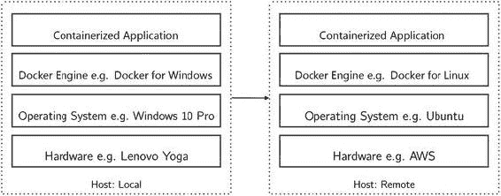

# 2. Docker

Joshua Cook¹  
(1) 美国加利福尼亚州圣莫尼卡

`Docker` 是一种将进程与其运行的系统隔离的方法。它允许我们将用于定义应用程序的代码以及运行该应用程序所需的资源，与其运行的硬件隔离开来。我们为软件增加了一层复杂性，但这样做也带来了一个优势：确保我们的本地开发环境与我们将部署应用程序的任何可能环境完全相同。如果一个系统能运行 `Docker`，那么该系统就能运行我们的进程。通过添加这一层薄薄的抽象层，我们实现了硬件无关性。

表面上看，这似乎是一项不可能完成的任务。截至 2014 年，有 285 个积极维护的 Linux 发行版，以及 OS X 和 Windows 的多个主要版本。我们怎么可能编写一个系统来支持所有可能的开发、测试和生产环境呢？`Docker` 通过容器化解决了这个问题。我们永远无法保证远程环境会运行与我们本地相同的操作系统。我们通常确切地知道它永远不会（我在 Mac OS X 上开发，通常部署到运行 Ubuntu 的系统上）。也就是说，如图 2-1 所示，我们可以保证我们的开发和部署环境都能运行 `Docker` 引擎。我们将应用程序编写为由 `Docker` 引擎作为容器运行——我们将应用程序容器化——从而确保跨平台的兼容性。我们不关心底层的操作系统或硬件，只关心它是否运行着 `Docker` 引擎。

**图 2-1.** 跨异构基础设施部署。请注意，不同系统的技术栈可能完全不同，但我们部署的是相同的容器。

使用 `Docker` 工具套件，我们将应用程序构建为以 `Docker` 容器的方式运行。构建完成后，我们通过在本地系统上运行镜像来验证它们。确认无误后，将我们的容器化应用程序部署到运行 `Docker` 引擎的远程机器上就变得轻而易举了。无论操作系统或硬件如何，我们都以完全相同的方式运行系统。`Docker` 让开发者可以忽略操作系统。

## Docker 不是虚拟机

`Docker` 不是虚拟机技术。¹ 尽管如此，简要了解一下虚拟机技术是什么还是很有用的。许多人会熟悉虚拟机技术，尤其是使用 `VirtualBox` 等工具运行的虚拟机。使用这些工具之一，一台计算机（宿主机）可以运行多个虚拟机实例（客户机）。每个客户机在磁盘上使用一个大文件来定义其隔离的操作系统和文件系统。每个客户机作为宿主机 CPU 上的一个资源密集型进程运行。对于大多数用户而言，客户机的行为就像一台独立的计算机，在实际使用中与其运行的宿主机非常相似。换句话说，虚拟机感觉像是虚拟化的硬件。虚拟机技术的缺点包括：消耗大量硬盘空间来存储庞大的操作系统，以及消耗大量 CPU 资源来维护完整操作系统所需的所有进程。

