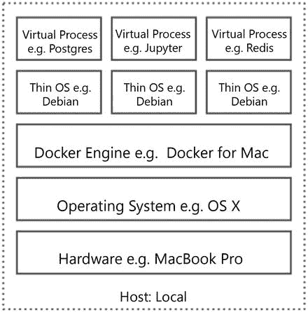

# 容器化

容器化是一种虚拟化方法，但容器并非大多数人认知中的虚拟机。这种混淆情有可原。与容器类似，甚至可以使用`Vagrant`软件来定义虚拟机。但需要明确的是，虚拟机使用的是某一种虚拟化技术，而容器化则完全是另一种不同类型的虚拟化。[`Linux 容器`](https://linuxcontainers.org/lxc/introduction/)（`LXC`）项目是一个供应商中立的项目，旨在提供一套原生的工具和库，用于将进程与运行它们的更广泛的`Linux`系统隔离开来。`LXC`与其宿主机运行在同一个操作系统上。`LXC`的既定目标是“创建一个尽可能接近标准`Linux`安装的环境，但无需单独的内核。”换句话说，`LXC`允许进程被容器化。

容器化旨在虚拟化进程。因此，一个被容器化的进程是在为其目的而优化的环境中运行，但使用的是宿主机的系统资源。`LXC`库经过精心设计，允许容器化进程作为虚拟化进程（见图 2-2）在其宿主机系统上运行，而无需运行完整的操作系统。与虚拟机相比，`LXC`具有开销低、性能更好的特点。

 图 2-2. 一个虚拟化进程

2015 年 6 月，`Docker`协助发起了[`开放容器项目`](https://www.opencontainers.org/about)。`Docker`将其库 `runc` 捐赠出来，作为`LXC`的迭代版本。虽然`Docker`的核心不再运行`LXC`，但其原则依然不变：[`Docker` 不是虚拟机](https://blog.docker.com/2016/03/containers-are-not-vms/)。`Docker`正在利用虚拟化技术来实现进程或服务与宿主系统的隔离。

在本书中，你将始终面临通过`Docker`运行进程时的两个问题：网络连接（连接到你的进程）以及维护数据的持久性。随着容器管理方面的这些最新创新，`Docker`正朝着更强大的工具方向发展，以管理这两个问题。通过`Docker`管理网络和持久性，一旦这些进程被抽象化或容器化，它们就可以在任何系统上随意运行。