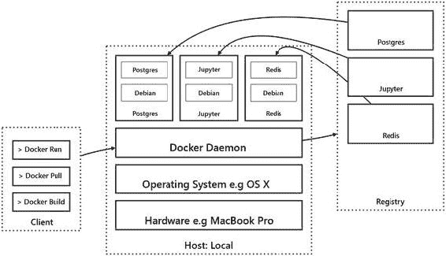
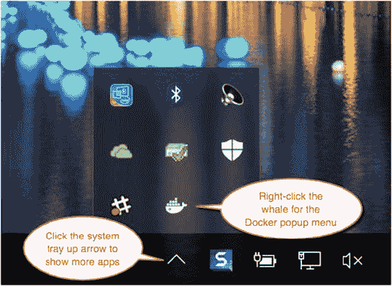

# Docker 容器生态系统

你将从关注容器的生态系统开始了解 Docker。之后，你将利用 Docker 的工具，用你构建的容器来组合更大的系统。在 Docker 容器的直接生态系统（见图 2-3）中，跟踪以下概念非常重要：

 图 2-3. Docker 生态系统

*   Docker CLI 客户端
*   宿主机
*   Docker 引擎或守护进程
*   Docker 镜像
*   Docker 容器
*   Docker 仓库，通常是 Docker Hub
*   Docker Compose

**注意：** 你将完全避免使用 GUI 工具 Kitematic，而采用完全面向命令行的方式来管理 Docker。

## Docker 客户端

Docker 客户端是一个命令行界面，用于向 Docker 引擎发出指令，而无需关心引擎在你系统上实现的具体细节。这类似于 Web 的客户端-服务器架构，其中客户端系统使用一个接口（通常是 Web 浏览器，但也可能是 RESTful API）与远程服务器交互。在 Docker 的情况下，Docker 客户端与执行容器和容器化工作的 Docker 引擎进行通信。在阅读本书的过程中，你将使用 Docker 命令行界面作为你的客户端，而引擎将在你的本地系统上运行，或者按照第 1 章的建议在 `t2.micro` 实例上运行。使用 Docker 客户端，你告诉 Docker 守护进程从仓库拉取一个镜像。然后你可以告诉 Docker 守护进程运行该镜像。完成这些操作后，你可能会询问引擎当前正在运行哪些 `ps` 或容器。² 要列出 Docker 客户端可用的命令，可以运行不带参数的 `docker` 或执行 `docker help`。根据你的 Docker 系统配置，你可能需要在每个 `docker` 命令前加上 `sudo`。为了避免在 `docker` 命令中使用 `sudo`，你的系统管理员可以创建一个名为 `docker` 的 Unix 组，并将用户添加到该组中。

## 宿主机

宿主机是你将运行 Docker 守护进程/引擎的机器。在本地，宿主机将取决于你的 Docker 配置。如果你运行的是 Docker for Linux、Docker for Mac 或 Docker for Windows，那么宿主机就是你的系统本身。如果你运行的是 Docker Toolbox，那么宿主机将是在 Oracle 的 VirtualBox 软件上运行的一个虚拟机。Docker Toolbox 提供了协助正确创建此虚拟机的工具。你也可以设置一台远程机器作为你的宿主机。重要的是，虽然你总是需要一个宿主机，但宿主机的具体细节是无关紧要的。宿主机可以是 Mac 上的一个虚拟机、Amazon Web Services 上的一个 `c4.8xlarge` EC2 实例，或者你大学地下室的一台裸机服务器。无论如何，你的应用行为都是一样的。在某些情况下，可能需要识别宿主机的 IP 地址。对于 Docker for Linux、Docker for Mac 或 Docker for Windows，这通常不是必需的，在这些环境中 Docker 要么是原生运行（Linux），要么是类似原生运行（Mac、Windows）。在其他情况下，可以使用 `docker-machine` 命令行工具来识别宿主机的 IP 地址，具体命令是 `docker-machine ls`（参见代码清单 2-1）。

```
$ docker-machine ls
NAME      ACTIVE   DRIVER      STATE     URL       SWARM   DOCKER    ERRORS
default   -        virtualbox  Running   tcp://192.168.99.100:2376  v1.13.0
```

代码清单 2-1. 显示与正在运行的附加 Docker 引擎关联的 Docker 宿主机

## Docker 引擎

Docker 引擎是一个管理容器的持久化进程。它作为后台服务或守护进程在宿主机上运行。事实上，引擎有时也被称为 Docker 守护进程。Docker 引擎执行 Docker 的核心工作：构建、运行和分发你的 Docker 容器。在本书中，你将直接与引擎交互，但会通过 Docker 客户端进行。Docker 的强大之处在于你能够通过 Docker 客户端与引擎协同工作。你将把进程的管理工作交给 Docker 引擎。如果你能在某个系统上做到这一点，那么你可以信赖，你在任何其他能够运行 Docker 引擎的机器上所做的任何工作都会有相同的行为。


### Docker 镜像与 Docker 容器

`Docker` 镜像是只读的。这并非意味着我们不能对镜像进行修改，而是指一旦我们做出修改，得到的就是一种新的镜像。我喜欢用具有不可变数据结构的语言（例如 Python 中的元组）来类比。一旦你定义了一个元组，就无法修改它，尽管你可以定义一个新元组，该元组以原始元组为基础并以某种方式对其进行修改。`Docker` 引擎有几种构建我们自己的镜像的方法。这些方法包括使用 `Docker` 客户端以及通过一种称为 `Dockerfile` 的领域特定语言（DSL）。我们也可以下载其他人创建的镜像。`Docker` 容器是 `Docker` 镜像的实例。它们是独立的，包含应用程序单个实例运行所需的一切（操作系统、依赖项、源代码、元数据），并且可以被运行、启动、停止、移动和删除。它们也是隔离且安全的。用面向对象编程的概念来理解 `Docker` 镜像和容器会很有帮助。镜像是我们可能创建的容器的已定义的“类”。而容器则是该类的“实例”或“对象”。`Docker` 引擎将管理主机上运行的多个容器。当引擎从镜像运行一个容器时，它会在镜像之上添加一个读写层，我们的应用程序可以在其中运行。然而，说实话，将镜像-容器关系类比为面向对象编程是一种较弱的类比。一个更强的类比是将 `Docker` 类比为一种编译型语言。在这个类比中，我们可以将 `Dockerfile` 视为源代码，将镜像视为编译后的二进制文件，将正在运行的容器视为正在运行的进程。考虑到我们使用命令 `docker ps` 来显示当前正在运行的容器，这显然是一个有意为之的类比。这个类比在几个方面都很有帮助。首先，它将构建过程置于我们理解 `Docker` 工作的前沿。其次，它有助于强化容器是短暂的这一概念，就像正在运行的进程一样。当它们的生命周期结束时，它们的状态实际上就丢失了。

### Docker 注册表

`Docker` 注册表保存着镜像。这些是公共或私有的存储库，你可以从中上传或下载镜像。就本书而言，你将使用 `Docker Hub` 上的公共 `Docker` 注册表。`Docker Hub` 是你将使用的主要开源技术（包括 `Jupyter`、`PostgreSQL`、`Redis` 和 `MongoDB`）的官方镜像来源。

#### Docker Compose

`Docker Compose` 是一个用于组装由多个容器组成的微服务和应用程序的工具。这些微服务和应用程序使用单个 `YAML` 文件进行设计，并且可以通过单个命令进行构建、运行和扩展。`Docker Compose` 对于数据科学家构建由 `Jupyter` 和一个或多个数据存储（例如 `Redis`）组成的独立计算系统特别有用。

## 获取 Docker

在撰写本文时，在主流操作系统上安装 `Docker` 有四种核心方式：

*   Linux 版 `Docker`
*   Mac 版 `Docker`
*   Windows 版 `Docker`
*   `Docker Toolbox`

建议将系统配置为至少使用 2GB 内存。在允许 `Docker` 引擎使用所有可用资源（如 CPU 和内存）方面，我没有遇到重大问题。请注意，我再次建议读者使用第 1 章中概述的 `t2.micro` 上的沙箱系统。第 1 章包含配置运行 Ubuntu 的 AWS 实例的说明。

### Linux 版 Docker

Linux 版 `Docker` 在大多数主流 Linux 操作系统上原生运行。它通过使用 `bash` 或类似 shell 的命令行驱动。值得注意的是，在远程服务器上运行 Linux 版 `Docker` 是最常见的配置。对于 Mac 和 Windows 开发者来说，熟悉这种配置是一项值得做的练习。话虽如此，不同平台的体验非常相似。有关可用操作系统列表的详细说明，请访问 `https://docs.docker.com/engine/installation/`。在此，我重点介绍 Ubuntu 系统的安装说明。对于其他 Linux 发行版的安装，读者应参考该链接以获取具体说明。

#### 在 Ubuntu 系统上安装 Docker

从命令行安装 `Docker` 提供了最高程度的灵活性。在 Ubuntu 系统上（此处我使用 Ubuntu 16.04.2），可以通过 `apt` 工具完成。注意：这些说明适用于在 Ubuntu 上安装 `Docker`。希望在其他 Linux 变体上安装 `Docker` 的用户应参考其系统的具体说明，网址为 `https://docs.docker.com/engine/installation/`。在清单 2-2 中，你使用 `apt search` 来检查与 `Docker` 相关的、可通过 `apt` 安装的软件包。你首先运行 `apt update` 以确保拥有最新的可用软件包列表。

```
$ apt update
$ apt search docker
Sorting... Done
Full Text Search... Done
...
docker/xenial 1.5-1 amd64
  System tray for KDE3/GNOME2 docklet applications
docker-compose/xenial 1.5.2-1 all
  Punctual, lightweight development environments using Docker
docker-doc/xenial-updates 1.12.6-0ubuntu1∼16.04.1 all
  Linux container runtime -- documentation
docker-registry/xenial 2.3.0∼ds1-1 amd64
  Docker toolset to pack, ship, store, and deliver content
docker.io/xenial-updates 1.12.6-0ubuntu1∼16.04.1 amd64
  Linux container runtime
...
```

清单 2-2. 显示可供安装的 Docker 软件包

你最感兴趣的软件包是 `docker.io` 软件包。该软件包包含 `Docker` 守护进程（也称为 `Docker` 容器运行时）和 `Docker` 命令行界面（CLI）可执行文件。在清单 2-3 中，你使用 `apt policy` 来显示 `docker.io` 软件包的可用元信息。在撰写本文时，通过 `apt` 可用的 `docker.io` 软件包是 1.12.6 版本。

```
$ apt policy docker.io
docker.io:
  Installed: (none)
  Candidate: 1.12.6-0ubuntu1∼16.04.1
  Version table:
     1.12.6-0ubuntu1∼16.04.1 500
        500 http://us-west-2.ec2.archive.ubuntu.com/ubuntu xenial-updates/universe amd64 Packages
     1.10.3-0ubuntu6 500
        500 http://us-west-2.ec2.archive.ubuntu.com/ubuntu xenial/universe amd64 Packages
```

清单 2-3. 显示 `docker.io` 软件包的元信息

注意：每个策略声明前面的 500 是一个优先级数字，表示该软件包在系统上是“可安装的”。你通过确保没有安装旧版本的 `docker` 来开始安装（清单 2-4）。如果你收到消息“Package 'docker' is not installed, so not removed”，这意味着 `docker` 未安装，你可以继续。

```
$ sudo apt remove docker
Reading package lists... Done
Building dependency tree
Reading state information... Done
Package 'docker' is not installed, so not removed
0 upgraded, 0 newly installed, 0 to remove and 43 not upgraded.
```

清单 2-4. 移除先前安装的 `docker`


#### 配置 Docker 仓库

要安装 Docker，你将采用 Docker 推荐的最佳实践，即从 Docker 仓库进行安装。为此，你首先需要设置该仓库。你将针对 Docker CE 进行此操作。首先，在清单 2-5 中，你将允许 `apt` 通过 HTTPS 使用仓库。

```
$ sudo apt-get install \
>     apt-transport-https \
>     ca-certificates \
>     curl \
>     software-properties-common
Reading package lists... Done
Building dependency tree
Reading state information... Done
ca-certificates is already the newest version (20160104ubuntu1).
apt-transport-https is already the newest version (1.2.19).
curl is already the newest version (7.47.0-1ubuntu2.2).
software-properties-common is already the newest version (0.96.20.5).
0 upgraded, 0 newly installed, 0 to remove and 43 not upgraded.
```

清单 2-5. 允许 `apt` 通过 HTTPS 使用仓库

然后，在清单 2-6 中，你将添加 Docker 的官方 GPG 密钥。

```
$ curl -fsSL https://download.docker.com/linux/ubuntu/gpg | sudo apt-key add -
OK
$ sudo apt-key fingerprint 0EBFCD88
pub   4096R/0EBFCD88 2017-02-22
      Key fingerprint = 9DC8 5822 9FC7 DD38 854A  E2D8 8D81 803C 0EBF CD88
uid                  Docker Release (CE deb) <docker@docker.com>
sub   4096R/F273FCD8 2017-02-22
```

清单 2-6. 添加 Docker 的官方 GPG 密钥

最后，在清单 2-7 中，你将为你的系统架构添加相应的 Docker 仓库。

```
$ sudo add-apt-repository \
>    "deb [arch=$(dpkg --print-architecture)] https://download.docker.com/linux/ubuntu \
>    $(lsb_release -cs) \
>    stable"
```

清单 2-7. 添加你系统特定的 Docker 仓库

#### 从 Docker 仓库安装

配置好 Docker 仓库后，你可以使用标准的 `apt update`（清单 2-8）和 `apt install`（清单 2-9）命令进行安装。

```
$ sudo apt update
...
Get:6 https://download.docker.com/linux/ubuntu xenial/stable amd64 Packages [1,479 B]
...
43 packages can be upgraded. Run 'apt list --upgradable' to see them.
```

清单 2-8. 更新 `apt` 注册表

```
$ sudo apt install -y docker-ce
Reading package lists... Done
...
Preparing to unpack .../docker-ce_17.03.1∼ce-0∼ubuntu-xenial_amd64.deb ...
Unpacking docker-ce (17.03.1∼ce-0∼ubuntu-xenial) ...
...
Processing triggers for ureadahead (0.100.0-19) ...
```

清单 2-9. 安装 `docker`。

#### 以非 root 用户身份管理 Docker

在 Linux 系统上，Docker 引擎绑定到一个 Unix 端口，而不是 TCP 端口。此端口通常由 `root` 拥有，并且必须通过 `sudo` 访问才能接收来自 Docker 客户端的命令。Linux 系统上 Docker 用户的一种常见模式是创建一个 `docker` 组并将用户添加到该组，如清单 2-10 所示。当 Docker 守护进程重启时，它会使绑定到 Docker 引擎的端口对 `docker` 组可读/写。结果是用户能够向引擎发出命令，而无需在其命令前加上 `sudo`。请注意，严格来说，这不是必需的。

```
$ sudo groupadd docker
$ sudo usermod -aG docker $USER
```

清单 2-10. 在 Linux 系统上创建 `docker` 组

注销并重新登录以查看更改生效。此时，用户将能够通过 `docker` 向引擎发出命令，而无需使用 `sudo`。

### Docker for Mac

Docker for Mac 使用 HyperKit⁴ 虚拟机运行 Docker。它通过 `bash` 或类似的 shell 从命令行驱动。详细说明以及具体的系统要求可在 [`docs.docker.com/docker-for-mac/`](https://docs.docker.com/docker-for-mac/) 找到。建议使用稳定版渠道进行安装。用于 `bash` 补全的脚本已预装在 Docker for Mac 应用程序中。要激活 `bash` 补全，只需将这些文件符号链接到你的 `bash_completion.d/` 目录（参见清单 2-11）。

```
$ ln -s /Applications/Docker.app/Contents/Resources/etc/docker.bash-completion /usr/local/etc/bash_completion.d/docker
$ ln -s /Applications/Docker.app/Contents/Resources/etc/docker-machine.bash-completion /usr/local/etc/bash_completion.d/docker-machine
$ ln -s /Applications/Docker.app/Contents/Resources/etc/docker-compose.bash-completion /usr/local/etc/bash_completion.d/docker-compose
```

清单 2-11. 在 Mac OS X 上符号链接 Bash 补全文件

### Docker for Windows

Docker for Windows 使用 Microsoft Hyper-V 运行。它通过 PowerShell 从命令行驱动。详细说明以及具体的系统要求可在 [`docs.docker.com/docker-for-windows/`](https://docs.docker.com/docker-for-windows/) 找到。安装 Docker for Windows 可能有些挑战。需要注意的是，Docker for Windows 只能在 Windows 10 专业版或企业版 64 位操作系统上使用，并且需要：

*   支持二级地址转换 (SLAT) 的 64 位处理器
*   至少 4GB 系统内存
*   BIOS 级别的硬件虚拟化支持

以下注意事项在以往的安装过程中很有帮助：

*   如果在 Docker 安装过程中提示启用 Hyper-V，请务必按“确定”。
*   从 Docker 设置中选择“共享驱动器”，并确保共享 `C:` 盘。这可以通过 Docker 设置完成（图 2-4）。 图 2-4. 访问 Docker 设置
*   如有必要，请禁用防火墙或创建例外。
*   确保使用 Windows PowerShell 来访问并向引擎发出命令。

### Docker Toolbox

Docker Toolbox 适用于不满足更原生实现的 Docker for Mac 或 Docker for Windows 要求的较旧 Mac 或 Windows 系统。Docker Toolbox 包含几个工具：

*   Docker Machine，用于运行 `docker-machine` 命令
*   Docker Engine，用于运行 `docker` 命令
*   Docker Compose，用于运行 `docker-compose` 命令
*   Kitematic，Docker 图形用户界面
*   一个为 Docker 命令行环境预配置的 shell
*   Oracle VirtualBox

安装说明可在此处找到：[`docs.docker.com/toolbox/overview/`](https://docs.docker.com/toolbox/overview/)。Docker Toolbox 用户需要使用 Docker Quickstart Terminal 命令行环境来向 Docker 引擎发出命令。安装 Docker Toolbox 将使用 VirtualBox 创建一个本地的 `docker-machine`，作为主机。


