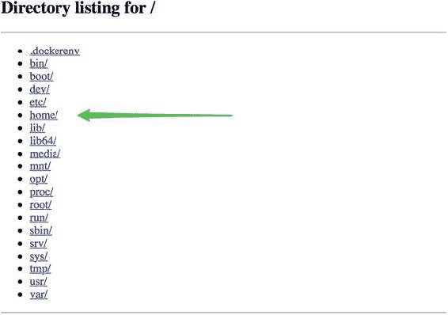

# 你好，Docker！

使用 Docker 运行代码，最基本的方式包括以下步骤：

1. 拉取预编译的镜像，或根据 Dockerfile 构建镜像。
2. 将镜像作为新容器运行。

如果你是首次安装 Docker，可以尝试一些简单的命令来验证 Docker 客户端是否正确安装并已添加到系统路径中。清单 2-12、2-13 和 2-14 展示了三种验证方法：`docker version`、`docker help` 或 `which docker` 都是很好的简单测试命令。

```
$ docker version
sudo docker version
Client:
  Version:      17.03.1-ce
  API version:  1.27
  Go version:   go1.7.5
  Git commit:   c6d412e
  Built:        Mon Mar 27 17:14:09 2017
  OS/Arch:      linux/amd64
Server:
  Version:      17.03.1-ce
  API version:  1.27 (minimum version 1.12)
  Go version:   go1.7.5
  Git commit:   c6d412e
  Built:        Mon Mar 27 17:14:09 2017
  OS/Arch:      linux/amd64
  Experimental: false
```

清单 2-12. 显示 Docker 版本

**注意：** 运行此命令会显示 Docker 客户端和服务器上运行的 Docker 版本信息。

```
$ docker help
Usage: docker COMMAND
A self-sufficient runtime for containers
...
```

清单 2-13. 显示 Docker 帮助信息

```
$ which docker
/usr/local/bin/docker
```

清单 2-14. 显示 Docker 二进制文件的位置

确认 Docker 客户端已正确安装后，就可以继续运行经典的 "Hello, World!" 示例，如清单 2-15 所示。

```
$ docker run hello-world
Unable to find image 'hello-world:latest' locally
latest: Pulling from library/hello-world
78445dd45222: Pull complete
Digest: sha256:c5515758d4c5e1e838e9cd307f6c6a0d620b5e07e6f927b07d05f6d12a1ac8d7
Status: Downloaded newer image for hello-world:latest
Hello from Docker!
```

清单 2-15. 运行 hello-world 镜像

这条消息表明你的安装似乎工作正常。为了生成这条消息，Docker 执行了以下步骤：

1. Docker 客户端联系了 Docker 守护进程。
2. Docker 守护进程从 Docker Hub 拉取了 `hello-world` 镜像。
3. Docker 守护进程基于该镜像创建了一个新容器，该容器运行了可执行文件，并产生了你当前正在阅读的输出。
4. Docker 守护进程将该输出流式传输到 Docker 客户端，然后由客户端发送到你的终端。

如果想尝试更复杂的操作，你可以使用 `$ docker run -it ubuntu bash` 命令运行一个 Ubuntu 容器。通过 [`cloud.docker.com/`](https://cloud.docker.com/) 上的免费 Docker ID，你可以共享镜像、自动化工作流以及实现更多功能。更多示例和想法，请访问 [`docs.docker.com/engine/userguide/`](https://docs.docker.com/engine/userguide/)。

至此，你已经验证了 Docker 已正确安装并能正常运行。当你执行此命令时，Docker 客户端会将 `run hello-world` 命令发送给 Docker 引擎。Docker 引擎随后执行以下操作：

1. 在本地镜像缓存中检查 `hello-world` 镜像。
2. 如果本地不存在该镜像，则从 Docker Hub 下载。
3. 使用该镜像创建一个新容器。
4. 分配文件系统，并在镜像顶层添加一个可读写层。
5. 为系统设置一个 IP 地址。
6. 执行镜像 Dockerfile 中指定的 shell 命令 `/hello`。
7. 该进程完成后，终止容器并关闭。

清单 2-16 展示了一个基本的 Docker 命令：运行最新的 Ubuntu 镜像（`run ubuntu`）并通过 bash shell（`-i -t /bin/bash`）连接到它。当你执行此命令时，Docker 客户端将命令发送给 Docker 引擎。Docker 引擎执行以下操作：

1. 在本地镜像缓存中检查 `ubuntu` 镜像。
2. 从 Docker Hub 下载镜像（除非本地已存在）。
3. 使用该镜像创建一个新容器。
4. 分配文件系统，并在镜像顶层添加一个可读写层。
5. 为系统设置一个 IP 地址。
6. 在容器内执行 `/bin/bash` 进程。
7. 通过你当前的终端连接到正在运行的 `/bin/bash` 进程。

```
$ docker run -it ubuntu  /bin/bash
root@eb5f4278d040:/#
```

清单 2-16. 运行基础 ubuntu 镜像并通过 Shell 连接到它

你将连接到正在运行的 Ubuntu 容器，直到你将其关闭。你可以与此进程进行交互（参见清单 2-17），就像它是通过 bash shell 连接的原生 Ubuntu 系统一样。

```
root@8b9461e1d7dd:/# ls
bin   dev  home  lib64  mnt  proc  run   srv  tmp  var
boot  etc  lib   media  opt  root  sbin  sys  usr
root@8b9461e1d7dd:/# ps
  PID TTY          TIME CMD
    1 ?        00:00:00 bash
   12 ?        00:00:00 ps
root@8b9461e1d7dd:/# ps aux
USER       PID %CPU %MEM    VSZ   RSS TTY      STAT START   TIME COMMAND
root         1  0.0  0.1  18240   3212 ?       S<s  04:00   0:00 /bin/bash
root        13  0.0  0.1  34424   2808 ?       R<+  04:01   0:00 ps aux
root@8b9461e1d7dd:/# exit
joshuacook@LOCALHOST:~$
```

清单 2-17. 与作为 Docker 容器运行的 Ubuntu 进行交互

在这里，你通过输入 `Ctrl+D` 结束了会话，就像通过 `ssh` 连接到远程系统一样。这样，控制权就返回到了你的本地系统，即运行 Docker 的主机。

注意观察你的 Ubuntu 镜像运行时的状态是很有用的。`ls` 显示一个完整的标准 Linux 文件系统并不奇怪。`ps` 只返回几个项目也不奇怪。但 `ps aux` 只返回两个项目则非常不寻常。`ps aux` 显示 (a) 所有用户的进程，(u) 显示进程所有者，(x) 包括未连接到任何终端的进程。换句话说，运行 `ps aux` 实际上显示了系统上当前运行的所有进程。再次强调，系统上仅运行着你连接的 shell（PID 1 `/bin/bash`）和你用来显示运行进程的 `ps aux`（PID 13 `ps aux`）是非常不寻常的。请仔细体会这一点。本质上，你的 Docker 容器只运行了一个进程。关于这一点，我们稍后会详细讨论。


### Docker 中的基本网络配置

在继续学习之前，你需要了解的最后一个入门知识是 Docker 中的网络配置。你将使用的许多容器都需要通过 TCP 或 HTTP 等网络协议从主机进行访问。幸运的是，Docker 为我们处理了网络问题。简单来说，你将通过发布端口来管理 Docker 的网络。发布端口时，你明确地将运行中容器的一个端口或端口范围绑定到主机。这是通过（小写 p）`-p` 标志完成的。此命令明确了主机与容器之间的连接。因此，它只能作为参数传递给 Docker 引擎。发布端口时使用的模式是 `-p host_port:container_port`。例如，假设我运行一个 Flask⁵ 应用，该应用定义在一个名为 `my_flask_app` 的容器中，端口为 5000，通过命令 `docker run -p 7777:5000 my_flask_app` 运行。在这种情况下，我将容器中的端口 5000 发布到主机上的端口 7777。换句话说，容器中端口 5000 上可用的任何内容，在主机上的端口 7777 上也将可用。对我这个本地最终用户来说，其效果是我可以在浏览器中通过 `http://localhost:7777`（如果使用 Docker Toolbox，则通过主机 IP 的端口 7777）访问我定义的 Flask 应用。Python 模块 `SimpleHTTPServer` 可用于为启动它的目录运行一个文件服务器。在代码清单 2-18 中，你使用单个命令通过 Docker 容器启动一个文件服务器。Docker 守护进程拉取 `python` 镜像，并使用它通过命令 `python -m SimpleHTTPServer` 运行 Python 模块。该服务器在容器内的默认端口 8000 上运行。你将其链接到主机上的端口 5000，并能够通过浏览器（图 2-5）在 `http://localhost:8000` 访问文件服务器。

  
图 2-5. 可通过浏览器访问的本地文件服务器

```
$ docker run -v ∼:/home -p 5000:8000 python:2.7 python -m SimpleHTTPServer
Unable to find image 'python:2.7' locally
2.7: Pulling from library/python
6d827a3ef358: Already exists
2726297beaf1: Pull complete
7d27bd3d7fec: Pull complete
44ae682c18a3: Pull complete
824bd01a76a3: Pull complete
69702776c399: Pull complete
7be4e7612dd4: Pull complete
Digest: sha256:bda277274d53484e4026f96379205760a424061933f91816a6d66784c5e8afdf
Status: Downloaded newer image for python:2.7
172.17.0.1 - - [16/Apr/2017 14:58:54] "GET / HTTP/1.1" 200 -
```

代码清单 2-18. 通过 Docker 容器启动文件服务器

**注意** 在不同系统上运行 Docker 存在细微差别。在大多数情况下，Docker Toolbox 用户将能够通过 `http://192.168.99.100:5000` 访问简单的文件服务器。Linux/Mac/Windows 的 Docker 用户应使用 `http://localhost:5000`。

## 总结

在本章中，我正式介绍了 Docker 及其生态系统。我定义了容器化及其对我们工作的用处。我提供了在几个流行操作系统上安装 Docker 的说明。最后，你运行了 Docker 的 `hello-world` 镜像和 Docker 的 `python` 镜像，并使用后者运行了一个简单的 Web 服务器。完成本章后，我希望你理解了 Docker 到底是什么，并对其存在的原因有了一些了解。我希望你了解 Docker 生态系统的各个组件。读者应该能够通过 Docker 客户端运行基本命令，例如 `docker help`、`docker ps` 和 `docker run`。在下一章中，我将正式介绍 Jupyter。与本书中的一切一样，我将使用 Docker 来进行介绍。在后续章节中，你将更深入地探索 Docker 生态系统的各个组件，例如 Docker 引擎（或守护进程）、Dockerfile 和 Docker Hub。

脚注  
1 [`blog.docker.com/2016/03/containers-are-not-vms/`](https://blog.docker.com/2016/03/containers-are-not-vms/)  
2 此命令是 bash 命令 `ps` 的后代。在 bash 中，此命令列出正在运行的进程，而在 Docker 中，此命令列出正在运行的容器。这符合我们对 Docker 容器作为虚拟化进程的理解。  
3 [`hub.docker.com`](https://hub.docker.com)  
4 [`github.com/docker/HyperKit/`](https://github.com/docker/HyperKit/)  
5 [`flask.pocoo.org`](http://flask.pocoo.org)  
© Joshua Cook 2017  
Joshua Cook, *Docker for Data Science*  
`doi.org/10.1007/978-1-4842-3012-1_3`

