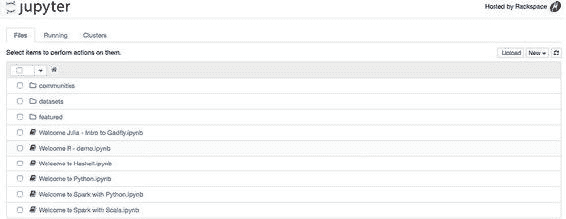
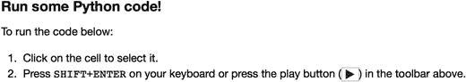
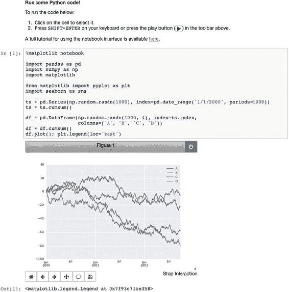
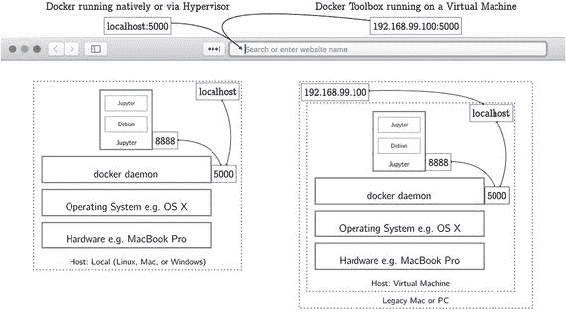
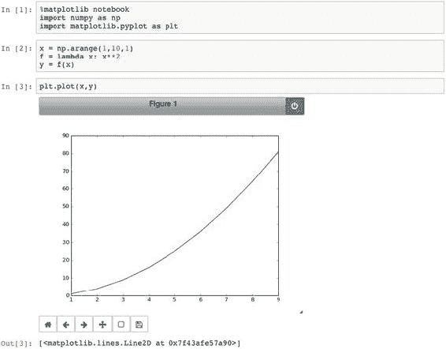
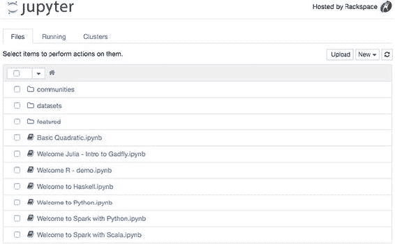

# 3. 交互式编程

Joshua Cook¹  
(1) 美国加利福尼亚州圣莫尼卡

> 交互式计算是人与机器之间的对话。 —Beki Grinter¹

Jupyter 是一个基于 Web 的交互式应用程序。Jupyter 是一个演示环境。Jupyter 是编程领域的一种新范式。Jupyter 是一种保存复杂终端会话的方式。所有这一切都表明 Jupyter 具有多重身份，并且，在笔者看来，它是近年来计算领域最令人兴奋的创新之一。Jupyter 正在从根本上改变我们编写代码的方式。可以肯定的是，Jupyter 不会取代 `vim`、Sublime Text 或 PyCharm。Jupyter 取代的是 `if __name__ == "__main__":`。

## Jupyter 作为持久化交互式计算

我们可以将 Jupyter 视为我们与技术互动方式大趋势的一部分。我们每天都积极地与计算机互动。我们向搜索引擎或在线地图工具提交查询，并期望立即得到响应。我们更改电子表格程序中单元格和列的数据，并期望关联的单元格和列立即更新。我们在智能家居中通过语音界面要求调暗灯光或播放最新的流行歌曲，并期望立即得到结果。这就是我们对计算机的期望，在这种期望中，我们很容易忽略一个事实：这与经典计算机科学有着根本的不同。

### 如何不进行交互式编程

为了说明这种差异，有必要看一下 C 编程语言。C 是 Fortran 的后代，也是 Python 的祖先，这三种语言至今仍在日常实际使用中。许多计算工程师使用 Python 及其计算库 `numpy` 和 `scipy` 进行工作，却愉快地没有意识到他们的核心语言实际上是 C 的高级封装，而他们的数值库实际上是 Fortran 库 BLAS 和 LAPACK 的高级封装。更不用说他们完全不了解使用 C 和 BLAS 的开发工作流程是什么样子。直到最近 `numpy` 的出现，计算工程师才被迫使用一种截然不同的工作流程。C 是一种编译型语言。一个可运行的程序，即使是执行简单数学计算的程序，也需要相当多的步骤才能使其运行起来。必须编写源代码文件。这些源代码通常包含对系统中其他位置的头文件的引用。代码必须编译成包含对这些头文件引用的二进制文件，并链接到二进制文件使用的任何底层编译库。最后，执行二进制文件，返回计算结果。我们将简要演示此过程如何在一个使用 [GNU 科学库](https://www.gnu.org/software/gsl/) (GSL) 的简单计算上工作。GSL 是一个用 C 编写的软件库，用于计算数学。GSL 位于较低级别的 [BLAS](http://www.netlib.org/blas/) 实现之上，为简化开发过程提供了一个抽象层。


### 搭建最小化计算项目

由于你需要管理多种类型的文件，因此建立一个结构清晰的项目目录是明智之举。首先，你需要定义一个用于存放工作的文件夹 `ch_3_minimal_comp`，并在其中创建三个子目录：`bin`（存放编译后的二进制文件）、`docker`（存放 `Dockerfile`）和 `src`（存放源代码）。完成后，在类 Unix 系统上，你可以使用 `tree` 命令来显示项目层级结构。如果你的系统尚未安装 `tree`，可以根据系统类型，通过 `brew`、`apt`、`yum` 或其他包管理器进行安装（参见代码清单 3-1）。

```
$ # 请将 apt 替换为 brew、yum 或适合你系统的包管理器
$ apt install tree
```

代码清单 3-1. 安装 Tree

接下来，在代码清单 3-2 中，你将创建启动项目所需的目录。随后，在代码清单 3-3 中，你将使用 `tree` 工具来显示已创建的项目仓库。

```
$ mkdir ch_3_minimal_comp ch_3_minimal_comp/bin ch_3_minimal_comp/src ch_3_minimal_comp/docker
```

代码清单 3-2. 创建项目目录

```
$ tree .
└── ch_3_minimal_comp
    ├── bin
    ├── docker
    └── src
```

代码清单 3-3. 显示最小化计算项目的当前状态

### 编写用于计算贝塞尔函数的源代码

接下来，你需要在 `src` 目录中创建一个名为 `bessel.c` 的新文件，用于存放源代码（参见代码清单 3-4）。请注意，该文件包含两条 `include` 语句，引用了包含扩展功能的外部代码文件：`stdio.h` 和 `gsl/gsl_sf_bessel.h`。你需要通过 `include` 语句和链接语句，明确告知编译器如何处理这些文件。

```
// src/bessel.c
#include <stdio.h>
#include <gsl/gsl_sf_bessel.h>

int main(void) {
  double x = 5.0;
  double y = gsl_sf_bessel_J0(x);
  printf("J0(%g) = %.18e\n", x, y);
  return 0;
}
```

代码清单 3-4. 计算 x=5 时第一类零阶贝塞尔函数的值

### 使用 Docker 执行计算

完成此计算需要两个独立的步骤：首先将源代码编译成二进制文件，然后执行该二进制文件。与之前一样，你将让 Docker 来管理这些流程。为此，你需要使用代码清单 3-5 中 `Dockerfile` 所定义的 Docker 镜像。

**注意** 此镜像是在 Docker Hub 上 [`hub.docker.com/_/gcc/`](https://hub.docker.com/_/gcc/) 提供的 `gcc` 镜像基础上构建的。

```
FROM gcc
LABEL maintainer=@joshuacook
RUN apt-get update && \
      apt-get install -y \
      gsl-bin \
      libgsl0-dbg \
      libgsl0-dev \
      libgsl0ldbl
```

代码清单 3-5. GSL Dockerfile

将此文件保存为 `docker` 目录下的 `Dockerfile`。之后，你再次使用 `tree` 命令来显示项目的当前状态（代码清单 3-6）。

```
$ cd ch_3_minimal_comp
$ tree .
├── bin
├── docker
│   └── Dockerfile
└── src
    └── bessel.c
```

代码清单 3-6. 显示最小化计算项目的当前状态

接下来，使用 `docker build` 命令构建镜像。在 shell 中，你当前应位于 `ch_3_minimal_comp` 目录下。这一点至关重要，因为 `docker build` 命令将相对引用一个包含你想要构建的镜像定义的 `Dockerfile`。这里，你通过 `-t` 标志为镜像指定了一个名称 `gsl`。你指定构建过程应在相对引用的 `docker` 目录中查找 `Dockerfile`。代码清单 3-7 显示了完整的执行命令。

```
$ docker build -t gsl docker
Sending build context to Docker daemon 2.048 kB
Step 1/3 : FROM gcc
latest: Pulling from library/gcc
693502eb7dfb: Already exists
...
Status: Downloaded newer image for gcc:latest
 ---> 408d218617ca
Step 2/3 : MAINTAINER @joshuacook
 ---> Running in 43a89bcd4fae
 ---> 97faa5ea6f1e
Removing intermediate container 43a89bcd4fae
Step 3/3 : RUN apt-get update &&      apt-get install -y      gsl-bin      libgsl0-dbg      libgsl0-dev      libgsl0ldbl
 ---> Running in 988614cb6d56
...
 ---> 568814736d4b
Removing intermediate container 988614cb6d56
Successfully built 568814736d4b
```

代码清单 3-7. 构建 `gsl` Docker 镜像

构建完成后，此镜像将可供全局使用。你可以通过 `docker images` 命令进行验证（参见代码清单 3-8）。

```
$ docker images
REPOSITORY      TAG         IMAGE ID          CREATED           SIZE
gsl             latest      b3f3b5f49e4a      24 hours ago      1.52 GB
...
```

代码清单 3-8. 显示本地 Docker 镜像

### 编译源代码

接下来，编译你的源代码。编译时，你将使用代码清单 3-9 中概述的 `docker run` 命令。

```
$ docker run \
  -v 'pwd':/home \
  gsl \
  gcc \
  -I /usr/include/ \
  -L /usr/lib/ -lgsl -lgslcblas \
  /home/src/bessel.c \
  -o /home/bin/bessel
```

代码清单 3-9. 编译贝塞尔函数二进制文件

此命令指示 Docker 引擎执行以下操作：

*   运行一个容器。
*   将当前工作目录（`'pwd'`）挂载到容器内的 `/home` 位置。
*   使用 `gsl` 镜像作为基础。

**注意** 你通过两个反引号使用了 bash 的内联执行功能。执行 `pwd` 会打印出你的工作目录（你当前所在的位置）。在反引号中运行此命令会将你的工作目录替换到相应位置。因此，`-v 'pwd':/home` 将你的工作目录挂载到 Docker 容器中的 `/home` 目录。使用 PowerShell 与 Docker 引擎交互的用户（即 Docker for Windows 用户）需要使用替代语法 `${pwd}`（例如 `-v ${pwd}:/home`）。对文件位置的引用是相对于它们在容器中的挂载点而言的。

该容器将执行以下操作：

*   运行一个进程：Gnu C 编译器 `gcc`。
*   包含对 `gsl` 头文件位置的引用（`-I /usr/include/`）。
*   链接 `gsl` 库（`-L /usr/lib/ -lgsl -lgslcblas`）。
*   使用 `/home/src/bessel.c` 作为源代码。
*   输出（`-o`）一个二进制文件到 `/home/bin/Bessel`。

该过程应该会很快完成。当 Docker 引擎将你的目录作为卷挂载时，会创建一个双向连接。因此，编译后的二进制文件现在已存在于你宿主机的文件系统中。在代码清单 3-10 中，你再次使用 `tree` 工具显示项目的状态。

```
$ tree .
├── bin
│   └── bessel
├── docker
│   └── Dockerfile
└── src
    └── bessel.c
```

代码清单 3-10. 显示最小化计算项目的当前状态


### 执行编译后的二进制文件

最后，你执行编译后的二进制文件来获取计算结果。你仍需请求 Docker 引擎为你管理此过程，原因无他，只因该二进制文件是为在 `gsl` 容器上运行而编译的。这一点值得强调。你完全可以在任何操作系统和硬件配置上完成这些练习。你使用 Docker 是为了将你的工作与特定配置解耦。然而，这意味着你的二进制文件并非为在你的本地硬件/软件配置上运行而编译，而是为在由 `gsl` Docker 镜像定义的 `gsl` Docker 容器上运行而编译的。在此例中，它是为在 `debian:jesse` 上运行而编译的。在代码清单 3-11 中，你使用 Docker 执行编译后的二进制文件。

```
$ docker run -v 'pwd':/home gsl_image /home/bin/bessel
J0(5) = -1.775967713143382642e-01
```

*代码清单 3-11. 执行贝塞尔函数二进制文件*

但如果你想知道 `x=6` 或 `x=7` 处的值呢？在这种情况下，你需要再次经历整个过程：编辑代码、编译代码、执行代码。虽然使用 GSL 编写代码运行有显著优势，但开发周期中的快速迭代并非其中之一，而且交互也是不可能的。整个过程演示了如何不进行交互式编程。

## 如何进行交互式编程

快进 30 年。放下那个编译器！得益于 Travis Oliphant 和 Fernando Perez 等先驱在 `numpy` 和 `iPython` 上的工作，我们可以用本该如此的方式执行这个简单的计算：轻松搞定。`numpy`（我对长辈说“num”-“pie”，对同辈说“num”-“pee”）是 Numerical Python 的缩写，它为我们提供了一个高级封装，底层是 BLAS 的低级实现。`IPython` 是 Interactive Python 的缩写，它是一个高度进化的 Python REPL（读取-求值-打印循环），配备了一套用于与所有 Python 库交互的工具。

> **注意**  
> 读者应注意不要混淆 `IPython`（命令行 REPL）和 `IPython Notebook`（已演变为 `Jupyter` 的旧版笔记本服务器）。

### 使用 Docker 启动 IPython

让我们来执行这个简单的计算。在代码清单 3-12 中，你使用 `jupyter/scipy-notebook` Docker 镜像激活 `ipython`。

```
$ docker run -it jupyter/scipy-notebook ipython
Python 3.5.2 |Continuum Analytics, Inc.| (default, Jul  2 2016, 17:53:06) 
Type "copyright", "credits" or "license" for more information.

IPython 5.1.0 -- An enhanced Interactive Python.
?         -> Introduction and overview of IPython's features.
%quickref -> Quick reference.
help      -> Python's own help system.
object?   -> Details about 'object', use 'object??' for extra details.
```

*代码清单 3-12. 使用 `jupyter/scipy-notebook` 镜像启动 `ipython`*

在代码清单 3-13 中，你执行了与之前相同的计算，但过程不那么复杂。你首先导入在 `numpy` 中计算贝塞尔函数所需的库，就像之前在 `bessel.c` 文件中导入头文件 `stdio.h` 和 `gsl/gsl_sf_bessel.h` 一样。这里，你从 `scipy` 库中导入 `special` 模块。`special` 模块包含一个名为 `jv` 的函数，用于计算“第一类实数阶复数宗量的贝塞尔函数”。你传入参数 `(0,5)`，表示希望在 `5` 处计算零阶函数。

```
In [1]: import scipy.special as spc
In [2]: spc.jv(0, 5)
Out[2]: -0.17759677131433838
```

*代码清单 3-13. 在 `x=5` 处计算第一类零阶贝塞尔函数*

在交互式 REPL（即你的 IPython 环境）中执行这些计算，再运行两次函数是轻而易举的事。这就是交互式编程！在代码清单 3-14 中，你使用参数 `(0,6)` 和 `(0,7)` 运行函数。

```
In [3]: spc.jv(0, 6)
Out[3]: 0.15064525725099703
In [4]: spc.jv(0, 7)
Out[4]: 0.30007927051955563
```

*代码清单 3-14. 在 `x=6` 和 `x=7` 处计算第一类零阶贝塞尔函数*

完成所有计划的计算后，你按两次 `Ctrl+D` 退出。这样做会终止 `ipython` 进程（由你的 Docker 守护进程管理），容器也随之关闭。

### 持久化

至此，你的进程已终止，容器也已关闭。就你的意图而言，你的工作将永久丢失。交互式编程确实强大，但如果我们每次离开再回来都必须重复所有操作，那就不那么有用了。我们可以编写一个简短的 Python 模块来执行这些计算，然后使用 Python（通过 Docker）执行该模块。在代码清单 3-15 中，你编写了一个名为 `bessel.py` 的简短文件，执行你刚才交互式完成的三个相同计算。

```
import scipy.special as spc
print(spc.jv(0, 5))
print(spc.jv(0, 6))
print(spc.jv(0, 7))
```

*代码清单 3-15. 三个贝塞尔函数计算*

在代码清单 3-16 中，你再次使用 `tree` 工具显示项目的状态。

```
$ tree .
.
├── bin
│   └── bessel
├── docker
│   └── Dockerfile
└── src
    ├── bessel.c
    └── bessel.py
```

*代码清单 3-16. 显示你的最小计算项目的当前状态*

在代码清单 3-17 中，你执行文件 `bessel.py`。

> **注意**  
> 为了运行此文件，你必须将包含你文件的目录挂载为卷，挂载到 `jupyter/scipy-notebook` 将查找文件的位置，本例中为 `/home/jovyan`。

```
$ docker run -v 'pwd'/src:/home/jovyan/work jupyter/scipy-notebook python bessel.py
-0.177596771314
0.150645257251
0.30007927052
```

*代码清单 3-17. 使用 Docker 执行 `bessel.py`*

但现在你又回到了非交互式编程的状态。

### Jupyter Notebooks

`Jupyter Notebooks` 是 `IPython` 的演进版本。`Jupyter` 允许用户将实时代码、Markdown 和 LaTeX 富文本、图像、图表等组合在单个文档中。作为 `IPython notebook` 的继承者，`Jupyter` 在平台开始支持其他软件内核时进行了更名。由于最初支持 Julia、Python 和 R，它被更名为 `JuPyteR`，尽管现在该平台还支持 Scala、Haskell、Ruby 等多种语言。所有支持的内核列表可在 [`github.com/jupyter/jupyter/wiki/Jupyter-kernels`](https://github.com/jupyter/jupyter/wiki/Jupyter-kernels) 找到。此后，你将使用 `Jupyter` 作为交互式编程的主要界面。

#### 预设型 Docker 栈

`Jupyter` 提供了适用于各种场景的[预设型栈](https://hub.docker.com/r/jupyter)：[All Spark 栈](https://hub.docker.com/r/jupyter/all-spark-notebook/)、[最小栈](https://hub.docker.com/r/jupyter/minimal-notebook/)等。我们已经在使用 [scipy 栈](https://hub.docker.com/r/jupyter/scipy-notebook/)。让我们看看[演示栈](https://hub.docker.com/r/jupyter/demo/)。访问 [`try.jupyter.org`](https://try.jupyter.org) 即可立即试用演示栈，它是一个功能完备的 `jupyter` 系统，预装了多个内核（Bash、Haskell、Julia、Python 2 和 3、R、Ruby 以及 Scala）。


### Jupyter Notebook 服务器的安全性

Jupyter 团队维护的 Jupyter Docker 镜像所定义的一项核心最佳实践，是在容器运行时生成安全令牌。作为运行过程的一部分，新的 Jupyter 容器会生成一个令牌并将其写入日志，该令牌必须作为查询参数传递或输入到密码字段中，才能与系统进行交互。这仅在浏览器中首次加载 Jupyter 时是必需的。其重要意义在于，如果我们希望在开放网络上托管 Jupyter Notebook 服务器（如第 1 章所述），它可以免受入侵者的攻击。清单 3-18 通过在端口 8888 上的新容器中运行 `jupyter/scipy-notebook` 镜像来演示这一点。

```
$ docker run -p 8888:8888 jupyter/scipy-notebook
...
[I 18:53:31.565 NotebookApp] The Jupyter Notebook is running at:
http://[all ip addresses on your system]:8888/?token=44dab68c1bc7b1662041853573f37cfa03f13d029d397816
[I 18:53:31.565 NotebookApp] Use Control-C to stop this server and shut down all kernels (twice to skip confirmation).
[C 18:53:31.566 NotebookApp] 
    Copy/paste this URL into your browser when you connect for the first time,
    to login with a token:
    http://localhost:8888/?token=44dab68c1bc7b1662041853573f37cfa03f13d029d397816
```

*清单 3-18. 运行 `jupyter/scipy-notebook` 镜像*

日志显示了令牌并生成了一个 URL，可以复制并粘贴到浏览器中。您可以通过访问 `localhost`（清单 3-19）或运行 `docker-machine` 时识别出的 IP 后跟端口 8888（清单 3-20）来访问 Jupyter Notebook 服务器。

```
http://localhost:8888/?token=44dab68c1bc7b1662041853573f37cfa03f13d029d397816
```

*清单 3-19. 使用提供的令牌在 `localhost` 端口 8888 访问 Jupyter*

```
http://192.168.99.100:8888/?token=44dab68c1bc7b1662041853573f37cfa03f13d029d397816
```

*清单 3-20. 使用提供的令牌在 IP 的端口 8888 访问 Jupyter*

> **注意**  
> 日志中生成的 URL 始终将基本 URL 列为 `http://localhost:8888`，即使服务器在不同的 IP 上并使用不同的端口运行。您必须修改 URL 以反映正确的 IP 和端口，才能访问您的系统。

### Jupyter 演示栈

让我们在您的本地环境中启动 Jupyter 演示栈。如果您正在运行 Docker for Linux、Docker for Mac 或 Docker for Windows，您可以通过在浏览器中访问 `http://localhost` 的相应端口来访问任何暴露的 Docker 容器。如果您一直在虚拟机上运行 Docker 守护进程（例如，如果您在 Mac 或 Windows 上运行 Docker Toolbox），则需要获取虚拟主机的 IP 并改为访问您的机器。通常，您的 Docker 虚拟机将被命名为 `default`。您可以使用 `docker-machine ip` 命令找到此 IP（参见清单 3-21）。再次重申，使用 Docker for Linux、Docker for Mac 或 Docker for Windows 时无需执行此操作。表 3-1 总结了您将如何访问您的系统。

*表 3-1. 访问您的 Docker 系统*

| 操作系统 | Docker 系统 | Shell | 访问 Jupyter 的地址 |
| --- | --- | --- | --- |
| Linux | Docker for Linux | Bash | `localhost:8888` |
| MacOS >= 10.10.3 (Yosemite) | Docker for Mac | Bash | `localhost:8888` |
| MacOS >= 10.8 (Mountain Lion) | Docker Toolbox for Mac | Docker Quickstart Terminal | `#DOCKERIP:8888` |
| Windows 10 专业版、企业版或教育版 | Docker for Windows | Windows PowerShell | `localhost:8888` |
| Windows 7、8、8.1 或 10 家庭版 | Docker Toolbox for Windows | Docker Quickstart Terminal | `#DOCKERIP:8888` |

```
$ docker-machine ip default
192.168.99.100
```

*清单 3-21. 获取您主机的 IP*

这表明 Docker 主机虚拟机可在 `192.168.99.100` 访问。您的机器可能在不同的 IP 地址上可用。

> **注意**  
> 此命令仅需由使用 Docker Toolbox 的主机系统运行。运行 Docker for Linux、Docker for Mac 或 Docker for Windows 的系统将能够使用 `localhost` 在浏览器中访问其 Jupyter Notebook 服务器。

### 启动 `jupyter/demo` 镜像

要启动一个镜像，您首先需要从 Docker Hub 拉取它（参见清单 3-22）。您本可以通过 `run` 命令隐式完成此操作，但显式运行它可以让您更深入地了解正在执行的操作。

```
$ docker pull jupyter/demo
Using default tag: latest
latest: Pulling from jupyter/demo
...
Digest: sha256:d3dd87e52ca1edbfc8b65ad68bfa91f15eb0660d218c64fd5cdb039c1fa10818
Status: Downloaded newer image for jupyter/demo:latest
```

*清单 3-22. 从 Docker Hub 拉取 Jupyter Demo*

拉取镜像后，您使用 `docker run` 命令运行该镜像（参见清单 3-23）。

```
$ docker run -p 8888:8888 jupyter/demo
[I 02:54:37.454 NotebookApp] Writing notebook server cookie secret to /home/jovyan/.local/share/jupyter/runtime/notebook_cookie_secret
[W 02:54:37.537 NotebookApp] WARNING: The notebook server is listening on all IP addresses and not using encryption. This is not recommended.
[I 02:54:37.580 NotebookApp] Serving notebooks from local directory: /home/jovyan/work
[I 02:54:37.580 NotebookApp] 0 active kernels
[I 02:54:37.580 NotebookApp] The Jupyter Notebook is running at:
http://[all ip addresses on your system]:8888/
[I 02:54:37.580 NotebookApp] Use Control-C to stop this server and shut down all kernels (twice to skip confirmation).
```

*清单 3-23. 运行 Jupyter Demo*

清单 3-23 中的绝大部分输出是由 Jupyter 应用程序生成并写入标准日志记录器的。由于您正在前台模式下运行容器，因此输出会写入您的终端。您可能还记得之前您将工作目录挂载到了目录 `/home/jovyan`。您可以在输出中看到，Jupyter 正是从这个目录提供文件服务的：

```
[I 02:54:37.580 NotebookApp] Serving notebooks from local directory: /home/jovyan/work
```

> **注意**  
> 一些旧版 Jupyter 镜像从本地目录 `/home/jovyan/work` 提供 notebook 服务。较新的 Jupyter 镜像从本地目录 `/home/jovyan` 提供 notebook 服务。这将在将本地目录挂载到 Jupyter 容器内的目录方面对您的工作产生一些影响。如果您始终使用 `-v 'pwd':/home/jovyan`，那么在访问文件或文件持久性方面应该没有问题。值得强调的是，此上下文中的本地目录指的是正在运行的 Docker 容器内的本地目录。


### Jupyter 文件系统

在浏览器中访问该应用时，首先看到的是 Jupyter 主文件系统（图 3-1）。  
  
图 3-1. Jupyter 文件系统

你可以通过点击文件系统中的任意文件来启动一个 Jupyter 文件，也可以通过右上角的“New”菜单新建一个文件。点击“Welcome to Python”文件将其打开。在收到关于在 Rackspace 免费托管上使用该文件的简短警告后（你可以忽略此警告，因为你是自行托管），你会在第一个 Markdown 单元格中看到在 Jupyter 文件中执行代码的最简说明（代码清单 3-24，图 3-2）。  
  
图 3-2. 最简说明

要运行以下代码：  
点击单元格将其选中。  
按下键盘上的 `SHIFT+ENTER` 键……

代码清单 3-24. 运行一些 Python 代码

下一个单元格包含一段 Python 代码（代码清单 3-25），你可以按照指示按 `Shift+Enter` 来执行它。该代码会生成一个随机数据的时间序列图（图 3-3）。图 3-4 展示了 Jupyter Notebook 中的完整代码和结果。  
  
图 3-3. 随机时间序列数据  
  
图 3-4. 尝试 Jupyter Python 演示

```
In [1]: %matplotlib notebook
    import pandas as pd
    import numpy as np
    import matplotlib
    from matplotlib import pyplot as plt
    import seaborn as sns
    ts = pd.Series(np.random.randn(1000), index=pd.date_range('1/1/2000', periods=1000))
    ts = ts.cumsum()
    df = pd.DataFrame(np.random.randn(1000, 4), index=ts.index,
    columns=['A', 'B', 'C', 'D'])
    df = df.cumsum()
    df.plot(); plt.legend(loc='best')
Out[1]: <matplotlib.legend.Legend at 0x7f73cc716b38>
```

代码清单 3-25. Python 入门

通过选择 **File ➤ Close and Halt** 来关闭 Jupyter 文件。这将终止内核（一个连接到浏览器内 Notebook 的 IPython 进程），并关闭浏览器窗口。你可以按两次 `Ctrl+C` 来关闭 Jupyter 应用。这将终止由 Docker 管理的 `jupyter notebook` 进程，从而关闭容器。

```
^C[I 03:10:32.463 NotebookApp] Interrupted...
[I 03:10:32.464 NotebookApp] Shutting down kernels
```

### 端口连接

让我们简要了解一下端口。你还可以通过 `-d` 标志以分离模式启动容器（代码清单 3-26）。

```
$ docker run -d -p 5000:8888 jupyter/demo
2040f677ad7ffa4666d0d9826e00175a15315ae2b2422314924f6022d6b65622
```

代码清单 3-26. 以分离模式运行 `jupyter/demo` 镜像

在代码清单 3-15 中，你以分离模式运行了 `jupyter/demo` 镜像，将端口 `8888` 暴露给端口 `5000`。你可以通过访问 `localhost:5000` 或 `192.168.99.100:5000` 来访问该机器。由于你以分离模式运行容器，该命令会返回容器的 `<container_id>`。由于容器运行在分离模式下，Jupyter 日志记录器的输出不会写入你的终端。你可以通过 `logs` 命令访问输出。为了获取随机生成的访问令牌，你需要这样做。

在代码清单 3-27 中，你使用 `docker ps` 命令获取容器的名称，以便访问其日志。

```
$ docker ps
CONTAINER ID  IMAGE         COMMAND      PORTS                   NAMES
2040f677ad7f  jupyter/demo  "tini ..."   0.0.0.0:5000->8888/tcp furious_archimedes
```

代码清单 3-27. 显示当前正在运行的容器

请注意，除了为容器分配 `<container_id>` 外，Docker 守护进程还分配了一个名称 `furious_archimedes`。名称是随机分配的，通常是一个形容词加上一位著名科学家的姓氏。你可以使用此名称来访问为容器生成的日志（代码清单 3-28）。你需要访问日志以获取访问令牌。

```
$ docker logs furious_archimedes
[I 15:38:05.402 NotebookApp] Writing notebook server cookie secret to /home/jovyan/.local/share/jupyter/runtime/notebook_cookie_secret
[W 15:38:05.455 NotebookApp] WARNING: The notebook server is listening on all IP addresses and not using encryption. This is not recommended.
[I 15:38:05.471 NotebookApp] Serving notebooks from local directory: /home/jovyan/work
[I 15:38:05.471 NotebookApp] 0 active kernels
[I 15:38:05.471 NotebookApp] The Jupyter Notebook is running at: http://[all ip addresses on your system]:8888/?token=a7ae5855be48acdb99d12f06f03354cc0bede5a941f10d22
[I 15:38:05.472 NotebookApp] Use Control-C to stop this server and shut down all kernels (twice to skip confirmation).
[C 15:38:05.472 NotebookApp] 
    Copy/paste this URL into your browser when you connect for the first time, to login with a token:
    http://localhost:8888/?token=a7ae5855be48acdb99d12f06f03354cc0bede5a941f10d22
...
```

代码清单 3-28. 显示以分离模式运行的容器的日志

#### 端口映射

你可以使用 `docker port` 命令查看容器的端口映射（代码清单 3-29）。这表明容器上的端口 `8888` 通过 TCP 协议映射到主机（`0.0.0.0`）上的端口 `5000`。如果你在虚拟机上运行 Docker（即使用 Docker Toolbox），那么相对于容器而言，对此端口的访问将在 `localhost` 上。也就是说，它将在你的系统上拥有一个 IP。你之前通过 `docker-machine ip default` 确定了这个 IP，其中 `default` 是你分配给虚拟机的名称。从 Docker 守护进程的角度来看，你通过 `localhost:5000` 访问容器的 `8888` 端口，但如果你运行的是虚拟机，则通过 `192.168.99.100:5000` 访问它（图 3-5）。  
  
图 3-5. 通过 localhost 访问 Jupyter

```
$ docker port furious_archimedes
8888/tcp -> 0.0.0.0:5000
```

代码清单 3-29. 检查运行中容器的端口


### Docker 中的数据持久化

我们来探讨 Docker 中的持久化问题。为此，你将在 Jupyter 中快速完成一个练习。内容相当基础，仅用于演示持久化。在浏览器中访问 Jupyter 应用。进入后，创建一个新的 Python 文件，并在该文件上运行一个基本计算。清单 3-30 是一段简单的代码片段，用于生成基本二次曲线的图表（图 3-6）。图 3-7 展示了 Jupyter Notebook 中的完整代码和结果。

  
图 3-6. 一条基本的二次曲线

  
图 3-7. 在 Notebook 中生成一条基本的二次曲线

```
In [1]: %matplotlib notebook
        import numpy as np
        import matplotlib.pyplot as plt

In [2]: x = np.arange(1,10,1)
        f = lambda x: x**2
        y = f(x)

In [3]: plt.plot(x,y)
Out[3]: <matplotlib.lines.Line2D at 0x7f73cc269978>
```

清单 3-30. 绘制一条基本二次曲线

将文件重命名为 `Basic Quadratic`，保存更改，然后从文件菜单中选择“关闭并停止”。返回 Jupyter 文件系统，你应该能看到刚刚创建的文件（图 3-8）。

  
图 3-8. Jupyter 文件系统中的文件

接下来，关闭正在运行的实例，并使用 `docker stop` 和 `docker ps` 确认它已不再运行（清单 3-31）。

```
$ docker stop furious_archimedes
furious_archimedes
$ docker ps
CONTAINER ID     IMAGE     COMMAND     CREATED     STATUS     PORTS     NAMES
```

清单 3-31. 关闭正在运行的容器

现在，在清单 3-32 中，你启动一个新的 Jupyter 镜像。你需要再次获取令牌。这里，你使用返回的容器 ID 而非容器名称来查看日志。

```
$ docker run -d -p 5000:8888 jupyter/demo
5999d158488d410ac5fbf3a646e4a962d307e968d3cd2f53e60e0a0c7bbe262c
$ docker logs 5999d158488d410ac5fbf3a646e4a962d307e968d3cd2f53e60e0a0c7bbe262c
```

清单 3-32. 以分离模式运行 `jupyter/demo` 镜像

在浏览器中访问 Jupyter 应用。你刚刚创建的文件不见了。数据没有在实例之间持久化。这是一个问题。

### 挂载卷

这个问题可以通过一个运行参数来解决。你可以使用标志 `-v` 通过运行参数挂载一个卷。请注意，如果你在虚拟机、Mac 或 Windows 上运行 Docker，你只能从 `/Users`（OS X）或 `C:\Users`（Windows）挂载卷，并且可能需要明确地将卷提供给 Docker 守护进程。你向 `-v` 标志传递一个由 `<local_dir>:<container_id>` 组成的参数。Jupyter Demo 栈从 `/home/jovyan` 提供文件服务。你将把 `~/src` 中的文件提供到 `/home/jovyan/src`。请注意，你必须使用绝对路径（例如 `/Users/joshuacook/src`）。在清单 3-33 中，你以分离模式运行并挂载一个卷。

```
$ docker run \
  -v /Users/joshuacook/src:/home/jovyan/src \
    -d -p 5000:8888 \
    jupyter/demo
273ff71c6755670e21accd197461dd4256fbeb129393d137733f36bcb5432a55
```

清单 3-33. 运行镜像并挂载卷

重复上述实验，创建一个名为 `Basic Quadratic` 的新文件。你应该会注意到三件事。

*   `~/src` 中的所有文件应立即可供你的 Jupyter 应用使用。
*   任何写入容器化 Jupyter 应用 `src` 目录的文件都应写入你机器上的 `~/src` 目录。
*   因此，这些文件应在每次启动之间持久化。

这里值得重申：如果你希望持久化通过 Docker 运行 Jupyter 时所做的工作，最佳实践是在运行时使用 `-v` 标志将本地目录挂载到你的容器中。

## 总结

在本章中，你做了不少事情。你在一定程度上探索了使用 Docker 进行非交互式和交互式编程的本质。你探索了在系统上运行各种 Jupyter Docker 镜像以进行交互式编程。你详细了解了 Jupyter 团队定义的 Notebook 安全最佳实践，以及如何在浏览器中访问你的 Jupyter Notebook 服务器。最后，你简要探讨了在使用 Docker 运行 Jupyter 时，端口映射和文件持久化如何影响你的工作。我希望，在学完本章后，你能熟练使用 Docker 在系统上运行 Jupyter，尤其是在以下方面：

1.  识别你的安全令牌
2.  识别你的 IP 和端口
3.  在容器生命周期之外持久化你的工作

你将在第 7 章再次探讨 Jupyter，届时你将深入探索 Jupyter 团队为通过 Docker 运行和扩展 Jupyter 而编写的公开可用的 Docker 镜像。

脚注  
1 [`beki70.wordpress.com/2011/01/27/what-is-interactive-computing/`](https://beki70.wordpress.com/2011/01/27/what-is-interactive-computing/)

© Joshua Cook 2017  
Joshua Cook  
《数据科学的 Docker》  
`doi.org/10.1007/978-1-4842-3012-1_4`

