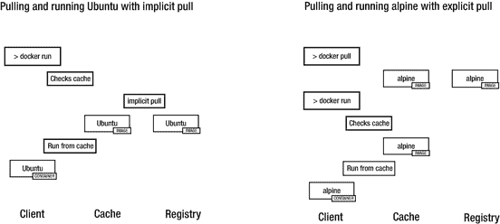

# 4. Docker 引擎

Joshua Cook^(1 )  
(1) 美国加利福尼亚州圣莫尼卡

Docker 引擎是你开展工作的核心技术。就你的目的而言，你可以将 Docker 引擎视为 Docker 守护进程和你用来向守护进程发出指令的 Docker 客户端。Docker 整体上由引擎和 Hub 组成，后者用于存储镜像。如果我没有充分强调这一点，那么奇迹之所以发生，是因为无论底层硬件（或虚拟硬件）和操作系统如何，我们都可以信赖 Docker 引擎以相同的方式工作。我们使用 Docker 引擎构建它，使用 Docker 引擎测试它，并使用 Docker 引擎部署它。

## 检查 Docker 工作站

Docker 是一项快速变化的技术。因此，最好参考 Docker 最新的安装说明。基础安装包括我们将要使用的每项核心技术：`docker`、`docker-machine` 和 `docker-compose`。单独运行 `docker` 命令会返回用法。如果你不确定哪些命令可以运行以及它们需要哪些参数，请尝试不带参数运行该命令（参见清单 4-1）。

```
$ docker
Usage:  docker COMMAND
A self-sufficient runtime for containers
...
```

清单 4-1. 显示 Docker 用法

你可以使用 `docker info` 命令显示系统范围的信息（清单 4-2）。`docker` 或 `docker info` 也可以作为 Docker 安装是否正常工作的最小验证。

```
$ docker info
Containers: 12
 Running: 2
 Paused: 0
 Stopped: 10
Images: 23
Server Version: 17.06.0-ce
...
```

清单 4-2. 显示 Docker 系统信息

在清单 4-3 中，你将最小的 Docker 镜像 [alpine](https://hub.docker.com/_/alpine/) 拉取到本地镜像集合中。`alpine` 是

> 一个基于 Alpine Linux 的最小 Docker 镜像，拥有完整的软件包索引，大小仅为 5MB！


`$ docker pull alpine`
```
Using default tag: latest
latest: Pulling from library/alpine
0a8490d0dfd3: Pull complete
Digest: sha256:dfbd4a3a8ebca874ebd2474f044a0b33600d4523d03b0df76e5c5986cb02d7e8
Status: Downloaded newer image for alpine:latest
```
代码清单 4-3. 拉取 alpine Docker 镜像

当你拉取 `hello-world` 或 `ubuntu` 镜像时，实际上是作为 `docker run` 命令的一部分隐式完成的（见图 4-1）。在代码清单 4-3 中，你显式地拉取了镜像。由于没有指定拉取的标签，Docker 引擎默认使用名为 `latest` 的标签。然后 Docker 引擎在 Docker Hub 上按名称找到最新的 `alpine` 镜像，并将其下载到本地镜像缓存中（见图 4-1）。`alpine` 镜像由单个层组成。如果它包含多个层，这些层会被并行拉取。


图 4-1. 从 Docker 注册表隐式与显式拉取镜像

如果你希望为下载的 `alpine` 镜像运行一个交互式 shell，可以通过 `run` 命令实现（见代码清单 4-4）。你将收到一个附加到 `alpine` 镜像的 shell 提示符。按 `Ctrl+D` 可终止 shell 进程并返回主机系统。

```
$ docker run -it alpine /bin/sh
/ # ls
bin    etc    lib    mnt    root   sbin   sys    usr
dev    home   media  proc   run    srv    tmp    var
/ # whoami
root
/ # ps
PID   USER     TIME   COMMAND
1     root     0:00   /bin/sh
7     root     0:00   ps
/ # ps aux
PID   USER     TIME   COMMAND
1     root     0:00   /bin/sh
8     root     0:00   ps aux
```
代码清单 4-4. 为 alpine 容器运行交互式 Shell

在代码清单 4-4 中，`-i` 标志启动了一个交互式容器。`-t` 标志分配了一个伪 TTY 命令行解释器或 shell，用于连接 `stdin` 和 `stdout`。你运行了 `ls` 命令，显示了正在运行的 Docker 容器根目录（`/`）中的目录。然后运行了 `ps` 和 `ps aux`，分别显示附加到当前 shell 的进程和所有进程。

你究竟做了什么？嗯，这有点抽象。你启动了一个 `alpine` 镜像的实例。然后 Docker 引擎在该镜像之上创建了一个临时层，供你与之交互。底层镜像及其之上的读/写层共同构成了一个 Docker 容器。Docker 引擎随后通过一个通用 shell 将你连接到该容器。在这里，你对正在运行的容器拥有 root 访问权限。通过 shell 连接时执行的任何操作的结果都会写入顶部的读/写层。

如第 2 章所述，Docker 容器可以被视为一个虚拟化进程。我们将继续沿用这种思维方式，并且我会在一定程度上互换使用“进程”和“容器”这两个术语。

到目前为止，你已经使用 `docker ps` 来显示当前由 Docker 守护进程管理的进程（即当前正在运行的容器）。在代码清单 4-5 中，你通过 `docker ps -a` 显示了所有进程/容器，包括已终止的。这里，`-a` 标志表示应显示所有容器，包括已退出的。

```
$ docker ps -a
CONTAINER ID  IMAGE   COMMAND   CREATED         STATUS     PORTS    NAMES
b04dfee8fc1c  alpine  "/bin/sh" 49 minutes ago  Exited ... clever_khorana
```
代码清单 4-5. 显示所有 Docker 进程

这里你看到了刚刚终止的进程。为运行该进程而创建的容器的容器 ID 为 `b04dfee8fc1c`。当你终止 shell 时，Docker 引擎会停止该容器。由 `alpine` 镜像定义的容器以及在运行时创建的读/写层会继续存在于你的缓存中。然而，读/写层与该容器关联，而非底层镜像。如果你再次运行相同的命令来启动一个新容器，Docker 引擎会在基础镜像之上创建一个新的读/写层，作为新容器。

在代码清单 4-6 中，你创建了一个新容器，将其关闭，并再次列出所有进程。你可以看到，现在有两个已退出的容器与 `alpine` 镜像关联。

```
$ docker run -it alpine /bin/sh
/ #^d
$ docker ps -a
CONTAINER ID  IMAGE   COMMAND   CREATED         STATUS     PORTS    NAMES
b04dfee8fc1c  alpine  "/bin/sh" 49 minutes ago  Exited ... clever_khorana
4d3cc1c5471d  alpine  "/bin/sh" 59 minutes ago  Exited ... suspicious_ritchie
```
代码清单 4-6. 创建第二个 alpine 容器，终止，并显示所有进程

## 容器中的 Hello, World

`docker run` 用于将应用程序作为容器运行。让我们逐步了解这个过程。首先，显示当前正在运行的 Docker 进程（见代码清单 4-7）。

```
$ docker ps
CONTAINER ID     IMAGE    COMMAND     CREATED     STATUS     PORTS     NAMES
```
代码清单 4-7. 显示 Docker 进程

你应该会看到一个空表的表头，表示当前没有正在运行的容器/进程。你可能会看到其他进程，这没关系。

你可以查看当前镜像缓存中的镜像。可以通过 `docker images` 命令来实现，如代码清单 4-8 所示。

```
$ docker images
REPOSITORY          TAG            IMAGE ID            CREATED          SIZE
alpine             latest         88e169ea8f46       7 weeks ago     3.98 MB
ubuntu             latest         b549a9959a66       31 hours ago    188 MB
hello-world        latest         690ed74de00f       4 weeks ago     960 B
```
代码清单 4-8. 显示 Docker 镜像

如果你一直跟着操作，应该有三个镜像。这三个镜像的意义在于它们存储在本地。你可以立即运行其中任何一个镜像定义的容器；也就是说，在运行容器之前，无需隐式拉取镜像。

在代码清单 4-9 中，你运行了 `hello-world` 镜像。

```
$ docker run hello-world
Hello from Docker.
This message shows that your installation appears to be working correctly.
```
代码清单 4-9. 运行 hello-world 镜像

为了生成此消息，Docker 执行了以下步骤：

1. Docker 客户端联系了 Docker 守护进程。
2. Docker 守护进程从 Docker Hub 拉取了“hello-world”镜像。
3. Docker 守护进程从该镜像创建了一个新容器，该容器运行可执行文件，并产生你正在阅读的输出。
4. Docker 守护进程将该输出流式传输到 Docker 客户端，然后客户端将其发送到你的终端。

之前，你运行此命令时，必须等待镜像从注册表拉取。现在它立即运行并显示相同的响应。

在代码清单 4-10 中，你显示了当前由 Docker 管理的进程；同样，你应该看不到本章中你一直在操作的任何进程。这意味着 `hello-world` 镜像启动后，显示了其消息，然后再次关闭。

```
$ docker ps
CONTAINER ID     IMAGE     COMMAND     CREATED     STATUS     PORTS     NAMES
```
代码清单 4-10. 显示当前正在运行的容器/进程


