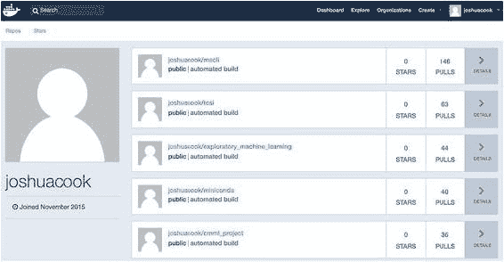

# 6. Docker Hub

约书亚·库克 (1) 美国加利福尼亚州圣莫尼卡

在掌握了开发自有镜像的工具后，能够将我们编写的镜像保存并分享到系统之外就变得至关重要。Docker 注册表（Docker Registries）正是为此而生。就你的需求而言，公共 Docker 注册表 Docker Hub 已经绰绰有余，不过值得注意的是，还有其他注册表存在，并且你也可以创建并托管自己的注册表。总体而言，Docker 注册表由三项技术组成：索引（Index）、注册表（Registry）和仓库（Repository）。在本文中，只需对这些技术如何交互有一个粗略的了解即可。索引跟踪与用户、组织、命名空间和仓库相关的元信息。仓库类似于 git 仓库，因为它跟踪一个项目（即一个 Docker 镜像）的多个版本。注册表则包含镜像以及构成仓库的仓库图谱。

## Docker Hub

Docker 注册表是一个可用于分发 Docker 镜像的服务器端应用程序。我们最感兴趣的是免费使用的公共 Docker 注册表——Docker Hub。Docker Hub 之于 Docker，某种程度上就像 GitHub 之于 Git。它允许我们使用现有的 Docker 仓库，也允许我们构建和托管自己的镜像。在绝大多数工作中，它将成为你唯一的 Docker 注册表，你可以从中发现要使用的镜像、管理镜像的开发，并在向生产就绪镜像迈进的过程中自动化构建流程。

### Docker Hub 的替代方案

两个最流行的替代公共注册表是 Quay.io 和 Google 容器注册表（Google Container Registry）。Quay.io 是由 CoreOS 运营的公共和私有注册表服务。CoreOS 是 Docker 的主要容器引擎替代品 `rkt` 的开发者。然而在过去一年中，CoreOS 和 Docker 似乎更像是盟友而非竞争对手，Quay.io 可以作为 Docker 和 `rkt` 定义镜像的注册表。Quay 提供了供组织和团队维护镜像的工具，以及工作流自动化工具，是 Docker Hub 的绝佳替代品。Google 是容器化技术的早期组织采用者，也是社区最受喜爱的工具之一——编排工具 Kubernetes 的起源地。毫不意外，Google 拥有自己的容器注册表，即 Google 容器注册表。就我们的目的而言，即数据科学领域，我们可能最感兴趣的是将 GCR 用作 Google 机器学习库 Tensorflow 内部镜像的托管地。

## Docker ID 与命名空间

为了利用 Docker Hub 提供的服务，你需要创建一个 Docker ID。可以通过 Docker Cloud 注册页面创建新的 Docker ID。创建 Docker ID 需要验证电子邮件。创建完成后，你的 Docker ID 也将成为你在 Docker Hub 上托管的所有镜像的主要命名空间。我的 Docker ID 是 `joshuacook`。如果我将第 4 章中创建的 `gsl` 镜像推送到 Docker Hub，该镜像将可通过命名空间/标签组合 `joshuacook/gsl` 访问。更一般地，托管在 Docker Hub 上的镜像的命名空间/标签将如代码清单 6-1 所示。

`<命名空间>/<仓库名称>:<标签>`

代码清单 6-1. Docker Hub 上镜像的通用命名空间/标签

如果你要使用非 Docker Hub 托管的镜像，例如代码清单 6-2 中的 Tensorflow GPU 镜像，则需要指定包含注册表地址的完整 URI，遵循代码清单 6-3 中概述的模式。

`gcr.io/tensorflow/tensorflow:latest-gpu`

代码清单 6-2. 最新 Tensorflow GPU 镜像的完整 URI

`<注册表地址>/<命名空间>/<仓库名称>:<标签>`

代码清单 6-3. 注册表托管镜像的通用 URI

## 镜像仓库

Docker Hub 上的仓库是一组具有相同用途、已构建并打上标签的 Docker 镜像的集合。访问我的用户页面，你可以看到我当前维护的所有 Docker 仓库（图 6-1）。每个仓库包含一个或多个先前定义并构建的镜像，这些镜像可以在本地构建，也可以通过 Docker Hub 的自动构建流程构建。



图 6-1. 我的 Docker Hub 用户资料

## 搜索现有仓库

如前所述，Docker Hub 注册表是 Docker CLI 使用的默认注册表。因此，使用 Docker CLI 通过 `docker search` 命令搜索 Docker Hub 中的相关镜像是一个简单的过程。通过 `docker search` 命令进行关键字搜索时，会针对镜像名称、用户、组织以及镜像描述进行匹配。在代码清单 6-4 中，你在 Docker Hub 上搜索 `miniconda` 镜像。

注意：镜像按星标数量降序返回。

```
$ docker search miniconda
名称                          描述                             星标数    官方      自动构建
continuumio/miniconda         强大且灵活的包管理...            38[OK]
alaindomissy/docker-miniconda docker-miniconda                    2[OK]
yamitzky/miniconda-neologd    Dockernized mecab-ipadic-NEolo...   2[OK]
show0k/alpine-miniconda       基于 Alpine 的镜像，包含 min...   1[OK]
kentwait/miniconda-mpi        用于开发...的 Docker 容器        1[OK]
pottava/miniconda             基于 Alpine... 的 Miniconda 镜像   1[OK]
```

代码清单 6-4. 在 Docker Hub 上搜索 `miniconda` 镜像

搜索结果中，搜索词 `miniconda` 既出现在名称中也出现在描述中。确定要使用的镜像后，你可以像第 3 章那样使用 `docker pull` 拉取该镜像（代码清单 6-5）。

```
$ docker pull continuumio/miniconda
使用默认标签：latest
latest: 正在从 continuumio/miniconda 拉取
8ad8b3f87b37: 拉取完成
090d0f0e845b: 拉取完成
3cc1bbd57a94: 拉取完成
bd7b36ac12a3: 拉取完成
摘要: sha256:f7e0a8a86a6d194e748c5884f53ddbbde33b08a666bed5370e453f35bbc3ec57
状态: 已下载 continuumio/miniconda:latest 的新镜像
```

代码清单 6-5. 拉取 `continuumio/miniconda` 镜像


