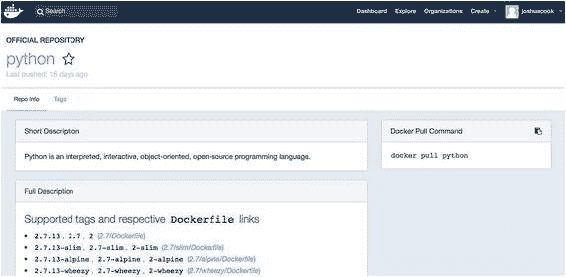
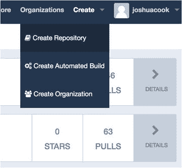
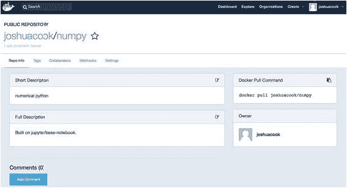
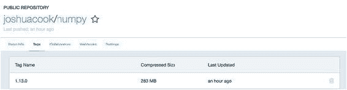

# 带标签的镜像

在 Python 社区中，Python 2 和 Python 3 之间存在着活跃、知名且友好的分歧。这意味着任何 Python 技术都必须能够同时在两个主要 Python 版本上运行。在你的个人电脑上，这是一项艰巨的任务，需要支持 Python 2 和 3 的包管理器，以及诸如 `virtualenv` 或 `conda` 提供的虚拟环境系统。使用 Docker，这项任务可以通过 Docker 镜像标签轻松管理。镜像标签定义了在单一命名空间和仓库组合下镜像定义的变体。标签没有语义含义，你的 Docker ID 或仓库名称也没有。它们仅用于区分对镜像所做的细微更改。可以通过以下三种方式之一为镜像添加标签：

1.  在构建时，只需将 `:<tag>` 附加到镜像名称的末尾即可为镜像添加标签（清单 6-6）。使用此方法，带标签的镜像将与特定的 `Dockerfile` 关联。
2.  之后可以使用 `docker tag` 命令为镜像添加标签（清单 6-7）。使用此方法，带标签的镜像将与特定的 `Dockerfile` 关联。
3.  可以使用 `docker commit` 命令将对容器所做的临时更改持久化为新镜像（清单 6-8）。使用此方法，将不存在描述对镜像所做临时更改的 `Dockerfile`。

```
$ docker build -t <namespace>/<repository_name>:<tag>
```

清单 6-6. 在构建期间为镜像添加标签

```
$ docker tag <existing_image> <namespace>/<repository_name>:<tag>
```

清单 6-7. 为现有本地镜像重新打标签

```
$ docker commit <existing_container> <namespace>/<repository_name>:<tag>
```

清单 6-8. 将容器的更改提交为带标签的镜像

你将在下一章中重新审视最后一点，作为维护镜像半持久性更改的最佳实践。

## Python 镜像上的标签

Python 镜像可以在 Python 的官方仓库页面上找到。访问“标签”选项卡，你可以看到与 Python 仓库关联的数十个标签的具体信息。Python 仓库使用镜像标签不仅管理 Python 2 和 Python 3 的分歧，还管理四个不同版本的 Python 3。从官方仓库页面，你可以链接到用于定义 Python 仓库中各个带标签镜像的 `Dockerfile`（见图 6-2）。



图 6-2. Python 官方仓库页面

## 官方仓库

Docker 为主要开源技术维护了一套精选的 Docker 镜像。这些官方仓库是使用编写 `Dockerfile` 的既定最佳实践设计的（并且很可能由 tianon 维护）。你在 Python 官方仓库中看到了第一个官方仓库。除了 `jupyter` 镜像（你将其视为官方仓库）之外，你几乎总是使用官方仓库作为你的基础镜像。

## 推送到 Docker Hub

为了演示推送到 Docker Hub 的过程，你将创建一个新镜像 `numpy-notebook`。此镜像将使用 `jupyter/base-notebook` 镜像作为基础，并添加 `numpy`。回想一下，`jupyter/base-notebook` 镜像仅包含 Python 3。你只会为 Python 3 添加 `numpy`。

注意：在第 5 章中，你通过设置一个通过 git 和 GitHub 跟踪的项目来配置系统进行本地开发。这是一个最佳实践。在本章中，你不会为创建镜像而遵循此实践。这并非因为这不是一个好习惯，而是因为我希望强调使用 Docker Hub 与使用 git 是独立的。

在清单 6-9 中，你创建了一个新的本地目录来存放你的项目，以及一个子目录来作为新镜像的上下文。

```
$ mkdir ch_6_dockerfiles && cd ch_6_dockerfiles
$ mkdir numpy
```

清单 6-9. 创建新的本地目录和上下文子目录

在清单 6-10 中，你创建了一个新的 `Dockerfile`（如清单 6-11 所示）。新镜像是使用 `jupyter/base-notebook` 镜像作为基础来定义的。为了安装 `numpy`，你短暂地将镜像的 `USER` 切换为 `root`。你使用 `conda` 安装 `numpy`，然后切换回 `USER jovyan`。

注意：你切换到用户 `root` 来安装库，并在完成后切换回用户 `jovyan`。这被认为是最佳实践，并确保你不会以过多的系统权限运行笔记本服务器。更多内容请参见第 7 章。

```
$ vi numpy/Dockerfile
```

清单 6-10. 创建新的 `Dockerfile`

```
FROM jupyter/base-notebook
USER root
RUN conda install --yes numpy
USER jovyan
```

清单 6-11. numpy 的 `Dockerfile`

在清单 6-12 中，你使用 `docker build` 命令构建 `numpy` 镜像。请注意，术语 `numpy` 在命令中出现了两次。第一个（`-t numpy`）指的是你赋予镜像的标签或名称。第二个，即命令中的最后一个词，指的是相对引用的构建上下文，在本例中是名为 `numpy` 的子目录。

```
$ docker build -t numpy numpy
Sending build context to Docker daemon  2.048kB
Step 1/4 : FROM jupyter/base-notebook
...
Step 2/4 : USER root
...
Step 3/4 : RUN conda install numpy
...
Step 4/4 : USER jovyan
...
Successfully built 2570ccf8069f
Successfully tagged numpy:latest
```

清单 6-12. 构建 `numpy` 镜像

在清单 6-13 中，你使用刚构建的 `numpy` 镜像运行 `ipython` REPL，作为测试安装的一种方式。在完成一个简单的计算后，你使用 `Ctrl+D` 退出容器化进程。

```
$ docker run -it numpy ipython
Python 3.6.1 | packaged by conda-forge | (default, May 23 2017, 14:16:20)
Type 'copyright', 'credits' or 'license' for more information
IPython 6.1.0 -- An enhanced Interactive Python. Type '?' for help.

In [1]: import numpy as np

In [2]: u = np.array((1,2))

In [3]: np.linalg.norm(u)
Out[3]: 2.2360679774997898

In [4]: Do you really want to exit ([y]/n)?
```

清单 6-13. 从 `numpy` 镜像运行 `ipython`

### 创建新仓库

可以通过 Docker Hub 用户配置文件创建新仓库（见图 6-3）。系统将提示你为仓库指定名称、简短描述和完整描述。你还会被问到仓库应该是公开的还是私有的。默认情况下，新仓库将是公开的。



图 6-3. 创建新仓库

再次强调，赋予仓库的名称没有语义含义。关于描述，你应该记得，在描述中输入的关键字会被 `docker search` 功能找到。

注意：你也可以选择在你拥有适当权限的任何组织中创建仓库。

你创建一个名为 `numpy` 的新仓库，其简短描述为“数值 Python”，完整描述为“基于 `jupyter/base-notebook` 构建”。新仓库如图 6-4 所示。



图 6-4. 新的 `joshuacook/numpy` 仓库

### 推送镜像

你可能希望推送你在 `numpy` 镜像上所做的工作。按照第 5 章讨论的方式创建的本地镜像，只要其命名符合 `<命名空间>/<仓库名称>:<标签>` 模式，就可以轻松推送到 Docker Hub。为了推送你的工作，首先通过 `docker images` 命令（列表 6-14）重新查看系统上的镜像状态，特别是检查你刚刚创建的 `numpy` 镜像。

```
$ docker images
REPOSITORY       TAG       IMAGE ID        CREATED           SIZE
numpy            latest    2570ccf8069f    33 minutes ago    925MB
jupyter/         latest    161472bc6c75    2 weeks ago       657MB
base-notebook
debian           latest    47af6ca8a14a    2 weeks ago       125.1 MB
miniconda3       latest    5865a6cfa8c2    2 weeks ago       1.64 GB
```

*列表 6-14. 显示本地镜像*

注意：你的镜像都没有命名空间或标签。同样，有三种方式可以为镜像添加标签：1) 构建时使用 `docker build`，2) 构建后使用 `docker tag`，3) 通过 `docker commit` 将容器的更改提交为镜像。在列表 6-15 中，你使用 `docker tag` 命令为 `numpy` 镜像添加了标签和命名空间。

```
$ docker tag numpy joshuacook/numpy:1.13.0
```

*列表 6-15. 为镜像添加标签*

在列表 6-16 中，你再次显示本地镜像。

```
$ docker images
REPOSITORY     TAG        IMAGE ID        CREATED           SIZE
numpy          latest     2570ccf8069f    34 minutes ago    925MB
joshuacook/    1.13.0     2570ccf8069f    34 minutes ago    925MB
numpy
jupyter/       latest     161472bc6c75    2 weeks ago       657MB
base-notebook
debian         latest     47af6ca8a14a    2 weeks ago       125.1MB
miniconda3     latest     5865a6cfa8c2    2 weeks ago       1.64GB
```

*列表 6-16. 显示本地镜像*

现在你有了一个镜像，其命名空间/仓库组合为 `joshuacook/numpy`，标签为 `1.13.0`。注意它与 `numpy` 镜像具有相同的镜像 ID。Docker 并没有存储两个相同的镜像，而是维护了指向同一镜像的两个引用。为了推送到 Docker Hub，你必须通过 Docker CLI 使用 `docker login` 登录（列表 6-17）。

```
$ docker login
Login with your Docker ID to push and pull images from Docker Hub. If you don't have a Docker ID, head over to https://hub.docker.com to create one.
Username (joshuacook):
Password:
Login Succeeded
```

*列表 6-17. 登录 Docker Hub*

一旦你正确标记了镜像并登录，就可以使用 `docker push` 命令（列表 6-18）。

```
$ docker push joshuacook/numpy:1.13.0
The push refers to a repository [docker.io/joshuacook/numpy]
2bcb5be18c74: Pushed
72c56d765cf2: Mounted from jupyter/base-notebook
317e6c337ef3: Mounted from jupyter/base-notebook
1a2fceb0b4da: Mounted from jupyter/base-notebook
c65670cc3813: Mounted from jupyter/base-notebook
52b6625b711f: Mounted from jupyter/base-notebook
93329dd321d3: Mounted from jupyter/base-notebook
7c10c4ddeab0: Mounted from jupyter/base-notebook
290b555a5673: Mounted from jupyter/base-notebook
6b538a724de5: Mounted from jupyter/base-notebook
f02f8903fe33: Mounted from jupyter/base-notebook
406306ca7a80: Mounted from jupyter/base-notebook
cff5883220e6: Mounted from jupyter/base-notebook
d17d48b2382a: Mounted from jupyter/base-notebook
1.13.0: digest: sha256:ccd8f21923c7538ae7a4d0606e203dce072d601494e570cf4c3d1d08ca7a84e2 size: 3246
```

*列表 6-18. 将 ipython 镜像推送到 Docker Hub*

### 从 Docker Hub 拉取镜像

你可以通过从 Docker Hub 拉取镜像来验证推送是否成功。当然，如果你本地已有该镜像，那么在请求该镜像时会使用本地缓存的镜像。为了测试是否成功，你首先使用 `docker inspect` 命令检查本地镜像的内容，以便用于验证（列表 6-19）。你需要关注 `inspect` 命令返回的 JSON 中的 `"RootFS"` 键，因为它提供了与镜像关联的每个层的 sha256 描述¹⁰。

```
$ docker inspect joshuacook/numpy:1.13.0
...
        "RootFS": {
            "Type": "layers",
            "Layers": [
                "sha256:d17d48b2382adda1fd94284c51d725f0226bf20b07f4d29ce09596788bed7e8e",
                "sha256:cff5883220e61c711e6345366431e2eb28d8b408ae02c21c1356797932379f7f",
                "sha256:406306ca7a8025fd3430c01289c18e5ed18f0a144e7b6f1bc592ad38817f52a3",
                "sha256:f02f8903fe334cbe7184c6d57fc08e6b5d26b607fce64c090c079d2a996f14a3",
                "sha256:6b538a724de5d6ecdbfa4583dc34a228a46c3ee0c4d309a481e9dfad675de380",
                "sha256:290b555a56733ef2f2a005e6c7a3c38d894674239aed477729092687c414015d",
                "sha256:7c10c4ddeab02a978638181a43ac67d43036fc6bf67e9888544debbd63aa11b3",
                "sha256:93329dd321d38f8394e015b422cf3680be1de5568f7248a3b635df329b2fe47b",
                "sha256:52b6625b711fbf05039b819e2d13161f5c36c1909ad61779efedae05a5fdc51c",
                "sha256:c65670cc38137214111c9e1587cb200e32e74de13fc2957752d6354f75da6278",
                "sha256:1a2fceb0b4daff636aa021a223b46c308a94e52f084c9feea395b68f672be6cb",
                "sha256:317e6c337ef3c57618c38257236cc02e254f2f8d499249fbc040208f25c360d9",
                "sha256:72c56d765cf2ae7ce7626b5a35bf0eba94f8c49b1a8d894b999949846b2ded71",
                "sha256:2bcb5be18c742a706f4667ce18b59e45d777e01d2423aac3c035c0d2831e34fc"
            ]
        }
...
```

*列表 6-19. 检查 ipython 镜像*

你将使用这些层描述，在从 Docker Hub 拉取镜像后与镜像进行验证。接下来，你尝试从本地缓存中删除 `joshuacook/ipython:3.6` 镜像（列表 6-20）。

```
$ docker rmi numpy
Untagged: numpy:latest
$ docker rmi joshuacook/numpy:1.13.0
Error response from daemon: conflict: unable to remove repository reference "joshuacook/numpy:1.13.0" (must force) - container 817ba39439d7 is using its referenced image 2570ccf8069f
```

*列表 6-20. 从本地缓存中删除镜像*

在此过程中，你看到了一个错误。这个错误表明一个已停止的容器正在使用该镜像。你必须先删除这个已停止的容器，才能删除镜像。你首先通过 `-a` 标志（显示所有）和 `docker ps` 命令显示已停止的容器（列表 6-21）。

```
$ docker ps -a
CONTAINER ID   IMAGE          COMMAND          CREATED     STATUS                 NAMES
817ba39439d7   "tini -- ipyth"   29 min...   Exited (0) 28 min...   gifted_clarke2570ccf8069f
fd66407a5358   "tini -- ipyth"   38 min...   Exited (0) 36 min...   peaceful_ 2570ccf8069f
                                                                   ardinghelli
...
```

*列表 6-21. 显示所有容器*

两个已停止的容器引用了镜像 `f9a032f0a9a5`，即你的本地 ipython 镜像。你必须删除它们全部（列表 6-22）。

```
$ docker rm 817ba39439d7 fd66407a5358 fd66407a5358 fd66407a5358
```

*列表 6-22. 删除所有已停止的 ipython 容器*

现在你可以删除本地缓存的镜像了（列表 5-23）。

```
$ docker rmi joshuacook/ipython:3.6
Untagged: joshuacook/numpy:1.13.0
Untagged: joshuacook/numpy@sha256:ccd8f21923c7538ae7a4d0606e203dce072d601494e570cf4c3d1d08ca7a84e2
Deleted: sha256:2570ccf8069f2333fc3c52cdeca9890dd4cb6b7a27ee7752aa97d8a2bc4e1bf6
Deleted: sha256:b66f2cee6b59bb573462448ee4766890737e74523fa3d14b99a418c57a1e67f1
Deleted: sha256:fe5d8ad29a14a9f6405de89aa47ef8c511965aff9d8b20cbeeffe34ee6fe6f19
Deleted: sha256:eddb59d7cee362460c5d62be665d004d008f724a3e65ad44ad1129cfb86f3f61
```

*列表 6-23. 从本地缓存中删除镜像*

现在你从 Docker Hub 拉取镜像以验证其内容（列表 6-24）。

```
$ docker pull joshuacook/numpy:1.13.0
1.13.0: Pulling from joshuacook/numpy
693502eb7dfb: Already exists
490c0d36e714: Already exists
b47c251cda4e: Already exists
5f06af7aed8b: Already exists
6486d270a020: Already exists
825ae89ffbbc: Already exists
0eb855700e1f: Already exists
3ea165122423: Already exists
57f4c53afea9: Already exists
960ee91f3ec0: Already exists
d685ecb69227: Already exists
86a69e035999: Already exists
166ce3ece426: Already exists
9c7191cb9c0e: Pull complete
Digest: sha256:ccd8f21923c7538ae7a4d0606e203dce072d601494e570cf4c3d1d08ca7a84e2
Status: Downloaded newer image for joshuacook/numpy:1.13.0
```

*列表 6-24. 从 Docker Hub 拉取 ipython 镜像*

你再次运行 `docker inspect` 命令（列表 6-25）。

# 镜像检查与Docker Hub

拉取镜像后，我们可以使用 `docker inspect` 命令来检查 `joshuacook/numpy` 镜像的层信息。

```
$ docker inspect joshuacook/numpy:1.13.0
...
        "RootFS": {
            "Type": "layers",
            "Layers": [
                "sha256:d17d48b2382adda1fd94284c51d725f0226bf20b07f4d29ce09596788bed7e8e",
                "sha256:cff5883220e61c711e6345366431e2eb28d8b408ae02c21c1356797932379f7f",
                "sha256:406306ca7a8025fd3430c01289c18e5ed18f0a144e7b6f1bc592ad38817f52a3",
                "sha256:f02f8903fe334cbe7184c6d57fc08e6b5d26b607fce64c090c079d2a996f14a3",
                "sha256:6b538a724de5d6ecdbfa4583dc34a228a46c3ee0c4d309a481e9dfad675de380",
                "sha256:290b555a56733ef2f2a005e6c7a3c38d894674239aed477729092687c414015d",
                "sha256:7c10c4ddeab02a978638181a43ac67d43036fc6bf67e9888544debbd63aa11b3",
                "sha256:93329dd321d38f8394e015b422cf3680be1de5568f7248a3b635df329b2fe47b",
                "sha256:52b6625b711fbf05039b819e2d13161f5c36c1909ad61779efedae05a5fdc51c",
                "sha256:c65670cc38137214111c9e1587cb200e32e74de13fc2957752d6354f75da6278",
                "sha256:1a2fceb0b4daff636aa021a223b46c308a94e52f084c9feea395b68f672be6cb",
                "sha256:317e6c337ef3c57618c38257236cc02e254f2f8d499249fbc040208f25c360d9",
                "sha256:72c56d765cf2ae7ce7626b5a35bf0eba94f8c49b1a8d894b999949846b2ded71",
                "sha256:2bcb5be18c742a706f4667ce18b59e45d777e01d2423aac3c035c0d2831e34fc"
            ]
        }
...
```

*列表 6-25. 成功拉取后检查 numpy 镜像*

请注意，拉取后镜像层的 sha256 描述与拉取前层的描述一致。值得注意的是，拉取过程相当简单，只需要从 Docker Hub 获取一个层。这是因为你的 `numpy` 镜像的大部分层都存在于 `jupyter/base-notebook` 镜像中。你正是以 `jupyter/base-notebook` 镜像为基础构建了你的 ipython 镜像！这一事实可以通过检查 `jupyter/base-notebook` 镜像来验证（列表 6-26）。

```
$ docker inspect jupyter/base-notebook
...
        "RootFS": {
            "Type": "layers",
            "Layers": [
                "sha256:d17d48b2382adda1fd94284c51d725f0226bf20b07f4d29ce09596788bed7e8e",
                "sha256:cff5883220e61c711e6345366431e2eb28d8b408ae02c21c1356797932379f7f",
                "sha256:406306ca7a8025fd3430c01289c18e5ed18f0a144e7b6f1bc592ad38817f52a3",
                "sha256:f02f8903fe334cbe7184c6d57fc08e6b5d26b607fce64c090c079d2a996f14a3",
                "sha256:6b538a724de5d6ecdbfa4583dc34a228a46c3ee0c4d309a481e9dfad675de380",
                "sha256:290b555a56733ef2f2a005e6c7a3c38d894674239aed477729092687c414015d",
                "sha256:7c10c4ddeab02a978638181a43ac67d43036fc6bf67e9888544debbd63aa11b3",
                "sha256:93329dd321d38f8394e015b422cf3680be1de5568f7248a3b635df329b2fe47b",
                "sha256:52b6625b711fbf05039b819e2d13161f5c36c1909ad61779efedae05a5fdc51c",
                "sha256:c65670cc38137214111c9e1587cb200e32e74de13fc2957752d6354f75da6278",
                "sha256:1a2fceb0b4daff636aa021a223b46c308a94e52f084c9feea395b68f672be6cb",
                "sha256:317e6c337ef3c57618c38257236cc02e254f2f8d499249fbc040208f25c360d9",
                "sha256:72c56d765cf2ae7ce7626b5a35bf0eba94f8c49b1a8d894b999949846b2ded71"
            ]
        }
...
```

*列表 6-26. 检查 jupyter/base-notebook 镜像*

**注意：** 构成 `jupyter/base-notebook` 镜像的十三个层正是 `numpy` 镜像的十三个层。

### Docker Hub 上的标签镜像

最后，我们来访问与你的 `numpy` 仓库关联的 Docker Hub 页面上的“标签”选项卡（图 6-5）。在这里，你可以看到你推送的那个带标签的镜像确实在 Docker Hub 上可用。

 图 6-5. `joshuacook/numpy` Docker Hub 页面

### 总结

在本章中，你了解了如何使用 Docker Hub 作为你构建的镜像的云端存储。你学习了镜像的多个版本，了解了如何使用标签来跟踪 Python 社区镜像的多个版本。你创建了一个新镜像，用于使用以 `jupyter/base-notebook` 镜像为基础构建的 `numpy` 库，用当前版本的 `numpy` 为其打上标签，并将其推送到你的 Docker Hub 账户。学完本章后，我希望你已经熟悉了从 `Dockerfile` 创建新镜像的过程，并知道如何将你创建的镜像推送到 Docker Hub。

脚注 1 [`hub.docker.com/`](http://hub.docker.com/) 2 [`quay.io/`](http://quay.io/) 3 [`gcr.io/`](http://gcr.io/) 4 [`coreos.com/rkt`](https://coreos.com/rkt) 5 [`www.tensorflow.org/`](http://www.tensorflow.org/) 6 [`cloud.docker.com/`](https://cloud.docker.com/) 7 然而，最新版本的 `IPython` 不支持 Python 2（ [`ipython.readthedocs.io/en/stable/`](http://ipython.readthedocs.io/en/stable/) ）。 8 [`hub.docker.com/_/python/`](https://hub.docker.com/_/python/) 9 [`github.com/tianon`](https://github.com/tianon) 10 [`en.wikipedia.org/wiki/SHA-2`](https://en.wikipedia.org/wiki/SHA-2) © Joshua Cook 2017 Joshua Cook Docker for Data Science [`doi.org/10.1007/978-1-4842-3012-1_7`](https://doi.org/10.1007/978-1-4842-3012-1_7)